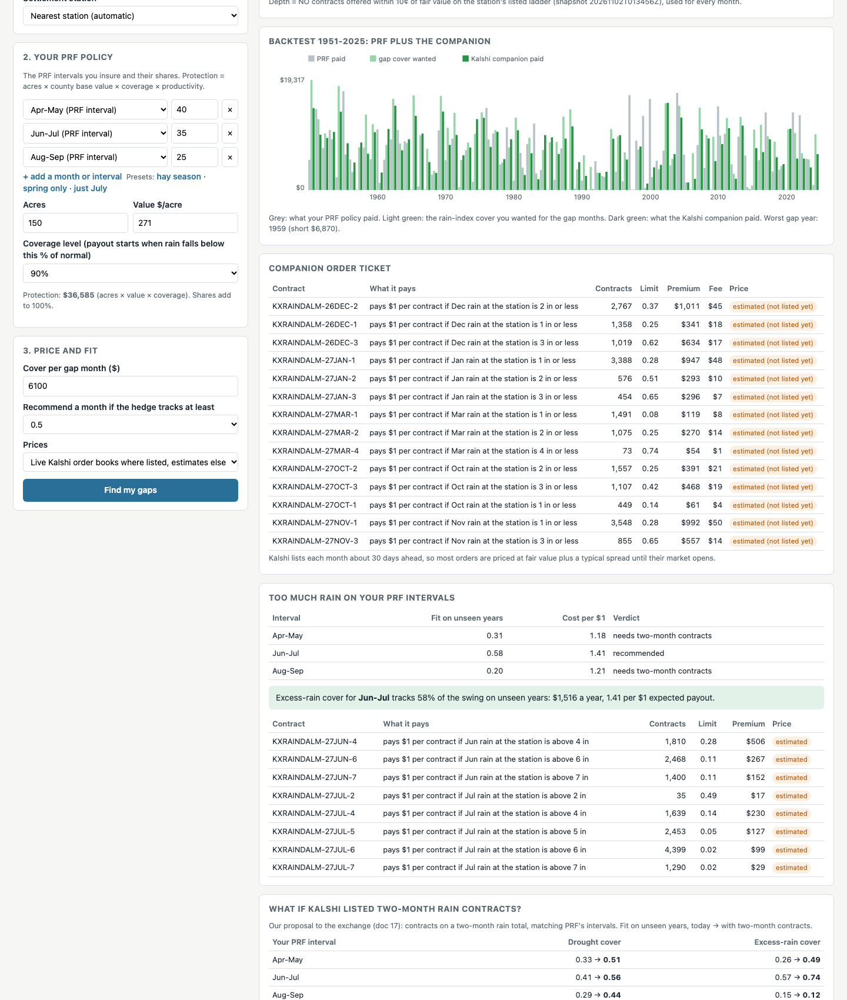

# Milestone II: Contract Design & Platform Architecture

**Team:** Maya, Evan, Jack  |  **Due:** 2026-11-12  |  **Built:** 2026-11-05 on branch `milestone-2`

Write-up for submission: [milestone2/milestone2.tex](milestone2/milestone2.tex) (Overleaf-ready, figures in `milestone2/figures/`), compiled as [milestone2/milestone2.pdf](milestone2/milestone2.pdf).

## Showcase: the PRF Companion ([doc 21](analysis/21_prf_companion.md), demo guide [DEMO.md](DEMO.md))

Keep your USDA rainfall insurance (PRF), and use Kalshi weather contracts to cover the months it leaves open. The app scores each open month at the rancher's location, recommends the months a Kalshi hedge tracks well, builds one order, and backtests it next to PRF's payouts.

- Recommended for **9 of 11** farms. Median hedge effectiveness (HE) on unseen years is **0.66**, against 0.38 for hedging PRF's own intervals.
- Holdout with no peeking (months chosen and fit on 1951-2000, scored on 2001-2025): **0.61 vs 0.23**. The companion wins on 7 of 10 farms.
- December, November and January carry it. At 60 random grids, 60% of locations get at least one recommended month.
- What limits it now is liquidity ([doc 22](analysis/22_making_it_better.md)). Today's books fill about a fifth of the cover at good fit, and 5-10x more depth fills it all. The app sizes orders to the book, offers excess-rain cover where it tracks, and shows each rancher what two-month contracts would add.
- Run `python scripts/run_app.py` and open `http://localhost:8473/?demo`.



## How it was built

This milestone follows the Milestone II table and the "Refinements to our plan" section of the submitted Milestone I update (Overleaf project `ECE473 Project`, files `main.tex`/`revision.tex`, read 2026-11-05). Those match the proposal's Milestone II tasks, and add three refinements: complement PRF (cover above its 90% cap, uncovered months, excess rain), look beyond binary payouts, and backtest on the CPC index PRF actually paid. The refinements are covered in doc 20. All results use the 11 representative farms, their 2026 PRF elections and the NCEI-based PRF index (1951-2025). HE (hedge effectiveness) is reported out of sample (leave one year out).

| Proposal cell | Owner | Deliverable | Headline |
|---|---|---|---|
| W4 Optimizer: lowest-error / lowest-cost portfolio | Jack | [analysis/15_hedge_optimizer.md](analysis/15_hedge_optimizer.md), `optimizer.py`, `hedge_builder.py` | Efficient frontier with fees, capital and depth. The 90% "knee" is 22% cheaper than the lowest-error hedge with the same out-of-sample HE (0.36 vs 0.37). |
| W4 Decompose the hedge error | Maya | [analysis/16_error_budget.md](analysis/16_error_budget.md), `error_budget.py` | HE 1.00 to 0.17: geography -0.35, settlement source -0.13, monthly contracts -0.19, whole-inch strikes ~0, order-book depth -0.16, capital -0.01. |
| W4 Exposures that fail; new contracts and mechanisms | Evan | [analysis/17_contract_gaps_and_proposals.md](analysis/17_contract_gaps_and_proposals.md) | 3 of 36 windows replicable today. Two-month contracts: 0.34 to 0.48. Grid-index binaries: 0.98 (but that is unsubsidized PRF). Depth needed: 5-28x today's book. |
| W5 Live-price backend | Jack | [analysis/18_platform.md](analysis/18_platform.md), `platform.py` | Live Kalshi books (public API, 60 s cache, snapshot fallback), month-roll and sensible-price rules, order ticket, automatic station choice. |
| W5 Farmer screen | Maya | [analysis/18_platform.md](analysis/18_platform.md), `webapp/` | Map + months + cover → verdict, frontier, 75-year backtest, ticket, PRF comparison, live market check. `python scripts/run_app.py`. |
| Refinements from the M1 update: complement PRF, non-binary payouts, CPC as-paid backtest | team | [analysis/20_complementing_prf.md](analysis/20_complementing_prf.md) | Uncovered months (Nov-Feb) hedge best: median HE 0.52, Dec 0.68. Top-up above 90% copies poorly (0.14). Excess rain needs two-month contracts (0.22 to 0.40). CPC as paid gives the same picture, slightly lower. |
| Showcase: PRF Companion | team | [analysis/21_prf_companion.md](analysis/21_prf_companion.md), `platform.companion`, app tab | 9 of 11 farms; HE 0.66 (LOYO), 0.61 on the 2001-2025 holdout, vs 0.38 / 0.23 for hedging PRF intervals. |
| W5 Test the app vs USDA | Evan | [analysis/19_app_test.md](analysis/19_app_test.md) | App matches the analysis exactly. Hedges cost 1.71x PRF producer premiums (median), median HE 0.38. HE 0.47 within 25 mi of a station, 0.15 beyond 100 mi. |

## What we learned

1. **The binding problems are where rain is measured, how long the contract window is, and who takes the other side.** Strike binning, flagged first in Milestone I, does not matter out of sample.
2. **Out-of-sample testing changes the answer.** In-sample fits overstate hedge quality by about 40%. A budget acts as regularization.
3. **Fixes in order of practicality:**
   - two-month contracts (no new data source);
   - ladders listed 6-12 months ahead;
   - a drought-side market maker or pooled orders;
   - contracts on a gridded rain index (near-perfect, but PRF without the subsidy).
4. **The best complement to PRF is the months it leaves uncovered.** Cool-season single-month cover near a station tracks well (doc 20).
5. **Who the platform can serve today:** producers within about 25-50 miles of a Kalshi rain station, in spring or fall windows, who want cover PRF does not offer (single months, above PRF caps, fast settlement, no PRF eligibility).

## Reproduce

```bash
.venv/bin/python -m pytest                       # 353 tests
.venv/bin/python scripts/run_optimizer.py        # doc 15 (about 2 min)
.venv/bin/python scripts/run_error_budget.py     # docs 16-17 (under 1 min)
.venv/bin/python scripts/run_prf_gaps.py         # doc 20 (under 1 min)
.venv/bin/python scripts/run_companion_study.py  # doc 21 (about 6 min)
.venv/bin/python scripts/run_companion_holdout.py  # doc 21 holdout (about 1 min)
.venv/bin/python scripts/run_companion_improve.py  # doc 22 (about 5 min)
.venv/bin/python scripts/run_app_test.py --live  # doc 19 (about 5 min; --live needs internet)
.venv/bin/python scripts/run_app.py              # the app, http://localhost:8473 (?demo runs the PRF Companion, ?demo=custom the custom hedge)
```

## Relation to the 2026-11-02 pivot discussion

On 2026-11-02 the team discussed moving away from the PRF replication (see the overview). Milestone II was still built as planned in the submitted Milestone I. Its results are the evidence for that decision: replicating PRF with today's Kalshi contracts is costly and loose, and it would only work with new contract designs. The tools themselves are reusable for any direction: the optimizer, the live-price backend and the app all take any target payout.
