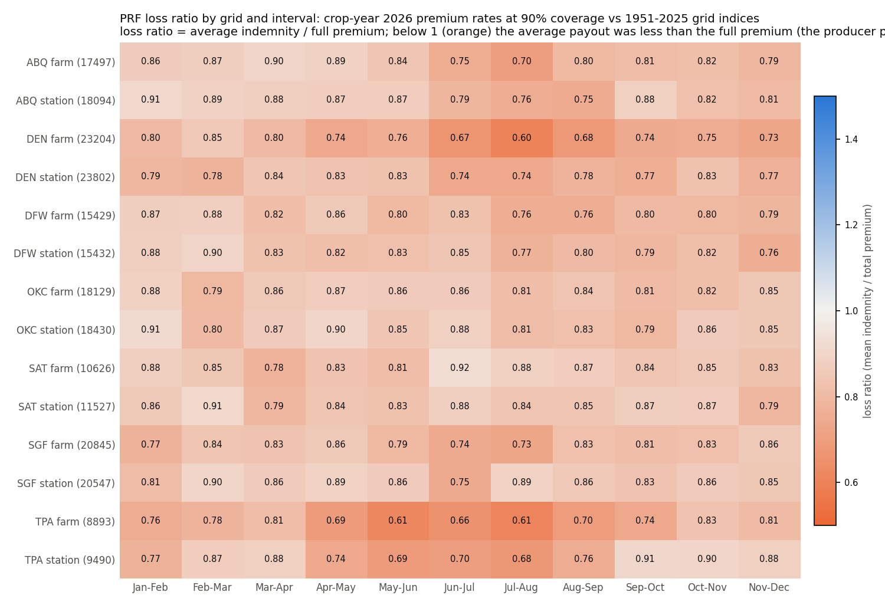
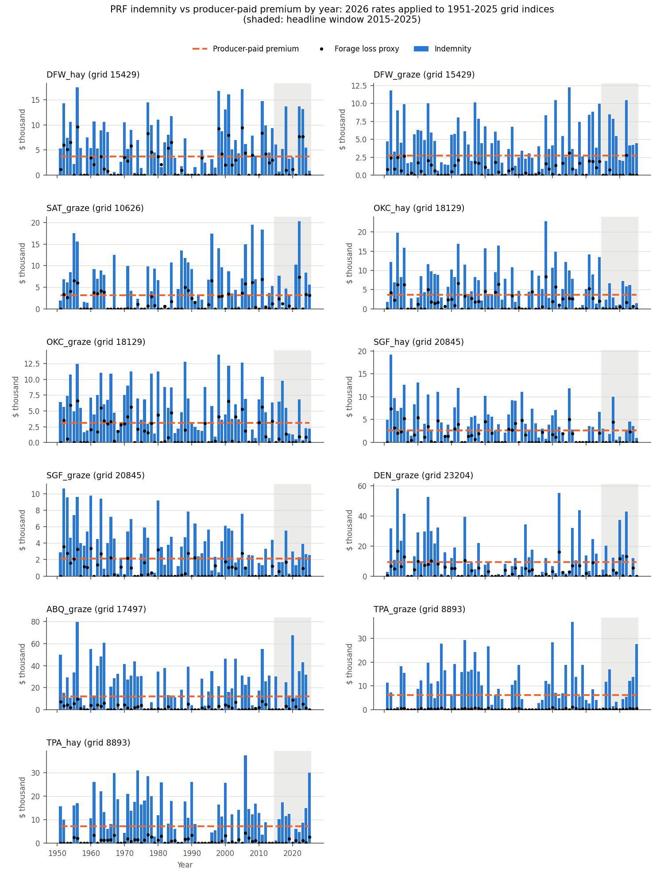
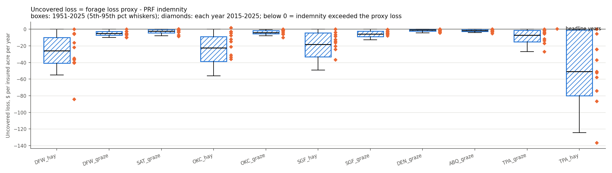
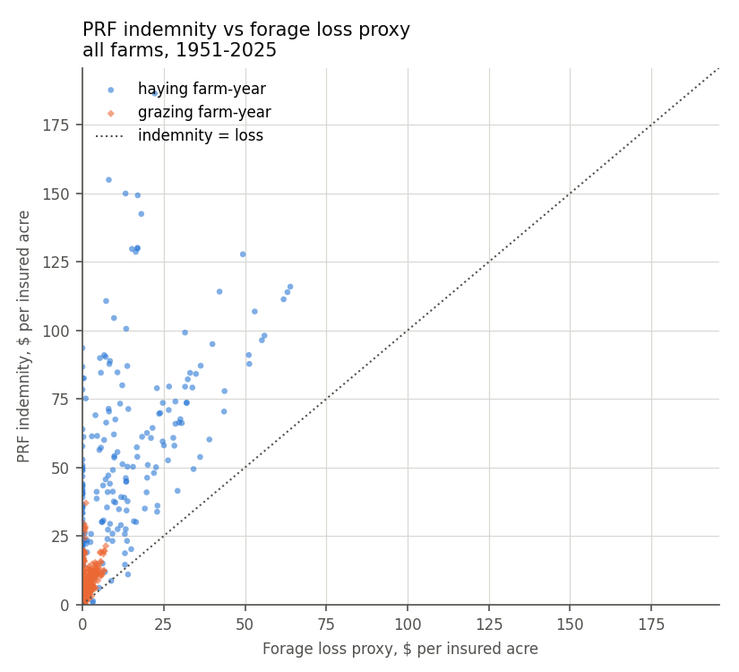

# PRF farm scenarios: premiums, payouts, and uncovered losses

**Proposal cell:** Week 1 / Evan ("Build example farmer scenarios showing the premiums, potential payouts, and uncovered losses under the USDA policy")  |  **Status:** DRAFT (calculator, actuarial data, grid analysis, and first farm results done; farm results use the 11 representative farms in `data/scenarios/farms.yaml` as of 2026-10-29)  |  **Last updated:** 2026-10-29

This document covers three things: (1) the PRF premium and indemnity calculator in
`src/agri_hedge/prf.py` and the policy rules it implements, (2) the 2025 and 2026 actuarial data
(premium rates, county base values, subsidy) for our 14 study grids, and (3) the farm-scenario
runner `scripts/run_scenarios.py` and its results for the 11 representative farms defined in
`data/scenarios/farms.yaml` (see `docs/research/04_representative_farms.md`).

## Key findings

- **The calculator reproduces RMA's own numbers exactly.** It matches every number in the
  handbook's worked example (FCIC-18150 Exhibit 5): 8 unit protections, 8 unit premiums, $10,692
  total protection, $1,114 premium, $568 subsidy, $546 producer premium, 10 unit indemnities, and
  the three scenario totals of $167, $1,332, and $1,705. It also matches 7 live calls to RMA's PRF
  Decision Support Tool and 73 payment factors that RMA published in the Actuarial Data Master
  (36 tests in `tests/test_prf.py`, no network needed). Interval codes are confirmed as 625 =
  Jan-Feb through 635 = Nov-Dec (ADM table A00480; handbook Exhibit 5), so
  `prf_intervals.VERIFIED` is now `True`.
- **The policy text has no rounding rule. RMA's published data does.** In the Actuarial Data
  Master, the payment factor (trigger - final index) / trigger is rounded half-up to 3 decimals.
  For example, 0.3025 is published as 0.303. RMA's Decision Support Tool instead uses the unrounded
  factor and rounds protection per acre to the cent. The two conventions differ by a few dollars
  per unit. Both are implemented (`rounding="official"` and `rounding="dst"`).
- **Premium rates depend only on the grid, the interval, and the coverage level.** For our 14
  grids, the 2026 rate at 90% coverage averages 0.200 per dollar of protection (range 0.068 to
  0.316). Rates are the same for grazing and haying and for every county that shares a grid. They
  moved by an average of 1.25% from 2025 to 2026. Producers pay 41-49% of the premium, because
  the federal subsidy is 59% at 70-75% coverage, 55% at 80-85%, and 51% at 90%. Each interval must
  get at least 10% of the policy value. The maximum per interval is 50% in TX, NM, and FL and 60%
  in OK, MO, and CO.
- **County base values (CBV) vary 3-4x across our farm counties and did not change from 2025 to
  2026.** Grazing ranges from $11.50/acre (Torrance Co., NM) to $50.30/acre (Hardee Co., FL).
  Non-irrigated haying ranges from $113/acre (Atascosa Co., TX) to $333/acre (Hardee Co., FL).
- **Long-run payouts are below the full premium in every grid and interval.** Applying 2026 rates
  to the 1951-2025 grid indices at 90% coverage, the average indemnity is 0.82 of the full
  premium across 14 grids x 11 intervals, and none of the 154 grid-intervals exceeds 1.0. The
  producer pays only 49% at 90% coverage, so the average producer got back about $1.67 per $1 of
  premium paid (0.82 / 0.49). The 2015-2025 figure is 0.79.
- **The index history we use is not the one RMA paid on.** The history in
  `prf_official_index.csv` comes from the Decision Support Tool, which is now based on NOAA NCEI
  data. We compared it with the official final grid indices in ADM (NOAA CPC based) for 854
  grid-interval-years in 2021-2026. The mean absolute difference is 12.6 index points, the largest
  is 96.9, and the correlation is 0.93. In 10.7% of cases the two disagree on whether a 90%
  trigger would have paid. The farm-level gap is large: over 2021-2025, TPA_graze would have been
  paid $26,989 per year on the official indices but $12,735 on the file, and DEN_graze $6,444 vs
  $13,807.
- **All 11 representative farms came out ahead over the long run.** With 2026 rates on the
  1951-2025 indices, the average producer premium is $2,132 to $12,120 per year ($1.01 to $36.51
  per acre). The average indemnity is $3,566 to $21,608 per year. Loss ratios are 0.70-0.86, at
  least one interval paid in 76-96% of years, and the average net gain to the producer is $1,434
  to $9,488 per year. The 2015-2025 headline window was weaker for the Oklahoma and Missouri farms:
  their loss ratios were 0.44-0.52, and the two hay farms lost money on average (-$400 per year
  for OKC_hay, -$93 for SGF_hay).
- **For grazing farms, PRF pays far more than the forage-loss proxy.** The proxy values grazing at
  the county's pasture cash rent. Protection per acre (CBV x coverage x productivity factor) is
  1.5 to 8.6 times that rent, so over 1951-2025 indemnities are 1.7 to 10.3 times the proxy loss,
  and the mean uncovered loss is negative for every grazing farm. The four hay farms value hay at
  yield x price, which is within a factor of 1.1-1.6 of CBV x productivity factor. For them,
  indemnities are 1.3-2.0 times the proxy loss, but uncovered loss is still positive in 7-29% of
  years, with a 90th percentile of $0-$2,572 per year.
- **How much is left uncovered depends mostly on assumptions, not on the policy.** If forage is
  valued at the PRF protection basis (CBV x productivity factor), mean uncovered loss is close to
  zero for every farm (-$1,537 to +$738 per year), but its 90th percentile is $1,802 to $24,734
  per year. That tail is the deductible plus payout-timing gap a top-up hedge could target. The
  results also depend on whether a wet interval can offset a dry one (the no-offset column).
- **The 2027 PRF rules (released August 2026) add a stocking-rate requirement for grazing:**
  livestock equal to at least 25% of an average stocking rate (27-RI-PRF section 4(j)). The 2026
  analysis here does not model it.

## Numbers table

ADM = RMA Actuarial Data Master, https://pubfs-rma.fpac.usda.gov/pub/References/actuarial_data_master/ (crop-year folders 2021-2026; files `<year>_ADM_Filing_0831.zip` and `<year>_ADM_YTD.zip`). HB = FCIC-18150 Rainfall Index Handbook 2026. BP = Rainfall Index Plan Common Policy 26-RI. CP = PRF Crop Provisions 26-RI-PRF. DST = PRF Decision Support Tool API (https://public-rma.fpac.usda.gov/apps/PrfWebApi), queried 2026-10-29. "Computed" = our own calculation from the named inputs, reproducible with the scripts.

| Quantity | Value | Units | Region / period | Source (URL + page/table) | Verification |
|---|---|---|---|---|---|
| Coverage levels offered | 70, 75, 80, 85, 90 | % | PRF, 2026 | CP 5(a)(1); BP 7(a)(2)(i); ADM A01130 (5 levels) | CONFIRMED |
| Productivity factor range | 60-150, 1% steps | % | PRF, 2026 | HB para 13 (p. 5); CP 5(a)(2) | CONFIRMED |
| Minimum intervals per election | 2 | intervals | PRF, 2026 | HB para 32 C (p. 12); CP 2(a) | CONFIRMED |
| Minimum percent of value per interval | 10 | % | PRF, 2026 | CP 2(a); ADM A00810 Minimum Acre Percent 0.10 | CONFIRMED |
| Maximum percent of value per interval | 50 (TX, NM, FL); 60 (OK, MO, CO) | % | study counties, 2025-2026 | ADM A00810 Maximum Acre Percent | CONFIRMED |
| Number of index intervals | 11 | intervals | PRF | HB para 32 B (pp. 11-12) | CONFIRMED |
| Interval codes | 625 (Jan-Feb) to 635 (Nov-Dec) | code | PRF, 2025-2026 | ADM A00480 Interval; HB Exhibit 5 D(3) (p. 52) | CONFIRMED |
| Expected grid index | 100 | index | PRF | HB para 33 D (p. 13), Exhibit 5 A(2) (p. 50) | CONFIRMED |
| Expected-index base period | 1948 to 2 years before crop year (CPC) | years | PRF, 2026 | HB para 33 D (p. 13) | CONFIRMED |
| Premium subsidy at 70 / 75 / 80 / 85 / 90% coverage | 59 / 59 / 55 / 55 / 51 | % of premium | PRF, 2025 and 2026 | ADM A00070 Subsidy Percent, plan 13, record category 04; HB Exhibit 5 A(4) (51% at 90%); DST SubsidyLevel (2027 data year) | CONFIRMED |
| HB Exhibit 5 protection per acre | 21.60 | $/acre | worked example | HB Exhibit 5 E (p. 53) | CONFIRMED (reproduced) |
| HB Exhibit 5 total policy protection | 10,692 | $ | worked example | HB Exhibit 5 E (p. 53) | CONFIRMED (reproduced) |
| HB Exhibit 5 total / subsidy / producer premium | 1,114 / 568 / 546 | $ | worked example | HB Exhibit 5 E (pp. 53-54) | CONFIRMED (reproduced) |
| HB Exhibit 5 payment calculation factors | 0.111, 0.333, 0.056, 0.222, 0.278 | fraction | worked example | HB Exhibit 5 F (pp. 55-56) | CONFIRMED (reproduced) |
| HB Exhibit 5 scenario total indemnities | 167 / 1,332 / 1,705 | $ | worked example | HB Exhibit 5 F (p. 57) | CONFIRMED (reproduced) |
| HB para 14 example protection | 21,600 total; 12,960 Apr-May; 8,640 Jul-Aug | $ | worked example | HB para 14 (p. 6) | CONFIRMED (reproduced) |
| DST probes reproduced exactly | 7 | elections | grid 15429 | `tests/fixtures/b4/dst_pricing_probes.json` | CONFIRMED |
| ADM payment factors reproduced exactly | 73 (23 half-way rounding cases) | rows | study grids, 2025-2026 | ADM A01130 Payment Factor; `tests/fixtures/b4/adm_payment_factor_sample.csv` | CONFIRMED |
| Payment-factor rounding in ADM | half-up, 3 decimals | - | all 17,255 published rows in our file (1,190 distinct grid x interval x coverage, 2025-2026); also 58,590 rows for all 206 grids in our counties, 2026 | ADM A01130 Payment Factor vs A00810 Final Index Value (computed) | CONFIRMED (empirical) |
| Study grids | 14 (7 station, 7 farm) | grids | 7 PRF sites | RMA PRF grid map layer via DST proxy; matches `data/processed/study_grids.csv` | CONFIRMED |
| Counties overlapping study grids | 28 | counties | 7 sites | DST GetCountiesAndStatesFromGridId | CONFIRMED |
| 2026 premium rate at 90% coverage, mean (min-max) | 0.200 (0.068-0.316) | $ per $ protection | 14 grids x 11 intervals | ADM 2026 A01130 + A01135 | CONFIRMED |
| 2026 premium rate at 70% coverage, mean (min-max) | 0.129 (0.014-0.245) | $ per $ protection | 14 grids x 11 intervals | ADM 2026 A01130 + A01135 | CONFIRMED |
| Mean absolute rate change 2025 to 2026 | 1.25 (range -2.6 to +12.3) | % | 14 grids x 11 intervals x 5 levels | ADM 2025, 2026 (computed) | CONFIRMED |
| Grazing county base value | ABQ 11.50; DEN 13.50; SAT 18.20; DFW 27.60; OKC 31.60; SGF 41.40; TPA 50.30 | $/acre | farm counties, 2025 and 2026 | ADM A00810 County Base Value | CONFIRMED |
| Non-irrigated haying county base value | SAT 113; DEN 171; OKC 172; DFW 181; SGF 184; ABQ 200; TPA 333 | $/acre | farm counties, 2025 and 2026 | ADM A00810 | CONFIRMED |
| Irrigated haying county base value | DEN 35; ABQ 48; SGF 81; SAT 85; OKC 105; DFW 118; TPA 233 | $/acre | farm counties, 2025 and 2026 | ADM A00810 | CONFIRMED |
| Certified-organic non-irrigated haying CBV | SAT 136; DEN 188; OKC 206; DFW 218; SGF 220; ABQ 221; TPA 366 | $/acre | farm counties, 2025 and 2026 | ADM A00810 | CONFIRMED |
| Long-run loss ratio at 90% coverage | 0.82 | indemnity / premium | 14 grids x 11 intervals, 2026 rates, 1951-2025 indices | computed (`run_scenarios.py` grid block) | CONFIRMED (computed) |
| Headline-window loss ratio at 90% coverage | 0.79 | indemnity / premium | same, 2015-2025 | computed | CONFIRMED (computed) |
| Grid-interval loss ratio range | 0.60 (DEN farm Jul-Aug) to 0.92 (SAT farm Jun-Jul) | ratio | 154 grid-intervals, 1951-2025 | computed | CONFIRMED (computed) |
| Producer return per $1 of producer premium | about 1.67 | $ | 90% coverage, 1951-2025 | computed: 0.82 / (1 - 0.51) | CONFIRMED (computed) |
| Index file vs ADM final index, mean absolute difference | 12.6 (by year 11.8-15.0) | index points | 854 grid-interval-years, 2021-2026 | ADM A00810 Final Index Value vs `prf_official_index.csv` (computed) | CONFIRMED (computed) |
| Same, mean difference (file - ADM) | +2.8 | index points | same | computed | CONFIRMED (computed) |
| Same, correlation | 0.930 | - | same | computed | CONFIRMED (computed) |
| Same, payout disagreement at 90% trigger | 10.7 | % of grid-interval-years | same | computed | CONFIRMED (computed) |
| Representative farms run | 11 (4 haying, 7 grazing) | farms | 7 sites | `data/scenarios/farms.yaml` (farm-exposure workstream) | CONFIRMED (input) |
| Long-run producer premium, range over farms | 2,132-12,120 per year; 1.01-36.51 per acre | $ | 11 farms, 2026 rates | computed, `prf_scenario_results.csv` | CONFIRMED (computed) |
| Long-run average indemnity, range | 3,566-21,608 | $/year | 11 farms, 1951-2025 | computed | CONFIRMED (computed) |
| Long-run farm loss ratio, range | 0.70 (DEN_graze) to 0.86 (OKC_hay) | ratio | 11 farms, 1951-2025 | computed | CONFIRMED (computed) |
| Long-run payout frequency, range | 76-96 | % of years | 11 farms, 1951-2025 | computed | CONFIRMED (computed) |
| Long-run average net to producer, range | 1,434 (SGF_graze) to 9,488 (ABQ_graze) | $/year | 11 farms, 1951-2025 | computed | CONFIRMED (computed) |
| Headline loss ratio, OK and MO farms | 0.44-0.52 | ratio | 4 farms, 2015-2025 | computed | CONFIRMED (computed) |
| Headline net to producer, OKC_hay / SGF_hay | -400 / -93 | $/year | 2015-2025 | computed | CONFIRMED (computed) |
| Protection per acre / pasture cash rent, grazing farms | 1.5 (SAT) to 8.6 (ABQ) | ratio | 7 grazing farms | computed from ADM CBV and farms.yaml value | CONFIRMED (computed) |
| Indemnity / forage loss proxy, long run | grazing 1.7-10.3; haying 1.3-2.0 | ratio | 11 farms, 1951-2025 | computed | CONFIRMED (computed) |
| Hay farms: share of years with uncovered loss > 0; 90th pct uncovered | 7-29%; $0-2,572 per year | - | 4 hay farms, 1951-2025 | computed | CONFIRMED (computed) |
| Mean / 90th pct uncovered loss with value = CBV x PF | -1,537 to +738 / 1,802 to 24,734 | $/year | 11 farms, 1951-2025 | computed | CONFIRMED (computed) |
| As-paid vs index-file indemnity, TPA_graze / TPA_hay / DEN_graze | 26,989 vs 12,735 / 32,727 vs 12,905 / 6,444 vs 13,807 | $/year | 2021-2025 | computed (ADM final indices vs `prf_official_index.csv`) | CONFIRMED (computed) |
| ADM streamed to build the actuarial file | about 1.0 | GB (network; about 4 MB kept) | 2025-2026 plus 2021-2024 A00810 | `scripts/pull_prf_actuarial.py` logs | CONFIRMED |
| 2027 stocking-rate requirement | at least 25% of an average stocking rate | % | PRF grazing, 2027+ | 27-RI-PRF summary of changes, section 4(j) | CONFIRMED |
| DST max percent of value for Jan-Feb, Parker Co. TX | 25 | % | 2027 data year | DST GetMaxAcrePercentage, grid 15429 | UNVERIFIED (one DST response; not checked in 2027 ADM) |

## Detail

### 1. How a PRF policy turns rainfall into dollars

PRF (Pasture, Rangeland, Forage) is an *area index* policy. It never measures the farmer's own
grass or hay. It pays when NOAA's gridded rainfall for a 0.25-degree grid cell, over a two-month
"index interval", falls below a chosen share of that cell's long-run average (HB para 31, 34 B;
BP section 13). Terms:

- **Grid ID**: the 0.25 x 0.25 degree cell (about 17 x 14 miles at our latitudes) that contains
  the insured land (HB para 32 A).
- **Index interval**: one of 11 overlapping two-month windows, Jan-Feb through Nov-Dec. The
  insured picks at least 2 of them, and no two picked intervals may share a month (HB 32 B-C;
  CP 2(a)-(b)).
- **Final grid index**: rainfall in the interval as a percent of the grid's average for that
  interval (100 = normal). **Expected grid index**: 100 by construction (HB 33 D).
- **County base value (CBV)**: RMA's dollar value per acre of the forage in the county, by intended
  use (grazing or haying) and practice (BP section 1). It is set in the actuarial documents.
- **Coverage level** (70-90%) and **productivity factor** (60-150%): the insured's two choices.
  The coverage level sets the trigger. The productivity factor scales dollars up or down when the
  insured thinks their land is better or worse than the county average (HB 13; CP 5(a)).
- **Percent of value**: the share of the policy's value placed on each chosen interval. The shares
  must sum to 100%, with at least 10% per interval and at most the state maximum (HB 14; CP 2(a)).
- **Unit**: one grid x interval x intended use x practice x share. Premium and indemnity are
  computed per unit (BP section 1, "Unit").

| Step | Formula | Source | Function in `agri_hedge.prf` |
|---|---|---|---|
| Dollar amount of protection per acre | CBV x coverage level x productivity factor | BP 7(a); HB 14, Exhibit 5 E | `dollar_amount_of_protection_per_acre` |
| Policy protection per unit | protection per acre x insured acres x percent of value x share | BP 7(c)(1); HB 14 | `policy_protection_per_unit` |
| Total premium per unit | policy protection x premium rate (grid, interval, coverage level) | BP 11(c); HB Exhibit 5 E | `premium_per_unit` |
| Premium subsidy | total premium x subsidy share (59/59/55/55/51%) | BP section 1 "Subsidy"; ADM A00070; HB Exhibit 5 A(4) | `premium_subsidy_rate` |
| Producer premium | total premium - subsidy | HB Exhibit 5 E | `policy_table` |
| Trigger grid index | expected grid index (100) x coverage level | BP section 1 "Trigger grid index" | `trigger_grid_index` |
| Payment calculation factor | (trigger - final index) / trigger if final < trigger, else 0 | BP 8(a)-(b); HB Exhibit 5 F | `payment_calculation_factor` |
| Indemnity per unit | payment calculation factor x policy protection per unit | BP 8(c) | `indemnity_per_unit` |

Worked example (HB Exhibit 5, grid 4): CBV $20.00, 90% coverage, 120% productivity factor, so
protection is $21.60 per acre. On 245 acres with 60% of value on Apr-May, policy protection is
$21.60 x 245 x 0.60 = $3,175 and the premium is $3,175 x 0.1000 = $318. If the Apr-May index comes
in at 60, the trigger is 90 and the factor is (90 - 60) / 90 = 0.333, so the indemnity is 0.333 x
$3,175 = $1,057.

Edge cases, all tested: an index exactly at the trigger pays nothing (HB Exhibit 5 F, interval
631 scenario 1). An index of 0 gives a factor of 1 and pays the whole unit protection. A missing
(not yet published) index gives NaN, not 0. Every core function accepts numpy arrays or pandas
Series, so one call prices all years at once. `simulate_years` applies one election to a
year x interval table of indices.

### 2. Rounding conventions

The Basic Provisions, Crop Provisions, and handbook give formulas but no rounding rule. We worked
out the conventions from three primary sources and implemented each one:

| Convention | Protection per acre | Unit protection | Unit premium | Subsidy | Payment factor | Indemnity | Evidence |
|---|---|---|---|---|---|---|---|
| `official` | unrounded | rounded to $1 for display; unrounded in calculations | rounded to $1 | rounded once on the policy total | rounded half-up to 3 decimals | rounded to $1 | Reproduces all of HB Exhibit 5. For example, $1,057 needs factor 0.333 x unrounded $3,175.20, and $588 needs 0.278 x unrounded $2,116.80. Matches every ADM A01130 Payment Factor we checked (17,255 rows in our file; 58,590 rows for 2026 across 206 grids) |
| `dst` | rounded to cents | rounded to $1 | rounded to $1 | rounded to $1 per unit | unrounded | rounded to $1 | Reproduces 7 DST GetPricingRates responses exactly. For example, protection per acre $11.7852 is used as $11.79 |
| `none` | unrounded | unrounded | unrounded | unrounded | unrounded | unrounded | Used for statistics over many years |

Python's `round()` uses banker's rounding (0.5 rounds to the nearest even number). RMA rounds
halves up: ADM publishes 0.3025 as 0.303. So `prf.round_half_up` is used everywhere.

### 3. Election validation (`validate_election`)

`validate_election` reports every violation at once and raises `PRFElectionError`. It checks:

- coverage level in {70, 75, 80, 85, 90}% (CP 5(a)(1));
- productivity factor between 60% and 150% in whole-percent steps (HB 13);
- intended use is grazing or haying (HB 16), with a practice combination offered for that use.
  Grazing has no irrigation or organic practice. Haying is irrigated or non-irrigated, and each of
  those can be conventional, certified organic, or transitional (ADM A00030);
- at least 2 intervals (HB 32 C);
- each interval at least 10% and at most the state maximum. The maximum can be given per interval
  from ADM (CP 2(a));
- shares sum to 100% (HB 14);
- no two intervals share a month (CP 2(b));
- every interval is offered for the grid (HB 32 B);
- acres > 0, share in (0, 1], and CBV > 0.

### 4. Actuarial data for the study grids

**Grid IDs.** We located each point on the RMA PRF grid map. This is the ArcGIS layer behind the
Decision Support Tool, reached through its public proxy. The grid IDs match the index workstream's
`study_grids.csv` exactly.

| Site | Role | Grid | Grid bounds | County containing the point | All counties overlapping the grid |
|---|---|---|---|---|---|
| DFW | station | 15432 | 32.75-33.00 N, -97.25 to -97.00 E | Dallas County, Texas | Dallas (48113); Denton (48121); Tarrant (48439) |
| DFW | farm | 15429 | 32.75-33.00 N, -98.00 to -97.75 E | Parker County, Texas | Parker (48367); Wise (48497) |
| SAT | station | 11527 | 29.50-29.75 N, -98.50 to -98.25 E | Bexar County, Texas | Bexar (48029); Comal (48091); Guadalupe (48187) |
| SAT | farm | 10626 | 28.75-29.00 N, -98.75 to -98.50 E | Atascosa County, Texas | Atascosa (48013) |
| OKC | station | 18430 | 35.25-35.50 N, -97.75 to -97.50 E | Oklahoma County, Oklahoma | Canadian (40017); Cleveland (40027); Grady (40051); McClain (40087); Oklahoma (40109) |
| OKC | farm | 18129 | 35.00-35.25 N, -98.00 to -97.75 E | Grady County, Oklahoma | Grady (40051) |
| SGF | station | 20547 | 37.00-37.25 N, -93.50 to -93.25 E | Greene County, Missouri | Christian (29043); Greene (29077) |
| SGF | farm | 20845 | 37.25-37.50 N, -94.00 to -93.75 E | Dade County, Missouri | Dade (29057); Lawrence (29109) |
| DEN | station | 23802 | 39.75-40.00 N, -104.75 to -104.50 E | Denver County, Colorado | Adams (08001); Denver (08031) |
| DEN | farm | 23204 | 39.25-39.50 N, -104.25 to -104.00 E | Elbert County, Colorado | Elbert (08039) |
| ABQ | station | 18094 | 35.00-35.25 N, -106.75 to -106.50 E | Bernalillo County, New Mexico | Bernalillo (35001); Sandoval (35043) |
| ABQ | farm | 17497 | 34.50-34.75 N, -106.00 to -105.75 E | Torrance County, New Mexico | Torrance (35057) |
| TPA | station | 9490 | 27.75-28.00 N, -82.75 to -82.50 E | Hillsborough County, Florida | Hillsborough (12057); Pinellas (12103) |
| TPA | farm | 8893 | 27.25-27.50 N, -82.00 to -81.75 E | Hardee County, Florida | DeSoto (12027); Hardee (12049) |

**Where PRF lives in the Actuarial Data Master.** PRF is commodity code 0088 under insurance
plan 13 (Rainfall Index). It is filed with the August 31 contract change date, so its records
are in `<year>_ADM_Filing_0831.zip`. Five tables are needed, joined on their ID fields:

| ADM table | What it holds for PRF | Join key |
|---|---|---|
| A00030 Insurance Offer | one offer per county x intended use (007 grazing, 030 haying) x irrigation (002, 003, 997) x organic (001, 002, 997) x interval code | ADM Insurance Offer ID |
| A00810 Price | per offer x grid ("Sub County Code" = grid ID): County Base Value, Minimum/Maximum Acre Percent (= percent of value limits), Expected and Final Index Value (as fractions) | Offer ID + grid |
| A01130 Area Coverage Level | per offer x grid x coverage level: Area Rate ID and the published Payment Factor once the interval is final | Offer ID + grid |
| A01135 Area Rate (only in the YTD zip) | Area Rate ID -> "Base Rate" = premium rate per $ of protection | Area Rate ID |
| A00070 Subsidy Percent (YTD zip) | plan 13, record category 04: subsidy share by coverage level (coverage type A) | plan + coverage level |

The subsidy shares come from ADM table A00070 (plan 13, record category 04), and the DST
and HB Exhibit 5 agree with them. The zips are 0.6-2.7 GB, so `scripts/pull_prf_actuarial.py` reads them in place with
HTTP range requests and streams only these members. For two crop years plus the 2021-2024 final
indices, that is about 1.0 GB of network traffic, and only about 4 MB of filtered extracts is
kept under `data/raw/prf_actuarial/adm/`.

**Output `data/processed/prf_actuarial_study_grids.csv`** (22,330 rows: 2 crop years x 29 grid-county
pairs (14 grids, 28 distinct counties) x 7 use/practice combinations x 11 intervals x 5 coverage levels):

| Column | Meaning |
|---|---|
| crop_year, site, grid_role, grid_id | crop year 2025 or 2026; study site; `station` or `farm` grid; PRF grid ID |
| county_fips, county_name, is_point_county | a county overlapping the grid; True for the county that contains the site's station or farm point |
| intended_use, irrigation_practice, organic_practice (+ `_code` columns) | grazing/haying; irrigated/non-irrigated/not specified; not organic/certified/transitional (RMA codes) |
| interval_code, interval_name, coverage_level | 625-635 and Jan-Feb..Nov-Dec; 0.70-0.90 |
| premium_rate | premium per $1 of policy protection (ADM A01135 Base Rate) |
| subsidy_rate | FCIC share of premium for the coverage level (ADM A00070, plan 13) |
| county_base_value_usd_per_acre | CBV for the county, intended use, and practice |
| min_percent_of_value, max_percent_of_value | allocation limits per interval |
| expected_index | 100 |
| final_index_adm, payment_factor_adm | official final grid index (100 scale) and published payment factor for that coverage level. Blank until the interval is final (all of 2025; Jan-Feb to Jun-Jul 2026 at retrieval) |
| adm_insurance_offer_id, area_rate_id, source | ADM keys; `ADM2025` or `ADM2026` |

### 5. Grid analysis (independent of the farm elections)

This block is regenerated by `scripts/run_scenarios.py`. The loss ratio is the average indemnity
per dollar of full premium. It is a property of the grid and interval, not of any one farm.

<!-- BEGIN AUTO: grid analysis (scripts/run_scenarios.py) -->
Generated by `scripts/run_scenarios.py`: crop-year 2026 grazing premium rates at 90% coverage (rates are identical for haying) against `data/processed/prf_official_index.csv`.

| Site | Grid role | Grid | Mean premium rate (11 intervals) | Long-run mean payment factor | Long-run loss ratio | Lowest / highest interval loss ratio | Payout frequency per interval (long run) | Headline-window loss ratio |
|---|---|---|---|---|---|---|---|---|
| ABQ | farm | 17497 | 0.231 | 0.193 | 0.83 | 0.70 (Jul-Aug) / 0.90 (Mar-Apr) | 49% | 0.73 |
| ABQ | station | 18094 | 0.235 | 0.199 | 0.85 | 0.75 (Aug-Sep) / 0.91 (Jan-Feb) | 48% | 0.97 |
| DEN | farm | 23204 | 0.188 | 0.141 | 0.75 | 0.60 (Jul-Aug) / 0.85 (Feb-Mar) | 46% | 0.72 |
| DEN | station | 23802 | 0.200 | 0.158 | 0.79 | 0.74 (Jul-Aug) / 0.84 (Mar-Apr) | 48% | 0.92 |
| DFW | farm | 15429 | 0.217 | 0.177 | 0.81 | 0.76 (Aug-Sep) / 0.88 (Feb-Mar) | 49% | 0.69 |
| DFW | station | 15432 | 0.203 | 0.166 | 0.82 | 0.76 (Nov-Dec) / 0.90 (Feb-Mar) | 47% | 0.67 |
| OKC | farm | 18129 | 0.193 | 0.162 | 0.84 | 0.79 (Feb-Mar) / 0.88 (Jan-Feb) | 47% | 0.59 |
| OKC | station | 18430 | 0.190 | 0.161 | 0.85 | 0.79 (Sep-Oct) / 0.91 (Jan-Feb) | 47% | 0.61 |
| SAT | farm | 10626 | 0.254 | 0.216 | 0.85 | 0.78 (Mar-Apr) / 0.92 (Jun-Jul) | 51% | 0.88 |
| SAT | station | 11527 | 0.238 | 0.202 | 0.85 | 0.79 (Mar-Apr) / 0.91 (Feb-Mar) | 50% | 1.00 |
| SGF | farm | 20845 | 0.162 | 0.131 | 0.81 | 0.73 (Jul-Aug) / 0.86 (Nov-Dec) | 47% | 0.70 |
| SGF | station | 20547 | 0.155 | 0.131 | 0.85 | 0.75 (Jun-Jul) / 0.90 (Feb-Mar) | 46% | 0.77 |
| TPA | farm | 8893 | 0.170 | 0.128 | 0.75 | 0.61 (Jul-Aug) / 0.83 (Oct-Nov) | 45% | 0.82 |
| TPA | station | 9490 | 0.167 | 0.137 | 0.82 | 0.68 (Jul-Aug) / 0.91 (Sep-Oct) | 47% | 0.93 |

All 14 grids x 11 intervals: long-run loss ratio 0.82 (1951-2025), headline-window loss ratio 0.79 (2015-2025). Share of grid-intervals with long-run loss ratio above 1: 0%.



**Index vintage check: official ADM final grid index vs `prf_official_index.csv`** (index points; same grid, interval, and year)

| Crop year | Grid-intervals compared | Mean difference (file - ADM) | Mean absolute difference | Max absolute difference | Correlation | Share disagreeing on payout at 90% trigger |
|---|---|---|---|---|---|---|
| 2021 | 154 | +4.1 | 12.2 | 78.8 | 0.932 | 13.0% |
| 2022 | 154 | +3.4 | 11.8 | 96.9 | 0.931 | 13.6% |
| 2023 | 154 | +3.1 | 12.0 | 84.9 | 0.939 | 9.7% |
| 2024 | 154 | +4.3 | 15.0 | 89.6 | 0.919 | 8.4% |
| 2025 | 154 | +1.2 | 12.4 | 81.1 | 0.933 | 9.1% |
| 2026 | 84 | -0.8 | 12.0 | 54.6 | 0.930 | 9.5% |
| all | 854 | +2.8 | 12.6 | 96.9 | 0.930 | 10.7% |
<!-- END AUTO: grid analysis -->

How to read this:

- **Loss ratio below 1 everywhere.** At 2026 rates, the full premium exceeds the average
  historical payout in every grid and interval, by 8-40%. This is expected. Federal crop insurance
  rates are set to cover expected losses plus a reserve. The producer still comes out ahead on
  average, because the federal subsidy pays 51% of the premium at 90% coverage. A long-run
  producer return of about $1.67 per $1 paid is the main reason farmers buy PRF, and it is the bar
  a Kalshi replica has to beat.
- **Midsummer is the expensive interval in dry-summer and monsoon regions.** The lowest loss
  ratios are Jul-Aug in Denver (0.60), Tampa (0.61), and Albuquerque (0.70). In those grids the
  rate charged for midsummer is high relative to how often midsummer has actually been dry.
- **The index vintage matters.** The DST history is NCEI based, the same data source PRF moves to
  from the 2027 crop year. It is internally consistent, and it is the right history for a forward
  look. But it is not what RMA paid on in 2021-2026. In about 1 grid-interval in 9, the two sources
  disagree on whether a 90% trigger paid at all. For "what PRF actually paid", use the official
  ADM final indices. The scenario runner reports an as-paid column (`indemnity_official_adm_index_usd`)
  for the years where those are cached (2021-2025).

### 6. Farm scenario method

**Inputs.** The inputs are `data/scenarios/farms.yaml` (representative farms from the farm-exposure
workstream), `data/processed/prf_official_index.csv` (final grid indices 1951-2026, 100 scale),
`data/processed/prf_actuarial_study_grids.csv`, and optionally
`data/processed/crop_rain_sensitivity_other.csv`.

**Per farm and year (1951-2025; the DST history starts in 1951):**

1. Build the election from farms.yaml: coverage level, productivity factor, acres, interval
   allocation, intended use, and practice. The grid comes from the farm's lat/lon (or an explicit
   `grid_id`). The rates, the CBV, and the min/max percent of value are taken from the actuarial
   file for that grid, county, use, practice, and coverage level. The election is validated before
   any money is computed. If farms.yaml's CBV differs from ADM by more than 1%, ADM is used and the
   difference is reported.
2. Hold one rate year fixed (default **crop year 2026**) and apply it to every historical year:
   "what a 2026 policy would have paid in year t". This is how the DST "historical indemnities" tab
   works. Premiums are therefore the same every year.
3. Compute the indemnity per interval and in total, using `official` rounding, from that year's
   final grid indices. net_to_producer = indemnity - producer premium.
4. **Forage loss proxy (assumption).** We have no farm yield data, so the loss is approximated from
   the same grid index:

   - W = sum over the insured intervals of (percent of value x final grid index), so 100 = normal
     rain in the months the farmer chose to insure;
   - forage_loss = value_per_acre x insured acres x max(0, 1 - W/100) x elasticity;
   - uncovered_loss = forage_loss - indemnity. A negative value means the indemnity exceeded the
     proxy loss.

   value_per_acre is the farm's `expected_value_usd_per_acre`, falling back to CBV x productivity
   factor. The elasticity is read from `crop_rain_sensitivity_other.csv` (the row whose `row_key`
   equals the farm's `rain_sensitivity_ref`, first numeric column whose name contains "elastic").
   Otherwise it is 1.0, meaning forage value falls one-for-one with the seasonal rainfall
   shortfall. This is a stated assumption, not a measured relationship.

   Three sensitivity versions bracket the main proxy:
   - **No-offset**: each interval's index is capped at 100 before weighting, so a wet spring
     cannot cancel a dry summer. This gives the upper end of the loss.
   - **Season-span**: uses total precipitation over every interval between the first and last
     insured month (precipitation-weighted). This also counts dry months that the farmer left
     uninsured between the chosen intervals.
   - **Value = CBV x PF**: values forage at the PRF protection basis instead of the farm's own
     value, which isolates the policy's design gaps (deductible, timing, offset) from valuation.
5. Summaries are produced for the **headline window 2015-2025** and the **long-run window
   1951-2025**. They cover: average total and producer premium, average indemnity, loss ratio (sum
   of indemnity / sum of total premium), payout frequency (share of years with any indemnity),
   average net to producer, the worst year (lowest W) with its loss and indemnity, and the
   distribution of uncovered loss (mean, median, 90th percentile, max, mean of the positive part,
   share of years above 0).

**What "uncovered loss" does and does not capture here.** The proxy uses the grid index itself,
so the uncovered loss measures three things:

- the deductible: the drop from 100 to the trigger, for example 10 points at 90% coverage;
- payout shape and timing: PRF pays each interval separately with no netting, and some months are
  not insured;
- the gap between the farm's own forage value and the CBV x productivity factor dollars.

It does **not** measure geographic basis risk, which is the farm's own rain differing from the
grid. That is measured in `docs/analysis/07_geographic_basis_risk.md`. In the simplest case it is
easy to reason about. Take value_per_acre = CBV x productivity factor, elasticity 1, and every
insured interval below the trigger. Then the uncovered loss is exactly the deductible:
(1 - coverage level) x CBV x productivity factor x acres.

### 7. Farm results

The 11 farms (4 haying, 7 grazing) and their elections are taken unchanged from
`data/scenarios/farms.yaml`. That file explains each choice and its sources: coverage levels and
productivity factors come from each county's RMA Summary of Business, yields and prices from
NASS, and grazing values are county pasture cash rents. All 11 elections pass `validate_election`,
and every farms.yaml county base value equals the 2026 ADM value. The block below is regenerated
on every run. `tests/fixtures/b4/farms_provisional.yaml` is kept only as a pipeline smoke test,
and its outputs go to `data/raw/prf_scenarios_provisional/`.

<!-- BEGIN AUTO: farm results (scripts/run_scenarios.py) -->
Generated by `scripts/run_scenarios.py` with crop-year 2026 rates and county base values; indices from `data/processed/prf_official_index.csv`.

#### Farm elections

| Farm | Site | Grid | County | Use | Coverage | Prod. factor | Acres | Intervals (percent of value) | CBV $/ac (ADM) | Value $/ac (loss proxy) | Elasticity |
|---|---|---|---|---|---|---|---|---|---|---|---|
| DFW_hay | DFW | 15429 | 48367 | haying | 90% | 150% | 150 | Apr-May 40%, Jun-Jul 35%, Aug-Sep 25% | 181.00 | 249.60 | crop_rain_sensitivity_other.csv row_key=scen_DFW_hay, column rain_elasticity |
| DFW_graze | DFW | 15429 | 48367 | grazing | 90% | 135% | 800 | Feb-Mar 15%, Apr-May 35%, Jun-Jul 25%, Sep-Oct 25% | 27.60 | 13.50 | crop_rain_sensitivity_other.csv row_key=scen_DFW_graze, column rain_elasticity |
| SAT_graze | SAT | 10626 | 48013 | grazing | 85% | 145% | 1,500 | Mar-Apr 20%, May-Jun 40%, Sep-Oct 40% | 18.20 | 15.50 | crop_rain_sensitivity_other.csv row_key=scen_SAT_graze, column rain_elasticity |
| OKC_hay | OKC | 18129 | 40051 | haying | 90% | 140% | 200 | Apr-May 35%, Jun-Jul 40%, Aug-Sep 25% | 172.00 | 148.70 | crop_rain_sensitivity_other.csv row_key=scen_OKC_hay, column rain_elasticity |
| OKC_graze | OKC | 18129 | 40051 | grazing | 90% | 130% | 1,000 | Mar-Apr 30%, May-Jun 40%, Jul-Aug 20%, Sep-Oct 10% | 31.60 | 24.50 | crop_rain_sensitivity_other.csv row_key=scen_OKC_graze, column rain_elasticity |
| SGF_hay | SGF | 20845 | 29057 | haying | 90% | 145% | 150 | Mar-Apr 40%, May-Jun 40%, Sep-Oct 20% | 184.00 | 214.70 | crop_rain_sensitivity_other.csv row_key=scen_SGF_hay, column rain_elasticity |
| SGF_graze | SGF | 20845 | 29057 | grazing | 90% | 150% | 500 | Mar-Apr 30%, May-Jun 30%, Aug-Sep 20%, Oct-Nov 20% | 41.40 | 35.00 | crop_rain_sensitivity_other.csv row_key=scen_SGF_graze, column rain_elasticity |
| DEN_graze | DEN | 23204 | 08039 | grazing | 90% | 145% | 7,000 | Apr-May 45%, Jun-Jul 35%, Aug-Sep 20% | 13.50 | 6.10 | crop_rain_sensitivity_other.csv row_key=scen_DEN_graze, column rain_elasticity |
| ABQ_graze | ABQ | 17497 | 35057 | grazing | 85% | 150% | 12,000 | Apr-May 20%, Jun-Jul 30%, Aug-Sep 50% | 11.50 | 1.70 | crop_rain_sensitivity_other.csv row_key=scen_ABQ_graze, column rain_elasticity |
| TPA_graze | TPA | 8893 | 12049 | grazing | 90% | 145% | 1,000 | Mar-Apr 40%, May-Jun 40%, Oct-Nov 20% | 50.30 | 11.00 | crop_rain_sensitivity_other.csv row_key=scen_TPA_graze, column rain_elasticity |
| TPA_hay | TPA | 8893 | 12049 | haying | 90% | 150% | 200 | Mar-Apr 30%, May-Jun 40%, Sep-Oct 30% | 333.00 | 326.40 | crop_rain_sensitivity_other.csv row_key=scen_TPA_hay, column rain_elasticity |

#### Headline window 2015-2025: premiums and payouts (dollars per year, whole farm)

| Farm | Years | Avg total premium | Avg producer premium | Avg indemnity | Loss ratio | Payout frequency | Avg net to producer | Worst year (W) | Worst-year loss proxy | Worst-year indemnity |
|---|---|---|---|---|---|---|---|---|---|---|
| DFW_hay | 2015-2025 | $7,517 | $3,683 | $5,976 | 0.79 | 91% | $2,293 | 2023 (58) | $7,700 | $13,167 |
| DFW_graze | 2015-2025 | $5,579 | $2,734 | $4,653 | 0.83 | 91% | $1,919 | 2022 (55) | $2,788 | $10,442 |
| SAT_graze | 2015-2025 | $7,106 | $3,198 | $5,511 | 0.78 | 82% | $2,313 | 2022 (34) | $7,364 | $20,337 |
| OKC_hay | 2015-2025 | $7,435 | $3,643 | $3,243 | 0.44 | 100% | $-400 | 2022 (88) | $1,695 | $5,884 |
| OKC_graze | 2015-2025 | $6,386 | $3,129 | $3,321 | 0.52 | 91% | $192 | 2018 (92) | $1,358 | $5,509 |
| SGF_hay | 2015-2025 | $5,435 | $2,663 | $2,570 | 0.47 | 82% | $-93 | 2018 (65) | $4,460 | $9,956 |
| SGF_graze | 2015-2025 | $4,350 | $2,132 | $2,281 | 0.52 | 100% | $149 | 2018 (79) | $1,676 | $5,552 |
| DEN_graze | 2015-2025 | $19,040 | $9,330 | $13,245 | 0.70 | 73% | $3,915 | 2022 (59) | $13,100 | $42,935 |
| ABQ_graze | 2015-2025 | $26,933 | $12,120 | $23,347 | 0.87 | 73% | $11,227 | 2020 (52) | $8,632 | $67,565 |
| TPA_graze | 2015-2025 | $12,369 | $6,061 | $8,931 | 0.72 | 91% | $2,870 | 2025 (64) | $614 | $27,622 |
| TPA_hay | 2015-2025 | $14,903 | $7,302 | $10,653 | 0.71 | 91% | $3,350 | 2025 (72) | $2,650 | $29,994 |

#### Headline window 2015-2025: uncovered loss (forage loss proxy minus indemnity, dollars per year)

| Farm | Avg loss proxy | Mean uncovered | Median | 90th pct | Max | Mean shortfall (uncovered > 0 part) | Years with uncovered > 0 | Indemnity / loss proxy | Mean / 90th pct uncovered, no-offset proxy | Mean / 90th pct uncovered, season-span proxy | Mean / 90th pct uncovered, value = CBV x PF |
|---|---|---|---|---|---|---|---|---|---|---|---|
| DFW_hay | $1,593 | $-4,383 | $-5,249 | $-770 | $0 | $0 | 0% | 3.75 | $-2,314 / $211 | $-4,401 / $-770 | $-4,243 / $-770 |
| DFW_graze | $333 | $-4,320 | $-4,219 | $-1,968 | $0 | $0 | 0% | 13.96 | $-3,336 / $-1,274 | $-4,335 / $-1,968 | $-3,733 / $-1,968 |
| SAT_graze | $1,647 | $-3,864 | $-2,429 | $0 | $747 | $68 | 9% | 3.35 | $-3,053 / $472 | $-4,169 / $0 | $-2,707 / $0 |
| OKC_hay | $263 | $-2,980 | $-2,384 | $-498 | $394 | $36 | 9% | 12.33 | $-1,615 / $75 | $-2,970 / $-231 | $-2,817 / $-253 |
| OKC_graze | $335 | $-2,986 | $-1,400 | $-355 | $0 | $0 | 0% | 9.91 | $-1,355 / $99 | $-2,901 / $0 | $-2,759 / $-355 |
| SGF_hay | $621 | $-1,949 | $-1,873 | $0 | $0 | $0 | 0% | 4.14 | $-1,298 / $102 | $-2,237 / $0 | $-1,798 / $0 |
| SGF_graze | $293 | $-1,988 | $-2,291 | $-319 | $-67 | $0 | 0% | 7.80 | $-1,389 / $6 | $-2,062 / $-319 | $-1,762 / $-319 |
| DEN_graze | $3,394 | $-9,851 | $-6,317 | $0 | $0 | $0 | 0% | 3.90 | $-8,546 / $76 | $-9,602 / $0 | $-2,355 / $4,323 |
| ABQ_graze | $2,018 | $-21,328 | $-21,751 | $0 | $0 | $0 | 0% | 11.57 | $-19,944 / $92 | $-21,502 / $0 | $-2,866 / $18,262 |
| TPA_graze | $217 | $-8,714 | $-5,248 | $-776 | $0 | $0 | 0% | 41.15 | $-8,614 / $-745 | $-8,890 / $-866 | $-7,492 / $-269 |
| TPA_hay | $671 | $-9,982 | $-10,169 | $-1,068 | $0 | $0 | 0% | 15.87 | $-9,171 / $-698 | $-10,456 / $-1,187 | $-9,626 / $-1,004 |

#### Long-run window: premiums and payouts (dollars per year, whole farm)

| Farm | Years | Avg total premium | Avg producer premium | Avg indemnity | Loss ratio | Payout frequency | Avg net to producer | Worst year (W) | Worst-year loss proxy | Worst-year indemnity |
|---|---|---|---|---|---|---|---|---|---|---|
| DFW_hay | 1951-2025 | $7,517 | $3,683 | $6,153 | 0.82 | 87% | $2,469 | 1956 (47) | $9,591 | $17,395 |
| DFW_graze | 1951-2025 | $5,579 | $2,734 | $4,664 | 0.84 | 93% | $1,931 | 2005 (50) | $3,098 | $12,227 |
| SAT_graze | 1951-2025 | $7,106 | $3,198 | $5,676 | 0.80 | 77% | $2,478 | 2022 (34) | $7,364 | $20,337 |
| OKC_hay | 1951-2025 | $7,435 | $3,643 | $6,370 | 0.86 | 88% | $2,727 | 1998 (43) | $8,434 | $22,831 |
| OKC_graze | 1951-2025 | $6,386 | $3,129 | $5,377 | 0.84 | 96% | $2,248 | 1956 (60) | $6,628 | $12,433 |
| SGF_hay | 1951-2025 | $5,435 | $2,663 | $4,428 | 0.81 | 84% | $1,765 | 1952 (42) | $7,403 | $19,168 |
| SGF_graze | 1951-2025 | $4,350 | $2,132 | $3,566 | 0.82 | 92% | $1,434 | 1952 (56) | $3,588 | $10,678 |
| DEN_graze | 1951-2025 | $19,040 | $9,330 | $13,410 | 0.70 | 76% | $4,080 | 1954 (47) | $16,643 | $58,245 |
| ABQ_graze | 1951-2025 | $26,933 | $12,120 | $21,608 | 0.80 | 77% | $9,488 | 1956 (46) | $9,692 | $79,706 |
| TPA_graze | 1951-2025 | $12,369 | $6,061 | $9,394 | 0.76 | 80% | $3,333 | 2006 (39) | $1,036 | $37,009 |
| TPA_hay | 1951-2025 | $14,903 | $7,302 | $10,858 | 0.73 | 76% | $3,555 | 2006 (53) | $4,449 | $37,295 |

#### Long-run window: uncovered loss (forage loss proxy minus indemnity, dollars per year)

| Farm | Avg loss proxy | Mean uncovered | Median | 90th pct | Max | Mean shortfall (uncovered > 0 part) | Years with uncovered > 0 | Indemnity / loss proxy | Mean / 90th pct uncovered, no-offset proxy | Mean / 90th pct uncovered, season-span proxy | Mean / 90th pct uncovered, value = CBV x PF |
|---|---|---|---|---|---|---|---|---|---|---|---|
| DFW_hay | $2,258 | $-3,895 | $-3,856 | $0 | $458 | $6 | 1% | 2.73 | $-2,419 / $204 | $-3,891 / $0 | $-3,697 / $0 |
| DFW_graze | $693 | $-3,971 | $-4,015 | $-864 | $0 | $0 | 0% | 6.73 | $-3,358 / $-443 | $-4,009 / $-864 | $-2,752 / $-833 |
| SAT_graze | $1,582 | $-4,095 | $-3,448 | $0 | $747 | $10 | 1% | 3.59 | $-3,198 / $326 | $-4,245 / $0 | $-2,983 / $0 |
| OKC_hay | $1,540 | $-4,830 | $-4,456 | $0 | $490 | $12 | 3% | 4.14 | $-3,698 / $0 | $-4,787 / $0 | $-3,876 / $0 |
| OKC_graze | $1,539 | $-3,838 | $-3,888 | $-410 | $0 | $0 | 0% | 3.49 | $-2,386 / $16 | $-3,833 / $-519 | $-2,797 / $-133 |
| SGF_hay | $1,317 | $-3,111 | $-2,723 | $0 | $38 | $1 | 1% | 3.36 | $-2,357 / $101 | $-3,358 / $0 | $-2,791 / $0 |
| SGF_graze | $735 | $-2,831 | $-2,901 | $-78 | $181 | $2 | 1% | 4.85 | $-2,224 / $48 | $-2,902 / $-27 | $-2,262 / $0 |
| DEN_graze | $3,271 | $-10,138 | $-6,317 | $0 | $155 | $4 | 3% | 4.10 | $-8,736 / $414 | $-10,317 / $0 | $-2,912 / $4,093 |
| ABQ_graze | $1,866 | $-19,742 | $-17,787 | $0 | $0 | $0 | 0% | 11.58 | $-18,490 / $55 | $-19,867 / $0 | $-2,674 / $18,486 |
| TPA_graze | $201 | $-9,192 | $-7,116 | $0 | $0 | $0 | 0% | 46.65 | $-9,087 / $0 | $-9,281 / $0 | $-8,059 / $0 |
| TPA_hay | $907 | $-9,951 | $-10,169 | $0 | $0 | $0 | 0% | 11.97 | $-9,363 / $161 | $-10,248 / $0 | $-9,470 / $0 |

#### As-paid check: indemnity on RMA's official ADM final indices vs on the index file (same years)

| Farm | Years | Avg indemnity, official ADM indices | Avg indemnity, prf_official_index.csv |
|---|---|---|---|
| DFW_hay | 2021-2025 | $8,721 | $6,636 |
| DFW_graze | 2021-2025 | $6,305 | $5,056 |
| SAT_graze | 2021-2025 | $10,417 | $8,967 |
| OKC_hay | 2021-2025 | $4,403 | $4,214 |
| OKC_graze | 2021-2025 | $2,736 | $2,418 |
| SGF_hay | 2021-2025 | $2,286 | $2,310 |
| SGF_graze | 2021-2025 | $2,494 | $2,553 |
| DEN_graze | 2021-2025 | $6,444 | $13,807 |
| ABQ_graze | 2021-2025 | $22,258 | $24,182 |
| TPA_graze | 2021-2025 | $26,989 | $12,735 |
| TPA_hay | 2021-2025 | $32,727 | $12,905 |

#### Figures






<!-- END AUTO: farm results -->

**How to read the farm results** (numbers refer to the tables above; the tables are regenerated
on every run, so this commentary should be rechecked if farms.yaml changes):

- **Premium is fixed and modest. Payouts are lumpy.** Each farm pays the same producer premium
  every year. Indemnities arrive in most years but vary widely: the top bars in the first figure
  are 4-7 times the premium line. Over 1951-2025 every farm's average indemnity exceeds its
  producer premium, so on average the subsidy makes PRF a good deal for the buyer. In 2015-2025,
  PRF paid out less in central Oklahoma and southwest Missouri, and there the producer roughly
  broke even or lost a little.
- **Hay farms: PRF covers the typical dry year, not the worst ones.** For the four hay farms the
  proxy value is close to the insured value. Indemnities exceed the proxy loss on average (ratio
  1.3-2.0), because PRF pays interval by interval while the proxy lets a wet interval offset a dry
  one. Even so, 7-29% of years leave an uncovered loss, up to $3,133 per year (DFW_hay). In the
  no-offset version the mean uncovered loss turns positive for DFW_hay ($1,529 per year) and
  SGF_hay ($788 per year). That uncovered tail is the 10-point deductible at 90% coverage plus dry
  months the farmer did not insure.
- **Grazing farms are insured well above the forage-loss proxy.** Their proxy uses the county
  pasture cash rent ($1.70 to $35 per acre). Farmers in these counties choose productivity
  factors of 1.30-1.50 (farms.yaml, from RMA Summary of Business), so PRF protection per acre is
  1.5 to 8.6 times the rent. The strongest case is Torrance Co., NM (ABQ_graze): $14.66 of
  protection per acre against $1.70 of rent. There, the producer premium of $1.01 per acre is
  about 60% of the rent and the average indemnity is about 10 times the proxy loss. A grazing farm
  "uncovered loss" measured against cash rent is therefore not meaningful as a coverage gap. The
  value = CBV x PF column is the better guide to the shape of the gap: mean near zero, but a
  90th-percentile shortfall of $1,802 to $24,734 per year.
- **As-paid check.** On the official ADM final indices, the 2021-2025 indemnities for the two
  Hardee Co. farms are 2.1-2.5 times what the index file gives, and DEN_graze's are about half.
  Single-grid, few-year comparisons are noisy, but the direction warns that the choice of index
  vintage can change a farm-level conclusion.

**Output `data/processed/prf_scenario_results.csv`** (one row per farm x year): farm and election
fields; policy_protection_usd, total_premium_usd, premium_subsidy_usd, producer_premium_usd,
indemnity_usd, net_to_producer_usd, indemnity_official_adm_index_usd (as-paid check, 2021-2025
only), n_intervals_paid; weighted_index, forage_loss_usd, uncovered_loss_usd; the no-offset
(`*_nooffset_*`), season-span (`*_span_*`), and value = CBV x PF (`*_cbvpf_*`) variants; and
index_<interval> and indemnity_<interval> for all 11 intervals (blank when not insured).

### 8. Reproduce

```bash
python scripts/pull_prf_actuarial.py            # ADM 2025-2026 for the study grids (cached; --refresh to re-pull)
python scripts/pull_prf_actuarial.py --fixtures # also refresh tests/fixtures/b4 (needs network)
python scripts/run_scenarios.py                 # grid analysis + farm scenarios (if farms.yaml exists)
python scripts/run_scenarios.py --farms tests/fixtures/b4/farms_provisional.yaml   # smoke test
pytest tests/test_prf.py
```

## Implications for our replication design

- **The PRF payoff is a put spread on a two-month rainfall ratio.** The payout is linear below the
  trigger and capped at full protection when the index reaches 0. It is computed per interval and
  then summed: PCF = max(0, (trigger - I)/trigger), with I = grid rain / grid normal. A Kalshi
  replica therefore needs, for each insured interval, a ladder of "rain below X" contracts. The
  ladder must cover the two calendar months and be scaled by the station's normal for those
  months. Kalshi contracts are monthly, so each two-month interval has to be built from two
  monthly ladders, and the sum of two months is not a single contract. This is a design constraint
  for Milestone 2.
- **The benchmark cost is the producer premium, not the full premium.** A farmer compares a Kalshi
  replica against paying 41-49% of the PRF premium. At 90% coverage, history has paid back about
  $1.67 per $1 of producer premium. An unsubsidized market hedge starts with a large cost
  disadvantage, before any market spread or fees.
- **Use the right index vintage for each question.** Use the NCEI-based DST history for
  forward-looking replication (it is the 2027+ data source). Use the official ADM final indices
  when the question is what PRF actually paid. In the cached years, the two sources disagree on
  roughly 1 in 9 trigger events.
- **What a Kalshi top-up should target.** For hay farms the residual risk is the tail: years where
  rain falls below normal but stays above the trigger (the deductible band), and dry months left
  uninsured between the chosen intervals. A complementary hedge would be cheap "below-normal"
  strikes on those months, not a replacement for PRF. For grazing farms PRF already insures well
  above the cash-rent value of the forage, so any hedge case rests on a better forage valuation.
- **Rates are per grid, interval, and coverage level, and identical across uses and counties.** The
  optimizer can therefore price any election from one small table (`prf_actuarial_study_grids.csv`).
  CBV is the only county- and use-specific input.
- **The calculator API is ready for the optimizer.** `PRFElection`, `validate_election`,
  `policy_table`, `simulate_years`, and `summarize_years` are vectorized over years and enforce the
  allocation rules. The Milestone 2 optimizer can search legal allocations directly.

## Unverified claims and open questions

- **Administrative fee:** BP 11(e) charges a per-crop, per-county fee "specified in the actuarial
  documents". We did not extract it, and it is not included in producer premium.
- **Beginning, veteran, and native-sod subsidy adjustments** (BP 11(g); CP 4(g)) are not modeled.
- **2027 changes.** The 27-RI-PRF crop provisions add the 25% stocking-rate requirement for grazing.
  A DST response for 2027 shows a 25% Jan-Feb maximum for Parker Co., TX (2026 ADM: 50%). We have
  not pulled 2027 ADM data or reviewed the 2027 handbook or Basic Provisions.
- **Rounding** is established from the handbook example, the ADM payment factors, and the DST. No
  RMA document states it, and AIP systems could round protection differently by a dollar.
- **Forage loss proxy:** both the elasticity (1.0 by default) and the use of the allocation-weighted
  grid index are assumptions. They should be replaced by the rainfall-sensitivity workstream's
  forage estimates when `crop_rain_sensitivity_other.csv` exists.
- **Grazing value basis:** farms.yaml values grazing at county pasture cash rent. That is what a
  rancher pays for grazing rights, and probably understates the cost of a forage shortfall to a
  rancher who must buy hay or sell cattle early. The grazing uncovered-loss numbers should be read
  together with the value = CBV x PF column.
- **Rate year:** applying 2026 rates to 1951-2025 ignores the fact that rates and CBVs were
  different in past years. Back-cast premiums are "today's price for yesterday's weather".
- **Official final indices before 2021** are not in the ADM A00810 layout we used (the field is
  absent in 2016). An as-paid history for 2015-2020 would need another source.

## Sources

1. USDA FCIC, *Rainfall Index Insurance Standards Handbook*, FCIC-18150, 2026 and succeeding crop years, issued 2025-08-29. https://www.rma.usda.gov/sites/default/files/2025-08/2026-18150-Rainfall-Index-Handbook.pdf (paras 13, 14, 16, 31-34; Exhibit 5, pp. 50-57).
2. USDA FCIC, *Rainfall Index Plan Common Policy (Basic Provisions)*, 26-RI. https://rma.usda.gov/sites/default/files/2025-08/Rainfall-Index-Plan-Common-Policy-26-RI.pdf (section 1 definitions; sections 7, 8, 11, 13).
3. USDA FCIC, *Rainfall Index Pasture, Rangeland, Forage Crop Provisions*, 26-RI-PRF (released August 2025). https://www.rma.usda.gov/sites/default/files/2025-08/Rainfall-Index-Pasture-Rangeland-Forage-Crop-Provisions-26-RI-PRF.pdf (sections 2, 3, 4, 5, 9).
4. USDA FCIC, *Rainfall Index PRF Crop Provisions*, 27-RI-PRF (released August 2026), summary of changes. https://www.rma.usda.gov/sites/default/files/2026-09/rainfall-index-pasture-rangeland-forage-crop-provisions-27-ri-prf.pdf
5. USDA RMA, *Actuarial Data Master*, crop years 2021-2026, tables A00030, A00070, A00480, A00470, A00490, A00500, A00810, A01130, A01135, and record layout `ADMLayout.zip` (2026). https://pubfs-rma.fpac.usda.gov/pub/References/actuarial_data_master/
6. USDA RMA, *PRF Decision Support Tool* and its web API (GetPricingRates, GetMaxAcrePercentage, GetCountiesAndStatesFromGridId, GetIndexValues) and grid map layer, accessed 2026-10-29. https://public-rma.fpac.usda.gov/apps/PRF
7. USDA RMA, "USDA Risk Management Agency Upgrades Rainfall Data Source", 2026-04-30. https://www.rma.usda.gov/news-events/news/2026/washington-dc/usda-risk-management-agency-upgrades-rainfall-data-source
