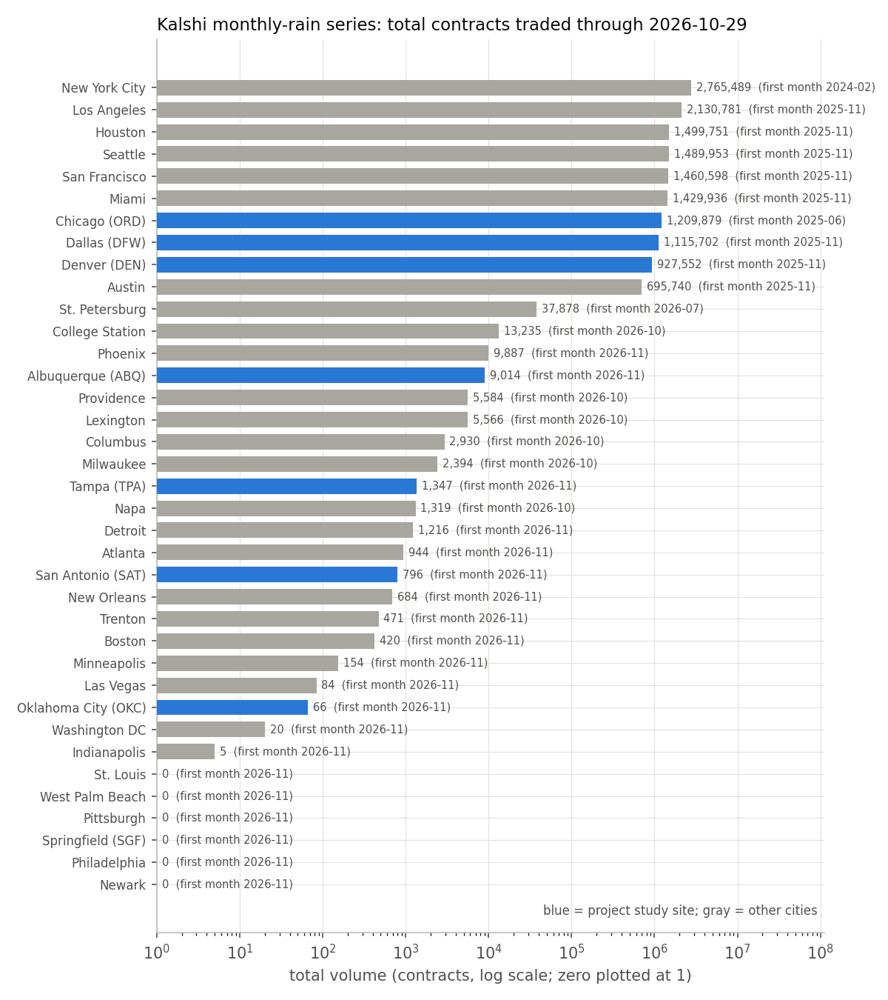
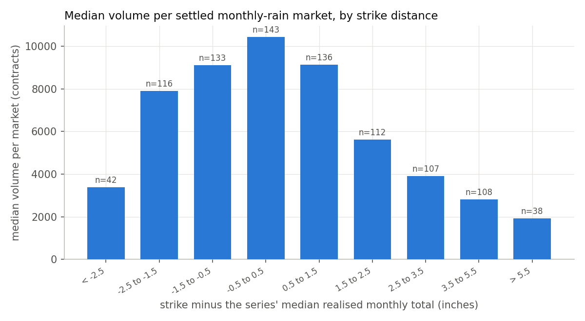
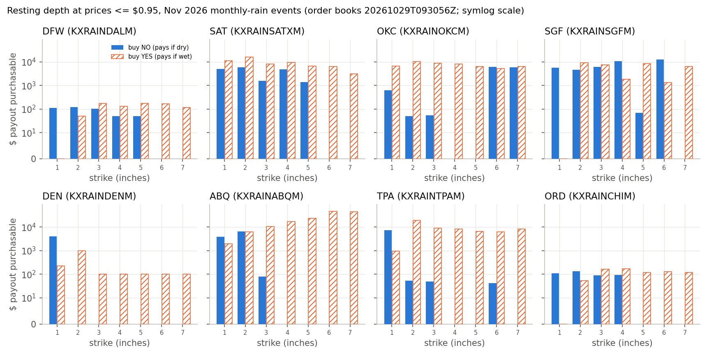
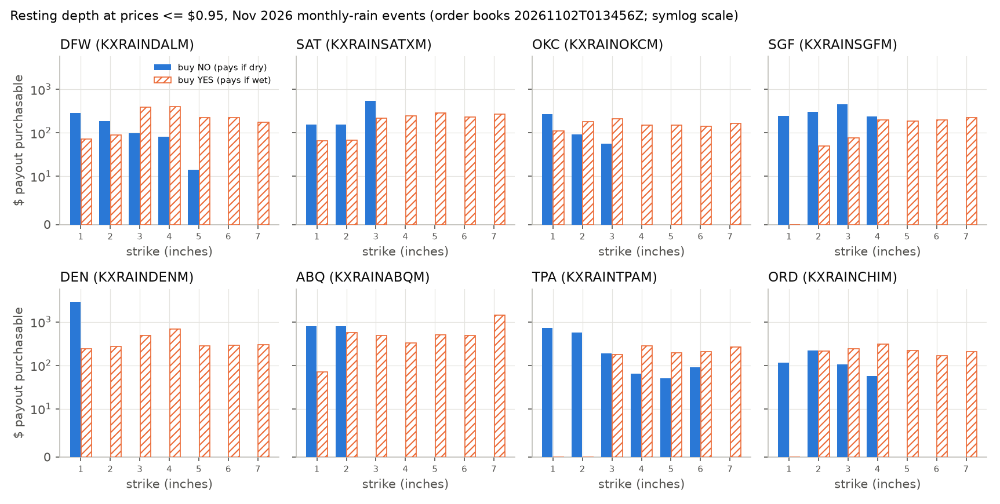
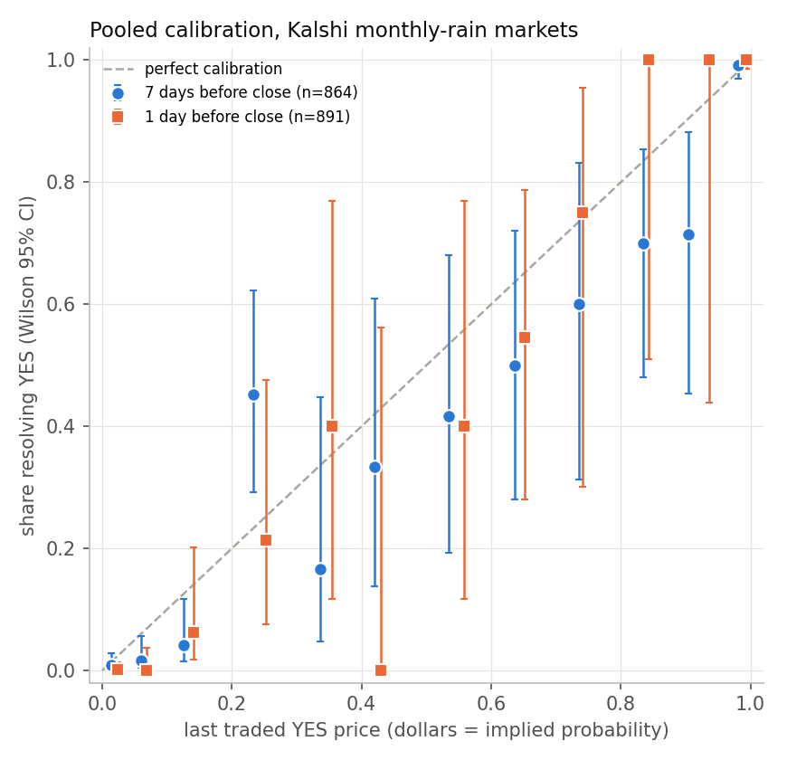

# Kalshi monthly-rain markets: data pipeline, liquidity, order-book depth, and calibration

**Proposal cell:** W2 Kalshi weather markets: cost and trading (data workstream B2)  |  **Status:** DRAFT  |  **Last updated:** 2026-11-02 (post-rewards order-book snapshot added; see also [12_post_rewards_liquidity.md](12_post_rewards_liquidity.md))

This document measures how much trading actually happens in Kalshi's monthly-rainfall contracts,
how much a farmer could buy today, and whether the prices behave like fair probabilities. All
numbers come from Kalshi's public market-data API, pulled on 2026-10-29 by
`scripts/pull_kalshi.py` with the client in `src/agri_hedge/kalshi.py`. Research on rules and
fees in general is in [../research/05_kalshi_weather_markets.md](../research/05_kalshi_weather_markets.md).

Terms used below:
- **Contract / market:** one binary bet, for example "Will Dallas get more than 3 inches of rain
  in October 2026?" A YES contract pays $1 if the answer is yes and $0 if not, so its price in
  dollars reads as the market's probability.
- **Event / ladder:** all the contracts for one city and month. Each month has a "ladder" of
  strikes, usually 1, 2, ..., 7 inches.
- **Strike:** the inch threshold in the question.
- **Volume:** total contracts traded. **Open interest (OI):** contracts still held (not yet
  closed out) at a point in time.
- **Bid / ask / spread:** the best price someone will pay (bid) and accept (ask) right now. The
  spread is ask minus bid, and it is the cost of trading in and straight back out.
- **Order-book depth:** how many contracts are waiting at each price. It caps how much you can
  buy at once.
- **Taker / maker:** a taker's order fills right away against waiting orders. A maker's order
  waits on the book until someone else fills it.
- **Drought hedge:** buying **NO** on "more than X inches" pays $1 if the month ends with X
  inches or less. This is the trade a rancher would use to replicate PRF, which pays when
  rainfall is below normal.
- **Favorite-longshot bias:** a well-documented pattern in betting markets. Unlikely outcomes
  ("longshots") are priced above their true odds, and likely ones ("favorites") a little below.

## Key findings

- **Most PRF study sites have only just been listed.** The Kalshi climate category holds 458
  series. 38 of them are monthly-rain series. 37 of those have listed markets, one city each. 20 of those series were created
  on 2026-10-25, four days before this pull. Five of our seven PRF sites are among them: SAT, OKC,
  SGF, ABQ and TPA. Each has a single event, November 2026. Only DFW and DEN, which started
  November 2025, plus the ORD contrast site (June 2025), have any trading history.
- **Where history exists, trading is real but modest.** 1,294 single-month markets across 187
  events have traded 14.8 million contracts. A settled market's median volume was 6,375 contracts,
  and only 1% of settled markets never traded. At DFW the median settled market traded 7,172
  contracts. The median DFW event held 32,984 contracts open when it closed, so even absorbing all
  of it would give a hedger about $33,000 of payout per month.
- **Volume clusters near the typical outcome.** Strikes within half an inch of a city's median
  realized monthly total carry 21.5% of volume (median 10,439 contracts per market). Strikes more
  than 5.5 inches above the median carry 0.8%.
- **Buyers pay a real spread.** Across markets with trades, the average daily-close bid-ask
  spread was 13.1 cents. Both sides were quoted on only 64% of market-days. At DFW the spread
  averaged 9.7 cents with two-sided quotes on 58% of days.
- **Current depth for a drought hedge is tiny at the established sites.** In the order-book
  snapshot at 2026-10-29 09:30 UTC, a farmer could buy only $436 of DFW November drought payout
  across all seven strikes at prices of $0.95 or less, with at most $120 at any one strike. The
  same figure was $428 at ORD and $4,017 at DEN, all of it at the 1-inch strike.
- **New-listing books looked deep only while rewards paid for that depth.** On 2026-10-29 the
  just-listed sites showed $7,431 (TPA) to $39,859 (SGF) of drought payout at $0.95 or less, while
  every one of their November markets carried a Kalshi "new_event" liquidity reward of $170 ending
  2026-11-01 03:59 UTC. **In a second snapshot at 2026-11-02 01:34 UTC, about 22 hours after the
  rewards ended, that depth was gone:** $416 (OKC) to $1,680 (TPA), 3-23% of the earlier amount
  (Table 4b). All 20 series whose rewards ended on 2026-11-01 lost depth (median ratio 0.05),
  while 13 of the 16 series without rewards at either snapshot gained (median ratio 1.44).
  No new reward program had been listed by then. Details: [doc 12](12_post_rewards_liquidity.md).
- **Prices show a clear favorite-longshot bias.** Seven days before the scheduled close, YES
  contracts last traded under $0.20 averaged $0.047, but only 1.6% of them resolved YES. That gap
  of -3.1 cents has an event-clustered 95% CI of [-4.2, -1.7] cents, and it holds at 1, 3 and 14
  days too. Contracts priced above $0.80 were roughly fair at 7 days (gap -1.4 cents, CI
  [-4.0, +0.7]). So buying cheap far-out-of-the-money YES contracts (a wet-tail hedge) costs about
  3x its expected payout. A drought hedge, which buys NO where YES is the favorite, is not
  overpriced on this evidence.
- **The settlement source has changed four times, and it now differs across our sites.** The
  rules text shows four regimes over time. Nov 2025 to Feb 2026 summed NOAA daily summaries. Mar to
  Aug 2026 used the NWS daily climate report (CLI). Since Sep 2026 the older series, DFW, DEN and
  ORD among them, settle on "TWC Report (Daily)" from The Weather Company. The 20 series launched
  2026-10-25, including SAT, OKC, SGF, ABQ and TPA, settle on "the first NWS Daily Climate Report
  containing all calendar days of the month". Separately, Chicago switched stations: CLIMDW
  (Midway) through Aug 2026, then CLIORD (O'Hare) from Sep 2026.
- **The ladders are internally consistent and agree with station data.** All 133 fully settled
  single-month ladders are consistent. For 131 of 131 events with ACIS data, the ACIS station
  monthly total falls inside the interval the ladder implies. Kalshi's `expiration_value`
  matches ACIS to within 0.05 inch in every event since Mar 2026. From Feb 2026 on, 91% of
  reported values are whole tenths of an inch.
- **The API has renamed fields and split off old data.** Prices are now `*_dollars` strings and
  counts are `*_fp` strings, with fractional contracts allowed. The old integer fields (`yes_bid`,
  `volume`, `open_interest`, `liquidity`) are gone, which is why they read None. Markets that
  settled before 2026-08-30 exist only under `/historical/...`. All 458 climate series report
  `fee_type = quadratic` and `fee_multiplier = 1`: a 7% taker fee coefficient and no maker fee.

## Numbers table

Retrieval date for every Kalshi API and ACIS number is 2026-10-29. "Computed" means our own
calculation from those primary API records. The calculation is reproducible with
`python scripts/pull_kalshi.py` followed by `python scripts/pull_kalshi.py --stats`.

| Quantity | Value | Units | Region / period | Source (URL + page/table) | Verification |
|---|---|---|---|---|---|
| Series in category "Climate and Weather" | 458 | series | Kalshi, as of 2026-10-29 | `GET /series?category=Climate and Weather` (api.elections.kalshi.com/trade-api/v2); `data/processed/kalshi_weather_series_catalog.csv` | CONFIRMED |
| Series by family: other / hurricane / temp_high / temp_low / snow / rain_monthly / rain_daily / rain_weekly | 166 / 68 / 68 / 61 / 45 / 38 / 10 / 2 | series | same | same, `family` column (our classification rules, `kalshi.series_family`) | CONFIRMED (computed) |
| Monthly-rain series with open markets | 36 of 38 | series | 2026-10-29 | `/markets?status=open` per series; catalog CSV | CONFIRMED |
| Monthly-rain series with listed markets (= cities, incl. Napa) | 37 | series | 2026-10-29 | `kalshi_rain_markets_summary.csv` (legacy RAINNYCM has no events; its old NYC events are listed under KXRAINNYCM) | CONFIRMED (computed) |
| Monthly-rain series created on 2026-10-25 | 20 | series | 2026-10-25 | min `created_time` per series, `kalshi_rain_markets.parquet` | CONFIRMED (computed) |
| Monthly-rain series created on 2025-11-14 / 2026-10-01 / 2026-10-02 / 2026-07-02 / 2025-06-03 / 2024-02-07 | 8 / 5 / 1 / 1 / 1 / 1 | series | as stated | same | CONFIRMED (computed) |
| First listed month: NYC / ORD / DFW, DEN / SAT, OKC, SGF, ABQ, TPA | 2024-02 / 2025-06 / 2025-11 / 2026-11 | month | per series | `kalshi_rain_markets_summary.csv` | CONFIRMED (computed) |
| Monthly-rain markets ever listed (all, incl. Napa multi-month) | 1,300 markets, 188 events | count | 2024-02 to 2026-12 | `/markets` + `/historical/markets` per series | CONFIRMED |
| Single-month monthly-rain markets / events | 1,294 / 187 | count | same | `kalshi_rain_markets.parquet` (`is_single_month`) | CONFIRMED (computed) |
| Of those: finalized / active | 943 / 347 | markets | 2026-10-29 | `status` field | CONFIRMED |
| Strikes per event (mode; share of events) | 7 (135 of 187 events) | strikes | all | `kalshi_rain_markets.parquet` | CONFIRMED (computed) |
| Strike grid of every Nov 2026 event except NYC | 1, 2, 3, 4, 5, 6, 7 | inches | Nov 2026 | same; NYC Nov 2026 is 1-4 in | CONFIRMED |
| Total volume, single-month rain markets | 14,819,395 | contracts | 2024-02 to 2026-10-29 | `volume_fp`, summed | CONFIRMED (computed) |
| Share of that volume in the 10 series created before 2026-07 | 99.4 | % | same | same | CONFIRMED (computed) |
| Median / mean volume per settled market (all cities) | 6,375 / 15,306 | contracts | 943 settled markets | `kalshi_rain_liquidity_by_series.csv`, row ALL | CONFIRMED (computed) |
| Share of settled markets with zero volume (all cities) | 1 | % | same | same | CONFIRMED (computed) |
| Median volume per settled market: DFW / DEN / ORD | 7,172 / 3,015 / 6,854 | contracts | series history | same | CONFIRMED (computed) |
| Median event volume, settled: DFW / DEN / ORD / all | 62,009 / 68,362 / 94,468 / 76,952 | contracts per event | same | same | CONFIRMED (computed) |
| Median OI at close per market: DFW / DEN / ORD / all | 4,218 / 2,505 / 3,900 / 3,459 | contracts | settled markets, last daily candle | same; candle `open_interest(_fp)` | CONFIRMED (computed) |
| Median OI at close summed over an event: DFW / DEN / ORD / all | 32,984 / 39,967 / 34,667 / 38,155 | contracts | settled events | same | CONFIRMED (computed) |
| Mean daily-close bid-ask spread: DFW / DEN / ORD / all | 9.7 / 11.3 / 11.1 / 13.1 | cents | markets with volume > 0, days with two-sided quotes | `kalshi_rain_daily_candles.parquet` (`yes_ask_close - yes_bid_close`) | CONFIRMED (computed) |
| Share of market-days with a two-sided quote: DFW / DEN / ORD / all | 58 / 56 / 60 / 64 | % | same | same | CONFIRMED (computed) |
| Volume share by strike distance from series median outcome (bins, Table 3) | 4.3 to 21.5 | % | 935 settled markets in 11 series | Table 3; `make_stats` output | CONFIRMED (computed) |
| Median realized monthly total (from `expiration_value`): DFW / DEN / ORD (as listed, CLIMDW then CLIORD) | 2.90 / 1.60 / 4.40 | inches | settled events to 2026-10 | `kalshi_rain_monthly_outcomes.csv` | CONFIRMED (computed) |
| Calibration, 7 days before close, last trade < $0.20: n, mean price, YES rate, gap, 95% CI | 505; 0.047; 0.016; -0.031; [-0.042, -0.017] | count; dollars; share; dollars | 139 settled events, 2024-02 to 2026-10 | `kalshi_rain_calibration.csv`; Table 5 | CONFIRMED (computed) |
| Calibration, 7 days, last trade > $0.80: n, mean price, YES rate, gap, CI | 265; 0.972; 0.958; -0.014; [-0.040, 0.007] | same | same | same | CONFIRMED (computed) |
| Longshot gap at 1 / 3 / 14 / 21 days (last trade) | -0.027 / -0.028 / -0.040 / -0.024 | dollars | same | Table 5 | CONFIRMED (computed) |
| Brier score of last traded price at 1 / 7 / 21 days | 0.015 / 0.049 / 0.099 | squared prob. | same | Table 5 | CONFIRMED (computed) |
| Order-book snapshot | 353 open markets at 2026-10-29T09:30:56Z | count | all open monthly-rain markets | `GET /markets/{ticker}/orderbook`; `data/raw/kalshi/orderbooks_20261029T093056Z.json` | CONFIRMED |
| Drought payout buyable at <= $0.95, Nov 2026, all strikes: DFW / DEN / ORD | 436 / 4,017 / 428 | $ payout | snapshot | `kalshi_rain_hedge_capacity_nov2026_20261029.csv`; Table 4 | CONFIRMED (computed) |
| Same, max at any one strike: DFW / DEN / ORD | 120 / 4,017 / 135 | $ payout | snapshot | same | CONFIRMED (computed) |
| Same, all strikes: SAT / OKC / SGF / ABQ / TPA | 18,810 / 12,836 / 39,859 / 10,456 / 7,431 | $ payout | snapshot | same | CONFIRMED (computed) |
| Median of same for the 28 non-study cities with Nov 2026 events | 9,504 | $ payout | snapshot | same | CONFIRMED (computed) |
| Second order-book snapshot (after rewards ended) | 269 open markets at 2026-11-02T01:34:56Z | count | all open monthly-rain markets | `scripts/pull_kalshi.py --orderbooks-only`; `kalshi_rain_orderbook_summary_20261102.csv`; raw `orderbooks_20261102T013456Z.json` (not committed) | CONFIRMED |
| Drought payout buyable at <= $0.95, Nov 2026, all strikes, 2026-11-02: DFW / DEN / ORD / SAT / OKC / SGF / ABQ / TPA | 663 / 2,878 / 497 / 859 / 416 / 1,237 / 1,585 / 1,680 | $ payout | 2026-11-02 snapshot | `kalshi_rain_hedge_capacity_nov2026_20261102.csv`; Table 4b | CONFIRMED (computed) |
| Same, max at any one strike, 2026-11-02: DFW / DEN / ORD / SAT / OKC / SGF / ABQ / TPA | 285 / 2,878 / 221 / 551 / 267 / 454 / 799 / 716 | $ payout | same | same | CONFIRMED (computed) |
| Median drought payout <= $0.95, 28 non-study cities, 2026-11-02 | 1,466 | $ payout | same | same | CONFIRMED (computed) |
| Reward programs listed after 2026-11-01 03:59 UTC on monthly-rain markets | 0 (latest end date still 2026-11-01T03:59:59Z; 762 programs, same IDs as 2026-10-29) | count | re-pulled 2026-11-02 | `GET /incentive_programs`; `kalshi_rain_incentive_programs.csv` | CONFIRMED |
| Current best bid-ask spread (median over 7 strikes), Nov 2026: DFW / DEN / ORD / SAT / OKC / SGF / ABQ / TPA | 17 / 9 / 17 / 12 / 14 / 9 / 1 / 14 | cents | snapshot | same | CONFIRMED (computed) |
| "new_event" liquidity reward per Nov 2026 market at the 20 new series | 170 | $ per market, 2026-10-26 to 2026-11-01 03:59 UTC | Nov 2026 | `GET /incentive_programs` (`period_reward` in centi-cents / 10,000); `kalshi_rain_incentive_programs.csv` | CONFIRMED |
| Liquidity reward programs on monthly-rain markets: new_event / long_dated | 619 programs, $61,005 / 110 programs, $11,775 | count, $ | 2026-04-29 to 2026-11-01 | same | CONFIRMED (computed) |
| Target size and discount factor of those programs | 1,000 contracts; 5,000 bps | contracts; bps | same | same (`target_size_fp`, `discount_factor_bps`) | CONFIRMED |
| Trades pulled for study-site series | 90,269 | trades | 2025-06-09 to 2026-10-29 | `/markets/trades` + `/historical/trades`; `kalshi_rain_trades.parquet` | CONFIRMED |
| Median trade size: DFW / DEN / ORD | 7.0 / 6.0 / 5.0 | contracts | same | same | CONFIRMED (computed) |
| 90th-percentile trade size: DFW / DEN / ORD | 83 / 62 / 60 | contracts | same | same | CONFIRMED (computed) |
| Share of contracts traded in the last 7 days before a market closes: DFW / DEN / ORD | 40 / 41 / 39 | % | same | same | CONFIRMED (computed) |
| Volume-weighted mean YES trade price: DFW / DEN / ORD | 0.49 / 0.26 / 0.51 | dollars | same | same | CONFIRMED (computed) |
| Fully settled single-month ladders that are internally consistent | 133 of 133 | events | to 2026-10 | `kalshi_rain_monthly_outcomes.csv` (`consistent`) | CONFIRMED (computed) |
| Settled events whose ACIS station total lies inside the ladder interval | 131 of 131 | events | 12 stations, 2024-02 to 2026-09 | ACIS StnData (data.rcc-acis.org); `data/raw/kalshi/acis_check.csv` | CONFIRMED (computed) |
| Events from Mar 2026 on with \|expiration_value - ACIS\| <= 0.05 in | 62 of 62 | events | 2026-03 to 2026-09 | same | CONFIRMED (computed) |
| Largest \|expiration_value - ACIS\| (KXRAINHOUM-26JAN: 1.54 vs 1.93) | 0.39 | inches | Jan 2026 (NOAA CDO regime) | same | CONFIRMED (computed) |
| Share of `expiration_value`s that are whole tenths: from 2026-02 / before | 91% of 79 / 5% of 37 | % | settled events | `kalshi_rain_monthly_outcomes.csv` | CONFIRMED (computed) |
| Historical-tier cutoff (`market_settled_ts`, `trades_created_ts`) | 2026-08-30T00:00:00Z | timestamp | 2026-10-29 | `GET /historical/cutoff` | CONFIRMED |
| Page-size caps: /markets and trades / /events / /incentive_programs | 1,000 / 200 / 10,000 | records | API | docs.kalshi.com OpenAPI pages; HTTP 400 seen for `/events?limit=1000` | CONFIRMED |
| Taker fee formula | round up(0.07 x C x P x (1-P)), to the next cent | $ | general markets | Kalshi Fee Schedule, 2nd iteration, 2022-09-22, p.2 (CFTC filing rule091222kexdcm003.pdf) | CONFIRMED |
| Fee table: 1 contract at $0.50 / 100 at $0.50 / 100 at $0.05 / 100 at $0.01 | $0.02 / $1.75 / $0.34 / $0.07 | $ | general markets | same, p.3-4 | CONFIRMED |
| Maker fee coefficient on series with maker fees | 0.0175 | per C x P x (1-P) | current schedule | third-party summaries of kalshi.com/docs/kalshi-fee-schedule.pdf (primary returned HTTP 429) | UNVERIFIED |
| Series `fee_type` / `fee_multiplier` | quadratic / 1 | n/a | all 458 climate series | `GET /series` fields | CONFIRMED |
| Fee rounding (retail balances aligned to $0.01; fee computed to $0.000001) | $0.01 / $0.000001 | $ | current | docs.kalshi.com/getting_started/fee_rounding | CONFIRMED |
| Fixed-point formats: price decimals / count decimals | up to 4 / up to 2 | decimal places | current | docs.kalshi.com/getting_started/fixed_point_migration ("Last Updated: August 20, 2026") | CONFIRMED |

## Detail

### 1. Data and method

`scripts/pull_kalshi.py` builds every output below. On reruns it reads cached raw JSON from
`data/raw/kalshi/`. Settled markets are cached permanently, market lists for 6 hours, and the
catalog for 24 hours. About 2,000 unauthenticated HTTP requests at 0.2 s spacing rebuild
everything from scratch in about 15 minutes.

| Output | Contents |
|---|---|
| `data/processed/kalshi_weather_series_catalog.csv` | all 458 climate series: family, frequency, CLI code / station, settlement sources, fee type, open-market count |
| `data/processed/kalshi_rain_markets.parquet` (+ `_summary.csv`) | all 1,300 monthly-rain markets from both tiers, 54 normalized columns |
| `data/processed/kalshi_rain_daily_candles.parquet` | 29,153 daily candles for the 1,133 markets with volume > 0 |
| `data/processed/kalshi_rain_trades.parquet` | 90,269 trades for the 8 study-site series (SGF has none) |
| `data/processed/kalshi_rain_monthly_outcomes.csv` | one row per event: ladder bounds on the monthly total, `expiration_value`, quality flags |
| `data/processed/kalshi_rain_orderbook_summary_<YYYYMMDD>.csv` | parsed books, one file per snapshot day: `_20261029` (353 open markets, raw `orderbooks_20261029T093056Z.json`) and `_20261102` (269 open markets, raw `orderbooks_20261102T013456Z.json`). `kalshi_rain_orderbook_summary.csv` is a copy of the latest one, which other scripts read |
| `data/processed/kalshi_rain_incentive_programs.csv` | 762 liquidity-reward programs on monthly-rain markets (619 new_event, 110 long_dated, 33 unlabeled) |
| `data/processed/kalshi_rain_liquidity_by_series.csv`, `kalshi_rain_calibration.csv`, `kalshi_rain_hedge_capacity_nov2026_<YYYYMMDD>.csv` | tables behind this document (`--stats`; the capacity file is named for the order-book snapshot used, `--stats --orderbook <file>` picks an earlier one) |

Method choices:
- **Which markets count.** "Monthly-rain" means tickers matching `(KX)RAIN<city>M`. Napa's
  Nov 2026 to Mar 2027 seasonal ladder is excluded from monthly statistics (`is_single_month`).
  Legacy `RAINNYCM-24xxx` events appear under series KXRAINNYCM and are included.
- **Open interest at close** is the `open_interest` value on the last daily candle at or before
  the market's `close_time`. The OI on a settled market object sometimes reads 0 after
  settlement, so we do not use it.
- **Spreads** come from daily candle closes, with the YES ask minus the YES bid at the period end
  (04:00 UTC). A day counts as two-sided only if bid > 0 and ask < 1. Candles were only pulled
  for markets with volume, so zero-volume markets do not enter the spread average.
- **Calibration** handles early closing. "More than X inches" markets close early once the total
  passes X ("This market will close and expire early if the event occurs"). So we measure time
  from each event's scheduled close, the latest `close_time` in the event. We keep a market at
  horizon h only if it was still open h days before that, so no outcome information leaks into
  the price. "Last price" is the last daily close with a trade at or before that time; the median
  staleness was 1 day. The CIs on gaps resample whole events (1,000 bootstrap draws), because all
  strikes in a month share one outcome.

### 2. Market universe and listing history

Monthly-rain markets all follow one template: "If the total precipitation at CLIxxx in <city> in
<Mon YYYY> is strictly greater than X inches, then the market resolves to Yes." Every November
2026 ladder except NYC uses strikes of 1 to 7 inches in 1-inch steps, in every climate. When a
wet month runs past the top strike, Kalshi adds strikes during the month: DFW October 2026 had
10. Ticks are $0.01 (`linear_cent`) on 1,234 markets and $0.001 (`deci_cent`) on 60.

*Figure 1. Total contracts traded per monthly-rain series through 2026-10-29, log scale. Blue
marks our study sites. The label gives the first contract month. Five of the seven PRF sites
(SAT, OKC, SGF, ABQ, TPA) first list November 2026.*

### 3. Liquidity by city (study sites and largest series)

Table 1. Single-month markets only. "Settled" statistics use finalized markets. Spread and
two-sided share come from daily candles of markets with volume. The full 37-row table, which
includes Napa, is in `data/processed/kalshi_rain_liquidity_by_series.csv`.

| Series | Site | First month | Events | Markets | Strikes/event | Total volume | Median vol / settled mkt | Zero-vol settled | Median OI at close / mkt | Median OI at close / event | Mean spread (cents) | Days two-sided |
|---|---|---|---|---|---|---|---|---|---|---|---|---|
| KXRAINDALM | DFW | 2025-11 | 13 | 95 | 7 | 1,115,702 | 7,172 | 1% | 4,218 | 32,984 | 9.7 | 58% |
| KXRAINDENM | DEN | 2025-11 | 13 | 91 | 7 | 927,552 | 3,015 | 1% | 2,505 | 39,967 | 11.3 | 56% |
| KXRAINCHIM | ORD (contrast) | 2025-06 | 14 | 98 | 7 | 1,209,879 | 6,854 | 2% | 3,900 | 34,667 | 11.1 | 60% |
| KXRAINSATXM | SAT | 2026-11 | 1 | 7 | 7 | 796 | n/a | n/a | n/a | n/a | 29.5 | 100% |
| KXRAINOKCM | OKC | 2026-11 | 1 | 7 | 7 | 66 | n/a | n/a | n/a | n/a | 28.4 | 100% |
| KXRAINSGFM | SGF | 2026-11 | 1 | 7 | 7 | 0 | n/a | n/a | n/a | n/a | n/a | n/a |
| KXRAINABQM | ABQ | 2026-11 | 1 | 7 | 7 | 9,014 | n/a | n/a | n/a | n/a | 25.9 | 100% |
| KXRAINTPAM | TPA | 2026-11 | 1 | 7 | 7 | 1,347 | n/a | n/a | n/a | n/a | 28.3 | 100% |
| KXRAINNYCM | (NYC) | 2024-02 | 35 | 224 | 5 | 2,765,489 | 5,101 | 1% | 3,003 | 39,267 | 16.2 | 72% |
| KXRAINLAXM | (LA) | 2025-11 | 13 | 92 | 7 | 2,130,781 | 9,495 | 0% | 5,884 | 65,842 | 10.0 | 50% |
| KXRAINHOUM | (Houston) | 2025-11 | 13 | 88 | 7 | 1,499,751 | 10,733 | 0% | 5,429 | 49,114 | 9.4 | 62% |
| ALL (37 series) | | 2024-02 | 187 | 1,294 | 7 | 14,819,395 | 6,375 | 1% | 3,459 | 38,155 | 13.1 | 64% |

For the five new sites, the candle spreads cover only the first three to four days after
listing, so they are not comparable with the established series. Section 5 gives their spreads
in the current order book.

At the established sites, trading is retail-sized and bunched at month end. The median trade is
5 to 7 contracts and the 90th percentile 60 to 83. About 40% of contracts trade in the final
7 days before close (Table 2, `kalshi_rain_trades.parquet`).

Table 2. Trades at study-site series (both API tiers).

| Series | Trades | Contracts | Median size | 90th pct size | Max size | Share in last 7 days | Share bought by YES takers |
|---|---|---|---|---|---|---|---|
| KXRAINDALM (DFW) | 23,919 | 1,115,702 | 7.0 | 83 | 12,330 | 40% | 45% |
| KXRAINDENM (DEN) | 28,790 | 927,535 | 6.0 | 62 | 9,999 | 41% | 52% |
| KXRAINCHIM (ORD) | 37,388 | 1,209,651 | 5.0 | 60 | 13,747 | 39% | 53% |
| KXRAINABQM (ABQ) | 128 | 9,014 | 22.0 | 193 | 666 | 0% | 56% |
| KXRAINTPAM (TPA) | 28 | 1,347 | 21.8 | 124 | 329 | 0% | 59% |
| KXRAINSATXM (SAT) | 11 | 796 | 50.0 | 132 | 198 | 0% | 95% |
| KXRAINOKCM (OKC) | 5 | 66 | 21.0 | 21 | 21 | 0% | 4% |

### 4. Volume versus strike distance

For each of the 11 series with settled history, we take the median realized monthly total
(`expiration_value_final`) and measure each settled strike's distance from it.

Table 3. Settled single-month markets, all 11 series pooled.

| Strike minus median outcome (in) | Markets | Total volume | Median volume | Zero-volume | Share of volume |
|---|---|---|---|---|---|
| < -2.5 | 42 | 626,685 | 3,389 | 0% | 4.3% |
| -2.5 to -1.5 | 116 | 1,936,578 | 7,906 | 2% | 13.4% |
| -1.5 to -0.5 | 133 | 2,554,120 | 9,114 | 1% | 17.7% |
| -0.5 to 0.5 | 143 | 3,094,149 | 10,439 | 0% | 21.5% |
| 0.5 to 1.5 | 136 | 2,208,902 | 9,132 | 0% | 15.3% |
| 1.5 to 2.5 | 112 | 1,749,600 | 5,619 | 1% | 12.1% |
| 2.5 to 3.5 | 107 | 1,276,458 | 3,901 | 2% | 8.8% |
| 3.5 to 5.5 | 108 | 864,947 | 2,815 | 2% | 6.0% |
| > 5.5 | 38 | 111,838 | 1,916 | 0% | 0.8% |

The uniform 1-to-7-inch grid sits mostly above the typical monthly total in dry climates:
DEN 1.60 in and LAX 0.70 in. That is where the many low-volume, high-strike markets come from.
For a drought hedge in an arid place, the lowest strike, "more than 1 inch", may already be above
normal rainfall. So the deepest "drought" contract available may still be a near-normal month.

*Figure 2. Median volume per settled market by strike distance from the series' median realized
monthly total. n is the number of markets per bin.*

### 5. Order-book depth and what a farmer could buy today

A drought hedge buys NO on "more than X inches". Each NO costs 1 minus the YES bid it fills
against, and pays $1 if the month ends at X inches or less. Table 4 adds up every resting YES bid
on the November 2026 ladders in the 2026-10-29 09:30 UTC snapshot. We count only levels where
the NO costs $0.95 or less, because paying 99 cents for $1 of cover is not insurance. Premium
includes the 7% taker fee.

Table 4. Hedge capacity, November 2026 events, 2026-10-29 snapshot, rewards still running (dollars of payout = contracts).

| Site | Series | Strikes two-sided | Median spread (cents) | Drought payout <= $0.95, all strikes | Premium for it | Net cover (payout - premium) | Max at one strike | Wet payout (buy YES) <= $0.95 |
|---|---|---|---|---|---|---|---|---|
| DFW | KXRAINDALM | 7 of 7 | 17 | $436 | $235 | $201 | $120 | $807 |
| DEN | KXRAINDENM | 4 of 7 | 9 | $4,017 | $3,077 | $940 | $4,017 | $1,707 |
| ORD | KXRAINCHIM | 6 of 7 | 17 | $428 | $221 | $207 | $135 | $752 |
| SAT | KXRAINSATXM | 7 of 7 | 12 | $18,810 | $12,052 | $6,758 | $5,968 | $61,340 |
| OKC | KXRAINOKCM | 7 of 7 | 14 | $12,836 | $11,473 | $1,363 | $6,175 | $52,034 |
| SGF | KXRAINSGFM | 7 of 7 | 9 | $39,859 | $25,073 | $14,786 | $12,710 | $34,844 |
| ABQ | KXRAINABQM | 7 of 7 | 1 | $10,456 | $9,286 | $1,170 | $6,533 | $148,786 |
| TPA | KXRAINTPAM | 7 of 7 | 14 | $7,431 | $3,159 | $4,272 | $7,287 | $58,276 |

Answer to "how much could a farmer hedge per month per city at current depth":
- **DFW and ORD:** a few hundred dollars of drought payout per month, about $120 to $135 at any
  single strike. **DEN:** about $4,000, all at the 1-inch strike.
- **Upper bound from history.** The most a buyer could take from the existing pool of positions
  is the open interest. The median DFW event held 32,984 contracts at close, which is about
  $33,000 of payout. Taking all of it would mean being the counterparty to the whole market. The
  realistic size is far smaller, and buying it would push prices up.
- **SAT, OKC, SGF, ABQ, TPA:** $7,000 to $40,000 on 2026-10-29, while each November market paid
  $170 to liquidity providers through 2026-11-01 03:59 UTC. DFW, DEN and ORD markets had carried
  the same "new_event" rewards in October ($55 per market, ended 2026-10-04), and their books were
  down to hundreds of dollars, so we expected this depth to go when the rewards ended.

The 28 other cities with November 2026 ladders showed a median $9,504 of drought payout at $0.95
or less on 2026-10-29. Most of them were also new listings with rewards.

**After the rewards ended (2026-11-02 snapshot).** We re-pulled every open book at 2026-11-02
01:34 UTC (`python scripts/pull_kalshi.py --orderbooks-only`, then `--stats`), about 22 hours after
the rewards ended and with no new reward program listed.

Table 4b. Hedge capacity, November 2026 events, 2026-11-02 snapshot, after the rewards ended.

| Site | Series | Strikes two-sided | Median spread (cents) | Drought payout <= $0.95, all strikes | Premium for it | Net cover (payout - premium) | Max at one strike | Wet payout (buy YES) <= $0.95 |
|---|---|---|---|---|---|---|---|---|
| DFW | KXRAINDALM | 7 of 7 | 9 | $663 | $353 | $310 | $285 | $1,572 |
| DEN | KXRAINDENM | 4 of 7 | 4 | $2,878 | $2,467 | $411 | $2,878 | $2,549 |
| ORD | KXRAINCHIM | 6 of 7 | 8 | $497 | $221 | $277 | $221 | $1,350 |
| SAT | KXRAINSATXM | 7 of 7 | 13 | $859 | $615 | $243 | $551 | $1,384 |
| OKC | KXRAINOKCM | 7 of 7 | 12 | $416 | $206 | $210 | $267 | $1,111 |
| SGF | KXRAINSGFM | 7 of 7 | 14 | $1,237 | $642 | $596 | $454 | $932 |
| ABQ | KXRAINABQM | 4 of 7 | 8 | $1,585 | $1,152 | $433 | $799 | $3,890 |
| TPA | KXRAINTPAM | 5 of 7 | 8 | $1,680 | $652 | $1,028 | $716 | $1,132 |

- **The reward-supported depth did not survive.** Drought payout at $0.95 or less fell 77-97% at
  the five new sites (to $416-$1,680) and wet-side depth fell 97-98%. The new-site books now look
  like the established ones: hundreds to low thousands of dollars per month.
- **The established books did not lose depth.** DFW (+52%) and ORD (+16%) grew; DEN fell 28%
  but is still the deepest study book at $2,878, all at the 1-inch strike.
- **It is market-wide.** The median over the 28 other cities fell from $9,504 to $1,466. Every one
  of the 20 series whose rewards ended on 2026-11-01 lost depth (median ratio 0.05). Of the 16
  series with no reward at either snapshot, 13 gained (median ratio 1.44). See doc 12.
- **Caveat:** the second snapshot is one day into November, so a little of the month's rain may
  already be known; this moves prices but cannot explain a 95% drop in resting size.

*Figure 3. Resting contracts available at $0.95 or less, by strike, for the November 2026
ladders, on 2026-10-29 (rewards running, top) and 2026-11-02 (after they ended, bottom). Blue is
buy-NO depth (pays if dry); hatched is buy-YES depth (pays if wet). The y-axis is symlog: linear
below 10, log above.*

### 6. Calibration and favorite-longshot bias

Table 5. Pooled calibration across all settled single-month markets. The gap is the realized YES
rate minus the mean price. The CI is a 95% event-cluster bootstrap. "Mid" uses the bid-ask
midpoint and needs a two-sided quote, so it covers fewer markets.

| Horizon (days before scheduled close) | Price used | n markets | Events | Brier | Longshots (< $0.20): n / mean price / YES rate / gap [CI] | Favorites (> $0.80): n / mean price / YES rate / gap [CI] |
|---|---|---|---|---|---|---|
| 1 | last trade | 891 | 140 | 0.015 | 567 / 0.032 / 0.005 / -0.027 [-0.034, -0.020] | 281 / 0.986 / 1.000 / +0.014 [0.013, 0.017] |
| 3 | last trade | 881 | 139 | 0.024 | 557 / 0.041 / 0.013 / -0.028 [-0.037, -0.019] | 274 / 0.982 / 0.982 / -0.001 [-0.016, 0.012] |
| 7 | last trade | 864 | 139 | 0.049 | 505 / 0.047 / 0.016 / -0.031 [-0.042, -0.017] | 265 / 0.972 / 0.958 / -0.014 [-0.040, 0.007] |
| 14 | last trade | 813 | 132 | 0.073 | 416 / 0.059 / 0.019 / -0.040 [-0.052, -0.025] | 222 / 0.953 / 0.937 / -0.016 [-0.054, 0.016] |
| 21 | last trade | 795 | 124 | 0.099 | 353 / 0.063 / 0.040 / -0.024 [-0.045, 0.002] | 198 / 0.943 / 0.914 / -0.029 [-0.080, 0.016] |
| 7 | mid | 382 | 128 | 0.104 | 253 / 0.066 / 0.047 / -0.019 [-0.046, 0.012] | 43 / 0.915 / 0.791 / -0.124 [-0.253, -0.010] |
| 14 | mid | 530 | 128 | 0.107 | 267 / 0.073 / 0.034 / -0.040 [-0.061, -0.015] | 87 / 0.909 / 0.874 / -0.035 [-0.117, 0.038] |

What the table shows:
- **Longshot YES contracts are overpriced at every horizon.** At 7 days they cost about 3 cents
  more than their realized frequency. Relative to the price, a buyer gets back only about a third
  of what they pay in expectation (1.6% realized vs 4.7 cents paid). Last-trade prices show the
  same direction at 21 days, and mid prices at 14 days, both with CIs that exclude zero or nearly
  do.
- **Favorites are close to fair.** At 1 day they are slightly underpriced, which is expected
  because those outcomes are nearly settled. With mids, favorites look overpriced at 7 days, but
  only 43 markets qualify and the CI is wide.
- **The middle bins, $0.20 to $0.80, are noisy.** They hold only 93 markets at 7 days. We do not
  draw conclusions from them.
- **Consequence for hedging:** a drought hedge buys NO where YES is a favorite, such as NO on
  "more than 1 inch" in a normally wet month. On this evidence that hedge is not systematically
  overpriced. A wet-tail hedge, buying YES on high strikes, is.

*Figure 4. Realized YES share vs last traded price, 7 days (circles) and 1 day (squares) before
the scheduled close, with Wilson 95% intervals. Wilson intervals assume independent markets, so
they understate the uncertainty. Use the event-clustered intervals in Table 5.*

### 7. Settlement source, station, and the ladder-vs-station check

The rules text (`rules_secondary`) tells us which data source decides each market. Table 6
counts that text by contract month for single-month markets outside NYC. NYC's rules_secondary
is empty; its series lists "NWS Climatological Report NY".

Table 6. Settlement-source wording by contract month (number of markets).

| Contract months | Wording in rules_secondary | Markets |
|---|---|---|
| 2025-11 (40 of 48), 2025-12 to 2026-02 | "The primary resolution link will be a sum of NOAA's Climate Data Online Daily Summaries ... [fallback] NWS Monthly Climate Report ... [then] sum of ... Daily Climate Reports" | 229 |
| 2025-11 (8 of 48), 2026-03 to 2026-08 | "Data for CLIxxx can be found ... NWS Climatological Report (Daily)" | 408 |
| 2026-09 to 2026-11 (older 14 series) | "... the official and final value ... as reported by the corresponding TWC Report (Daily)" | 271 |
| 2026-11 (the 20 series created 2026-10-25) | "The monthly precipitation total in the first National Weather Service Daily Climate Report containing all calendar days of the month determines this market ..." | 140 |
| Napa 2026-10 to 2026-12 | "The total is the sum of The Weather Company's daily precipitation values at KAPC ..." | 18 |

Two station facts matter for the basis-risk work:
- **Chicago changed stations.** KXRAINCHIM settled on CLIMDW (Chicago Midway) from Nov 2025 to
  Aug 2026 and on CLIORD (O'Hare) from Sep 2026. Its June 2025 markets say "Chicago Midway, IL in
  || Month ||", with a template placeholder left unfilled.
- **Codes are not always the airport you would expect.** West Palm Beach's rules name "CLIDJT",
  not the PBI airport. NYC names "Central Park, New York City" with no CLI code.

None of the monthly rules mention trace rain. No "trace" wording appears in any rules_primary or
rules_secondary string, so the daily-contract trace rule change reported in the literature
review was not observed here.

**Ladder vs station check (sanity test of the parsed outcomes).** For each fully settled event
we pulled the ACIS monthly total for the settlement station. Codes map to ACIS as CLIDFW -> DFW
and so on, NYC -> Central Park, and ACIS trace "T" counts as 0. The other workstream's
`data/processed/kalshi_settlement_vs_station.csv` (`scripts/check_kalshi_settlement.py`) does the
full settlement analysis. This check only validates our ladder parsing.

Table 7. Ladder results vs ACIS station monthly totals, fully settled events.

| Settlement regime (contract months) | Events | ACIS inside ladder interval | With expiration_value | Exact match | Within 0.05 in | Max abs diff (in) |
|---|---|---|---|---|---|---|
| to 2025-10 (NYC only) | 21 | 21 | 18 | 17 | 17 | 0.14 |
| 2025-11 to 2026-02 | 40 | 39 (1 missing in ACIS) | 24 | 17 | 21 | 0.39 |
| 2026-03 to 2026-08 | 61 | 61 | 52 | 15 | 52 | 0.05 |
| 2026-09 on | 10 | 10 | 10 | 2 | 10 | 0.05 |

The settled YES/NO results never contradict the station total. Kalshi's reported
`expiration_value` looks rounded to 0.1 inch from Feb 2026 on: 91% of 79 values are whole tenths,
against 5% of 37 before. That rounding is invisible in the results unless a total lands within
0.05 inch of a strike.

### 8. Fees

Kalshi's fee schedule filed with the CFTC (2nd iteration, 2022-09-22, p.2) sets the general
trading fee: "fees = round up(0.07 x C x P x (1-P))", where P is the price in dollars, C the
number of contracts, and "round up = rounds to the next cent". The same filing says fees are
"only charged for orders that are immediately matched", meaning taker orders. The API reports
`fee_type = quadratic` and `fee_multiplier = 1` for every climate series. By the API's own fee
types, maker fees only apply to series typed `quadratic_with_maker_fees`.

`kalshi.fee(contracts, price, maker=False, fee_type="quadratic", multiplier=1)` implements this
and is tested against the schedule's table. As a share of the premium, the fee equals
0.07 x (1 - P) before rounding: 6.7% on a 4-cent contract and 3.5% at 50 cents. On a 1-contract
order the round-up to a whole cent dominates. One contract at $0.05 pays $0.01, which is 20% of
its premium. So a hedger should buy in round lots of 100 or more.

## Implications for our replication design

1. **Only DFW and DEN have usable price history among the PRF sites.** For SAT, OKC, SGF, ABQ and
   TPA, Milestone 2 has to price replicating portfolios from a model, such as station
   climatology plus a loading, not from Kalshi history. Their first real price data arrive in
   November 2026.
2. **Size hedges to depth, not to need.** Without reward-subsidized liquidity, a drought hedge at
   DFW is a few hundred dollars per month at quoted prices. The optimizer should treat order-book
   depth (or a fraction of typical OI) as a hard cap per strike and per month. It should also
   charge the half-spread (about 5 cents at DFW) plus fees on every leg.
3. **Prefer strikes near the median, and lean on NO legs for drought.** Liquidity concentrates
   within about 1.5 inches of the median outcome (Table 3). Drought protection bought as NO on
   low strikes was not overpriced in the calibration test. YES legs on far strikes carry roughly
   a 3-cent longshot premium, about two-thirds of their price.
4. **Accept the fixed strike grid.** Strikes are whole inches from 1 to 7 everywhere. At arid
   sites (ABQ, DEN) that leaves no strike below normal in dry months, so replicating PRF's
   "percent of normal" trigger will be coarse. The replication-quality analysis (doc 08) should
   measure this.
5. **Use the right settlement series per site and month.** DFW, DEN and ORD now settle on TWC
   data, while SAT, OKC, SGF, ABQ and TPA settle on the NWS daily climate report. Chicago is
   O'Hare only from Sep 2026. Historical backtests should use the station named in each month's
   rules (`cli_code` column), not today's station.
6. **Use `ladder_outcomes` for backtests.** The ladder's highest-YES and lowest-NO strikes bound
   the settled total. Use `expiration_value` only as a reported value; it is rounded to 0.1 inch
   since Feb 2026 and is a lower bound when every strike resolved YES (8 events).

## Unverified claims and open questions

- **Current maker fee rate (0.0175).** The current fee schedule PDF and kalshi.com/fee-schedule
  both returned HTTP 429 on 2026-10-29. The 0.0175 maker coefficient comes from secondary
  summaries. It does not affect rain series today, which are `quadratic` (taker-only).
- **Why the new books were deep.** The 2026-11-02 snapshot confirms that the depth at the five
  new PRF sites disappeared when the $170-per-market rewards ended (Table 4b). That the rewards
  *caused* it is still an inference from timing and from the unrewarded control series; we did not
  see who placed or pulled the orders. One post-rewards snapshot cannot show whether depth comes
  back later in the month.
- **Undocumented liquidity-reward details.** We take `period_reward` in centi-cents
  ($ = value / 10,000) from the OpenAPI description. We could not find public documentation of how
  the reward is split among liquidity providers, `discount_factor_bps` or `target_size_fp`.
- **OI at close.** It is the last daily candle's OI. For markets that closed early the candle can
  end up to a day after the close, which may slightly misstate OI.
- **Thin calibration sample.** The test pools 795 to 891 markets per horizon from 124 to 140 events, mostly in NYC,
  LA, Houston and other large cities, over 2024-02 to 2026-10. Results may not carry over to the
  new Plains and Southwest sites, and the middle-price bins are thin.
- **Our depth estimate is a static snapshot.** Market makers may quote more size when a large
  order shows up, for example through Kalshi's request-for-quote (RFQ) endpoints, which we did not
  test. Block trades exist (`is_block_trade`), and none appear in the study-series trades.
- **Unexplained station codes.** "CLIDJT" for West Palm Beach and the Chicago Midway-to-O'Hare
  switch come from the rules text only. We have not checked them against a Kalshi announcement.

## Field names and API quirks (for other workstreams)

- **Market object fields (live and historical tiers alike):** `last_price_dollars`,
  `yes_bid_dollars`, `yes_ask_dollars`, `no_bid_dollars`, `no_ask_dollars`,
  `previous_price_dollars`, `previous_yes_bid_dollars`, `previous_yes_ask_dollars`,
  `notional_value_dollars`, `settlement_value_dollars`, `volume_fp`, `volume_24h_fp`,
  `open_interest_fp`, `yes_bid_size_fp`, `yes_ask_size_fp`, `price_ranges` (`start`/`end`/`step`),
  `price_level_structure`, `strike_type`, `floor_strike`, `custom_strike` (Napa: `station`,
  `start_date`, `end_date`), `expiration_value` (free text), `result`, `status`, `settlement_ts`,
  `can_close_early`, `early_close_condition`, `fee_waiver_expiration_time`.
- **Fields that no longer exist:** `yes_bid`, `yes_ask`, `last_price`, `volume`,
  `open_interest`, `liquidity`.
- **Missing fields on a few markets.** The 4 NYC January 2025 markets (KXRAINNYCM-25JAN-1..4) lack `strike_type`/`floor_strike`.
  `kalshi.market_strike` falls back to the rules text, then to the ticker suffix.
- **Candlesticks:** the live endpoint returns `price.{open,high,low,close,mean,previous}_dollars`,
  `yes_bid.*_dollars`, `yes_ask.*_dollars`, `volume_fp`, `open_interest_fp`. The historical
  endpoint uses the same structure without suffixes (`price.close`, `volume`, `open_interest`),
  still as dollar and contract strings. A daily candle exists even on days with no trade; its
  `price.*` is null and `price.previous` carries the last trade. Daily candles end at 04:00 UTC.
- **Trades:** `trade_id`, `ticker`, `created_time`, `yes_price_dollars`, `no_price_dollars`,
  `count_fp`, `taker_side` (also `taker_outcome_side`, `taker_book_side`), `is_block_trade`.
- **Order book:** `{"orderbook_fp": {"yes_dollars": [[price, size], ...], "no_dollars": [...]}}`.
  Both lists are bids, sorted ascending (best bid last). The YES ask is 1 minus the best NO bid.
- **Status values:** markets are `initialized`, `active` or `finalized`, but the `status` query
  filter takes `unopened|open|paused|closed|settled`.
- **Tiers and pagination:** markets settled before `market_settled_ts` (2026-08-30) live only
  under `/historical/markets`, and `/markets/{ticker}` returns 404 for them. Legacy-ticker events
  appear under the KX series. `/events` caps `limit` at 200. `/incentive_programs` paginates with
  `next_cursor`, not `cursor`.
- **Module entry points:** `KalshiClient` and its `list_all_markets`, `get_candles_any`,
  `list_all_trades`; parsers `parse_market`, `parse_candles`, `parse_trades`, `parse_orderbook`;
  helpers `orderbook_summary`, `walk_book`, `fee`, `ladder_outcomes`, `prices_at_horizon`,
  `calibration_table`.

## Sources

1. Kalshi Trade API v2, public market-data endpoints, https://api.elections.kalshi.com/trade-api/v2 :
   `/series`, `/series/{ticker}`, `/events`, `/markets`, `/markets/{ticker}/orderbook`,
   `/series/{s}/markets/{t}/candlesticks`, `/markets/trades`, `/historical/cutoff`,
   `/historical/markets`, `/historical/markets/{t}/candlesticks`, `/historical/trades`,
   `/incentive_programs`. Retrieved 2026-10-29. Raw JSON in `data/raw/kalshi/`.
2. Kalshi API documentation, "Fixed-Point Representation" (last updated 2026-08-20),
   https://docs.kalshi.com/getting_started/fixed_point_migration
3. Kalshi API documentation, "Historical Data", https://docs.kalshi.com/getting_started/historical_data
4. Kalshi API documentation, "Fee Rounding", https://docs.kalshi.com/getting_started/fee_rounding
5. Kalshi API documentation, "Get Incentives" (OpenAPI), https://docs.kalshi.com/api-reference/incentive-programs/get-incentives
6. Kalshi API documentation, "Get Market Candlesticks", "Get Markets", "Get Historical Markets",
   "Get Historical Trades", "Get Series Fee Changes", https://docs.kalshi.com/api-reference/
7. KalshiEX LLC, "Fee Schedule", 2nd Iteration, September 22, 2022, as filed with the CFTC,
   https://www.cftc.gov/filings/orgrules/rule091222kexdcm003.pdf (formula p.2; general fee table
   p.3-4).
8. Kalshi, current fee schedule, https://kalshi.com/docs/kalshi-fee-schedule.pdf (cited only as
   the current primary source; HTTP 429 on 2026-10-29, not read).
9. Kalshi Help Center, "Fees", https://help.kalshi.com/trading/fees (dated 2026-04-19; read
   2026-10-29). It says maker fees are charged on resting orders in some markets, and that
   cancelling is free.
10. Applied Climate Information System (ACIS) StnData web service, https://data.rcc-acis.org/StnData ,
    monthly precipitation sums for DFW, DEN, MDW, ORD, AUS, HOU, LAX, MIA, SEA, SFO, SPG, NYC.
    Retrieved 2026-10-29; raw JSON in `data/raw/kalshi/acis/`.
11. Kalshi contract terms for monthly rain, https://assets.kalshi.com/contract_terms/RAINM.pdf
    (linked from the series object; not read for this document).
