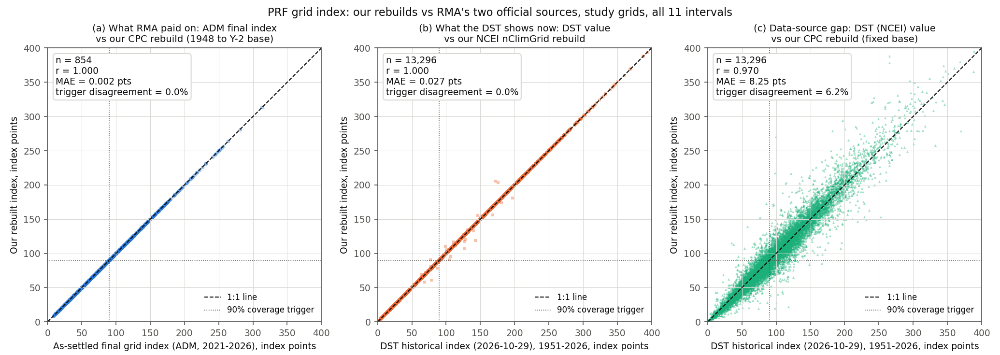
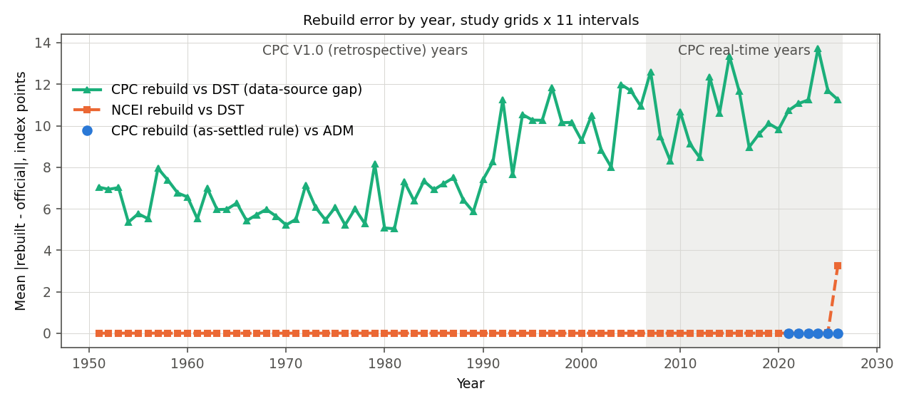

# PRF grids, official index values, and our rebuild of the PRF rainfall index

**Proposal cell:** Week 2 / Jack (B1, data foundation)  |  **Status:** VERIFIED (numbers below are reproducible from the scripts listed at the end)  |  **Last updated:** 2026-10-29

## Key findings

- **PRF grid IDs are a simple formula.** A PRF grid is one cell of NOAA CPC's 0.25-degree CONUS grid, and `grid_id = row * 300 + col + 1`, with `row = floor((lat - 20) / 0.25)` and `col = floor((lon + 130) / 0.25)`. All 22 interior test points (our 16 study-site points plus 6 others across the US) give the same ID and the same cell edges as RMA's own grid map.
- **RMA's Decision Support Tool (DST) has a public JSON back end that needs no login.** `GetIndexValues` returns, for any grid, the index, the interval rainfall (mm) and the expected rainfall (mm) for every year and interval. We pulled 956 grids: the 16 study grids plus every PRF grid within 100 miles of a settlement station. That is 794,436 grid-interval-years.
- **There are now two different sets of "official" PRF index values.**
  - (A) The *as-settled* final grid indexes in the Actuarial Data Master (ADM) are what RMA actually paid on. They use NOAA CPC data.
  - (B) The historical values the DST serves today (2026-10-29) have been recomputed from NOAA NCEI nClimGrid data for 1951-2026. That matches RMA's switch to NCEI on 2026-08-31.
  - On the 14 PRF study grids the two sets differ by 12.6 index points on average (2021-2026). They disagree on whether a 90%-coverage policy pays in 91 of 854 grid-interval-years (10.7%).
- **Our CPC rebuild reproduces what RMA paid on, essentially exactly.** It uses the handbook base period (1948 through two years before the crop year) and CPC's reprocessed "UPDATED" analysis for 2019 onward. Against the ADM final indexes for crop years 2021-2026 the mean absolute error is 0.002 index points, 97.9% of values match to RMA's 0.1-point rounding, the largest difference is 0.1, and no trigger decision differs (854 values).
- **Our NCEI rebuild reproduces what the DST shows, also essentially exactly.** It averages the 36 nClimGrid-Monthly cells in each PRF grid and uses the DST's base period (1951-2025, or 1951-2024 for 2026). The error is 0.03 index points over all 956 grids, and interval rainfall matches to within 0.05 mm in 99.5% of study-grid cases. The exception is 2026: the DST's Apr-May to Jun-Jul 2026 values come from an earlier nClimGrid release and differ from the current file by 4.4-8.2 index points.
- **Switching from CPC to NCEI is not a neutral change at a single grid.** At the same grids and years, a CPC-based index differs from the NCEI-based DST value by 8.3 index points on average (16 study grids, 1951-2026). The two disagree on the 90% trigger in 6.2% of cases (8.1% over all 956 grids). The CPC-based index also pays about 5% more on average at 90% coverage: mean payment factor 0.165 vs 0.157, ratio 1.05 over 956 grids. RMA says loss ratios are "nearly identical" overall; at the grid level the indexes are clearly different.
- **The DST has not yet published Jul-Aug or Aug-Sep 2026**, the first intervals settled under NCEI. As of 2026-10-29 the latest 2026 interval in the DST is Jun-Jul, for all 956 grids we pulled.

## Numbers table

| Quantity | Value | Units | Region / period | Source (URL + page/table) | Verification |
|---|---|---|---|---|---|
| PRF grid size, contiguous US | 0.25 x 0.25 | degrees lat x lon | CONUS | FCIC-18150 (2026) sec. 32A, p. 11 [1] | CONFIRMED |
| CPC grid dimensions | 300 x 120 | columns x rows | 230.125-304.875 E, 20.125-49.875 N | CPC RT .ctl file (`xdef 300 linear 230.125 0.250`, `ydef 120 linear 20.125 0.250`) [6] | CONFIRMED |
| Grid-ID formula offsets | +1 per cell east, +300 per cell north | grid IDs | CONUS | ArcGIS PRF_GRID layer, 30 polygons near DFW, 2026-10-29 [3] | CONFIRMED |
| Grid lookups that agree with RMA's map | 22 of 22 interior points | points | 16 study points + 6 check points | `scripts/pull_prf_official_index.py` output | CONFIRMED (computed) |
| Grid records in DST list / flagged CONUS | 36,843 / 13,626 | grids | all PRF | DST `GetContinentalUsGridList` [3] | CONFIRMED |
| PRF grids within 100 mi of a station (CONUS-flagged) | ABQ 129, DEN 136, DFW 125, OKC 129, ORD 141, SAT 123, SGF 134, TPA 71 (983 unique) | grids | 8 stations | `data/processed/prf_ring100_grids.csv` | CONFIRMED (computed) |
| Of those, grids with DST values / without | 956 / 27 (26 in Lake Michigan near ORD, 1 in the Gulf near TPA) | grids | same | DST `GetIndexValues` [3] | CONFIRMED |
| DST rows pulled | 794,436 | grid-interval-years | 956 grids, 1951-2026 | `data/processed/prf_official_index_ring100.parquet` | CONFIRMED |
| Years with DST values | 1951-2026 (1948-1950 returned empty) | years | all pulled grids | DST `GetIndexValues`, `GetListOfAvailableRainfallYears` [3] | CONFIRMED |
| DST tutorial statement on history | "current year back to 1948" | text | DST | DST User Tutorial, p. 24 [4] | CONFIRMED |
| Latest 2026 interval in DST | Jun-Jul | interval | 956 grids, 2026-10-29 | DST `GetIndexValues` [3] | CONFIRMED |
| DST reinsurance year setting | 2027 | year | DST page settings | DST page source [3] | CONFIRMED |
| Handbook base period, CPC | 1948 to two years before the crop year | years | PRF | FCIC-18150 sec. 33D, p. 13 [1] | CONFIRMED |
| Handbook example | 2025 crop year uses 1948-2023 | years | PRF | FCIC-18150 sec. 33D, p. 13 [1] | CONFIRMED |
| DST base period found | 1951-2025 for years <= 2025; 1951-2024 for 2026 | years | 956 grids | own recomputation; max difference vs DST expected value 9.7e-11 mm | CONFIRMED (computed) |
| DST index reproduced from DST's own rainfall and that base | 99.9999% to 0.1 points | share | 794,436 rows | `scripts/build_indices.py` | CONFIRMED (computed) |
| NCEI switch date for PRF | 2026-08-31 | date | PRF, Apiculture, Shellfish | RMA news release 2026-04-30 [2] | CONFIRMED |
| RMA statement on loss ratios | "nearly identical" | text | all | RMA news release 2026-04-30 [2] | CONFIRMED |
| PSL monthly-mean file coverage | 917 months, 1948-01 to 2024-05 | months | CONUS | PSL OPeNDAP DAS/DDS for precip.V1.0.mon.mean.nc [8] | CONFIRMED |
| PSL monthly-mean units | mm/day ("Monthly Average of Daily Accumulated Precipitation") | units | | same [8] | CONFIRMED |
| PSL note on vintage | "Monthly Values after 2006 are from the real time files (RT)" | text | | same [8] | CONFIRMED |
| CPC daily file units | 0.1 mm/day, little-endian float32, 2 fields (rain, gauge count) | units | | CPC README and RT .ctl [6] | CONFIRMED |
| CPC UPDATED archive coverage | 2019-01-01 to 2026-07-31 | days | CONUS, listing 2026-10-29 | CPC FTP UPDATED directory [7] | CONFIRMED |
| Lag of UPDATED files | 2025-01-01 file stamped 2025-03-22 | date | | CPC FTP listing [7] | CONFIRMED |
| CPC RT vs UPDATED, monthly totals 2025 | MAE 1.11; 81.7% within 1 mm; max 122.7 | mm | 2,070 cells x 12 months | own computation | CONFIRMED (computed) |
| Cells within 150 mi of a station | 2,206 total; 2,070 with CPC data; 2,036 with nClimGrid data | cells | 8 stations | `scripts/pull_cpc.py` output | CONFIRMED (computed) |
| nClimGrid resolution | 1/24 (0.04167) | degrees | CONUS | nClimGrid file metadata [9] | CONFIRMED |
| nClimGrid-Monthly coverage used | 1951-01 to 2026-09 (file covers 1895-01 to 2026-09) | months | CONUS | nclimgrid_prcp.nc, date_modified 2026-10-06 [9] | CONFIRMED |
| Example cell: grid 15432 Mar-Apr 2025 rainfall | DST 177.29; nClimGrid 36-cell mean 177.29; CPC UPDATED 120.01; CPC RT 120.49 | mm | DFW airport grid | DST API; [9]; [7]; own computation | CONFIRMED (computed) |
| Same, DFW airport gauge | 175.0 (Mar 1.67 in + Apr 5.22 in) | mm | USW00003927 | ACIS StnData [10] | CONFIRMED |
| As-settled ADM final indexes compared | 854 (14 grids x 11 intervals x 2021-2025, plus 6 intervals of 2026) | values | 14 PRF study grids | ADM A00810 "Final Index Value", via PRF actuarial workstream cache [11] | CONFIRMED (computed) |
| CPC rebuild (1948 to Y-2) vs ADM: MAE / exact to 0.1 / max / trigger disagreements | 0.002 / 97.9% / 0.1 / 0 | index points / share / points / count | 854 values, 2021-2026 | `scripts/build_indices.py` | CONFIRMED (computed) |
| Same with 1951 to Y-2 base | MAE 1.05; exact 5.2% | index points / share | same | same | CONFIRMED (computed) |
| Same with fixed 1948-2025 base | MAE 1.02; exact 12.4% | index points / share | same | same | CONFIRMED (computed) |
| Same with fixed 1981-2010 / 1991-2020 normal | MAE 7.39 / 5.90 | index points | same | same | CONFIRMED (computed) |
| CPC rebuild vs ADM for 2025, UPDATED vs RT for the 2025 months | UPDATED: MAE 0.001, exact 98.7%; RT: MAE 0.681, exact 48.1%, max 9.6 | index points | 154 values, 2025 | `scripts/build_indices.py` | CONFIRMED (computed) |
| DST value vs ADM | MAE 12.61; max 96.9; trigger disagreements 91 of 854 (10.7%) | index points | 14 grids, 2021-2026 | same | CONFIRMED (computed) |
| NCEI rebuild vs DST, 16 study grids | r 0.99993; MAE 0.027; trigger disagreement 0.015% (2 of 13,296) | index points | 1951-2026 | same | CONFIRMED (computed) |
| NCEI rebuild vs DST, by period | MAE 0.004 (1951-2006), 0.005 (2007-2025), 3.25 (2026) | index points | 16 study grids | same | CONFIRMED (computed) |
| NCEI rebuild vs DST, 956 grids | r 0.99990; MAE 0.033; trigger disagreement 0.033% | index points | 1951-2026 | same | CONFIRMED (computed) |
| NCEI rainfall vs DST rainfall | MAE 0.047; 99.5% within 0.05 mm | mm | 16 study grids | same | CONFIRMED (computed) |
| 2026 DST vs current nClimGrid, by interval | Jan-Feb 0.11, Feb-Mar 0.04, Mar-Apr 0.24, Apr-May 4.41, May-Jun 8.21, Jun-Jul 6.48 | index points | 16 study grids | same | CONFIRMED (computed) |
| CPC rebuild (fixed base) vs DST, 16 study grids | r 0.970; MAE 8.25; bias +0.41; trigger disagreement 6.2% | index points | 1951-2026 | same | CONFIRMED (computed) |
| Same, by period | MAE 7.39 (1951-2006), 10.71 (2007-2025), 11.26 (2026) | index points | 16 study grids | same | CONFIRMED (computed) |
| Same, 956 grids | r 0.948; MAE 10.23; trigger disagreement 8.1% | index points | 1951-2026 | same | CONFIRMED (computed) |
| CPC vs DST interval rainfall | MAE 10.96; median relative difference 6.3% | mm | 16 study grids | same | CONFIRMED (computed) |
| CPC-vs-DST MAE before / after 1990 | 6.28 (1951-1989) / 10.35 (1990-2025) | index points | 16 study grids | same | CONFIRMED (computed) |
| Standard deviation of the index | DST (NCEI) 50.0; CPC fixed base 52.8 | index points | 956 grids, 1951-2026 | same | CONFIRMED (computed) |
| Mean shortfall below 90 when triggered | DST 30.1; CPC 31.2 | index points | 956 grids, 1951-2026 | same | CONFIRMED (computed) |
| nClimGrid-Monthly precipitation reference | GHCN-Monthly Version 3 (Vose et al. 2011) | text | | nclimgrid_prcp.nc `prcp` attribute [9] | CONFIRMED |
| nClimGrid-Daily sources | GHCN-Daily, nClimGrid-Monthly | text | | ncdd-202503 file metadata [9] | CONFIRMED |
| Share of grid-interval-years with index < 90 | 47.1% (DST); 47.5% (CPC fixed base) | share | 16 study grids, 1951-2026 | same | CONFIRMED (computed) |
| Mean payment factor at 90% coverage | DST (NCEI) 0.157, CPC 0.165, ratio 1.052 (956 grids); 0.159 vs 0.165, ratio 1.042 (16 grids) | share of protection | 1951-2026, all intervals | same | CONFIRMED (computed) |
| Per-grid CPC-vs-DST MAE range | 4.8 (ORD farm) to 14.5 (DEN farm) | index points | 16 study grids | same | CONFIRMED (computed) |
| Distance from grid centre to station | station grids 1.7-8.6; farm grids 23.5-57.5 | miles | 8 sites | `data/processed/study_grids.csv` | CONFIRMED (computed) |
| Interval codes | 625 = Jan-Feb ... 635 = Nov-Dec | codes | PRF | DST API rows and DST JavaScript `GetIndexIntervalString` [3] | CONFIRMED |

## Detail

### 1. Terms used here

- **Grid index (final grid index).** For one grid and one two-month interval, it is 100 x (rain that fell in the interval) / (expected rain for that interval). The expected rain is the average over a **base period** of years. An index of 100 means normal rain.
- **Interval.** One of PRF's 11 overlapping two-month windows (Jan-Feb, Feb-Mar, ..., Nov-Dec). Names and codes are in `agri_hedge.prf_intervals`.
- **Trigger.** With coverage level c (70-90%), an interval pays when the final grid index is below 100c, for example below 90 at 90% coverage. The **payment calculation factor** is (trigger - index) / trigger. The indemnity is that factor times the policy protection.
- **DST.** RMA's PRF Decision Support Tool web app, which shows historical indexes and estimates premiums and indemnities.
- **ADM.** RMA's Actuarial Data Master, the bulk files that carry rates and the final index values used for payment.
- **CPC.** NOAA's Climate Prediction Center Unified Gauge-Based Analysis of daily precipitation over CONUS, at 0.25 degree. It comes in three versions:
  - **V1.0:** retrospective, through 2006.
  - **RT:** real time, made a day or so after the fact.
  - **UPDATED:** RT reprocessed about two months later with more gauge reports, available from 2019 on.
- **NCEI nClimGrid.** NOAA's National Centers for Environmental Information gridded climate data at 1/24 degree (about 5 km). nClimGrid-Monthly holds monthly totals.

### 2. Grid IDs and the study grids

The handbook says CONUS PRF grids are the 0.25-degree cells "created by NOAA CPC" [1, sec. 32A]. We queried RMA's grid map, the ArcGIS layer behind the DST's Grid Locator. Moving one cell east adds 1 to the ID and moving one cell north adds 300. ID 1 is the cell centred at 20.125 N, 129.875 W. That is exactly the order CPC uses to store its files ("from west to east first, and then south to north") [6]. So the PRF grid ID is the 1-based position of the cell in the CPC array, and the CPC array index of a grid is `divmod(grid_id - 1, 300)`.

`agri_hedge.prf_grid` implements `latlon_to_grid_id`, `grid_id_to_center`, `grid_id_to_bounds`, `grid_id_to_rowcol` and `grid_ids_within_radius`. Points exactly on a cell edge touch 2-4 polygons. RMA's map returned the southern one in our tests, while our function assigns the cell to the north and east. Edges matter only for points on exact quarter-degree lines.

| Site | Role | Grid ID | Grid centre (lat, lon) | Centre to station (mi) | Counties the DST lists for the grid |
|---|---|---|---|---|---|
| DFW | station | 15432 | 32.875, -97.125 | 6.18 | Dallas, Denton, Tarrant TX |
| DFW | farm | 15429 | 32.875, -97.875 | 49.52 | Parker, Wise TX |
| SAT | station | 11527 | 29.625, -98.375 | 8.60 | Bexar, Comal, Guadalupe TX |
| SAT | farm | 10626 | 28.875, -98.625 | 47.02 | Atascosa TX |
| OKC | station | 18430 | 35.375, -97.625 | 1.67 | Canadian, Cleveland, Grady, McClain, Oklahoma OK |
| OKC | farm | 18129 | 35.125, -97.875 | 23.90 | Grady OK |
| SGF | station | 20547 | 37.125, -93.375 | 7.98 | Christian, Greene MO |
| SGF | farm | 20845 | 37.375, -93.875 | 28.25 | Dade, Lawrence MO |
| DEN | station | 23802 | 39.875, -104.625 | 2.57 | Adams, Denver CO |
| DEN | farm | 23204 | 39.375, -104.125 | 43.14 | Elbert CO |
| ABQ | station | 18094 | 35.125, -106.625 | 5.77 | Bernalillo, Sandoval NM |
| ABQ | farm | 17497 | 34.625, -105.875 | 50.92 | Torrance NM |
| TPA | station | 9490 | 27.875, -82.625 | 8.01 | Hillsborough, Pinellas FL |
| TPA | farm | 8893 | 27.375, -81.875 | 57.52 | DeSoto, Hardee FL |
| ORD | station | 26269 | 41.875, -87.875 | 6.57 | Cook, DuPage IL |
| ORD | farm | 26267 | 41.875, -88.375 | 23.54 | Cook, DuPage, Kane IL |

The six extra check points (Seattle, Maine, Montana, Nebraska, Georgia, Kansas) also matched.

### 3. The official back end (for every workstream)

The DST page embeds its service URLs in a settings object. All calls below are plain HTTP GET with no authentication, verified 2026-10-29. Base: `https://public-rma.fpac.usda.gov/apps/PrfWebApi`.

| Endpoint | Parameters (example) | Returns |
|---|---|---|
| `/PrfExternalIndexes/GetIndexValues` | `intervalType=BiMonthly&sampleYearMinimum=1948&sampleYearMaximum=2026&gridId=15432` | per year and interval code: `PercentOfNormal` (index/100, 3 decimals), `IntervalMeasurement` (mm), `AverageIntervalMeasurement` (mm), `FilingStatusId` |
| `/PrfExternalIndexes/GetListOfAvailableRainfallYears` | none | 2026 ... 1951 |
| `/PrfExternalNoaaGrids/GetContinentalUsGridList` | none | 36,843 grid records with `IsContinentalUsFlag` |
| `/PrfExternalNoaaGrids/GetNoaaGridId`, `/IsInContinentalUsGridList` | `gridName=15432` | grid ID / flag |
| `/PrfExternalStates/GetStates`, `/GetCountiesByState`, `/GetCountiesAndStatesFromGridId` | `stateCode=48`; `gridId=15432&gridName=15432` | state and county lists |
| `/PrfExternalIntervalCodes/GetValidIntervalCodes` | `intervalType=BiMonthly&irrigationPracticeCode=997&organicPracticeCode=997&intendedUseCode=007&stateCode=48&countyCode=439&coverageLevelPercent=90&gridId=15432&gridName=15432` | premium rate per interval |
| `/PrfExternalPricingRates/GetPricingRates` | the above plus `productivityFactor=100` (integer percent, 60-150), `insurableInterest=100`, `insuredAcres=100`, `sampleYear=2026`, `intervalPercentOfValues=[50,0,50,0,0,0,0,0,0,0,0]` | policy protection, premium, subsidy, indemnity per interval (about 12 s per call) |
| `/PrfExternalEstimatedIndemnities/GetEstimatedIndemnityValues` | like GetPricingRates with `sampleYearMinimum` / `sampleYearMaximum` | historical indemnity estimates |
| `/PrfExternalMaxAcrePercentage/GetMaxAcrePercentage` | location and practice codes | maximum percent of value per interval |
| Grid map (ArcGIS, via the DST proxy) | `https://public-rma.fpac.usda.gov/apps/prf/proxy/proxy.ashx?https://pdgis.rm.usda.net/arcgis/rest/services/PRF/PRF_GRID/MapServer/0/query?geometry=<lon>,<lat>&geometryType=esriGeometryPoint&inSR=4326&spatialRel=esriSpatialRelIntersects&outFields=GRIDCODE&returnGeometry=true&outSR=4326&f=json` | grid polygon with `GRIDCODE`. Layer 1 is counties. The pdgis host is not reachable directly, only through the proxy. |

Because the DST's indemnity estimates are now based on NCEI history (section 5), they will not match what was actually paid for 2021-2026.

### 4. Data we pulled and units

- **CPC, 1948-01 to 2018-12:** PSL's monthly-mean file (mm/day) through OPeNDAP, for a box around the stations (about 30 MB). Monthly total (mm) = mean rate (mm/day) x days in the month. PSL fills months after 2006 from CPC RT [8].
- **CPC, 2019-01 to 2026-09:** CPC's own daily binary files, 0.1 mm per day (288 KB per day, about 815 MB of transfer). We use UPDATED where it exists (through 2026-07-31) and RT for 2026-08 and 2026-09. Only monthly totals are kept.
- **NCEI:** nClimGrid-Monthly, read one month at a time with HTTP byte-range requests (about 1.1 MB per month). We average the 6 x 6 = 36 nClimGrid cells whose centres fall inside each PRF grid; their edges line up exactly with the quarter-degree grid.
- **Conversion:** inches = mm / 25.4. Interval total = sum of the interval's two calendar months. Intervals never cross a year.

### 5. What the DST shows today is NCEI-based

Four observations point the same way:

1. The DST serves 1951-2026, but its own tutorial says the table runs back to 1948 [4]. The CPC record starts in 1948 and the handbook's base period starts in 1948 [1].
2. The expected rainfall the DST reports equals the plain mean of its own interval rainfall over 1951-2025, or 1951-2024 for the 2026 row, to 1e-10 mm on all 794,436 rows. No 1948-1950 values enter it.
3. The DST's interval rainfall equals the 36-cell nClimGrid-Monthly mean to within 0.05 mm in 99.5% of study-grid cases. CPC differs by 11 mm on average. For grid 15432 (DFW airport), Mar-Apr 2025:
   - DST 177.29 mm
   - nClimGrid 177.29 mm
   - CPC UPDATED 120.01 mm
   - DFW airport gauge 175.0 mm
4. The DST reports no values for grids over Lake Michigan, where nClimGrid has no land cells.

RMA's announcement does not name the NCEI product [2]. "nClimGrid-Monthly" is our identification from the exact numerical match, not an RMA statement.

The DST's own information page says historical indices are "based on current information" and may be "re-calibrated" as data are added [5]. That fits what we see: past years are shown against today's base period, not the one in force when they were settled.

### 6. Which base period RMA uses

The handbook says the expected index "represents the average precipitation for the grid ID during the index interval based on NOAA CPC data from 1948 to two years prior to the crop year". Its example is the 2025 crop year using 1948-2023 [1, sec. 33D, p. 13]. We tested six candidate base periods against the ADM's as-settled final indexes (854 values, 14 grids, 2021-2026):

| CPC base period | MAE (index points) | Share exact to 0.1 | Trigger disagreement at 90% |
|---|---|---|---|
| **Handbook: 1948 to Y-2** | **0.002** | **97.9%** | **0.0%** |
| 1951 to Y-2 | 1.051 | 5.2% | 0.7% |
| Fixed 1948-2025 (2026: 1948-2024) | 1.018 | 12.4% | 0.5% |
| Fixed 1951-2025 (DST rule) | 1.439 | 4.4% | 0.8% |
| Fixed 1981-2010 normal | 7.394 | 0.5% | 6.3% |
| Fixed 1991-2020 normal | 5.904 | 1.4% | 4.1% |

So the handbook rule is exactly what RMA settled on. The remaining 2.1% of values differ by exactly 0.1, which is a rounding-boundary effect. The DST instead uses 1951-2025 for every past year (1951-2024 for 2026), because it shows history against the current normal.

### 7. Validation results



*Figure 1. (a) Our CPC rebuild vs the ADM as-settled final index, 2021-2026. (b) Our NCEI rebuild vs the DST's current values, 1951-2026. (c) Our CPC rebuild with a fixed 1948-2025 base vs the DST's NCEI values. In (c) the scatter is the CPC-vs-NCEI data-source gap. Dotted lines mark the 90% trigger.*

**A. Against what RMA paid on (ADM, 14 PRF study grids):**

| Compared with ADM final index | Year | n | MAE (pts) | Max abs (pts) | Exact to 0.1 | Trigger disagreements |
|---|---|---|---|---|---|---|
| Our CPC rebuild (1948 to Y-2) | 2021-2026 | 854 | 0.002 | 0.1 | 97.9% | 0 |
| DST value shown today | 2021-2026 | 854 | 12.61 | 96.9 | 0.1% | 91 |
| Our NCEI rebuild | 2021-2026 | 854 | 12.51 | 96.9 | 0.2% | 91 |

Per year, the CPC rebuild's MAE is between 0.001 and 0.003 in every crop year 2021-2026. The DST-vs-ADM MAE is between 11.8 and 15.0.

**B. Against the DST's current values:**

| Rebuild vs DST | Grids | n | r | MAE (pts) | Trigger disagreement at 90% |
|---|---|---|---|---|---|
| NCEI (36-cell mean, 1951 base) | 16 study | 13,296 | 0.99993 | 0.027 | 0.015% |
| NCEI | 956 | 794,436 | 0.99990 | 0.033 | 0.033% |
| CPC (fixed 1948-2025 base) | 16 study | 13,296 | 0.970 | 8.25 | 6.2% |
| CPC | 956 | 794,436 | 0.948 | 10.23 | 8.1% |



*Figure 2. Mean absolute index error by year over the 16 study grids. The NCEI rebuild tracks the DST at about 0.005 points until 2026. The CPC-vs-NCEI gap averages 6.3 points in 1951-1989 and 10.3 points in 1990-2025. Dots show the CPC rebuild against the ADM, 2021-2026.*

CPC rebuild vs the DST, by period and by grid, 16 study grids:

| Period | n | r | MAE (pts) | Trigger disagreement |
|---|---|---|---|---|
| 1951-2006 (CPC V1.0) | 9,856 | 0.976 | 7.39 | 5.5% |
| 2007-2025 (CPC RT / UPDATED) | 3,344 | 0.955 | 10.71 | 8.3% |
| 2026 | 96 | 0.938 | 11.26 | 8.3% |

| Grid | MAE (pts) | r | Trigger disagreement |
|---|---|---|---|
| ORD farm 26267 | 4.80 | 0.982 | 4.2% |
| OKC station 18430 | 5.33 | 0.988 | 3.2% |
| OKC farm 18129 | 5.91 | 0.985 | 4.2% |
| SGF station 20547 | 6.14 | 0.973 | 4.1% |
| ORD station 26269 | 6.22 | 0.974 | 5.1% |
| SGF farm 20845 | 6.56 | 0.979 | 7.1% |
| DFW station 15432 | 6.76 | 0.984 | 4.3% |
| TPA station 9490 | 7.22 | 0.977 | 8.8% |
| DFW farm 15429 | 8.10 | 0.978 | 5.4% |
| SAT farm 10626 | 8.31 | 0.980 | 4.0% |
| SAT station 11527 | 9.52 | 0.973 | 5.3% |
| ABQ station 18094 | 9.89 | 0.971 | 5.9% |
| DEN station 23802 | 9.95 | 0.960 | 5.8% |
| TPA farm 8893 | 11.38 | 0.934 | 11.3% |
| ABQ farm 17497 | 11.49 | 0.961 | 7.3% |
| DEN farm 23204 | 14.47 | 0.924 | 13.4% |

The gap is largest in the dry West (DEN, ABQ) and in rural Florida (TPA farm). It is smallest in the gauge-dense Midwest and Oklahoma.

### 8. Why the residual differences exist

- **Data source (CPC vs NCEI).** This is the dominant term. CPC interpolates each 0.25-degree cell from a few nearby gauges each day [1, sec. 33A]. nClimGrid is a 5-km station-based field: the monthly file cites GHCN-Monthly v3, and the daily file lists GHCN-Daily and nClimGrid-Monthly as sources [9]. The PRF grid value averages 36 of its cells. The two disagree by 6.3% of interval rainfall at the median. The CPC index is more spread out (standard deviation 52.8 vs 50.0 points over 956 grids). So it falls below 90 slightly more often (47.5% vs 47.1% on the study grids) and goes deeper when it does (mean shortfall 31.2 vs 30.1 points). The mean payment factor at 90% coverage is about 5% higher under CPC (0.165 vs 0.157 over 956 grids).
- **Base period.** The DST uses 1951 to Y-2 for the current year and 1951-2025 for all past years. Settlement under CPC used 1948 to Y-2. On CPC data, using the wrong base costs about 1 index point of MAE (section 6 table).
- **CPC version (V1.0 vs RT vs UPDATED).**
  - Through 2006 PSL's history is the retrospective V1.0. After that it is real-time RT.
  - RMA settled on UPDATED: for 2025, the rebuild error rises from 0.001 to 0.681 points (max 9.6) if RT replaces UPDATED, and exact matches fall from 98.7% to 48.1%.
  - RT and UPDATED monthly totals differ by 1.1 mm on average but by up to 123 mm in single cells (2025).
  - The CPC-vs-NCEI gap also grows after about 1990 (Figure 2). We have not established why; see open questions.
- **NCEI data vintage.** NCEI revises nClimGrid as late station reports arrive. The DST's 2026 values for Jan-Feb to Mar-Apr still match the current file, to 0.24 points or better. Apr-May, May-Jun and Jun-Jul 2026 do not: they differ by 4.4, 8.2 and 6.5 points (7-15 mm). Those values were computed from an earlier nClimGrid release and have not been updated. 2025 shows a trace of the same effect (mean 0.03 mm, max 1.6 mm).
- **The NCEI switch for late-2026 intervals.** Jul-Aug 2026 and later are the first intervals settled on NCEI data. As of 2026-10-29 neither the DST nor (per the actuarial workstream's extract) the ADM carries them. Their final values will need a fresh pull. Our NCEI series already contains Jul-Sep 2026 from the current nClimGrid file, but those are not official numbers.
- **Coast and lakes.** 27 PRF-flagged grids near Chicago and Tampa have no DST values because nClimGrid has no land there. CPC has values for all 27.

## Implications for our replication design

- **Use the right "official" index for each question.**
  - To compare Kalshi payouts with what a PRF policyholder actually received in 2021-2026, use the as-settled ADM values or our CPC rebuild (`cpc_interval_index.parquet`, `index_value_ours`). The DST values are 12.6 points off these on average.
  - For crop years from Jul-Aug 2026 on, PRF settles on NCEI. Use `ncei_interval_index.parquet`, or the DST once RMA publishes the values.
- **For long historical backtests**, use one fixed base so that every year is on the same scale. Use either `index_value_fixed_base` (CPC, base 1948-2025) or the NCEI series (base 1951-2025), and state which. Measured against each other, the source choice alone changes the trigger decision in 6-8% of grid-interval-years.
- **For the Kalshi replication**, the NCEI source matters going forward. nClimGrid is built from GHCN station networks [9], and Kalshi's settlement airports are GHCN-Daily stations (DFW is USW00003927). The station-to-grid gap may therefore be smaller under NCEI than under CPC, but we have not measured that yet. The basis-risk work (W3) should compare station rainfall with both series. `prf_ring100_grids.csv` plus `prf_official_index_ring100.parquet` give the 956 grids within 100 miles for a basis-risk-vs-distance curve.
- **Freeze data vintages.** Both CPC (RT to UPDATED) and nClimGrid (monthly revisions) change after the fact, while RMA's final index is fixed when published. Any payout comparison should record which vintage it used. Our caches record the source per month in the `source` column.
- **The index formula is settled.** It is index = 100 x interval total / mean over the base years, rounded to 0.1, with intervals summed from calendar months. `agri_hedge.cpc.compute_index` with `handbook_base_end` (as-settled) or `dst_base_end` (DST display) reproduces both official series.

## Unverified claims and open questions

- RMA has not said in any document we opened that the NCEI product is nClimGrid-Monthly. That is our inference from the 0.05-mm match. It is also unclear whether settlement after 2026-08-31 will use the 1951 base start (as the DST does) or keep 1948 (as the 2026 handbook says for CPC). A 2027 handbook or the next ADM will answer this.
- It is unknown whether RMA plans to revise the 2026 Apr-May to Jun-Jul DST values to the newer nClimGrid vintage, and which vintage will be final for the NCEI-era intervals.
- The ADM comparison covers 14 grids and crop years 2021-2026 only, because the "Final Index Value" field appears in ADM files from about 2021 (per the actuarial workstream). For 2007-2020 we have not checked whether the handbook rule and CPC vintage also hold; RT-only years (2007-2018) may match less well.
- We have not explained why the CPC-vs-NCEI gap grows after about 1990 (Figure 2). Changes in either product's station network are a plausible cause but unverified.
- RMA's claim that loss ratios are "nearly identical" under NCEI is a national, premium-weighted statement. Our 1.05 payment-factor ratio is an unweighted average over 956 grids near our stations, all 11 intervals and all years, at 90% coverage. The two are not directly comparable.
- Our points on exact quarter-degree lines follow a north/east convention that may differ from RMA's map. None of our study points are on an edge.

## Sources

1. USDA RMA, *Rainfall Index Insurance Standards Handbook*, FCIC-18150 (2026 and succeeding crop years), August 2025. Sec. 32A Grid Area (p. 11), 32B Index Intervals (p. 11), 33A NOAA CPC Precipitation Data (p. 13), 33D Expected and Final Grid Index (p. 13). https://www.rma.usda.gov/sites/default/files/2025-08/2026-18150-Rainfall-Index-Handbook.pdf
2. USDA RMA news release, "USDA Risk Management Agency Upgrades Rainfall Data Source," April 30, 2026. https://www.rma.usda.gov/news-events/news/2026/washington-dc/usda-risk-management-agency-upgrades-rainfall-data-source
3. USDA RMA, PRF Decision Support Tool (page source, JavaScript `Scripts/Services/PrfController.js`, and the REST endpoints in section 3), accessed 2026-10-29. https://public-rma.fpac.usda.gov/apps/PRF ; API base https://public-rma.fpac.usda.gov/apps/PrfWebApi ; grid layer https://pdgis.rm.usda.net/arcgis/rest/services/PRF/PRF_GRID/MapServer/0 (through the DST proxy).
4. USDA RMA, *User Tutorial - PRF Decision Support Tool*, p. 24 (Historical Filter). https://public-rma.fpac.usda.gov/apps/PRF/Content/PDFs/User%20Tutorial%20-%20PRF%20Decision%20Support%20Tool.pdf
5. USDA RMA, *PRF Decision Support Tool Information* (Important Notes; Actual Index Values). https://public-rma.fpac.usda.gov/apps/PRF/Content/PDFs/PRF%20Decision%20Support%20Tool%20Information.pdf
6. NOAA CPC, GAUGE_CONUS documentation: `PRCP_CU_GAUGE_V1.0CONUS_0.25deg.README` and `PRCP_CU_GAUGE_V1.0CONUS_0.25deg.lnx.RT.ctl`. https://ftp.cpc.ncep.noaa.gov/precip/CPC_UNI_PRCP/GAUGE_CONUS/DOCU/
7. NOAA CPC, GAUGE_CONUS daily archives (V1.0/, RT/, UPDATED/ directory listings, accessed 2026-10-29). https://ftp.cpc.ncep.noaa.gov/precip/CPC_UNI_PRCP/GAUGE_CONUS/
8. NOAA PSL, CPC Unified Gauge-Based Analysis of Daily Precipitation over CONUS, `precip.V1.0.mon.mean.nc` (OPeNDAP DAS/DDS) and daily files. https://psl.noaa.gov/thredds/dodsC/Datasets/cpc_us_precip/precip.V1.0.mon.mean.nc ; https://downloads.psl.noaa.gov/Datasets/cpc_us_precip/
9. NOAA NCEI, nClimGrid-Monthly `nclimgrid_prcp.nc` (date_modified 2026-10-06) and nClimGrid-Daily file metadata (DOI 10.25921/c4gt-r169; reference doi:10.1175/JTECH-D-22-0024.1). https://www.ncei.noaa.gov/data/nclimgrid-monthly/access/ ; https://www.ncei.noaa.gov/data/nclimgrid-daily/
10. NOAA RCC ACIS web services, StnData for USW00003927 (DFW), monthly precipitation 2025-2026, accessed 2026-10-29. https://data.rcc-acis.org/StnData
11. USDA RMA Actuarial Data Master, table A00810 "Final Index Value", crop years 2021-2026, as extracted by the PRF actuarial workstream (`scripts/pull_prf_actuarial.py`, cache `data/raw/prf_actuarial/adm_final_index_history.csv`). https://pubfs-rma.fpac.usda.gov/pub/References/actuarial_data_master/

## Reproduce

```bash
python scripts/pull_prf_official_index.py   # grid validation, study_grids.csv, DST index pull (~10 min first run)
python scripts/pull_cpc.py                  # CPC + NCEI monthly grids (~15 min first run)
python scripts/build_indices.py             # rebuilds, validation tables, figures (~20 s)
python -m pytest tests/test_prf_grid.py tests/test_indices.py
```

Processed outputs:
- `data/processed/study_grids.csv`
- `prf_official_index.csv` (16 study grids)
- `prf_official_index_ring100.parquet` (956 grids)
- `prf_ring100_grids.csv`
- `cpc_monthly_precip_grids.parquet`
- `ncei_monthly_precip_grids.parquet`
- `cpc_interval_index.parquet`
- `ncei_interval_index.parquet`
- `b1_index_validation_summary.csv` (every computed number above)
