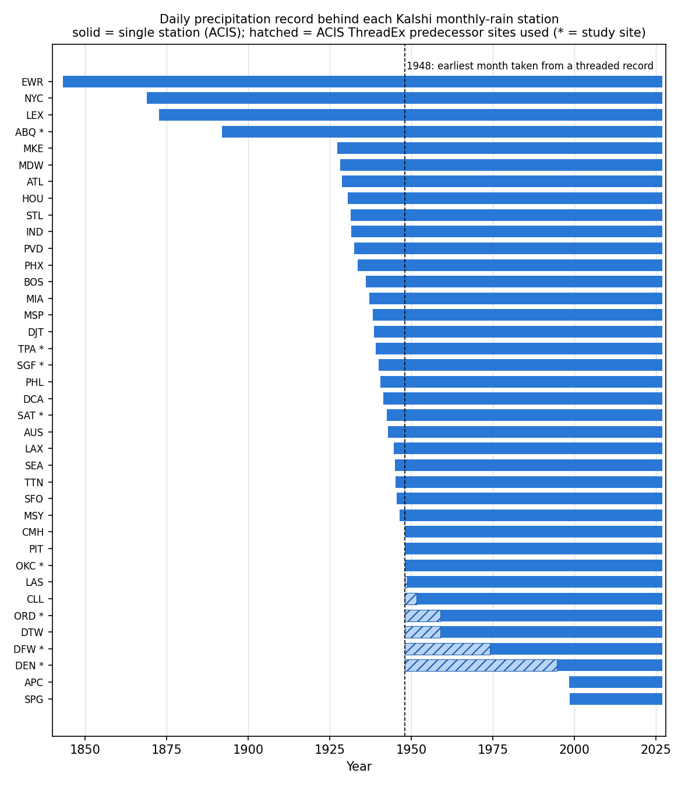
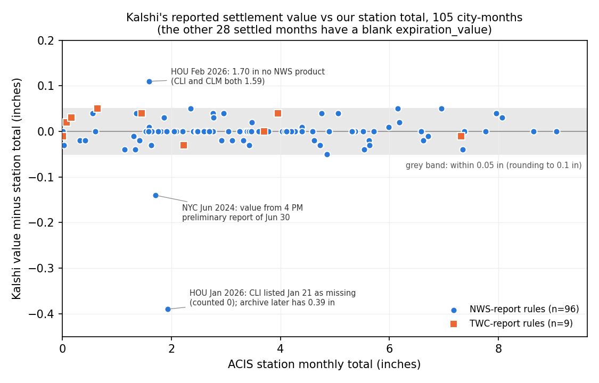
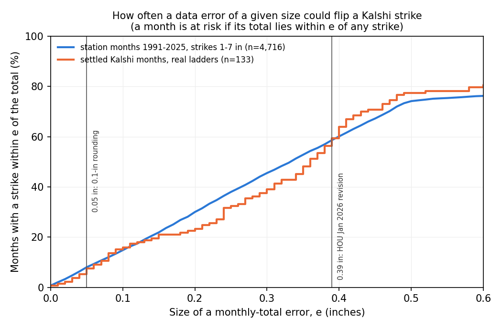

# 06c: Do settlement-station records reproduce Kalshi's monthly-rain settlements?

**Proposal cell:** Milestone 1, workstream B3 (settlement stations and settlement check) / Evan  |  **Status:** DRAFT  |  **Last updated:** 2026-10-29

Code: `src/agri_hedge/stations.py`, `scripts/pull_stations.py`, `scripts/check_kalshi_settlement.py`, tests in `tests/test_stations.py`.
Data: `data/processed/station_map.csv`, `station_monthly_precip.csv`, `station_daily_precip_study.parquet`, `kalshi_settlement_vs_station.csv`.

## Key findings

- **Our station data reproduce every settled outcome.** ACIS daily records from the settlement station give the same YES/NO result as Kalshi for **922 of 922** settled markets, covering **133 of 133** settled city-months (Feb 2024 to Sep 2026, 11 series). Because the markets within one month are not independent, the honest bound is per month. The 95% Clopper-Pearson lower bound on the per-month agreement rate is **97.3%**.
- **Kalshi settles on the first complete NWS daily climate report, not on the cleaned archive.** The RAINM contract terms say: use the first NWS Daily Climate Report (the "CLI" report) that covers every day of the month; count trace ("T") as 0.00 and missing ("M") days as 0.00; ignore later corrections, including the final quality-controlled record (Local Climatological Data, LCD). "Above X" means strictly greater than X. A station archive can therefore disagree with the settlement value whenever the NWS later fills in a missing day.
- **That has happened once so far, and it did not flip an outcome.** For Houston Hobby in Jan 2026, the CLI report listed Jan 21 as missing. Kalshi (and the CLI) used 1.54 in, but the archive now has 0.39 in for that day, for a total of 1.93 in. The nearest strike was 2 in, so the month was 0.07 in away from a disagreement.
- **Kalshi's reported `expiration_value` agrees with our total up to rounding.** Of the 105 city-months that have a value, 53 match exactly and 49 match after rounding to 0.1 in. The newer RAINM series report 0.1-in values from Feb 2026 on. Three months differ by more than rounding: Houston Jan 2026 (-0.39 in, the missing day above), New York Jun 2024 (-0.14 in, which matches the 4 PM *preliminary* report of Jun 30), and Houston Feb 2026 (+0.11 in; no NWS product we found says 1.70). None of the three changed an outcome.
- **Most of our study sites have no settlement history.** Only 11 of the 38 monthly-rain series have settled complete months. Twenty series, including the SAT, OKC, SGF, ABQ and TPA study sites, listed their first month (Nov 2026) on 2026-10-25. Among the study sites, only DFW (11 months) and DEN (11 months) have settled history. ORD has 1 month, because KXRAINCHIM settled on Chicago **Midway** through Aug 2026 and switched to O'Hare from the Sep 2026 contract on.
- **The station map covers 38 series and 38 distinct stations, in 39 series-station rows.** Six rows are flagged ambiguous: the Chicago switch (2 rows), New York (the rules name "Central Park" rather than a CLI code), the legacy RAINNYCM series (it lists no markets), St. Petersburg (ACIS's "SPG" id points to a COOP site that closed in 2015; we use Albert Whitted ASOS), and Napa (the rules name airport KAPC and settle on The Weather Company only).
- **ACIS and NCEI GHCN-Daily agree exactly.** At all 8 study-site stations, ACIS and GHCN monthly totals match in 100% of complete months (371 to 1,145 months per station). The NWS CLI month-end totals match ACIS in 131 of 133 settled months.
- **Long histories need ThreadEx splices at three study sites.** A ThreadEx ("threaded") record joins a station to the predecessor sites that kept the city's official record before it. The single-station records start in 1974-01 at DFW, 1994-07 at DEN and 1958-11 at ORD, so we fill back to 1948 with ACIS threaded records. The DFW and DEN threads equal the current station in 100% of overlap months. The Chicago thread equals O'Hare in only 68.8% of overlap months, because it follows other Chicago sites after 1958.
- **Small data errors matter.** In 8.0% of station-months (1991-2025, strikes of 1 to 7 in), the total lies within 0.05 in of a strike, and in 58.6% it lies within 0.39 in. From the observed discrepancy sizes we estimate that a station-based backtest will settle about **0.4% of city-months** (roughly 1 in 250) differently from Kalshi.
- **The settlement source is changing.** Starting with the Sep 2026 contracts, `rules_secondary` names "the corresponding TWC Report (Daily)" (TWC = The Weather Company) as the final source. All 9 TWC-rule months so far agree with the station data.

## Numbers table

"Computed" means we derived the number from the primary data named in the source column using the scripts listed above (run 2026-10-29). Verification is CONFIRMED when we read the value or rule directly in the primary source or data.

| Quantity | Value | Units | Region / period | Source (URL + page/table) | Verification |
|---|---|---|---|---|---|
| Kalshi "Climate and Weather" series | 458 | series | all | Kalshi API `/series?category=Climate%20and%20Weather`, retrieved 2026-10-29 | CONFIRMED |
| Monthly-rain series (ticker contains RAIN, ends in M) | 38 | series | US cities | same | CONFIRMED |
| Series-station rows in station_map.csv | 39 | rows | 38 series | computed; Kalshi `rules_primary` text + ACIS StnMeta | CONFIRMED (computed) |
| Distinct settlement stations | 38 | stations | US | same | CONFIRMED (computed) |
| Rows flagged ambiguous | 6 | rows | CHIM x2, NYCM, RAINNYCM, STPM, NAPAM | same | CONFIRMED (computed) |
| KXRAINCHIM station, events 2025-06 to 2026-08 | CLIMDW (Midway) | - | Chicago | Kalshi `rules_primary` of each market | CONFIRMED |
| KXRAINCHIM station, events from 2026-09 | CLIORD (O'Hare) | - | Chicago | same | CONFIRMED |
| Series with settled complete months | 11 | series | Feb 2024 - Sep 2026 | Kalshi `/markets?status=settled` + `/historical/markets` | CONFIRMED (computed) |
| Series with no settled market at all | 22 | series | as of 2026-10-29 | same | CONFIRMED (computed) |
| Series whose first listed month is Nov 2026 | 20 | series | markets created 2026-10-25 | same (event tickers, `created_time`) | CONFIRMED (computed) |
| NYC markets without strike fields | 4 | markets | KXRAINNYCM-25JAN-1 to -4 | Kalshi API | CONFIRMED |
| Settled markets in complete months | 922 | markets | 133 city-months | same | CONFIRMED (computed) |
| Settled city-months (events) | 133 | months | 11 series, 12 stations | same | CONFIRMED (computed) |
| New York settled months | 32 | months | Feb 2024 - Sep 2026 | same | CONFIRMED (computed) |
| Other cities' settled months | 11 | months | Nov 2025 - Sep 2026 (ORD and SPG: 1) | same | CONFIRMED (computed) |
| Markets where station outcome = Kalshi outcome | 922 / 922 | markets | all settled | computed vs ACIS StnData | CONFIRMED (computed) |
| City-months with station total inside ladder range | 133 / 133 | months | all settled | same | CONFIRMED (computed) |
| 95% Clopper-Pearson lower bound, per market | 99.6 | % | 922 markets | computed, 0.025^(1/922) | CONFIRMED (computed) |
| 95% Clopper-Pearson lower bound, per month | 97.3 | % | 133 months | computed, 0.025^(1/133) | CONFIRMED (computed) |
| Markets where NWS CLI month-end outcome = Kalshi | 922 / 922 | markets | all settled | IEM CLI archive `geojson/cli.py` | CONFIRMED (computed) |
| Months where CLI month-end total = ACIS total | 131 / 133 | months | all settled | IEM CLI archive vs ACIS | CONFIRMED (computed) |
| City-months with a non-blank `expiration_value` | 105 | months | all settled | Kalshi API market field | CONFIRMED |
| City-months with blank `expiration_value` | 28 | months | all settled | same | CONFIRMED |
| Value exactly equal to station total | 53 | months | of 105 | computed | CONFIRMED (computed) |
| Value equal to station total rounded to 0.1 in | 49 | months | of 105 | computed | CONFIRMED (computed) |
| Values within 0.05 in of station total | 102 | months | of 105 | computed | CONFIRMED (computed) |
| Largest value difference | 0.39 | in | HOU Jan 2026 | computed | CONFIRMED (computed) |
| Last month with 2-decimal values, RAINM series | Jan 2026 | - | all except NYC and STP | Kalshi `expiration_value` | CONFIRMED (computed) |
| HOU Jan 2026: Kalshi value / CLI month-to-date | 1.54 / 1.54 | in | Houston Hobby | Kalshi API; CLIHOU issued 1245 AM CST Feb 1 2026 (IEM AFOS) | CONFIRMED |
| HOU Jan 2026: ACIS total | 1.93 | in | Houston Hobby | ACIS StnData uid 22999 | CONFIRMED |
| HOU Jan 21 2026: CLI daily value / ACIS value | M / 0.39 | in | Houston Hobby | IEM `json/cli.py?station=KHOU&year=2026`; ACIS | CONFIRMED |
| HOU Feb 2026: Kalshi value / CLI / CLM / ACIS | 1.70 / 1.59 / 1.59 / 1.59 | in | Houston Hobby | Kalshi API; CLIHOU 130 AM CST Mar 1 2026; CLMHOU 519 PM CST Mar 1 2026 | CONFIRMED |
| NYC Jun 2024: 4 PM preliminary MTD (Jun 30) | 1.57 | in | Central Park | CLINYC 435 PM EDT Jun 30 2024 (IEM AFOS) | CONFIRMED |
| NYC Jun 2024: final MTD (Jun 30) / ACIS / Kalshi | 1.71 / 1.71 / 1.57 | in | Central Park | CLINYC 251 AM EDT Jul 1 2024; ACIS; Kalshi API | CONFIRMED |
| NYC Feb 2025: CLI / ACIS | 2.59 / 2.60 | in | Central Park | IEM CLI archive; ACIS | CONFIRMED |
| DEN Jul 2026: total equal to strike, settled NO | 1.00 vs strike 1 | in | Denver Intl | ACIS; Kalshi KXRAINDENM-26JUL-1 | CONFIRMED |
| Markets with total within 0.05 in of strike | 10 | markets | of 922 | computed | CONFIRMED (computed) |
| Markets that closed early (YES before month end) | 33 | markets | 9 city-months | Kalshi `close_time` | CONFIRMED (computed) |
| Oct 2026 early YES consistent with station month-to-date | 21 / 21 | markets | through 2026-10-28 | Kalshi API; ACIS | CONFIRMED (computed) |
| Markets under TWC-source rules (Sep 2026 events) | 72 | markets | 9 city-months | Kalshi `rules_secondary` | CONFIRMED (computed) |
| Lifetime volume, all 922 markets (`volume_fp`) | 14,401,161 | contracts | Feb 2024 - Sep 2026 | Kalshi API | CONFIRMED (field read); unit assumed contracts |
| Station-months within 0.05 / 0.10 / 0.39 in of a strike | 8.0 / 14.8 / 58.6 | % | 12 settled-series stations, 1991-2025, strikes 1-7 in, 4,716 months | computed from ACIS | CONFIRMED (computed) |
| Same, settled Kalshi months with real ladders | 7.5 / 15.8 / 59.4 | % | 133 months | computed | CONFIRMED (computed) |
| Estimated station-vs-Kalshi mis-settlement rate | about 0.4 | % of city-months | forward-looking | our estimate (see "Backtest reliability") | estimate, not a measurement |
| GHCN = ACIS monthly totals, 8 study stations | 100 | % of complete months | 371 (DEN) to 1,145 (ABQ) months | NCEI GHCN-Daily access CSV vs ACIS | CONFIRMED (computed) |
| DFW single-station record start | 1974-01-01 | date | DFW airport | ACIS StnMeta valid_daterange | CONFIRMED |
| DEN single-station record start | 1994-07-20 | date | Denver Intl | same | CONFIRMED |
| ORD single-station record start | 1958-11-01 | date | O'Hare | same | CONFIRMED |
| DFWthr / DENthr / ORDthr start | 1898-09-01 / 1872-01-01 / 1871-01-02 | date | ThreadEx | ACIS StnMeta (sid "xxxthr 9") | CONFIRMED |
| Thread = single station in overlap, DFW / DEN / ORD / DTW | 100 / 100 / 68.8 / 89.3 | % of months | overlap to Sep 2026 | computed from ACIS | CONFIRMED (computed) |
| Months spliced from threaded records | 1,184 | months | DEN 559, DFW 312, DTW 131, ORD 130, CLL 43, LAS 9 | station_monthly_precip.csv | CONFIRMED (computed) |
| Rows in station_monthly_precip.csv | 41,328 | months | 38 stations, 1843-05 to 2026-09 | computed | CONFIRMED (computed) |
| Share of months since 1948 with no missing day | 97.2 | % | all 38 stations | computed | CONFIRMED (computed) |
| Months since 1948 with missing days, TTN / MDW / AUS | 603 / 228 / 60 | months | worst three stations | computed | CONFIRMED (computed) |
| Mean trace days per month, 1991+ | 3.7 | days | all stations | computed | CONFIRMED (computed) |
| Kalshi historical cutoff (market_settled_ts) | 2026-08-30 | date | API | Kalshi `/historical/cutoff` | CONFIRMED |
| RAINM latest expiration date | 15 | days after month end | contract terms | https://assets.kalshi.com/contract_terms/RAINM.pdf p.2 | CONFIRMED |
| RAINM position accountability level | 25,000 | USD per strike per member | contract terms | same, p.2 | CONFIRMED |
| RAINNYCM position limit | 25,000 | USD per member | contract terms | https://assets.kalshi.com/contract_terms/RAINNYCM.pdf p.1 | CONFIRMED |
| RAINNYCM expiration fallback | one week | after month end | contract terms | same, p.1 | CONFIRMED |

## Detail

### 1. What exactly does a Kalshi monthly-rain contract pay on?

Each city-month is an *event* that holds a ladder of binary markets such as "Above 3 inches". A market pays $1 if YES. We read both contract-terms documents in full.

**RAINM** (assets.kalshi.com/contract_terms/RAINM.pdf), used by every KX...M series except New York:
- The underlying is the monthly total "as reported in the first Daily Climate Report published by the NWS Weather Forecast Office that contains precipitation data for all calendar days" of the month (p.1).
- Trace counts as 0.00, and a day listed as missing ("M") in that first complete report counts as 0.00 (p.1).
- Later corrections, amendments and the final LCD data "shall not affect market resolution" unless Kalshi judges the first report materially wrong. In that case it may delay expiration, at most until 15 days after month end (p.1-2).
- "Above" means strictly greater than (>). "Between" includes the lower bound and excludes the upper bound (p.1).

**RAINNYCM** (assets.kalshi.com/contract_terms/RAINNYCM.pdf), used by KXRAINNYCM and the legacy RAINNYCM: Kalshi sums "the most recent daily climate reports for any given day" for Central Park, uses "initial non-preliminary reported values", and names the NWS first and TWC second (p.1).

What the API shows: every rain market is `strike_type = "greater"`. The four Jan 2025 New York markets have no strike fields, so we read their strike from `yes_sub_title` ("Above 1 inches"). From the Sep 2026 events on, `rules_secondary` reads "...as reported by the corresponding TWC Report (Daily)", while earlier events named the NWS Climatological Report. Markets "close and expire early if the event occurs": 33 markets in 9 settled months resolved YES before month end. This makes sense because precipitation can only accumulate, but it also means the reported `expiration_value` of an early-closed market is a partial-month figure. We therefore take each event's value from its last-settled market.

### 2. Station map (`data/processed/station_map.csv`)

Method: (1) pull every market of every series from `/markets` (all statuses) and `/historical/markets`, because Kalshi moved markets settled before 2026-08-30 to the historical endpoint; (2) parse the station from each market's `rules_primary` ("at CLIDFW in Dallas"); (3) look the 3-letter code up in ACIS StnMeta as ICAO ("KDFW 5"), FAA ("DFW 3") and NWS id ("DFW 7"); (4) look up the ACIS ThreadEx record "DFWthr 9". If the lookups return different stations, we choose the airport ASOS site that has a GHCN "USW" id, because CLI reports come from those sites, and we flag the row.

| Series | CLI code | Station | GHCN-Daily | Single-station start | Thread used | First event | Settled mkts | Flag |
|---|---|---|---|---|---|---|---|---|
| KXRAINABQM | CLIABQ | Albuquerque Intl Ap | USW00023050 | 1891-12-01 | - | 2026-11 | 0 |  |
| KXRAINATLM | CLIATL | Atlanta Hartsfield-Jackson Intl | USW00013874 | 1928-09-01 | - | 2026-11 | 0 |  |
| KXRAINAUSM | CLIAUS | Austin Bergstrom Intl Ap | USW00013904 | 1942-10-17 | - | 2025-11 | 75 |  |
| KXRAINBOSM | CLIBOS | Boston Logan Intl | USW00014739 | 1936-01-01 | - | 2026-11 | 0 |  |
| KXRAINCHIM | CLIMDW | Chicago Midway Ap | USW00014819 | 1928-02-29 | - | 2025-06 | 77 | yes |
| KXRAINCHIM | CLIORD | Chicago O'Hare Intl Ap | USW00094846 | 1958-11-01 | ORDthr to 1958-10 | 2026-09 | 9 | yes |
| KXRAINCLLM | CLICLL | College Station Easterwood | USW00003904 | 1951-08-01 | CLLthr to 1951-07 | 2026-10 | 3 |  |
| KXRAINCMHM | CLICMH | Columbus John Glenn Intl | USW00014821 | 1948-01-01 | - | 2026-10 | 1 |  |
| KXRAINDALM | CLIDFW | Dal-Ftw WSCMO Ap | USW00003927 | 1974-01-01 | DFWthr to 1973-12 | 2025-11 | 81 |  |
| KXRAINDCM | CLIDCA | Washington Reagan National | USW00013743 | 1941-06-16 | - | 2026-11 | 0 |  |
| KXRAINDENM | CLIDEN | Denver Intl Ap | USW00003017 | 1994-07-20 | DENthr to 1994-07 | 2025-11 | 77 |  |
| KXRAINDTWM | CLIDTW | Detroit Metro | USW00094847 | 1958-12-01 | DTWthr to 1958-11 | 2026-11 | 0 |  |
| KXRAINEWRM | CLIEWR | Newark Liberty Intl Ap | USW00014734 | 1843-05-01 | - | 2026-11 | 0 |  |
| KXRAINHOUM | CLIHOU | Houston William P Hobby Ap | USW00012918 | 1930-08-01 | - | 2025-11 | 75 |  |
| KXRAININDM | CLIIND | Indianapolis Intl Ap | USW00093819 | 1931-08-01 | - | 2026-11 | 0 |  |
| KXRAINLAXM | CLILAX | Los Angeles Intl Ap | USW00023174 | 1944-08-01 | - | 2025-11 | 78 |  |
| KXRAINLEXM | CLILEX | Lexington Bluegrass Ap | USW00093820 | 1872-10-01 | - | 2026-10 | 1 |  |
| KXRAINLVM | CLILAS | Las Vegas Harry Reid Intl | USW00023169 | 1948-09-06 | LASthr to 1948-09 | 2026-11 | 0 |  |
| KXRAINMIAM | CLIMIA | Miami International Ap | USW00012839 | 1937-03-01 | - | 2025-11 | 90 |  |
| KXRAINMINM | CLIMSP | Minneapolis-St. Paul Intl | USW00014922 | 1938-04-01 | - | 2026-11 | 0 |  |
| KXRAINMKEM | CLIMKE | Milwaukee Mitchell | USW00014839 | 1927-05-01 | - | 2026-10 | 1 |  |
| KXRAINNAPAM | (KAPC) | Napa County Airport | USW00093227 | 1998-05-22 | - | 2026-10 | 0 | yes |
| KXRAINNOLAM | CLIMSY | New Orleans Ap | USW00012916 | 1946-05-01 | - | 2026-11 | 0 |  |
| KXRAINNYCM | CLINYC | NY City Central Park | USW00094728 | 1869-01-01 | - | 2024-02 | 211 | yes |
| KXRAINOKCM | CLIOKC | Oklahoma City Will Rogers | USW00013967 | 1948-01-01 | - | 2026-11 | 0 |  |
| KXRAINPHILM | CLIPHL | Philadelphia Intl Ap | USW00013739 | 1940-07-01 | - | 2026-11 | 0 |  |
| KXRAINPHXM | CLIPHX | Phoenix Sky Harbor | USW00023183 | 1933-07-01 | - | 2026-11 | 0 |  |
| KXRAINPITM | CLIPIT | Pittsburgh Intl | USW00094823 | 1948-01-01 | - | 2026-11 | 0 |  |
| KXRAINPVDM | CLIPVD | Providence T.F. Green | USW00014765 | 1932-06-01 | - | 2026-10 | 2 |  |
| KXRAINSATXM | CLISAT | San Antonio Intl Ap | USW00012921 | 1942-07-01 | - | 2026-11 | 0 |  |
| KXRAINSEAM | CLISEA | Seattle-Tacoma | USW00024233 | 1945-01-01 | - | 2025-11 | 78 |  |
| KXRAINSFOM | CLISFO | San Francisco Intl Ap | USW00023234 | 1945-07-01 | - | 2025-11 | 74 |  |
| KXRAINSGFM | CLISGF | Springfield WSO Ap | USW00013995 | 1940-01-01 | - | 2026-11 | 0 |  |
| KXRAINSTLM | CLISTL | St Louis Lambert Intl | USW00013994 | 1931-06-01 | - | 2026-11 | 0 |  |
| KXRAINSTPM | CLISPG | St Petersburg Albert Whitted Ap | USW00092806 | 1998-06-15 | - | 2026-07 | 10 | yes |
| KXRAINTPAM | CLITPA | Tampa Intl Ap | USW00012842 | 1939-02-01 | - | 2026-11 | 0 |  |
| KXRAINTTNM | CLITTN | Trenton-Mercer | USW00014792 | 1945-02-20 | - | 2026-11 | 0 |  |
| KXRAINWPBM | CLIDJT | West Palm Beach (Donald J. Trump Intl) | USW00012844 | 1938-07-01 | - | 2026-11 | 0 |  |
| RAINNYCM | CLINYC | NY City Central Park | USW00094728 | 1869-01-01 | - | none listed | 0 | yes |

"Settled mkts" counts every market that has a YES/NO result, including the Oct 2026 early closes. The CSV also has ICAO, FAA and NWS ids, WBAN, COOP, ACIS uid and sid, latitude, longitude, elevation (ft), record end, threaded-record name and start, threaded-overlap match rate, the GHCN cross-check results, settlement-source names, and a free-text `notes` column.

Ambiguous or surprising mappings:
- **Chicago (KXRAINCHIM)** names CLIMDW (Midway) for the Jun 2025 to Aug 2026 events and CLIORD (O'Hare) from Sep 2026. The four Jun 2025 markets read "at Chicago Midway, IL in || Month ||", which is an unfilled template, so we mapped them by place name. `locations.py` defines the ORD contrast site as O'Hare, which is correct for current contracts. **Always resolve the station per market, not per series.**
- **New York (KXRAINNYCM, RAINNYCM)**: the rules name "Central Park, New York City", not a CLI code, so we map by place name to CLINYC / USW00094728. The legacy RAINNYCM series returns no markets from either endpoint. Its 2024 events ("RAINNYCM-24JUN") are listed under KXRAINNYCM, so we map it from its settlement-source URL (`...product=CLI&issuedby=NYC`).
- **St. Petersburg (CLISPG)**: in ACIS, NWS id "SPG 7" points to the COOP station "ST PETERSBURG" (uid 4588, data end 2015-01-12). ICAO KSPG and FAA SPG point to Albert Whitted ASOS (uid 80178), which IEM also lists as the CLISPG site. We use the ASOS site.
- **West Palm Beach (CLIDJT)**: the airport now carries FAA/ICAO ids DJT/KDJT as well as PBI/KPBI. ACIS (uid 4504) and IEM both resolve it, so there is no ambiguity in the data, but older documents will say PBI.
- **Houston (CLIHOU)** is **Hobby** airport, not Bush Intercontinental (IAH). The ACIS "Houston Area" thread (IAHthr) belongs to IAH, so we do not use it. Hobby's own record starts in 1930 anyway.
- **Napa (KXRAINNAPAM)** is a different product (RAINGLOBALPERIOD terms; date-range event tickers such as `-01DEC26-31DEC26`). It names airport KAPC and The Weather Company as the only source. We map it to the Napa County ASOS for reference, but TWC values may not equal the NWS station's.

### 3. Station precipitation data

**Source and parsing.** Daily totals come from ACIS StnData (`elems=pcpn`) for the station's ACIS uid. ACIS uses these codes: a number (inches); "T" for a trace, stored as 0.0 and flagged; "M" for missing, stored as NaN; "S" when the amount is included in a later accumulated value, stored as NaN with an `n_subseq` count; and a trailing "A" for an accumulated multi-day total. In practice "A" and "S" appear only in 19th-century Newark data (plus one month each at ATL and MDW), so they do not matter for the modern record. Airport daily values cover midnight to midnight local standard time, the same day definition as the CLI report. The month-boundary test in the classifier (shifting the window one day) was never needed.

**Monthly file** (`station_monthly_precip.csv`, 41,328 rows): columns `station_key, cli_code, ghcn, year, month, precip_in, n_days, n_missing, n_trace, n_accum, n_subseq, source`. `precip_in` is the sum over non-missing days, so **filter on `n_missing == 0`** before using a month. Since 1948, 97.2% of station-months are complete. The worst stations are Trenton (603 incomplete months), Midway (228) and Austin (60). `source` is `acis_station` or `acis_threaded:<sid>`. Each record starts at the single station's first full month. When that is after 1948-01 and a ThreadEx record exists, threaded months fill 1948-01 up to the switch (1,184 months in total; DEN 559, DFW 312, DTW 131, ORD 130, CLL 43, LAS 9). PRF two-month interval totals come from `agri_hedge.stations.interval_totals(monthly, by=["station_key"])`, which uses the names in `prf_intervals.py`.

**Daily study file** (`station_daily_precip_study.parquet`, 258,776 rows): the 8 study-site stations (7 PRF sites + ORD), spliced the same way, with `flag`, `raw` and `source` columns.

**Threaded records are not the same station.** In the overlap period, the threaded series equals the single station in 100% of months for DFW, DEN, CLL and LAS. For Detroit (DTW) the figure is 89.3%: the thread follows another site from 1958-12 to 1966-03. For Chicago (ORD) it is 68.8%, because the "Chicago Area" thread is the city's official record and keeps using other sites after O'Hare opened. Threaded months before the switch therefore measure rain somewhere else, such as Denver's former airport before 1994 (we have not verified which site; see open questions). That is fine for climatology but adds measurement basis risk.

**GHCN-Daily cross-check.** For the 8 study stations we downloaded NCEI's by-station CSV (PRCP in tenths of mm, converted to inches and rounded to 0.01 in). ACIS and GHCN monthly totals were identical in every complete month: ABQ 1,145 months, TPA 1,052, SGF 1,033, SAT 960, OKC 945, ORD 814, DFW 631, DEN 371. Either source can serve as the other's backup.

*Figure 1. Years covered by each station's ACIS single-station record (solid) and by the threaded predecessor record we splice in (hatched). Source: ACIS StnMeta/StnData.*

### 4. Reconciliation method

For each settled event (city-month) we:
1. **Infer the settled range from the ladder.** The total lies above the highest strike that settled YES and at or below the lowest strike that settled NO. For Dallas Jul 2026, "Above 1" settled YES and "Above 2" settled NO, so the total is in (1, 2] (`stations.infer_settled_range`). We also check that the ladder is internally consistent; all 133 events are.
2. **Read Kalshi's `expiration_value`** from the last-settled market. It is blank in 28 months, mostly months where every strike settled NO or months with early closes.
3. **Compare three numbers:** Kalshi's outcomes and value, our ACIS station total, and the NWS CLI month-to-date total on the month's last day. The IEM keeps the latest CLI product for each date. We use it to tell "the archive changed after settlement" apart from "Kalshi used something else".
4. **Classify any disagreement**, in this order: missing station data; late correction (the CLI matches Kalshi but the archive differs); early YES on preliminary data; rounding; source mismatch; trace; month boundary (window shifted one day); wrong station (the series' other station matches).

Months still in progress are excluded. The 21 Oct 2026 markets that already settled YES early are checked separately against the station's month-to-date total through Oct 28: all 21 are consistent.

### 5. Results

**Agreement per city** (all settled complete months through Sep 2026):

| Series | Station | Period | Months | Markets | Station agrees | CLI agrees | Lifetime volume (contracts) |
|---|---|---|---|---|---|---|---|
| KXRAINNYCM | NYC | 2024-02 to 2026-09 | 32 | 209 | 209 (100%) | 209 | 2,742,171 |
| KXRAINLAXM | LAX | 2025-11 to 2026-09 | 11 | 78 | 78 (100%) | 78 | 1,960,431 |
| KXRAINHOUM | HOU | 2025-11 to 2026-09 | 11 | 74 | 74 (100%) | 74 | 1,490,432 |
| KXRAINSEAM | SEA | 2025-11 to 2026-09 | 11 | 78 | 78 (100%) | 78 | 1,455,547 |
| KXRAINSFOM | SFO | 2025-11 to 2026-09 | 11 | 74 | 74 (100%) | 74 | 1,450,640 |
| KXRAINMIAM | MIA | 2025-11 to 2026-09 | 11 | 86 | 86 (100%) | 86 | 1,400,776 |
| KXRAINCHIM | MDW | 2025-06 to 2026-08 | 11 | 77 | 77 (100%) | 77 | 1,188,811 (both stations) |
| KXRAINCHIM | ORD | 2026-09 | 1 | 7 | 7 (100%) | 7 | (included above) |
| KXRAINDALM | DFW | 2025-11 to 2026-09 | 11 | 78 | 78 (100%) | 78 | 1,087,992 |
| KXRAINDENM | DEN | 2025-11 to 2026-09 | 11 | 77 | 77 (100%) | 77 | 906,661 |
| KXRAINAUSM | AUS | 2025-11 to 2026-09 | 11 | 74 | 74 (100%) | 74 | 679,821 |
| KXRAINSTPM | SPG | 2026-07 | 1 | 10 | 10 (100%) | 10 | 37,878 |
| **Total** | | | **133** | **922** | **922 (100%)** | **922** | **14,401,161** |

Chicago's 11 Midway months run Jun 2025 and then Nov 2025 to Aug 2026; there were no Jul to Oct 2025 events.

**Outcome disagreements: none.** No market's YES/NO result differs between Kalshi and our station total. The closest calls:
- **Denver Jul 2026:** exactly 1.00 in against "Above 1"; it settled NO, which confirms "strictly greater" in practice.
- **Miami Aug 2026:** 5.99 in against strike 6 (NO).
- **Houston Sep 2026 and Dallas May 2026:** 3.96 in and 2.96 in against strikes of 4 and 3 (NO). Kalshi reported these as 4.0 and 3.0, so rounding up to the strike still gives NO under ">".
- **New York Jul 2025 and Aug 2024:** 4.03 in and 7.02 in, just above strikes of 4 and 7 (YES). The NYC series reports 2-decimal values.

**Value-level discrepancies** (Kalshi `expiration_value` differs from the station total by more than rounding). These are the only anomalies; none changed an outcome:

| Event | Kalshi value | Station (ACIS) | NWS CLI month-end | Ladder result | Likely cause |
|---|---|---|---|---|---|
| KXRAINHOUM-26JAN | 1.54 | 1.93 | 1.54 | (1, 2] | **Missing day, later filled.** The CLI listed Jan 21 as "M"; the RAINM terms count it as 0.00. The archive (ACIS, from later QC'd data) has 0.39 in. Kalshi followed its rules. A total 0.07 in higher would have flipped "Above 2". |
| RAINNYCM-24JUN | 1.57 | 1.71 | 1.71 | (1.5, 2] | **Preliminary report / month-end timing.** 1.57 is the month-to-date in the 4:35 PM EDT Jun 30 CLI ("valid as of 4 PM"). The final report (2:51 AM Jul 1) says 1.71, and Kalshi settled at 16:15 UTC Jul 1, after the final. The displayed value looks stale; the outcome is the same under both. |
| KXRAINHOUM-26FEB | 1.70 | 1.59 | 1.59 | (1, 2] | **Unexplained / likely data-entry error.** Every CLIHOU product from Feb 27 to Mar 4 and the monthly CLMHOU say 1.59. |

The other two CLI-versus-archive differences: Houston Jan 2026 (above) and New York Feb 2025 (CLI 2.59, ACIS 2.60, Kalshi value blank, no strike within 0.4 in).

**Rounding of reported values.** From Feb 2026 on, the RAINM series show `expiration_value` to one decimal. All five values that fall exactly on a half-tenth match Python's `round()` on a binary double: 0.65 to 0.7, 2.35 to 2.4, 6.15 to 6.2, 6.95 to 7.0, but 4.85 to 4.8, because 4.85 is stored as 4.8499... We have no month in the rounding era whose total fell just above a strike (strike < total < strike + 0.05). We therefore cannot tell whether Kalshi resolves on the rounded or the 2-decimal value. The terms say "the monthly total stated in the Daily Climate Report", which is 2-decimal.

*Figure 2. Kalshi's reported value minus our ACIS total for the 105 city-months with a value. The grey band (within 0.05 in) is what rounding to 0.1 in explains. Sources: Kalshi API, ACIS, NWS CLI via IEM.*

### 6. How reliable is a station-based backtest of Kalshi payoffs?

**Measured.** 133 of 133 months agree (95% lower bound 97.3% per month). The underlying data sources (ACIS, GHCN, NWS CLI) agree with each other to the hundredth in all but 2 of 133 months.

**Mechanisms that can still cause a mismatch,** with how often we saw each:
1. **Missing days in the first complete CLI report** are counted as 0 by Kalshi, but later filled in the archive. Seen once in 133 months (0.39 in). This always makes Kalshi's figure *lower* than the archive.
2. **Preliminary or stale values, or other data-entry errors** in Kalshi's figure. Seen twice (0.14 in and 0.11 in), with no outcome effect.
3. **Rounding to 0.1 in**, *if* Kalshi resolves on the rounded value. It only matters when the total lies 0.01 to 0.04 in above a strike, which is roughly 4% of months (half of the 8.0% two-sided band). Not observed yet.
4. **Station changes** (Chicago) and **source changes** (TWC from Sep 2026). Both are handled by reading each market's rules. We have 9 TWC-rule months so far, all consistent.
5. **Trace and month boundaries**: never a factor. Trace equals 0.00 in both the rules and our data, and the day definitions match.

**Sensitivity.** Figure 3 shows how often an error of a given size would flip at least one strike: 8.0% of months for 0.05 in, 14.8% for 0.10 in, 58.6% for 0.39 in (station history, 1991-2025). The 133 settled months follow the same curve. **Estimate (ours, not a measurement):** the three observed discrepancies total 0.64 in over 133 months. With integer strikes, a one-directional error of size e flips a strike in about 0.75 x e of months (half of the two-sided curve's slope). The expected mis-settlement rate is therefore about 0.64 x 0.75 / 133 = **0.4% of city-months**, or about 1 in 250. Over a 1991-2025 backtest of 12 months per year, that is about 1.5 mis-settled months per station.

*Figure 3. Share of months whose total lies within e inches of a strike. Blue: 4,716 complete station-months (1991-2025) at the 12 settled-series stations, with strikes of 1 to 7 in. Orange: the 133 settled months with their real ladders. Sources: ACIS, Kalshi API.*

## Implications for our replication design

1. **Use ACIS single-station monthly totals as the settlement proxy** (`station_monthly_precip.csv`, `source == "acis_station"`, `n_missing == 0`). Apply strict ">" against strikes and count trace as 0. They reproduced 100% of 133 settled months, and GHCN gives an identical backup.
2. **For exact reproduction of a recent month, use the NWS CLI month-end report** (IEM `geojson/cli.py?dt=<last day>`, `precip_month`), not the archive. The contract freezes the first complete report and counts missing days as 0. `stations.fetch_iem_cli_day` does this.
3. **Treat near-strike months as uncertain** in payoff backtests. Flag months within 0.05 in of a strike (about 8% of months), or add a small symmetric error term (standard deviation of a few hundredths of an inch) instead of treating station totals as exact.
4. **Resolve the settlement station per contract month, never per series.** KXRAINCHIM switched stations mid-history, and `locations.py` (ORD = O'Hare) is right only from Sep 2026. Rerun `check_kalshi_settlement.py` each month: it is idempotent, caches its pulls, and catches station or source changes.
5. **Pre-1974 DFW, pre-1994 DEN and pre-1958 ORD months come from threaded predecessor sites.** Use them for climatology and hedge-effectiveness statistics, keep the `source` column, and report results with and without the threaded years.
6. **Kalshi price history does not exist for 5 of our 7 PRF study sites** (SAT, OKC, SGF, ABQ and TPA first list Nov 2026). Backtests there must price contracts from station climatology or a model, not from historical Kalshi quotes. Only DFW and DEN have about 11 months of real settlements and prices.

## Unverified claims and open questions

- **Rounded or exact?** Does Kalshi resolve RAINM markets on the 2-decimal CLI total or on the 0.1-in `expiration_value` it displays? No test case yet. A month that lands 0.01 to 0.04 in above a strike would settle it.
- **Houston Feb 2026:** where did Kalshi's 1.70 come from? Possibly a TWC or ASOS-derived value; we did not find it in any NWS product.
- **"First complete report" versus IEM:** the IEM archive keeps the *latest* CLI version per date, not necessarily the first complete report the contract names. A correction issued later on the same date would hide the difference. Product-level history is available from IEM AFOS (`retrieve.py`), but we only inspected it for the three anomalies.
- **TWC data:** we have no access to TWC daily reports, so we cannot test whether they equal the NWS CLI. The 9 TWC-rule months so far all match the station totals after rounding.
- **Predecessor sites in ThreadEx:** we did not verify which sites the threads use (for example Stapleton for Denver before 1994, or Love Field or Meacham for Dallas-Fort Worth before 1974). We only measured where the thread equals the current station.
- **Documentation not re-read:** we did not re-read the ACIS documentation for the flag definitions (T, M, S, A) or NCEI's GHCN readme for PRCP units (tenths of mm). Both are consistent with the data: GHCN converted with this assumption matches ACIS in 100% of months.
- **Blank `expiration_value`:** in 28 months the field is blank, mostly when every strike settled NO or a market closed early. Kalshi does not document why.
- **Volume units:** `volume_fp` is read as the number of contracts (one contract = $1 notional, per `notional_value_dollars`). This is not separately confirmed in the API docs.
- **Napa:** settlement on The Weather Company only. Our mapping to the Napa County ASOS is a reference, not a verified settlement station.

## Sources

1. Kalshi Trade API v2, public market-data endpoints `/series?category=Climate%20and%20Weather`, `/series/{ticker}`, `/markets?series_ticker=...`, `/historical/markets?series_ticker=...`, `/historical/cutoff`. https://api.elections.kalshi.com/trade-api/v2 (retrieved 2026-10-29; raw JSON cached in `data/raw/stations/kalshi/`). Historical-data split: https://docs.kalshi.com/getting_started/historical_data
2. Kalshi, "RAINM" contract terms. https://assets.kalshi.com/contract_terms/RAINM.pdf (read 2026-10-29, pp. 1-2).
3. Kalshi, "RAINNYCM" contract terms (Appendix A). https://assets.kalshi.com/contract_terms/RAINNYCM.pdf (read 2026-10-29, pp. 1-2).
4. Regional Climate Centers, Applied Climate Information System (ACIS) web services: StnMeta https://data.rcc-acis.org/StnMeta and StnData https://data.rcc-acis.org/StnData (queried 2026-10-29; cached in `data/raw/stations/acis_meta/`, `acis_daily/`).
5. NOAA NCEI, GHCN-Daily by-station access files, e.g. https://www.ncei.noaa.gov/data/global-historical-climatology-network-daily/access/USW00003927.csv (downloaded 2026-10-29; cached in `data/raw/stations/ghcn/`).
6. Iowa Environmental Mesonet (IEM), archive of NWS daily climate reports: https://mesonet.agron.iastate.edu/geojson/cli.py?dt=YYYY-MM-DD and https://mesonet.agron.iastate.edu/json/cli.py?station=KHOU&year=2026 (retrieved 2026-10-29; cached in `data/raw/stations/iem_cli/`).
7. NWS text products retrieved through IEM AFOS (https://mesonet.agron.iastate.edu/cgi-bin/afos/retrieve.py): CLIHOU issued 1245 AM CST Feb 1 2026 (climate summary for Jan 31 2026); CLIHOU products Feb 27 to Mar 4 2026; CLMHOU issued 519 PM CST Mar 1 2026; CLINYC issued 435 PM EDT Jun 30 2024 and 251 AM EDT Jul 1 2024; CLMNYC issued 558 PM EDT Jul 1 2024.
8. Cross-check: `data/processed/kalshi_rain_markets.parquet` (another workstream's Kalshi pull) has the same 1,300 markets across the same 37 series as our pull.
