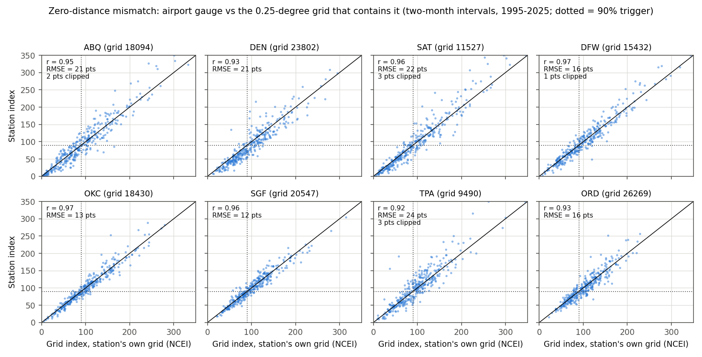
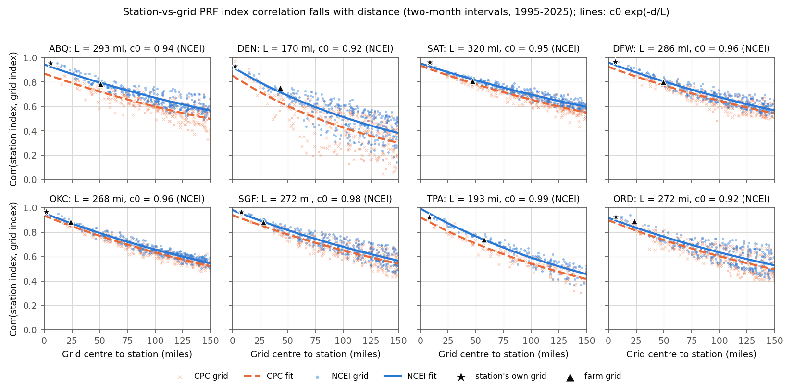
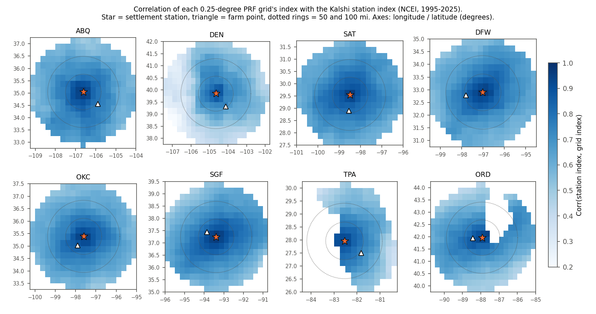
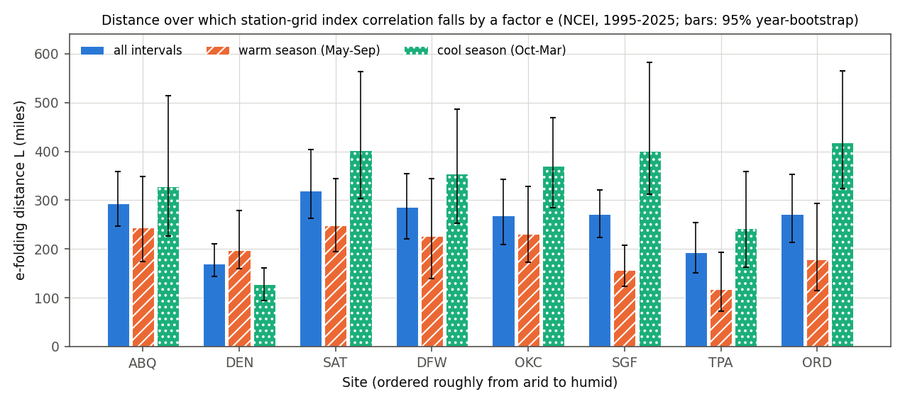
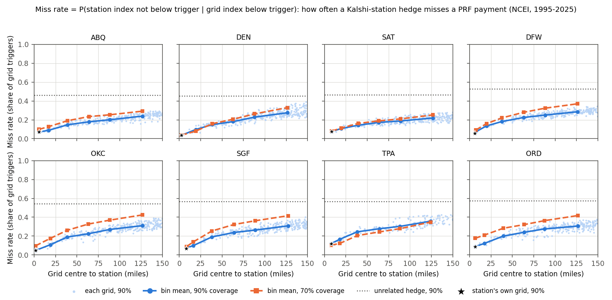
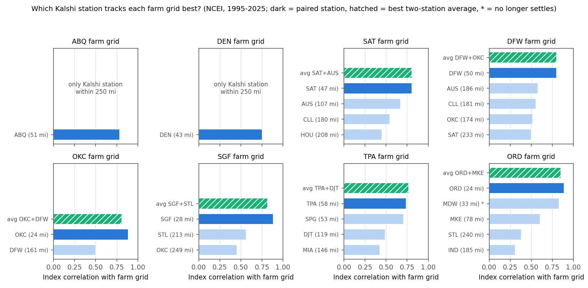

# 07: Geographic basis risk between Kalshi settlement stations and PRF grids

**Proposal cell:** Week 3 / Jack (A1, "measure geographic basis risk by comparing the USDA rainfall-index location with the locations used to settle available prediction-market contracts")  |  **Status:** DRAFT (all numbers computed and reproducible; literature comparisons rest on other team docs)  |  **Last updated:** 2026-10-29

Code: `src/agri_hedge/basis.py` (metric functions), `scripts/run_basis_risk.py` (analysis, tables, figures), `tests/test_basis.py`.
Data written: `data/processed/basis_risk_pairs.csv` (one row per sample x data regime x site x grid, 6,505 rows), `data/processed/basis_risk_best_station.csv` (candidate stations, two-station mixes and cross-validation per farm grid).
Inputs: station data from [06c](06c_station_vs_kalshi_settlement_check.md), PRF grid indexes from [06b](06b_index_validation.md).

Terms used throughout:
- **PRF grid index:** rain that fell on one 0.25-degree grid box (about 600 km², or 220-265 square miles at our sites) during a two-month *interval*, divided by that box's long-run average for the same interval, times 100. 100 = normal. A PRF policy at coverage level c pays when the index is **below** 100c, e.g. below 90 at 90% coverage (the **trigger**).
- **Station index:** the same formula applied to the single airport rain gauge that settles a Kalshi contract: station interval total / station mean for that interval over the same base years x 100.
- **Basis risk:** the chance that the hedge (Kalshi, which pays on the station) and the exposure (PRF, which pays on the grid) disagree. Here we measure it with correlation, root-mean-square error (RMSE) in index points, and trigger agreement.
- **Miss:** the grid triggers but the station does not, so the Kalshi hedge pays nothing when PRF would pay. **Miss rate** = P(no station trigger | grid triggers). **Hit rate** = 1 - miss rate.
- **False alarm:** the station triggers but the grid does not, so the hedge pays when PRF would not. **False-alarm share** = P(no grid trigger | station triggers).
- **phi:** the correlation of the two yes/no trigger indicators (1 = always agree, 0 = unrelated).
- **Residual basis risk 1 - r²:** the share of the PRF payout's variance that the best linear hedge on the station payout cannot remove (r² is Ederington's hedging effectiveness, see [10_literature_review](../research/10_literature_review.md)).
- **e-folding distance L:** in the fit corr(d) = c0 exp(-d/L), the distance over which the correlation falls by a factor e = 2.718. c0 is the fitted correlation at zero distance.
- **NCEI regime / CPC regime:** PRF pays on NOAA NCEI nClimGrid data from 2026-08-31 on, and paid on NOAA CPC gridded data before that (06b). We use NCEI as the primary, forward-looking regime and CPC as the robustness check.

## Key findings

- **Zero distance is not zero basis risk.** At the PRF grid that contains the settlement gauge (grid centre 1.7-8.6 mi from the gauge), the station index and the NCEI grid index correlate at r = 0.92-0.97 (mean 0.95) across eight sites, 1995-2025. They still differ by 12-24 index points RMSE (mean 18). The station misses 4-12% of 90%-coverage grid triggers (mean 7.1%) and raises false alarms on 7-14% of its own triggers. Under CPC the zero-distance mismatch is larger: mean miss rate 11.1%, RMSE 20.4.
- **At the farm grid (24-58 mi away) basis risk roughly triples.** Index correlation falls to 0.74-0.89 (mean 0.82) and RMSE rises to 19-44 points (mean 34). The station misses 12-28% of 90% grid triggers (mean 17%), and 15-27% of its own triggers are false alarms. Residual basis risk 1 - r² on PRF payouts averages **0.40** at the farm grids (NCEI) and **0.45** (CPC), against 0.12 at the station's own grid. About a third of the farm-grid residual is therefore already present at zero distance (measurement mismatch). The rest comes from distance.
- **Correlation decays exponentially with distance, and an exponential fits well.** Fitting corr(d) = c0 exp(-d/L) to every grid within 150 mi gives c0 = 0.92-0.99 and L = 170 mi (DEN) to 320 mi (SAT) for NCEI; the fit residual is 0.03-0.09. Pooled over all 2,157 site-grid pairs, c0 = 0.95 and L = 256 mi, so the correlation reaches 0.8 at about **44 mi**. Mean index correlation falls from 0.92-0.97 within 10 mi to 0.73-0.85 at 25-50 mi and 0.44-0.64 at 100-150 mi. Over the same distances the 90% miss rate climbs from 4-12% to 22-36%. A hedge unrelated to the grid would miss 45-58%.
- **Summer convective rain decorrelates fastest, most of all at humid sites.** The warm-season (May-Sep) L is 117-249 mi; the cool-season (Oct-Mar) L is 127-419 mi. The contrast is largest at Springfield MO (156 vs 401 mi), Chicago (179 vs 419) and Tampa (117 vs 243). On all intervals, arid sites (ABQ, DEN) and humid sites (SGF, TPA) have the same mean L, 232 mi. The difference shows up by season: in summer arid sites average 221 mi and humid sites 137 mi, while in winter arid sites average 227 mi and humid sites 322 mi. Denver is the exception, with the shortest all-season (170 mi) and cool-season (127 mi) L. Its correlation map is lopsided: correlation drops fast toward the Front Range and across the Palmer Divide, where the Elbert County farm sits.
- **NCEI tracks the settlement gauges better than CPC at every distance.** Within 100 mi, NCEI gives a mean index correlation of 0.734 vs 0.688 for CPC, and a 90% miss rate of 21.3% vs 24.2%. Residual basis risk at 100-150 mi is 0.70 vs 0.73. The biggest farm-grid gains are at Denver (r 0.66 under CPC to 0.75 under NCEI) and Tampa (0.66 to 0.74). A plausible reason (see Interpretation): nClimGrid is built from the same GHCN station network that includes the airport gauges.
- **The paired station is the best single Kalshi station for every farm grid, in both regimes. A second station adds little.** Every alternative within 250 mi is far worse. For the Atascosa County farm, San Antonio gives r = 0.81 and Austin (107 mi away) gives 0.67. The one near-tie is Tampa's Hardee County farm: St. Petersburg (SPG, 53 mi from the farm, 14 mi from the Tampa gauge) matches Tampa on their common 1998-2025 sample (r 0.71 vs 0.70). Out of sample (leave-one-year-out), the best two-station payout mix beats the paired station at all six farms that have an alternative. The gain is only 0.011-0.024 in payout correlation, or 2-4 points of hedge effectiveness. Example: Atascosa goes from 0.779 to 0.795 with 65% San Antonio + 35% Austin. ABQ and DEN have no second Kalshi station within 250 mi.
- **Most PRF land is far from any Kalshi station.** Of the 13,626 CONUS PRF grids, only 274 (2.0%) lie within 25 mi of one of the 37 current Kalshi monthly-rain stations, 1,009 (7.4%) within 50 mi and 3,308 (24.3%) within 100 mi. The median grid is 171 mi from the nearest station, where the pooled fit predicts r of about 0.49.
- **How the station's "normal" is set changes trigger behaviour.** Strike calibration is therefore a first-order design choice. If the station index uses the same 1951-2025 base years as the official NCEI grid index, Denver's station index runs 7-11 points below the grid. Its base years before 1994 come from a predecessor site, and the recent decades differ from the long-run mean. As a result the station triggers more often: miss rate 12% and false-alarm share 27% at the farm grid. Recomputing both indexes on 1995-2025 removes the bias, but the farm-grid miss rate rises to 21%. Correlation hardly changes, so the choice of normal moves risk between misses and false alarms; it does not remove it.

## Numbers table

"Computed" = derived by `scripts/run_basis_risk.py` (run 2026-10-29) from the processed files named in Methods. All computed values can be found in `basis_risk_pairs.csv` / `basis_risk_best_station.csv` or in the script's stdout tables. Unless stated: NCEI regime, sample 1995-2025, two-month intervals, 90% coverage.

| Quantity | Value | Units | Region / period | Source | Verification |
|---|---|---|---|---|---|
| Sites analysed | 8 (7 PRF + ORD) | sites | study sites | `agri_hedge.locations.ALL_SITES` | CONFIRMED (computed) |
| Grids with data within 150 / 100 mi of a station | 143-316 / 71-141 per site | grids | 8 sites | `basis_risk_pairs.csv` | CONFIRMED (computed) |
| Common sample | 1995-2025; 337-341 interval-years per station-grid pair | years; obs | 8 sites | this doc, Methods | CONFIRMED (computed) |
| NCEI rebuild vs DST index | MAE 0.0077 | index points | 956 ring grids, 1995-2025 | `prf_official_index_ring100.parquet` vs `ncei_interval_index.parquet` | CONFIRMED (computed) |
| Station vs own grid: index r | 0.92-0.97 (mean 0.949) | correlation | 8 sites | computed | CONFIRMED (computed) |
| Station vs own grid: RMSE | 12.0-23.8 (mean 18.1) | index points | 8 sites | computed | CONFIRMED (computed) |
| Station vs own grid: miss rate / false alarm at 90% | 4-12% (mean 7.1%) / 7-14% (mean 10.0%) | share | 8 sites | computed | CONFIRMED (computed) |
| Station vs own grid: phi at 90% | 0.79-0.87 (mean 0.84) | correlation | 8 sites | computed | CONFIRMED (computed) |
| Station vs own grid, CPC: r / RMSE / miss 90% | 0.939 / 20.4 / 11.1% | mean over 8 | CPC as-settled | computed | CONFIRMED (computed) |
| SD of station index / SD of own-grid index | 1.01-1.17 | ratio | 8 sites | computed | CONFIRMED (computed) |
| Monthly totals, station vs own grid: r raw / anomaly | 0.93-0.97 / 0.89-0.96 | correlation | 8 sites, 337-372 months | computed | CONFIRMED (computed) |
| Monthly totals, station vs farm grid: r raw / anomaly | 0.79-0.89 / 0.63-0.87 | correlation | 8 sites | computed | CONFIRMED (computed) |
| Station vs farm grid: index r | 0.74-0.89 (mean 0.819) | correlation | 8 farm grids, 24-58 mi | computed | CONFIRMED (computed) |
| Station vs farm grid: RMSE | 19.2-44.4 (mean 33.6) | index points | same | computed | CONFIRMED (computed) |
| Station vs farm grid: miss / false alarm at 90% | 12-28% (mean 17.0%) / 15-27% (mean 20.5%) | share | same | computed | CONFIRMED (computed) |
| Station vs farm grid: miss at 70% | 16-28% (mean 21.1%) | share | same | computed | CONFIRMED (computed) |
| Station vs farm grid, CPC: r / RMSE / miss 90% | 0.778 / 39.4 / 20.4% | mean over 8 | CPC as-settled | computed | CONFIRMED (computed) |
| Residual 1 - r² of PRF payout, own grid / farm grid | 0.125 / 0.396 (NCEI); 0.154 / 0.449 (CPC) | share of variance | mean over 8 sites | computed | CONFIRMED (computed) |
| Residual 1 - r² of payout by distance bin 0-10 / 10-25 / 25-50 / 50-75 / 75-100 / 100-150 mi | 0.12 / 0.24 / 0.39 / 0.52 / 0.60 / 0.70 (NCEI); 0.17 / 0.31 / 0.46 / 0.57 / 0.65 / 0.73 (CPC) | share | all grids, 8 sites | computed | CONFIRMED (computed) |
| Decay fit, all intervals: c0 / L | 0.92-0.99 / 170 (DEN) - 320 (SAT) | corr. / miles | NCEI, grids <= 150 mi | computed | CONFIRMED (computed) |
| Decay fit, CPC: c0 / L | 0.85-0.94 / 144 (DEN) - 282 (SAT) | corr. / miles | CPC | computed | CONFIRMED (computed) |
| Pooled decay fit | c0 0.949, L 256 mi; r = 0.8 at 44 mi | - | 2,157 pairs, 8 sites | computed | CONFIRMED (computed) |
| Warm-season L / cool-season L | 117-249 / 127-419 | miles | NCEI, 8 sites | computed | CONFIRMED (computed) |
| Mean L arid (ABQ, DEN) vs humid (SGF, TPA): all / warm / cool | 232 vs 232 / 221 vs 137 / 227 vs 322 | miles | NCEI | computed | CONFIRMED (computed) |
| Mean 90% miss rate, 0-10 mi vs 100-150 mi | 4-12% vs 22-36% | share | 8 sites | computed | CONFIRMED (computed) |
| Miss rate of an unrelated hedge (1 - P(station triggers)) | 45-58% | share | 8 sites | computed | CONFIRMED (computed) |
| NCEI vs CPC, all grids <= 100 mi: r / miss 90% / miss 70% | 0.734 vs 0.688 / 21.3% vs 24.2% / 26.5% vs 31.0% | - | 962 / 988 site-grid pairs | computed | CONFIRMED (computed) |
| Best alternative to paired station: Atascosa farm | SAT r 0.81 vs AUS 0.67 (107 mi) | correlation | NCEI | `basis_risk_best_station.csv` | CONFIRMED (computed) |
| Tampa vs St. Petersburg for Hardee farm, common 1998-2025 sample | r 0.696 vs 0.711; miss 30% vs 25%; phi 0.51 vs 0.49 | - | 271 interval-years | computed (script internals) | CONFIRMED (computed) |
| Correlation of the Tampa and St. Petersburg gauges' indexes | 0.76 | correlation | 14.4 mi apart, 1998-2025 | computed | CONFIRMED (computed) |
| Leave-one-year-out payout r, paired vs best pair | SAT 0.779 vs 0.795; DFW 0.760 vs 0.784; OKC 0.875 vs 0.886; SGF 0.835 vs 0.851; TPA 0.704 vs 0.727; ORD 0.835 vs 0.846 | correlation | NCEI, 90% payouts | computed | CONFIRMED (computed) |
| PRF CONUS grids within 25 / 50 / 100 mi of a current Kalshi monthly-rain station | 274 (2.0%) / 1,009 (7.4%) / 3,308 (24.3%) of 13,626 | grids | CONUS, 37 stations | DST `GetContinentalUsGridList` cache + `station_map.csv` | CONFIRMED (computed) |
| Median distance, PRF grid to nearest Kalshi station | 171 | miles | CONUS | same | CONFIRMED (computed) |
| DEN station index bias vs own grid, official vs matched base | -7.1 vs -0.3 | index points | DEN | computed | CONFIRMED (computed) |
| DEN farm grid: bias / miss 90%, official vs matched base | -11.4 / 12% vs -0.2 / 21% | points / share | DEN | computed | CONFIRMED (computed) |
| Share of DEN / DFW / ORD 1951-2025 station intervals from threaded predecessor sites | 58.6% / 30.8% / 10.6% | share | ACIS ThreadEx | `station_monthly_precip.csv` `source` | CONFIRMED (computed) |
| PRF grid area at the 8 stations | 575-683 (222-264) | km² (sq mi) | 0.25° x 0.25° cells | spherical-cap formula, R = 3,958.8 mi | CONFIRMED (computed) |
| Gauge orifice | "about 1 ft across" (≈ 0.07 m²) | - | ASOS | [06_settlement_and_data_sources](../research/06_settlement_and_data_sources.md), section 6 | UNVERIFIED here (doc 06 cites NWS) |
| CPC day | 12Z-12Z (06-06 CST), stamped by end date | - | CPC Unified Gauge analysis | doc 06, key findings and section 6 (CPC README) | UNVERIFIED here (CONFIRMED in doc 06) |
| nClimGrid method | GHCN-Daily stations incl. ASOS; thin-plate-spline normals x IDW ratio anomalies; ~36 nClimGrid cells averaged per PRF grid | - | NCEI | doc 06 section 2 (Vose et al. 2014; NCEI consumer guide) | UNVERIFIED here (CONFIRMED in doc 06) |
| Luo: mean residual basis risk; multi-station beats best single out of sample | 0.386; 43% of cases | unitless; share | Kalshi temperature, 30 station pairs | Luo (2026) abstract, via [10_literature_review](../research/10_literature_review.md) | UNVERIFIED (abstract only) |
| Iturbide: payout-loss correlation | 0.44 | correlation | NYC daily rain, 355 days | Iturbide (2026) repo `results/trigger.csv`, via doc 10 | UNVERIFIED here (CONFIRMED in doc 10) |
| Yu et al.: overall PRF basis risk / index-related part | 26-43% / 5-9 pp | share / pp | Kansas, Nebraska | Yu et al. (2019) pp. 180, 189-190, via doc 10 | UNVERIFIED here (CONFIRMED in doc 10) |

## Methods

### Data and regimes

| Item | NCEI regime (primary) | CPC regime (robustness) |
|---|---|---|
| Grid index | Our nClimGrid rebuild, `ncei_interval_index.parquet` `index_value_ours`. Base 1951-2025 is the Decision Support Tool (DST) convention; it equals the DST to 0.0077 points MAE over 956 grids, 1995-2025. | Our as-settled CPC rebuild, `cpc_interval_index.parquet` `index_value_ours`. Base 1948 to two years before the crop year; matches what RMA paid on, 2021-2026, to 0.002 points (06b). |
| Grid monthly totals | `ncei_monthly_precip_grids.parquet` | `cpc_monthly_precip_grids.parquet` |
| Station index base | Same years as the grid: 1951-2025 | Same rule as the grid: 1948 to Y-2, at least 20 base years |
| Grids | Every cell with data within 150 mi of the station (143-309 per site; 277 at ORD because nClimGrid has no Lake Michigan cells) | Same rule (143-316 per site; CPC has 39 more cells at ORD, over Lake Michigan, and 5 fewer at SAT) |

- **Station data:** `station_monthly_precip.csv`, months with `n_missing == 0` only. An interval needs both months complete (`agri_hedge.cpc.interval_totals`). This is the ACIS archive, which reproduced all 133 settled Kalshi months in 06c.
- **Chicago:** we use O'Hare (CLIORD), which settles KXRAINCHIM from the Sep 2026 contract on. Midway (MDW), which settled it through Aug 2026, appears in the candidate ranking but is flagged "no longer settles" and is left out of the pair and cross-validation tests. **Houston** is Hobby (CLIHOU).
- **Common sample: calendar years 1995-2025, all 11 intervals.** This is the longest span in which all eight settlement stations are single-station records: Denver Intl starts 1994-07, so 1995 is its first full year. It gives 337-341 interval-years and 369-372 months per pair. 2026 is excluded because it is incomplete and because the DST's 2026 values come from an older nClimGrid vintage (06b).
- **Long-sample check:** NCEI, 1951-2025. Base years and sample years before 1994-07 (DEN), 1974 (DFW) and 1958-11 (ORD) come from ACIS "threaded" predecessor sites, which are physically different gauges (06c).
- **Matched-base check (suffix `_mb` in the CSV):** both indexes recomputed with base = the sample years 1995-2025, which removes any level difference between the two series.
- **Distance:** great-circle distance from the station to the grid centre. The farm-grid distances (23.5-57.5 mi) are therefore grid-centre distances, slightly different from the station-to-farm-point distances in `locations.py`.

### Metrics (all in `agri_hedge.basis`)

For each station-grid pair:
1. **Totals:** Pearson and Spearman correlation of monthly totals and of two-month interval totals, raw and as *anomalies* (each series minus its own mean for that calendar month or interval over the sample). Raw correlations of rain totals are inflated by the shared seasonal cycle, so the anomaly correlations are the honest measure of co-variation.
2. **Index:** Pearson and Spearman correlation of the station index with the grid index; RMSE and mean bias (station minus grid) in index points; ratio of standard deviations; correlation of the 90% PRF payment factors max(0, (90 - index)/90).
3. **Trigger agreement** at 90% and 70% coverage: the 2 x 2 table of (grid index < trigger) vs (station index < trigger), hit rate, miss rate, false-alarm share, overall agreement, phi, and the miss rate of an unrelated hedge (1 - P(station triggers)) as a baseline. Always read misses and false alarms together: a hedge that triggers more often has fewer misses and more false alarms.
4. **Seasonal:** index correlation and 90% miss rate on warm-season intervals (May-Jun, Jun-Jul, Jul-Aug, Aug-Sep) and cool-season intervals (Oct-Nov, Nov-Dec, Jan-Feb, Feb-Mar). The three transition intervals appear only in "all".

**Distance decay.** For each site, season and regime we fit corr(d) = c0 exp(-d/L) by least squares (`scipy.optimize.curve_fit`, 0 < c0 <= 1, L >= 1 mi). The fit uses the index correlation of every grid within 150 mi; a fit to grids within 100 mi is a check. For NCEI, 95% intervals for L come from 200 bootstrap draws that resample whole years, keeping each year's 11 overlapping intervals together.

**Best station per farm grid.** For each farm grid we score every Kalshi monthly-rain station within 250 mi of the grid centre (from `station_map.csv`) by index correlation, payout correlation and trigger agreement. We test two kinds of two-station combination:
- an equal-weight **average index**, which is an ideal basket, not tradable;
- a **payout portfolio** w x payout(A) + (1 - w) x payout(B), with w on a 0.05 grid. This is tradable, because Kalshi lists each city separately.

The out-of-sample test is leave-one-year-out (LOYO). For each held-out year, we pick the best single station and the best (pair, weight) on the other 30 years by correlation with the farm grid's 90% PRF payout. We then predict the held-out year with those choices and pool the held-out predictions. Only stations with at least 75% of the best-covered candidate's data enter the pair and LOYO tests, so St. Petersburg is excluded under CPC: its 1998 start leaves fewer than 20 base years before 2020. In every test the paired station is the one the farm was matched to in `locations.py`.

**Coverage.** Distance from every CONUS-flagged PRF grid (DST grid list, cached in `data/raw/prf_official/`) to the nearest of the 37 stations that currently settle a Kalshi monthly-rain series. The 37 are all rows of `station_map.csv` except Midway, Napa included.

## Results

### 1. Zero-distance measurement mismatch: the station vs its own grid



*Figure 1. Station index vs the NCEI index of the grid that contains the gauge, every two-month interval 1995-2025. Black line: 1:1. Dotted lines: the 90% trigger. Points in the upper-left and lower-right boxes formed by the dotted lines are trigger disagreements.*

| Site | Grid | Centre to gauge (mi) | r monthly (raw / anomaly) | r interval anomaly | r index | RMSE (pts) | Bias (pts) | SD ratio | Miss 90 | False alarm 90 | phi 90 | Miss 70 |
|---|---|---|---|---|---|---|---|---|---|---|---|---|
| ABQ | 18094 | 5.8 | 0.95 / 0.94 | 0.94 | 0.95 | 20.9 | +1.6 | 1.11 | 0.07 | 0.08 | 0.83 | 0.10 |
| DEN | 23802 | 2.6 | 0.95 / 0.94 | 0.95 | 0.93 | 21.1 | -7.1 | 1.09 | 0.04 | 0.12 | 0.83 | 0.04 |
| SAT | 11527 | 8.6 | 0.95 / 0.95 | 0.96 | 0.96 | 21.8 | +1.5 | 1.15 | 0.08 | 0.07 | 0.84 | 0.08 |
| DFW | 15432 | 6.2 | 0.97 / 0.96 | 0.97 | 0.97 | 16.4 | +0.6 | 1.10 | 0.06 | 0.09 | 0.86 | 0.10 |
| OKC | 18430 | 1.7 | 0.96 / 0.95 | 0.96 | 0.97 | 13.2 | +0.1 | 1.05 | 0.05 | 0.10 | 0.86 | 0.10 |
| SGF | 20547 | 8.0 | 0.96 / 0.96 | 0.96 | 0.96 | 12.0 | -0.3 | 1.01 | 0.07 | 0.07 | 0.87 | 0.11 |
| TPA | 9490 | 8.0 | 0.94 / 0.89 | 0.86 | 0.92 | 23.8 | +4.8 | 1.17 | 0.12 | 0.11 | 0.79 | 0.10 |
| ORD | 26269 | 6.6 | 0.93 / 0.91 | 0.91 | 0.93 | 16.0 | -0.3 | 1.11 | 0.09 | 0.14 | 0.81 | 0.18 |
| **Mean** | | | | | **0.949** | **18.1** | | | **0.071** | **0.100** | **0.84** | **0.10** |
| CPC mean | | | | | 0.939 | 20.4 | | | 0.111 | 0.107 | 0.79 | 0.15 |

Confusion matrices (counts of interval-years; NCEI, 90% coverage; "grid only" = misses):

| Site | Both trigger | Grid only | Station only | Neither |
|---|---|---|---|---|
| ABQ | 169 | 13 | 15 | 144 |
| DEN | 162 | 6 | 23 | 147 |
| SAT | 168 | 14 | 13 | 144 |
| DFW | 145 | 9 | 14 | 169 |
| OKC | 140 | 7 | 16 | 178 |
| SGF | 136 | 10 | 11 | 182 |
| TPA | 131 | 18 | 17 | 175 |
| ORD | 124 | 12 | 20 | 183 |

Season matters even at zero distance. In Tampa the warm-season index correlation is 0.79 vs 0.95 in the cool season, and the warm-season miss rate is 26% vs 6%. In Chicago the same contrast is 0.87 vs 0.95. Within 25 mi of each gauge, the gauge's own grid is the best-correlated grid at six sites. At SGF and ORD a neighbour does as well or slightly better (0.97 vs 0.96 at 9.4 mi; 0.94 vs 0.93 at 19.4 mi).

**Why a single gauge differs from its own 0.25-degree box.** These are the mechanisms. The size of each is our measurement where stated; the rest is from team doc 06.
1. **Point vs area.** The gauge orifice is about 1 ft across (doc 06), about 0.07 m². The PRF box is 575-683 km², roughly 10^10 times larger. A thunderstorm that drops 2 inches on the airport and misses the rest of the box (or the reverse) moves the station far more than the box average. The station index is 1-17% more variable than its own grid's (SD ratio 1.01-1.17). Averaging over an area smooths extremes, so the station spends more time in both tails, and that alone creates trigger disagreements near 90.
2. **The gauge is not at the box centre.** It sits 1.7-8.6 mi from the centre, and the box average is dominated by rain elsewhere in the box.
3. **The grid is an interpolation, not a measurement.** nClimGrid maps station ratio anomalies by inverse-distance weighting on top of spline-mapped normals, then RMA averages about 36 of its 5-km cells (doc 06). CPC instead interpolates daily gauge reports by optimal interpolation. Both smooth across gauges. nClimGrid's inputs include the airport ASOS gauges themselves (GHCN-Daily), which helps explain why NCEI tracks the settlement gauge better than CPC (miss 7.1% vs 11.1%).
4. **Different "days".** Kalshi's month is midnight to midnight local standard time. CPC's daily fields run 12Z to 12Z (6 AM to 6 AM CST). nClimGrid sums each input station's own observing day, mostly about 7 AM for cooperative observers (doc 06). A storm straddling a month boundary can be booked in different months.
5. **Gauge error and base-period mismatch.** Tipping-bucket undercatch, missing days (which Kalshi counts as 0, see 06c), and the base period used to define "normal" all add noise. The Denver bias of -7 points disappears when both series use 1995-2025 as base (-0.3): it is a base-period effect, not a measurement effect (section 5).

### 2. The farm grid

| Site | Farm grid | Distance (mi) | r monthly anomaly | r index | RMSE (pts) | Bias | Payout r 90 | Miss 90 | False alarm 90 | phi 90 | Miss 70 | False alarm 70 | 1 - r² payout |
|---|---|---|---|---|---|---|---|---|---|---|---|---|---|
| ABQ (Torrance) | 17497 | 50.9 | 0.75 | 0.79 | 42.6 | -2.8 | 0.75 | 0.14 | 0.19 | 0.65 | 0.20 | 0.38 | 0.45 |
| DEN (Elbert) | 23204 | 43.1 | 0.78 | 0.75 | 38.0 | -11.4 | 0.68 | 0.12 | 0.27 | 0.61 | 0.16 | 0.53 | 0.54 |
| SAT (Atascosa) | 10626 | 47.0 | 0.77 | 0.81 | 44.4 | +1.5 | 0.78 | 0.16 | 0.17 | 0.65 | 0.16 | 0.22 | 0.39 |
| DFW (Parker) | 15429 | 49.5 | 0.81 | 0.80 | 37.5 | +1.8 | 0.75 | 0.22 | 0.20 | 0.60 | 0.28 | 0.26 | 0.43 |
| OKC (Grady) | 18129 | 23.9 | 0.85 | 0.89 | 25.0 | -0.1 | 0.88 | 0.13 | 0.15 | 0.75 | 0.20 | 0.23 | 0.23 |
| SGF (Dade) | 20845 | 28.3 | 0.87 | 0.88 | 21.2 | -1.3 | 0.84 | 0.18 | 0.19 | 0.67 | 0.21 | 0.26 | 0.30 |
| TPA (Hardee) | 8893 | 57.5 | 0.63 | 0.74 | 40.6 | +6.0 | 0.69 | 0.28 | 0.24 | 0.53 | 0.23 | 0.41 | 0.53 |
| ORD (Kane) | 26267 | 23.5 | 0.86 | 0.89 | 19.2 | -0.0 | 0.83 | 0.13 | 0.22 | 0.70 | 0.25 | 0.34 | 0.30 |
| **Mean, NCEI** | | | 0.79 | **0.819** | **33.6** | | 0.77 | **0.170** | **0.205** | 0.65 | 0.21 | 0.33 | **0.396** |
| Mean, CPC | | | 0.75 | 0.778 | 39.4 | | 0.74 | 0.204 | 0.240 | 0.58 | 0.25 | 0.31 | 0.449 |

The confusion matrices for every pair, both regimes, are in `basis_risk_pairs.csv` (`both90`, `grid_only90`, `station_only90`, `neither90`, and the same for 70). Two examples:
- **Parker County (DFW farm):** 127 both / 36 misses / 32 false alarms / 142 neither.
- **Hardee County (TPA farm):** 112 / 44 / 36 / 149.

Under CPC, Hardee County is markedly worse: 116 / 78 / 25 / 122, a 40% miss rate. Raw monthly correlations overstate agreement where the seasonal cycle is strong. At the Hardee farm the raw monthly r is 0.81 but the anomaly r is 0.63, because both sites share Florida's wet summers and dry winters.

Warm vs cool season at the farm grid (NCEI): index r is 0.52 vs 0.81 at TPA, 0.75 vs 0.85 at DFW, 0.83 vs 0.92 at SGF and 0.79 vs 0.93 at ORD. The 90% miss rate in Tampa's warm season is 52%: the station hedge misses half of the summer PRF payments on the Hardee grid.

### 3. Distance decay



*Figure 2. Correlation of the station index with the index of every grid within 150 mi, 1995-2025 (dots: NCEI; crosses: CPC), with the fitted c0 exp(-d/L) curves. Star: the station's own grid; triangle: the farm grid.*



*Figure 3. The same NCEI correlations on a map. Denver's field is lopsided: correlation falls fast toward the mountains to the west and across the Palmer Divide to the southeast. Blank cells near Chicago and Tampa are water, where nClimGrid has no data.*

**e-folding distances (NCEI, grids <= 150 mi, 95% year-bootstrap interval in brackets):**

| Site | c0 (all) | L all (mi) | r at 50 mi (fit) | Distance where fit r = 0.8 (mi) | L warm (mi) | L cool (mi) | L all, CPC | L all, NCEI 1951-2025 |
|---|---|---|---|---|---|---|---|---|
| ABQ | 0.94 | 293 [247-359] | 0.80 | 48 | 244 [175-349] | 328 [226-514] | 268 | 285 |
| DEN | 0.92 | 170 [143-211] | 0.69 | 25 | 198 [160-279] | 127 [94-161] | 144 | 175 |
| SAT | 0.95 | 320 [263-403] | 0.81 | 56 | 249 [195-344] | 403 [303-564] | 282 | 308 |
| DFW | 0.96 | 286 [221-354] | 0.81 | 52 | 227 [139-345] | 354 [252-487] | 279 | 272 |
| OKC | 0.96 | 268 [209-342] | 0.79 | 48 | 231 [173-328] | 370 [285-469] | 257 | 279 |
| SGF | 0.98 | 272 [224-322] | 0.82 | 56 | 156 [124-207] | 401 [312-583] | 271 | 285 |
| TPA | 0.99 | 193 [151-254] | 0.77 | 42 | 117 [73-193] | 243 [163-359] | 188 | 200 |
| ORD | 0.92 | 272 [214-353] | 0.76 | 37 | 179 [115-294] | 419 [324-566] | 251 | 295 |
| Pooled | 0.95 | 256 | 0.78 | 44 | | | | |

Notes on the fit:
- The fit residual is 0.03-0.09 in correlation units, so a single exponential describes the decay well over 0-150 mi.
- Fitting only grids within 100 mi gives L = 163-321 mi, close to the 150-mi fit.
- c0 is an extrapolation from many nearby grids and can exceed the station's own-grid correlation. At TPA, c0 = 0.99 but the own grid is 0.92. Only 21 of the Tampa grid's 36 nClimGrid cells are land; the rest is Tampa Bay. Use the own-grid row in section 1 as the zero-distance number.
- CPC has lower c0 (0.85-0.94) and shorter L at every site.
- The long-sample (1951-2025) fits are within about 25 mi of the 1995-2025 fits.



*Figure 4. e-folding distance by site and season (NCEI, 1995-2025), with 95% year-bootstrap intervals. Warm = May-Sep intervals, cool = Oct-Mar intervals.*

**Arid vs humid.**
- **All intervals:** the arid pair (ABQ, DEN) and the humid pair (SGF, TPA) have the same mean L, 232 mi.
- **Warm season:** arid 221 mi vs humid 137 mi. Summer thunderstorms in Missouri and Florida are small and short-lived, so a gauge 50 miles away sees different storms.
- **Cool season:** arid 227 mi vs humid 322 mi. Winter rain in the humid East comes from large frontal systems that cover whole regions.
- **The arid sites look different for two reasons we cannot separate here.** First, rainfall there depends on terrain: at Denver, upslope snow and the Palmer Divide make the cool-season L the shortest of any site-season (127 mi). Second, sparse gauges make the interpolated grid smoother, so the correlation looks longer-range than the physics alone would give.
- **Hedging difficulty also depends on the climate.** At the same distance, the arid sites' grid index is more volatile (dry intervals give very low and very high index values), which is why ABQ and DEN farm-grid RMSEs (38-43 points) are as large as Tampa's.

**Trigger misses vs distance.**



*Figure 5. 90% and 70% miss rates for every grid within 150 mi (NCEI), with distance-bin means. The dotted line is the miss rate a hedge unrelated to the grid would have.*

Mean index correlation and 90% miss rate by distance bin (NCEI; each cell is the mean over that site's grids in the bin):

| Site | r 0-10 mi | r 10-25 | r 25-50 | r 50-75 | r 75-100 | r 100-150 | Miss 0-10 | Miss 25-50 | Miss 75-100 | Miss 100-150 | Miss if unrelated |
|---|---|---|---|---|---|---|---|---|---|---|---|
| ABQ | 0.95 | 0.93 | 0.83 | 0.75 | 0.70 | 0.61 | 0.07 | 0.15 | 0.20 | 0.24 | 0.46 |
| DEN | 0.93 | 0.84 | 0.73 | 0.64 | 0.55 | 0.44 | 0.04 | 0.15 | 0.23 | 0.28 | 0.45 |
| SAT | 0.96 | 0.90 | 0.84 | 0.78 | 0.72 | 0.64 | 0.08 | 0.14 | 0.19 | 0.22 | 0.47 |
| DFW | 0.97 | 0.92 | 0.85 | 0.76 | 0.70 | 0.62 | 0.07 | 0.18 | 0.25 | 0.29 | 0.53 |
| OKC | 0.97 | 0.91 | 0.83 | 0.75 | 0.68 | 0.60 | 0.05 | 0.19 | 0.27 | 0.31 | 0.54 |
| SGF | 0.97 | 0.94 | 0.85 | 0.77 | 0.71 | 0.62 | 0.08 | 0.19 | 0.26 | 0.31 | 0.57 |
| TPA | 0.92 | 0.90 | 0.81 | 0.73 | 0.64 | 0.52 | 0.12 | 0.24 | 0.30 | 0.36 | 0.57 |
| ORD | 0.93 | 0.90 | 0.79 | 0.72 | 0.65 | 0.58 | 0.09 | 0.20 | 0.28 | 0.31 | 0.58 |

At 70% coverage the miss rates are higher at the same distance: 0.21-0.37 at 75-100 mi and 0.25-0.42 at 100-150 mi. Deep droughts are rarer, so one station-grid disagreement weighs more.

**Residual basis risk 1 - r² of the PRF payout, mean over all eight sites:**

| Regime | 0-10 mi | 10-25 | 25-50 | 50-75 | 75-100 | 100-150 |
|---|---|---|---|---|---|---|
| NCEI | 0.12 | 0.24 | 0.39 | 0.52 | 0.60 | 0.70 |
| CPC | 0.17 | 0.31 | 0.46 | 0.57 | 0.65 | 0.73 |

### 4. Best available Kalshi station per farm grid



*Figure 6. Index correlation of every Kalshi monthly-rain station within 250 mi with each farm grid (NCEI, 1995-2025). Dark bar: the paired station. Hatched bar: the best two-station average index. * = Midway, which no longer settles a Kalshi contract.*

| Farm grid | Candidates within 250 mi (distance to farm grid, NCEI index r) | Best single | Best two-station average index (r) | LOYO payout r: paired / best single / best pair (most-chosen pair, share of folds) |
|---|---|---|---|---|
| ABQ (Torrance) | ABQ (51 mi, 0.79) | ABQ | - | 0.745 / 0.745 / - |
| DEN (Elbert) | DEN (43, 0.75) | DEN | - | 0.682 / 0.682 / - |
| SAT (Atascosa) | SAT (47, 0.81); AUS (107, 0.67); CLL (180, 0.54); HOU (208, 0.45) | SAT | SAT+AUS (0.81) | 0.779 / 0.779 / 0.795 (65% SAT + 35% AUS, 64%) |
| DFW (Parker) | DFW (50, 0.80); AUS (186, 0.58); CLL (181, 0.56); OKC (174, 0.52); SAT (233, 0.50) | DFW | DFW+OKC (0.80) | 0.760 / 0.760 / 0.784 (80% DFW + 20% SAT, 71%) |
| OKC (Grady) | OKC (24, 0.89); DFW (161, 0.50) | OKC | OKC+DFW (0.81) | 0.875 / 0.875 / 0.886 (85% OKC + 15% DFW, 100%) |
| SGF (Dade) | SGF (28, 0.88); STL (213, 0.56); OKC (249, 0.46) | SGF | SGF+STL (0.82) | 0.835 / 0.835 / 0.851 (85% SGF + 15% OKC, 100%) |
| TPA (Hardee) | SPG (53, 0.71*); TPA (58, 0.74); DJT (119, 0.49); MIA (146, 0.42) | TPA (tie with SPG) | TPA+DJT (0.77) | 0.704 / 0.704 / 0.727 (65% TPA + 35% MIA, 79%) |
| ORD (Kane) | ORD (24, 0.89); MDW (33, 0.83, no longer settles); MKE (78, 0.61); IND (185, 0.31); STL (240, 0.38) | ORD | ORD+MKE (0.85) | 0.835 / 0.835 / 0.846 (80% ORD + 20% MKE, 61%) |

\* SPG's record starts 1998-06 (271 interval-years). On the common 1998-2025 sample, SPG edges Tampa on index correlation (0.711 vs 0.696) and miss rate (25% vs 30%) but not on phi (0.49 vs 0.51) or payout correlation (0.68 vs 0.70). The Tampa and St. Petersburg gauges, 14 mi apart, correlate only 0.76 with each other.

Reading the table:
- **The paired (nearest current) station wins everywhere.** In the LOYO test the selection rule chose it in 100% of folds at all eight farms. The CPC regime gives the same ranking.
- **A different single station never helps.** Leaving aside St. Petersburg (a near-twin of Tampa) and Midway (no longer settles), the best alternative station is 78-213 mi from the farm grid. It reaches only r = 0.49-0.67, far below the paired station's 0.74-0.89.
- **Two stations help only a little.** The out-of-sample gain is 0.011 (OKC) to 0.024 (DFW) in payout correlation, so hedge effectiveness r² rises by 0.019-0.037. Weights stay at 65-85% on the paired station. The second station adds information about the part of the farm grid's rain the first misses. The equal-weight average index is not better than the paired station except at Tampa (0.77 vs 0.74), where the two Tampa-area gauges each catch different storms. Under CPC the out-of-sample gains are 0.002-0.023.

### 5. Robustness

| Check | What changes | Result |
|---|---|---|
| CPC instead of NCEI | Grid data source | Lower agreement at every distance: within 100 mi r 0.688 vs 0.734, 90% miss 24.2% vs 21.3%, 70% miss 31.0% vs 26.5%. Same station ranking. |
| Matched base (1995-2025 for both indexes) | Definition of "normal" | Bias falls to about 0 everywhere (from -11 to +6 points). RMSE changes by at most 3 points under NCEI. Miss rates shift by up to 9 points: DEN farm 12% to 21%, DEN station grid 4% to 5%, TPA station grid 12% to 16%. Correlations change by at most 0.03 at the station and farm grids. |
| Long sample 1951-2025 (NCEI) | 825 instead of 341 interval-years; threaded predecessor sites at DEN (59% of intervals), DFW (31%), ORD (11%) | Index r within 0.03 of the short sample at all 16 station and farm grids. Miss rates move by up to 10 points at DEN, where the pre-1994 data come from another gauge. L within about 25 mi. |
| Grids <= 100 mi only | Fit range | L = 163-321 mi (vs 170-320). |
| 70% coverage | Trigger | At the station and farm grids, miss rates are 0-7 points higher than at 90% at most sites, 9-12 points higher at ORD and 2-5 points lower at TPA. False alarms are higher (farm grids 22-53%). |

## Interpretation for beginners

Picture a rancher in Atascosa County, Texas, 47 miles south of the San Antonio airport. Her PRF policy pays when the government's rain estimate for her 17-by-15-mile grid box is below 90% of normal. She wants extra protection, so she buys Kalshi contracts that pay when the San Antonio airport gauge is dry. The question is how often "dry at the airport" and "dry on my grid" happen together.

- **Even at the airport itself the two numbers differ.** A rain gauge is a bucket about a foot wide. The grid number is an average over hundreds of square kilometres, built by interpolating many gauges. When a thunderstorm parks over the airport the bucket overflows while the box average barely moves. Over 31 years the two agree on "below 90% of normal" about 92% of the time (correlation 0.95). The remaining disagreements come from local storms, from the gauge not sitting at the box centre, and from small differences in how a "day" and a "month" are counted.
- **Move the grid 50 miles away and the agreement drops.** Correlation falls to about 0.8. The airport hedge now misses about one PRF payment in six, and about one hedge payment in six comes in a period when PRF does not pay. In statistics terms, the best hedge built on the airport removes only about 60% of the variance of her PRF payout (1 - 0.40).
- **The drop follows a simple rule.** Correlation falls by a factor of e (2.7) roughly every 250 miles, and it falls faster in summer and in humid places, where rain comes from small thunderstorms. In winter, big storm systems water a whole region at once, so distance matters less.
- **A second city does not fix it.** Austin is 107 miles from her farm. Adding some Austin contracts improves her hedge by 1-2 points of correlation, a small gain. Distance to the nearest Kalshi city is the main problem, and most PRF land is far from one: the typical PRF grid is 171 miles from the nearest Kalshi station.
- **"Miss rate" alone can mislead.** A hedge that pays all the time never misses, but it is expensive and pays when nothing is wrong. Always read misses and false alarms together, or use phi or the payout correlation.

## Implications for our replication design

1. **Treat geography as the first-order risk and model it explicitly.** For a farm grid at distance d from its Kalshi station, the pooled fit predicts index correlation of about 0.95 exp(-d/256 mi). The site-specific L and the seasonal L values above are better. The Milestone 2 optimizer should report expected residual risk (1 - r²) next to the price. That residual is 0.12 at 0-10 mi, 0.39 at 25-50 mi and 0.60 at 75-100 mi.
2. **Restrict promises by distance.** Within about 25 mi of a station a Kalshi ladder can track PRF closely (miss rates about 10%). Beyond about 50 mi more than one in five PRF payments is missed, and beyond 100 mi about a third or more. Only 7.4% of PRF grids lie within 50 mi of a current Kalshi station, so the app must tell most users that their hedge is a weak substitute for PRF.
3. **Season-aware hedging.** At humid sites, warm-season intervals carry the most basis risk. The Hardee County miss rate is 52% in summer vs 19% in winter. The optimizer should allow different hedge ratios or strikes by interval and should not assume one correlation for all months.
4. **Use NCEI for forward-looking design.** PRF now settles on NCEI, which also tracks the airport gauges better than CPC did. Results calibrated on CPC history (2021-2026 payouts) will overstate basis risk for future intervals, by roughly 3 points of miss rate and 0.05 of residual risk.
5. **Calibrate strikes on the station's own climatology over the same base years as the grid, and check for predecessor sites.** The choice of normal moves risk between misses and false alarms (DEN example). For DEN, DFW and ORD, pre-switch base years come from other gauges. Compute the station normal on the single-station years too, and report both.
6. **Offer two-station mixes only with out-of-sample validation.** The gains are real but small (0.01-0.02 in payout correlation), with weights around 0.65-0.85 on the nearest station. A second station is worth it where two gauges sit near one farm (Tampa + St. Petersburg) or where a farm lies between two cities. In-sample weight optimisation should not be shown to users without a holdout.
7. **Next steps for other workstreams.** These metrics use a continuous station index. A real Kalshi hedge pays on whole-inch strikes in each calendar month, while PRF uses two-month intervals. The replication workstream should reuse `agri_hedge.basis` (`index_metrics`, `trigger_table`, `payment_factor`, `portfolio_payout`) and add the ladder and month-to-interval steps on top, so that geographic and contract-design errors can be separated as in Luo (2026).

**Relation to the literature** (details and verification status in [10_literature_review](../research/10_literature_review.md)):
- **Luo (2026)** finds, from its abstract only, that residual basis risk between a Kalshi temperature settlement station and another station "rises with station distance", with a mean of 0.386 over 30 pairs. Our rainfall result shows the same pattern with an explicit rate. Mean farm-grid residual (1 - r² of payouts) is 0.40 under NCEI and 0.45 under CPC, the same order as Luo's figure. Luo's exact definition of "residual basis risk" is not visible in the abstract, so the numbers should not be compared directly.
- **Luo's multi-station result:** a portfolio beats the best single station out of sample in 43% of cases. In our data, the pair beat the paired station out of sample at all six farms that have an alternative, but the gains were small.
- **Iturbide (2026)** finds the binding constraint for NYC daily rain contracts is contract design (window and trace rule), with a payout-loss correlation of 0.44. At our monthly and two-month scale, geography is the larger term once the farm is more than 25-50 mi away. At zero distance the station-grid payout correlation is 0.91-0.97, so measurement and window effects are small next to Iturbide's daily-scale mismatch. Monthly aggregation averages out much of the storm-to-storm noise that dominates a daily contract.
- **Other agreement:** Norton, Turvey and Osgood (2013) report from their abstract that distance raises payout differences for precipitation; our decay curves agree. The Woodard and Garcia (2008) local / geographic / product split maps onto our station grid (measurement, residual 0.12) vs farm grid (geography adds about 0.27 on average).
- **Scale against PRF's own basis risk:** Yu et al. (2019) find that the index part of PRF basis risk (two-month grid index vs on-ranch rain) adds only 5-9 percentage points. Our station-to-grid gap is of comparable or larger size, and it comes on top of PRF's own basis risk relative to the ranch's forage.

## Limitations

- **Overlapping intervals.** The 11 PRF intervals overlap (each month is in two), so the 341 interval-years per pair are not independent. Year-block bootstrap intervals for L account for this; the correlations and rates in the tables have no confidence intervals. With 31 years, differences below about 0.02-0.03 in correlation or 3-5 points in a miss rate should not be read as real.
- **Shared inputs inflate agreement near stations.** nClimGrid (and CPC) use airport gauges as inputs. Near a station, part of the station-grid agreement therefore comes from the station itself, and in gauge-sparse areas interpolation spreads one gauge's influence over a wide area. This is real for settlement purposes, since PRF pays on the grid as published. It means c0 and L describe the data products, not the physical rainfall field.
- **The grid is not the ranch.** We measure station vs PRF grid. PRF's own basis risk (grid vs forage on the ranch) is separate and not included (see 04 and 10).
- **Archive values, not settlement values.** We use the ACIS archive, not the first NWS climate report Kalshi settles on. 06c estimates the archive would mis-settle about 0.4% of city-months, which is negligible here. From Sep 2026, older Kalshi series settle on The Weather Company's republished values, which we cannot test.
- **Continuous station index.** Real contracts pay on whole-inch strikes in calendar months. The station interval total is the sum of two monthly settlement values, and a strike ladder on each month cannot pay exactly on that sum. That replication error is not in these numbers.
- **NCEI-era settlement rules are not final.** We use the DST's 1951 base start. The 2026 handbook still says 1948 for CPC, and 06b and doc 06 discuss which base NCEI-era settlement will use. A different base shifts the grid index level, and the matched-base check shows how much that matters.
- **Distance is measured to the grid centre.** Coastal grids (Tampa Bay, Lake Michigan) are partial land cells in nClimGrid. Grids within 100-150 mi are not filtered to PRF-insurable grids; within 100 mi all but one are PRF-flagged.
- **Season split.** The warm and cool definitions (four intervals each) are our choice. Transition intervals (Mar-Apr, Apr-May, Sep-Oct) appear only in "all".
- **Small station set.** Eight sites. Arid vs humid comparisons rest on two sites each, and the bootstrap intervals for L overlap at many sites.

## Unverified claims and open questions

- The mechanism behind NCEI's better station tracking (shared GHCN inputs, day-boundary alignment, or smoother interpolation) is our interpretation, not tested.
- Whether Denver's short cool-season L reflects terrain (upslope snow, Palmer Divide) or gauge sparsity is not established.
- Luo's definition of "residual basis risk" and the full paper are unavailable (SSRN blocked; doc 10), so the comparison with 0.386 is qualitative.
- The coverage count treats Napa (KXRAINNAPAM, settled on TWC data at KAPC) and St. Petersburg (SPG) as current settlement stations, following `station_map.csv`. Both are flagged ambiguous in 06c.
- Gauge-physics statements (orifice size, CPC day definition, nClimGrid method) come from team doc 06, which read the primary sources. We did not re-open those sources.

## Sources

1. Team doc [06b_index_validation.md](06b_index_validation.md): PRF grid IDs, the CPC and NCEI index rebuilds and their validation against RMA's ADM and DST values.
2. Team doc [06c_station_vs_kalshi_settlement_check.md](06c_station_vs_kalshi_settlement_check.md): settlement-station map, station monthly totals, threaded records, settlement reproduction (133 of 133 months).
3. Team doc [05b_kalshi_liquidity_stats.md](05b_kalshi_liquidity_stats.md): which Kalshi series exist and when they were listed.
4. Team doc [06_settlement_and_data_sources.md](../research/06_settlement_and_data_sources.md): how CPC, nClimGrid and the NWS climate report measure rain (sections 2 and 6), citing Vose et al. (2014), *J. Appl. Meteor. Climatol.* 53, 1232-1251, https://doi.org/10.1175/JAMC-D-13-0248.1, and NOAA CPC GAUGE_CONUS documentation, https://ftp.cpc.ncep.noaa.gov/precip/CPC_UNI_PRCP/GAUGE_CONUS/DOCU/.
5. Team doc [10_literature_review.md](../research/10_literature_review.md) and `docs/research/references.bib`: Luo (2026), "Prediction Markets as Weather Hedges: Geographic Basis Risk, Settlement Constraints, and Contract Replication", SSRN 7138562, https://doi.org/10.2139/ssrn.7138562 (abstract only); Iturbide (2026), "Basis Risk in Prediction Markets: Can a Rain Contract Hedge New York Rooftop Bars?", SSRN 7552699, replication repository https://github.com/pauliturbide21-blip/kalshi-rain-basis-risk; Norton, Turvey and Osgood (2013); Woodard and Garcia (2008); Yu et al. (2019).
6. USDA RMA PRF Decision Support Tool, `GetContinentalUsGridList` endpoint (https://public-rma.fpac.usda.gov/apps/PrfWebApi/PrfExternalNoaaGrids/GetContinentalUsGridList), cached 2026-10-29 by `scripts/pull_prf_official_index.py`.
7. USDA RMA, *Rainfall Index Insurance Standards Handbook*, FCIC-18150 (2026), sec. 33D (index formula and base period), https://www.rma.usda.gov/sites/default/files/2025-08/2026-18150-Rainfall-Index-Handbook.pdf (as read in 06b).

## Reproduce

```bash
python scripts/run_basis_risk.py   # about 1 minute, no network; prints every table above to stdout
python -m pytest tests/test_basis.py
```

The script is idempotent: two consecutive runs give byte-identical CSVs. It needs the processed files listed in Methods. The coverage table also needs the cached DST grid list (`data/raw/prf_official/conus_grid_list.json.gz`, from `scripts/pull_prf_official_index.py`) and is skipped with a message if that file is absent.
