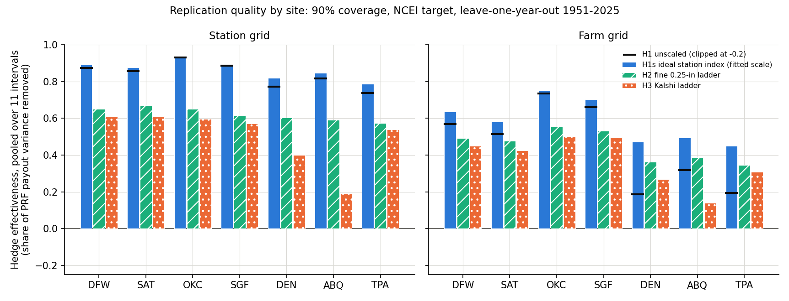
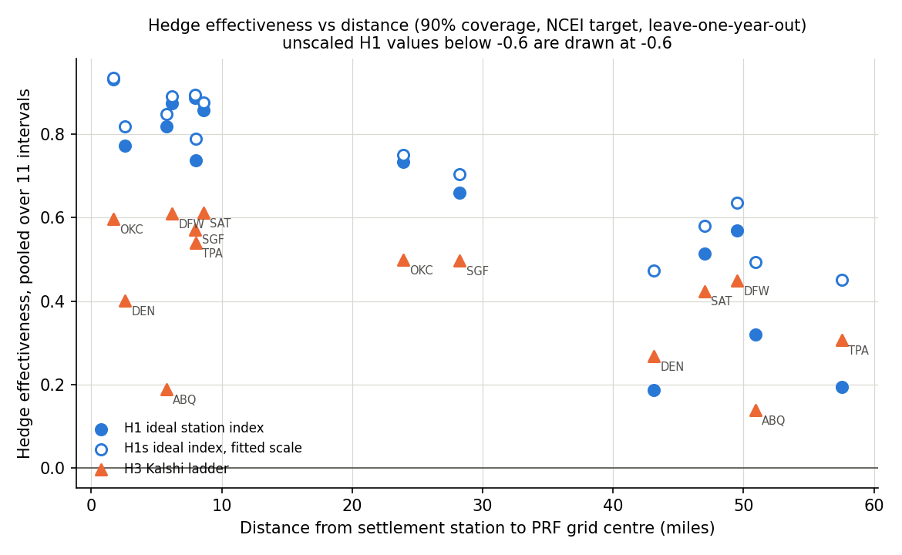
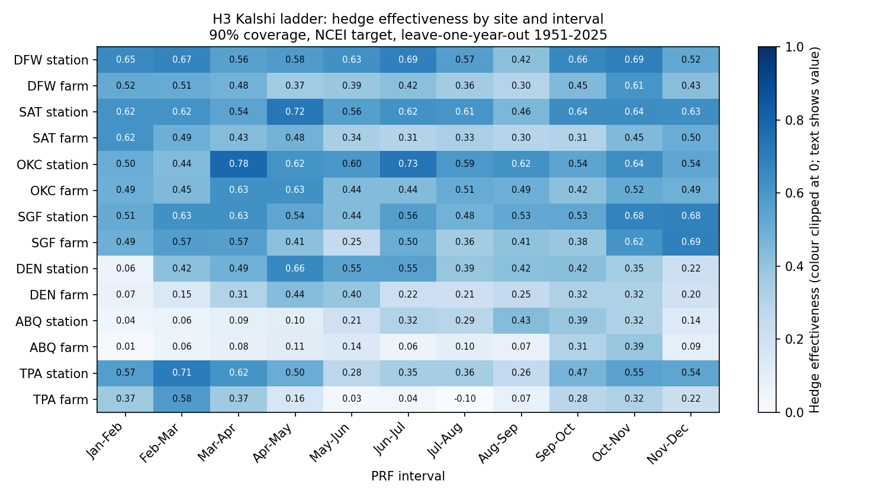
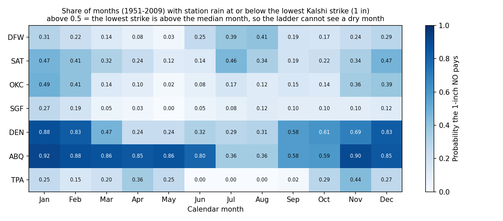
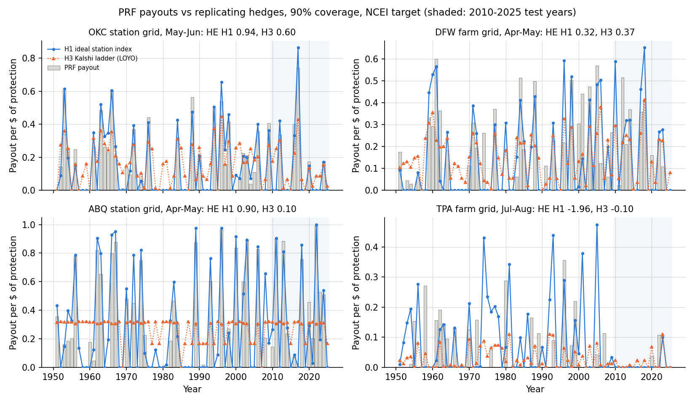
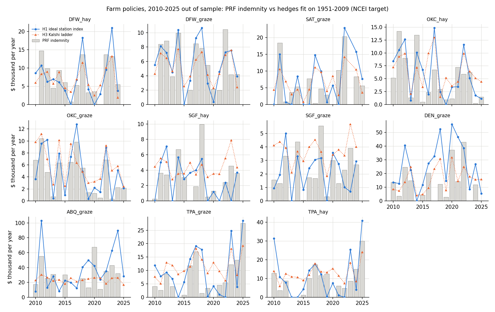

# 08: How well can Kalshi monthly-rain contracts replicate PRF payouts, and how does that vary by location?

**Proposal cell:** Week 3 / Maya (A2, "compare replication quality across a small set of representative locations to see how geography affects hedge performance")  |  **Status:** DRAFT (baseline; numbers reproducible with `python scripts/run_replication.py`)  |  **Last updated:** 2026-10-29

Code: `src/agri_hedge/replicate.py` (fitting, payoffs, metrics), `scripts/run_replication.py` (study loop, figures, the tables between the AUTO markers), tests in `tests/test_replicate.py` (synthetic data, no network).
Data written: `data/processed/replication_weights.csv`, `replication_backtest.csv`, `replication_summary.csv`; figures `docs/figures/a2_*.png`.

## Key findings

All headline numbers use 90% coverage, the NCEI-based PRF index (the data PRF settles on from 2026-08-31), and leave-one-year-out (LOYO) cross-validation over 1951-2025, pooled over 7 PRF sites x 2 grids x 11 intervals = 154 site-grid-intervals. "HE" (hedge effectiveness) is the share of the year-to-year variance of PRF payouts that the hedge removes (1 = perfect, 0 = useless).

- **A ladder of real Kalshi strikes removes 43% of PRF payout variance on average (HE 0.43).** The time-split test (fit 1951-2009, judge 2010-2025) gives 0.41, so the number is not an artifact of the cross-validation. Only 41% of site-grid-intervals reach HE > 0.5 with the Kalshi ladder, and 14% are below 0.2.
- **The loss splits into three steps of decreasing size.**
  - Geography and gauge-vs-grid measurement: 0.27 of HE. An ideal contract on the station's own two-month index, sized optimally (H1s), reaches 0.73.
  - Monthly contracts instead of a two-month index: 0.19 (0.73 to 0.54, the 0.25-inch ladder H2).
  - Whole-inch strike binning: 0.11 (0.54 to 0.43, the real Kalshi ladder H3).
- **Distance matters most for the ideal contract.** At the station's own grid the ideal contract reaches HE 0.87 and the Kalshi ladder 0.49. At the farm grid, 24-58 miles away, they reach 0.58 and 0.36. Across the 154 site-grid-intervals, the ideal contract's HE has correlation -0.75 with distance and +0.90 with the station-vs-grid rainfall correlation.
- **Strike binning destroys replication at arid sites.** At Albuquerque, the 1-inch NO (the lowest strike) pays in more than half of all months in 10 of 12 calendar months; at Denver in 6 of 12. Station-grid HE with the Kalshi ladder is 0.19 at ABQ and 0.40 at DEN, against 0.59-0.60 with 0.25-inch strikes. In the 28 site-grid-intervals where the 1-inch NO pays more than half the time, moving from 0.25-inch to Kalshi strikes costs 0.29 of HE on average, against 0.05 elsewhere.
- **Best and worst places.** The Kalshi ladder works best in the humid and sub-humid Plains: OKC, DFW and SAT reach 0.60-0.61 at the station grid, and OKC and SGF reach 0.50 at the farm grid. It works worst at ABQ (0.14-0.19 at either grid), at the DEN farm (0.27), and at the TPA farm in summer, where convective rain 58 miles away is nearly unrelated (Kalshi ladder HE 0.03, 0.04 and -0.10 for May-Jun, Jun-Jul and Jul-Aug).
- **The hedge pays in the wrong years more often than it misses.** The Kalshi ladder almost never misses a real PRF payout: in only 1% of years with PRF > $0.10 per $ does the hedge pay < $0.02. But it pays more than $0.10 in 47% of years in which PRF pays almost nothing (< $0.02), because one dry month triggers a monthly contract even when the two-month total is normal. In deep-drought years (index < 70) it pays only 62% of what PRF pays.
- **Fair cost is close to PRF's own expected payout but far above what a farmer pays for PRF.** At fair odds (training-window frequencies), the Kalshi ladder costs $0.179 per $ of protection. PRF's expected payout over 1951-2009 is $0.163, and the average 2026 full premium rate on these grids is $0.200. With the 51% federal subsidy at 90% coverage, the farmer pays about $0.098. Spreads, fees and the favorite-longshot pattern (05b) come on top.
- **Farm policies.** For the 11 representative farms, the Kalshi ladder's HE ranges from 0.10 (ABQ_graze) to 0.53 (DFW_graze), with typical replication error (RMSE) of $2,000-$18,000 per year. Copying DFW_hay's policy takes about 16,200 $1 NO contracts spread over 23 month-strike legs, with up to 3,640 in a single month. The live DFW order book held only $436 of drought payout at $0.95 or less (05b).
- **The results are robust to the index source and coverage level.** Against the CPC-based index (what PRF paid on before the switch), the Kalshi ladder's HE is 0.41 (LOYO). Against the CPC index exactly as settled, 2010-2025, it is 0.39. HE falls to 0.40 at 85% and 0.33 at 70% coverage, because rarer, deeper payouts are harder to copy with monthly steps.

## Numbers table

"Computed" = produced by `scripts/run_replication.py` (run 2026-10-29) from the processed data listed in Methods. All HE values are pooled over the stated groups, 90% coverage, NCEI target, LOYO 1951-2025 unless stated.

| Quantity | Value | Units | Region / period | Source | Verification |
|---|---|---|---|---|---|
| Pooled HE: H1 / H1s / H2 / H3 | 0.65 / 0.73 / 0.54 / 0.43 | share of variance | 154 PRF site-grid-intervals, LOYO | Table A | CONFIRMED (computed) |
| Same, time split | 0.66 / 0.74 / 0.53 / 0.41 | share | test 2010-2025 | Table A | CONFIRMED (computed) |
| Same, in sample | 0.65 / 0.74 / 0.65 / 0.51 | share | 1951-2009 | Table A | CONFIRMED (computed) |
| Station grids: H1 / H1s / H2 / H3 | 0.84 / 0.87 / 0.62 / 0.49 | share | 77 site-intervals | `replication_summary.csv` | CONFIRMED (computed) |
| Farm grids: H1 / H1s / H2 / H3 | 0.46 / 0.58 / 0.45 / 0.36 | share | 77 site-intervals | same | CONFIRMED (computed) |
| H3 HE by site, station grid | DFW 0.61, SAT 0.61, OKC 0.60, SGF 0.57, TPA 0.54, DEN 0.40, ABQ 0.19 | share | 11 intervals each | Table B | CONFIRMED (computed) |
| H3 HE by site, farm grid | OKC 0.50, SGF 0.50, DFW 0.45, SAT 0.42, TPA 0.31, DEN 0.27, ABQ 0.14 | share | 11 intervals each | Table B | CONFIRMED (computed) |
| H2 HE, station grid, DEN / ABQ | 0.60 / 0.59 | share | | Table B | CONFIRMED (computed) |
| Share of site-grid-intervals with H3 HE > 0.5 / < 0.2 | 40.9% / 14.3% | share | 154 | `replication_summary.csv` | CONFIRMED (computed) |
| Correlation of H1s HE with distance / with station-grid rain correlation | -0.75 / +0.90 | correlation | 154 | same | CONFIRMED (computed) |
| Station-to-grid-centre distance | 2-9 (station grids), 24-58 (farm grids) | miles | 7 PRF sites | `study_grids.csv` ([06b](06b_index_validation.md)) | CONFIRMED |
| Months where the 1-inch NO pays in > 50% of years | ABQ 10 of 12, DEN 6 of 12, other PRF sites 0 | months | 1951-2009 | `station_monthly_precip.csv` | CONFIRMED (computed) |
| P(month <= 1 in), ABQ Nov-Jun | 0.80-0.92 | probability | 1951-2009 | same | CONFIRMED (computed) |
| Median monthly rain, ABQ Jan-Jun / Jul-Aug | 0.29-0.48 / 1.32 | inches | 1951-2009 | same | CONFIRMED (computed) |
| HE lost from H2 to H3 where P(<=1 in) > 0.5 / elsewhere | 0.29 (28 cases) / 0.05 | HE | 154 | same | CONFIRMED (computed) |
| Correlation of that loss with P(<=1 in) | 0.80 | correlation | 154 | same | CONFIRMED (computed) |
| H3 HE, TPA farm May-Jun / Jun-Jul / Jul-Aug | 0.03 / 0.04 / -0.10 | share | per interval | Figure 3 | CONFIRMED (computed) |
| H3 HE, Jan-Feb at DEN and ABQ grids | 0.01-0.07 | share | 4 grids | Figure 3 | CONFIRMED (computed) |
| H3 HE, Oct-Nov pooled / best (DFW station) | 0.50 / 0.73 | share | | Table C | CONFIRMED (computed) |
| Tail capture (index < 70): H1 / H1s / H2 / H3 | 0.98 / 0.79 / 0.66 / 0.62 | ratio | mean of 154 | Table A | CONFIRMED (computed) |
| Miss rate: H1 / H3 | 0.09 / 0.01 | share of years with PRF > 0.10 | mean of 154 | Table A | CONFIRMED (computed) |
| False-alarm rate: H1 / H2 / H3 | 0.10 / 0.41 / 0.47 | share of years with PRF < 0.02 | mean of 154 | Table A | CONFIRMED (computed) |
| Fair cost: H1 / H1s / H2 / H3 | 0.184 / 0.150 / 0.180 / 0.179 | $ per $ protection | 1951-2009 climatology | Table A | CONFIRMED (computed) |
| PRF mean payout | 0.163 | $ per $ protection | 154, 1951-2009 | Table A | CONFIRMED (computed) |
| Mean 2026 full premium rate, 90% | 0.200 | $ per $ protection | 14 PRF study grids | `prf_actuarial_study_grids.csv` ([04b](04b_farm_scenario_results.md)) | CONFIRMED |
| Premium subsidy at 90% coverage | 51% | share of premium | PRF | [01](../research/01_usda_prf_mechanics.md), [04b](04b_farm_scenario_results.md) | CONFIRMED |
| H3 legs per interval fit / contracts per $ | 5.7 / 0.443 | count | 154, train fit | Table F | CONFIRMED (computed) |
| Ridge penalty chosen, H2 / H3 | 0.1 / 0.03 | per observation | pooled LOYO inside 1951-2009 | Table D notes | CONFIRMED (computed) |
| H3 HE with free cash intercept | 0.46 (bias 0.000 vs 0.017) | share | 154, LOYO | Table D notes | CONFIRMED (computed) |
| H3 HE, CPC target / CPC as settled | 0.41 (LOYO) / 0.39 (test) | share | 154 | Table D | CONFIRMED (computed) |
| H3 HE at 85% / 70% coverage | 0.40 / 0.33 | share | 154, LOYO | Table D | CONFIRMED (computed) |
| Farm H3 HE range | 0.10 (ABQ_graze) to 0.53 (DFW_graze) | share | 11 farms, LOYO | Table E | CONFIRMED (computed) |
| Farm H3 RMSE range | 2,026 (SGF_graze) to 18,054 (ABQ_graze) | $ per year | 11 farms, LOYO | Table E | CONFIRMED (computed) |
| DFW_hay: PRF mean / H3 fair cost / producer premium | 6,224 / 6,498 / 3,683 | $ per year | 1951-2025; 2026 rates | Table E; `prf_scenario_results.csv` (04b) | CONFIRMED (computed) |
| DFW_hay H3 contracts | 16,236 total, 23 legs, max 3,640 in one month | $1 contracts | forward (1951-2025) weights | `replication_weights.csv` | CONFIRMED (computed) |
| Farm H3 contracts range | 12,979 (DFW_graze) to 37,623 (DEN_graze) | $1 contracts per year | 11 farms | same | CONFIRMED (computed) |
| DFW drought depth at <= $0.95 | $436 | $ payout | Nov 2026 book, 2026-10-29 | [05b](05b_kalshi_liquidity_stats.md) | CONFIRMED (from 05b) |
| Settled Kalshi outcomes reproduced by station data | 922 of 922 | markets | Feb 2024 - Sep 2026 | [06c](06c_station_vs_kalshi_settlement_check.md) | CONFIRMED (from 06c) |
| Rows in replication_weights.csv | 50,321 | rows | | file | CONFIRMED (computed) |

## Methods

### Terms

- **PRF payout per dollar.** For one PRF grid, one two-month interval, and coverage level c, PRF pays max(0, (T - I) / T) per $1 of policy protection, where T = 100c is the trigger and I is the final grid index (100 = normal rain). We use the unrounded payment calculation factor from `agri_hedge.prf.payment_calculation_factor(..., decimals=None)` (see [01](../research/01_usda_prf_mechanics.md), [04b](04b_farm_scenario_results.md)).
- **NO contract.** Kalshi's market "Above X inches" for a city and month resolves YES if the settlement station's monthly total is strictly greater than X. Buying NO therefore pays $1 if the month ends at X inches or less. That is the drought-side contract a rancher would buy ([05b](05b_kalshi_liquidity_stats.md), [06c](06c_station_vs_kalshi_settlement_check.md)).
- **Ladder / portfolio.** A set of NO contracts on one station's two calendar months (for Apr-May: April and May contracts) at several strikes, held in chosen amounts. The amount is the **weight**: the number of $1-notional contracts held per $1 of PRF policy protection.
- **Hedge effectiveness (HE).** HE = 1 - Var(PRF - hedge) / Var(PRF). HE = 1 means the hedge removes all year-to-year variation in what PRF pays; HE = 0 means it removes none; negative means it adds noise. HE ignores a constant offset, so we also report the bias.
- **Out of sample (OOS).** Weights are fit on one set of years and judged on years the fit never saw.

### Targets and data

| Item | What we used | Why |
|---|---|---|
| Primary target | NCEI nClimGrid-based PRF index served by RMA's Decision Support Tool (`prf_official_index.csv`, fixed 1951-2025 base), years 1951-2025 | PRF settles on NCEI from 2026-08-31; this is the history the DST shows ([06b](06b_index_validation.md)) |
| Robustness target 1 | CPC-based rebuild with a fixed 1948-2025 base (`cpc_interval_index.parquet`, `index_value_fixed_base`) | the data source PRF paid on through mid-2026 |
| Robustness target 2 | CPC as settled (`index_value_ours`, base 1948 to Y-2), test years 2010-2025 only | what PRF actually paid; hedges fit on target 1 are evaluated against it |
| Station rain | `station_monthly_precip.csv`, complete months only (`n_missing == 0`); ThreadEx records fill DFW before 1974 and DEN before 1994 | 06c showed these station totals reproduce 922 of 922 settled Kalshi outcomes |
| Kalshi strikes | `kalshi_rain_markets.parquet`: for each series and calendar month, the union of strikes ever listed; months never listed fall back to the series' most common ladder | SAT, OKC, SGF, ABQ and TPA have listed only Nov 2026 (1-7 in), so every month there uses 1-7 in |
| Grids | `study_grids.csv`: the grid containing the station ("station grid") and the grid containing the farm point ("farm grid") for 7 PRF sites plus ORD (row-crop contrast, not PRF) | station grid isolates measurement mismatch; farm grid adds 24-58 miles of distance |
| Farms | `data/scenarios/farms.yaml`: 11 farms, their interval allocations and coverage levels (85% for SAT_graze and ABQ_graze, 90% otherwise) | the farm's actual policy |

### Hedge families

Each family adds one real-world constraint, so the drop in quality from one family to the next is the cost of that constraint (a preview of the Week 4 error decomposition).

| Family | What the hedge is | What error it contains |
|---|---|---|
| **H1 ideal station index** | A hypothetical contract that pays the PRF formula applied to the station's own two-month index, 100 x (station two-month total) / (station normal). The normal uses the same base years as the target. No fitting. | geography (station vs grid location) + measurement (one gauge vs a gridded average) |
| **H1s ideal index, fitted scale** | H1 held in the NNLS-optimal amount (one non-negative weight per interval, fit like the ladders). Added because the fitted ladders can shrink toward zero when the farm is far away and the unscaled H1 cannot, so H1s is the fair starting point for the decomposition. | same as H1, without the over-sizing penalty |
| **H2 fine monthly ladder** | NO contracts on the station's two calendar months at every 0.25-inch strike, from 0.25 in up to the first strike above the wettest month on record. Weights by non-negative least squares. | H1's error + the **monthly-vs-two-month mismatch**: the hedge is g1(month-1 rain) + g2(month-2 rain), while PRF pays on the two-month sum |
| **H3 actual Kalshi ladder** | As H2, but only the strikes Kalshi lists for that series and month (whole inches, usually 1-7) | H2's error + **strike binning** |

We kept to linear combinations of monthly contracts. Products of contracts or joint two-month contracts do not exist on Kalshi.

### Fitting

- **Non-negative least squares (NNLS), no intercept.** Weights minimize the mean squared gap between the hedge and the PRF payout, subject to every weight being >= 0 (long NO positions only, no short selling) and no free cash term. A NO at a strike above every observed total pays $1 every year. It is a real contract and acts as a cash leg if the fit wants one.
- **Ridge shrinkage.** NNLS on 59 years overfits: the 0.25-inch ladder offers 13-158 candidate legs per interval (median 88). We add a ridge penalty lambda x (sum of squared weights). One lambda per family is chosen by leave-one-year-out (LOYO) error pooled over all 154 PRF site-grid-intervals at 90% coverage, inside 1951-2009 only, so the test years never influence it.
- **Evaluation.**
  - **Time split:** fit on 1951-2009 (59 years), evaluate on 2010-2025 (16 years). This is the honest "would it have worked" test, but 16 years is a small sample.
  - **LOYO CV:** refit 75 times on 1951-2025, each time leaving one year out, and predict that year. This uses more data and is our main basis for comparing sites.
  - **In sample:** train-window fit evaluated on the training years (an upper bound).
- **Sensitivities:** a free-sign cash intercept (NCEI target); H1 with the station normal from 1951-2009 only; CPC targets; 70% and 85% coverage.
- **Fair cost.** The expected payout of the portfolio under training-window climatology: the sum over legs of weight x (share of 1951-2009 months in which that NO paid). It is the price of the hedge at fair odds, before Kalshi's spread, fees, and the favorite-longshot pattern documented in 05b.
- **Farm policies.** The farm's hedge is the allocation-weighted sum of its per-interval hedges, at the farm grid and the farm's coverage level. Dollars = per-dollar payout x the farm's total policy protection (county base value x coverage x productivity factor x acres, computed with `agri_hedge.prf`).

### Metrics (all in $ per $1 of policy protection unless marked $)

| Metric | Definition |
|---|---|
| RMSE | sqrt(mean((PRF - hedge)^2)) |
| Corr | Pearson correlation of PRF and hedge payouts |
| HE | 1 - Var(PRF - hedge) / Var(PRF) |
| Tail capture | (sum of hedge payouts) / (sum of PRF payouts) over years with grid index < 70 (for farm policies: allocation-weighted index < 70) |
| Miss rate | share of years with PRF > 0.10 in which the hedge pays < 0.02 |
| False-alarm rate | share of years with PRF < 0.02 in which the hedge pays > 0.10 |
| Bias | mean(hedge - PRF); also mean overpayment mean(max(0, hedge - PRF)) and underpayment mean(max(0, PRF - hedge)) |

## Results

<!-- BEGIN AUTO: replication tables (scripts/run_replication.py) -->
HE values in Tables A-D are **pooled**: 1 - sum(n Var(PRF - hedge)) / sum(n Var(PRF)) over the site-grid-intervals in the cell, i.e. the share of total PRF payout variance the hedges remove. Other metrics are plain means over site-grid-intervals. "loyo" = leave-one-year-out 1951-2025; "test" = fit 1951-2009, evaluated 2010-2025; "train" = in-sample 1951-2009.

**Table A. All 7 PRF sites x 2 grids x 11 intervals (154 site-grid-intervals), 90% coverage, NCEI target.**

| Hedge | Eval set | HE (pooled) | HE (median) | Corr | RMSE ($/$) | Tail capture | Miss rate | False-alarm rate | Bias ($/$) | Fair cost ($/$) |
|---|---|---|---|---|---|---|---|---|---|---|
| H1 ideal station index | train | 0.65 | 0.74 | 0.83 | 0.129 | 0.97 | 0.10 | 0.10 | 0.021 | 0.184 |
| H1s ideal index, fitted scale | train | 0.74 | 0.77 | 0.83 | 0.112 | 0.79 | 0.10 | 0.08 | -0.013 | 0.150 |
| H2 fine 0.25-in ladder | train | 0.65 | 0.65 | 0.81 | 0.134 | 0.71 | 0.00 | 0.37 | 0.017 | 0.180 |
| H3 Kalshi ladder | train | 0.51 | 0.55 | 0.71 | 0.156 | 0.65 | 0.00 | 0.42 | 0.016 | 0.179 |
| H1 ideal station index | test | 0.66 | 0.73 | 0.83 | 0.124 | 1.02 | 0.09 | 0.09 | 0.023 | 0.184 |
| H1s ideal index, fitted scale | test | 0.74 | 0.78 | 0.83 | 0.108 | 0.84 | 0.09 | 0.08 | -0.012 | 0.150 |
| H2 fine 0.25-in ladder | test | 0.53 | 0.54 | 0.72 | 0.155 | 0.71 | 0.01 | 0.43 | 0.021 | 0.180 |
| H3 Kalshi ladder | test | 0.41 | 0.44 | 0.65 | 0.171 | 0.66 | 0.01 | 0.47 | 0.018 | 0.179 |
| H1 ideal station index | loyo | 0.65 | 0.73 | 0.83 | 0.129 | 0.98 | 0.09 | 0.10 | 0.021 | 0.184 |
| H1s ideal index, fitted scale | loyo | 0.73 | 0.76 | 0.82 | 0.114 | 0.79 | 0.10 | 0.08 | -0.013 | 0.150 |
| H2 fine 0.25-in ladder | loyo | 0.54 | 0.54 | 0.72 | 0.154 | 0.66 | 0.01 | 0.41 | 0.018 | 0.180 |
| H3 Kalshi ladder | loyo | 0.43 | 0.44 | 0.64 | 0.169 | 0.62 | 0.01 | 0.47 | 0.017 | 0.179 |

Mean PRF payout over 1951-2009 (the PRF "burn"): 0.163 per $ of protection; mean 2026 full premium rate at these grids: 0.200.

**Table B. Pooled LOYO HE by site and grid (11 intervals, 90% coverage, NCEI).** The last three columns describe climate: correlation of the station's two-month total with the grid index (1951-2009, mean over intervals), the station's mean two-month normal, and the share of calendar months in which the 1-inch NO pays.

| Site | Grid | Distance (mi) | H1 | H1s | H2 | H3 | H3 tail capture | H3 false-alarm rate | Station-grid corr | Two-month normal (in) | P(month <= 1 in) |
|---|---|---|---|---|---|---|---|---|---|---|---|
| DFW | station | 6 | 0.87 | 0.89 | 0.65 | 0.61 | 0.76 | 0.37 | 0.95 | 5.9 | 0.22 |
| DFW | farm | 50 | 0.57 | 0.64 | 0.49 | 0.45 | 0.67 | 0.45 | 0.84 | 5.9 | 0.22 |
| SAT | station | 9 | 0.86 | 0.88 | 0.67 | 0.61 | 0.77 | 0.40 | 0.96 | 5.2 | 0.29 |
| SAT | farm | 47 | 0.51 | 0.58 | 0.48 | 0.42 | 0.67 | 0.51 | 0.81 | 5.2 | 0.29 |
| OKC | station | 2 | 0.93 | 0.93 | 0.65 | 0.60 | 0.75 | 0.34 | 0.97 | 6.0 | 0.19 |
| OKC | farm | 24 | 0.73 | 0.75 | 0.55 | 0.50 | 0.68 | 0.38 | 0.91 | 6.0 | 0.19 |
| SGF | station | 8 | 0.89 | 0.89 | 0.61 | 0.57 | 0.70 | 0.29 | 0.95 | 7.4 | 0.09 |
| SGF | farm | 28 | 0.66 | 0.70 | 0.53 | 0.50 | 0.65 | 0.32 | 0.86 | 7.4 | 0.09 |
| DEN | station | 3 | 0.77 | 0.82 | 0.60 | 0.40 | 0.62 | 0.43 | 0.93 | 2.6 | 0.49 |
| DEN | farm | 43 | 0.19 | 0.47 | 0.36 | 0.27 | 0.50 | 0.46 | 0.77 | 2.6 | 0.49 |
| ABQ | station | 6 | 0.82 | 0.85 | 0.59 | 0.19 | 0.53 | 0.67 | 0.94 | 1.5 | 0.72 |
| ABQ | farm | 51 | 0.32 | 0.49 | 0.39 | 0.14 | 0.45 | 0.64 | 0.75 | 1.5 | 0.72 |
| TPA | station | 8 | 0.74 | 0.79 | 0.57 | 0.54 | 0.63 | 0.33 | 0.90 | 8.3 | 0.18 |
| TPA | farm | 58 | 0.19 | 0.45 | 0.35 | 0.31 | 0.46 | 0.38 | 0.66 | 8.3 | 0.18 |
| ORD (contrast, not PRF) | station | 7 | 0.84 | 0.87 | 0.65 | 0.61 | 0.70 | 0.24 | 0.94 | 6.2 | 0.10 |
| ORD (contrast, not PRF) | farm | 24 | 0.68 | 0.72 | 0.55 | 0.53 | 0.64 | 0.28 | 0.88 | 6.2 | 0.10 |

**Table C. Pooled LOYO HE by interval (7 PRF sites x 2 grids, 90% coverage, NCEI).**

| Interval | H1 | H1s | H2 | H3 | H3 best site-grid | H3 worst site-grid |
|---|---|---|---|---|---|---|
| Jan-Feb | 0.76 | 0.78 | 0.56 | 0.41 | DFW station 0.69 | ABQ farm 0.01 |
| Feb-Mar | 0.72 | 0.76 | 0.59 | 0.44 | TPA station 0.73 | ABQ farm 0.06 |
| Mar-Apr | 0.73 | 0.75 | 0.56 | 0.41 | OKC station 0.79 | ABQ farm 0.08 |
| Apr-May | 0.66 | 0.73 | 0.55 | 0.39 | SAT station 0.74 | ABQ station 0.10 |
| May-Jun | 0.56 | 0.66 | 0.47 | 0.36 | DFW station 0.68 | TPA farm 0.02 |
| Jun-Jul | 0.47 | 0.64 | 0.50 | 0.46 | OKC station 0.76 | TPA farm 0.04 |
| Jul-Aug | 0.47 | 0.66 | 0.48 | 0.44 | SAT station 0.68 | TPA farm -0.10 |
| Aug-Sep | 0.49 | 0.64 | 0.45 | 0.40 | OKC station 0.65 | ABQ farm 0.07 |
| Sep-Oct | 0.65 | 0.71 | 0.50 | 0.44 | DFW station 0.68 | TPA farm 0.28 |
| Oct-Nov | 0.73 | 0.77 | 0.58 | 0.50 | DFW station 0.73 | TPA farm 0.32 |
| Nov-Dec | 0.74 | 0.77 | 0.59 | 0.41 | SGF station 0.71 | ABQ farm 0.09 |

**Table D. Robustness: pooled HE over the 154 PRF site-grid-intervals by target, coverage and evaluation set.** cpc_as_settled = hedges fit to the fixed-base CPC index, evaluated against the CPC index as RMA settled it.

| Target | Coverage | Eval set | H1 | H1s | H2 | H3 | PRF mean payout ($/$) |
|---|---|---|---|---|---|---|---|
| ncei | 0.70 | test | 0.57 | 0.70 | 0.46 | 0.32 | 0.105 |
| ncei | 0.70 | loyo | 0.58 | 0.69 | 0.46 | 0.33 | 0.100 |
| ncei | 0.85 | test | 0.64 | 0.73 | 0.51 | 0.39 | 0.151 |
| ncei | 0.85 | loyo | 0.64 | 0.72 | 0.52 | 0.40 | 0.147 |
| ncei | 0.90 | test | 0.66 | 0.74 | 0.53 | 0.41 | 0.168 |
| ncei | 0.90 | loyo | 0.65 | 0.73 | 0.54 | 0.43 | 0.164 |
| cpc | 0.70 | test | 0.52 | 0.63 | 0.43 | 0.31 | 0.114 |
| cpc | 0.70 | loyo | 0.57 | 0.66 | 0.44 | 0.32 | 0.107 |
| cpc | 0.85 | test | 0.58 | 0.66 | 0.48 | 0.37 | 0.162 |
| cpc | 0.85 | loyo | 0.61 | 0.69 | 0.50 | 0.39 | 0.155 |
| cpc | 0.90 | test | 0.60 | 0.67 | 0.49 | 0.39 | 0.180 |
| cpc | 0.90 | loyo | 0.62 | 0.69 | 0.52 | 0.41 | 0.172 |
| cpc_as_settled | 0.70 | test | 0.52 | 0.63 | 0.43 | 0.31 | 0.116 |
| cpc_as_settled | 0.85 | test | 0.58 | 0.66 | 0.48 | 0.37 | 0.165 |
| cpc_as_settled | 0.90 | test | 0.59 | 0.67 | 0.49 | 0.39 | 0.182 |

Sensitivities (NCEI, 90%, 154 PRF site-grid-intervals):
- H2 with a free-sign cash intercept, test: pooled HE 0.57 (vs 0.53 without), mean RMSE 0.148 (vs 0.155), mean bias 0.003 (vs 0.021).
- H2 with a free-sign cash intercept, loyo: pooled HE 0.57 (vs 0.54 without), mean RMSE 0.147 (vs 0.154), mean bias 0.000 (vs 0.018).
- H3 with a free-sign cash intercept, test: pooled HE 0.45 (vs 0.41 without), mean RMSE 0.163 (vs 0.171), mean bias 0.002 (vs 0.018).
- H3 with a free-sign cash intercept, loyo: pooled HE 0.46 (vs 0.43 without), mean RMSE 0.163 (vs 0.169), mean bias 0.000 (vs 0.017).
- H1 with the station normal from 1951-2009 only, test: pooled HE 0.66 (vs 0.66 with the 1951-2025 normal), mean bias 0.025 (vs 0.023).
- Ridge penalty chosen by pooled LOYO inside 1951-2009: H2 = 0.1, H3 = 0.03. Pooled training-window LOYO sum of squared errors by penalty: 0: H2 237.7, H3 284.6; 0.001: H2 236.6, H3 284.2; 0.003: H2 235.1, H3 283.7; 0.01: H2 231.6, H3 282.2; 0.03: H2 227.4, H3 280.6; 0.1: H2 226.2, H3 284.4; 0.3: H2 236.4, H3 307.3; 1: H2 271.4, H3 360.0.

**Table E. Farm policies (allocation-weighted hedges on the farm grid at the farm's coverage, NCEI target).** Dollar columns use the farm's total policy protection.

| Farm | Coverage | Protection ($) | PRF mean ($/yr, 1951-2025) | HE H1 / H1s / H2 / H3 (LOYO) | HE H3 (test 2010-25) | H3 RMSE ($/yr, LOYO) | H3 fair cost ($/yr) | H3 tail capture (LOYO) | H3 false-alarm rate (LOYO) |
|---|---|---|---|---|---|---|---|---|---|
| DFW_hay | 0.90 | 36,652 | 6,224 | 0.37 / 0.53 / 0.52 / 0.46 | 0.59 | 3,671 | 6,498 | 0.73 | 0.57 |
| DFW_graze | 0.90 | 26,827 | 4,667 | 0.47 / 0.59 / 0.53 / 0.53 | 0.55 | 2,220 | 4,951 | 0.80 | 0.50 |
| SAT_graze | 0.85 | 33,647 | 5,750 | 0.27 / 0.44 / 0.32 / 0.32 | 0.23 | 4,604 | 6,193 | 0.70 | 0.57 |
| OKC_hay | 0.90 | 43,344 | 6,369 | 0.58 / 0.60 / 0.48 / 0.47 | 0.25 | 3,923 | 7,346 | 0.70 | 0.42 |
| OKC_graze | 0.90 | 36,972 | 5,377 | 0.67 / 0.70 / 0.55 / 0.49 | 0.67 | 2,731 | 6,316 | 0.80 | 0.33 |
| SGF_hay | 0.90 | 36,018 | 4,474 | 0.66 / 0.66 / 0.49 / 0.42 | 0.08 | 3,132 | 5,413 | 0.64 | 0.29 |
| SGF_graze | 0.90 | 27,945 | 3,579 | 0.69 / 0.71 / 0.55 / 0.51 | 0.23 | 2,026 | 4,330 | 0.68 | 0.29 |
| DEN_graze | 0.90 | 123,322 | 13,356 | 0.40 / 0.62 / 0.40 / 0.36 | 0.21 | 12,185 | 14,980 | 0.56 | 0.33 |
| ABQ_graze | 0.85 | 175,950 | 21,609 | -0.66 / 0.23 / 0.21 / 0.10 | 0.10 | 18,054 | 21,757 | 0.47 | 0.74 |
| TPA_graze | 0.90 | 65,642 | 9,393 | 0.42 / 0.57 / 0.36 / 0.38 | 0.40 | 7,006 | 10,716 | 0.63 | 0.58 |
| TPA_hay | 0.90 | 89,910 | 10,857 | 0.10 / 0.49 / 0.29 / 0.31 | 0.44 | 7,940 | 12,230 | 0.66 | 0.48 |

**Table F. Shape of the fitted ladders (NCEI, 90%, 1951-2009 fit, 154 PRF site-grid-intervals).**

| Family | Fits | Mean legs per fit | Median strike (in) | Mean total contracts per $ | Mean fair cost ($/$) |
|---|---|---|---|---|---|
| H2 | 154 | 19.5 | 1.75 | 0.555 | 0.180 |
| H3 | 154 | 5.7 | 2.00 | 0.443 | 0.179 |

Threaded (ThreadEx) station years used in training: DFW 1948-1973; DEN 1948-1994; ORD 1948-1958. All test years 2010-2025 are single-station.
<!-- END AUTO: replication tables -->

### Figures

*Figure 1. Hedge effectiveness by site, pooled over the 11 intervals (90% coverage, NCEI target, LOYO). Left: the station's own grid. Right: the farm grid. Bars: ideal station-index contract with fitted size (H1s), 0.25-inch monthly ladder (H2), real Kalshi ladder (H3). Black ticks: the unscaled ideal contract (H1).*

*Figure 2. Hedge effectiveness against the distance from the settlement station to the PRF grid centre. Each site appears twice: its station grid (2-9 miles) and its farm grid (24-58 miles).*

*Figure 3. Real Kalshi ladder (H3), hedge effectiveness for every site, grid and interval (LOYO, 90%, NCEI). The companion map for the ideal contract is [a2_he_heatmap_h1.png](../figures/a2_he_heatmap_h1.png).*

*Figure 4. Share of 1951-2009 months with station rain at or below the lowest listed Kalshi strike (1 inch at every PRF site). Where this exceeds 0.5 (ABQ in 10 months, DEN in 6), the 1-inch NO pays in a normal month and the ladder cannot tell a dry month from a typical one.*

*Figure 5. Four example interval backtests. OKC station grid May-Jun replicates well. DFW farm grid Apr-May shows the distance effect. ABQ station grid Apr-May shows strike binning: the 1-inch NO pays almost every year, so the Kalshi ladder pays nearly the same amount every year. TPA farm grid Jul-Aug shows summer convection 58 miles away, where nothing works.*

*Figure 6. The 11 farm policies in dollars, 2010-2025 out of sample (weights fit on 1951-2009). Missing years are years with an incomplete station month.*

### What the results mean (plain English)

**1. Three separate things go wrong, and they add up.** Think of the perfect hedge as a contract that pays exactly what PRF pays. Each real-world constraint takes something away:

| Step | Pooled HE, all 154 | Station grids | Farm grids | What is lost |
|---|---|---|---|---|
| Perfect copy | 1.00 | 1.00 | 1.00 | |
| H1s: ideal contract on the station's two-month index, sized optimally | 0.73 | 0.87 | 0.58 | the gauge is not the grid (geography + one gauge vs a 36-cell gridded average) |
| H2: monthly NO contracts at every 0.25 in | 0.54 | 0.62 | 0.45 | PRF pays on the two-month sum; monthly contracts pay on each month separately |
| H3: monthly NO contracts at Kalshi's whole-inch strikes | 0.43 | 0.49 | 0.36 | strikes too coarse, worst where months are dry |

The order of the steps matters for how the loss is split, because the losses overlap. At farm grids, geography is the biggest step (-0.42). At station grids, the monthly-vs-two-month mismatch is the biggest (-0.24). The unscaled ideal contract (H1, exactly the PRF formula on the station index) does worse than its sized version, and much worse at far grids (DEN, TPA farm: 0.19 vs 0.45-0.47). When the farm is far from the gauge, the best hedge holds fewer contracts than one per dollar. The unscaled contract also costs more than PRF pays on average ($0.184 against $0.163 per $). A single gauge swings more than a 36-cell grid average, so it falls below the trigger more often and further.

**2. Why monthly contracts cannot copy a two-month index.** PRF pays when the two months together are dry. A drought in April can be cancelled by a wet May. A portfolio of monthly NO contracts pays on April and on May separately, so it pays for the dry April even when May made up for it. Least squares balances this. It buys enough low-strike contracts to pay something in most dry months, so it rarely misses a real PRF payout (miss rate 1%). But it pays in many years when PRF does not (false-alarm rate 41-47%), and it under-pays in the deepest droughts (tail capture 62-66%). This is a property of the contract design, not of any one place. The ORD contrast site (humid corn belt) shows the same pattern: at its station grid, 0.87 (H1s), 0.65 (H2) and 0.61 (H3).

**3. Why the arid West fails with Kalshi strikes.** A strike is only useful if rain falls below it in a dry month and above it in a normal one. At Albuquerque the median month has 0.3-0.5 inch from November to June, so the 1-inch NO pays in 80-92% of those months (Figure 4). It is almost a sure thing and carries no information about drought. Only the July-August monsoon months (median 1.3 in) give the 1- and 2-inch strikes something to separate. Denver has the same problem from September to February. With 0.25-inch strikes (H2) both sites replicate nearly as well as the Plains (0.59-0.60 at the station grid, against 0.61-0.67). The problem is the strike grid, not the weather.

**4. Which intervals replicate.** Differences between intervals are smaller than differences between sites. Pooled over sites, Oct-Nov replicates best (Kalshi ladder HE 0.50; DFW station grid 0.73) and May-Jun worst (0.36). The clear failures are local: summer intervals at the TPA farm grid, and every ABQ interval outside the Jul-Sep monsoon. For the ideal contract the summer intervals are the hardest (May-Jun to Aug-Sep HE 0.47-0.56 unscaled), because convective storms make rain at one gauge a poor guide to rain 50 miles away. For the Kalshi ladder, the cold-season intervals at DEN and ABQ are the worst (Jan-Feb 0.01-0.07), because of strike binning.

**5. Geography: distance plus climate.** Figure 2 shows the two effects. Distance lowers every hedge. The drop is gentle in the gauge-dense, frontal-rain Plains (OKC farm at 24 mi: ideal contract 0.75) and steep where rain is convective or sparse (TPA farm at 58 mi: 0.45; DEN farm at 43 mi: 0.47). Climate then sets how much the strike grid costs on top: almost nothing at SGF, OKC, DFW, SAT and TPA, and most of the remaining HE at ABQ.

**6. The farmer's view.** For a whole policy (Table E), the Kalshi ladder removes 32-53% of payout variance for the Texas, Oklahoma and Missouri farms, 31-38% for the Florida farms, 36% for DEN_graze and 10% for ABQ_graze. Its fair cost (1951-2009 climatology) is 1-21% above PRF's 1951-2025 average payout: for example $6,498 per year against $6,224 for DFW_hay. The farmer pays only $3,683 per year for DFW_hay's PRF policy after subsidy (04b). So even before trading costs, a Kalshi copy of DFW_hay's PRF policy costs the farmer about 1.8 times as much as PRF, and it removes only about half of the year-to-year variation in what PRF would have paid. A3 will price this with actual quotes.

### The weights file (for A3 and Milestone 2)

`data/processed/replication_weights.csv` has one row per non-zero leg: 50,321 rows. Each row says "hold `weight_per_dollar_protection` NO contracts on `kalshi_series`, month `contract_month`, strike `strike_in`, for each $1 of PRF policy protection in `interval_name` at `coverage` on `grid_id`".

| Column | Meaning |
|---|---|
| target_index | `ncei` (primary) or `cpc` (fixed-base CPC robustness) |
| site, is_prf_site, role, grid_id | study site, PRF site flag (ORD = False), `station` or `farm` grid, PRF grid ID |
| interval_name, interval_code, coverage | PRF interval (codes 625-635) and coverage level (0.70, 0.85, 0.90) |
| hedge_family | `H3` = only strikes Kalshi has listed for that series and month; `H2` = hypothetical 0.25-inch strikes (`strike_listed_on_kalshi` says which H2 legs exist) |
| fit_window, train_years, n_train_years, weights_use | `train` = fit 1951-2009 (`backtest`, judged on 2010-2025); `full` = fit 1951-2025 (`forward`, for pricing 2026-27 policies) |
| kalshi_series, cli_code, station_ghcn | contract series and settlement station |
| contract_month, contract_month_name | calendar month (1-12) of the monthly contract |
| strike_in, position, payoff_rule | strike in inches; always `NO`, which pays $1 if the station's monthly total <= strike |
| weight_per_dollar_protection | number of $1-notional NO contracts per $1 of interval policy protection |
| leg_prob_pays_fit_window, leg_fair_cost_per_dollar | share of fit-window months in which this NO paid (its fair price); weight x that share |
| fair_cost_per_dollar, n_legs | fair cost of the whole interval hedge (sum over legs) and its number of legs |
| prf_mean_payout_fit_window, premium_rate_2026 | PRF's average payout per $ over the fit window; 2026 full (unsubsidized) premium rate for that grid, interval and coverage (blank for ORD) |
| ridge | the ridge penalty used |

**Recipe for a farm.** Filter `target_index == "ncei"`, `hedge_family == "H3"`, `fit_window == "full"` (or `"train"` for a backtest), `role == "farm"`, the farm's `site` and `coverage`, and the farm's intervals. Then contracts = `weight_per_dollar_protection` x the interval's allocation share x the farm's total policy protection (county base value x coverage x productivity factor x acres). The fair cost in dollars = `fair_cost_per_dollar` x the same protection. `replication_backtest.csv` holds the yearly payouts (per $ of protection) behind every number here. Farm rows have `role == "farm_policy"` and `policy_protection_usd`. `replication_summary.csv` holds every metric for every target, site, grid, interval, coverage, family, variant and evaluation set.

## Implications for the Milestone 2 optimizer

1. **Start from these weights, but change the objective.** Least squares treats a false alarm and a missed drought as equally bad. A farmer does not: the missed payout hurts and the false alarm only costs premium. The optimizer should minimize downside error, for example the shortfall max(0, PRF - hedge) or a tail-weighted loss, subject to a budget. That will trade some of the 47% false alarms for better tail capture (now 62%).
2. **Regularize.** With 59 training years and up to 80 candidate legs, unregularized NNLS overfits. For the 0.25-inch ladder, in-sample HE is 0.65 against 0.53 out of sample. A ridge penalty chosen inside the training window (0.1 for H2, 0.03 for H3, per observation) is a reasonable default. A smoothness penalty across adjacent strikes is a natural alternative.
3. **Report replicability before cost.** For each farm interval, the optimizer should show the expected HE (this file) and refuse or flag intervals that cannot be copied. Flag intervals where, averaged over the two months, the 1-inch NO pays in more than half of months. That is every ABQ interval except Jul-Aug and Aug-Sep, and DEN Jan-Feb, Feb-Mar, Sep-Oct, Oct-Nov and Nov-Dec: the 28 site-grid-intervals in the key findings. Also flag summer intervals at far farm grids in Florida.
4. **Steer the PRF interval choice toward replicable intervals.** Where a farmer has flexibility (PRF requires 2+ non-overlapping intervals), intervals in the replicable months (for example Oct-Nov and Mar-Apr in the Plains) produce a hedgeable policy. In the arid West, monsoon intervals (Jul-Aug, Aug-Sep) are the only ones Kalshi strikes can see.
5. **Liquidity, not math, is the binding constraint at the sites with history.** The H3 portfolio needs roughly 0.44 contracts per $ of protection, spread over about 6 legs per interval. A typical farm needs 13,000-38,000 contracts per year, with 2,300-13,600 in its busiest month. The optimizer must cap each leg at order-book depth (05b). It should also expect that most of the needed low-strike NO depth does not exist yet.
6. **Better contracts would help more than better optimization.** If Kalshi listed 0.25- or 0.5-inch strikes below 1 inch at arid sites, ABQ's station-grid HE would rise from 0.19 toward 0.59. A two-month cumulative contract would remove the second step (about 0.19 of HE). These are concrete product suggestions for the final report.

## Limitations

- **Short out-of-sample window.** 2010-2025 is only 16 years, so per-interval test metrics are noisy. We report LOYO as the main comparison and pooled HE rather than plain averages: at 70% coverage the 16-year window often has 0-2 payout years, which makes per-interval HE meaningless. HE is left blank when PRF pays in fewer than 3 evaluation years.
- **Target normal.** The NCEI target uses the DST's fixed 1951-2025 normal, which includes the test years. Real PRF uses 1951 to two years before the crop year. We did not rebuild the target with a rolling normal. Giving the station contract a 1951-2009 normal instead of 1951-2025 leaves its test HE unchanged at 0.66 (Table D notes), which suggests the choice of normal matters little.
- **Strike sets assumed stable.** Five of seven PRF sites have listed only November 2026 (1-7 in). We assume the same ladder for every month and every past year. DFW (Oct 1-10, Nov 1-8 in) and DEN (Aug 1-10 in) use the extra strikes they have listed.
- **Station data are a settlement proxy.** We use the cleaned archive, not the first NWS climate report that Kalshi settles on. 06c estimates about 0.4% of months could settle differently, and DFW, DEN and ORD now settle on The Weather Company data. Training years use ThreadEx predecessor records at DFW (1948-1973) and DEN (1948-1994). All test years are from the current station.
- **Linear, long-only, per interval.** No products of contracts, no YES legs, and farm hedges are sums of per-interval fits, not one joint fit. A joint fit, or allowing YES legs, can only improve the in-sample numbers.
- **No prices, fees, spreads or depth.** Fair cost uses historical frequencies. Real costs are A3's and Milestone 2's job.
- **Least squares is one choice of loss.** Different losses give different weights (see the Implications above). Also, the intercept-free constraint costs about 0.03 of HE: with a free cash term the Kalshi ladder reaches 0.46 instead of 0.43, and its mean bias drops from +0.017 to 0.000 per $.

## Unverified claims and open questions

- **Will Kalshi keep 1-7 inch ladders for every month at the new sites?** We only have the November 2026 ladder for SAT, OKC, SGF, ABQ and TPA. A wetter-month ladder at TPA (summer medians of 5.8-7.5 in) might add strikes above 7 in. That would not matter for drought legs. A drier ladder at ABQ would help a lot.
- **Is 0.25 inch fine enough to call H2 "unbinned"?** Finer strikes would lower H2's error slightly, but more legs also overfit more. We did not test 0.1-inch strikes.
- **Station selection.** We used one settlement station per site. A farm between two Kalshi cities could combine both ladders; none of our farms has a second station within 60 miles.
- **Basis-risk cross-check.** A1 (doc 07) is measuring raw station-vs-grid basis risk at the same sites. Our H1 numbers should agree with A1's in direction. We have not reconciled them yet.

## Sources

- Data and code: this repository, `scripts/run_replication.py`, `src/agri_hedge/replicate.py`.
- PRF payout formula and subsidy: [docs/research/01_usda_prf_mechanics.md](../research/01_usda_prf_mechanics.md) (FCIC-18150 Rainfall Index Handbook, 2026, https://www.rma.usda.gov/sites/default/files/2025-08/2026-18150-Rainfall-Index-Handbook.pdf; Basic Provisions sections 7-8).
- PRF index series, grids, and the NCEI switch: [06b_index_validation.md](06b_index_validation.md); RMA news release 2026-04-30, https://www.rma.usda.gov/news-events/news/2026/washington-dc/usda-risk-management-agency-upgrades-rainfall-data-source.
- Station data and Kalshi settlement rules: [06c_station_vs_kalshi_settlement_check.md](06c_station_vs_kalshi_settlement_check.md); Kalshi RAINM contract terms, https://assets.kalshi.com/contract_terms/RAINM.pdf.
- Kalshi strikes, depth and pricing: [05b_kalshi_liquidity_stats.md](05b_kalshi_liquidity_stats.md); Kalshi public API, https://api.elections.kalshi.com/trade-api/v2.
- Farm elections, protection and premiums: [04b_farm_scenario_results.md](04b_farm_scenario_results.md), `data/scenarios/farms.yaml`.
- Closest prior art on replication with prediction-market weather contracts: Luo, "Prediction Markets as Weather Hedges: Geographic Basis Risk, Settlement Constraints, and Contract Replication", SSRN 7138562 (not re-read for this analysis; cited for context only).
