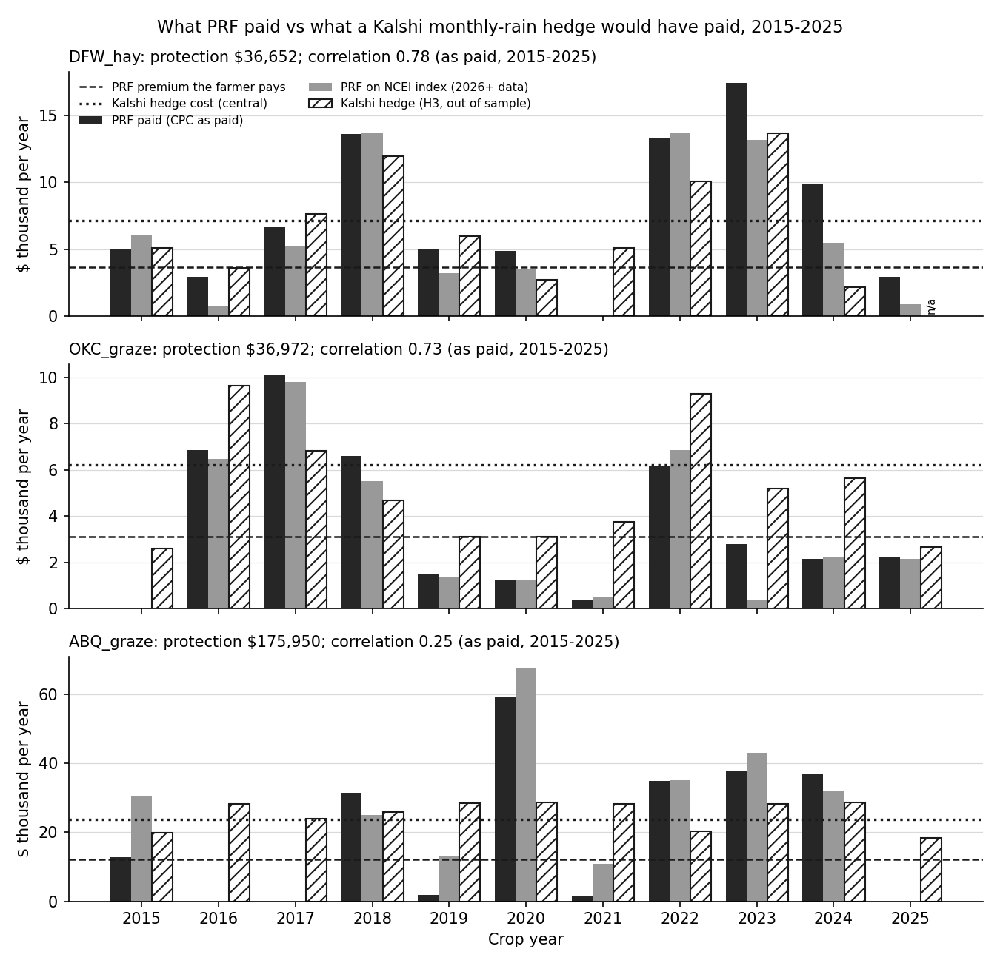
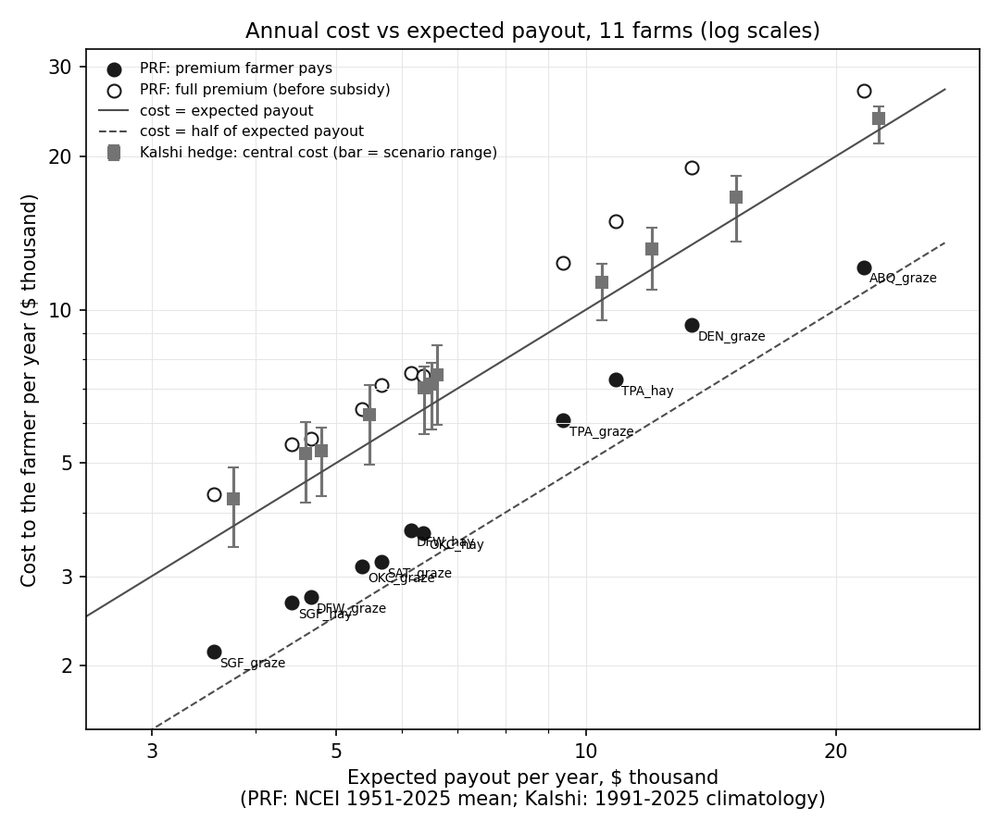
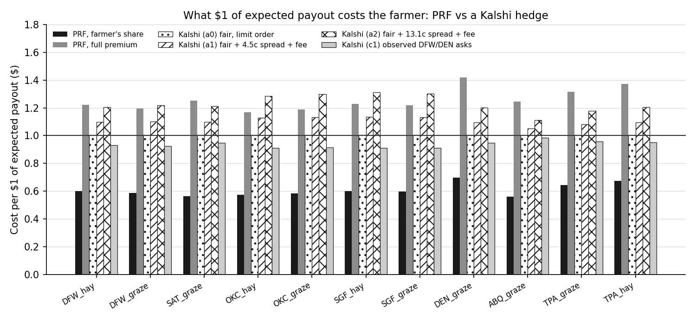
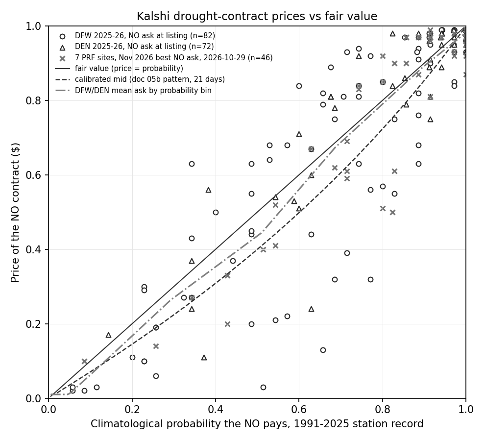
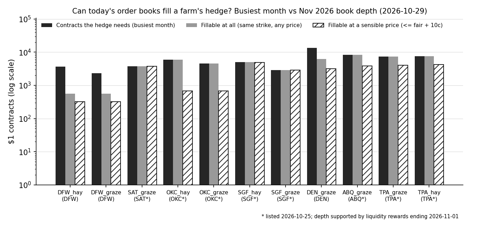

# 09: What PRF pays a farmer, what a Kalshi rain hedge would pay, and what that hedge would cost

**Proposal cell:** Week 3 / Evan (A3, "Compare what farmers currently get paid by traditional insurance versus what they could get paid using the current weather betting markets")  |  **Status:** DRAFT (all numbers reproducible with `python scripts/run_payout_comparison.py`)  |  **Last updated:** 2026-10-29

Code: `src/agri_hedge/pricing.py` (hedge legs, payouts, prices, fees, capital cost, order-book walks, comparison metrics), `scripts/run_payout_comparison.py` (study loop, figures, and the tables between the AUTO markers), tests in `tests/test_pricing.py` (synthetic data, no network).
Data written: `data/processed/payout_comparison_farm_year.csv` (one row per farm and year, 1951-2025), `data/processed/payout_comparison_summary.csv` (one row per farm); figures `docs/figures/a3_*.png`.
Inputs: the 11 farms in `data/scenarios/farms.yaml`, PRF results from [04b](04b_farm_scenario_results.md), index regimes from [06b](06b_index_validation.md), hedge weights from [08](08_replication_quality.md), station rain from [06c](06c_station_vs_kalshi_settlement_check.md), Kalshi prices, books and calibration from [05b](05b_kalshi_liquidity_stats.md).

## Key findings

All dollar figures are per farm per year unless stated. "PRF" is each farm's 2026 policy (2026 rates, premium and 51-55% subsidy) applied to every past year. "Kalshi hedge" is the doc-08 ladder of real Kalshi strikes (H3) scaled to the farm's policy. "Out of sample" means the hedge weights were fit on years the comparison does not use.

- **On the risk PRF covers, the Kalshi hedge pays out about as much as PRF, but often in different years.** In 2015-2025, the 11 farms' PRF policies paid $1.10 million as actually settled (CPC index) in the 116 farm-years with complete station data. Out-of-sample Kalshi hedges would have paid $1.20 million. Only 70% of PRF's dollars were matched by a hedge payout in the same year. The median farm correlation was 0.40, ranging from 0.78 (DFW_hay) to -0.17 (TPA_hay). Over the long run (leave-one-year-out) the median correlation is 0.60 against the CPC index as paid (1969-2025) and 0.68 against the NCEI index PRF now uses (1951-2025).
- **The hedge pays in the wrong years more often than it misses.** In 2015-2025 (as paid), PRF paid at least 5% of protection while the hedge paid less than half as much in 13 of 116 farm-years. The reverse happened in 39. The largest single misses were TPA_hay 2021 (PRF $50,400, hedge $13,100, a $37,300 shortfall), ABQ_graze 2020 ($30,800 short) and TPA_graze 2022 ($30,300 short). The largest overpayments were ABQ_graze 2016 ($28,200) and DEN_graze 2017 ($25,400).
- **Florida is a data story, not a weather story.** Against the CPC index RMA actually paid on, the two Hardee County farms have negative 2015-2025 correlations (-0.15 and -0.17). Against the NCEI index PRF uses from 2026-08-31 they are 0.60 and 0.65. In 2015-2025 the CPC index paid those farms about twice what the NCEI index would have ($18,100 vs $8,900 per year for TPA_graze, $22,800 vs $10,700 for TPA_hay), and the Tampa gauge sides with NCEI.
- **The farmer pays about $0.61 per $1 of expected PRF payout, but about $1.09 per $1 of expected Kalshi payout.** Dollar-weighted over the 11 farms, the PRF producer premium is $56,000 per year against an expected indemnity of $91,500 (NCEI, 1951-2025). On the payouts actually settled in 2015-2025 it is $0.55. The central Kalshi cost (fair odds, half of a 4.5-cent spread, taker fee, capital) is $107,500 per year for a hedge with an expected payout of $98,400. So a Kalshi copy of PRF costs these farmers 1.9 times what they pay for PRF.
- **The whole gap is the federal subsidy, not market pricing.** Before subsidy, PRF's full premium costs $1.28 per $1 of expected payout, more than the Kalshi hedge's $1.09. To give the farmer PRF's expected net gain, someone would have to pay $44,600 per year toward the 11 Kalshi hedges, 41% of their cost (33-48% by farm). That is close to PRF's own 51% subsidy at 90% coverage.
- **Across all six pricing assumptions, Kalshi costs $0.89-$1.31 per $1 of expected payout.** The doc-02 prior ($0.47 for PRF, $1.00-$1.40 for Kalshi) holds in direction. With our farms and data, PRF is a bit dearer for the farmer ($0.55-$0.61, $0.32-$1.12 by farm). The Kalshi range starts lower because the evidence points to drought-side (NO) contracts trading slightly *below* fair value, not above it.
- **Spreads, not fees or capital, are the main trading cost.** The hedge holds 1.4-4.0 contracts per $1 of expected payout (13,000-38,000 contracts per year), and every contract pays half the spread. In the central case the markup over fair value is $490-$1,450 per year per farm (5-14%). Taker fees are 1.6-4.2% of the premium, and the capital lock-up costs $15-$81 per year (4.05% T-bill rate for 31 days). Using the 13.1-cent spread instead of 4.5 cents adds another 6-15%.
- **Observed prices: drought contracts were not marked up.** At DFW and DEN in Nov 2025 - Oct 2026, the NO ask at listing (median 30 days before close) averaged 2.1 cents *below* the 1991-2025 climatological probability, and the mid 4.8 cents below (154 markets). On the 142 settled ones, NO paid 81% of the time against a 75% average ask. The pooled calibration of doc 05b shows the same pattern: YES is priced above its win rate, so NO is priced below.
- **Depth, not price, is what stops a farmer today.** The busiest month of DFW_hay's hedge needs 3,640 contracts. The 2026-10-29 DFW book could fill 566 at any price and 326 at a price within 10 cents of fair value. That is 10-17% of the hedge for the two DFW farms and 46% for DEN_graze. The five sites listed on 2026-10-25 look much deeper (17-100% fillable at a sensible price), but their depth sits next to liquidity rewards that end 2026-11-01. At DFW, DEN and ORD the depth fell to hundreds of dollars after the same rewards ended (05b).
- **One real season (2026).** DFW_hay's 2026 hedge, bought at the actual asks when each month listed, cost $6,484 and paid $7,266. Its PRF policy cost the farmer $3,683 and paid $6,671 (the Aug-Sep figure is provisional). DEN_graze's hedge cost $14,663 and paid $20,739, while its PRF policy cost $9,330 and paid only $1,165: the Denver gauge was dry while the Elbert County grid was not.

## Numbers table

"Computed" = produced by `scripts/run_payout_comparison.py` (run 2026-10-29) from the processed files named in Methods. Unless stated, dollar values are per year, summed or quoted per farm as labeled.

| Quantity | Value | Units | Region / period | Source | Verification |
|---|---|---|---|---|---|
| PRF paid (as settled, CPC) / out-of-sample Kalshi hedge paid | 1,096,360 / 1,200,959 | $ total | 11 farms, 116 farm-years with complete station data, 2015-2025 | `payout_comparison_farm_year.csv` | CONFIRMED (computed) |
| Same-year matched share of PRF dollars (recovery) | 70% (CPC as paid); 77% (NCEI) | share | same | same | CONFIRMED (computed) |
| PRF-only / Kalshi-only farm-years | 13 / 39 (CPC as paid); 5 / 46 (NCEI) | farm-years of 116 | 2015-2025 | Table 4 | CONFIRMED (computed) |
| Median farm correlation, H3 out of sample | 0.40 (CPC as paid, 2015-2025); 0.60 (CPC, 1969-2025 LOYO); 0.51 (NCEI, 2015-2025); 0.68 (NCEI, 1951-2025 LOYO) | correlation | 11 farms | Table 4 | CONFIRMED (computed) |
| Farm correlation range, CPC as paid 2015-2025 | -0.17 (TPA_hay) to 0.78 (DFW_hay) | correlation | 11 farms | Table 3 | CONFIRMED (computed) |
| TPA_graze / TPA_hay correlation, NCEI 2015-2025 | 0.60 / 0.65 | correlation | Hardee Co. FL | Table 3 | CONFIRMED (computed) |
| PRF mean 2015-2025, CPC as paid vs NCEI: TPA_graze / TPA_hay | 18,082 vs 8,931 / 22,813 vs 10,653 | $/yr | Hardee Co. FL | `payout_comparison_summary.csv` | CONFIRMED (computed) |
| Largest shortfalls | TPA_hay 2021: 37,330; ABQ_graze 2020: 30,791; TPA_graze 2022: 30,332 | $ | CPC as paid, 2015-2025 | Table 3 | CONFIRMED (computed) |
| Largest overpayments | ABQ_graze 2016: 28,233; DEN_graze 2017: 25,409 | $ | same | Table 3 | CONFIRMED (computed) |
| Reference hedges, median correlation, NCEI long run | H1 0.76; H2 0.70; H3 0.68 | correlation | 11 farms | Table 4 | CONFIRMED (computed) |
| PRF producer premium / full premium, 11 farms | 55,994 / 117,053 | $/yr | 2026 rates | `prf_scenario_results.csv` ([04b](04b_farm_scenario_results.md)) | CONFIRMED (computed upstream) |
| PRF expected indemnity, 11 farms | 91,502 | $/yr | NCEI 1951-2025 mean | same | CONFIRMED (computed) |
| Kalshi hedge fair value / central cost, 11 farms | 98,399 / 107,486 | $/yr | 1991-2025 climatology | Table 1 | CONFIRMED (computed) |
| PRF farmer load (cost per $1 expected payout) | 0.61 (long run); 0.55 (as paid 2015-2025); farm range 0.32-1.12 | $ | 11 farms | Table 6 | CONFIRMED (computed) |
| PRF full-premium load | 1.28 (farm range 1.17-1.42) | $ | 11 farms | Table 6 | CONFIRMED (computed) |
| Kalshi load, central / range over scenarios | 1.09 / 0.89-1.31 | $ | 11 farms | Table 6 | CONFIRMED (computed) |
| Prior estimate to check | PRF 0.47; Kalshi 1.00-1.40 | $ per $1 expected payout | US 2015-2025 | [02](../research/02_how_farmers_buy_weather_insurance.md) section 7 | DERIVED (doc 02) |
| Subsidy to give the farmer PRF's net gain | 44,594 (41% of hedge cost; farms 33-48%) | $/yr | 11 farms | Table 6 | CONFIRMED (computed) |
| PRF premium subsidy at 85% / 90% coverage | 55% / 51% | share | PRF 2026 | [04b](04b_farm_scenario_results.md) (ADM A00070) | CONFIRMED |
| Hedge size | 12,979-37,623 contracts; 1.41-3.96 contracts per $1 fair value; 9-37 legs | per farm-year | forward weights | Table 5b | CONFIRMED (computed) |
| Markup over fair value, central | 490-1,452 (5-14%) | $/yr per farm | a1 | Table 5b | CONFIRMED (computed) |
| Extra cost of the 13.1c vs 4.5c spread | 6-15% | share of central cost | a2 vs a1 | Table 5 | CONFIRMED (computed) |
| Taker fee / capital cost, central | 161-549 (1.6-4.2% of premium) / 15-81 | $/yr per farm | a1 | Table 5 | CONFIRMED (computed) |
| Taker fee formula | round up(0.07 x C x P x (1 - P)) to the cent per order | $ | climate series, no maker fee | Kalshi fee schedule via [05b](05b_kalshi_liquidity_stats.md) | CONFIRMED (05b) |
| Fee rounding: FCM-cleared / direct member | 0.01 / 0.0001 | $ | | docs.kalshi.com fee rounding via [05](../research/05_kalshi_weather_markets.md) | CONFIRMED (05) |
| Spread assumptions | 4.5 (median, hourly contested quotes); 13.1 (mean daily close) | cents | Kalshi monthly rain | [05](../research/05_kalshi_weather_markets.md); [05b](05b_kalshi_liquidity_stats.md) Table 1 | CONFIRMED (05, 05b) |
| 3-month T-bill rate | 4.05 | % per year | 2026-10-27 | FRED series DTB3, https://fred.stlouisfed.org/series/DTB3 (CSV read 2026-10-29) | CONFIRMED |
| Kalshi interest on cash and positions | 3.50 (variable) | % APY | US users, balance >= $250 | help.kalshi.com "APY on Kalshi", via [05](../research/05_kalshi_weather_markets.md) | CONFIRMED (05) |
| Lock-up assumed | 31 | days | market lists ~28-32 days before close (DFW/DEN 2025-26), settles ~1 day after | `kalshi_rain_markets.parquet` | CONFIRMED (computed) |
| Calibration fit logit(YES rate) = a + b logit(price) | a = -0.412, b = 1.014 | | 21 days before close, last trade, 795 markets | `kalshi_rain_calibration.csv` ([05b](05b_kalshi_liquidity_stats.md)) | CONFIRMED (computed) |
| DFW/DEN NO ask - climatology / mid - climatology at listing | -0.021 / -0.048 | $ per contract | 154 markets, Nov 2025 - Oct 2026 | Table 8 | CONFIRMED (computed) |
| Settled DFW/DEN markets: mean NO ask / climatology / NO paid | 0.749 / 0.758 / 0.810 | $ / share / share | 142 markets | Table 8 | CONFIRMED (computed) |
| DFW_hay busiest month: needed / fillable at all / at a sensible price | 3,640 / 566 / 326 | contracts | 2026-10-29 Nov book | Table 9 | CONFIRMED (computed) |
| Share of hedge fillable at a sensible price | DFW 10-17%; DEN 46%; new sites 17-100%; all farms 56% | share of contracts | same | Table 9 | CONFIRMED (computed) |
| New-listing liquidity rewards | $170 per market, end 2026-11-01 03:59 UTC | $ | SAT, OKC, SGF, ABQ, TPA Nov 2026 | [05b](05b_kalshi_liquidity_stats.md) | CONFIRMED (05b) |
| 2026 season, DFW_hay: hedge cost / paid; PRF premium / paid | 6,484 / 7,266; 3,683 / 6,671 | $ | 2026 | Table 10 | CONFIRMED (computed; PRF Aug-Sep provisional) |
| 2026 season, DEN_graze: hedge cost / paid; PRF premium / paid | 14,663 / 20,739; 9,330 / 1,165 | $ | 2026 | Table 10 | CONFIRMED (computed; PRF Aug-Sep provisional) |
| PRF premium billing date | Sep 1 of the crop year | date | PRF | [01](../research/01_usda_prf_mechanics.md) (ADM A00200) | CONFIRMED (01) |

## Methods

### Terms

- **Indemnity / payout:** what the product pays the farmer in a year. For PRF it is the sum over insured intervals of max(0, (trigger - index) / trigger) x that interval's protection ([04b](04b_farm_scenario_results.md)).
- **NO contract:** Kalshi's "Above X inches" market for one city and month resolves YES if the settlement station's monthly total is strictly greater than X. A NO therefore pays $1 if the month ends at X inches or less: the drought side.
- **Leg:** one (month, strike) NO position. A **hedge** is a set of legs.
- **Fair value:** the hedge's expected payout. For each leg, contracts x the share of past months (1991-2025 unless stated) in which that NO would have paid.
- **Load:** cost / expected payout. 1.00 means you pay exactly what you expect to get back. Below 1 means someone else (the government, or a mispriced market) is paying part of it.
- **Spread / taker / maker:** see [05b](05b_kalshi_liquidity_stats.md). A taker crosses the spread and pays the fee. A resting (maker) order on climate series pays no fee but may not fill.
- **Out of sample / LOYO:** for 2015-2025 we use weights fit on 1951-2009 only. For the long run we use doc 08's leave-one-year-out predictions: each year is predicted by weights fit without that year.

### The two products

| | PRF (what the farmer has now) | Kalshi hedge (what current markets offer) |
|---|---|---|
| Contract | Farm's 2026 election from `farms.yaml`: grid, intervals, coverage 85-90%, productivity factor, acres | doc-08 H3 ladder for the farm grid, coverage and intervals |
| Size | policy protection $26,828-$175,950 | contracts = weight per $ of protection x interval share x total protection (`pricing.farm_hedge_legs`) |
| Pays on | PRF grid index: CPC as paid (`cpc_interval_index.parquet`, `index_value_ours`, 1969-2025), or NCEI (`prf_official_index.csv`, 1951-2025) | settlement-station monthly totals (`station_monthly_precip.csv`, months with `n_missing == 0`; ThreadEx records fill DFW before 1974 and DEN before 1994) |
| Cost to farmer | producer premium = full premium x (1 - subsidy), billed after coverage starts | contracts x price + taker fee + cash locked up until settlement |
| Code | `agri_hedge.prf` (`simulate_years`, official rounding) | `agri_hedge.pricing` |

**Which hedge for which question.**

| Question | Index regime | Hedge weights (`replication_weights.csv`) |
|---|---|---|
| What would the hedge have paid vs what farmers actually got, 2015-2025 | CPC as paid | `target_index=cpc`, `fit_window=train` (1951-2009), H3 |
| Same, long run 1969-2025 | CPC as paid | doc-08 LOYO predictions, `replication_backtest.csv` `h3_loyo` (cpc) |
| Forward-looking comparison | NCEI | `target_index=ncei`, `train` for 2015-2025, LOYO for 1951-2025 |
| What the hedge costs today | NCEI | `target_index=ncei`, `fit_window=full` (1951-2025), H3 |
| References | both | H1 (ideal station index) and H2 (0.25-inch ladder) from the same files |

The CPC-regime hedge is fit to the fixed-base CPC index (doc 08) and judged against the index RMA actually paid on (base 1948 to two years before the crop year; matches ADM to 0.002 points, [06b](06b_index_validation.md)). Following 04b, the PRF side holds the 2026 policy fixed and applies it to every past year ("today's policy on yesterday's weather").

### Comparison metrics (`pricing.payout_comparison`)

Correlation and hedge effectiveness across years. **Recovery** = sum over years of min(hedge, PRF) / sum of PRF: the share of PRF's dollars matched in the same year. Overpayment in another year does not count. **Hedge / PRF total** = total hedge payout / total PRF payout. **PRF-only year:** PRF paid at least 5% of the policy's protection and the hedge paid less than half of PRF. **Kalshi-only year:** the reverse. **Worst shortfall / overpayment:** the year with the largest PRF - hedge and hedge - PRF gap, in dollars. Years with an incomplete station month for any leg are dropped. That drops DFW 2025 (one missing day in Jul and Sep), SGF 2025 (Oct), and SAT 2023 (Jun).

### Pricing assumptions

| Scenario | Price paid per NO contract | Fee | Notes |
|---|---|---|---|
| (a0) fair, maker | climatological probability q (1991-2025), clipped to 1-99 cents | none | lower bound: a patient limit order that fills at fair value |
| (a1) fair, taker, **central** | q + 2.25 cents (half of the 4.5-cent median contested spread, doc 05) | taker | |
| (a2) fair, taker | q + 6.55 cents (half of the 13.1-cent mean daily-close spread, doc 05b) | taker | |
| (b1), (b2) calibrated | calibrated mid + 2.25 or 6.55 cents | taker | mid = 1 - f(1 - q), where f maps a YES contract's true win rate to the price Kalshi markets have charged for it. f comes from a logistic fit logit(rate) = a + b logit(price) to `kalshi_rain_calibration.csv`, 21 days before close, last trade (a = -0.41, b = 1.01). Sensitivity: 7 and 14 days, last trade or mid |
| (c1) observed ask curve | q + the mean (NO ask - q) observed at listing at DFW/DEN in the same probability bin (Table 8) | taker | applies the only real ask history we have to every farm |
| (c2) actual asks | the real 2025-26 NO ask at listing for each (month, strike) leg, DFW and DEN farms only | taker | "listing" = earliest daily candle with a two-sided quote and spread <= 25 cents, median 30 days before close |
| Order books | walk the 2026-10-29 Nov 2026 book (YES bids -> NO offers at 1 - bid), level by level | taker per level | see Capacity |

Fees: 0.07 x C x P x (1 - P), rounded up to the cent per order (FCM-cleared retail account). Direct-member rounding ($0.0001) is a sensitivity. Capital: contracts are fully prepaid. A monthly market lists about 30 days before it closes and settles about a day after, so cash is locked for 31 days at the 3-month T-bill rate of 4.05% (FRED DTB3, 2026-10-27). Sensitivities: Kalshi's 3.50% APY on positions credited back, and a 92-day lock-up. A farmer cannot lock in the whole season at PRF's sales-closing date, because each month's ladder lists only around the start of that month (doc 05).

### Capacity (Nov 2026 order books, snapshot 2026-10-29 09:30 UTC)

Only November 2026 ladders were open at every site. Two measures:

1. **At all:** each leg walks the same site's November book at the same strike, at any price up to 99 cents. This is an upper bound. At the new sites much of the depth is NO offered at 98-99 cents, which is worthless for a leg worth 25 cents.
2. **At a sensible price:** each leg is matched to the November strike whose November probability of paying (1991-2025) is closest to the leg's own probability. Only offers at most 10 cents above that strike's fair value count. Legs of one month that map to the same strike share its depth.

Both assume every month's book looks like this November's. Two farms at the same site would compete for the same depth; each farm is reported alone. The farms with real November legs (SGF_graze, TPA_graze) are also priced exactly against the live book.

### Checks

The NCEI indemnities recomputed here from `prf_official_index.csv` match `prf_scenario_results.csv` exactly. Hedge payouts recomputed from `replication_weights.csv` and station data match doc 08's `replication_backtest.csv` to within $1.25 per farm-year (rounding in the stored per-$ values). DFW_hay's hedge has 23 legs and 16,236 contracts, as in doc 08.

## Results

<!-- BEGIN AUTO: payout comparison tables (scripts/run_payout_comparison.py) -->
Generated by `scripts/run_payout_comparison.py`. PRF = the farm's 2026 policy (2026 rates, premium and subsidy) applied to each year's index. Kalshi hedge = the doc-08 H3 ladder (real Kalshi strikes) scaled to the farm's protection. Central Kalshi cost = scenario (a1) fair value + half of a 4.5c spread + taker fee, with T-bill capital cost 4.05% for 31 days. Fair value = expected payout under 1991-2025 station climatology.

**Table 1. Plain-English summary per farm (dollars per year).** PRF payout = mean indemnity on the NCEI index 1951-2025 (the data PRF now pays on) and, in brackets, as actually paid on CPC 2015-2025. Kalshi payout = mean payout of the hedge under 1991-2025 climatology (its fair value) and, in brackets, the out-of-sample hedge's mean payout in 2015-2025 (CPC weights). Correlation = out-of-sample hedge vs PRF as paid, 2015-2025 (fit 1951-2009). Fill today = share of the hedge's contracts that November-2026-sized order books (2026-10-29) could fill at all (same strike, any price) / at a sensible price (same chance of paying, at most 10 cents above fair value); see Table 9.

| Farm | PRF premium farmer pays | PRF full premium | PRF avg payout (as paid 2015-25) | Kalshi central cost | Kalshi avg payout (2015-25 out of sample) | Correlation | Fill today: at all / sensible price |
|---|---|---|---|---|---|---|---|
| DFW_hay | 3,683 | 7,517 | 6,153 (7,440) | 7,146 | 6,516 (6,807) | 0.78 | 15% / 10% |
| DFW_graze | 2,734 | 5,579 | 4,664 (5,473) | 5,294 | 4,804 (5,041) | 0.70 | 26% / 17% |
| SAT_graze | 3,198 | 7,106 | 5,676 (6,499) | 7,019 | 6,386 (7,084) | 0.53 | 100% / 100% |
| OKC_hay | 3,643 | 7,435 | 6,370 (3,242) | 7,463 | 6,614 (6,118) | 0.40 | 100% / 17% |
| OKC_graze | 3,129 | 6,386 | 5,377 (3,628) | 6,224 | 5,494 (5,133) | 0.73 | 100% / 26% |
| SGF_hay | 2,663 | 5,435 | 4,428 (2,870) | 5,217 | 4,595 (4,744) | 0.34 | 100% / 89% |
| SGF_graze | 2,132 | 4,350 | 3,566 (2,412) | 4,259 | 3,760 (3,966) | 0.37 | 100% / 89% |
| DEN_graze | 9,330 | 19,040 | 13,410 (8,761) | 16,637 | 15,185 (20,945) | 0.69 | 59% / 46% |
| ABQ_graze | 12,120 | 26,933 | 21,608 (19,695) | 23,734 | 22,557 (25,298) | 0.25 | 100% / 72% |
| TPA_graze | 6,061 | 12,369 | 9,394 (18,082) | 11,335 | 10,465 (12,750) | -0.15 | 100% / 69% |
| TPA_hay | 7,302 | 14,903 | 10,858 (22,813) | 13,158 | 12,023 (13,805) | -0.17 | 100% / 74% |
| **All 11** | 55,994 | 117,053 | 91,502 (100,916) | 107,486 | 98,399 (111,691) | median 0.40 | 84% / 56% |

**Table 2. Year by year, 2015-2025: PRF as actually paid (CPC) / Kalshi hedge payout, $ thousand.** Hedge = H3 weights fit to the CPC index on 1951-2009 (out of sample), settled on station rain. n/a = a needed station month has a missing day. The NCEI version is in `payout_comparison_farm_year.csv`.

| Farm | 2015 | 2016 | 2017 | 2018 | 2019 | 2020 | 2021 | 2022 | 2023 | 2024 | 2025 | Total |
|---|---|---|---|---|---|---|---|---|---|---|---|---|
| DFW_hay | 5.0 / 5.1 | 3.0 / 3.6 | 6.7 / 7.7 | 13.6 / 12.0 | 5.1 / 6.0 | 4.9 / 2.7 | 0.0 / 5.1 | 13.3 / 10.1 | 17.4 / 13.7 | 9.9 / 2.2 | 3.0 / n/a | 78.9 / 68.1 |
| DFW_graze | 0.0 / 2.9 | 3.6 / 4.1 | 9.6 / 6.9 | 7.8 / 7.6 | 4.8 / 4.6 | 2.9 / 2.6 | 2.7 / 4.3 | 10.1 / 7.0 | 6.0 / 7.8 | 7.0 / 2.7 | 5.7 / n/a | 54.5 / 50.4 |
| SAT_graze | 0.0 / 0.6 | 5.9 / 4.5 | 3.0 / 11.3 | 6.9 / 9.9 | 3.3 / 4.3 | 0.4 / 9.0 | 9.7 / 2.8 | 20.8 / 14.6 | 1.6 / n/a | 11.8 / 10.4 | 8.2 / 3.6 | 69.9 / 70.8 |
| OKC_hay | 0.0 / 3.3 | 1.9 / 10.0 | 7.3 / 12.9 | 3.2 / 1.6 | 0.0 / 5.4 | 1.2 / 3.6 | 7.5 / 4.5 | 3.9 / 10.1 | 7.9 / 6.4 | 2.3 / 4.9 | 0.5 / 4.5 | 35.7 / 67.3 |
| OKC_graze | 0.0 / 2.6 | 6.9 / 9.6 | 10.1 / 6.8 | 6.6 / 4.7 | 1.5 / 3.1 | 1.2 / 3.1 | 0.4 / 3.8 | 6.1 / 9.3 | 2.8 / 5.2 | 2.1 / 5.6 | 2.2 / 2.7 | 39.9 / 56.5 |
| SGF_hay | 2.9 / 3.9 | 1.1 / 5.6 | 2.4 / 3.5 | 11.5 / 5.2 | 1.2 / 3.2 | 1.1 / 3.3 | 0.0 / 3.3 | 2.9 / 5.7 | 3.8 / 8.8 | 3.7 / 5.0 | 1.0 / n/a | 30.6 / 47.4 |
| SGF_graze | 0.0 / 3.2 | 2.3 / 4.3 | 2.2 / 4.9 | 6.0 / 3.9 | 0.7 / 1.9 | 2.9 / 3.5 | 1.5 / 3.8 | 2.9 / 3.4 | 3.2 / 6.2 | 2.4 / 4.6 | 2.5 / n/a | 24.1 / 39.7 |
| DEN_graze | 1.7 / 7.3 | 14.5 / 12.9 | 0.0 / 25.4 | 18.9 / 35.0 | 0.0 / 10.5 | 29.1 / 36.5 | 8.0 / 17.6 | 20.1 / 27.3 | 0.0 / 20.9 | 0.0 / 19.7 | 4.1 / 17.3 | 96.4 / 230.4 |
| ABQ_graze | 12.8 / 19.7 | 0.0 / 28.2 | 0.0 / 23.8 | 31.5 / 26.0 | 1.8 / 28.3 | 59.4 / 28.6 | 1.7 / 28.2 | 34.9 / 20.2 | 37.9 / 28.2 | 36.8 / 28.6 | 0.0 / 18.3 | 216.6 / 278.3 |
| TPA_graze | 13.8 / 9.8 | 16.3 / 12.7 | 17.3 / 18.1 | 6.0 / 14.6 | 6.4 / 9.7 | 4.1 / 14.0 | 31.8 / 11.2 | 35.6 / 5.2 | 20.2 / 18.1 | 18.2 / 7.9 | 29.1 / 19.0 | 198.9 / 140.2 |
| TPA_hay | 16.8 / 8.3 | 12.7 / 13.5 | 16.3 / 18.2 | 9.7 / 13.9 | 18.9 / 13.9 | 13.0 / 15.9 | 50.4 / 13.1 | 41.6 / 6.3 | 19.2 / 17.5 | 21.5 / 8.1 | 31.0 / 23.1 | 250.9 / 151.9 |

**Table 3. Payout match by regime and window (H3 Kalshi ladder, out of sample).** 2015-2025 uses weights fit on 1951-2009; the long run uses leave-one-year-out predictions. Recovery = share of PRF's dollars matched by the hedge in the same year. PRF-only year = PRF paid at least 5% of protection and the hedge less than half of that; Kalshi-only year = the reverse.

| Farm | Regime | Window | Years | Corr | Recovery | Hedge / PRF total | PRF-only years | Kalshi-only years | Worst shortfall (year, $) | Worst overpayment (year, $) |
|---|---|---|---|---|---|---|---|---|---|---|
| ABQ_graze | CPC as paid | 2015-2025 | 11 | 0.25 | 68% | 1.28 | 1 (2020) | 5 (2016,2017,2019,2021,2025) | 2020, 30,791 | 2016, 28,233 |
| ABQ_graze | CPC as paid | long run | 57 | 0.29 | 73% | 1.42 | 3  | 28  | 2011, 32,125 | 1976, 33,489 |
| ABQ_graze | NCEI (from 2026) | 2015-2025 | 11 | 0.26 | 63% | 0.98 | 1 (2020) | 4 (2016,2017,2021,2025) | 2020, 41,417 | 2016, 25,800 |
| ABQ_graze | NCEI (from 2026) | long run | 75 | 0.31 | 67% | 1.05 | 7  | 27  | 1956, 50,843 | 1976, 31,460 |
| DEN_graze | CPC as paid | 2015-2025 | 11 | 0.69 | 98% | 2.39 | 0  | 7 (2015,2017,2019,2021,2023,2024,2025) | 2016, 1,522 | 2017, 25,409 |
| DEN_graze | CPC as paid | long run | 56 | 0.55 | 81% | 1.59 | 3  | 29  | 1974, 22,299 | 1996, 22,420 |
| DEN_graze | NCEI (from 2026) | 2015-2025 | 11 | 0.48 | 76% | 1.35 | 1 (2016) | 5 (2017,2018,2019,2023,2025) | 2022, 18,122 | 2017, 23,344 |
| DEN_graze | NCEI (from 2026) | long run | 74 | 0.61 | 68% | 1.11 | 6  | 28  | 1963, 27,893 | 1996, 21,997 |
| DFW_graze | CPC as paid | 2015-2025 | 10 | 0.70 | 80% | 0.92 | 1 (2024) | 1 (2015) | 2024, 4,343 | 2015, 2,872 |
| DFW_graze | CPC as paid | long run | 56 | 0.72 | 84% | 1.09 | 3  | 13  | 2001, 8,239 | 2010, 4,688 |
| DFW_graze | NCEI (from 2026) | 2015-2025 | 10 | 0.72 | 80% | 1.02 | 0  | 2 (2015,2021) | 2022, 3,559 | 2023, 3,409 |
| DFW_graze | NCEI (from 2026) | long run | 74 | 0.73 | 85% | 1.08 | 2  | 15  | 2001, 6,630 | 2010, 4,893 |
| DFW_hay | CPC as paid | 2015-2025 | 10 | 0.78 | 76% | 0.86 | 1 (2024) | 1 (2021) | 2024, 7,769 | 2021, 5,094 |
| DFW_hay | CPC as paid | long run | 56 | 0.68 | 79% | 1.07 | 3  | 16  | 2001, 12,691 | 1975, 7,073 |
| DFW_hay | NCEI (from 2026) | 2015-2025 | 10 | 0.83 | 81% | 0.99 | 1 (2024) | 2 (2016,2021) | 2024, 3,590 | 2021, 5,249 |
| DFW_hay | NCEI (from 2026) | long run | 74 | 0.68 | 80% | 1.07 | 4  | 19  | 2001, 11,070 | 2010, 7,490 |
| OKC_graze | CPC as paid | 2015-2025 | 11 | 0.73 | 87% | 1.41 | 0  | 5 (2015,2019,2020,2021,2024) | 2017, 3,240 | 2024, 3,500 |
| OKC_graze | CPC as paid | long run | 57 | 0.69 | 85% | 1.22 | 1  | 21  | 1988, 6,280 | 1975, 5,350 |
| OKC_graze | NCEI (from 2026) | 2015-2025 | 11 | 0.72 | 89% | 1.52 | 0  | 6 (2015,2019,2020,2021,2023,2024) | 2017, 3,428 | 2023, 4,706 |
| OKC_graze | NCEI (from 2026) | long run | 75 | 0.70 | 84% | 1.11 | 2  | 17  | 1988, 6,606 | 1961, 5,930 |
| OKC_hay | CPC as paid | 2015-2025 | 11 | 0.40 | 83% | 1.89 | 0  | 7 (2015,2016,2019,2020,2022,2024,2025) | 2021, 2,946 | 2016, 8,038 |
| OKC_hay | CPC as paid | long run | 57 | 0.60 | 79% | 1.18 | 2  | 21  | 1998, 10,193 | 1976, 11,771 |
| OKC_hay | NCEI (from 2026) | 2015-2025 | 11 | 0.50 | 88% | 1.87 | 0  | 6 (2015,2016,2019,2020,2024,2025) | 2021, 2,810 | 2016, 7,552 |
| OKC_hay | NCEI (from 2026) | long run | 75 | 0.69 | 80% | 1.11 | 2  | 21  | 1998, 10,239 | 1976, 8,096 |
| SAT_graze | CPC as paid | 2015-2025 | 10 | 0.53 | 71% | 1.01 | 2 (2021,2025) | 2 (2017,2020) | 2021, 6,886 | 2020, 8,605 |
| SAT_graze | CPC as paid | long run | 56 | 0.60 | 70% | 1.06 | 6  | 22  | 2001, 9,782 | 1982, 8,309 |
| SAT_graze | NCEI (from 2026) | 2015-2025 | 10 | 0.41 | 69% | 1.15 | 1 (2021) | 3 (2017,2018,2020) | 2021, 7,423 | 2017, 10,694 |
| SAT_graze | NCEI (from 2026) | long run | 74 | 0.57 | 71% | 1.08 | 7  | 27  | 2006, 9,936 | 2017, 10,228 |
| SGF_graze | CPC as paid | 2015-2025 | 10 | 0.37 | 91% | 1.65 | 0  | 4 (2015,2017,2019,2021) | 2018, 2,132 | 2015, 3,220 |
| SGF_graze | CPC as paid | long run | 56 | 0.66 | 91% | 1.52 | 0  | 23  | 1988, 2,352 | 1997, 3,748 |
| SGF_graze | NCEI (from 2026) | 2015-2025 | 10 | 0.51 | 92% | 1.65 | 0  | 5 (2015,2016,2017,2019,2021) | 2018, 1,913 | 2015, 2,884 |
| SGF_graze | NCEI (from 2026) | long run | 74 | 0.75 | 81% | 1.11 | 2  | 28  | 1952, 4,301 | 1961, 3,530 |
| SGF_hay | CPC as paid | 2015-2025 | 10 | 0.34 | 80% | 1.55 | 1 (2018) | 5 (2016,2019,2020,2021,2023) | 2018, 6,223 | 2023, 4,983 |
| SGF_hay | CPC as paid | long run | 56 | 0.55 | 86% | 1.51 | 3  | 25  | 2018, 6,190 | 1975, 4,997 |
| SGF_hay | NCEI (from 2026) | 2015-2025 | 10 | 0.36 | 81% | 1.63 | 1 (2018) | 5 (2016,2019,2020,2021,2022) | 2018, 5,226 | 2016, 4,966 |
| SGF_hay | NCEI (from 2026) | long run | 74 | 0.68 | 77% | 1.11 | 5  | 22  | 1952, 10,817 | 1965, 6,301 |
| TPA_graze | CPC as paid | 2015-2025 | 11 | -0.15 | 59% | 0.71 | 3 (2021,2022,2024) | 2 (2018,2020) | 2022, 30,332 | 2020, 9,931 |
| TPA_graze | CPC as paid | long run | 57 | 0.46 | 68% | 0.92 | 6  | 16  | 2022, 30,206 | 1992, 16,286 |
| TPA_graze | NCEI (from 2026) | 2015-2025 | 11 | 0.60 | 85% | 1.39 | 0  | 5 (2015,2018,2019,2020,2021) | 2025, 8,395 | 2020, 12,906 |
| TPA_graze | NCEI (from 2026) | long run | 75 | 0.63 | 74% | 1.10 | 6  | 26  | 2006, 22,526 | 1994, 13,772 |
| TPA_hay | CPC as paid | 2015-2025 | 11 | -0.17 | 57% | 0.61 | 4 (2015,2021,2022,2024) | 0  | 2021, 37,330 | 2018, 4,233 |
| TPA_hay | CPC as paid | long run | 57 | 0.31 | 67% | 0.90 | 11  | 14  | 2021, 36,924 | 1992, 20,948 |
| TPA_hay | NCEI (from 2026) | 2015-2025 | 11 | 0.65 | 89% | 1.29 | 0  | 3 (2015,2020,2023) | 2024, 6,534 | 2020, 15,300 |
| TPA_hay | NCEI (from 2026) | long run | 75 | 0.56 | 75% | 1.09 | 6  | 23  | 2006, 22,882 | 1992, 19,638 |

**Table 4. Reference hedges: median over the 11 farms.** H1 = ideal contract on the station's own two-month index (not tradable); H2 = 0.25-inch monthly ladder (mostly not listed); H3 = real Kalshi strikes. In-sample = weights fit on 1951-2025, judged on the same years.

| Regime | Window | Hedge | Corr | Recovery | Hedge / PRF total | PRF-only years (sum over farms) | Kalshi-only years (sum) |
|---|---|---|---|---|---|---|---|
| CPC as paid | 2015-2025 | H1 ideal station index | 0.64 | 75% | 0.91 | 23 | 23 |
| CPC as paid | 2015-2025 | H2 out-of-sample | 0.45 | 79% | 1.39 | 14 | 39 |
| CPC as paid | 2015-2025 | H3 in-sample | 0.55 | 80% | 1.25 | 10 | 35 |
| CPC as paid | 2015-2025 | H3 out-of-sample | 0.40 | 80% | 1.28 | 13 | 39 |
| CPC as paid | long run | H1 ideal station index | 0.71 | 80% | 1.11 | 71 | 125 |
| CPC as paid | long run | H2 out-of-sample | 0.60 | 80% | 1.19 | 40 | 219 |
| CPC as paid | long run | H3 in-sample | 0.70 | 82% | 1.18 | 27 | 220 |
| CPC as paid | long run | H3 out-of-sample | 0.60 | 79% | 1.18 | 41 | 228 |
| NCEI (from 2026) | 2015-2025 | H1 ideal station index | 0.66 | 80% | 1.22 | 17 | 31 |
| NCEI (from 2026) | 2015-2025 | H2 out-of-sample | 0.52 | 80% | 1.34 | 6 | 45 |
| NCEI (from 2026) | 2015-2025 | H3 in-sample | 0.61 | 83% | 1.26 | 3 | 42 |
| NCEI (from 2026) | 2015-2025 | H3 out-of-sample | 0.51 | 81% | 1.35 | 5 | 46 |
| NCEI (from 2026) | long run | H1 ideal station index | 0.76 | 83% | 1.12 | 87 | 161 |
| NCEI (from 2026) | long run | H2 out-of-sample | 0.70 | 78% | 1.10 | 48 | 243 |
| NCEI (from 2026) | long run | H3 in-sample | 0.75 | 80% | 1.09 | 28 | 240 |
| NCEI (from 2026) | long run | H3 out-of-sample | 0.68 | 77% | 1.10 | 49 | 253 |

**Table 5. Annual cost of each farm's Kalshi hedge under each pricing assumption ($ per year, including taker fee where stated and T-bill capital cost).** Fair value = the hedge's expected payout. (c2) = the same hedge bought at the actual 2025-26 asks at listing, for the legs that had a two-sided quote, expressed as cost per $1 of fair value of those legs.

| Farm | Fair value | a0 | a1 | a2 | b1 | b2 | c1 | (c2) actual asks, cost / fair | Fees in a1 | Capital cost in a1 |
|---|---|---|---|---|---|---|---|---|---|---|
| DFW_hay | 6,516 | 6,538 | 7,146 | 7,852 | 5,821 | 6,534 | 6,064 | 1.00 (100% of contracts quoted) | 240 | 24 |
| DFW_graze | 4,804 | 4,821 | 5,294 | 5,861 | 4,313 | 4,886 | 4,444 | 0.88 (91% of contracts quoted) | 180 | 18 |
| SAT_graze | 6,386 | 6,408 | 7,019 | 7,731 | 5,704 | 6,425 | 6,047 | no history | 240 | 24 |
| OKC_hay | 6,614 | 6,637 | 7,463 | 8,501 | 5,951 | 6,998 | 6,036 | no history | 295 | 26 |
| OKC_graze | 5,494 | 5,524 | 6,224 | 7,127 | 4,960 | 5,871 | 5,014 | no history | 250 | 21 |
| SGF_hay | 4,595 | 4,619 | 5,217 | 6,024 | 4,234 | 5,047 | 4,180 | no history | 195 | 18 |
| SGF_graze | 3,760 | 3,778 | 4,259 | 4,897 | 3,440 | 4,083 | 3,419 | no history | 161 | 15 |
| DEN_graze | 15,185 | 15,237 | 16,637 | 18,272 | 13,596 | 15,249 | 14,408 | 0.97 (100% of contracts quoted) | 549 | 57 |
| ABQ_graze | 22,557 | 22,634 | 23,734 | 25,056 | 21,212 | 22,550 | 22,233 | no history | 381 | 81 |
| TPA_graze | 10,465 | 10,501 | 11,335 | 12,320 | 9,523 | 10,519 | 10,038 | no history | 317 | 39 |
| TPA_hay | 12,023 | 12,065 | 13,158 | 14,482 | 10,928 | 12,265 | 11,432 | no history | 404 | 45 |

Scenario key: **a0** fair value, resting limit order (no fee, no spread); **a1** fair value + half of a 4.5c spread + taker fee; **a2** fair value + half of a 13.1c spread + taker fee; **b1** calibrated market mid + half of 4.5c + fee; **b2** calibrated market mid + half of 13.1c + fee; **c1** DFW/DEN ask-at-listing markup curve + fee.

**Table 5b. Why the hedge costs more than its fair value: its shape.** Contracts per $1 of fair value drive the spread and fee bill (each contract pays half the spread). Likely legs = NO contracts that paid in at least 75% of 1991-2025 months; they behave mostly like prepaid cash. Floor = the smallest annual payout of the forward hedge in 1951-2025.

| Farm | Legs | Contracts per year | Contracts per $1 of fair value | Share of fair value in likely legs | Floor payout ($/yr) | Spread + fee + capital over fair value (a1, $/yr) |
|---|---|---|---|---|---|---|
| DFW_hay | 23 | 16,236 | 2.49 | 6% | 515 | 630 |
| DFW_graze | 31 | 12,979 | 2.70 | 6% | 1,356 | 490 |
| SAT_graze | 20 | 16,371 | 2.56 | 4% | 643 | 633 |
| OKC_hay | 27 | 23,486 | 3.55 | 5% | 413 | 849 |
| OKC_graze | 31 | 20,401 | 3.71 | 0% | 773 | 730 |
| SGF_hay | 30 | 18,188 | 3.96 | 4% | 1,324 | 622 |
| SGF_graze | 37 | 14,383 | 3.83 | 3% | 1,375 | 499 |
| DEN_graze | 13 | 37,623 | 2.48 | 0% | 1,610 | 1,452 |
| ABQ_graze | 9 | 31,768 | 1.41 | 70% | 5,234 | 1,178 |
| TPA_graze | 19 | 22,834 | 2.18 | 20% | 904 | 870 |
| TPA_hay | 21 | 30,430 | 2.53 | 19% | 0 | 1,134 |

**Table 6. Cost per $1 of expected payout (load), net benefit, and the subsidy Kalshi would need.** PRF expected payout = NCEI 1951-2025 mean. Kalshi expected payout = fair value (1991-2025). Net benefit = expected payout - cost. Subsidy to match = dollars per year someone would have to pay toward the Kalshi hedge so the farmer's expected net gain equals PRF's; 'same load' = share of the hedge's cost that would have to be paid so that $1 of expected payout costs the farmer what it costs under PRF.

| Farm | PRF load (farmer) | PRF load (farmer, as paid 2015-25) | PRF load (full premium) | Kalshi load central | Kalshi load range | PRF net benefit | Kalshi net benefit (central) | Subsidy to match net ($) | as share of hedge cost | Subsidy share for same load |
|---|---|---|---|---|---|---|---|---|---|---|
| DFW_hay | 0.60 | 0.50 | 1.22 | 1.10 | 0.89-1.20 | 2,469 | -630 | 3,099 | 43% | 45% |
| DFW_graze | 0.59 | 0.50 | 1.20 | 1.10 | 0.90-1.22 | 1,931 | -490 | 2,421 | 46% | 47% |
| SAT_graze | 0.56 | 0.49 | 1.25 | 1.10 | 0.89-1.21 | 2,478 | -633 | 3,111 | 44% | 49% |
| OKC_hay | 0.57 | 1.12 | 1.17 | 1.13 | 0.90-1.29 | 2,727 | -849 | 3,575 | 48% | 49% |
| OKC_graze | 0.58 | 0.86 | 1.19 | 1.13 | 0.90-1.30 | 2,248 | -730 | 2,978 | 48% | 49% |
| SGF_hay | 0.60 | 0.93 | 1.23 | 1.14 | 0.91-1.31 | 1,765 | -622 | 2,387 | 46% | 47% |
| SGF_graze | 0.60 | 0.88 | 1.22 | 1.13 | 0.91-1.30 | 1,434 | -499 | 1,934 | 45% | 47% |
| DEN_graze | 0.70 | 1.06 | 1.42 | 1.10 | 0.90-1.20 | 4,080 | -1,452 | 5,533 | 33% | 37% |
| ABQ_graze | 0.56 | 0.62 | 1.25 | 1.05 | 0.94-1.11 | 9,488 | -1,178 | 10,665 | 45% | 47% |
| TPA_graze | 0.65 | 0.34 | 1.32 | 1.08 | 0.91-1.18 | 3,333 | -870 | 4,203 | 37% | 40% |
| TPA_hay | 0.67 | 0.32 | 1.37 | 1.09 | 0.91-1.20 | 3,555 | -1,134 | 4,689 | 36% | 39% |
| **All 11 (dollar-weighted)** | 0.61 | 0.55 | 1.28 | 1.09 | | 35,508 | -9,086 | 44,594 | 41% | |

**Table 7. Sensitivity of the central cost and of fair value ($ per year, all 11 farms summed).**

| Item | Value | Change vs central |
|---|---|---|
| Central cost (a1) | 107,486 | |
| Central, Kalshi credits 3.50% APY on positions | 107,167 | -0.30% |
| Central, fee rounded to $0.0001 (direct member) | 107,484 | -0.00% |
| Central, 92-day lock-up instead of 31 | 108,211 | +0.67% |
| Fair value, 1991-2025 climatology (main) | 98,399 | |
| Fair value, 1951-2025 climatology | 99,170 | +0.8% vs main |
| Fair value, 1951-2009 climatology | 99,197 | +0.8% vs main |
| Fair value, 1996-2025 climatology | 101,087 | +2.7% vs main |
| Fair value, 2006-2025 climatology | 98,691 | +0.3% vs main |
| Calibrated mid + 4.5c spread + fee, calibration at 21 days (last_price); a = -0.412, b = 1.014 | 89,681 | -16.6% |
| Calibrated mid + 4.5c spread + fee, calibration at 7 days (last_price); a = -0.469, b = 1.061 | 88,441 | -17.7% |
| Calibrated mid + 4.5c spread + fee, calibration at 14 days (last_price); a = -0.480, b = 1.135 | 89,727 | -16.5% |
| Calibrated mid + 4.5c spread + fee, calibration at 14 days (mid); a = -0.387, b = 1.105 | 92,787 | -13.7% |
| Calibrated mid + 4.5c spread + fee, calibration at 21 days (mid); a = -0.293, b = 1.118 | 96,892 | -9.9% |

**Table 8. Observed Kalshi NO prices at listing vs climatology, DFW and DEN, Nov 2025 - Oct 2026.** Earliest daily candle with a two-sided quote (spread <= 0.25); median 30 days before the event closes. 154 of 172 markets had such a quote. q = share of 1991-2025 months with rain at or below the strike.

| q bin | Markets | Mean q | Mean NO ask | Mean NO mid | Mean ask - q | Median ask - q | Mean mid - q | Settled markets | Share where NO paid |
|---|---|---|---|---|---|---|---|---|---|
| [0.05, 0.2) | 5 | 0.091 | 0.054 | 0.049 | -0.037 | -0.037 | -0.042 | 5 | 0.000 |
| [0.2, 0.4) | 16 | 0.292 | 0.264 | 0.233 | -0.029 | -0.067 | -0.060 | 16 | 0.500 |
| [0.4, 0.6) | 15 | 0.511 | 0.445 | 0.417 | -0.066 | -0.036 | -0.094 | 14 | 0.643 |
| [0.6, 0.8) | 27 | 0.686 | 0.673 | 0.647 | -0.013 | +0.094 | -0.039 | 24 | 0.833 |
| [0.8, 0.95) | 40 | 0.896 | 0.889 | 0.858 | -0.007 | +0.036 | -0.038 | 36 | 0.861 |
| [0.95, 1.0) | 51 | 0.991 | 0.974 | 0.947 | -0.017 | -0.010 | -0.044 | 47 | 1.000 |
| all | 154 | 0.764 | 0.744 | 0.716 | -0.021 | -0.010 | -0.048 | 142 | 0.810 |

On the 142 settled quoted markets the mean NO ask was 0.749, the mean climatological probability 0.758, and NO actually paid in 0.810 of them.

Nov 2026 books (2026-10-29), best NO ask minus November climatology, by site (mean over the strikes with a YES bid): ABQ -0.080 (7 strikes); DEN -0.081 (4 strikes); DFW +0.013 (7 strikes); OKC -0.030 (7 strikes); SAT -0.060 (7 strikes); SGF +0.019 (7 strikes); TPA -0.012 (7 strikes).

**Table 9. Fill capacity in the 2026-10-29 order books.** 'At all' = each leg walks the same site's November 2026 book at the same strike, any price up to 99 cents (an upper bound: much of the new-site depth is NO offered at 98-99 cents). 'Sensible price' = each leg uses the November strike with the closest chance of paying and counts only offers at most 10 cents above that strike's fair value; legs of one month that map to the same strike share its depth. Both assume every month's book looks like November's. Payout-weighted = share of the hedge's expected payout that could be filled. Nov legs = the farm's real November 2026 legs bought now at any price (cost incl. fee per $1 of their fair value).

| Farm | Contracts per year | Busiest month | Needed that month | Fillable at all | Fillable at a sensible price | Share of contracts: at all / sensible | Share of expected payout: at all / sensible | Nov legs: needed / fillable / cost per $1 fair |
|---|---|---|---|---|---|---|---|---|
| DFW_hay | 16,236 | 5 | 3,640 | 566 | 326 | 15% / 10% | 16% / 11% | no Nov legs |
| DFW_graze | 12,979 | 5 | 2,332 | 566 | 326 | 26% / 17% | 29% / 21% | no Nov legs |
| SAT_graze | 16,371 | 5 | 3,777 | 3,777 | 3,777 | 100% / 100% | 100% / 100% | no Nov legs |
| OKC_hay | 23,486 | 6 | 6,000 | 6,000 | 675 | 100% / 17% | 100% / 16% | no Nov legs |
| OKC_graze | 20,401 | 5 | 4,525 | 4,525 | 675 | 100% / 26% | 100% / 27% | no Nov legs |
| SGF_hay | 18,188 | 4 | 5,015 | 5,015 | 4,890 | 100% / 89% | 100% / 75% | no Nov legs |
| SGF_graze | 14,383 | 4 | 2,918 | 2,918 | 2,866 | 100% / 89% | 100% / 77% | 1,875 / 1,875 / 1.13 |
| DEN_graze | 37,623 | 5 | 13,550 | 6,237 | 3,217 | 59% / 46% | 52% / 52% | no Nov legs |
| ABQ_graze | 31,768 | 8 | 8,256 | 8,256 | 3,845 | 100% / 72% | 100% / 72% | no Nov legs |
| TPA_graze | 22,834 | 3 | 7,357 | 7,357 | 4,091 | 100% / 69% | 100% / 51% | 1,874 / 1,874 / 1.01 |
| TPA_hay | 30,430 | 3 | 7,558 | 7,558 | 4,202 | 100% / 74% | 100% / 54% | no Nov legs |

**Table 10. One real season, 2026: the hedge bought at each month's actual ask at listing and settled by Kalshi, vs the 2026 PRF policy.** PRF index sources are listed per interval.

| Farm | Kalshi cost (actual asks + fee + capital) | Share of contracts with a quote | Fair value of the legs | Kalshi paid | PRF premium farmer pays | PRF indemnity 2026 | PRF index used |
|---|---|---|---|---|---|---|---|
| DFW_hay | 6,484 | 100% | 6,516 | 7,266 | 3,683 | 6,671 | Apr-May 120.3 [ADM final (CPC)]; Jun-Jul 112.7 [ADM final (CPC)]; Aug-Sep 24.5 [our NCEI rebuild (provisional)] |
| DEN_graze | 14,663 | 100% | 15,185 | 20,739 | 9,330 | 1,165 | Apr-May 95.1 [ADM final (CPC)]; Jun-Jul 87.6 [ADM final (CPC)]; Aug-Sep 138.8 [our NCEI rebuild (provisional)] |

Checks: NCEI indemnity recomputed from `prf_official_index.csv` matches `prf_scenario_results.csv` to within $0.00 per farm-year; hedge payouts from `replication_weights.csv` match doc 08's `replication_backtest.csv` to within $1.25.
<!-- END AUTO: payout comparison tables -->

### Figures

*Figure 1. 2015-2025 payouts for three farms: PRF as actually paid (black), PRF recomputed on the NCEI index (grey), and the out-of-sample Kalshi hedge (hatched). Dashed line: PRF premium the farmer pays. Dotted line: central cost of the Kalshi hedge. DFW_hay tracks well. OKC_graze pays in the right years but too much in quiet years. ABQ_graze's hedge pays $18,000-29,000 every year whatever PRF does.*

*Figure 2. Annual cost against expected annual payout for each farm (log scales). Black dots (the PRF premium the farmer pays) sit near the half-cost line. Open dots (PRF's full premium) and grey squares (the Kalshi hedge, with the range over all pricing scenarios) sit on or above the cost = payout line.*

*Figure 3. Cost per $1 of expected payout. PRF to the farmer: $0.56-0.70. PRF before subsidy: $1.17-1.42. The Kalshi hedge: $1.00 at fair value with a limit order, $1.05-1.14 with a 4.5-cent spread and fees, $1.11-1.31 with a 13.1-cent spread, and $0.91-0.99 at the ask levels observed at DFW and DEN.*

*Figure 4. Price of each NO contract against its climatological probability of paying. Circles and triangles: DFW and DEN asks at listing, Nov 2025 - Oct 2026. Crosses: best NO ask in the Nov 2026 books of the 7 PRF sites on 2026-10-29. Single points scatter widely because each month's price reflects that month's forecast. The binned average (dash-dot) and the calibration curve (dashed) both lie slightly below fair value.*

*Figure 5. Contracts needed in each farm's busiest month against what a November-2026-sized book could fill (log scale). Starred sites were listed on 2026-10-25 and carry liquidity rewards until 2026-11-01.*

## Interpretation for beginners

**1. What the farmer has now.** PRF is subsidized insurance. A farmer insuring $36,652 of hay (DFW_hay) pays $3,683 a year. The government adds $3,834. On average the policy pays back about $6,150 a year (NCEI, 1951-2025) and $7,440 a year as actually paid in 2015-2025. For every $1 the farmer pays, they get back about $1.67 on average over the long run (04b). The subsidy is largest in dollars at high coverage, which is one reason the farms here, like most buyers in their counties, insure at 85-90%.

**2. What the market can copy.** Kalshi lists, for each city and month, a ladder of bets on "will it rain more than 1, 2, ..., 7 inches?". Buying the NO side of several of these, in the right amounts, gives a payout that grows as the months get drier: a rough copy of PRF. Doc 08 found the best amounts. Here we priced and backtested them per farm.

**3. Why the copy pays in the wrong years.** PRF pays on rain over a whole 17-by-14-mile grid cell, over two months together. The Kalshi bet pays on one airport gauge 24-58 miles away, one month at a time, at whole-inch steps. A dry April at the airport triggers the April bets even if May was wet and the farm's grid was fine. In the Plains (DFW, OKC, SGF) the hedge rarely misses a big PRF year: 0-1 PRF-only years per farm in 2015-2025. But it often pays when PRF does not (39 of 116 farm-years in 2015-2025). Sometimes the gauge and the grid disagree completely, as at Denver in 2026: the hedge paid $20,700 and PRF $1,200.

**4. Why it costs about twice as much to the farmer.** The market charges roughly fair odds: on average you pay about $1 for every $1 you expect to get back. Then you also pay for crossing the spread and for fees, about 5-14% more with a tight spread. PRF's *full* price is actually higher than Kalshi's ($1.28 per $1 expected). But the government pays 51% of it, so the farmer pays only about $0.61. A market product has no subsidy, so it starts with a cost disadvantage of roughly 1.8-1.9 to 1 for the same expected payout. No pricing improvement inside Kalshi can close that.

**5. Why it cannot be bought today anyway.** A typical farm's hedge needs 2,300-13,600 contracts in its busiest month. At Dallas the whole relevant order book holds a few hundred at reasonable prices. The newer markets look deeper, but that depth is being paid for by Kalshi's short-term liquidity rewards.

**6. What the market is good for.** No paperwork, no sales-closing date, and anyone can buy it (doc 02). It pays quickly and settles on a public gauge. Its prices on the drought side were, if anything, slightly below fair odds. Those are reasons to use it as a *top-up* to PRF, for example for months PRF does not cover or the deductible band, not as a replacement.

## Implications for Milestone 2

1. **Benchmark against the subsidized price.** The optimizer's "is this worth it" test should compare Kalshi cost with the PRF producer premium per $1 of expected payout (about $0.55-0.61 for our farms), not with PRF's full premium. On that test a Kalshi replica of a PRF policy fails at every farm. The product case must rest on what PRF does not cover.
2. **Price legs with a probability model plus an explicit execution cost.** Use the station climatology (1991-2025; windows from 1951 change fair value by less than 3%) as the mid. Add half the spread (2.25-6.55 cents) plus `pricing.taker_fee` for orders that cross, and zero for resting orders. The evidence does not support a markup on NO legs. Treat the calibrated discount (b1/b2) as an upside scenario, not the base case, until more drought-side price history exists.
3. **Minimize contracts per dollar of payout.** Spread cost scales with contract count, and these ladders hold 1.4-4.0 contracts per $1 of expected payout. A cost-aware objective should penalize contracts, for example a per-contract cost of half the spread. Prefer fewer, more informative strikes. ABQ_graze shows the extreme: 70% of its fair value sits in legs that pay in at least 75% of months. That is prepaid money with no insurance in it.
4. **Cap every leg at book depth and at a price limit.** Use `pricing.walk_no_book` with a limit of fair value + 10 cents. Report the unfillable share instead of assuming fills. Refresh the order-book snapshot after 2026-11-01 to see how much of the new-site depth survives the end of the rewards.
5. **Score hedges on dollars matched, not only correlation.** Recovery (70-77% in 2015-2025) and the PRF-only / Kalshi-only year counts tell a farmer more than a correlation does. A downside-weighted objective (penalize shortfalls more than overpayments) is the natural next step, as doc 08 also recommends.
6. **Use the right PRF history.** For "what did farmers get", use CPC as paid. For "what will PRF pay from now on", use NCEI. Florida shows they can give opposite answers for the same farm.

## Limitations

- **Today's policy on yesterday's weather.** Both products use 2026 rates and sizes in every year. Past rates, subsidies and county base values were different (04b).
- **Kalshi prices exist for two sites and one year.** Scenarios (c1)/(c2) rest on 154 DFW/DEN markets from Nov 2025 - Oct 2026. Their prices carried each month's forecast, and outcomes within one month are correlated, so the "-2 cents vs climatology" result is suggestive, not established. Scenario (b) relies on doc 05b's calibration, which pools mostly large cities and uses last-trade prices rather than the asks a buyer pays.
- **Depth is one snapshot.** The order-book capacity is from a single moment (2026-10-29 09:30 UTC) for November only. It is applied to every month, and five sites had liquidity rewards running. Real books change daily, and a large order would move prices. We did not test request-for-quote or block trades.
- **Station settlement proxy.** Hedge payouts use the cleaned station archive, not the first NWS report or the TWC data Kalshi now settles on. Doc 06c estimates about 0.4% of months could settle differently. Months with a missing day are dropped rather than imputed. That removes DFW 2025, SGF 2025 and SAT 2023 from the 2015-2025 comparison.
- **Strike sets assumed stable.** Five sites have listed only November 2026 (1-7 inches). We assume that ladder for every month (doc 08).
- **2026 PRF figure is provisional.** The Aug-Sep 2026 interval settles on NCEI and was not yet published by RMA. We used our NCEI rebuild ([06b](06b_index_validation.md)).
- **Capital cost is simple.** It assumes a 31-day lock-up at the T-bill rate. It ignores Kalshi's DIRECNET collateral return on ladders (doc 05), which would lower it slightly, and the value to the farmer of PRF's deferred premium billing (Sep 1), which would widen the gap slightly in PRF's favor. Both effects are under 1% of cost.
- **No forage-loss view.** This document compares two payouts with each other, not with the farm's actual forage loss; see 04b for the loss proxy.

## Unverified claims and open questions

- **Does the drought-side discount persist?** The calibration and the DFW/DEN asks both say NO contracts traded at or below fair value. That fits a market where retail traders prefer buying YES. It needs more months and more cities with drought-side volume before Milestone 2 relies on it.
- **Will the new-site depth survive the end of the rewards on 2026-11-01?** At DFW, DEN and ORD it did not (05b). A second snapshot in November 2026 answers this.
- **Will Kalshi pay interest on positions for a business account at the quoted 3.50% APY?** The help article applies to US individuals with at least $250 (doc 05). We used the full T-bill rate as the base case.
- **Two farms at one site.** DFW_hay and DFW_graze would draw on the same DFW book. Joint capacity is lower than either alone; we did not model the split.

## Sources

- Data and code: this repository. `scripts/run_payout_comparison.py`, `src/agri_hedge/pricing.py`; inputs from `scripts/run_scenarios.py` (04b), `scripts/run_replication.py` (08), `scripts/pull_kalshi.py` (05b), `scripts/build_indices.py` (06b), `scripts/pull_stations.py` (06c).
- PRF rules, rates and subsidy: [01](../research/01_usda_prf_mechanics.md) and [04b](04b_farm_scenario_results.md) (FCIC-18150 Rainfall Index Handbook 2026, https://www.rma.usda.gov/sites/default/files/2025-08/2026-18150-Rainfall-Index-Handbook.pdf ; RMA Actuarial Data Master, https://pubfs-rma.fpac.usda.gov/pub/References/actuarial_data_master/).
- PRF index regimes: [06b](06b_index_validation.md); RMA news release 2026-04-30, https://www.rma.usda.gov/news-events/news/2026/washington-dc/usda-risk-management-agency-upgrades-rainfall-data-source .
- Hedge weights and replication quality: [08](08_replication_quality.md).
- Kalshi markets, candles, books, calibration and fees: [05b](05b_kalshi_liquidity_stats.md) (Kalshi Trade API v2, https://api.elections.kalshi.com/trade-api/v2 , retrieved 2026-10-29; Kalshi Fee Schedule, 2nd Iteration, 2022-09-22, https://www.cftc.gov/filings/orgrules/rule091222kexdcm003.pdf ); [05](../research/05_kalshi_weather_markets.md) (spreads, fee rounding https://docs.kalshi.com/getting_started/fee_rounding , APY https://help.kalshi.com/en/articles/13823847-apy-on-kalshi , collateral return).
- Prior cost estimate: [02](../research/02_how_farmers_buy_weather_insurance.md), section 7.
- Treasury bill rate: Board of Governors of the Federal Reserve System, 3-Month Treasury Bill Secondary Market Rate, Discount Basis (DTB3), via FRED, https://fred.stlouisfed.org/series/DTB3 (CSV https://fred.stlouisfed.org/graph/fredgraph.csv?id=DTB3 , read 2026-10-29; 4.05% on 2026-10-27).
