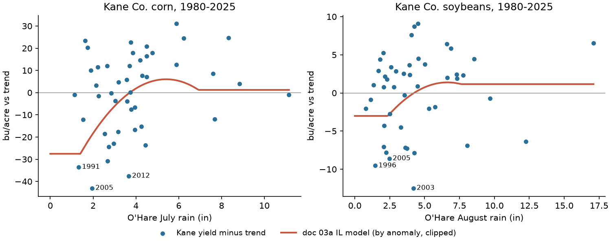

# 14: Row-crop rain risk with Kalshi: an exploration at Chicago (Kane County corn and soybeans)

**Proposal cell:** Milestone 2 scoping (row-crop and excess-rain niche named in the Milestone 1 overview)  |  **Status:** DRAFT, exploration only (all numbers reproducible with `python scripts/run_rowcrop_exploration.py`; not fact-checked by an independent pass)  |  **Last updated:** 2026-11-01

Code: `src/agri_hedge/rowcrop.py` (yield response, trend shortfall, NO/YES payoffs, loss-hedge fitting and scoring, two-sided order-book walks, station coverage), `scripts/run_rowcrop_exploration.py` (data pulls, study loop, figure, tables on stdout), tests in `tests/test_rowcrop.py` (18 tests, synthetic data, no network). Hedge fitting reuses `agri_hedge.replicate.fit_ladder` (NNLS); pricing, fees and capital reuse `agri_hedge.pricing`.
Data written: `data/processed/rowcrop_kane_yields.csv`, `rowcrop_farm_year.csv` (one row per year 1948-2025), `rowcrop_exposure_correlations.csv`, `rowcrop_hedge_summary.csv`, `rowcrop_hedge_legs.csv`, `rowcrop_chicago_2026_listing_quotes.csv`, `rowcrop_kxrainchim_orderbook_20261102T013428Z.csv` (new live snapshot), `rowcrop_kxrainchim_book_depth.csv`, `rowcrop_county_station_distance.csv`; figure `docs/figures/rc_rain_vs_kane_yield.png`.
Inputs: yield models from [03a](../research/03a_rain_yield_corn_soybean.md) (VERIFIED), O'Hare station rain from [06c](06c_station_vs_kalshi_settlement_check.md), Kalshi markets, candles, calibration and the 2026-10-29 book from [05b](05b_kalshi_liquidity_stats.md), pricing assumptions from [09](09_payout_comparison.md). New downloads: NASS Quick Stats (Kane County yields and acres; US county acres from the 2022 Census of Agriculture), NOAA nClimDiv Illinois climate division 2 rain, Census 2024 county Gazetteer, and the live KXRAINCHIM order book.

## Key findings

"HE" (hedge effectiveness) is the share of the year-to-year variance of rain-driven revenue loss that a hedge removes (1 = all of it, 0 = none, negative = the hedge adds variance). "LOYO" means each year is scored with contracts fitted on the other years. All hedges use only strikes Kalshi has listed for KXRAINCHIM. Unless stated, the window is 1980-2025.

- **On paper the hedge works, but only because the loss and the contract use the same gauge.** If corn loss is modeled from O'Hare's own July rain with the doc-03a Illinois model, three July NO strikes (>2, >3, >4 in) remove 92% of the loss variance out of sample. For soybeans, August NO strikes remove 97%. This only measures strike binning, because the loss is a formula of the same gauge reading.
- **Against the area's rain, effectiveness drops to 0.30 (corn) and 0.43 (soybeans).** Here the same model is driven by NE Illinois climate-division rain, the area average around the farm. O'Hare's July total correlates 0.71 with the division's (August: 0.78). In 2012 O'Hare got 3.66 in in July while the division got 2.51 in.
- **Against Kane County's actual yields, the rain hedges do not work.** Losses here are NASS yields below a 1980-2025 trend, valued at $4.70 corn and $12.00 soybeans. In-sample HE is 0.10 for corn July NO and 0.01 for soybean August NO; out of sample it is -0.06 and -0.05. O'Hare July rain correlates only 0.27 with Kane corn yield deviations, and the area's rain only 0.37. In 2012, Kane corn was 37.5 bu/ac below trend (-$176/ac), but the model said the O'Hare July rain cost only $1.78/ac. Heat and June dryness did the damage.
- **We found no excess-rain hedge in this data.** July YES (corn) and August YES (soybeans) get zero weight against every loss measure. The doc-03a quadratics only turn wet-month damage on beyond the observed range. May+June YES contracts, where 03a puts the wet-spring yield penalty, reach out-of-sample HE of 0.10 against modeled loss and below zero against division-modeled and observed loss. Kane's 1993 wet June (9.96 in at O'Hare, corn -23.6 bu/ac) is one year, not a pattern a contract can be fitted to.
- **Price is not the obstacle.** For the July corn drought hedge, cost per $1 of expected payout is:
  - $1.12 at fair odds plus half a 4.5-cent spread and the taker fee (doc 09's central case);
  - $1.26 with a 13.1-cent spread;
  - $0.88 at the price implied by Kalshi's historical calibration, because drought NO contracts trade below fair value.

  For soybeans the same three cases are $1.09, $1.19 and $0.88. Excess-rain YES contracts carry the longshot markup: the wet-spring YES hedge costs $1.50 per $1 at calibrated prices. The Chicago Jul/Aug 2026 listing quotes imply $0.57-$0.60, but that is one season in which the market priced dry outcomes 12-23 cents below Midway's climatology at the central strikes.
- **Depth is the obstacle.** A 288-acre corn farm's July hedge (modeled-loss weights) needs 31,956 contracts. The KXRAINCHIM book could fill 245 of them at a sensible price on 2026-10-29 and 374 on 2026-11-02, about 1%, or 2-3 acres' worth. The soybean hedge needs 10,407 contracts and 3-4% could be filled (9-10 acres). Flow is larger than resting depth: the Jul 2026 and Aug 2026 events traded 120,167 and 94,468 contracts over their lives.
- **Few corn/soy acres sit near a Kalshi rain station.** Of 164.9 million county-located corn-for-grain and soybean acres in the 2022 Census, 1.2% lie within 25 miles of one of the 36 active Kalshi monthly-rain stations, 7.1% within 50 miles and 30.2% within 100 miles. The acre-weighted median distance is 150 miles. Iowa, Nebraska, South Dakota and North Dakota, together 54.1 million acres, have nothing within 100 miles (Kansas 3.6%). None of the 25 largest corn+soy counties is within 50 miles of a station, and 8 are within 100. The stations with the most acres within 50 miles are Indianapolis (2.5 M), Columbus (2.0 M), St. Louis (1.6 M), Minneapolis (1.5 M) and O'Hare (1.0 M).
- **Recommendation: row-crop hedging with today's Kalshi monthly-rain contracts is not a promising main Milestone 2 direction.** It becomes promising only as a contract-design project: an area index (climate division or county) instead of an airport gauge, a heat component, and Corn Belt locations. See the last section.

## Numbers table

"Computed" = produced by `scripts/run_rowcrop_exploration.py` (run 2026-11-01/02 UTC) from the inputs named in Methods. Per-acre values are for one acre of the representative farm. Farm values multiply by 288 acres.

| Quantity | Value | Units | Region / period | Source | Verification |
|---|---|---|---|---|---|
| Representative farm size | 288 (corn farm: 288 ac corn; soybean farm: 288 ac soybeans) | acres | Kane Co., IL, 2022 | 2022 Census average farm size, [04](../research/04_representative_farms.md) Table A1 | DERIVED (doc 04, not fact-checked) |
| Kane corn grain / soybean acres harvested | 67,315 / 57,349 | acres | 2022 Census | NASS Quick Stats CENSUS county pull (`rowcrop_county_station_distance.csv`); matches [04](../research/04_representative_farms.md) | CONFIRMED (two pulls agree) |
| Prices | 4.70 corn; 12.00 soybeans | $/bu | 2026/27 projected season-average farm price | USDA WASDE-676 (Oct 9 2026), via [03a](../research/03a_rain_yield_corn_soybean.md) | CONFIRMED (03a VERIFIED) |
| Yield model, corn July (IL, 1980-2025 update) | b1 = 24.071, b2 = -2.0906 per in / in²; state normal 4.06 in; slope 7.1 bu/ac per in | bu/ac | Illinois statewide | `crop_yield_aux/r1_reestimate_coefficients.csv`; script asserts slope = 03a CSV value | CONFIRMED (03a VERIFIED; checked in code) |
| Yield model, soybean August (IL, same spec) | slope 1.16 bu/ac per in at 3.56 in normal | bu/ac | Illinois statewide | same | CONFIRMED (03a VERIFIED; checked in code) |
| Rain range used to clip the model | July 1.75-7.27; August 1.69-6.92; May 1.25-8.71; June 1.05-7.67 | in (statewide) | IL 1960-2006 observed range | Tannura et al. rows of `crop_rain_sensitivity_corn_soy.csv` | CONFIRMED (03a VERIFIED) |
| O'Hare normals | May 4.49, Jun 4.13, Jul 3.71, Aug 4.24 | in | 1991-2020 | `station_monthly_precip.csv` (ORD) | CONFIRMED (computed) |
| Kane yields available | corn 1925-2024 (2025 not published); soybeans 1927-2025 | years | Kane Co. | NASS Quick Stats SURVEY, county | CONFIRMED (pulled 2026-11-01) |
| Kane trend yield at 2025 | 204.6 corn; 60.9 soybeans | bu/ac | linear trend fit 1980-2025 | `rowcrop_farm_year.csv` | CONFIRMED (computed) |
| Corn loss, modeled from O'Hare July rain: mean / sd / years with loss / worst | 28.84 / 41.15 / 23 of 46 / 129.47 (1991) | $/ac | 1980-2025 | Exposure table | CONFIRMED (computed) |
| Corn loss, modeled from division July rain: mean / sd / worst | 26.10 / 36.36 / 129.47 (1991) | $/ac | 1980-2025 | same | CONFIRMED (computed) |
| Corn loss, observed (Kane shortfall vs trend): mean / sd / years / worst | 34.85 / 54.85 / 21 of 45 / 202.04 (2005, -43.0 bu/ac) | $/ac | 1980-2024 | same | CONFIRMED (computed) |
| Soybean loss, modeled from O'Hare Aug rain: mean / sd / worst | 14.90 / 16.04 / 36.13 | $/ac | 1980-2025 | same | CONFIRMED (computed) |
| Soybean loss, observed: mean / sd / worst | 26.19 / 40.55 / 149.67 (2003, -12.5 bu/ac) | $/ac | 1980-2025 | same | CONFIRMED (computed) |
| Farm-level mean observed loss | 10,036 corn; 7,542 soybeans | $/yr | 288 ac | same | CONFIRMED (computed) |
| Correlation O'Hare vs division rain | 0.71 (Jul); 0.78 (Aug) | r | 1980-2025 | `rowcrop_exposure_correlations.csv` | CONFIRMED (computed) |
| Correlation rain vs Kane yield deviation | corn: O'Hare Jul 0.27, division Jul 0.37; soy: O'Hare Aug 0.18, division Aug 0.34 | r | 1980-2025 | same | CONFIRMED (computed) |
| Correlation modeled vs observed loss | corn: O'Hare 0.21, division 0.40, O'Hare May-Aug sum 0.36; soy: 0.10, 0.37, 0.20 | r | 1980-2025 | same | CONFIRMED (computed) |
| 2012 | O'Hare Jun 0.90 / Jul 3.66 in; division Jun 2.11 / Jul 2.51 in; Kane corn -37.5 bu/ac (176.33 $/ac); modeled O'Hare-July loss 1.78 $/ac | | 2012 | `rowcrop_farm_year.csv` | CONFIRMED (computed) |
| HE, corn July NO, LOYO: modeled-O'Hare / modeled-division / observed | 0.92 / 0.30 / -0.06 (in-sample 0.94 / 0.42 / 0.10) | share of variance | 1980-2025 | Table 2 | CONFIRMED (computed) |
| HE, soybean August NO, LOYO: same three | 0.97 / 0.43 / -0.05 (in-sample 0.97 / 0.51 / 0.01) | share | same | Table 2 | CONFIRMED (computed) |
| HE, corn May+June YES, LOYO: same three | 0.10 / -0.07 / -0.08 | share | same | Table 2 | CONFIRMED (computed) |
| HE, July YES (corn) and August YES (soy) | 0.00 (no weight) against all three modeled measures; soy observed LOYO -0.09 | share | same | Table 2 | CONFIRMED (computed) |
| Corn July NO hedge (modeled-O'Hare weights) | NO >2: 58.8, >3: 46.0, >4: 6.2 contracts/ac (111/ac; 31,956 per farm) | contracts | forward | Table 3 | CONFIRMED (computed) |
| Soybean August NO hedge (same) | NO >2: 2.9, >3: 23.8, >4: 9.3 contracts/ac (36/ac; 10,407 per farm) | contracts | forward | Table 3 | CONFIRMED (computed) |
| Cost per $1 expected payout, corn July NO: a0 / a1 / a2 / b1 / c1 | 1.00 / 1.12 / 1.26 / 0.88 / 0.60 | $ | O'Hare climatology 1991-2025 | Table 4 | CONFIRMED (computed) |
| Same, soybean August NO | 1.00 / 1.09 / 1.19 / 0.88 / 0.57 | $ | same | Table 4 | CONFIRMED (computed) |
| Same, corn May+June YES | 1.00 / 1.15 / 1.32 / 1.50 / 0.61 | $ | same | Table 4 | CONFIRMED (computed) |
| Corn July NO hedge cost, central (a1) | 38.61 per acre for 34.39 of expected payout; net 1,214 per farm-year | $ | 288 ac | `rowcrop_hedge_summary.csv` | CONFIRMED (computed) |
| Calibration fit used for (b1) | a = -0.412, b = 1.014 | | 21 days before close, last trade | `kalshi_rain_calibration.csv`; same as doc 09 | CONFIRMED (computed; matches 09) |
| Spread assumptions | 4.5 / 13.1 | cents | Kalshi monthly rain | [05](../research/05_kalshi_weather_markets.md), [05b](05b_kalshi_liquidity_stats.md) via doc 09 | CONFIRMED (09) |
| Chicago May-Aug 2026 listing quotes, mean markup over Midway climatology | NO ask +0.006; YES ask +0.032 (33 of 34 markets quoted) | $/contract | 25-36 days before close | `rowcrop_chicago_2026_listing_quotes.csv` | CONFIRMED (computed) |
| Jul / Aug 2026 central-strike NO markups | Jul >2: -0.12, >3: -0.15; Aug >3: -0.23, >4: -0.17, >5: -0.12 | $/contract | listing | same | CONFIRMED (computed) |
| KXRAINCHIM event volume | Jul 2026 120,167; Aug 2026 94,468; Jun 2026 153,801 | contracts | lifetime of event | `kalshi_rain_markets.parquet` | CONFIRMED (computed) |
| Nov 2026 book, drought (NO) payout buyable at <= $0.95 | 428 (2026-10-29); 497 (2026-11-02 01:34 UTC) | $ payout | all 7 strikes | `rowcrop_kxrainchim_book_depth.csv`; 428 matches [05b](05b_kalshi_liquidity_stats.md) Table 4 | CONFIRMED (computed; 10-29 value matches 05b) |
| Nov 2026 book, excess (YES) payout at any price / at <= fair + 10c | 752 / 50 (10-29); 1,966 / 307 (11-02) | $ payout | all strikes | same; 752 matches `kalshi_rain_hedge_capacity_nov2026.csv` | CONFIRMED (computed) |
| Farm hedge fillable at a sensible price | corn 245 (10-29) and 374 (11-02) of 31,956; soybeans 334 and 374 of 10,407 | contracts | moneyness-matched to the Nov ladder | Table 5 | CONFIRMED (computed) |
| Active Kalshi monthly-rain stations | 36 | stations | series with events to at least 2026-11 | `station_map.csv` (built 2026-10-28) | CONFIRMED (computed) |
| US corn+soy acres located by county | 164,905,258 (652 of 4,852 county-crop values withheld as (D), excluded) | acres | 2022 Census | NASS Quick Stats CENSUS | CONFIRMED (pulled 2026-11-01) |
| Share within 25 / 50 / 100 mi of a station | 1.2% / 7.1% / 30.2%; acre-weighted median 150 mi | share | 2022 acres, county internal points | `rowcrop_county_station_distance.csv` | CONFIRMED (computed) |
| Share within 50 / 100 mi by state | IA 0/0; IL 10.8/58.0; MN 8.3/43.2; NE 0/0; IN 23.6/81.8; SD 0/0; KS 0/3.6; MO 5.7/26.5; ND 0/0; OH 26.8/95.1; WI 12.8/55.3; MI 12.9/71.9 | % | 12 largest states | same | CONFIRMED (computed) |
| Irrigated share of corn acres | US 13.6%; Nebraska 52.7%; IA/IL about 1-3% | % | 2022 Census | [03a](../research/03a_rain_yield_corn_soybean.md) | CONFIRMED (03a VERIFIED) |
| Kalshi Chicago daily high-temperature series | KXHIGHCHI, open markets at catalog pull | | Chicago | `kalshi_weather_series_catalog.csv` | CONFIRMED (catalog) |

## Methods

**Farms.** Two Kane County farms, 288 acres of corn and 288 acres of soybeans (the 2022 Census average Kane farm size). Every dollar figure scales linearly with acres, so per-acre numbers are the general result. Revenue risk here is *yield* risk at a fixed price. Price risk, and the revenue-protection crop insurance most row-crop farmers already buy (overview section 1, doc 02), are out of scope.

**Three loss measures, from most to least idealised.**
1. *Modeled, O'Hare rain.* Yield change = b1 (P - P0) + b2 (P² - P0²), using the IL 1980-2025 "update" model of doc 03a (temperature held fixed). P is O'Hare rain mapped to the state scale by its anomaly: P = P0_state + (R_ORD - normal_ORD, 1991-2020). P is then clipped to the statewide range the published Tannura model was fit on, so the quadratic is not pushed beyond its data. Loss = max(0, -change) x price. Corn uses July and soybeans August. The rain-only variant and a May-Aug sum are reported in the exposure table only.
2. *Modeled, area rain.* The same model and steps, driven by NOAA nClimDiv Illinois climate division 2 (northeast Illinois, which contains Kane and Cook counties).
3. *Observed.* Kane County NASS yield minus an OLS linear trend fitted on 1980-2025, floored at zero, times price. This includes every peril (heat, June drought, wind, disease). Kane corn for 2025 is not yet published, so corn has 45 years.

**Hedges.** These are long-only $1 contracts on KXRAINCHIM for one or more calendar months. Strikes are those Kalshi has listed for that month (`replicate.kalshi_strike_sets`): 1-10 in for July/August and 1-7 in for May/June. The drought side buys NO at strikes at or below the month's O'Hare normal rounded to the nearest inch (1-4 in). The excess side buys YES at or above it (4 in and up). Contract counts per acre come from NNLS (`replicate.fit_ladder`) with a free cash term that is not bought. Contracts that pay the same in every fitted year are dropped, and NO and YES on the same strike are netted (together they are just $1 of cash). Out of sample, each year is scored with weights fitted on the other years. The payout is netted against that fit's mean payout (its fair premium), so a fold that happens to buy more cash-like contracts is not scored as variance. "Tail5" is the share of the summed loss in the 5 worst-loss years that the hedge paid back in those years.

**Prices.** These are doc 09's scenarios applied to farm-scale legs with `pricing.price_legs`:
- (a0) fair odds, a resting order;
- (a1) fair odds plus half of a 4.5-cent spread plus the taker fee (central);
- (a2) the same with a 13.1-cent spread;
- (b1) the price implied by Kalshi's historical calibration (YES priced above, NO below its win rate), plus half of 4.5 cents plus the fee;
- (c1) each leg's fair odds plus the markup observed when the same month and strike listed at Chicago in May-Aug 2026.

Fair odds are O'Hare's 1991-2025 frequency. The 2026 markets settled at Midway, so their markups are measured against Midway's 1991-2025 frequency. The capital cost is a 4.05% T-bill rate over 31 days.

**Capacity.** Two books are used: the committed 2026-10-29 snapshot of the Nov 2026 ladder ([05b](05b_kalshi_liquidity_stats.md)) and a new live snapshot taken 2026-11-02 01:34 UTC (2026-11-01 evening US time). Buying NO walks the resting YES bids, and buying YES walks the resting NO bids. "Sensible price" follows doc 09: each farm leg is mapped to the November strike with the closest chance of paying on the same side. Fills count only up to that strike's fair value plus 10 cents, and legs mapped to one strike share its depth. This assumes July and August books look like November's. They may be deeper in season: June-August 2026 events traded 94,000-154,000 contracts each.

**Coverage.** County corn-for-grain and soybean harvested acres from the 2022 Census of Agriculture are placed at Census 2024 Gazetteer county internal points. Each county gets the great-circle distance to the nearest of the 36 Kalshi monthly-rain stations with events through at least Nov 2026 (`station_map.csv`; Chicago at O'Hare). Withheld (D) county values (652 of 4,852 county-crop rows) are excluded, and 8 counties had no Gazetteer match.

## Results

### Table 1. Exposure (per acre, 1980-2025)

| Crop | Measure | Mean $/ac | SD $/ac | Years with loss | Worst year ($/ac) |
|---|---|---|---|---|---|
| Corn | Modeled, O'Hare July | 28.84 | 41.15 | 23 / 46 | 1991 (129.47) |
| Corn | Modeled, O'Hare July, rain-only model | 40.95 | 58.20 | 28 / 46 | 1991 (183.97) |
| Corn | Modeled, O'Hare May-Aug sum | 47.81 | 58.47 | 29 / 45 | 1991 (226.00) |
| Corn | Modeled, division July | 26.10 | 36.36 | 24 / 46 | 1991 (129.47) |
| Corn | Observed Kane shortfall | 34.85 | 54.85 | 21 / 45 | 2005 (202.04) |
| Soybeans | Modeled, O'Hare August | 14.90 | 16.04 | 27 / 46 | 1983 (36.13) |
| Soybeans | Modeled, division August | 11.02 | 12.94 | 25 / 46 | 1984 (36.13) |
| Soybeans | Observed Kane shortfall | 26.19 | 40.55 | 19 / 46 | 2003 (149.67) |

The modeled worst years sit at 129.47 $/ac (corn) and 36.13 $/ac (soybeans) because dry months are clipped at the edge of the model's fit range. The worst observed corn years were 2005, 2012, 1991, 2002, 1988 and 1993. Only 1991 and 2005 had a dry July at O'Hare. 2012 (3.66 in) and 1993 (4.45 in, after a 9.96-in June) did not. The worst soybean year, 2003, had 4.19 in of August rain at O'Hare (division: 2.09 in).

*Figure 1. O'Hare July (corn) and August (soybean) rain against Kane yield minus trend, 1980-2025, with the doc-03a Illinois curve applied by anomaly and clipped. The curve's shape is right on average, but the scatter around it is far larger than the curve's range.*

### Table 2. Hedge effectiveness (1980-2025)

| Hedge | Modeled, O'Hare: HE in / LOYO | Modeled, division: in / LOYO | Observed Kane: in / LOYO | Best single strike (LOYO HE vs O'Hare model) |
|---|---|---|---|---|
| Corn: July NO (drought) | 0.94 / 0.92 | 0.42 / 0.30 | 0.10 / -0.06 | Jul NO >3 (0.74) |
| Corn: July YES (excess) | 0.00 / 0.00 | 0.00 / 0.00 | 0.00 / 0.00 | none |
| Corn: May+Jun YES (wet spring) | 0.29 / 0.10 | 0.06 / -0.07 | 0.00 / -0.08 | Jun YES >5 (0.20) |
| Corn: July NO + May/Jun YES | 0.96 / 0.93 | 0.46 / 0.32 | 0.10 / -0.13 | Jul NO >3 (0.74) |
| Soy: August NO (drought) | 0.97 / 0.97 | 0.51 / 0.43 | 0.01 / -0.05 | Aug NO >3 (0.93) |
| Soy: August YES (excess) | 0.00 / 0.00 | 0.00 / 0.00 | 0.00 / -0.09 | none |
| Soy: July+Aug NO | 0.97 / 0.96 | 0.51 / 0.43 | 0.03 / -0.10 | Aug NO >3 (0.93) |

Over the long ORD record (1948-2025, modeled-O'Hare loss) the numbers are the same: corn July NO 0.92 LOYO, soybean August NO 0.98. Before 1958-11 the ORD series comes from an ACIS "threaded" predecessor gauge ([07](07_geographic_basis_risk.md)). The step from column 1 to column 2 is gauge-versus-area basis risk. The step from column 2 to column 3 is everything the rain model leaves out. By the correlations above, even a perfect linear contract on the division-modeled loss would explain only about 0.40² = 16% (corn) and 0.37² = 14% (soybeans) of observed loss variance in sample (derived from the correlations, not fitted separately).

### Table 3. Hedge legs (contracts per acre, weights fitted on 1980-2025)

| Hedge | Fitted to modeled O'Hare loss | Fitted to observed Kane loss |
|---|---|---|
| Corn July NO | >2: 58.8; >3: 46.0; >4: 6.2 | >2: 8.7; >3: 17.6; >4: 18.6 |
| Corn May+Jun YES | May >5: 15.5; May >7: 5.9; Jun >5: 55.7 | May >4: 1.1; May >5: 1.6 |
| Soy August NO | >2: 2.9; >3: 23.8; >4: 9.3 | >4: 8.0 |

### Table 4. Cost per $1 of expected payout (legs fitted to modeled O'Hare loss)

| Hedge | Expected payout $/ac | (a0) fair, maker | (a1) fair + 4.5c + fee | (a2) fair + 13.1c + fee | (b1) calibrated + 4.5c + fee | (c1) Chicago 2026 listing |
|---|---|---|---|---|---|---|
| Corn July NO | 34.39 | 1.00 | 1.12 | 1.26 | 0.88 | 0.60 |
| Corn May+Jun YES | 19.57 | 1.00 | 1.15 | 1.32 | 1.50 | 0.61 |
| Corn July NO + May/Jun YES | 39.05 | 1.00 | 1.12 | 1.27 | 0.95 | 0.59 |
| Soy August NO | 15.65 | 1.00 | 1.09 | 1.19 | 0.88 | 0.57 |

These numbers sit inside doc 09's PRF-site range of $0.89-$1.31. The drought side is cheaper than the excess side whenever prices follow Kalshi's calibration, because YES contracts are priced above how often they pay. The (c1) column rests on one listing per month and strike in one season. In July and August 2026 the market priced dry outcomes well below climatology, and both months ended wet (6.20 and 4.70 in at Midway). That fits either forecast information or mispricing. It is not evidence of a durable discount.

### Table 5. Order-book capacity

| Book | Drought NO, any price / <= $0.95 / sensible | Excess YES, any price / sensible | Corn July hedge filled (of 31,956) | Soybean Aug hedge filled (of 10,407) |
|---|---|---|---|---|
| 2026-10-29 (Nov ladder) | 2,891 / 428 / 1,703 | 752 / 50 | 245 (0.8%, 2.2 ac) | 334 (3.2%, 9.2 ac) |
| 2026-11-02 01:34 UTC (Nov ladder) | 2,986 / 497 / 1,491 | 1,966 / 307 | 374 (1.2%, 3.4 ac) | 374 (3.6%, 10.4 ac) |

"Sensible" NO depth exceeds the <= $0.95 depth because it counts deep in-the-money NO at the 5-7 in strikes, which costs 95-99 cents and is nearly cash. The liquidity rewards for the older cities ended before both snapshots (05). The depth here is what remains without them.

### Station coverage of US corn and soybeans

| Radius | Share of county-located 2022 corn+soy acres |
|---|---|
| 25 mi | 1.2% |
| 50 mi | 7.1% |
| 100 mi | 30.2% |

Doc 07 found station-to-grid correlation decays with an e-folding distance of about 256 miles. Here, the O'Hare gauge, 26 miles from the Kane County point, already explains only half the variance of the surrounding division's July rain (0.71² = 0.50). So "within 50 miles" is the most a station can be from the farm and still be useful, not a guarantee that it is. Central Illinois (McLean, Livingston, Champaign, Iroquois: 80-112 mi from O'Hare or Indianapolis), all of Iowa, and the Dakotas and Nebraska are uncovered. Nebraska also irrigates 52.7% of its corn, which barely responds to rain (03a).

## Interpretation for beginners

A Kalshi rain contract pays on one airport gauge. A corn farm loses money when its own fields are short of water at the wrong time, often while it is also hot. Our test chains three links:
- The contracts copy a rain formula at the gauge well (about 0.9).
- The gauge only partly matches the rain over the farm's area (about 0.3-0.4 of the area-based loss).
- Rain in one month explains little of how far Kane County yields fall below trend (16% or less).

Multiplied together, the hedge does almost nothing for the actual yield swings of a Kane County farm, and it would cost about 9-12% more than it pays back on average. The excess-rain side, which looked like a natural gap PRF leaves open, did not show up in Kane's yields at all.

## Implications for Milestone 2: is row-crop rain hedging a promising direction?

**Not with today's contracts, and not as the main thread.** The pricing is competitive, but three independent things fail:
1. **Basis.** The settlement gauge is not the farm's area, and the farm's yield is not set by one month's rain.
2. **Depth.** About 1% of one average-size Kane farm's corn hedge can be filled.
3. **Coverage.** About 7% of US corn and soybean acres are within 50 miles of any Kalshi rain station, and none of Iowa, Nebraska or the Dakotas is within 100.

Row-crop farmers also already hold subsidized revenue insurance (doc 02), so a rain hedge would have to beat their deductible, not replace their policy.

**What it would need to become promising** (in order of expected payoff):
1. **An area index instead of an airport gauge.** A contract settling on NOAA nClimDiv climate-division or nClimGrid county rain would move effectiveness from about 0.3 to about 0.9 against the area-rain loss. That is the column-2 versus column-1 gap in Table 2. NOAA publishes these series monthly, and PRF already settles on nClimGrid from 2027 (06b). This is the single change most worth prototyping.
2. **A heat or stress component.** The 2012 corn loss was about 31% heat by USDA's split (03a), and Kane's 2012 and 2005 losses were not July-rain events at O'Hare. A combined July-August rain-and-temperature index, or stacking Kalshi's daily Chicago high-temperature markets (KXHIGHCHI), should be tested against the observed-yield target before any claim is made.
3. **Corn Belt locations.** Des Moines, Peoria/Champaign, Omaha/Lincoln and Sioux Falls would cover most of the uncovered acres. Irrigated Nebraska would still not respond.
4. **Liquidity.** The same market-maker or pooled-order plan doc 09 calls for. A single 288-acre farm's corn hedge is about 100 times today's November book.
5. **A real excess-rain test.** Wet springs hurt through planting delays and prevented planting (03a). That is a daily or planting-window risk, not a monthly-total risk, and Kane's history gives too few wet-spring loss years to fit a monthly contract. A multi-county panel (all counties near a station), or prevented-planting indemnities from RMA cause-of-loss data, would be the right test.

If Milestone 2 keeps a row-crop thread, it should be framed as a **contract-design study** (area index plus heat) with a multi-county panel. A farm-level hedge built from existing KXRAINCHIM ladders should not be the frame.

## Limitations

- One county and one station. Effectiveness against observed yields is noisy with 45-46 years. Out-of-sample HE near zero is consistent with a small true effect, but not with a large one.
- The observed loss uses county yields, which average out field-level variation. A single farm's rain sensitivity can be larger, and its basis to the county smaller or larger. Losses are shortfalls against a linear trend, so their mean is about half the mean absolute deviation by construction. They are not insured losses.
- The modeled losses use statewide coefficients on station or division rain by anomaly (03a caution 4). Station and division rain vary more than statewide rain, which the clipping only partly controls.
- Capacity uses November books for July/August hedges. The listing-quote markups come from one season and from Midway, not O'Hare.
- The station list is the 2026-10-28 `station_map.csv` snapshot. Kalshi may have added or removed cities since.
- The NE Illinois name for climate division 1102 comes from NCEI's division numbering. The CSV header only says "Illinois, Climate Division 2" (UNVERIFIED label; the data are what the script used).

## Unverified claims and open questions

- Doc 04's 288-acre Census average farm size is not fact-checked. It only scales dollar totals.
- Whether July/August Chicago books are deeper in season than November's is not measured. The trade volumes suggest more flow, but not resting depth.
- The (c1) prices may reflect weather forecasts available at listing. A forecast-conditioned fair value was not built.
- The heat-index and area-index improvements in the recommendation are hypotheses from the gaps measured here. They were not tested.

## Sources

- USDA NASS Quick Stats, county SURVEY yields and acres (Kane Co., IL) and 2022 CENSUS county harvested acres, keyless CSV export as in `scripts/r1_rain_yield_calcs.py`: https://quickstats.nass.usda.gov (pulled 2026-11-01).
- NOAA NCEI Climate at a Glance, divisional precipitation, Illinois division 2: https://www.ncei.noaa.gov/access/monitoring/climate-at-a-glance/divisional/time-series/1102/pcp/1/0/1895-2025/data.csv (pulled 2026-11-01).
- US Census Bureau 2024 Gazetteer, counties: https://www2.census.gov/geo/docs/maps-data/data/gazetteer/2024_Gazetteer/2024_Gaz_counties_national.zip (pulled 2026-11-01).
- Kalshi public API, KXRAINCHIM markets and order books: https://api.elections.kalshi.com/trade-api/v2 (live snapshot 2026-11-02 01:34 UTC); committed markets, candles, calibration and 2026-10-29 books from [05b](05b_kalshi_liquidity_stats.md).
- Yield models and prices: [03a](../research/03a_rain_yield_corn_soybean.md) (Tannura, Irwin & Good 2008; our 1980-2025 re-estimate; USDA WASDE-676).
- Pricing assumptions: [09](09_payout_comparison.md); geographic decay: [07](07_geographic_basis_risk.md).
