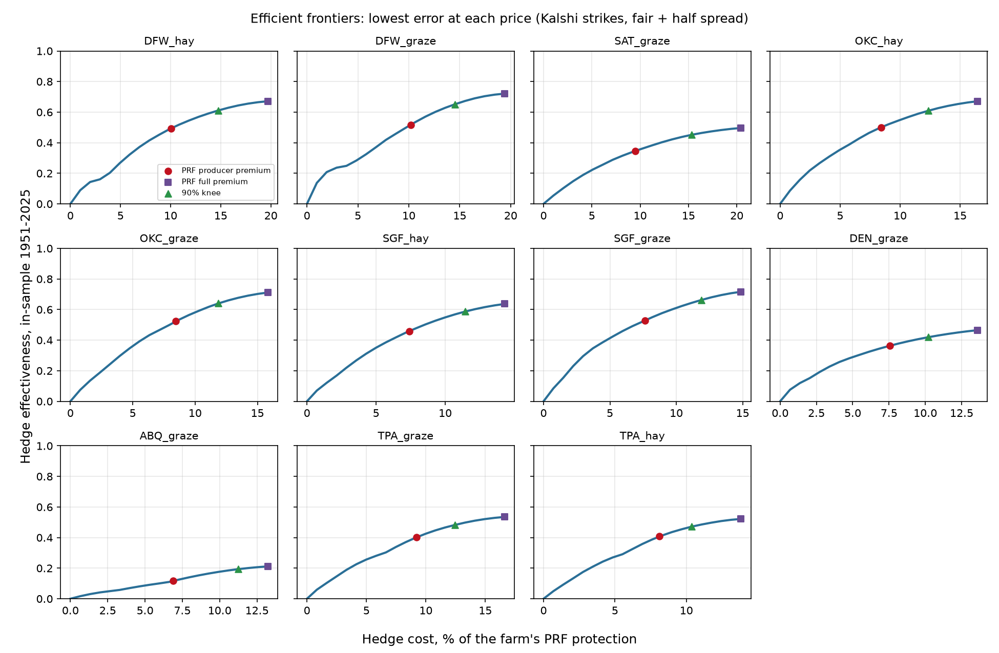
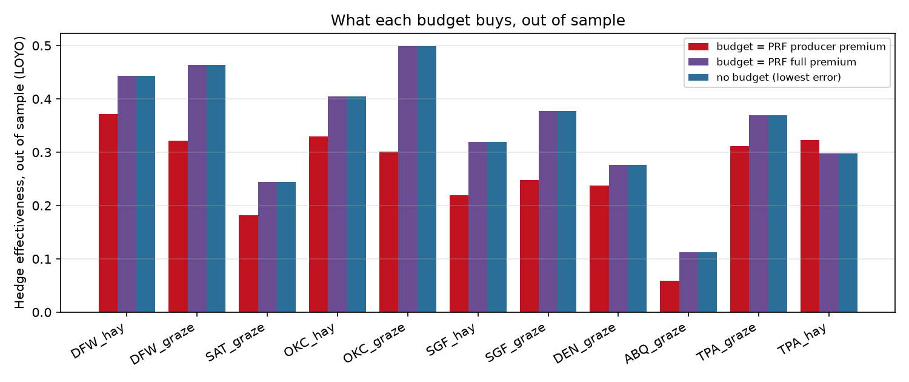

# 15: Choosing the lowest-error, lowest-cost portfolio of Kalshi rain contracts

**Proposal cell:** Milestone II, Week 4 / Jack ("build the optimization method for choosing the lowest-error / lowest-cost portfolio of available event contracts")  |  **Status:** DRAFT (numbers reproducible with `python scripts/run_optimizer.py`)  |  **Last updated:** 2026-11-05

Code: `src/agri_hedge/optimizer.py` (solver, frontier, order-book tranches), `src/agri_hedge/hedge_builder.py` (turns a location, months and coverage into a problem), `scripts/run_optimizer.py` (11-farm study, figures, the tables between the AUTO markers). Tests: `tests/test_optimizer.py`, `tests/test_platform.py`.
Data written: `data/processed/m2_optimizer_frontier.csv`, `m2_optimizer_summary.csv`; figures `docs/figures/m2_frontiers.png`, `m2_he_by_budget.png`.

## Key findings

All numbers: the 11 representative farms of doc 04, their 2026 PRF elections, the NCEI-based PRF index (what PRF pays on from crop year 2027), 1951-2025. Contracts are NO positions at the strikes Kalshi lists for each farm's station, bought at fair value (1991-2025 climatology) plus half a 4.5-cent spread, with the taker fee and 31 days of prepaid cash at 4.05%. HE (hedge effectiveness) is the share of the year-to-year variance of the farm's PRF payout that the hedge removes. "Out of sample" means leave one year out (LOYO): refit without each year at the same budget and score that year.

- **The optimizer turns doc 08's single answer into a menu.** Doc 08 found one hedge per farm: the lowest-error fit (non-negative least squares). The optimizer adds the price of every contract, order-book depth limits and a budget. It returns the whole efficient frontier, the lowest error at every price, as a convex quadratic program. With no budget or depth limit it reproduces the doc 08 fit exactly (same squared error to 7 digits; unit test).
- **The lowest-error hedges cost $104,970 a year for the 11 farms** and have a fair expected payout of $95,145 (cost $1.10 per $1 of expected payout). This matches doc 09's independent pricing of the same hedges ($107,500, $1.09 per $1). The farms' PRF producer premiums total $55,994 and their full premiums $117,053.
- **In-sample fit overstates real performance by about 40%.** The median farm's lowest-error hedge removes 64% of PRF payout variance in the years it was fit on, but only 37% in years it has not seen.
- **The "90% knee" is free money out of sample.** The cheapest hedge that keeps 90% of the in-sample variance reduction costs $81,516 (22% less) and keeps the same out-of-sample HE (median 0.36 vs 0.37). For six farms it does better out of sample than the lowest-error hedge (DFW_hay 0.47 vs 0.44; OKC_hay 0.44 vs 0.40; TPA_hay 0.36 vs 0.30; SAT_graze, ABQ_graze and TPA_graze gain 0.01-0.02). A budget acts like regularization: the last dollars buy fit to noise. The platform uses this knee as its default recommendation.
- **What the PRF producer premium buys.** Spending exactly what each farmer now pays for PRF ($55,992 in total) gives a median HE of 0.46 in sample and 0.30 out of sample. The same money in PRF buys the PRF payout itself (HE 1 by definition) with an expected payout of $1.64 per $1 paid (doc 09).
- **The full (unsubsidized) PRF premium never binds.** For every farm the lowest-error hedge costs less than the full PRF premium, so a budget equal to the full premium returns the lowest-error hedge. Without the subsidy, Kalshi is cheaper per farm than PRF's list price, but it buys a much worse match to the PRF payout.
- **Where it works and where it does not.** The best out-of-sample fits are OKC_graze (0.50), DFW_graze (0.46) and DFW_hay (0.44-0.47). The worst is ABQ_graze: even the lowest-error hedge removes 11% of variance out of sample at a cost of $23,274 a year. Doc 16 explains why.

<!-- BEGIN AUTO: optimizer tables (scripts/run_optimizer.py) -->
### Per farm: four points on the frontier

HE = hedge effectiveness (1 - Var(PRF - hedge) / Var(PRF)). In = fit and scored on 1951-2025. LOYO = refit without each year at the same budget, scored on that year. Cost is all-in (fair + 2.25c, taker fee, 31 days of capital). $/$ = cost per $1 of fair expected payout.

| Farm | PRF producer premium | Lowest-error hedge: cost / HE in / HE LOYO | 90% knee: cost / HE in / HE LOYO | Budget = producer premium: HE in / HE LOYO | Budget = full premium: HE in / HE LOYO |
|---|---|---|---|---|---|
| DFW_hay | $3,683 | $7,221 / 0.67 / 0.44 | $5,415 / 0.61 / 0.47 | 0.49 / 0.37 | 0.67 / 0.44 |
| DFW_graze | $2,734 | $5,201 / 0.72 / 0.46 | $3,901 / 0.65 / 0.45 | 0.52 / 0.32 | 0.72 / 0.46 |
| SAT_graze | $3,198 | $6,877 / 0.50 / 0.24 | $5,157 / 0.45 / 0.26 | 0.35 / 0.18 | 0.50 / 0.24 |
| OKC_hay | $3,643 | $7,134 / 0.67 / 0.40 | $5,350 / 0.61 / 0.44 | 0.50 / 0.33 | 0.67 / 0.40 |
| OKC_graze | $3,129 | $5,854 / 0.71 / 0.50 | $4,391 / 0.64 / 0.43 | 0.52 / 0.30 | 0.71 / 0.50 |
| SGF_hay | $2,663 | $5,145 / 0.64 / 0.32 | $4,116 / 0.59 / 0.29 | 0.46 / 0.22 | 0.64 / 0.32 |
| SGF_graze | $2,132 | $4,158 / 0.72 / 0.38 | $3,326 / 0.66 / 0.33 | 0.53 / 0.25 | 0.72 / 0.38 |
| DEN_graze | $9,330 | $16,772 / 0.47 / 0.28 | $12,578 / 0.42 / 0.28 | 0.36 / 0.24 | 0.47 / 0.28 |
| ABQ_graze | $12,120 | $23,274 / 0.21 / 0.11 | $19,781 / 0.19 / 0.12 | 0.12 / 0.06 | 0.21 / 0.11 |
| TPA_graze | $6,061 | $10,902 / 0.53 / 0.37 | $8,176 / 0.48 / 0.38 | 0.40 / 0.31 | 0.53 / 0.37 |
| TPA_hay | $7,302 | $12,433 / 0.52 / 0.30 | $9,324 / 0.47 / 0.36 | 0.41 / 0.32 | 0.52 / 0.30 |

### All 11 farms together

| Point | Total cost | Total fair expected payout | Cost per $1 expected | Median HE in | Median HE LOYO | Legs used (median) |
|---|---|---|---|---|---|---|
| Lowest error (no budget) | $104,970 | $95,145 | 1.10 | 0.64 | 0.37 | 15 |
| 90% knee | $81,516 | $73,500 | 1.11 | 0.59 | 0.36 | 11 |
| Budget = PRF producer premium | $55,992 | $50,004 | 1.12 | 0.46 | 0.30 | 9 |
| Budget = PRF full premium | $104,970 | $95,145 | 1.10 | 0.64 | 0.37 | 15 |

PRF premiums for the same 11 farms: producer $55,994, full $117,053 per year.

Target check: largest gap between the rebuilt PRF target and doc 04b's NCEI indemnity in any farm-year: $124 (index rounding).
<!-- END AUTO: optimizer tables (scripts/run_optimizer.py) -->

## Method

**Problem.** Years t = 1..n. The farmer wants y_t dollars (here the PRF indemnity). A leg is a NO contract on one station-month "Above K inches", paying $1 iff that month's station rain is at most K (Kalshi resolves YES iff the total is strictly greater). Each leg can be bought in tranches: a price level of a live order book with a size, or an unlimited quantity at a model price. With x_j contracts bought in tranche j:

    minimize   (1/n) sum_t (y_t - h_t)^2      subject to   sum_j c_j x_j <= B,   0 <= x_j <= capacity_j

where h_t is the hedge payout and c_j is the all-in unit cost: price + 0.07 P(1 - P) taker fee + simple interest at 4.05% for 31 days on the outlay (constants from doc 09, `pricing.py`). The fee is applied per contract without Kalshi's one-cent round-up per order; the order ticket in the app adds the round-up back.

**Solver.** The penalized form (1/n) sum (y - h)^2 + lambda * cost is a bound-constrained convex quadratic. It is solved with L-BFGS-B and an analytic gradient after dividing money by the farm's protection, so variables are of order one. The budget form is solved by bisection on lambda, because cost falls monotonically as lambda rises. After solving, each leg's contracts are reassigned to its cheapest tranches first; the payout depends only on leg totals, so this keeps the fit and removes solver slack between price levels.

**Frontier and knee.** The frontier sweeps 21 budgets from $0 to the cost of the lowest-error hedge. The knee is the cheapest budget that reaches 90% of the best in-sample variance reduction.

**Out of sample.** For each farm and budget the hedge is refit 75 times, once without each year, and scored on the left-out year. Doc 08 also used a 1951-2009 / 2010-2025 time split and found the two methods agree closely, so only LOYO is reported here.

**Target check.** The target is rebuilt from the farm's grid and PRF election by `hedge_builder` and matches doc 04b's NCEI indemnity within $124 in every farm-year. The gap comes from index rounding, because RMA rounds published indexes.

## Numbers table

"Computed" = produced by `scripts/run_optimizer.py` (run 2026-11-05) from the processed data listed in Method.

| Quantity | Value | Units | Region / period | Source | Verification |
|---|---|---|---|---|---|
| Lowest-error hedges, total cost / fair expected payout | $104,970 / $95,145 | $ per year | 11 farms | tables above | CONFIRMED (computed) |
| Same, cost per $1 expected | 1.10 | ratio | 11 farms | tables above | CONFIRMED (computed) |
| Doc 09 central cost of the same hedges | $107,500; $1.09 per $1 | $ per year | 11 farms | doc 09 | CONFIRMED (doc 09) |
| PRF producer / full premiums | $55,994 / $117,053 | $ per year | 11 farms, 2026 terms | `prf_scenario_results.csv` | CONFIRMED (doc 04b) |
| Median HE, lowest error: in / LOYO | 0.64 / 0.37 | share of variance | 11 farms, 1951-2025 | tables above | CONFIRMED (computed) |
| 90% knee: total cost, median HE in / LOYO | $81,516; 0.59 / 0.36 | | 11 farms | tables above | CONFIRMED (computed) |
| Budget = PRF producer premium: median HE in / LOYO | 0.46 / 0.30 | share | 11 farms | tables above | CONFIRMED (computed) |
| PRF expected payout per $1 the producer pays | $1.64 (= 1 / 0.61) | ratio | 11 farms | doc 09 | CONFIRMED (doc 09) |
| Largest target vs doc 04b gap | $124 | $ | any farm-year | tables above | CONFIRMED (computed) |
| Taker fee, T-bill rate, lockup, half spread | 0.07 P(1-P); 4.05%; 31 days; 2.25 cents | | | `pricing.py`, docs 05, 09 | CONFIRMED (docs 05, 09) |

## Implications for the platform

- Recommend a knee, not the lowest-error hedge: the 90% knee is about 22% cheaper with no loss out of sample. A later test over 44 farm and single-month cases (doc 21) found 95% does slightly better on unseen years (median HE 0.49 vs 0.46), so the app now recommends the 95% knee.
- Always show the out-of-sample number next to the in-sample one. The in-sample number is what a naive backtest would advertise, and it is about 40% too optimistic.
- The optimizer accepts order-book tranches directly, so live depth limits (doc 12: a few hundred contracts per strike) enter the same problem. Doc 16 shows that they bind hard.

## Limits and open questions

- Prices are model prices (fair value plus half a typical spread). Live books exist only for the next listed month (doc 18), so a full-season hedge cannot be priced from books yet.
- The target is the PRF payout. A farmer's real loss is a different target; `loss_model.py` (doc 13) could be plugged in as `y` with no change to the optimizer.
- Fair value uses 1991-2025 climatology. A trend in rainfall, or a market that prices the season's forecast, would change both cost and fit.
