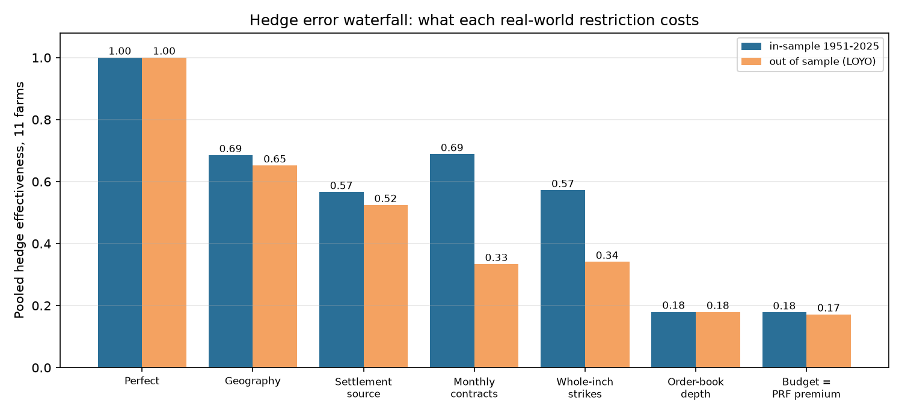
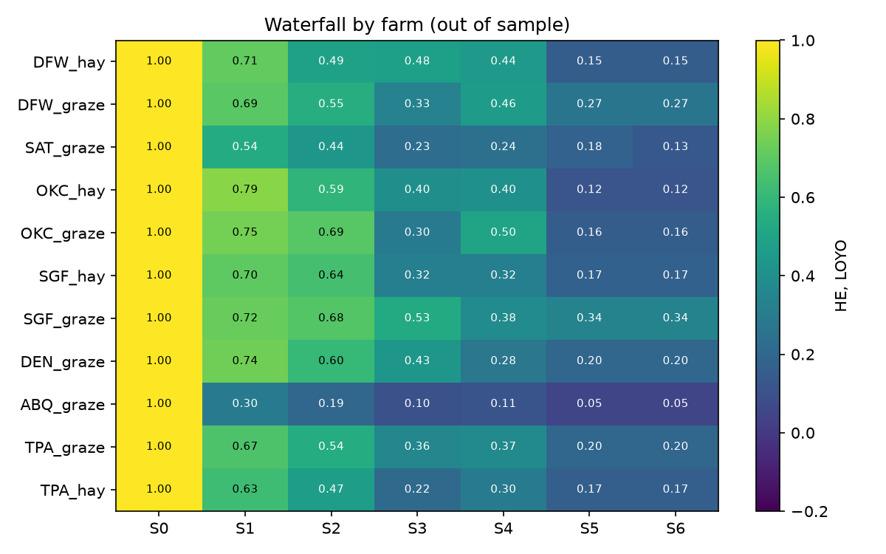

# 16: Where the hedge error comes from: geography, settlement, contract design, liquidity, capital

**Proposal cell:** Milestone II, Week 4 / Maya ("decompose the remaining hedge error into contract binning, geography, settlement-source mismatch, liquidity, and capital constraints")  |  **Status:** DRAFT (numbers reproducible with `python scripts/run_error_budget.py`)  |  **Last updated:** 2026-11-05

Code: `src/agri_hedge/error_budget.py` (instrument builders for every step, order-book depth), `scripts/run_error_budget.py` (study loop, figures, tables between the AUTO markers). Uses the optimizer of doc 15.
Data written: `data/processed/m2_error_budget_farm.csv`, `m2_error_budget_window.csv`; figures `docs/figures/m2_error_waterfall.png`, `m2_waterfall_by_farm.png`.

## Key findings

The target is each of the 11 farms' PRF payout (NCEI index, 1951-2025, 90% coverage as elected). Starting from a perfect hedge, one real-world restriction is added at a time, and the lowest-error hedge is refit after each (doc 15 optimizer). "Pooled HE" is the share of PRF payout variance removed across all farms, with payouts per $1 of protection. Out-of-sample (LOYO) numbers lead, because in-sample fits reward flexible contract sets that only fit noise.

- **Out of sample, the hedge falls from 1.00 to 0.17 in six steps.** Geography costs 0.35, settlement source 0.13, monthly contracts 0.19, whole-inch strikes nothing (-0.01), order-book depth 0.16, and a budget equal to the PRF producer premium 0.01.
- **Geography is the largest single loss.** A contract paying the PRF formula on the station's own 0.25-degree grid, 30-55 miles from the farm, removes only 65% of the variance. It is the largest drop for 7 of 11 farms and 23 of 36 insured windows. ABQ_graze loses 0.70 here: monsoon rain 53 miles away is nearly unrelated.
- **Settlement source adds a smaller, steady loss.** Replacing NOAA's gridded analysis with the station's single gauge (the NWS climate report Kalshi settles on) costs 0.13 more. It is never the largest drop in any window, but it is present everywhere (mean 0.11 per window). Doc 06c showed that the gauge data reproduce Kalshi's settlements exactly, so this is a gauge-vs-grid loss, not a data error.
- **Monthly contracts cost more than strike binning.** Splitting the two-month interval into two separately settled months costs 0.19 out of sample. One dry month triggers a payout even when the two-month total is normal (doc 08: false alarms in 47% of no-PRF years). Moving from 0.25-inch to Kalshi's whole-inch strikes costs nothing out of sample. In sample the finer strikes look 0.12 better, but that gain is all overfitting: a 0.25-inch ladder has up to 60 strikes per month to fit 74 years. This is smaller than doc 08's 0.11 binning loss, because doc 08 pooled the station grids, where arid sites lose most to binning; at the farm grids geography has already removed most of what finer strikes could recover.
- **Liquidity is the second-largest loss, and in sample it is the largest (0.39).** With at most the contracts offered within 10 cents of fair value on the post-rewards November 2026 book (doc 12), the best hedge falls to 0.18. It is the largest drop for DFW_hay and OKC_hay and for 9 of 36 windows. The busiest leg needs 5 to 28 times the depth on offer (doc 17).
- **The capital constraint barely matters once liquidity binds.** After depth limits, the hedges cost far less than the PRF producer premium, so the budget seldom binds (0.01). Without the depth limit, the same budget costs 0.07 out of sample (doc 15: 0.37 to 0.30). Kalshi requires full prepayment, so the capital constraint is a constraint on the farmer's cash. Its interest cost is already in the price (31 days at 4.05%, about 0.3% of the outlay).
- **What this means for contract design.** Two thirds of today's loss (geography + settlement = 0.48 of the 0.83) comes from paying on the wrong rain, and no strike set or optimizer can fix that. Only a contract settled on rain at the farm (a grid index) can, and doc 17 shows it would recover almost all of it.

<!-- BEGIN AUTO: error budget tables (scripts/run_error_budget.py) -->
### Pooled over the 11 farms

Pooled HE = 1 - sum(n x residual variance) / sum(n x PRF payout variance), with payouts per $1 of protection so each farm counts by its risk, not its size.

| Step | Restriction added | Pooled HE in-sample | Drop | Pooled HE LOYO | Drop | Median farm HE LOYO |
|---|---|---|---|---|---|---|
| S0 | Perfect: contract on the farm's own grid index | 1.00 |  | 1.00 |  | 1.00 |
| S1 | Geography: PRF formula on the station's grid | 0.69 | 0.31 | 0.65 | 0.35 | 0.70 |
| S2 | Settlement source: PRF formula on the station gauge | 0.57 | 0.12 | 0.52 | 0.13 | 0.55 |
| S3 | Monthly contracts (0.25-inch strikes) | 0.69 | -0.12 | 0.33 | 0.19 | 0.33 |
| S4 | Kalshi's listed strikes (whole inches) | 0.57 | 0.12 | 0.34 | -0.01 | 0.37 |
| S5 | Order-book depth (Nov 2026, post-rewards) | 0.18 | 0.39 | 0.18 | 0.16 | 0.17 |
| S6 | Budget = PRF producer premium | 0.18 | 0.00 | 0.17 | 0.01 | 0.17 |

### Each farm, out of sample (HE LOYO after each step)

| Farm | S0 | S1 | S2 | S3 | S4 | S5 | S6 | Largest single drop |
|---|---|---|---|---|---|---|---|---|
| DFW_hay | 1.00 | 0.71 | 0.49 | 0.48 | 0.44 | 0.15 | 0.15 | S5 (0.29) |
| DFW_graze | 1.00 | 0.69 | 0.55 | 0.33 | 0.46 | 0.27 | 0.27 | S1 (0.31) |
| SAT_graze | 1.00 | 0.54 | 0.44 | 0.23 | 0.24 | 0.18 | 0.13 | S1 (0.46) |
| OKC_hay | 1.00 | 0.79 | 0.59 | 0.40 | 0.40 | 0.12 | 0.12 | S5 (0.29) |
| OKC_graze | 1.00 | 0.75 | 0.69 | 0.30 | 0.50 | 0.16 | 0.16 | S3 (0.39) |
| SGF_hay | 1.00 | 0.70 | 0.64 | 0.32 | 0.32 | 0.17 | 0.17 | S3 (0.33) |
| SGF_graze | 1.00 | 0.72 | 0.68 | 0.53 | 0.38 | 0.34 | 0.34 | S1 (0.28) |
| DEN_graze | 1.00 | 0.74 | 0.60 | 0.43 | 0.28 | 0.20 | 0.20 | S1 (0.26) |
| ABQ_graze | 1.00 | 0.30 | 0.19 | 0.10 | 0.11 | 0.05 | 0.05 | S1 (0.70) |
| TPA_graze | 1.00 | 0.67 | 0.54 | 0.36 | 0.37 | 0.20 | 0.20 | S1 (0.33) |
| TPA_hay | 1.00 | 0.63 | 0.47 | 0.22 | 0.30 | 0.17 | 0.17 | S1 (0.37) |

### Which step costs most, counted over every insured window (LOYO)

| Step | Windows where it is the largest drop | Mean drop |
|---|---|---|
| S1 Geography | 23 of 36 | 0.36 |
| S2 Settlement source | 0 of 36 | 0.11 |
| S3 Monthly contracts (0.25-inch strikes) | 3 of 36 | 0.15 |
| S4 Kalshi's listed strikes (whole inches) | 1 of 36 | 0.05 |
| S5 Order-book depth (Nov 2026, post-rewards) | 9 of 36 | 0.15 |
| S6 Budget = PRF producer premium | 0 of 36 | 0.01 |
<!-- END AUTO: error budget tables (scripts/run_error_budget.py) -->

## Method

Each step changes the instruments the optimizer may use. All steps use the same farm-years, those where every instrument and the target are known.

| Step | Instruments | Fit |
|---|---|---|
| S0 perfect | the target itself | HE = 1 |
| S1 geography | one contract per insured window paying the PRF factor on the *station's* PRF grid (`study_grids.csv`, role = station) | non-negative weights |
| S2 settlement source | one contract per window paying the PRF factor on the station gauge's own two-month index (100 x total / 1951-2025 mean) | non-negative weights |
| S3 monthly contracts | NO contracts on each calendar month at 0.25-inch strikes up to 15 inches (duplicate payoffs dropped) | non-negative weights |
| S4 binning | NO contracts at the strikes Kalshi lists for the series and month (doc 08 `kalshi_strike_sets`) | non-negative weights |
| S5 liquidity | S4, with at most the NO contracts offered within 10 cents of fair value per strike on the 2026-11-02 snapshot (the November ladder; the same depth is assumed for every month) | capacity bounds |
| S6 capital | S5, with total all-in cost at most the farm's 2026 PRF producer premium | budget |

Pooled HE = 1 - sum(n x residual variance) / sum(n x payout variance), with payouts divided by protection so that big farms do not dominate. The window-level table repeats the waterfall for each insured interval on its own (36 windows), with the window's share of the protection and of the premium.

**Order of steps.** Losses are not additive in general, and the order matters for the last two steps. Applying the budget before the depth limit gives a capital loss of 0.07 (doc 15) and a smaller liquidity loss. The ordering above follows the physical chain from rain to trade.

## Numbers table

"Computed" = produced by `scripts/run_error_budget.py` (run 2026-11-05).

| Quantity | Value | Units | Region / period | Source | Verification |
|---|---|---|---|---|---|
| Pooled HE LOYO, S0 to S6 | 1.00, 0.65, 0.52, 0.33, 0.34, 0.18, 0.17 | share of variance | 11 farms, 1951-2025 | tables above | CONFIRMED (computed) |
| Pooled HE in sample, S0 to S6 | 1.00, 0.69, 0.57, 0.69, 0.57, 0.18, 0.18 | share | same | tables above | CONFIRMED (computed) |
| Windows where geography / liquidity / monthly / binning is the largest drop | 23 / 9 / 3 / 1 of 36 | count | 36 insured windows | tables above | CONFIRMED (computed) |
| Mean drop per window: geography, settlement, monthly, binning, liquidity, capital | 0.36, 0.11, 0.15, 0.05, 0.15, 0.01 | HE | 36 windows, LOYO | tables above | CONFIRMED (computed) |
| ABQ_graze geography loss | 0.70 | HE | LOYO | tables above | CONFIRMED (computed) |
| Budget-only loss (no depth limit) | 0.07 (0.37 to 0.30, medians) | HE | 11 farms | doc 15 | CONFIRMED (computed) |
| Doc 08 binning loss (pooled station + farm grids) | 0.11 | HE | 154 site-grid-intervals | doc 08 | CONFIRMED (doc 08) |
| Depth snapshot | 2026-11-02 01:34 UTC, 22 hours after liquidity rewards ended | | 8 study series | doc 12 | CONFIRMED (doc 12) |

## Limits and open questions

- Depth comes from one snapshot of one month. Doc 12 showed depth swings with liquidity rewards; a market maker or a pooled order (doc 17) would change S5 completely.
- S1 and S2 are idealized contracts with one optimally sized weight per window, so they are upper bounds on what any contract at that location could do.
- The steps use the PRF payout as the target. Against modeled forage loss (doc 13), geography would matter even more for PRF itself, which also pays on a grid and not on the farm.
