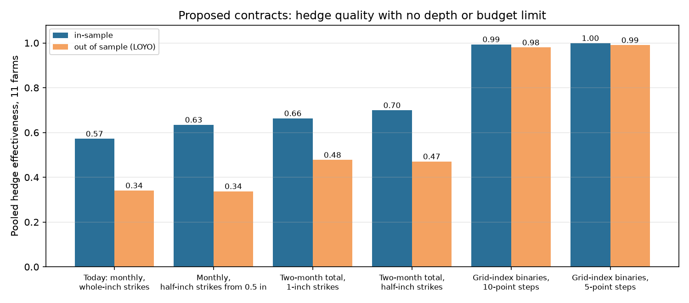

# 17: Which exposures today's contracts cannot replicate, and what new contracts or market mechanisms would fix them

**Proposal cell:** Milestone II, Week 4 / Evan ("find which insurance exposures can't be replicated well with current contracts and propose what extra contracts or market mechanisms would be needed")  |  **Status:** DRAFT (numbers reproducible with `python scripts/run_error_budget.py`)  |  **Last updated:** 2026-11-05

Code: `src/agri_hedge/error_budget.py` (builders for every proposed contract), `scripts/run_error_budget.py` (part 2). Uses the optimizer of doc 15 and the waterfall of doc 16.
Data written: `data/processed/m2_contract_proposals.csv`, `m2_liquidity_needed.csv`; figure `docs/figures/m2_proposals.png`.

## Key findings

The 11 farms' PRF payouts (NCEI index, 1951-2025) are hedged with today's Kalshi ladder and with five proposed contract sets, each with the lowest-error hedge and no depth or budget limit. Each of the 36 insured windows is also hedged on its own. HE is out of sample (leave one year out) unless stated.

- **Only 3 of 36 insured windows are replicable today** (HE at least 0.6): OKC_hay Apr-May, OKC_graze Mar-Apr and SGF_graze Oct-Nov. 21 are partial (0.3-0.6) and 12 are not replicable (below 0.3).
- **The exposures that fail share one cause: summer convective or monsoon rain.** Every ABQ window fails (0.03-0.10), as do Denver's Jun-Jul and Aug-Sep (0.21, 0.25), Tampa's May-Jun (0.01) and Sep-Oct (0.22), Springfield's May-Jun (0.20), Dallas's Aug-Sep (0.29) and San Antonio's Sep-Oct (0.28). Thunderstorm rain at an airport 30-55 miles away says little about rain on the farm. Spring and fall frontal rain transfers much better. Row crops (doc 14) and producers more than about 50 miles from a station (doc 19: median HE 0.15 beyond 100 miles) fail for the same reason.
- **Finer strikes do not help (P1).** Half-inch strikes from 0.5 inches leave pooled HE at 0.34. They help a few arid windows (ABQ Apr-May 0.10 to 0.32, DEN Aug-Sep 0.25 to 0.43) but overfit elsewhere. Doc 08's call for sub-inch strikes holds only for the driest sites.
- **Two-month contracts help (P2, P3).** A contract on the station's two-month total ("Apr-May rain at DFW at or below K inches"), matching PRF's interval, raises pooled HE from 0.34 to 0.48. Two farms reach 0.6 (none do today), and 35 of 36 windows improve. Half-inch steps add nothing over whole inches (0.47). Kalshi could list this with the same settlement source it uses now: two monthly climate reports added together.
- **A contract on the grid index itself fixes almost everything (P4, P5).** Binaries that pay when the farm grid's PRF index is at or below K (10-point steps up to the trigger) reach pooled HE 0.98. All 11 farms and all 36 windows reach at least 0.90. Five-point steps reach 0.99. This removes geography and settlement mismatch, the 0.48 of HE that doc 16 shows no other design can recover.
- **But P4 is PRF without the subsidy.** It costs about $1.20 per $1 of expected payout at fair value plus half a spread, against $0.61 for subsidized PRF (doc 09). Its real advantages over PRF are the ones Milestone I listed: any month, settlement days after the month instead of weeks, cover above PRF's caps, and access for producers outside PRF. It needs a settlement source Kalshi does not use today, NOAA's gridded data (nClimGrid) for a 0.25-degree cell, and 1 contract series per grid (about 36,000 grids, or one per county or climate division as a compromise).
- **Liquidity has to be engineered, whatever the contract.** The lowest-error hedge's busiest leg needs 5 to 28 times the NO depth that sat within 10 cents of fair value on the 2026-11-02 book. Only 16% of all the contracts could be filled at a sensible price, and that assumes each farm has the book to itself.
- **Mechanisms needed** (no numbers of our own beyond the depth gap):
  1. **Earlier listing.** Kalshi lists each monthly ladder about 30 days before it closes (docs 05b, 09). A rancher deciding cover in the fall for next spring cannot buy it. Seasonal hedging needs ladders listed 6-12 months ahead.
  2. **A designated market maker on the drought side**, quoting NO size near fair value. Doc 12 showed that depth paid for by liquidity rewards fell 94% when the rewards ended.
  3. **Pooled orders.** A cooperative or insurance agent aggregates many farms' orders on the same station and month into block orders. This spreads fixed costs, though it does not create depth.
  4. **A subsidy if policy wants parity with PRF.** Doc 09 put the subsidy needed to match PRF's net benefit at about $44,600 a year for the 11 farms (41% of hedge cost).

<!-- BEGIN AUTO: contract proposal tables (scripts/run_error_budget.py) -->
### Proposed contracts, pooled over the 11 farms (lowest-error hedge, no depth or budget limit)

| Contract set | Pooled HE in | Pooled HE LOYO | Median farm HE LOYO | Farms with HE LOYO >= 0.6 | Total cost / yr | Cost per $1 expected |
|---|---|---|---|---|---|---|
| today: Today: monthly, whole-inch strikes | 0.57 | 0.34 | 0.37 | 0 of 11 | $104,970 | 1.10 |
| P1: Monthly, half-inch strikes from 0.5 in | 0.63 | 0.34 | 0.37 | 0 of 11 | $107,766 | 1.12 |
| P2: Two-month total, 1-inch strikes | 0.66 | 0.48 | 0.50 | 2 of 11 | $101,777 | 1.13 |
| P3: Two-month total, half-inch strikes | 0.70 | 0.47 | 0.48 | 2 of 11 | $103,081 | 1.14 |
| P4: Grid-index binaries, 10-point steps | 0.99 | 0.98 | 0.98 | 11 of 11 | $100,698 | 1.20 |
| P5: Grid-index binaries, 5-point steps | 1.00 | 0.99 | 0.99 | 11 of 11 | $100,393 | 1.20 |

### Every insured window: out-of-sample HE today and with each proposal

Class: replicable = today's HE LOYO >= 0.6; partial = 0.3-0.6; not replicable = below 0.3.

| Farm | Window | Today | P1 | P2 | P3 | P4 | P5 | Class today |
|---|---|---|---|---|---|---|---|---|
| DFW_hay | Apr-May | 0.33 | 0.33 | 0.51 | 0.51 | 0.98 | 0.99 | partial |
| DFW_hay | Jun-Jul | 0.41 | 0.46 | 0.56 | 0.54 | 0.99 | 1.00 | partial |
| DFW_hay | Aug-Sep | 0.29 | 0.29 | 0.44 | 0.45 | 0.99 | 0.99 | not replicable |
| DFW_graze | Apr-May | 0.33 | 0.33 | 0.51 | 0.51 | 0.98 | 0.99 | partial |
| DFW_graze | Jun-Jul | 0.41 | 0.46 | 0.56 | 0.54 | 0.99 | 1.00 | partial |
| DFW_graze | Feb-Mar | 0.50 | 0.58 | 0.71 | 0.72 | 0.99 | 1.00 | partial |
| DFW_graze | Sep-Oct | 0.43 | 0.39 | 0.61 | 0.59 | 0.98 | 1.00 | partial |
| SAT_graze | Sep-Oct | 0.28 | 0.27 | 0.39 | 0.49 | 0.99 | 0.99 | not replicable |
| SAT_graze | Mar-Apr | 0.40 | 0.43 | 0.51 | 0.43 | 0.99 | 0.99 | partial |
| SAT_graze | May-Jun | 0.31 | 0.26 | 0.39 | 0.45 | 0.99 | 0.99 | partial |
| OKC_hay | Apr-May | 0.62 | 0.61 | 0.77 | 0.82 | 0.98 | 1.00 | replicable |
| OKC_hay | Jun-Jul | 0.41 | 0.41 | 0.53 | 0.49 | 0.99 | 0.99 | partial |
| OKC_hay | Aug-Sep | 0.48 | 0.55 | 0.62 | 0.55 | 0.98 | 0.99 | partial |
| OKC_graze | Sep-Oct | 0.40 | 0.48 | 0.65 | 0.62 | 0.95 | 0.96 | partial |
| OKC_graze | Mar-Apr | 0.62 | 0.64 | 0.81 | 0.84 | 0.99 | 1.00 | replicable |
| OKC_graze | May-Jun | 0.43 | 0.41 | 0.67 | 0.68 | 0.99 | 1.00 | partial |
| OKC_graze | Jul-Aug | 0.51 | 0.49 | 0.60 | 0.63 | 0.99 | 1.00 | partial |
| SGF_hay | Sep-Oct | 0.34 | 0.33 | 0.68 | 0.71 | 0.95 | 0.96 | partial |
| SGF_hay | Mar-Apr | 0.56 | 0.63 | 0.67 | 0.73 | 0.98 | 0.99 | partial |
| SGF_hay | May-Jun | 0.20 | 0.26 | 0.48 | 0.46 | 0.98 | 0.99 | not replicable |
| SGF_graze | Aug-Sep | 0.39 | 0.46 | 0.58 | 0.57 | 0.99 | 1.00 | partial |
| SGF_graze | Mar-Apr | 0.56 | 0.63 | 0.67 | 0.73 | 0.98 | 0.99 | partial |
| SGF_graze | May-Jun | 0.20 | 0.26 | 0.48 | 0.46 | 0.98 | 0.99 | not replicable |
| SGF_graze | Oct-Nov | 0.60 | 0.58 | 0.78 | 0.74 | 0.99 | 1.00 | replicable |
| DEN_graze | Apr-May | 0.43 | 0.37 | 0.60 | 0.60 | 0.99 | 0.99 | partial |
| DEN_graze | Jun-Jul | 0.21 | 0.20 | 0.23 | 0.21 | 0.90 | 0.94 | not replicable |
| DEN_graze | Aug-Sep | 0.25 | 0.43 | 0.33 | 0.41 | 0.96 | 0.97 | not replicable |
| ABQ_graze | Apr-May | 0.10 | 0.32 | 0.29 | 0.56 | 0.99 | 1.00 | not replicable |
| ABQ_graze | Jun-Jul | 0.03 | 0.19 | 0.13 | 0.10 | 0.99 | 0.99 | not replicable |
| ABQ_graze | Aug-Sep | 0.04 | 0.02 | 0.11 | 0.09 | 0.98 | 0.99 | not replicable |
| TPA_graze | Mar-Apr | 0.35 | 0.29 | 0.55 | 0.53 | 0.99 | 0.99 | partial |
| TPA_graze | May-Jun | 0.01 | -0.03 | 0.17 | 0.14 | 0.97 | 0.99 | not replicable |
| TPA_graze | Oct-Nov | 0.32 | 0.27 | 0.24 | 0.36 | 0.98 | 0.99 | partial |
| TPA_hay | Sep-Oct | 0.22 | 0.34 | 0.27 | 0.21 | 0.94 | 0.95 | not replicable |
| TPA_hay | Mar-Apr | 0.35 | 0.29 | 0.55 | 0.53 | 0.99 | 0.99 | partial |
| TPA_hay | May-Jun | 0.01 | -0.03 | 0.17 | 0.14 | 0.97 | 0.99 | not replicable |

Windows by class today: partial 21, not replicable 12, replicable 3 (of 36).

### Order-book depth needed (lowest-error hedge with today's strikes)

Depth = NO contracts offered within 10 cents of fair value on the Nov 2026 book (2026-11-02 snapshot), taken as the depth for every month.

| Farm | Legs used | Contracts in busiest leg | Depth at that strike | Busiest leg / depth | Share of all contracts fillable |
|---|---|---|---|---|---|
| DFW_hay | 15 | 4,380 | 284 | 15x | 11% |
| DFW_graze | 20 | 3,596 | 284 | 13x | 16% |
| SAT_graze | 13 | 2,797 | 101 | 28x | 7% |
| OKC_hay | 19 | 4,789 | 266 | 18x | 8% |
| OKC_graze | 17 | 2,565 | 266 | 10x | 11% |
| SGF_hay | 16 | 3,082 | 197 | 16x | 14% |
| SGF_graze | 23 | 2,405 | 301 | 8x | 22% |
| DEN_graze | 10 | 10,122 | 2,078 | 5x | 31% |
| ABQ_graze | 5 | 8,116 | 765 | 11x | 14% |
| TPA_graze | 10 | 6,237 | 715 | 9x | 22% |
| TPA_hay | 11 | 6,387 | 715 | 9x | 14% |

All farms together: 16% of the contracts could be filled at a sensible price, if each farm had the book to itself.
<!-- END AUTO: contract proposal tables (scripts/run_error_budget.py) -->

## Method

| Set | Contracts | Settles on |
|---|---|---|
| today | NO on "Above K inches" for each calendar month, K = the strikes Kalshi lists (whole inches, usually 1-7) | station monthly total (NWS climate report) |
| P1 | same, K every 0.5 inch from 0.5 to 15 | same |
| P2 | NO on "window total above K inches", K = 1, 2, ... 30, one ladder per insured window | sum of the station's monthly totals |
| P3 | same, K every 0.5 inch | same |
| P4 | binary "grid index at or below K", K = 10, 20, ... up to the trigger, per window | NOAA NCEI grid index (what PRF pays on) |
| P5 | same, K every 5 points | same |

Identical payoff columns are dropped. Fair price is the 1991-2025 frequency of paying. Every set is fit by the doc 15 optimizer with no budget or depth limit, then scored in sample and with LOYO refits. Liquidity: for each leg of today's lowest-error hedge, contracts needed are compared with the NO contracts offered within 10 cents of fair value at the same strike on the November 2026 book (one snapshot; the same depth is assumed for every month).

## Numbers table

"Computed" = produced by `scripts/run_error_budget.py` (run 2026-11-05).

| Quantity | Value | Units | Region / period | Source | Verification |
|---|---|---|---|---|---|
| Pooled HE LOYO: today, P1, P2, P3, P4, P5 | 0.34, 0.34, 0.48, 0.47, 0.98, 0.99 | share of variance | 11 farms, 1951-2025 | tables above | CONFIRMED (computed) |
| Farms with HE LOYO at least 0.6: today, P2, P4 | 0, 2, 11 of 11 | count | | tables above | CONFIRMED (computed) |
| Windows replicable / partial / not, today | 3 / 21 / 12 of 36 | count | 36 insured windows | tables above | CONFIRMED (computed) |
| Cost per $1 expected: today, P2, P4 | 1.10, 1.13, 1.20 | ratio | 11 farms, fair + 2.25 cents | tables above | CONFIRMED (computed) |
| Busiest leg / depth | 5x (DEN) to 28x (SAT) | ratio | 2026-11-02 book | tables above | CONFIRMED (computed) |
| Contracts fillable at a sensible price | 16% | share | 11 farms | tables above | CONFIRMED (computed) |
| Listing horizon of a monthly ladder | about 30 days (28-32 days for DFW/DEN 2025-26) | days | | doc 05b markets table, `pricing.py` | CONFIRMED (doc 05b) |
| Drop in rewarded depth after rewards ended | 94% | | 5 new cities | doc 12 | CONFIRMED (doc 12) |
| Subsidy to match PRF net benefit | $44,600 / yr (41% of hedge cost) | $ | 11 farms | doc 09 | CONFIRMED (doc 09) |
| PRF producer cost per $1 expected | $0.61 | ratio | 11 farms | doc 09 | CONFIRMED (doc 09) |

## Unverified claims and open questions

- How fast NOAA publishes a preliminary nClimGrid monthly value, and how much it is revised, would set P4's settlement delay. We have not checked this.
- Whether Kalshi would list a contract per grid cell or per county is a business question. A county or climate-division index would add back some of the geography loss.
- The two-month contract (P2) needs no new data source. It is the cheapest change that matters, and the one to propose first.
