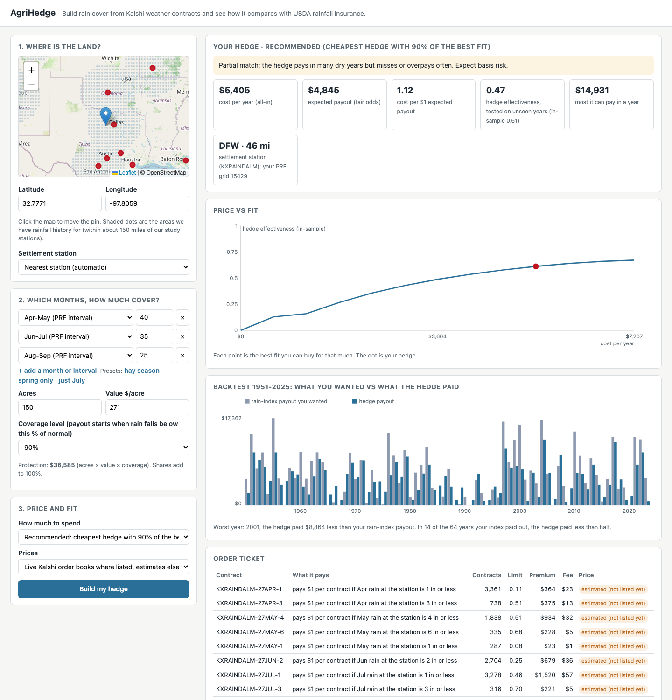

# 18: The platform: live-price backend and farmer screen

**Proposal cells:** Milestone II, Week 5 / Jack ("build the behind-the-scenes code that pulls in live prices so farmers can see what their custom plan would cost") and Maya ("build the user screen where a farmer can type in their exact location and pick the months they want to be covered")  |  **Status:** WORKING PROTOTYPE (run `python scripts/run_app.py`, open http://localhost:8473)  |  **Last updated:** 2026-11-05

Code: `src/agri_hedge/platform.py` (quote engine, live order books), `src/agri_hedge/webapp/server.py` (HTTP server, standard library only), `src/agri_hedge/webapp/static/index.html` (the screen), `scripts/run_app.py`. Tests: `tests/test_platform.py`. Testing against PRF: doc 19.

## What a farmer does

1. **Where.** Click the map or type a latitude and longitude. Shaded dots show where we have rainfall history: every PRF grid within about 150 miles of the 8 study stations, 2,036 grids. Red dots are Kalshi rain stations. The settlement station is picked automatically or chosen from a list.
2. **Which months and how much.** Add rows: any of PRF's 11 two-month intervals, any single month, or a three-month season, each with a share of the protection. Presets: hay season, spring only, just July. Then acres, value per acre and a coverage level (70-90%). Protection = acres x value x coverage, as in PRF.
3. **Price and fit.** Choose "recommended" (the cheapest hedge with 90% of the best fit, doc 15), "best fit at any cost", or a budget. Choose live prices where listed, or estimates only.
4. **Read the answer.**
   - A plain verdict (good, partial or poor match) based on out-of-sample hedge effectiveness.
   - Cost per year, fair expected payout, cost per $1 of expected payout, and the most the hedge can pay.
   - The price-vs-fit frontier with the chosen hedge marked.
   - A 1951-2025 backtest: the rain-index payout wanted versus what the hedge paid each year, with the worst year.
   - An order ticket: ticker, what each contract pays, contracts, limit price, premium, fee, and whether the price came from a live book or an estimate.
   - A side-by-side with PRF on the same grid: expected payout, an estimated premium before and after subsidy, which months can be chosen, and payment timing.
   - A live market check: today's open ladder at the station, fair value, best NO ask, and the depth within 10 cents of fair value.

## How the backend works

`platform.quote(params)` is the single entry point. The web app and the app test (doc 19) both call it.

1. **Location to grid and station.** `prf_grid.latlon_to_grid_id` gives the PRF grid. Stations come from `station_map.csv` and need a rain record in `station_monthly_precip.csv`. If several stations lie within 25 miles of the nearest one, each is scored by the out-of-sample fit of its lowest-error hedge, and the best is used. Doc 19 found that the nearest station can be the wrong one: St. Petersburg is nearer to the Tampa farms than Tampa, but has only 17 complete years of record. The winner's score is slightly optimistic because it was picked as the best of a few; the screen shows all candidates.
2. **Target.** `hedge_builder` builds the PRF-style payout for each chosen window on the grid's NCEI rainfall. PRF intervals use the interval index PRF pays on. Other windows use the grid's monthly rain over the 1951-2025 normal.
3. **Prices.**
   - `LiveQuotes` pulls Kalshi's open markets and order books for the station's series through the public API (no key) and caches them for 60 seconds.
   - Each order is matched to the next occurrence of its month that has not started. The month in progress rolls to next year, because its price reflects the rain so far, not climatology. This rule was added after a live test bought an in-progress November at 99 cents.
   - Book levels more than 10 cents above fair value are skipped.
   - Months not yet listed use fair value + 2.25 cents and are flagged "estimated (not listed yet)".
   - If the API fails, the latest saved snapshot is used and flagged.
4. **Optimizer.** `optimizer.efficient_frontier` and `solve_budget` (doc 15). Order-book levels enter as capacity-limited tranches, so a thin book limits the hedge directly. The out-of-sample score refits the hedge 75 times. A full quote takes about 1-3 seconds on a laptop.
5. **Order ticket.** Contracts are rounded to whole contracts per leg, the limit price is the worst level used, and the fee is Kalshi's taker fee per order, rounded up to the cent.
6. **PRF comparison.** Our actuarial rates cover only the 14 study grids, so the screen *estimates* the PRF premium as the expected payout x $0.61 (after subsidy) and x $1.28 (before), the 11-farm averages from doc 09. Doc 19 checks this against the real 2026 premiums.

API (JSON over HTTP):

| Route | Purpose |
|---|---|
| `GET /api/stations` | stations with a rain record (38) |
| `GET /api/coverage` | grid centers the app can serve (2,036) |
| `POST /api/quote` | `{lat, lon, windows: [{label, share}], coverage, protection, station_key?, budget?, price_source?}`; returns the quote above. Bad input or a location outside coverage returns HTTP 400 with a message. |

## What the live test showed (2026-11-05)

- The public API answered within 2-3 seconds per series. Each station had one open ladder: November 2026, strikes 1-7 inches.
- With the start date set before November, a November leg was priced from the live Dallas book, and the optimizer could buy only 69 NO contracts at the 2-inch strike within 10 cents of fair value. The 1-inch and 3-inch strikes had none. This is doc 16's liquidity constraint, seen live.
- Under the real date, November is in progress, and December 2026 and later months are not listed yet. Every order for a real season is therefore priced from estimates. The screen says so on each order.

## Limits

- Coverage is limited to 150 miles around the 8 study stations because only those grids' rainfall is in the repo. Extending it needs `scripts/pull_cpc.py`/`build_indices.py` run for more grids.
- The screen does not place orders. It produces a ticket. Placing orders would need Kalshi account authentication and is out of scope.
- The map and tiles load Leaflet and OpenStreetMap from the internet; the quote itself works offline with estimated prices.
- Prices for unlisted months are model prices. The order book, when it exists, has been far thinner than the hedge needs (docs 12, 16, 17).
