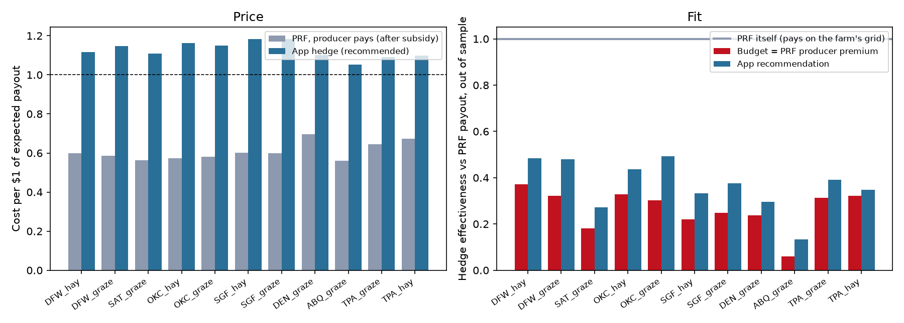
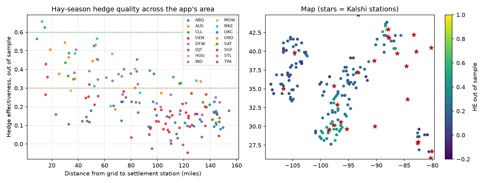

# 19: Testing the app against the USDA PRF benchmark

**Proposal cell:** Milestone II, Week 5 / Evan ("test the app by running farm scenarios and compare its hedge quality, cost, and remaining basis risk against a USDA insurance benchmark")  |  **Status:** DRAFT (numbers reproducible with `python scripts/run_app_test.py --live`)  |  **Last updated:** 2026-11-05

Code: `scripts/run_app_test.py`. Every number goes through `agri_hedge.platform.quote`, the same function the web app calls (doc 18), so this tests the app, not a separate analysis.
Data written: `data/processed/m2_app_test_farms.csv`, `m2_app_test_sweep.csv`, `m2_app_live_smoke.json`; figures `docs/figures/m2_app_vs_prf.png`, `m2_app_sweep.png`.

## Key findings

Each of the 11 representative farms typed its own location, PRF intervals, coverage level and protection into the app. The station was chosen automatically, and prices were estimated so the run is reproducible. Then a standard "hay season" request (Apr-May 40%, Jun-Jul 35%, Aug-Sep 25%, 90% coverage, $100,000 protection) was run at 150 random grids across the app's area. HE is out of sample (leave one year out) and measured against the PRF payout on the farm's grid. The app recommends the cheapest hedge with 95% of the best fit (doc 21). This run supersedes an earlier one at 90%.

- **The app reproduces the analysis exactly.** It chose each farm's study station and PRF grid (11 of 11). Its target matches the PRF indemnity within $124 in every farm-year, and its lowest-error hedges cost the same as doc 15's to the cent.
- **Price: hedging the PRF intervals costs about 1.7 times what the farmer pays for PRF.** The 11 recommended hedges cost $95,182 a year against $55,994 of PRF producer premiums (1.56 to 1.97 times per farm, median 1.71). Per $1 of expected payout, the hedges cost $1.05-1.18 and PRF costs the producer $0.56-0.70.
- **Fit: the hedge copies a bit over a third of PRF's payout swings.** Median HE out of sample is 0.38 for the recommended hedge, 0.30 at a budget equal to the PRF producer premium, and 0.37 with no budget. The best farms are OKC_graze (0.49), DFW_hay (0.48) and DFW_graze (0.48). The worst are ABQ_graze (0.13) and SAT_graze (0.27).
- **Remaining basis risk is large in both directions.**
  - In 2-11 of the 50-68 years in which PRF paid more than 2% of protection, the recommended hedge paid less than half as much.
  - The worst single shortfalls range from $3,588 (SGF_graze) to $50,964 (ABQ_graze, 1956).
  - In 115 farm-years the hedge paid more than 2% of protection when PRF paid nothing. Those false alarms are why the hedge costs more than its fit is worth.
- **Distance decides who the app can serve.** At 150 random grids, median HE is 0.47 within 25 miles of a station, 0.35 at 25-50 miles, 0.34 at 50-75, 0.22 at 75-100 and 0.15 at 100-150 miles. Only 1% of grids reach 0.6, and 69% are below 0.3. With doc 07's figure (7.4% of US PRF grids lie within 50 miles of a Kalshi rain station), hedging PRF's own intervals helps a small minority of PRF land. The PRF Companion (doc 21) does much better, because it targets the months that do track.
- **The app's PRF premium estimate is close.** Estimating the producer premium as $0.61 per $1 of expected payout lands within -13% to +10% of the real 2026 premium (median +3%) for the 11 farms.
- **Live prices could not be used for a real season today.** On 2026-11-05 each station had only November 2026 listed, and November was already under way. The app correctly priced every order for December onward as "estimated (not listed yet)". A test with an earlier start date priced November from the live Dallas book. It could buy only 69 contracts at a sensible price (doc 18).
- **Nearest is not always best.** A first run that used the nearest station sent the Tampa farms to St. Petersburg, which has only 17 years of record, and scored HE 0.14-0.17. The app now compares the stations within 25 miles of the nearest by out-of-sample fit and picks Tampa (0.35-0.39).

<!-- BEGIN AUTO: app test tables (scripts/run_app_test.py) -->
### Farm scenarios typed into the app

| Farm | Station picked (mi) | PRF: producer pays | PRF $/$1 expected | App recommended: cost | App $/$1 | App HE out of sample | Budget = PRF premium: HE out of sample | Worst year (shortfall) | Years hedge < half of PRF / PRF paid |
|---|---|---|---|---|---|---|---|---|---|
| DFW_hay | DFW (46) | $3,683 | 0.60 | $6,017 | 1.12 | 0.48 | 0.37 | 2001 ($8,641) | 11 / 60 |
| DFW_graze | DFW (46) | $2,734 | 0.59 | $4,334 | 1.15 | 0.48 | 0.32 | 2022 ($5,537) | 6 / 68 |
| SAT_graze | SAT (45) | $3,198 | 0.56 | $6,303 | 1.11 | 0.27 | 0.18 | 2006 ($9,727) | 7 / 53 |
| OKC_hay | OKC (30) | $3,643 | 0.57 | $6,539 | 1.16 | 0.44 | 0.33 | 1972 ($9,559) | 6 / 63 |
| OKC_graze | OKC (30) | $3,129 | 0.58 | $5,366 | 1.15 | 0.49 | 0.30 | 1988 ($6,222) | 3 / 66 |
| SGF_hay | SGF (29) | $2,663 | 0.60 | $4,716 | 1.18 | 0.33 | 0.22 | 1952 ($7,413) | 4 / 57 |
| SGF_graze | SGF (29) | $2,132 | 0.60 | $3,811 | 1.18 | 0.38 | 0.25 | 1980 ($3,588) | 2 / 60 |
| DEN_graze | DEN (47) | $9,330 | 0.70 | $15,373 | 1.10 | 0.30 | 0.24 | 1963 ($26,328) | 8 / 50 |
| ABQ_graze | ABQ (53) | $12,120 | 0.56 | $21,333 | 1.05 | 0.13 | 0.06 | 1956 ($50,964) | 9 / 56 |
| TPA_graze | TPA (55) | $6,061 | 0.65 | $9,993 | 1.09 | 0.39 | 0.31 | 2006 ($17,475) | 8 / 56 |
| TPA_hay | TPA (55) | $7,302 | 0.67 | $11,396 | 1.10 | 0.35 | 0.32 | 2006 ($16,973) | 6 / 54 |

### Totals and checks

| Measure | Value |
|---|---|
| PRF producer premiums, 11 farms | $55,994 / yr |
| PRF full premiums, 11 farms | $117,053 / yr |
| App recommended hedges, 11 farms | $95,182 / yr |
| App lowest-error hedges, 11 farms | $104,970 / yr |
| Median HE out of sample: recommended / PRF-premium budget / lowest error | 0.38 / 0.30 / 0.37 |
| Farms where the app picked the study station | 11 of 11 |
| Farms where the app's grid = the farm's PRF grid | 11 of 11 |
| App target vs PRF indemnity, largest gap in any farm-year | $124 |
| App lowest-error cost vs doc 15, largest gap | $0.00 |
| App's PRF premium estimate vs real 2026 producer premium | median +3%, range -13% to +10% |
| Farm-years the hedge paid > 2% of protection while PRF paid nothing (recommended) | 115 |

### Coverage sweep: hay-season request at 150 random grids

| Distance to station | Grids | Median HE out of sample | Share with HE >= 0.6 | Share with HE < 0.3 | Median cost per $1 |
|---|---|---|---|---|---|
| (0, 25] mi | 8 | 0.47 | 25% | 25% | 1.11 |
| (25, 50] mi | 22 | 0.35 | 0% | 41% | 1.12 |
| (50, 75] mi | 24 | 0.34 | 0% | 42% | 1.12 |
| (75, 100] mi | 25 | 0.22 | 0% | 68% | 1.11 |
| (100, 150] mi | 70 | 0.15 | 0% | 91% | 1.09 |
| (150, 400] mi | 1 | 0.18 | 0% | 100% | 1.12 |
| all | 150 | 0.21 | 1% | 69% | 1.10 |

### Live smoke test

Run 2026-11-05 18:29 UTC: DFW_hay location covering Dec and Jan. 0 of 4 orders priced from a live book; 7 open markets seen for the series; quote took 1.67s (without the out-of-sample refits).
<!-- END AUTO: app test tables (scripts/run_app_test.py) -->

## Numbers table

"Computed" = produced by `scripts/run_app_test.py --live` (run 2026-11-05, 95% recommendation).

| Quantity | Value | Units | Region / period | Source | Verification |
|---|---|---|---|---|---|
| Recommended hedges / PRF producer premiums | $95,182 / $55,994 | $ per year | 11 farms | tables above | CONFIRMED (computed) |
| Hedge cost / PRF producer premium, per farm | 1.56-1.97 (median 1.71) | ratio | 11 farms | `m2_app_test_farms.csv` | CONFIRMED (computed) |
| Median HE out of sample: recommended / PRF-premium budget / lowest error | 0.38 / 0.30 / 0.37 | share | 11 farms | tables above | CONFIRMED (computed) |
| Median HE by distance: 0-25, 25-50, 50-75, 75-100, 100-150 mi | 0.47, 0.35, 0.34, 0.22, 0.15 | share | 150 random grids | tables above | CONFIRMED (computed) |
| Grids with HE at least 0.6 / below 0.3 | 1% / 69% | share | 150 grids | tables above | CONFIRMED (computed) |
| PRF premium estimate error | median +3%, range -13% to +10% | | 11 farms | tables above | CONFIRMED (computed) |
| False-alarm farm-years (hedge > 2% of protection, PRF = 0) | 115 | count | 11 farms x 1951-2025 | tables above | CONFIRMED (computed) |
| US PRF grids within 50 miles of a Kalshi rain station | 7.4% | share | CONUS | doc 07 | CONFIRMED (doc 07) |

## Limits

- Estimated prices, not live ones, because no season beyond the current month is listed (doc 18). Real fills would be worse (docs 12, 16).
- The sweep uses one standard request. Single critical months or spring-only cover score higher at many sites (doc 17: spring and fall windows transfer best).
- HE is measured against the PRF payout, the benchmark the proposal set. Against the farm's real forage loss (doc 13), PRF itself is imperfect, so a hedge that misses PRF is not necessarily missing the farmer's loss.
