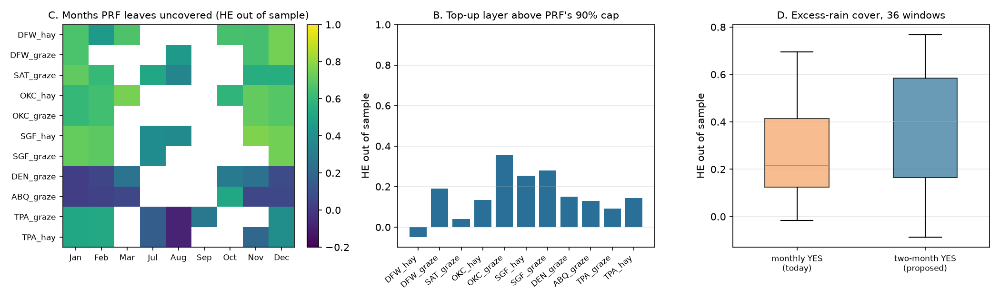

# 20: Complementing PRF: the gaps event contracts can cover

**Proposal cell:** Milestone II refinements in the submitted Milestone I update ("Refinements to our plan", Overleaf `ECE473 Project`, 2026-10-29). Owners: team  |  **Status:** DRAFT (numbers reproducible with `python scripts/run_prf_gaps.py`)  |  **Last updated:** 2026-11-05

The submitted Milestone I said Milestone II would:
- complement PRF instead of replacing it, by targeting cover above PRF's 90% coverage cap, months PRF leaves uncovered, and too much rain;
- look at contracts more advanced than binary payouts;
- backtest on the index USDA actually paid (CPC), with NCEI used for forward results.

This doc does all three for the 11 farms. It uses the doc 15 optimizer, and hedge effectiveness (HE) is scored out of sample (leave one year out). Temperature risk was listed as "if time permits" and is not done.

Code: `scripts/run_prf_gaps.py`; `hedge_builder.CoverageRequest(index="cpc")` selects the as-paid CPC index. Data: `data/processed/m2_prf_gaps.csv`; figure `docs/figures/m2_prf_gaps.png`.

## Key findings

- **The best niche is the months PRF leaves uncovered.** The farms' PRF elections leave 60 farm-months uncovered, mostly November to February. Single-month cover for those months, hedged with today's Kalshi ladder, has median out-of-sample HE 0.52, and 26 of 60 reach 0.6. December (0.68), November (0.65) and January (0.60) are best. Compare 0.34 for the farms' insured intervals (doc 17). Cool-season frontal rain spreads evenly over a region, so the airport gauge tracks the farm. Kalshi lists these months, and PRF lets ranchers buy at most a few intervals. One caveat: doc 03b found cool-season rain matters less for warm-season forage, so the value is for winter pasture, stock water and winter wheat.
- **A top-up above PRF's 90% cap is a poor fit.** What a 100%-coverage policy would pay on top of the 90% policy is a small payout in almost every year (64-75 of the 74-75 years), and its year-to-year pattern is what monthly whole-inch contracts copy worst. Median HE is 0.40 in sample and 0.14 out of sample. The hedge costs about $1.07 per $1 of layer payout.
- **Excess rain needs two-month contracts.** For a payout that starts at 130% of normal window rain (about 17 years in 75), today's monthly YES contracts reach median HE 0.22 out of sample (2 of 36 windows at least 0.6). Proposed two-month-total YES contracts reach 0.40 (6 of 36), led by SGF_graze Aug-Sep (0.77) and the DFW Jun-Jul windows (0.74). This supports doc 17's first proposal from the other side of the distribution.
- **Payouts beyond binaries.** Doc 16 already measures two non-binary designs that pay the PRF formula linearly on an index. On the station gauge's own index the pooled HE is 0.52. On the station's grid index it is 0.65. Both beat today's binary ladder (0.34). The linear grid-index contract on the farm's own grid is perfect by construction, and doc 17's grid-index binaries (P4) come within 0.02 of it. So the gain comes from what the contract settles on, not from the payout shape.
- **CPC as paid vs NCEI: same picture, slightly worse.**
  - On the same 1969-2025 years, the median lowest-error HE out of sample is 0.28 against NCEI and 0.20 against the CPC index PRF actually paid on.
  - With the 90% knee hedge it is 0.27 vs 0.26, so the cost limit removes most of the overfitting that hits the CPC fit.
  - The rebuilt CPC target matches doc 09's as-paid PRF indemnities within $7-58 a year.
  - Fewer years (57 instead of 75) cost every fit some out-of-sample HE. This is why the main docs use NCEI 1951-2025.

<!-- BEGIN AUTO: PRF gap tables (scripts/run_prf_gaps.py) -->
### A. Backtest on the index USDA actually paid (CPC) vs NCEI, same years 1969-2025

| Farm | NCEI: HE in / LOYO (lowest error) | CPC as paid: HE in / LOYO (lowest error) | NCEI knee LOYO | CPC knee LOYO | CPC target vs doc 09 as-paid PRF, max gap |
|---|---|---|---|---|---|
| DFW_hay | 0.69 / 0.37 | 0.66 / 0.36 | 0.44 | 0.38 | $11 |
| DFW_graze | 0.72 / 0.37 | 0.72 / 0.35 | 0.39 | 0.39 | $7 |
| SAT_graze | 0.54 / 0.28 | 0.57 / 0.34 | 0.26 | 0.33 | $11 |
| OKC_hay | 0.68 / 0.36 | 0.61 / 0.27 | 0.40 | 0.33 | $11 |
| OKC_graze | 0.73 / 0.47 | 0.72 / 0.45 | 0.44 | 0.40 | $9 |
| SGF_hay | 0.63 / 0.24 | 0.58 / 0.16 | 0.27 | 0.19 | $9 |
| SGF_graze | 0.67 / 0.14 | 0.67 / 0.12 | 0.09 | 0.18 | $7 |
| DEN_graze | 0.41 / 0.11 | 0.39 / 0.06 | 0.12 | 0.09 | $35 |
| ABQ_graze | 0.22 / 0.11 | 0.17 / -0.01 | 0.14 | 0.03 | $58 |
| TPA_graze | 0.53 / 0.36 | 0.47 / 0.20 | 0.39 | 0.26 | $18 |
| TPA_hay | 0.48 / 0.18 | 0.41 / 0.07 | 0.27 | 0.11 | $24 |
| **median, ncei 1969-2025** | lowest error LOYO 0.28 | | knee LOYO 0.27 | | |
| **median, cpc 1969-2025** | lowest error LOYO 0.20 | | knee LOYO 0.26 | | |

### B. Top-up layer above PRF's 90% coverage cap

Target: what a 100%-coverage policy would pay minus what the farm's 90% policy pays, same protection and intervals (NCEI, 1951-2025). Hedge: today's Kalshi NO ladder, lowest error.

| Farm | Years the layer pays | Mean layer payout / yr | HE in | HE LOYO | Hedge cost / yr | Cost per $1 of layer payout |
|---|---|---|---|---|---|---|
| DFW_hay | 69 of 74 | $1,357 | 0.35 | -0.05 | $1,463 | 1.08 |
| DFW_graze | 71 of 74 | $994 | 0.52 | 0.19 | $1,060 | 1.07 |
| SAT_graze | 70 of 74 | $1,245 | 0.35 | 0.04 | $1,290 | 1.04 |
| OKC_hay | 67 of 75 | $1,514 | 0.50 | 0.13 | $1,624 | 1.07 |
| OKC_graze | 75 of 75 | $1,340 | 0.62 | 0.36 | $1,417 | 1.06 |
| SGF_hay | 67 of 74 | $1,416 | 0.55 | 0.25 | $1,478 | 1.04 |
| SGF_graze | 71 of 74 | $1,074 | 0.63 | 0.28 | $1,116 | 1.04 |
| DEN_graze | 66 of 74 | $4,779 | 0.40 | 0.15 | $5,302 | 1.11 |
| ABQ_graze | 64 of 75 | $5,826 | 0.29 | 0.13 | $6,382 | 1.10 |
| TPA_graze | 66 of 75 | $2,405 | 0.35 | 0.09 | $2,657 | 1.10 |
| TPA_hay | 67 of 75 | $3,437 | 0.38 | 0.14 | $3,789 | 1.10 |
| **median** | | | 0.40 | 0.14 | | 1.07 |

### C. Months PRF leaves uncovered (single-month cover at 90%, today's ladder)

60 farm-months outside the farms' PRF intervals. Median HE LOYO 0.52; 26 reach 0.6, 17 are below 0.3.

| Month | Farm-months | Median HE LOYO | Best farm (HE LOYO) |
|---|---|---|---|
| Jan | 11 | 0.60 | SGF_hay (0.72) |
| Feb | 10 | 0.56 | SGF_graze (0.70) |
| Mar | 4 | 0.46 | OKC_hay (0.75) |
| Jul | 5 | 0.39 | SAT_graze (0.51) |
| Aug | 5 | 0.35 | DFW_graze (0.45) |
| Sep | 1 | 0.28 | TPA_graze (0.28) |
| Oct | 4 | 0.55 | DFW_hay (0.65) |
| Nov | 9 | 0.65 | SGF_hay (0.77) |
| Dec | 11 | 0.68 | DFW_graze (0.75) |

### D. Excess-rain cover on each insured window

Target: pays from 130% of normal grid rain in the window, in full at 230% (share of protection x min(1, (index - 130) / 100)). Hedge: YES contracts (pay when station rain is above K).

| Contracts | Windows | Median years paying | Median HE in | Median HE LOYO | Windows with HE LOYO >= 0.6 | Median cost per $1 expected |
|---|---|---|---|---|---|---|
| monthly YES (today) | 36 | 17 of 75 | 0.47 | 0.22 | 2 | 1.19 |
| two-month YES (proposed) | 36 | 17 of 75 | 0.70 | 0.40 | 6 | 1.26 |

Best excess-rain windows with two-month YES contracts: SGF_graze Aug-Sep (0.77); DFW_hay Jun-Jul (0.74); DFW_graze Jun-Jul (0.74); SAT_graze Mar-Apr (0.71); OKC_graze Sep-Oct (0.69).
<!-- END AUTO: PRF gap tables (scripts/run_prf_gaps.py) -->

## What this changes in the plan

- The app already lets a farmer cover any single month. The default suggestion should point to the uncovered months near a station (November to February), where a hedge both fills a PRF gap and tracks well.
- Excess-rain cover is worth offering only once two-month contracts exist. The app does not offer YES (wet-side) hedges yet; adding them takes one target option, because the optimizer accepts any payoff matrix.
- Do not market a top-up above 90%: it costs about the same per dollar of payout and copies about a seventh of the risk.

## Numbers table

"Computed" = produced by `scripts/run_prf_gaps.py` (run 2026-11-05).

| Quantity | Value | Units | Region / period | Source | Verification |
|---|---|---|---|---|---|
| Uncovered farm-months; median HE LOYO; number at least 0.6 | 60; 0.52; 26 | | 11 farms, 1951-2025 | tables above | CONFIRMED (computed) |
| Median HE LOYO in Dec / Nov / Jan | 0.68 / 0.65 / 0.60 | share | | tables above | CONFIRMED (computed) |
| Top-up layer median HE in / LOYO; cost per $1 of payout | 0.40 / 0.14; 1.07 | | 11 farms | tables above | CONFIRMED (computed) |
| Excess rain median HE LOYO: monthly YES / two-month YES | 0.22 / 0.40 | share | 36 windows | tables above | CONFIRMED (computed) |
| Median HE LOYO, 1969-2025: NCEI / CPC (lowest error); knee | 0.28 / 0.20; 0.27 / 0.26 | share | 11 farms | tables above | CONFIRMED (computed) |
| Pooled HE LOYO: linear station-gauge / station-grid index contracts | 0.52 / 0.65 | share | 11 farms | doc 16 | CONFIRMED (computed) |
