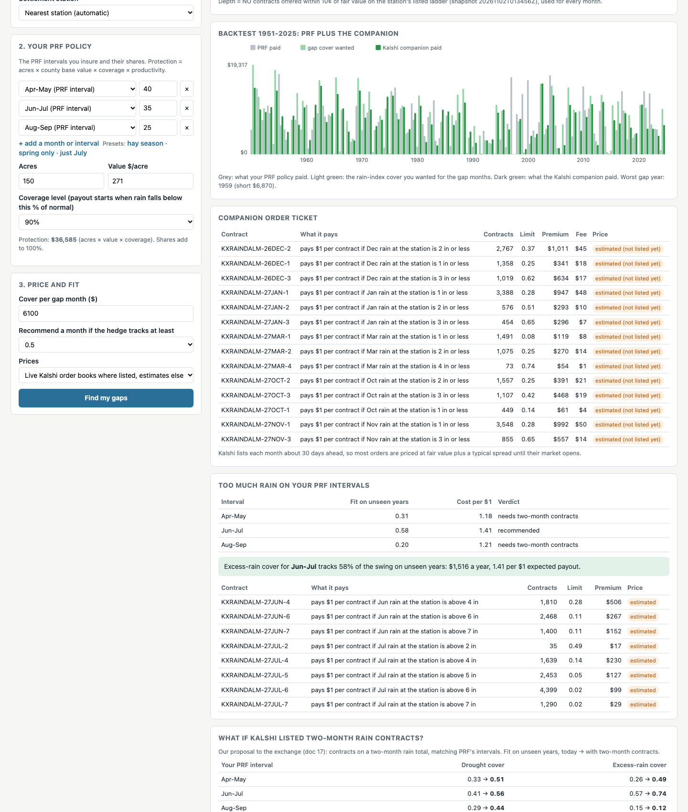
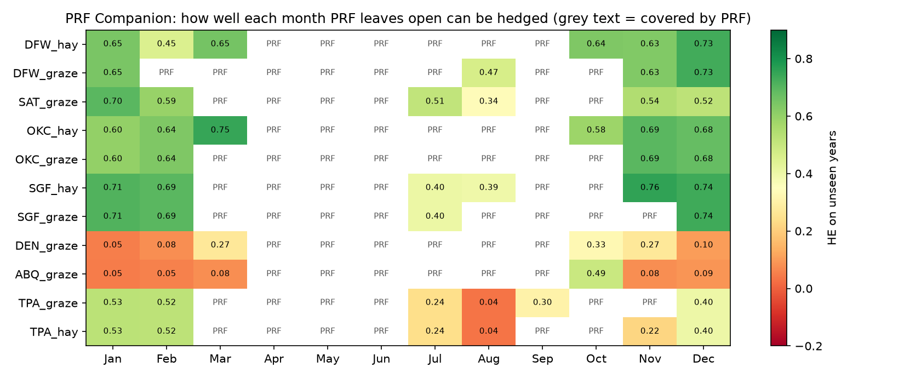
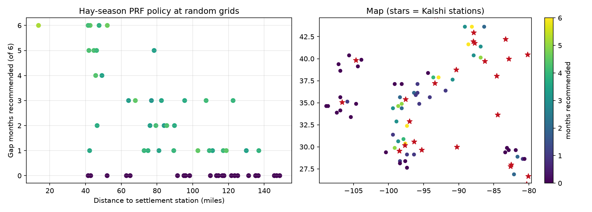

# 21: The PRF Companion: the Milestone II showcase

**Proposal cell:** Milestone II showcase, building on the platform (doc 18) and the refinement "complement PRF instead of replacing it" in the submitted Milestone I update. Owners: team  |  **Status:** WORKING PROTOTYPE (`python scripts/run_app.py`, PRF Companion tab; numbers from `scripts/run_companion_study.py` and `run_companion_holdout.py`)  |  **Last updated:** 2026-11-05

Code: `platform.companion` (backend), the PRF Companion tab in `webapp/static/index.html`, `POST /api/companion`. Tests: `tests/test_platform.py`.
Data: `data/processed/m2_companion_farms.csv`, `m2_companion_months.csv`, `m2_companion_sweep.csv`, `m2_companion_holdout.csv`. Figures: `docs/figures/m2_companion_screenshot.png`, `m2_companion_farms.png`, `m2_companion_sweep.png`.

## Why this is the showcase

Docs 15-19 showed that Kalshi rain contracts are a poor substitute for PRF:
- they copy about a third of PRF's payout swings;
- they cost about 1.7 times the farmer's PRF premium for that;
- the order books are too thin to fill.

Doc 20 found the exception: the months PRF leaves open. Cool-season rain is spread evenly over a region, so an airport gauge 30-55 miles away tracks the farm's grid well. The PRF Companion turns that finding into a product. It keeps the rancher's PRF policy, finds the months it leaves open, tests each one at the rancher's location, and recommends and prices only the months that work.

## What it does

1. The rancher enters a location, the PRF intervals and shares they insure, a coverage level, and acres and value per acre (or protection).
2. For each of the 12 months the app marks it "covered by PRF" or scores it. A score is the hedge effectiveness (HE) of a single-month PRF-style cover on the rancher's grid, hedged with Kalshi NO contracts at the best nearby station. The hedge is the cheapest one with 95% of the best fit. HE is measured on years the hedge was not fitted to (leave one year out).
3. Months scoring at least 0.5 are recommended (the threshold is adjustable). They are combined into one hedge with an order ticket, priced from live Kalshi books where listed and estimated elsewhere.
4. It shows a 1951-2025 backtest of what PRF paid, the gap cover wanted, and what the Kalshi companion paid. It also scores excess-rain cover on the insured intervals with today's YES contracts.

## Key findings

- **The companion is recommended for 9 of 11 farms.** The only exceptions are the dry-West farms, Denver and Albuquerque, where no month qualifies. The combined companions reach a median HE of 0.66 on unseen years. Hedging the PRF intervals themselves reaches 0.38 (doc 19).
- **The result holds up with no peeking.**
  - Months were picked and hedges fit on 1951-2000 only, then scored on 2001-2025, which played no part in any choice.
  - The companion scores a median HE of 0.61 for the 10 farms with a pick. Hedging the PRF intervals scores 0.23 the same way.
  - The companion wins on 7 of 10 farms.
  - SGF_graze (0.80), SGF_hay (0.74) and DFW_hay (0.70) do best. The Tampa farms (0.41) and ABQ (0.25, one month picked) do worst.
- **December, November and January carry it.**
  - Of the farm-months PRF leaves open, 7 of 11 Decembers are recommended (median HE 0.68), 6 of 9 Novembers (0.63) and 9 of 11 Januaries (0.60).
  - Summer months are not recommended: July 1 of 5, August 0 of 5.
  - This is the convective-vs-frontal split seen throughout docs 16-20.
- **It reaches more land than PRF-interval hedging.** For a standard hay-season PRF policy at 60 random grids, 60% of locations get at least one recommended month, with a median companion HE of 0.59. That is 83% of grids within 25-50 miles of a station and 38% at 100-150 miles. For the PRF intervals themselves, only 1% of grids reach HE 0.6 (doc 19).
- **The price is fair but not subsidized.** Companions cost a median $1.10 per $1 of expected payout, about Kalshi's fair price plus spread and fees. For the 9 farms that is $56,233 a year for 34 farm-months of cover at $1/6 of the policy's protection per month. There is no subsidy, but PRF offers no cover in these months at any price.
- **Two experiments set the defaults.**
  - Recommending at 95% of the best fit beats 90% and beats no cost limit on unseen years. Across 44 farm and single-month cases, the median HE is 0.49 vs 0.46 at 90% and 0.48 with no limit.
  - Combining contracts from several nearby stations does not help much. Few farms have a second Kalshi station with a long record within 150 miles. Only the Tampa farms improve (0.37 to 0.43), so the app uses one station.
- **Caveats.**
  - Winter rain matters less for warm-season forage (doc 03b). The companion's value is for winter pasture, winter wheat, stock-water ponds, and ranchers whose PRF allocation caps leave months open.
  - **Added 2026-11-06: this is the companion's biggest weakness.** PRF does offer winter intervals (Nov-Dec, Dec-Jan, Jan-Feb); ranchers skip them because winter rain grows little warm-season forage. Our own rain-to-loss model (doc 13, growth-timing weights in `loss_model_parameters.csv`) puts Nov-Feb at 1-15% of each farm's forage value, median 6%. So HE 0.61 measures how well Kalshi tracks winter *rain*, not how much *loss* it covers; for most of these farms there is little loss to cover. It matters only where winter forage is the crop (wheat pasture for stocker cattle in OK/TX, cool-season grass in MO) or for stock water.
  - Today only the next month is listed, about 30 days ahead, and books are thin (doc 12). A real order would be placed month by month as each market opens.

<!-- BEGIN AUTO: companion tables (scripts/run_companion_study.py) -->
### The 11 farms

| Farm | Station (mi) | Months PRF leaves open | Recommended | Companion HE (unseen years) | PRF-interval hedge HE (doc 19) | Companion cost / yr | Cost per $1 | PRF producer premium |
|---|---|---|---|---|---|---|---|---|
| DFW_hay | DFW (46) | 6 | Jan, Mar, Oct, Nov, Dec | 0.68 | 0.48 | $6,740 | 1.12 | $3,683 |
| DFW_graze | DFW (46) | 4 | Jan, Nov, Dec | 0.76 | 0.48 | $3,127 | 1.12 | $2,734 |
| SAT_graze | SAT (45) | 6 | Jan, Feb, Jul, Nov, Dec | 0.59 | 0.27 | $8,166 | 1.07 | $3,198 |
| OKC_hay | OKC (30) | 6 | Jan, Feb, Mar, Oct, Nov, Dec | 0.65 | 0.44 | $11,647 | 1.10 | $3,643 |
| OKC_graze | OKC (30) | 4 | Jan, Feb, Nov, Dec | 0.66 | 0.49 | $6,617 | 1.09 | $3,129 |
| SGF_hay | SGF (29) | 6 | Jan, Feb, Nov, Dec | 0.79 | 0.33 | $5,064 | 1.13 | $2,663 |
| SGF_graze | SGF (29) | 4 | Jan, Feb, Dec | 0.75 | 0.38 | $2,545 | 1.13 | $2,132 |
| DEN_graze | DEN (47) | 6 | none |  | 0.30 |  |  | $9,330 |
| ABQ_graze | ABQ (53) | 6 | none |  | 0.13 |  |  | $12,120 |
| TPA_graze | TPA (55) | 6 | Jan, Feb | 0.44 | 0.39 | $5,202 | 1.10 | $6,061 |
| TPA_hay | TPA (55) | 6 | Jan, Feb | 0.44 | 0.35 | $7,126 | 1.10 | $7,302 |

Farms with at least one recommended month: 9 of 11. Median companion HE 0.66 vs 0.38 for hedging the PRF intervals themselves. Companions cost $56,233 a year in total for 34 farm-months (median 1.10 per $1 of expected payout).

### Each month PRF leaves open (all 11 farms)

| Month | Farm-months | Recommended | Median HE |
|---|---|---|---|
| Jan | 11 | 9 | 0.60 |
| Feb | 10 | 7 | 0.56 |
| Mar | 4 | 2 | 0.46 |
| Jul | 5 | 1 | 0.40 |
| Aug | 5 | 0 | 0.34 |
| Sep | 1 | 0 | 0.30 |
| Oct | 4 | 2 | 0.54 |
| Nov | 9 | 6 | 0.63 |
| Dec | 11 | 7 | 0.68 |

### Sweep: hay-season PRF policy at 60 random grids

| Distance to station | Grids | Share with any month recommended | Median months recommended | Median companion HE |
|---|---|---|---|---|
| (0, 25] mi | 1 | 100% | 6 | 0.79 |
| (25, 50] mi | 12 | 83% | 4 | 0.61 |
| (50, 75] mi | 8 | 62% | 1 | 0.60 |
| (75, 100] mi | 15 | 73% | 2 | 0.54 |
| (100, 150] mi | 24 | 38% | 0 | 0.59 |
| all | 60 | 60% | 1 | 0.59 |
<!-- END AUTO: companion tables (scripts/run_companion_study.py) -->

<!-- BEGIN AUTO: companion holdout (scripts/run_companion_holdout.py) -->
### Holdout: months chosen and hedges fit on 1951-2000, scored on 2001-2025

| Farm | Months picked (1951-2000 data only) | Companion HE 2001-2025 | Hedging the PRF intervals, HE 2001-2025 |
|---|---|---|---|
| DFW_hay | Jan, Mar, Oct, Nov, Dec | 0.70 | 0.32 |
| DFW_graze | Jan, Aug, Nov, Dec | 0.45 | 0.51 |
| SAT_graze | Jan, Feb, Jul, Nov | 0.63 | 0.10 |
| OKC_hay | Jan, Feb, Mar, Oct, Nov, Dec | 0.59 | 0.13 |
| OKC_graze | Jan, Feb, Nov, Dec | 0.64 | 0.51 |
| SGF_hay | Jan, Feb, Nov, Dec | 0.74 | -0.09 |
| SGF_graze | Jan, Feb, Dec | 0.80 | -0.01 |
| DEN_graze | none |  | 0.41 |
| ABQ_graze | Oct | 0.25 | 0.06 |
| TPA_graze | Jan, Feb | 0.41 | 0.41 |
| TPA_hay | Jan, Feb | 0.41 | 0.44 |

Median over farms with a pick: companion 0.61 vs PRF intervals 0.23; companion better on 7 of 10 farms. All 11 farms, PRF intervals: 0.32.
<!-- END AUTO: companion holdout (scripts/run_companion_holdout.py) -->

## Numbers table

"Computed" = produced by `scripts/run_companion_study.py` and `scripts/run_companion_holdout.py` (run 2026-11-05), estimated prices.

| Quantity | Value | Units | Region / period | Source | Verification |
|---|---|---|---|---|---|
| Farms with a recommended month | 9 of 11 | count | 11 farms | tables above | CONFIRMED (computed) |
| Median companion HE (LOYO) vs PRF-interval hedge | 0.66 vs 0.38 | share | 1951-2025 | tables above, doc 19 | CONFIRMED (computed) |
| Holdout median HE, scored on 2001-2025 only: companion vs PRF intervals | 0.61 vs 0.23 (companion better on 7 of 10) | share | fit 1951-2000 | holdout table | CONFIRMED (computed) |
| Recommended Dec / Nov / Jan | 7 of 11 / 6 of 9 / 9 of 11 | count | | tables above | CONFIRMED (computed) |
| Sweep: grids with any month recommended; median companion HE | 60%; 0.59 | | 60 random grids | tables above | CONFIRMED (computed) |
| Companion cost, 9 farms; median cost per $1 expected | $56,233 / yr; 1.10 | | | tables above | CONFIRMED (computed) |
| Recommendation point: median HE at 90% / 95% / no limit | 0.46 / 0.49 / 0.48 | share | 44 cases | `scripts/experiments/knee_share.py` | CONFIRMED (computed) |
| Multi-station hedges, Tampa farms | 0.37 to 0.43 (TPA_graze) | share | | `scripts/experiments/multistation.py` | CONFIRMED (computed) |
