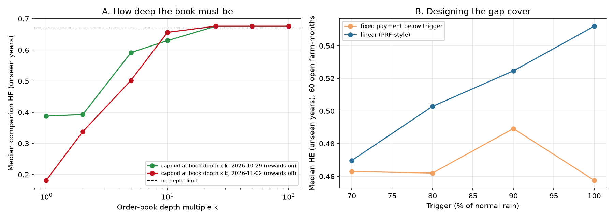

# 22: Making the companion better: liquidity, cover design, excess rain, two-month contracts

**Proposal cell:** Milestone II showcase follow-up (what limits the PRF Companion of doc 21, and what fixes it). Owners: team  |  **Status:** DRAFT (numbers reproducible with `python scripts/run_companion_improve.py`)  |  **Last updated:** 2026-11-05

Code: `scripts/run_companion_improve.py`. App features added: `platform._depth_check`, `_wet_package` and the two-month what-if in `platform.companion`, shown on the PRF Companion tab. Data: `data/processed/m2_improve_liquidity.csv`, `m2_improve_design.csv`; figure `docs/figures/m2_improve.png`.

## Key findings

- **Liquidity is now the binding limit, not fit.**
  - Refit with every order capped at the NO contracts offered within 10 cents of fair value on the post-rewards book (2026-11-02), the 9 companions fall from median HE 0.67 to 0.18.
  - A typical farm's companion needs 9,000-27,000 contracts. Today's books hold 1,800-5,400 near fair value at the same strikes.
  - The October book, during liquidity rewards, did no better at the median (0.39), even though it was deep at some new cities: SAT 0.60, SGF 0.81.
- **About 5 to 10 times today's depth is enough.**
  - Median fit is 0.34 at 2x depth, 0.50 at 5x and 0.66 at 10x, and full (0.68) at 25x.
  - Six of 9 farms reach 90% of their unlimited fit at 5x.
  - A designated market maker or pooled orders from a few dozen ranches would close this gap, which makes doc 17's mechanism proposal concrete.
- **Size the order to the book.** Capping at k times the depth is the same as buying 1/k of the cover at today's depth. So today a rancher keeps 90% of the fit on about one fifth of the requested gap cover: about $1,200 a month for the Dallas hay farm instead of $6,100. The app now shows this depth check and suggested size.
- **Cover design matters little; keep it PRF-like.**
  - Over the 60 open farm-months, a linear PRF-style payout beats a fixed payment at every trigger.
  - Raising the trigger from 90% to 100% of normal lifts median HE from 0.52 to 0.55, but the cover pays in 44 of 75 years instead of 39, so it costs more.
  - Picking the best design per month (an optimistic, in-sample choice) gains only 0.03.
  - The app keeps the 90% linear default.
- **Excess rain is now offered where it works.**
  - Excess-rain cover on the insured intervals is recommended when its out-of-sample HE is at least 0.5, with its own YES-contract ticket. For the Dallas hay farm that is Jun-Jul (0.58).
  - The two-month what-if shows each rancher what our exchange proposal would do for their own policy. For Dallas hay, drought cover on Apr-May goes from 0.33 to 0.51 and excess-rain cover from 0.26 to 0.49.

<!-- BEGIN AUTO: improvement tables (scripts/run_companion_improve.py) -->
### A. The companion under real order-book depth

| Farm | Months | Contracts needed | Depth near fair value (2026-11-02) | HE, no limit | HE at today's depth (rewards off) | HE at depth during rewards | Depth multiple for 90% of the fit |
|---|---|---|---|---|---|---|---|
| DFW_hay | Jan, Mar, Oct, Nov, Dec | 21,472 | 2,986 | 0.67 | 0.18 | 0.12 | 5x |
| DFW_graze | Jan, Nov, Dec | 10,128 | 1,792 | 0.78 | 0.24 | 0.14 | 5x |
| SAT_graze | Jan, Feb, Jul, Nov, Dec | 17,149 | 5,419 | 0.60 | 0.16 | 0.60 | 25x |
| OKC_hay | Jan, Feb, Mar, Oct, Nov, Dec | 27,121 | 4,386 | 0.66 | 0.10 | 0.21 | 25x |
| OKC_graze | Jan, Feb, Nov, Dec | 16,034 | 2,924 | 0.68 | 0.11 | 0.22 | 10x |
| SGF_hay | Jan, Feb, Nov, Dec | 17,067 | 3,384 | 0.81 | 0.27 | 0.81 | 5x |
| SGF_graze | Jan, Feb, Dec | 9,211 | 2,538 | 0.78 | 0.33 | 0.77 | 5x |
| TPA_graze | Jan, Feb | 13,858 | 3,780 | 0.44 | 0.23 | 0.39 | 5x |
| TPA_hay | Jan, Feb | 18,982 | 3,780 | 0.44 | 0.17 | 0.40 | 5x |

Median companion HE by depth multiple, 2026-10-29 (rewards on): 1x 0.39, 2x 0.39, 5x 0.59, 10x 0.63, 25x 0.68, 50x 0.68, 100x 0.68 (no limit 0.67).

Median companion HE by depth multiple, 2026-11-02 (rewards off): 1x 0.18, 2x 0.34, 5x 0.50, 10x 0.66, 25x 0.68, 50x 0.68, 100x 0.68 (no limit 0.67).

### B. Designing the gap cover (60 open farm-months)

| Trigger | Linear (PRF-style): median HE | months >= 0.5 | Fixed payment: median HE | months >= 0.5 | Median years paying (linear) |
|---|---|---|---|---|---|
| 70% | 0.47 | 26 | 0.46 | 22 | 31 of 75 |
| 80% | 0.50 | 31 | 0.46 | 26 | 35 of 75 |
| 90% | 0.52 | 35 | 0.49 | 30 | 39 of 75 |
| 100% | 0.55 | 35 | 0.46 | 27 | 44 of 75 |

Best design per month vs the current default (linear, 90%): median gain 0.03, months reaching 0.5 rise from 35 to 38 of 60. Best designs: (1.0, 'linear (PRF-style)') 23, (0.9, 'fixed payment below trigger') 12, (1.0, 'fixed payment below trigger') 9, (0.7, 'fixed payment below trigger') 6.
<!-- END AUTO: improvement tables (scripts/run_companion_improve.py) -->

## What this means for the rest of the project

1. **Liquidity is the product problem now.** The fit problem is solved for the gap months near a station. Next: model a market maker (quotes, inventory, how wide a spread they need to earn a return) and pooled orders across ranches, using the optimizer's tranche interface.
2. **Ship the depth-sized order.** It is honest and works today.
3. **Use the two-month what-if as evidence** in a pitch to Kalshi, because it quantifies the gain per rancher.
