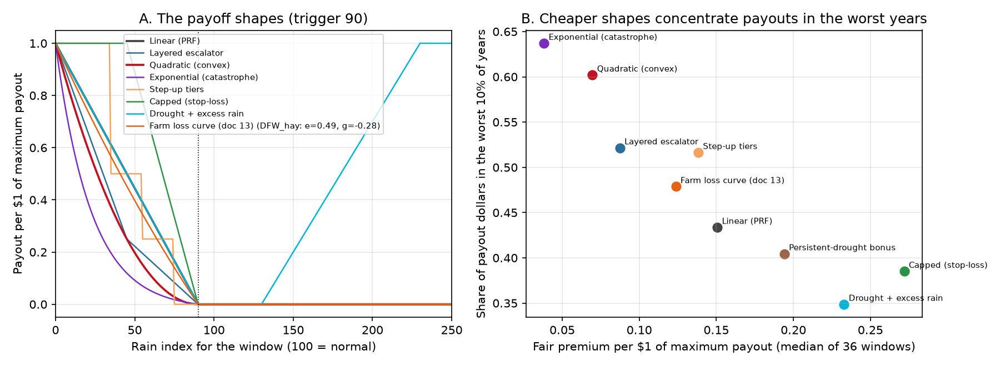
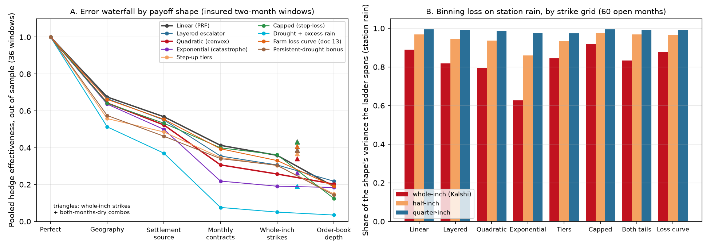
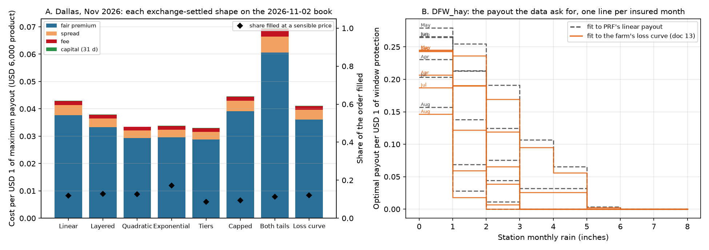

# 23: Exotic payouts: insurance shapes built from binary rain contracts

**Proposal cell:** Milestone III direction ("design an insurance derivative layer on top of existing event contracts: define the payoff, the settlement rule and the replicating portfolio, and find which exposures replicate well and which need new contracts"). Owners: team  |  **Status:** DRAFT (numbers reproducible with `python scripts/run_exotic_payouts.py`, about 30 minutes; `--tables-only` redoes the tables and figures from the saved CSVs)  |  **Last updated:** 2026-11-08

Code: `src/agri_hedge/exotic.py` (payoff shapes, closed-form spanning, order-book execution, tail and capital metrics), `platform.exotic_quote` and `POST /api/exotic` (design and price one exchange-settled product), `scripts/run_exotic_payouts.py` (this study). Tests: `tests/test_exotic.py`.
Data written: `data/processed/m2_exotic_windows.csv`, `m2_exotic_months.csv`, `m2_exotic_execution.csv`, `m2_exotic_execution_legs.csv`, `m2_exotic_optimal_shape.csv`; figures `docs/figures/m2_exotic_shapes.png`, `m2_exotic_waterfall.png`, `m2_exotic_execution.png`.

> **Follow-up (doc 24, 2026-11-09).** The "convex shapes hedge better at today's depth" result below holds at the same maximum payout; at the same premium it disappears (0 of 36 windows). The term sheet is stable on a 2001-2025 holdout but the farmer's basis risk is lower there. The utility-optimal payout for a risk-averse farmer is this doc's convex ladder at a fair price and a deep-drought digital at Kalshi's load; the exponential and quadratic shapes capture 90%+ of its value. See [24_contract_design.md](24_contract_design.md).

## Why exotic shapes

Everything before this doc hedged one payoff: PRF's linear factor max(0, (T - I) / T). Two things argue for other shapes. First, a rancher's loss is not linear in rain. Doc 13 found that a dry inch costs more than a wet inch gains (curvature g from -0.3 to -1.9), so the loss is convex in the shortfall: the worst years hurt disproportionately. Second, a prediction-market ladder is a set of digital options, and a set of digitals spans any step function of the underlying (Ross 1976; Breeden and Litzenberger 1978). An insurer that writes a payoff on the station's own rain can therefore replicate it exactly with today's contracts. This doc asks what that buys and what it costs.

## The shapes

All shapes pay $1 per $1 of maximum payout when the window's rain index is 0 and nothing at or above the trigger T (90 at 90% coverage). With s = max(0, (T - I) / T):

| Shape | Payout per $1 of maximum payout | Why a farmer might want it |
|---|---|---|
| Linear (PRF) | s | the benchmark; what PRF pays |
| Layered escalator | 0.5 s up to s = 0.5, then slope 1.5 | a reinsurance-style structure: a cheap first layer and an expensive catastrophe layer |
| Quadratic (convex) | s^2 | pays extra for worse events; cheaper in ordinary dry years |
| Exponential (catastrophe) | (e^{4s} - 1) / (e^4 - 1) | almost nothing until a deep drought, then everything |
| Step-up tiers | 0.25 below T-15, 0.5 below T-35, 1 below T-55 | fixed payments that are easy to explain and to settle |
| Capped (stop-loss) | min(1, 2s) | full payment once the shortfall reaches half; concave, for comparison |
| Drought + excess rain | s + min(1, max(0, (I - 130) / 100)) | both tails in one contract (hay harvest and planting windows) |
| Farm loss curve (doc 13) | the farm's own e (x + g x^2) response above a deductible at the trigger, scaled to 1 at I = 0 | the payout that matches the modeled loss |
| Persistent-drought bonus | (s + 0.5 x [every month of the window is below its trigger]) / 1.5 | pays extra when the drought lasts: the one shape that depends on more than the window total |

Figure A of `m2_exotic_shapes.png` draws them.

## Two product families

- **Exchange-settled.** The contract pays a step function of the Kalshi station's monthly rain total. Spanning makes the issuer's hedge exact: long NO contracts at the strikes where the payout drops, long YES contracts where it rises, no cash leg for any shape that is zero at normal rain and quasi-convex (falls, then rises). The farmer bears the station-vs-farm basis risk. `platform.exotic_quote` designs and prices this product: a term sheet (payout per rain bin), the replicating order, the fill on the live or saved book, and the farmer's basis risk against their own grid.
- **Farm-settled.** The contract pays the shape on the farm's PRF grid, like PRF. The issuer hedges with the ladder and keeps the residual, so it needs capital against the shortfall. The error waterfall below measures that residual step by step.

The two families share one number: the hedge effectiveness of the ladder against the farm-grid payoff is the farmer's basis risk in the first family and the issuer's hedge error in the second.

## Key findings

All numbers: the 11 farms of doc 04, NCEI index, 1951-2025, hedge effectiveness (HE) out of sample (leave one year out) unless stated. Shapes pay $1 per $1 of maximum payout at index 0, so the convex shapes are cheaper: fair premium per $1 of maximum payout is 0.151 for the linear shape, 0.087 layered, 0.070 quadratic, 0.038 exponential, and the exponential puts 64% of its dollars into the worst 8 of 75 years against 43% for the linear shape (table A).

- **Every single-month insurance shape is a long-only portfolio of today's contracts.** A NO at strike K pays when rain is at or below K and a YES when it is above, so any step function on the ladder's bins is a sum of long NO positions where the payout drops and long YES positions where it rises, plus a cash term that is zero for every shape that is zero at normal rain and falls-then-rises (Ross 1976 spanning, with digitals as in Breeden and Litzenberger 1978). In all 480 shape-months of part B the binned shape was quasi-convex. A cash leg appears in two cases only (table D): the two-tailed shape when no whole-inch bin pays exactly zero between the drought trigger and the wet start, and Tampa's August for every drought shape, where the month's normal is above 8 inches so even the bin above the top strike (7 inches) sits below the trigger and pays a little that no NO contract can cover (0.4 cents per $1 for the linear shape). Everywhere else the issuer of an exchange-settled product keeps no rain risk.
- **Binning is then the only replication error, and it hits convex shapes hardest.** On the gauge's own rain, whole-inch strikes reproduce 89% of the linear shape's variance, 80% of the quadratic and 63% of the exponential. Half-inch strikes give 97 / 94 / 86%, quarter-inch 99 / 99 / 97% (table D). Convex payouts live below 2 inches, where Kalshi has two strikes. Doc 17 found finer strikes useless for PRF's linear payout; for convex products they are the one contract change that matters.
- **Even a linear payoff is best hedged by a convex station payout.** The lowest-error ladder fit to PRF's own linear payout is a step function whose first drop (rain at or below 1 inch versus 1-2 inches) is 2.3 times the mean of the next two drops, convex in 52 of 62 months; fit to the farm's doc-13 loss curve it is 2.8 times, convex in 51 of 61 (table F, figure B of `m2_exotic_execution.png`). The median optimal payout per $1 of window protection is 0.25 when the station gets at most 1 inch, 0.14 at 1-2 inches and 0.06 at 2-3 inches. The reason is conditional expectation: when the airport is very dry the farm almost surely is, but a 2-3 inch month at the airport says little. The exchange-settled product a farmer should buy is convex in station rain whatever their loss looks like.
- **Farm-settled, convex shapes lose more to geography and to the monthly split.** Out of sample the pooled HE at Kalshi's strikes is 0.36 for the linear shape, 0.31 layered, 0.26 quadratic and 0.19 exponential (table B). Geography costs them 0.32 / 0.33 / 0.36 / 0.36 and the monthly split 0.16 / 0.20 / 0.22 / 0.28: a payoff on a two-month total is less additive across its months the more convex it is. In the worst 10% of years the ladder pays 50% of the linear target but 40% of the quadratic and 37% of the exponential (table C). Convex products promise the most in exactly the years where the station-versus-farm mismatch costs the most.
- **But they need a third of the contracts, so at today's depth they hedge better than PRF's shape.** Contracts per $1 of maximum payout: 0.51 linear, 0.33 layered, 0.28 quadratic, 0.16 exponential (median window 6,800 / 3,100 / 1,900 contracts). Capping every strike at the 2026-11-02 depth costs the linear shape 0.17 of HE and the quadratic 0.05; pooled HE at today's depth is 0.19 linear, 0.22 layered, 0.20 quadratic, 0.18 exponential. The layered escalator beats the linear shape in 31 of 36 windows at today's depth (6 of 36 with unlimited depth), the quadratic in 25 of 36 (2 of 36). On the 60 open months the quadratic beats the linear shape in 31 of 60 at today's depth and 7 of 60 without the limit. Liquidity, the binding constraint of doc 22, favours convex products.
- **Convex shapes also need less issuer capital.** The 95th-percentile yearly shortfall of a farm-settled product hedged at Kalshi's strikes is 30% of the window's protection for the linear shape, 19% layered and quadratic, 9% exponential, 54% for the capped shape (table C). The capped (concave) shape is the mirror image of the convex ones: the best fit with unlimited depth (median HE 0.38, beats linear in 25 of 36 windows), 0.80 contracts per $1, the largest depth loss (0.24) and the worst result at today's depth (0.12).
- **The farm's own loss curve is a mild convex shape and hedges like the linear one.** With doc 13's curvature it pays 0.45 at half the shortfall (linear 0.50), costs 0.124 per $1 of maximum payout (18% less than the linear shape), reaches the same median HE (0.35) and needs the same capital (29%). The curvature doc 13 estimated is real but too mild to change the hedge.
- **Two shapes need contracts that do not exist.** Drought and excess rain in one contract is fine exchange-settled (binning R2 0.83) but useless farm-settled with monthly contracts (pooled HE 0.05; the wet side needs two-month contracts, doc 20). The persistent-drought bonus is the one shape that is not a function of the window total: pooled HE 0.30 against 0.36 linear. Proposed "both months dry" combo contracts lift it to 0.39, but they lift every shape by 0.06-0.08 (linear to 0.43), about half of what doc 17's two-month total contract gave (0.34 to 0.48); they are a weaker form of the same proposal.
- **Executable today, in small sizes.** A $6,000 quadratic November contract at Dallas pays $3,727 if November rain at DFW is at most 1 inch, $862 at 1-2 inches, $4 at 2-3 inches and nothing above; it is 3,727 NO contracts, mostly at the 1-inch and 2-inch strikes, with a fair premium of $1,205 (20% of the limit; the linear shape costs 30%). The 2026-11-02 book fills 13% of it within 10 cents of fair value; the largest fully fillable contract is $595. All-in cost per $1 of expected payout is 1.32 against 1.20 for the linear shape: the spread and the fee are the same cents per contract but a larger share of a cheaper one (table E). Across stations the exponential fills best (Dallas 17%, Denver 100%) because it needs the fewest contracts; Denver fills everything because its November median is under 1 inch and the 1-inch strike carries 4,700 contracts of depth, while San Antonio fills 4-8%.
- **What this means for the product.** Sell exchange-settled, convex, single-month contracts with the term sheet `platform.exotic_quote` writes: the issuer's hedge is exact, the farmer's basis risk is the same as for the companion (median HE 0.56 for the quadratic in November to January against 0.65 linear), the premium is about a third lower per $1 of limit, and today's books fill a larger share of the order. Ask the exchange for half-inch strikes before two-month contracts if convex products are the goal.

<!-- BEGIN AUTO: exotic payout tables (scripts/run_exotic_payouts.py) -->
### A. The shapes: what each one costs and where it pays (36 insured windows, farm grid)

Per $1 of maximum payout (what the contract pays when the window's rain index is 0). Fair premium = mean payout 1951-2025. Tail share = payout dollars in the worst 10% of years (8 of 75).

| Shape | Payout at index 45 (half the shortfall) | Fair premium per $1 max payout (median) | Tail share (median) | Years paying (median of 75) |
|---|---|---|---|---|
| Linear (PRF) | 0.50 | 0.151 | 43% | 36 |
| Layered escalator | 0.25 | 0.087 | 52% | 36 |
| Quadratic (convex) | 0.25 | 0.070 | 60% | 36 |
| Exponential (catastrophe) | 0.12 | 0.038 | 64% | 36 |
| Step-up tiers | 0.50 | 0.138 | 52% | 26 |
| Capped (stop-loss) | 1.00 | 0.272 | 39% | 36 |
| Drought + excess rain | 0.50 | 0.233 | 35% | 52 |
| Farm loss curve (doc 13) | 0.45 | 0.124 | 48% | 36 |
| Persistent-drought bonus |  | 0.194 | 40% | 36 |

### B. Error waterfall by shape: pooled HE out of sample (LOYO), 36 insured two-month windows

Each column adds one restriction (doc 16's steps). P6 = today's strikes plus proposed 'both months dry' combo contracts. Pooled HE weights windows by their payout variance per $1 of protection.

| Shape | S0 | S1 | S2 | S3 | S4 | S5 | P6 | Drop: geography | settlement | monthly | binning | depth |
|---|---|---|---|---|---|---|---|---|---|---|---|---|
| Linear (PRF) | 1.00 | 0.68 | 0.57 | 0.41 | 0.36 | 0.19 | 0.43 | 0.32 | 0.11 | 0.16 | 0.05 | 0.17 |
| Layered escalator | 1.00 | 0.67 | 0.55 | 0.35 | 0.31 | 0.22 | 0.39 | 0.33 | 0.12 | 0.20 | 0.05 | 0.09 |
| Quadratic (convex) | 1.00 | 0.64 | 0.52 | 0.31 | 0.26 | 0.20 | 0.34 | 0.36 | 0.12 | 0.22 | 0.05 | 0.05 |
| Exponential (catastrophe) | 1.00 | 0.64 | 0.50 | 0.22 | 0.19 | 0.18 | 0.26 | 0.36 | 0.14 | 0.28 | 0.03 | 0.01 |
| Step-up tiers | 1.00 | 0.56 | 0.49 | 0.35 | 0.30 | 0.15 | 0.37 | 0.44 | 0.07 | 0.14 | 0.04 | 0.15 |
| Capped (stop-loss) | 1.00 | 0.64 | 0.53 | 0.40 | 0.36 | 0.12 | 0.43 | 0.36 | 0.11 | 0.13 | 0.04 | 0.24 |
| Drought + excess rain | 1.00 | 0.51 | 0.37 | 0.08 | 0.05 | 0.03 | 0.19 | 0.49 | 0.14 | 0.29 | 0.03 | 0.02 |
| Farm loss curve (doc 13) | 1.00 | 0.66 | 0.55 | 0.39 | 0.33 | 0.19 | 0.41 | 0.34 | 0.11 | 0.16 | 0.06 | 0.14 |
| Persistent-drought bonus | 1.00 | 0.57 | 0.46 | 0.34 | 0.30 | 0.14 | 0.39 | 0.43 | 0.11 | 0.12 | 0.04 | 0.16 |

### C. At Kalshi's strikes (S4), by shape: fit, tail capture, issuer capital, cost (medians over the 36 windows)

Tail capture = hedge payout in the worst 10% of years / target payout in those years (LOYO). Issuer capital = 95th percentile of the yearly shortfall (target minus hedge) as a share of the window's protection: what a farm-settled issuer must hold. Cost per $1 = all-in hedge cost / fair expected payout.

| Shape | HE LOYO (median) | Windows HE >= 0.6 | Windows HE < 0.3 | Tail capture | Issuer capital (95th pct) | Cost per $1 expected | Contracts per $1 of max payout |
|---|---|---|---|---|---|---|---|
| Linear (PRF) | 0.35 | 3 of 36 | 12 | 50% | 30% | 1.11 | 0.51 |
| Layered escalator | 0.29 | 1 of 36 | 19 | 43% | 19% | 1.12 | 0.33 |
| Quadratic (convex) | 0.25 | 1 of 36 | 26 | 40% | 19% | 1.13 | 0.28 |
| Exponential (catastrophe) | 0.20 | 0 of 36 | 27 | 37% | 9% | 1.13 | 0.16 |
| Step-up tiers | 0.30 | 0 of 36 | 19 | 44% | 35% | 1.12 | 0.53 |
| Capped (stop-loss) | 0.38 | 1 of 36 | 12 | 58% | 54% | 1.11 | 0.80 |
| Drought + excess rain | -0.01 | 0 of 36 | 34 | 43% | 41% | 1.14 | 0.93 |
| Farm loss curve (doc 13) | 0.35 | 2 of 36 | 15 | 49% | 29% | 1.12 | 0.46 |
| Persistent-drought bonus | 0.32 | 0 of 36 | 14 | 53% | 41% | 1.10 | 0.58 |

### D. Single open months (60 farm-months): spanning on the station, basis risk, and binning

On the station's own rain every single-month shape is spanned exactly by long NO and YES contracts, up to the strike grid. Binning R2 = share of the shape's variance (on the gauge's monthly index) that the step function on each strike grid reproduces. Exchange-settled HE = how well that exact product tracks the farm-grid payoff (the farmer's basis risk). Farm-settled HE = the issuer's out-of-sample hedge error (S4), and at today's depth (S5).

| Shape | Binning R2: whole-inch | half-inch | quarter-inch | Contracts per $1 max payout | Exchange-settled HE (farmer's basis risk) | Farm-settled HE LOYO (S4) | Months >= 0.5 | S5 HE at today's depth |
|---|---|---|---|---|---|---|---|---|
| Linear (PRF) | 0.89 | 0.97 | 0.99 | 0.71 | 0.52 | 0.52 | 34 of 60 | 0.16 |
| Layered escalator | 0.82 | 0.95 | 0.99 | 0.57 | 0.46 | 0.46 | 26 of 60 | 0.17 |
| Quadratic (convex) | 0.80 | 0.94 | 0.99 | 0.53 | 0.43 | 0.43 | 23 of 60 | 0.18 |
| Exponential (catastrophe) | 0.63 | 0.86 | 0.97 | 0.38 | 0.39 | 0.32 | 10 of 60 | 0.17 |
| Step-up tiers | 0.84 | 0.94 | 0.97 | 0.85 | 0.46 | 0.50 | 30 of 60 | 0.13 |
| Capped (stop-loss) | 0.92 | 0.98 | 0.99 | 1.00 | 0.50 | 0.50 | 31 of 60 | 0.12 |
| Drought + excess rain | 0.83 | 0.97 | 0.99 | 1.62 | 0.08 | 0.17 | 12 of 60 | 0.04 |
| Farm loss curve (doc 13) | 0.88 | 0.97 | 0.99 | 0.70 | 0.53 | 0.52 | 32 of 60 | 0.16 |

Every binned shape was quasi-convex in 100% of the 480 shape-months and needed a cash leg in 13%, so all of them are long-only portfolios of today's contracts.

### E. Executing exchange-settled products on the 2026-11-02 book: Dallas (KXRAINDALM), Nov 2026, $6,000 maximum payout

Closed-form portfolio from the whole-inch ladder, filled cheapest-first up to 10 cents above fair value. Fair premium = contracts filled x climatological probability; spread = premium paid minus fair; capital = 31 days of interest at 4.05%.

| Shape | Contracts | Fair premium | Spread | Fee | Capital | All-in | Cost per $1 expected | Filled | Largest size the book fills |
|---|---|---|---|---|---|---|---|---|---|
| Linear (PRF) | 4,664 | $226.12 | $22.35 | $8.66 | $0.88 | $258.02 | 1.20 | 12% | $536 |
| Layered escalator | 3,996 | $199.52 | $19.34 | $8.03 | $0.78 | $227.66 | 1.32 | 13% | $588 |
| Quadratic (convex) | 3,727 | $175.71 | $17.11 | $7.45 | $0.69 | $200.95 | 1.32 | 13% | $595 |
| Exponential (catastrophe) | 2,757 | $177.33 | $17.24 | $7.49 | $0.70 | $202.76 | 1.42 | 17% | $728 |
| Step-up tiers | 5,455 | $172.91 | $16.88 | $7.38 | $0.68 | $197.85 | 1.13 | 9% | $491 |
| Capped (stop-loss) | 6,000 | $234.60 | $23.32 | $8.85 | $0.92 | $267.69 | 1.03 | 9% | $272 |
| Drought + excess rain | 10,495 | $363.46 | $34.83 | $17.34 | $1.43 | $417.05 | 1.15 | 11% | $321 |
| Farm loss curve (doc 13) | 4,486 | $216.52 | $21.26 | $8.43 | $0.85 | $247.06 | 1.21 | 12% | $603 |

#### Fill share by station (same products, same book)

| Station | Linear (PRF) | Layered escalator | Quadratic (convex) | Exponential (catastrophe) | Step-up tiers | Capped (stop-loss) | Drought + excess rain | Farm loss curve (doc 13) |
|---|---|---|---|---|---|---|---|---|
| DFW | 12% | 13% | 13% | 17% | 9% | 9% | 11% | 12% |
| OKC | 8% | 10% | 10% | 13% | 7% | 6% | 5% | 9% |
| SGF | 17% | 18% | 17% | 19% | 14% | 14% | 10% | 16% |
| SAT | 5% | 6% | 7% | 8% | 5% | 4% | 4% | 6% |
| DEN | 97% | 100% | 100% | 100% | 93% | 59% | 1% | 100% |
| ABQ | 28% | 31% | 33% | 38% | 26% | 22% | 0% | 26% |
| TPA | 31% | 31% | 28% | 35% | 26% | 22% | 8% | 31% |

### F. The payout the data ask for: lowest-error ladder fit to the farm's loss curve vs to PRF's linear payout

For each insured window and each of its two months, the fitted NO weights define a payout per $1 of protection in each rain bin. Convexity ratio = the drop from the <=1 in bin to the 1-2 in bin, over the mean of the next two drops; above 1 the payout accelerates as rain falls to zero.

| Target | Months | Median convexity ratio | Months with ratio > 1 | Median payout per $1 at <= 1 in | at 1-2 in | at 2-3 in |
|---|---|---|---|---|---|---|
| PRF linear payout | 72 | 2.34 | 52 of 62 | 0.254 | 0.135 | 0.055 |
| Farm loss curve (doc 13) | 72 | 2.84 | 51 of 61 | 0.228 | 0.111 | 0.048 |
<!-- END AUTO: exotic payout tables (scripts/run_exotic_payouts.py) -->

## Method

**Targets.** For each of the 11 farms (doc 04) and each insured PRF interval (36 windows), the target in year t is share x protection x f(I_t), where I_t is the farm grid's NCEI interval index and f is the shape. For the 60 open farm-months (doc 20) the target is f on the grid's single-month index with one sixth of the protection, as in docs 21-22. Years 1951-2025.

**Waterfall (part A).** The same steps as doc 16, with the shape carried through: S1 the shape on the station's own PRF grid (one idealized contract), S2 the shape on the gauge's window index, S3 NO contracts on each month at 0.25-inch strikes (plus YES contracts for the two-tailed shape), S4 the strikes Kalshi lists, S5 each strike capped at the NO (or YES) contracts offered within 10 cents of fair value on the 2026-11-02 book, and P6 = S4 plus proposed "both months dry" combo contracts (one per pair of strikes, paying $1 iff both months are at or below their strikes). Every step is the lowest-error fit (doc 15 optimizer) scored in sample and leave-one-year-out. Pooled HE weights windows by their payout variance per $1 of protection.

**Spanning and binning (part B).** On the gauge's single-month index the shape is binned into whole-inch, half-inch and quarter-inch strike grids (mean of the shape within each bin, the L2-best step function), the step function is turned into NO and YES weights in closed form (`exotic.span_step`), and its R2 against the smooth shape is the binning loss. The exchange-settled HE compares that exact product with the farm-grid payoff.

**Execution (part C).** For each study station the November 2026 shapes are built from the listed whole-inch ladder and filled against the 2026-11-02 order book, cheapest level first, stopping 10 cents above fair value (doc 09's "sensible" rule). Fair premium = contracts x climatological probability (1991-2025); spread = premium paid minus fair; fee = Kalshi's taker fee per level; capital = 31 days of interest at 4.05% (doc 09 constants).

**The data-optimal payout (part D).** The lowest-error Kalshi ladder fit to the farm's doc-13 loss curve, and to PRF's linear payout, read as a step function of each month's rain; the convexity ratio compares the first drop (at or below 1 inch to 1-2 inches) with the mean of the next two.

## Numbers table

"Computed" = produced by `scripts/run_exotic_payouts.py` (run 2026-11-08, about 30 minutes) from the processed data listed in Method.

| Quantity | Value | Units | Region / period | Source | Verification |
|---|---|---|---|---|---|
| Fair premium per $1 of maximum payout: linear, layered, quadratic, exponential, tiers, capped, both tails, loss, persistence | 0.151, 0.087, 0.070, 0.038, 0.138, 0.272, 0.233, 0.124, 0.194 | ratio (median of 36 windows) | 11 farms, 1951-2025 | table A | CONFIRMED (computed) |
| Share of payout dollars in the worst 10% of years: exponential vs linear | 64% vs 43% | share | same | table A | CONFIRMED (computed) |
| Shape-months whose binned shape is quasi-convex; needing a cash leg | 100% of 480; 13% (two-tailed shape only) | share | 60 open months x 8 shapes | table D | CONFIRMED (computed) |
| Binning R2 on the gauge, whole / half / quarter inch: linear; quadratic; exponential | 0.89 / 0.97 / 0.99; 0.80 / 0.94 / 0.99; 0.63 / 0.86 / 0.97 | share of variance (median) | 60 open months | table D | CONFIRMED (computed) |
| Convexity ratio of the fitted ladder payout, PRF target; loss target | 2.34 (52 of 62 months > 1); 2.84 (51 of 61) | ratio of drops | 36 windows x 2 months | table F | CONFIRMED (computed) |
| Fitted payout per $1 of protection at <= 1 in / 1-2 in / 2-3 in (PRF target) | 0.254 / 0.135 / 0.055 | $ per $ (median) | same | table F | CONFIRMED (computed) |
| Pooled HE LOYO at Kalshi strikes (S4): linear, layered, quadratic, exponential, tiers, capped, both tails, loss, persistence | 0.36, 0.31, 0.26, 0.19, 0.30, 0.36, 0.05, 0.33, 0.30 | share of variance | 36 windows | table B | CONFIRMED (computed) |
| Drop from geography / monthly split: linear; quadratic; exponential | 0.32 / 0.16; 0.36 / 0.22; 0.36 / 0.28 | HE | same | table B | CONFIRMED (computed) |
| Pooled HE LOYO at today's depth (S5): linear, layered, quadratic, exponential, capped | 0.19, 0.22, 0.20, 0.18, 0.12 | share | same, 2026-11-02 book | table B | CONFIRMED (computed) |
| Depth drop S4 to S5: linear, quadratic, exponential, capped | 0.17, 0.05, 0.01, 0.24 | HE | same | table B | CONFIRMED (computed) |
| Windows where the shape beats linear at today's depth (with unlimited depth): layered; quadratic; exponential; loss; capped | 31 (6); 25 (2); 22 (1); 25 (4); 0 (25) of 36 | count | same | `m2_exotic_windows.csv` | CONFIRMED (computed) |
| Open months where the quadratic beats linear at today's depth (unlimited) | 31 (7) of 60 | count | 60 open months | `m2_exotic_months.csv` | CONFIRMED (computed) |
| Contracts per $1 of maximum payout at S4: linear, layered, quadratic, exponential, capped | 0.51, 0.33, 0.28, 0.16, 0.80 | contracts (median) | 36 windows | table C | CONFIRMED (computed) |
| Median contracts per window: linear, quadratic, exponential | 6,800; 3,100; 1,900 | contracts | same | `m2_exotic_windows.csv` | CONFIRMED (computed) |
| Tail capture at S4: linear, layered, quadratic, exponential, capped | 50%, 43%, 40%, 37%, 58% | share (median) | same | table C | CONFIRMED (computed) |
| Issuer capital (95th pct shortfall) at S4: linear, layered, quadratic, exponential, capped, loss | 30%, 19%, 19%, 9%, 54%, 29% | share of protection (median) | same | table C | CONFIRMED (computed) |
| Median HE LOYO at S4: linear, loss, capped | 0.35, 0.35, 0.38 | share | same | table C | CONFIRMED (computed) |
| Exchange-settled HE (farmer's basis risk), 60 months: linear, quadratic, exponential; Nov-Jan only | 0.52, 0.43, 0.39; 0.65, 0.56, 0.44 | share (median) | 60 open months | table D, `m2_exotic_months.csv` | CONFIRMED (computed) |
| P6 combo contracts, pooled HE: linear; persistence | 0.36 to 0.43; 0.30 to 0.39 | share | 36 windows | table B | CONFIRMED (computed) |
| Dallas Nov 2026 $6,000 quadratic: term sheet; contracts; fair premium (full product); filled; largest fillable; cost per $1 expected | $3,727 / $862 / $4 / 0; 3,727; $1,205; 13%; $595; 1.32 (linear 1.20) | | 2026-11-02 01:34 UTC book | table E, `platform.exotic_quote` | CONFIRMED (computed) |
| Fill share by station, linear to exponential | DFW 12-17%, OKC 8-13%, SGF 17-19%, SAT 5-8%, DEN 97-100%, ABQ 28-38%, TPA 31-35% | share | same book | table E | CONFIRMED (computed) |
| Denver 1-inch strike NO depth near fair value | about 4,700 contracts | contracts | same book | `kalshi_rain_orderbook_summary_20261102.csv` | CONFIRMED (doc 12 data) |
| Pricing constants: half spread, taker fee, lockup, rate | 2.25 cents; 0.07 P(1-P); 31 days; 4.05% | | | `pricing.py`, docs 05, 09 | CONFIRMED (docs 05, 09) |

## Limits and open questions

- The shapes are normalized to the same maximum payout, not the same premium. Convex shapes are cheaper per $1 of maximum payout; a farmer with a fixed budget would buy more of them. HE, tail capture and cost per $1 of expected payout do not depend on the scale.
- Binned payouts use all 1951-2025 years, so the exchange-settled term sheet is calibrated in sample. Its basis risk against the farm is reported in sample too; the farm-settled hedges are scored out of sample.
- Depth is one snapshot (2026-11-02) of one listed month, taken as the depth for every month (the doc 16 and 22 assumption). YES-side depth comes from resting NO bids in the same snapshot.
- The "both months dry" combo contract is a proposal. Kalshi lists no such product for weather; the P6 column shows what it would add.
- The farm loss curve for the Florida farms has zero curvature (doc 13 clamps a positive fit to 0), so for them the "loss" shape is linear with a deductible.
- The convexity ratio in part F uses the first three rain bins and is undefined where the fitted payout does not drop between the first two (Albuquerque, where most months are under 1 inch); those months are left out of the count.
- Exchange-settled products shift the basis risk to the farmer. Whether a rancher prefers a cheaper exact contract on the airport's rain or a dearer contract on their own grid is a question for the farmer interviews, not for this doc.
