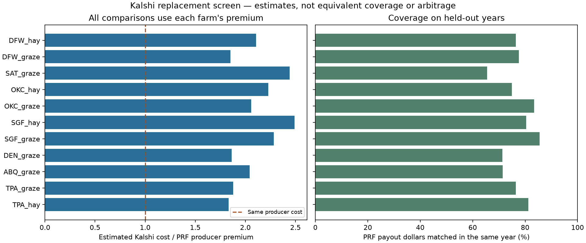

# Farmer-specific Kalshi replacement and price-gap screen

The requested idea is Kalshi-based rain cover, not a Cauchy probability model. This screen builds a portfolio for each representative farmer, compares it with that farmer's subsidized PRF premium, and measures how much coverage is lost. A positive premium difference is a candidate saving; it is not evidence of arbitrage.

The reproduced results below find no cheaper replacement in these farm scenarios under either portfolio-sizing method. The unsubsidized comparison is much closer, which supports the earlier diagnosis that the subsidy matters. Coverage still differs materially, and the negative HE cases show that a good training fit can fail on unseen weather. These results strengthen the case for retaining PRF and using the existing Companion to address uncovered months.

## Use it

Run `.venv/bin/python scripts/run_app.py` and open `http://localhost:8473/compare`. Choose a farm, optionally scale its acres, and enter a producer premium quote if available. The farm's grid, county, coverage level and interval allocations stay fixed. An entered quote must cover those same elections and acres. Other locations remain available through the existing custom-cover app, which does not have their actuarial rates.

The screen shows a lowest-error portfolio and a portfolio scaled to match average *training* payouts. Both use whole contracts and receive an untouched temporal holdout evaluation. The latter is a useful check on superficial “same average coverage” comparisons; it does not promise the same payout in each year. The default prices are estimates. “Check current books” attempts the public API, walks actual NO offers, and reports partial fills separately from the cost of a complete hedge. It never places trades.

The API is `GET /api/farms`, then `POST /api/compare` with a `farm_id`. Optional fields are `acres`, `producer_premium_usd`, `contract_year` and `price_source` (`model` or `auto`). JSON downloads preserve inputs, assumptions, orders and holdout payouts.

## What is being compared

The target is each farm's reconstructed NCEI grid-index PRF payout, with its saved election windows and protection. These are research scenarios, not insurance policies for sale. PRF premiums come from the saved actuarial scenario, rather than the app's average premium-to-payout ratio. Scaled acres scale premium and protection proportionally; a farmer-entered total producer quote replaces only that premium.

Fitting probabilities and portfolio weights use the training period only. The holdout changes no weights, sizing decisions or station choice. Published index normals, farm elections and the current strike menu are fixed specifications, so this is a historical weather stress test of today's design, not a tradable historical profit backtest. Future price estimates are a separate layer using the recent climatology available at the scenario date. Those estimates are not seasonal weather forecasts.

Reported HE is accompanied by RMSE, dollar bias, same-year payout recovery, and mean/worst shortfall. HE can equal its theoretical maximum despite a constant underpayment, so it cannot establish equal coverage by itself. Missing rainfall years are omitted and their counts are displayed. No measured forage loss is substituted for the PRF target.

Costs include estimated spread, taker fees and the assumed opportunity cost of cash prepaid until each contract settles. This matters for a season booked months ahead. Actual rates, fee multipliers, account-specific rounding, PRF administrative fees, settlement delays and premium due dates can change the comparison. The default is explicitly a scenario, not a binding target-year quote. The current [Kalshi fee schedule](https://kalshi.com/docs/kalshi-fee-schedule.pdf) includes a series multiplier and distinguishes third-party account fees; the repository retail fee model is retained as a stated assumption.

## Why a price gap is not PRF arbitrage

PRF pays on a grid index over elected intervals; the hedge pays on monthly station thresholds. Consider two weather outcomes with identical airport readings but different rainfall over the farm grid. Every station-only portfolio has the same payoff in both outcomes, but PRF can have different payouts. Thus, a station-only payoff cannot generally equal the PRF payoff across all weather states. More contracts or a better statistical fit do not eliminate that information gap. RMA describes the [grid-index construction and the NCEI transition](https://www.rma.usda.gov/policy-procedure/general-policies/rainfall-index).

An executable price arbitrage would additionally require offsetting positions whose net payoff is nonnegative in every state after costs. This analysis identifies no tradable short position in the farmer's PRF policy. A producer cannot infer such a trade from an actuarial premium; conditional assignments of indemnity under the [policy provisions](https://www.rma.usda.gov/sites/default/files/2025-08/Rainfall-Index-Plan-Common-Policy-26-RI.pdf) are not an exchange order to short the policy. Buying two differently priced long exposures is not an offsetting arbitrage.

Fresh book availability is also essential. Only the requested year/month, an open contract and a recent live observation count toward available orders. Saved snapshots, an API fallback, a different month's book, or an unlimited model tranche contribute no executable quantity. Even a complete observed fill is subject to market movement, fee verification and execution risk. The reproducible offline table makes no claim about today's depth.

A live run on 2026-11-06 (`farmer_comparison_live.json`, 21:30 UTC) reached the API for all 11 farms, but every station series listed only November 2026 contracts (6-7 books each). None of the 2027 legs had a matching book, so the fillable fraction was 0% for every farm. Kalshi lists monthly rain contracts close to the month, so a season booked a year ahead cannot be bought today at any price.

## Reproduce and inspect

```bash
.venv/bin/python scripts/run_farmer_comparison.py
.venv/bin/python scripts/run_farmer_comparison.py --live
.venv/bin/python -m pytest tests/test_comparison.py
```

The first command regenerates the AUTO tables below, the figure, and `data/processed/farmer_comparison{,_summary,_holdout,_orders}` JSON/CSV artifacts. The live command writes a separate `farmer_comparison_live.json` with observation times; it does not overwrite the reproducible results. Source code is `src/agri_hedge/comparison.py`.



<!-- BEGIN AUTO: farmer comparison (scripts/run_farmer_comparison.py) -->
### Farmer results — estimated prices, fixed holdout portfolios

Positive price gap would mean estimated savings; these hedges have different coverage.

| Farm | PRF producer / full premium | Kalshi estimate | Cost / producer premium | Holdout HE | Same-year PRF dollars recovered | Worst holdout shortfall | Complete holdout years |
|---|---:|---:|---:|---:|---:|---:|---:|
| DFW_hay | $3,683 / $7,517 | $7,761 | 2.11× | 0.21 | 76.5% | $13,266 | 24 |
| DFW_graze | $2,734 / $5,579 | $5,056 | 1.85× | 0.54 | 77.6% | $6,419 | 24 |
| SAT_graze | $3,198 / $7,106 | $7,807 | 2.44× | -0.06 | 65.5% | $12,695 | 24 |
| OKC_hay | $3,643 / $7,435 | $8,115 | 2.23× | 0.05 | 75.0% | $7,308 | 25 |
| OKC_graze | $3,129 / $6,386 | $6,442 | 2.06× | 0.49 | 83.4% | $4,415 | 25 |
| SGF_hay | $2,663 / $5,435 | $6,636 | 2.49× | -0.48 | 80.4% | $5,975 | 24 |
| SGF_graze | $2,132 / $4,350 | $4,866 | 2.28× | -0.19 | 85.6% | $4,439 | 24 |
| DEN_graze | $9,330 / $19,040 | $17,369 | 1.86× | 0.43 | 71.4% | $21,266 | 25 |
| ABQ_graze | $12,120 / $26,933 | $24,741 | 2.04× | 0.05 | 71.5% | $36,729 | 25 |
| TPA_graze | $6,061 / $12,369 | $11,380 | 1.88× | 0.46 | 76.4% | $17,873 | 25 |
| TPA_hay | $7,302 / $14,903 | $13,379 | 1.83× | 0.44 | 81.3% | $15,917 | 25 |

### Numbers and sources

| Claim | Value | Source |
|---|---:|---|
| Best-fit hedges cheaper than subsidized PRF | 0 / 11 | `farmer_comparison_summary.csv`, best_fit |
| Best-fit median cost / producer premium | 2.06× | Same CSV |
| Best-fit median cost / full premium | 1.01× | Same CSV |
| Best-fit median holdout HE | 0.21 | Same CSV, 2001–2025 complete years |
| Best-fit median same-year recovery | 76.5% | Same CSV; sum min(PRF, hedge) / sum PRF |
| Best-fit annual PRF producer premium / hedge estimate, all farms | $55,994 / $113,552 | Same CSV |
| Equal-training-mean median cost / producer premium | 1.97× | Same CSV, equal_mean |
| Equal-training-mean median holdout HE | 0.24 | Same CSV |
| Equal-training-mean cheaper than subsidized PRF | 0 / 11 | Same CSV |
| Same coverage / demonstrated PRF arbitrage | 0 / 0 | Different settlement functions; no offsetting short PRF trade identified |
| Live books checked in this reproducible table | 0 | Model-only run; no inference of current market depth |
| PRF scenario terms | 2026 | `prf_scenario_results.csv`, `farms.yaml` |
| Fit / holdout years | 1951–2000 / 2001–2025 | `comparison.TRAIN` / `TEST`; incomplete years omitted |
| Forward price probability window | 1991–2025 | `hedge_builder.FAIR_WINDOW`; not used in fitting |
| Quote date / contract year | 2026-11-06 / 2027 | This script's deterministic default |
| Model half spread | 2.25 cents | Doc 05 historical median spread / 2 |
| Funding rate / assumed settlement delay | 4.05% annual / 2 days after month-end | Scenario assumptions; historical rate in `pricing.DEFAULT_TBILL_RATE` |
| Taker rate / rounding assumption | 0.07 / up to $0.01 per price-level fill | Repository retail model; [Kalshi fee schedule](https://kalshi.com/docs/kalshi-fee-schedule.pdf) has account-specific rounding and multipliers |
| Freshness threshold / material shortfall threshold | 120 seconds / $1 | `comparison.MAX_BOOK_AGE_SECONDS` / `coverage_metrics` |
<!-- END AUTO: farmer comparison (scripts/run_farmer_comparison.py) -->
