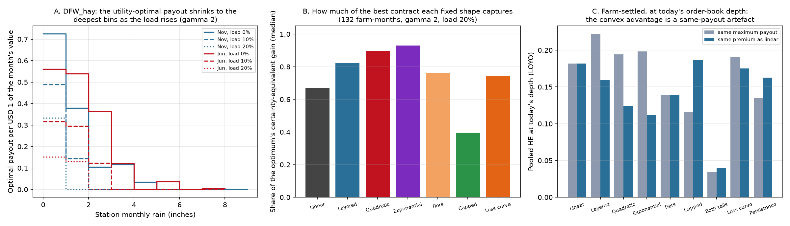

# 24: Contract design: equal premiums, a holdout term sheet, the utility-optimal payout, and the advisor

**Proposal cell:** Milestone III direction (the insurance derivative layer of doc 23: "theory for spanning bounds / optimal parametric payout is useful but not required"). Owners: team  |  **Status:** DRAFT (numbers reproducible with `python scripts/run_exotic_design.py`, about 5 minutes; `--tables-only` redoes the tables and figure from the saved CSVs)  |  **Last updated:** 2026-11-09

Code: `src/agri_hedge/design.py` (equal-premium scaling, holdout split, the utility-optimal step payout and the certainty-equivalent comparison), `platform.exotic_quote` (new shape `optimal`), `platform.exotic_compare` / `POST /api/exotic_compare` (every shape at equal payout and equal premium with the utility ranking), `src/agri_hedge/advisor.py` / `POST /api/advise` / `GET /api/advisor` (the prompt-driven designer), `scripts/run_exotic_design.py` (this study). Tests: `tests/test_design.py`, `tests/test_advisor.py`.
Data written: `data/processed/m2_design_equal_premium.csv`, `m2_design_holdout.csv`, `m2_design_optimal.csv`, `m2_design_shape_ce.csv`, `m2_design_execution.csv`; figure `docs/figures/m2_design_optimal.png`.

## Why this doc

Doc 23 left three things open. Its shapes were compared at the same **maximum payout**, which flatters the convex shapes because they are cheaper per $1 of limit. Its exchange-settled **term sheet** was calibrated on all 75 years. And it chose shapes from a menu instead of asking what payout a farmer *should* buy. This doc closes the three, and puts the result in the app: a "Design a contract" tab (every shape, the term sheet, the exact ticket, a comparison table) and an "Ask the advisor" tab where a farmer describes the land in a sentence and Claude, or a rule-based parser when no API key is set, designs the contract with the project's own tools.

## The utility-optimal payout in one paragraph

The index-insurance design problem (Raviv 1979; Zhang, Tan and Weng 2019): a farmer with CRRA utility and wealth W per $1 of the month's insured value loses l_t in year t (PRF's linear payoff, or the doc-13 loss curve, on the farm's own grid) and can buy a payout p_j for each rain bin j of the station's whole-inch ladder, priced at (1 + load) x the bin's historical frequency. Maximize the mean of u(W - l_t + p_{b_t} - premium) over p >= 0. With u concave this is a concave program in eight numbers; `design.optimal_step_payout` solves it directly. The answer is a step function on the ladder, so it is a long-only NO portfolio like every other shape here (spanning, doc 23). The certainty-equivalent (CE) gain is what the farmer would pay for the contract on top of its premium; a fixed shape's "share of the optimum" is its CE gain at its own best size divided by the optimum's. With quadratic utility the problem is doc 23's lowest-error fit (Zhang, Tan and Weng); with CRRA and a load it is not, and the difference is the point.

## Key findings

All numbers: the 11 farms of doc 04, NCEI farm index, station rain 1951-2025, Kalshi's whole-inch strikes; base case risk aversion 2, load 20% (Kalshi's all-in cost per $1 of expected payout is 1.1-1.3, docs 09 and 23), wealth 2x the month's insured value.

- **At equal premium the convex shapes' depth advantage disappears.** Doc 23 found that at today's order-book depth the layered shape beats PRF's linear shape in 31 of 36 windows, the quadratic in 25 and the exponential in 22, all at the same maximum payout. Scaled to the linear shape's premium (1.7x, 2.2x and 4.0x the maximum payout) they beat it in 0 of 36 (table A). Pooled HE at today's depth, weighting windows by payout variance per $1 of premium: 0.18 linear against 0.22 / 0.19 / 0.20 at the same payout, but 0.16 / 0.12 / 0.11 at the same premium. Per premium dollar the convex shapes need more contracts (3.6 / 4.0 / 4.2 against 3.4) and more issuer capital (2.4 / 3.3 / 3.0 against 2.1 per $1 of premium). The concave capped shape is the mirror image: it wins 26 of 36 at equal premium. The honest statement of doc 23's result is that convex shapes buy more *limit* per contract, not more fit per dollar.
- **The term sheet holds up out of sample; the farmer's basis risk does not improve.** Bins fitted on 1951-2000 and scored on 2001-2025 reproduce the smooth shapes as well as the all-years bins (binning R2 0.90 / 0.78 / 0.62 for linear / quadratic / exponential against 0.89 / 0.80 / 0.63), the largest bin payout moves by 0.02 per $1 of maximum payout and the premium by about 1% (table B). The exchange-settled product's fit to the farm grid falls on the test years, 0.52 to 0.41 linear, 0.43 to 0.25 quadratic, 0.39 to 0.22 exponential (Nov-Jan: 0.65 to 0.56 and 0.56 to 0.48), by the same amount whether the bins come from the training years or from all years (median difference 0.004). That is the harder 2001-2025 period, as in doc 21's companion holdout, not an overfitted term sheet.
- **At a fair price the farmer's best contract is doc 23's convex ladder; at Kalshi's load it collapses to the driest bin or two.** With no load the utility optimum pays in 5 bins (median), its first drop is 2.3 times the next ones (doc 23's variance-optimal ladder had 2.3), it costs 28% of the month's value and is worth a CE gain of 3.3% of that value (table C). At a 10% load it pays in 2 bins for a 12% premium; at 20% in 1 bin (one bin in 43% of farm-months, two in 35%), for a 7% premium and a 1.0% CE gain (1.2% in the open months, 0.8% in the insured ones, 1.6% in Nov-Jan); 21 of 132 farm-months buy nothing, 28 at a 30% load. A more risk-averse farmer (4) buys 2 bins at a 20% load for 14% of value and gains 4.2%. The optimum's variance fit to the farm falls from 0.52 to 0.40 as the load rises: it gives up tracking on purpose to save premium. Figure A shows DFW_hay's June and November.
- **Of the fixed shapes the exponential captures most of that value, the linear shape two thirds.** At the base case the exponential shape at its best size captures 93% of the optimum's CE gain (median), the quadratic 90%, the layered 82%, the tiers 76%, the loss curve 74%, PRF's linear shape 67% and the capped 40%; the exponential is the best fixed shape in 89 of the 111 farm-months where any cover is bought (table D). The best sizes are a quarter of the month's value (0.26-0.27 of value as maximum payout) for a 7-8% premium. With the doc-13 loss curve as the farm's loss the ranking is the same (91 / 86 / 80 / 64%).
- **The raw optimum is fragile; the smooth convex shapes are not.** On the 2001-2025 test, with sizes and bins chosen on 1951-2000, the mean CE gain is 1.17% of value for the optimum, 1.10% exponential, 1.02% quadratic, 0.69% linear, 0.50% capped, and every shape's gain is positive in only about half the farm-months (25 test years are noisy). The exponential beats the optimum out of sample in 42 of 132 farm-months. At DFW_hay in November the training optimum is a single bin (1 inch or less) that gains 0.03% on the test years, while the exponential, quadratic and linear shapes gain about 3.5%: the test period put its losses in the 1-2 inch bin the optimum left uninsured. The product should be a smooth convex shape sized by utility, not the fitted step function.
- **Execution.** On the 2026-11-02 Dallas book the $6,000 November contracts fill 12% linear, 13% quadratic and 17% exponential at the same maximum payout; scaled to the linear premium the quadratic is a $9,057 contract that fills 8% and the exponential a $13,172 contract that fills 8% (table E). The single-bin optimum fills 5% and the largest size the book fills in full is $284, because it loads everything on the 1-inch strike. Across the seven study stations the base-case farmer buys cover at five; at Denver and Albuquerque no contract on the ladder is worth its premium (farm fit 0.28 and 0.07). The best fixed shape is the exponential at DFW, OKC, SAT and TPA, the quadratic at SGF.
- **What this means for the product.** The exchange-settled convex contract of doc 23 survives, for a better reason: it is what a risk-averse farmer should buy at Kalshi's price (90% or more of the best possible contract's value), not because today's books fill more of it (they do not, per premium dollar). Size it at the utility-optimal quarter of the month's value, premium 7-8% of value, instead of PRF's full protection; that is also a size the books can fill at four of the seven stations. Keep the term sheet calibrated on all years (it is stable); quote the farmer's basis risk from the holdout numbers (0.4-0.5 in the cool season), not the in-sample ones.

<!-- BEGIN AUTO: contract design tables (scripts/run_exotic_design.py) -->
### A. Equal premium: farm-settled hedges at today's depth, 36 insured windows

Each shape is first sized at the same maximum payout as doc 23 (S5), then scaled so its fair premium equals the linear shape's (S5 at equal premium). Pooled HE weights windows by payout variance per $1 of premium. Contracts and capital are per $1 of premium.

| Shape | Premium scale (median) | Contracts per $1 premium | Pooled S5 HE, same max payout | Pooled S5 HE, same premium | Windows beating linear at same premium | Issuer capital per $1 premium (95th pct) |
|---|---|---|---|---|---|---|
| Linear (PRF) | 1.00 | 3.4 | 0.18 | 0.18 | 0 of 36 | 2.1 |
| Layered escalator | 1.71 | 3.6 | 0.22 | 0.16 | 0 of 36 | 2.4 |
| Quadratic (convex) | 2.19 | 4.0 | 0.19 | 0.12 | 0 of 36 | 3.3 |
| Exponential (catastrophe) | 4.03 | 4.2 | 0.20 | 0.11 | 0 of 36 | 3.0 |
| Step-up tiers | 1.01 | 3.8 | 0.14 | 0.14 | 0 of 36 | 2.7 |
| Capped (stop-loss) | 0.55 | 2.9 | 0.12 | 0.19 | 26 of 36 | 1.8 |
| Drought + excess rain | 0.65 | 4.3 | 0.03 | 0.04 | 0 of 36 | 1.8 |
| Farm loss curve (doc 13) | 1.12 | 3.6 | 0.19 | 0.18 | 0 of 36 | 2.3 |
| Persistent-drought bonus | 0.78 | 3.2 | 0.13 | 0.16 | 4 of 36 | 2.0 |

### B. Holdout term sheet: bins fitted on 1951-2000, scored on 2001-2025 (60 open months)

Binning R2 = share of the smooth shape's variance the step function reproduces on the gauge. Exchange-settled HE = how well the product tracks the farm-grid payoff. 'All years' is doc 23's in-sample number; 'test' scores 2001-2025 with bins fitted on 1951-2000.

| Shape | Binning R2, all years | Binning R2, test | Exchange HE, all years | Exchange HE, test | Largest bin payout change per $1 (median) | Premium change, test vs all (median) |
|---|---|---|---|---|---|---|
| Linear (PRF) | 0.89 | 0.90 | 0.52 | 0.41 | 0.020 | -1% |
| Layered escalator | 0.82 | 0.82 | 0.46 | 0.33 | 0.021 | -1% |
| Quadratic (convex) | 0.80 | 0.78 | 0.43 | 0.25 | 0.023 | -0% |
| Exponential (catastrophe) | 0.63 | 0.62 | 0.39 | 0.22 | 0.026 | -0% |
| Step-up tiers | 0.84 | 0.83 | 0.46 | 0.33 | 0.023 | -3% |
| Capped (stop-loss) | 0.92 | 0.91 | 0.50 | 0.43 | 0.024 | -2% |
| Drought + excess rain | 0.83 | 0.82 | 0.08 | 0.03 | 0.045 | 5% |
| Farm loss curve (doc 13) | 0.88 | 0.88 | 0.53 | 0.39 | 0.022 | -1% |

### C. The utility-optimal payout: what a CRRA farmer buys on the station's ladder (132 farm-months, PRF-linear farm loss)

Wealth = 2 x the month's insured value. Bins paying = rain bins with a positive payout (the ladder has 7-9). Premium and CE gain are per $1 of the month's insured value; the CE gain is what the farmer would pay for the cover beyond its premium.

| Risk aversion | Load | Bins paying (median) | Months with 3+ bins paying | Premium per $1 of value (median) | CE gain, % of value (median) | Months buying nothing | Convexity ratio (median) | HE vs farm (median) |
|---|---|---|---|---|---|---|---|---|
| 1 | 0% | 4 | 108 of 132 | 26% | 1.52 | 0 | 2.50 | 0.52 |
| 1 | 10% | 1 | 8 of 132 | 6% | 0.39 | 24 | 9.56 | 0.40 |
| 1 | 20% | 1 | 0 of 132 | 1% | 0.02 | 50 | 6.51 | 0.22 |
| 1 | 30% | 0 | 0 of 132 | 0% | 0.00 | 86 | 8.92 | 0.09 |
| 2 | 0% | 5 | 109 of 132 | 28% | 3.34 | 0 | 2.28 | 0.52 |
| 2 | 10% | 2 | 48 of 132 | 12% | 1.85 | 13 | 3.55 | 0.50 |
| 2 | 20% | 1 | 8 of 132 | 7% | 0.97 | 21 | 8.96 | 0.40 |
| 2 | 30% | 1 | 2 of 132 | 4% | 0.42 | 28 | 2.45 | 0.30 |
| 4 | 0% | 5 | 109 of 132 | 30% | 7.84 | 0 | 2.10 | 0.51 |
| 4 | 10% | 3 | 72 of 132 | 18% | 5.73 | 4 | 2.48 | 0.54 |
| 4 | 20% | 2 | 54 of 132 | 14% | 4.19 | 12 | 3.28 | 0.51 |
| 4 | 30% | 2 | 24 of 132 | 11% | 3.26 | 16 | 5.41 | 0.46 |

Wealth sensitivity at risk aversion 2 and a 20% load: bins paying (median) and premium per $1 of value for wealth 1.25x: 2 bins, 13%; 2x: 1 bins, 7%; 4x: 1 bins, 0%.

### D. Fixed shapes against the optimum (risk aversion 2, load 20%, wealth 2x): certainty-equivalent gain at each shape's best size

Share = the shape's CE gain / the optimum's. 'Best fixed shape' counts the farm-months where the shape has the highest share among the seven. Test = CE gain on 2001-2025 with sizes and bins chosen on 1951-2000 (25 test years make it noisy: the mean is shown, with the share of farm-months where the gain stayed positive and where the shape beat the optimum out of sample).

| Shape | Share of optimum (median) | Best fixed shape in | Best size, max payout per $1 of value (median) | Premium per $1 of value (median) | CE gain, % of value (median) | Test CE gain, % of value (mean) | Test gain positive | Beats the optimum on test |
|---|---|---|---|---|---|---|---|---|
| **Farm loss: PRF linear payoff** | | | | | | | | |
| Utility optimum | 1.00 |  | 0.28 | 7% | 0.97 | 1.17 | 70 of 132 |  |
| Linear (PRF) | 0.67 | 7 of 111 | 0.22 | 9% | 0.55 | 0.69 | 66 of 132 | 38 of 132 |
| Layered escalator | 0.82 | 0 of 111 | 0.26 | 8% | 0.72 | 0.91 | 65 of 132 | 36 of 132 |
| Quadratic (convex) | 0.90 | 12 of 111 | 0.26 | 8% | 0.77 | 1.02 | 65 of 132 | 38 of 132 |
| Exponential (catastrophe) | 0.93 | 89 of 111 | 0.27 | 7% | 0.84 | 1.10 | 66 of 132 | 42 of 132 |
| Step-up tiers | 0.76 | 2 of 111 | 0.24 | 9% | 0.64 | 0.86 | 64 of 132 | 40 of 132 |
| Capped (stop-loss) | 0.40 | 0 of 111 | 0.18 | 8% | 0.37 | 0.50 | 64 of 132 | 38 of 132 |
| Farm loss curve (doc 13) | 0.74 | 1 of 111 | 0.24 | 9% | 0.64 | 0.78 | 65 of 132 | 40 of 132 |
| **Farm loss: doc-13 loss curve** | | | | | | | | |
| Utility optimum | 1.00 |  | 0.28 | 6% | 0.96 | 1.19 | 71 of 132 |  |
| Linear (PRF) | 0.64 | 6 of 110 | 0.21 | 9% | 0.49 | 0.64 | 61 of 132 | 35 of 132 |
| Layered escalator | 0.80 | 0 of 110 | 0.25 | 8% | 0.65 | 0.87 | 65 of 132 | 36 of 132 |
| Quadratic (convex) | 0.86 | 9 of 110 | 0.26 | 8% | 0.73 | 0.99 | 66 of 132 | 37 of 132 |
| Exponential (catastrophe) | 0.91 | 93 of 110 | 0.26 | 7% | 0.80 | 1.08 | 64 of 132 | 36 of 132 |
| Step-up tiers | 0.74 | 2 of 110 | 0.24 | 9% | 0.61 | 0.82 | 64 of 132 | 40 of 132 |
| Capped (stop-loss) | 0.37 | 0 of 110 | 0.15 | 7% | 0.25 | 0.45 | 61 of 132 | 36 of 132 |
| Farm loss curve (doc 13) | 0.71 | 0 of 110 | 0.23 | 9% | 0.56 | 0.73 | 61 of 132 | 38 of 132 |

### E. Exchange-settled, Nov 2026, $6,000 maximum payout on the 2026-11-02 book: fill at equal payout and at equal premium

Equal premium = each shape scaled to the linear product's fair premium at the same station. Utility share as in D (risk aversion 2, load 20%) for the study farm at each site.

| Station | Shape | Fair premium | Filled, same max payout | Max payout at linear's premium | Filled, same premium | Largest fillable max payout | Farm HE | Utility share | Best size (utility) |
|---|---|---|---|---|---|---|---|---|---|
| DFW | Linear (PRF) | $1,819 | 12% | $6,000 | 12% | $536 | 0.65 | 0.68 | $1,760 |
| DFW | Layered escalator | $1,346 | 13% | $8,113 | 10% | $588 | 0.58 | 0.84 | $1,926 |
| DFW | Quadratic (convex) | $1,205 | 13% | $9,057 | 8% | $595 | 0.58 | 0.89 | $1,953 |
| DFW | Exponential (catastrophe) | $829 | 17% | $13,172 | 8% | $728 | 0.49 | 0.93 | $1,965 |
| DFW | Step-up tiers | $2,045 | 9% | $5,337 | 10% | $491 | 0.60 | 0.74 | $1,828 |
| DFW | Capped (stop-loss) | $2,767 | 9% | $3,945 | 14% | $272 | 0.59 | 0.43 | $1,387 |
| DFW | Farm loss curve (doc 13) | $1,633 | 12% | $6,683 | 11% | $650 | 0.64 | 0.74 | $1,828 |
| DFW | Utility optimum | $1,543 | 5% | $7,075 | 4% | $284 | 0.08 | 1.00 | $1,926 |
| OKC | Linear (PRF) | $2,101 | 8% | $6,000 | 8% | $435 | 0.71 | 0.80 | $2,045 |
| OKC | Layered escalator | $1,691 | 10% | $7,454 | 8% | $479 | 0.62 | 0.88 | $2,086 |
| OKC | Quadratic (convex) | $1,544 | 10% | $8,164 | 8% | $484 | 0.59 | 0.94 | $2,103 |
| OKC | Exponential (catastrophe) | $1,179 | 13% | $10,691 | 8% | $616 | 0.47 | 0.96 | $2,106 |
| OKC | Step-up tiers | $2,355 | 7% | $5,352 | 8% | $340 | 0.69 | 0.89 | $2,090 |
| OKC | Capped (stop-loss) | $2,920 | 6% | $4,316 | 9% | $367 | 0.73 | 0.68 | $1,959 |
| OKC | Farm loss curve (doc 13) | $1,932 | 9% | $6,524 | 8% | $449 | 0.68 | 0.83 | $2,065 |
| OKC | Utility optimum | $2,571 | 4% | $4,902 | 5% | $266 | 0.26 | 1.00 | $2,110 |
| SGF | Linear (PRF) | $1,532 | 17% | $6,000 | 17% | $0 | 0.79 | 0.68 | $2,119 |
| SGF | Layered escalator | $1,078 | 18% | $8,529 | 13% | $0 | 0.76 | 0.84 | $2,543 |
| SGF | Quadratic (convex) | $931 | 17% | $9,879 | 12% | $505 | 0.74 | 0.93 | $2,651 |
| SGF | Exponential (catastrophe) | $581 | 19% | $15,823 | 10% | $0 | 0.69 | 0.93 | $2,786 |
| SGF | Step-up tiers | $1,797 | 14% | $5,116 | 16% | $538 | 0.71 | 0.75 | $2,134 |
| SGF | Capped (stop-loss) | $2,441 | 14% | $3,766 | 21% | $0 | 0.75 | 0.44 | $1,469 |
| SGF | Farm loss curve (doc 13) | $1,350 | 17% | $6,809 | 15% | $0 | 0.78 | 0.75 | $2,274 |
| SGF | Utility optimum | $1,157 | 8% | $7,946 | 6% | $338 | 0.65 | 1.00 | $2,750 |
| SAT | Linear (PRF) | $2,378 | 5% | $6,000 | 5% | $172 | 0.55 | 0.75 | $2,164 |
| SAT | Layered escalator | $1,932 | 6% | $7,382 | 5% | $174 | 0.55 | 0.86 | $2,262 |
| SAT | Quadratic (convex) | $1,769 | 6% | $8,062 | 5% | $174 | 0.54 | 0.91 | $2,290 |
| SAT | Exponential (catastrophe) | $1,346 | 8% | $10,596 | 5% | $215 | 0.51 | 0.94 | $2,303 |
| SAT | Step-up tiers | $2,667 | 4% | $5,349 | 5% | $131 | 0.49 | 0.84 | $2,246 |
| SAT | Capped (stop-loss) | $3,268 | 4% | $4,365 | 6% | $170 | 0.45 | 0.58 | $1,955 |
| SAT | Farm loss curve (doc 13) | $2,193 | 6% | $6,504 | 5% | $173 | 0.55 | 0.79 | $2,207 |
| SAT | Utility optimum | $2,571 | 2% | $5,548 | 2% | $101 | 0.23 | 1.00 | $2,316 |
| DEN | Linear (PRF) | $1,772 | 97% | $6,000 | 97% | $5,795 | 0.28 |  | $0 |
| DEN | Layered escalator | $1,209 | 100% | $8,791 | 97% | $8,491 | 0.20 |  | $0 |
| DEN | Quadratic (convex) | $1,029 | 100% | $10,333 | 97% | $9,980 | 0.17 |  | $0 |
| DEN | Exponential (catastrophe) | $667 | 100% | $15,948 | 97% | $15,403 | 0.12 |  | $0 |
| DEN | Step-up tiers | $1,842 | 93% | $5,770 | 97% | $5,573 | 0.22 |  | $0 |
| DEN | Capped (stop-loss) | $2,897 | 59% | $3,670 | 97% | $3,544 | 0.33 |  | $0 |
| DEN | Farm loss curve (doc 13) | $1,547 | 100% | $6,872 | 97% | $6,638 | 0.26 |  | $0 |
| ABQ | Linear (PRF) | $2,223 | 28% | $6,000 | 28% | $1,651 | 0.07 |  | $0 |
| ABQ | Layered escalator | $1,946 | 32% | $6,855 | 28% | $1,887 | 0.06 |  | $0 |
| ABQ | Quadratic (convex) | $1,856 | 33% | $7,186 | 28% | $1,978 | 0.05 |  | $0 |
| ABQ | Exponential (catastrophe) | $1,604 | 38% | $8,316 | 28% | $2,289 | 0.04 |  | $0 |
| ABQ | Step-up tiers | $2,380 | 26% | $5,605 | 28% | $1,543 | 0.07 |  | $0 |
| ABQ | Capped (stop-loss) | $2,778 | 22% | $4,802 | 28% | $1,322 | 0.10 |  | $0 |
| ABQ | Farm loss curve (doc 13) | $2,112 | 29% | $6,315 | 28% | $1,738 | 0.07 |  | $0 |
| TPA | Linear (PRF) | $2,264 | 31% | $6,000 | 31% | $1,223 | -0.04 | 0.00 | $0 |
| TPA | Layered escalator | $1,783 | 31% | $7,619 | 26% | $1,421 | -0.04 | 0.05 | $33 |
| TPA | Quadratic (convex) | $1,638 | 28% | $8,294 | 22% | $1,451 | -0.09 | 0.34 | $84 |
| TPA | Exponential (catastrophe) | $1,204 | 35% | $11,281 | 20% | $1,930 | -0.11 | 0.51 | $101 |
| TPA | Step-up tiers | $2,524 | 26% | $5,380 | 28% | $1,018 | -0.07 | 0.02 | $21 |
| TPA | Capped (stop-loss) | $3,226 | 22% | $4,210 | 32% | $957 | -0.05 | 0.00 | $0 |
| TPA | Farm loss curve (doc 13) | $2,074 | 32% | $6,548 | 30% | $1,284 | -0.06 | 0.00 | $0 |
| TPA | Utility optimum | $3,086 | 12% | $4,402 | 16% | $715 | -1.15 | 1.00 | $139 |
<!-- END AUTO: contract design tables (scripts/run_exotic_design.py) -->

## In the app

- **Design a contract** (tab 3): month, payout shape (the eight doc-23 single-month shapes plus `optimal`), maximum payout, value at risk, coverage, risk attitude and load. The result is the term sheet with a payout chart, the backtest of what it would have paid each year against station rain, the exact replicating order priced on the live or saved book, the fill and the largest fully fillable size, and the fit against the farmer's own grid. **Compare every shape** prices all nine at the same maximum payout and at the linear shape's premium and adds the utility share and the size the model farmer would buy; the recommended row is highlighted, and when no contract is worth its premium at that location the table says so. `?demo=exotic` runs it for the Dallas hay farm.
- **Ask the advisor** (tab 4): a chat box. The farmer writes "I'm growing corn at 1234 FM 51, Weatherford, TX on 300 acres"; the advisor geocodes the address (US Census geocoder for street addresses, OpenStreetMap Nominatim for towns and zip codes), looks up the crop (approximate value per acre and the months whose rain sets the yield), checks that the land is inside the served area and how well the station tracks it in those months, sizes the month (acres x value x the month's season weight x coverage), compares the shapes, designs the contract and explains it in plain words. If the address, the crop or the size is missing it asks for them first. The designed contract renders on the right with the same code as the designer tab, and the form is filled in so the farmer can change one thing and re-run.
  - With an Anthropic API key (`ANTHROPIC_API_KEY` in the server's environment, or pasted into the tab, where it stays in the browser), **Claude** (`claude-opus-5-5`, adaptive thinking, server-side refusal fallbacks on) runs the loop over five tools (`geocode_address`, `crop_profile`, `check_location`, `compare_shapes`, `design_contract`) with strict JSON schemas; the system prompt tells it which three facts it needs before designing, how to size and choose, and to quote only numbers that came back from the tools. The conversation (including tool calls) is kept by the browser and replayed, so follow-ups ("make it cheaper", "what about August?") work.
  - Without a key, a **rule-based** parser extracts crop, acres, dollars, value per acre, coordinates or a place name, months, coverage and a preference ("catastrophe", "like PRF", "too much rain") from the text and runs the same tools. It covers the common phrasings and is what the tests exercise; `?demo=advisor` runs it for the Dallas hay farm.
  - The crop table (`advisor.CROPS`) holds rough 2025 US-average revenue per acre and season weights for corn, soybeans, wheat, sorghum, cotton, hay, alfalfa, pasture, peanuts, rice, orchards and vegetables, with a "rain fit" flag (irrigated and perennial crops: poor). They size the quote; the farmer's own value per acre overrides them. They are not verified figures.

## Where this sits in the literature

- Clarke (2016), *AEJ: Microeconomics* 8(1): rational demand for index insurance is non-monotonic in risk aversion and zero for the infinitely risk averse, because basis risk makes the product pay in the wrong state. Table C is that result on our data: at a 20-30% load a sixth of the farm-months buy nothing, and what is bought shrinks to the states where the index is most informative. [https://doi.org/10.1257/mic.20140103](https://doi.org/10.1257/mic.20140103)
- Zhang, Tan and Weng (2019), *ASTIN Bulletin* 49(2) 491-523: the optimal index insurance contract maximizes the insured's expected utility, exists and is unique, is nonlinear and can be non-monotonic in the index, and reduces to variance minimization under quadratic utility. Our step payout on the ladder is their problem with a discrete index, and the quadratic-utility case is doc 23's lowest-error fit. [https://doi.org/10.1017/asb.2019.5](https://doi.org/10.1017/asb.2019.5)
- Stigler and Lobell (2024), *AJAE* 106(1): basis risk decomposes into zonal risk (heterogeneity within the insured zone) and design risk (the index's accuracy). Our geography step is their zonal risk and our binning step their design risk. [https://arxiv.org/abs/2111.08601](https://arxiv.org/abs/2111.08601)
- Raviv (1979) and Arrow (1963): with a proportional load the optimal indemnity has a deductible. Tables C and D show the index version: the load empties the wetter bins first.
- Luo, SSRN 7138562 (prediction markets as hedging instruments, cited in the project brief) could not be retrieved in this session (the SSRN page returned 403); its numbers remain unverified (doc 10 loose end).

## Method

**A. Equal premium.** For each insured window and shape, the farm-grid target y is rescaled by k = mean(y_linear) / mean(y) so its fair premium equals the linear shape's; the S5 fit (Kalshi strikes, each capped at the 2026-11-02 near-fair depth, doc 23) is refit and scored leave-one-year-out at the original size and at the rescaled one. Pooled HE = 1 - sum of residual variance / sum of target variance, both per $1 of premium.

**B. Holdout term sheet.** For the 60 open farm-months, `exotic.binned_values` on the 1951-2000 station years gives the bin payouts; binning R2 and the exchange-settled HE against the farm-grid payoff are scored on 2001-2025, and compared with the all-years bins scored on the same test years.

**C. The utility-optimal payout.** For all 132 farm-months (11 farms x 12 months; the insured months are included because a single-month product can cover them too) the farm loss per $1 of the month's value is PRF's payoff or the doc-13 curve on the farm grid, the station bins come from the listed whole-inch strikes, and `design.optimal_step_payout` maximizes mean CRRA utility over the bin payouts (bounded at 1.5 per $1) for risk aversion 1, 2 and 4, load 0, 10, 20 and 30%, wealth 1.25, 2 and 4 per $1 of value. CE = u^{-1}(mean u). The fixed shapes' bin payouts are their doc-23 term sheets; `design.scale_for_utility` picks each one's best size. Holdout: optimum and sizes chosen on 1951-2000 bins and losses, priced at the training bin frequencies, CE gain measured on 2001-2025.

**D. Execution.** `platform.exotic_compare` for each study station's farm, November 2026, $6,000 maximum payout, on the saved 2026-11-02 book (`LiveQuotes(offline=True)`, `today = 2026-10-20` so November is the listed month): each shape at that payout and at the linear product's premium, filled cheapest-first up to 10 cents above fair value.

## Numbers table

"Computed" = produced by `scripts/run_exotic_design.py` (run 2026-11-09, about 5 minutes) from the processed data listed in Method; tables A-E are the AUTO block above.

| Quantity | Value | Units | Region / period | Source | Verification |
|---|---|---|---|---|---|
| Windows where the shape beats linear at today's depth, same max payout: layered, quadratic, exponential | 31, 25, 22 of 36 | count | 11 farms, 36 windows | `m2_design_equal_premium.csv` (doc 23 numbers reproduced) | CONFIRMED (computed) |
| Same, at the linear shape's premium | 0, 0, 0 of 36 (capped 26) | count | same | table A | CONFIRMED (computed) |
| Premium scale to match linear: layered, quadratic, exponential | 1.71, 2.19, 4.03 | multiple of max payout (median) | same | table A | CONFIRMED (computed) |
| Pooled S5 HE, premium-variance weights: same payout; same premium (linear / layered / quadratic / exponential) | 0.18 / 0.22 / 0.19 / 0.20; 0.18 / 0.16 / 0.12 / 0.11 | share | same | table A | CONFIRMED (computed) |
| Contracts per $1 of premium; issuer capital per $1 of premium (linear / layered / quadratic / exponential) | 3.4 / 3.6 / 4.0 / 4.2; 2.1 / 2.4 / 3.3 / 3.0 | contracts; $ (median) | same | table A | CONFIRMED (computed) |
| Binning R2 all years vs test (linear; quadratic; exponential) | 0.89 vs 0.90; 0.80 vs 0.78; 0.63 vs 0.62 | share (median) | 60 open months, test 2001-2025 | table B | CONFIRMED (computed) |
| Largest bin payout change, train vs all-years bins; premium change | 0.02 per $1; about -1% | | same | table B | CONFIRMED (computed) |
| Exchange-settled HE all vs test: linear; quadratic; exponential; Nov-Jan linear; Nov-Jan quadratic | 0.52 vs 0.41; 0.43 vs 0.25; 0.39 vs 0.22; 0.65 vs 0.56; 0.56 vs 0.48 | share (median) | same | table B, `m2_design_holdout.csv` | CONFIRMED (computed) |
| Test HE with all-years bins minus with train bins | 0.004 | HE (median) | same | `m2_design_holdout.csv` | CONFIRMED (computed) |
| Utility optimum, risk aversion 2, wealth 2x, load 0 / 10% / 20% / 30%: bins paying; premium per $1 of value; CE gain | 5 / 2 / 1 / 1; 28% / 12% / 7% / 4%; 3.3 / 1.9 / 1.0 / 0.4% | median | 132 farm-months, PRF-linear loss | table C | CONFIRMED (computed) |
| Convexity ratio of the fair-price optimum | 2.28 (doc 23 variance fit: 2.34) | ratio (median) | same | table C | CONFIRMED (computed) |
| Farm-months buying nothing at load 20% / 30%; one-bin and two-bin optima at 20% | 21 / 28 of 132; 43% and 35% | count, share | same | table C, `m2_design_optimal.csv` | CONFIRMED (computed) |
| Optimum's HE vs farm at load 0 / 20% | 0.52 / 0.40 | share (median) | same | table C | CONFIRMED (computed) |
| CE gain at load 20%: open months; insured months; Nov-Jan | 1.2% / 0.8% / 1.6% of value | median | same | `m2_design_optimal.csv` | CONFIRMED (computed) |
| Risk aversion 4, load 20%: bins, premium, CE gain | 2; 14%; 4.2% | median | same | table C | CONFIRMED (computed) |
| Share of the optimum captured: exponential, quadratic, layered, tiers, loss, linear, capped | 0.93, 0.90, 0.82, 0.76, 0.74, 0.67, 0.40 | share (median) | 132 farm-months, base case | table D | CONFIRMED (computed) |
| Best fixed shape: exponential | 89 of 111 farm-months with cover | count | same | table D | CONFIRMED (computed) |
| Best size and premium of the fixed shapes | 0.26-0.27 of value; 7-8% of value | median | same | table D | CONFIRMED (computed) |
| Loss-curve target shares: exponential, quadratic, layered, linear | 0.91, 0.86, 0.80, 0.64 | share (median) | same | table D | CONFIRMED (computed) |
| Test CE gain (mean): optimum, exponential, quadratic, linear, capped; exponential beats optimum on test | 1.17, 1.10, 1.02, 0.69, 0.50% of value; 42 of 132 | | 2001-2025 test | table D | CONFIRMED (computed) |
| DFW_hay November, test CE gain: train optimum vs exponential / quadratic / linear | 0.03% vs 3.5 / 3.6 / 3.7% | % of value | 2001-2025 test | `m2_design_shape_ce.csv` | CONFIRMED (computed) |
| Dallas Nov 2026 $6,000: fill at same payout (linear / quadratic / exponential); at linear premium (payout, fill) | 12% / 13% / 17%; quadratic $9,057 8%, exponential $13,172 8% | | 2026-11-02 book | table E | CONFIRMED (computed) |
| Dallas optimum: fill; largest fillable | 5%; $284 | | same | table E | CONFIRMED (computed) |
| Stations where the base-case farmer buys nothing; their farm HE | DEN, ABQ; 0.28, 0.07 | | same | table E | CONFIRMED (computed) |
| Best fixed shape by station | exponential at DFW, OKC, SAT, TPA; quadratic at SGF | | same | `m2_design_execution.csv` | CONFIRMED (computed) |
| Advisor crop values (CROPS table) | e.g. corn $870/acre, soybeans $545, hay $260, pasture $25 | $ per acre | US, approximate 2025 | `advisor.py` | UNVERIFIED (rough averages for sizing; farmer's own value overrides) |
| Base-case constants | risk aversion 2, load 20%, wealth 2x, payout cap 1.5 per $1 | | | `design.py` | CONFIRMED (code) |

## Limits and open questions

- **Wealth normalization.** CE gains scale with the month's value as a share of the farmer's wealth (table C's last line: at 1.25x the base-case optimum pays in 2 bins for 13% of value, at 4x in 1 bin for 0.5%). We have no farm balance sheets; 2x is a round middle value. The ranking of shapes is much less sensitive than the sizes.
- **The load is proportional.** Kalshi's cost is a spread plus a fee per contract, which weighs more on cheap contracts (doc 23, cost per $1 expected 1.20 linear against 1.32 quadratic and 1.42 exponential at Dallas). Using 20% for every shape slightly favours the convex ones; with 30% the exponential still captures 93% in table C's spirit, but the farmer buys less.
- **Test noise.** Twenty-five test years and a loss that pays in a third of them give CE gains with a median near zero for every shape; the means and the beat counts in table D are the usable statistics. A longer station record (DFW starts in 1948) would not change that; more farms would.
- **The optimum is per farm-month and in sample.** It uses 75 years of the joint station-farm history; the holdout shows it overfits where the loss is spread over two bins. The app labels it "data-optimal" and shows its CE gain, not its variance fit, and the comparison table is there so the user can pick a smooth shape.
- **Advisor.** The Claude mode was written against the SDK and exercised with a scripted fake client in the tests; it was not run against the live API in this session (no key was available). The rule-based mode is what `?demo=advisor` runs. The geocoders need internet; Nominatim's usage policy allows light use with an identifying User-Agent, which the code sends. The crop values are rough and unverified by design: they size a first quote.
- **Still missing for the product:** a farmer's actual risk preference (an interview question), the two-month and half-inch contracts of docs 17 and 23, and a market maker for the 1-inch strike that every convex product loads.
