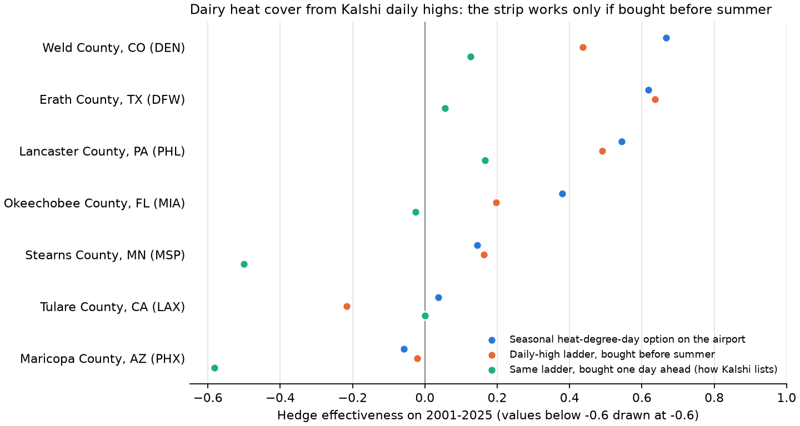

# Dairy heat stress: can Kalshi daily-high contracts insure a dairy's summer?

This is Jack's weather-defined-loss pilot from commit `8577aa6`, reused on `maya-experiments`.
It models milk loss as a function of heat rather than observing individual dairy losses.
**Correction (2026-11-07):** Dairy Margin Coverage protects the milk/feed margin, while
[Dairy Revenue Protection](https://www.rma.usda.gov/about-crop-insurance/frequently-asked-questions/dairy-revenue-protection)
also includes regional milk-yield changes and subsidized premiums. This pilot does not
establish that heat losses lack government coverage or that a hedge beats that coverage.
Private heat-index products also exist, for example [Arbol](https://www.arbol.io/products/dairy-risk-solutions).
See [doc 25](25_maya_dairy_validation.md) for the separate observed-production validation,
data limitations, and the definition of a fair comparison with rainfall.

**Answer: on paper, yes at three of seven regions; in practice, no.** Kalshi's daily contracts *can* be combined into a seasonal hedge: buying "high above k" for every strike in a 2 F ladder adds up to that day's degrees above the bottom strike, and doing that every day of the summer adds up to a seasonal heat-degree-day index. At Erath County TX, Weld County CO and Lancaster County PA that strip, if bought before summer, has holdout HE 0.44-0.64, close to a single seasonal option on the airport's heat load (0.54-0.67). But Kalshi lists each day's market about a day ahead, priced off the forecast. Bought one day at a time, the same strip only pays for the forecast's error, and the summer's heat waves are already in the price. Median HE falls to about 0.03.

So the obstacle for temperature is the opposite of rain. Rain fails on location: an airport gauge 30-55 miles away misses the farm's storms (doc 07). Temperature is spatially smooth (median R² 0.66 between farm and airport seasonal heat load, 0.76-0.86 for Pennsylvania, Minnesota and Colorado), so location is mostly fine. Temperature fails on **timing**: the contract that would work, a monthly or seasonal "days above 90 F at DFW" contract listed in spring, does not exist on Kalshi. That is a concrete contract proposal in the spirit of doc 17.

## How it is built

- **Sites.** Seven large dairy counties, each paired with the nearest Kalshi daily-high airport: Maricopa AZ (PHX), Erath TX (DFW), Weld CO (DEN), Lancaster PA (PHL), Stearns MN (MSP), Okeechobee FL (MIA), Tulare CA (LAX). Wisconsin, Idaho and New York have no nearby Kalshi airport.
- **Data.** Daily maximum temperature, May-September 1951-2025, from the [ACIS web services](https://www.rcc-acis.org/docs_webservices.html): the settlement airport (filled from the NWS threaded city record before DFW opened in 1974 and DEN in 1994) and the NRCC interpolated grid at a point in the dairy county.
- **Loss.** Degree-days above 80 F at the dairy, June-September, times $0.062 per cow per degree-day: about 0.2 kg of milk per cow per day for each THI unit above 72 ([Ravagnolo et al. 2000, as summarized here](https://en.engormix.com/dairy-cattle/dairy-cattle-management-practices/nutritional-management-strategies-alleviating_a33801/)), about 0.67 THI units per F at moderate humidity, and $21/cwt milk (an assumption). The insured amount is the loss above the 1951-2000 average, for a 1,000-cow herd. HE does not depend on any of these dollar coefficients. It does depend on the 80 F threshold, and a temperature-only index ignores humidity, which matters most in Florida.
- **Hedges.** (1) A call option on the airport's seasonal heat load, the best a seasonal heat contract could do (pure location basis). (2) A ladder of daily "high above k" contracts (k = 78-116 F in 2 F steps), whole contracts per day per month, fit on 1951-2000 with the repository optimizer and priced at 1991-2025 climatological odds plus a 2.25-cent half spread, per-order fees and capital from May 1. Kalshi does not list that far ahead; this is the hypothetical. (3) The same ladder bought one day at a time at a fair forecast-informed price, with a forecast error of 3.5 F (sensitivity 2.5 and 5 F) and heat waves of 5 days or more assumed seen a day ahead.
- **Test.** 2001-2025 holdout, as in the rain studies.

## Caveats

- Maricopa County barely paid: the interpolated grid there is cooler in 2001-2025 than in 1951-2000 (2,702 vs 2,946 degree-days), while Phoenix airport warmed, so the insured excess paid in only 2 holdout years and its HE values are not meaningful.
- Tulare County is 166 miles from LAX, which sits under the marine layer; the basis is near zero, as expected. California, the largest dairy state, has no usable Kalshi station.
- The ladder needs up to about 1,300 contracts a day on one strike for 1,000 cows. Daily-high books were not checked here; doc 12 found rain books hold a few thousand dollars per city-month.
- The day-ahead view assumes markets list every strike; in fact Kalshi lists about six 2 F brackets around the forecast, which only makes buying day ahead weaker.
- Day-ahead prices assume normal forecast errors. Summer highs are skewed (occasional cool, rainy days), so on the real data the fair price is off by up to 5 cents per contract-day on some strikes. That shifts the ladder's average payoff but not its year-to-year swings, which is what HE measures.
- CME lists monthly cooling-degree-day futures for a few cities, which is the seasonal contract described above; their liquidity and prices were not checked.

## Reproduce

```bash
.venv/bin/python scripts/pull_dairy_temps.py   # ACIS download, about 1 minute; output committed
.venv/bin/python scripts/run_dairy_heat.py     # tables, CSV, figure, under 10 s
```



<!-- BEGIN AUTO: dairy heat (scripts/run_dairy_heat.py) -->
### Dairy heat stress: can Kalshi daily highs cover a summer? (2001-2025 holdout)

Herd of 1,000 cows; loss = milk lost to degree-days above 80 F, June-September; the insured amount is the loss above its 1951-2000 average. HE = 1 - Var(loss - hedge) / Var(loss).

| Dairy region | Kalshi airport (miles) | Basis: farm vs airport heat load (R²) | Seasonal option HE | Ladder bought before summer HE | Bought day ahead HE | Mean insured loss / yr | Ladder cost before summer (cost / fair) | Day-ahead spread + fees / yr |
|---|---|---:|---:|---:|---:|---:|---:|---:|
| Maricopa County, AZ | PHX (33) | 0.41 | -0.06 | -0.02 | -0.58 | $435 (2 of 25 yrs) | $10,982 (1.15x) | $1,228 |
| Erath County, TX | DFW (83) | 0.66 | 0.62 | 0.64 | 0.06 | $12,181 (18 of 25 yrs) | $11,898 (1.36x) | $2,890 |
| Weld County, CO | DEN (35) | 0.86 | 0.67 | 0.44 | 0.13 | $8,801 (20 of 25 yrs) | $6,682 (1.18x) | $786 |
| Lancaster County, PA | PHL (58) | 0.76 | 0.54 | 0.49 | 0.17 | $5,082 (16 of 25 yrs) | $7,086 (1.33x) | $1,582 |
| Stearns County, MN | MSP (81) | 0.76 | 0.15 | 0.16 | -0.50 | $1,673 (9 of 25 yrs) | $5,600 (1.72x) | $2,235 |
| Okeechobee County, FL | MIA (105) | 0.48 | 0.38 | 0.20 | -0.03 | $8,610 (19 of 25 yrs) | $9,140 (1.19x) | $1,294 |
| Tulare County, CA | LAX (166) | 0.07 | 0.04 | -0.22 | 0.00 | $6,262 (18 of 25 yrs) | $5,307 (1.28x) | $991 |

### Numbers and sources

| Claim | Value | Source |
|---|---:|---|
| Sites where the insured excess paid in at least 5 holdout years | 6 / 7 | `dairy_heat_summary.csv` (Maricopa paid in 2) |
| Median basis R², farm vs airport seasonal heat load | 0.66 | Same CSV, holdout years |
| Median HE, seasonal option on airport heat load (those sites) | 0.46 | Same CSV |
| Median HE, daily ladder bought before summer (those sites) | 0.32 | Same CSV |
| Median HE, same ladder bought day ahead (those sites) | 0.03 | Same CSV; forecast error 3.5 F, 5-day heat waves forecast |
| Same, forecast error 2.5 F / 5.0 F | 0.02 / 0.03 | Same CSV |
| Same, upper bound (no heat wave is foreseen) | 0.23 | Same CSV, `persistence_days=1` |
| Median cost / fair value, ladder bought before summer | 1.28x | Same CSV; 2.25-cent half spread, fees per daily order, capital from May 1 |
| Largest contracts per day on one strike | 1,308 | Same CSV |
| Milk loss slope | 0.2 kg / cow / day per THI unit above 72 | Ravagnolo et al. (2000), via secondary sources (see text) |
| THI per F / milk price / herd | 0.67 / $21 per cwt / 1,000 cows | Assumptions; HE does not depend on them |
| Dollars lost per cow per degree-day | $0.062 | Product of the three rows above |
| Kalshi daily-high listing | opens about 1.5 days before the date; 2 F brackets around the forecast | Live `KXHIGHTPHX` markets, 2026-11-06 |
| Airport days filled from the NWS threaded city record | DFW 31%, DEN 58% | `dairy_daily_tmax.parquet`; DFW opened 1974, DEN 1994 |
| Fit / holdout / fair-price years | 1951-2000 / 2001-2025 / 1991-2025 | `dairy.TRAIN`, `TEST`, `FAIR_WINDOW` |
<!-- END AUTO: dairy heat (scripts/run_dairy_heat.py) -->
