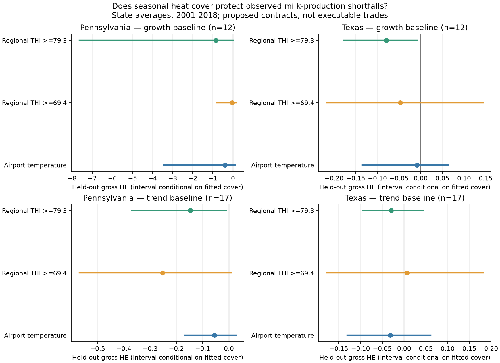

# 25: Maya's dairy pilot: does heat cover protect observed milk-production shortfalls?

**Status:** completed pilot, 2026-11-07; implementation on `maya-experiments`.
Rainfall research and the PRF Companion remain intact. This is a new comparison, not an approved
replacement of the team's project direction. Existing dairy pilot files were reused from Jack's
commit `8577aa6` without importing the unrelated price-comparison branch changes.

**Result:** this pilot does not establish an improvement over rainfall or a useful new dairy
product. Every primary observed-production hedge has negative gross HE. The exploratory trend
baseline produces one near-zero positive result, with an interval spanning zero. See the AUTO
tables for every value, its cohort and assumptions. These findings are about the tested simple
contracts and regional production baselines, not a rejection of every heat-insurance design.

The stronger-looking old dairy results are against a target defined directly from temperature,
not measured milk loss. They cannot establish effectiveness against real production losses.
Rainfall remains the project's empirical foundation. A sensible next step is to improve loss
identification and check residual risk after existing dairy coverage before building a product UI.

## Validation

| Check | Result | Source |
|---|---|---|
| Full branch suite, including rainfall, inherited dairy and new safeguards | 373 passed | `.venv/Scripts/python.exe -m pytest -q`, 2026-11-07 |
| Deterministic regeneration | 7 artifacts byte-identical | SHA-256 comparison before/after `run_dairy_validation.py`: five Maya CSVs, this report and its figure; same recorded environment |
| Raw source conversion | Verified against the NASS workbook | Preparation script; exact conversion error recorded in AUTO numbers table |
| Scope of changes | Local experiment branch; rainfall calculators and application preserved | Branch based on `main` at `dd0c464`; dairy reuse attributed above |

## Questions and definition of better

1. Does a weather-index payout protect shortfalls in **observed** milk yield, rather than a
   loss defined as a formula of that same weather index?
2. How much difference do humidity and settlement location make?
3. How much protection survives if the contracts can only be bought day ahead?

"Better" is evaluated separately on held-out hedge effectiveness (HE), normalized RMSE and bias,
same-year payout recovery, tail shortfall, cost, purchase timing, and executable depth. HE values
against different exposures are descriptive comparisons, not a head-to-head product ranking.
Report net premiums separately: a high gross payout correlation is insufficient.

## Specification recorded before running the new analysis

- Regional validation: Colorado, Pennsylvania and Texas, chosen for the existing Weld/Denver,
  Lancaster/Philadelphia and Erath/Dallas cases, not after selecting successful outcomes.
- Source: Gisbert-Queral et al. (2021), Nature Food, DOI 10.1038/s43016-021-00372-z;
  public replication archive https://doi.org/10.5281/zenodo.4818011.
- Published panel: monthly observed milk yield (kg/cow/day) and cow-weighted weather exposures.
  Source scripts convert pounds to kg, divide by calendar days, and use fixed geographic cow
  weights based on 2002-2012 inventories. These published geographic weights are a fixed study
  specification, not weights available to a trader in the earliest historical years.
- Fit contract quantities and triggers using years through 2000; score 2001-2018. Future
  validation years must not select thresholds, regions, or models. This is an exploratory pilot;
  the old dairy study and its findings were already known when selecting the cases.
- Coverage season: June-September, matching doc 24. Shortfalls are measured against a simple
  pre-season production baseline estimated only from earlier years. They include non-weather
  causes and are **not** identified causal heat losses or individual-farm insurance claims.
- Compare no hedge, temperature-index cover, and humidity-sensitive index cover. Proposed
  seasonal covers are hypothetical and must be marked as such. Estimate prices from earlier
  observations only and report load sensitivity rather than calling estimates market quotes.
- Reproduce the older seven-region heat-index pilot as supporting evidence, clearly separating
  its weather-defined loss and simulated forecasts from observed production validation.
- Retain rainfall as the first case study. Use its committed holdout results as context and
  report the difference in target, periods and populations next to any HE comparison.

### Availability amendment (before fitting)

Inspection of source dates found that Colorado has no observations for 1986-2002 in the published
panel. It cannot support the specified pre-2001 production validation and will be reported as
insufficient training data, not silently filled or moved to a favorable split. Pennsylvania and
Texas retain the specified split. Some source months are absent in 1982 and 2013; incomplete
June-September seasons and nonconsecutive year-over-year pairs will be excluded explicitly.
The old Colorado weather-index experiment remains a separate, modeled-loss result.

### Exploratory baseline sensitivity

After seeing the first pilot's negative HE values, an explicitly exploratory sensitivity was
added: extrapolate a log-linear trend fitted to the last ten observed earlier summers (minimum
eight). This avoids losing every production forecast after a gap in the source series. It does
not replace the primary baseline, and both baselines and every index are reported. Contract
triggers/slopes remain fitted through 2000 in both cases; no region or payoff is selected on test HE.
The fixed contract cap is 10% of expected seasonal milk, with model premium loads of 0%, 10% and
25%. These loads are scenarios, not insurance quotes or measured trading costs.

## Government and commercial baseline

The earlier doc 24 statement that USDA dairy programs only insure prices and margins is too broad.
Dairy Revenue Protection includes a regional yield adjustment and subsidized premiums:
https://www.rma.usda.gov/about-crop-insurance/frequently-asked-questions/dairy-revenue-protection.
DMC covers the milk/feed margin:
https://www.fsa.usda.gov/resources/income-support/dairy-margin-coverage-program-dmc.
Neither program is reconstructed as an actual historical policy by this pilot. No claim of beating
subsidized dairy insurance or of an uncovered market is justified without that comparison.
Private THI cover also exists (https://www.arbol.io/products/dairy-risk-solutions), and CME lists
monthly/seasonal temperature products (https://www.cmegroup.com/markets/weather).

## Data and results

The generated tables below retain failed cases, source gaps and the exploratory sensitivity.
The study does not identify causal heat losses; regional output can also change with herd mix,
management, feed costs, disease and baseline forecast error. Observed aggregate data is a stronger
validation target than a weather formula but is not a direct record of losses at the named county.

<!-- BEGIN AUTO: Maya dairy validation -->
## Observed-production results

These are fixed-slope seasonal contracts evaluated against state-average production shortfalls.
The airport and regional THI indices differ in location, threshold **and** measurement, so their contrast
does not isolate humidity. No seasonal contract is claimed executable. No Dairy-RP policy is simulated.

Growth is the primary forecast baseline; trend is the exploratory missing-data sensitivity.

| State | Baseline | Complete seasons | Training shortfalls | Holdout seasons | Status |
|---|---|---:|---:|---:|---|
| COLORADO | growth | 19 | 0 | 4 | insufficient training data |
| PENNSYLVANIA | growth | 36 | 12 | 12 | usable |
| TEXAS | growth | 36 | 12 | 12 | usable |
| COLORADO | trend | 19 | 0 | 11 | insufficient training data |
| PENNSYLVANIA | trend | 36 | 11 | 17 | usable |
| TEXAS | trend | 36 | 11 | 17 | usable |

HE: 1 = perfect variance reduction; 0 = none; negative = added variance. The interval is a
paired-year bootstrap conditional on a fixed fitted hedge; it omits fitting/selection uncertainty.

| State | Baseline | Cover | Gross HE [95% interval] | Net HE, 10% load | Payout recovery | 95th-percentile net shortfall / expected milk |
|---|---|---|---:|---:|---:|---:|
| PENNSYLVANIA | growth | No cover | 0.00 [0.00, 0.00] | 0.00 | 0% | 3.89% |
| PENNSYLVANIA | growth | Airport temperature | -0.40 [-3.43, 0.13] | -0.42 | 20% | 4.02% |
| PENNSYLVANIA | growth | Regional THI >=69.4 | -0.03 [-0.82, 0.17] | -0.04 | 8% | 3.78% |
| PENNSYLVANIA | growth | Regional THI >=79.3 | -0.85 [-7.65, 0.02] | -0.88 | 10% | 4.52% |
| TEXAS | growth | No cover | 0.00 [0.00, 0.00] | 0.00 | 0% | 7.99% |
| TEXAS | growth | Airport temperature | -0.01 [-0.13, 0.06] | -0.01 | 3% | 7.94% |
| TEXAS | growth | Regional THI >=69.4 | -0.05 [-0.22, 0.14] | -0.05 | 7% | 7.68% |
| TEXAS | growth | Regional THI >=79.3 | -0.08 [-0.18, -0.01] | -0.08 | 1% | 8.17% |
| PENNSYLVANIA | trend | No cover | 0.00 [0.00, 0.00] | 0.00 | 0% | 4.59% |
| PENNSYLVANIA | trend | Airport temperature | -0.05 [-0.17, 0.03] | -0.06 | 4% | 4.62% |
| PENNSYLVANIA | trend | Regional THI >=69.4 | -0.25 [-0.57, 0.01] | -0.25 | 11% | 4.87% |
| PENNSYLVANIA | trend | Regional THI >=79.3 | -0.15 [-0.37, -0.01] | -0.16 | 5% | 4.84% |
| TEXAS | trend | No cover | 0.00 [0.00, 0.00] | 0.00 | 0% | 6.21% |
| TEXAS | trend | Airport temperature | -0.03 [-0.13, 0.06] | -0.04 | 7% | 6.06% |
| TEXAS | trend | Regional THI >=69.4 | 0.01 [-0.18, 0.18] | 0.00 | 15% | 6.25% |
| TEXAS | trend | Regional THI >=79.3 | -0.03 [-0.09, 0.04] | -0.03 | 5% | 6.36% |

Actual evaluated years (source gaps and baseline requirements can reduce the nominal period):

- PENNSYLVANIA, growth: 2001, 2002, 2003, 2004, 2005, 2006, 2007, 2008, 2009, 2010, 2011, 2012.
- TEXAS, growth: 2001, 2002, 2003, 2004, 2005, 2006, 2007, 2008, 2009, 2010, 2011, 2012.
- PENNSYLVANIA, trend: 2001, 2002, 2003, 2004, 2005, 2006, 2007, 2008, 2009, 2010, 2011, 2012, 2014, 2015, 2016, 2017, 2018.
- TEXAS, trend: 2001, 2002, 2003, 2004, 2005, 2006, 2007, 2008, 2009, 2010, 2011, 2012, 2014, 2015, 2016, 2017, 2018.

### How to distinguish better from rainfall

| Evidence | What is scored | Result / source | Why not directly comparable |
|---|---|---|---|
| Rainfall Companion, doc 21 | PRF-style gap-month payout | Median holdout HE 0.61 | Weather-index target; 2001-2025; selected farm-months |
| Rainfall replacement, same picked cohort | PRF payout | Median HE 0.23 | Different coverage from dairy |
| Dairy Airport temperature, growth baseline | Observed state-production shortfall | Median HE -0.20 | State averages; missing-data-restricted 2001-2018; different target |
| Dairy Regional THI >=69.4, growth baseline | Observed state-production shortfall | Median HE -0.04 | State averages; missing-data-restricted 2001-2018; different target |
| Dairy Regional THI >=79.3, growth baseline | Observed state-production shortfall | Median HE -0.46 | State averages; missing-data-restricted 2001-2018; different target |
| Dairy Airport temperature, trend baseline | Observed state-production shortfall | Median HE -0.04 | State averages; missing-data-restricted 2001-2018; different target |
| Dairy Regional THI >=69.4, trend baseline | Observed state-production shortfall | Median HE -0.12 | State averages; missing-data-restricted 2001-2018; different target |
| Dairy Regional THI >=79.3, trend baseline | Observed state-production shortfall | Median HE -0.09 | State averages; missing-data-restricted 2001-2018; different target |
| Old dairy ladder, doc 24 | Temperature-defined loss | Median seasonal HE 0.32, simulated day-ahead 0.03 | Modeled target, hypothetical strikes/listing and simulated prices |

### Dated market availability

Public API observation: 2026-11-08T02:35:32.181437+00:00 (2026-11-07 21:35 EST).
Only the selected daily-high series were checked; this is not an audit of all seasonal products.

| Series | Open daily events | Listed days for target summer | Target year |
|---|---|---:|---:|
| KXHIGHDEN | 2026-11-07, 2026-11-08 | 0 | 2027 |
| KXHIGHPHIL | 2026-11-07, 2026-11-08 | 0 | 2027 |
| KXHIGHTDAL | 2026-11-07, 2026-11-08 | 0 | 2027 |

Source URLs and timestamps: `maya_dairy_market_check.json`; collected by
`scripts/pull_dairy_market_check.py`. A market listing does not prove sufficient depth.

### Numbers and assumptions

| Quantity | Value | Source / status |
|---|---|---|
| Prepared observed records | 1125 state-months | `maya_dairy_state_month.csv`; source DOI 10.5281/zenodo.4818011 |
| Raw milk conversion max absolute error | 0 kg/cow/day | Raw NASS workbook versus publication panel |
| Cover fit / nominal evaluation years | through 2000 / 2001-2018 | Cover terms fixed; production baseline and prices update from earlier observations only |
| Pre-season baseline | Prior summer yield times mean log growth over five completed annual changes | Six consecutive earlier summers required; recalculated each spring |
| Training target | Positive shortfall relative to that earlier-only baseline | Observed yield; all causes, not causal heat loss |
| Maximum payout | 10% of expected summer production | Fixed scenario cap |
| Trigger / slope | Earlier weather mean / one nonnegative least-squares slope on earlier shortfalls | No validation threshold search; capped after fitting |
| Model premium | Earlier-weather expected payout times 1.10 | Hypothetical; 0% and 25% load sensitivity in summary CSV |
| Dollar illustration | 1000 cows, $21/cwt | Fixed scenario assumptions, not historical prices or profit |
| Regional THI index thresholds | Approx. 69.4 and 79.3 | Publication's CreateFigure2a.R; cow-weighted daily-maximum THI bins |
| Geographic weather weights | Published 2002-2012 cow inventories | Fixed study specification; future relative to earliest years |
| Individual-farm validation / government-policy price comparison | Not established / not performed | No individual milk records or historical Dairy-RP quotes used |
| Executable seasonal hedge / market-maker capital | Not established / not modeled | A model premium is not a live quote |

## Reproduce

```powershell
.\.venv\Scripts\python.exe scripts/run_dairy_validation.py
# Optional raw refresh; needs internet and the dairy extra:
.\.venv\Scripts\python.exe -m pip install -e ".[dairy]"
.\.venv\Scripts\python.exe scripts/pull_dairy_validation.py
.\.venv\Scripts\python.exe scripts/pull_dairy_market_check.py
```


<!-- END AUTO: Maya dairy validation -->
