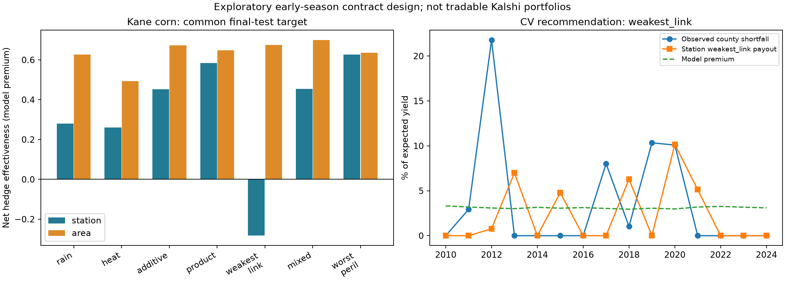

# 26: Compound heat-and-drought corn cover: can an exotic payout improve protection?

**Status:** specification recorded before fitting, on `maya-experiments`, 2026-11-07.
This extends the rainfall and dairy investigations without replacing them. It is an exploratory
contract-design pilot, not an insurance product or a claim to beat subsidized crop insurance.

## What Maya should take from this

We tested whether corn protection should pay for drought, heat, or their combination. The
product `D*H` is a real mathematical interaction: drought increases what another unit of heat
pays, and vice versa. Separate rain and heat contracts cannot create that interaction with a
fixed additive portfolio. A simpler combined contract can pay for whichever peril is worse.

For the mixed family, dollar payout is `E * (a*D + b*H + c*D*H)`: `E` is expected crop value;
`D` and `H` are drought/heat severity between zero and one; and `a,b,c` are nonnegative fitted
weights with a shared cap. The `c*D*H` term is the extra payment for coincident stresses. A pure
product sets `a=b=0`; a pure additive contract sets `c=0`. These are proposed payoff rules, not
claims that heat and drought are statistically independent.

**The evidence supports further testing, not a proven winning exotic product.** On the same
observed county-yield target, the station product looks substantially better than rain alone.
But its payout occurs only in the already-known drought event, and its advantage over additive
cover is uncertain. More decisively, the family selected by the earlier validation years fails
on later station data. It would be misleading to replace that selected family with the best
final-test performer and call the resulting score an unbiased selected-strategy backtest.

The area diagnostic works better, including for plain rainfall. That suggests studying the
weather measurement and region is at least as important as inventing a more elaborate formula.
It does not prove the gauge caused the difference: both rainfall and temperature measurements
change together. County yields also average across farms, and the production trend is an
estimate. A dry/hot year can still have an above-trend county yield, or a loss can arise from
other causes outside the cover.

This was honest hyperparameter tuning: thresholds, window and regularization were chosen in
earlier validation years; payout coefficients were fitted parameters. Nevertheless, the search
is large relative to the short validation sample. Temporal separation prevents direct leakage
but does not guarantee reliable model selection. Bootstrap intervals are wide and conditional
on the frozen fit; they do not include the uncertainty of selecting a family or weather site.

**Recommended next experiment:** freeze a small set of simple candidate shapes, obtain a panel
of additional corn counties, and evaluate by held-out years **and** held-out counties. Include
multiple severe drought seasons and benign years, and compare at equal modeled premium as well
as the present equal payout cap. Choose the panel and decision rule before inspecting its hedge
scores. Do not keep changing this test's thresholds to improve its final scores. The next goal
is to learn whether there is a repeatable advantage over additive cover, not to maximize one
county's backtest. Check county/farm targeting, available insurance, and realistic quotes before
claiming commercial improvement. These findings preserve the rainfall and dairy chapters.

## What a demo contract would actually need

The live public listing snapshot in `compound_market_check.json` confirms the Chicago heat
sample names `CLIMDW` and the rain sample names `CLIORD`. Current rules name The Weather Company;
historical ACIS readings have not been reconciled to all final TWC settlements. Both are station
proxies here. The snapshot lists only near-term daily heat and the current month's rainfall,
not a pre-season summer hedge. See the dated listing table below; it is a point-in-time check,
not evidence of what the exchange will list in future.

The duration-based heat index also uses **Tmin**, while these daily-high markets pay on **Tmax**.
Even ideal continuous rain/heat benchmarks in this study are proposed instruments, not portfolios
verified against listed strike ladders. A joint product or minimum needs joint-state exposure;
an exact static basket of separate single-peril contracts cannot supply it. Multi-month totals,
available strikes, listing horizon, source differences, counterparty capital and liquidity add
further gaps. Dynamic replication has not been tested.

A small mock tool could show a frozen payout surface, historical payouts and premiums, and a
clear 'proposed contract' label. A testnet contract could escrow capped collateral and accept a
mock weather oracle to demonstrate settlement. It would not create a counterparty, verify an
oracle's truth, make the hedge profitable or improve these empirical results. First validate
the exposure; then build that modest demonstration if the team/TA wants an on-chain component.

| Listing/protocol item | Value | Source |
| --- | --- | --- |
| Snapshot (UTC) | 2026-11-08; local date 2026-11-07 | `compound_market_check.json`, `checked_utc` |
| Open heat events | 2026-11-07, 2026-11-08 | public `KXHIGHCHI` open-event list in snapshot |
| Open rain event | November 2026 | public `KXRAINCHIM` open-event list in snapshot |
| Source heat threshold | Corn optimum approximately 29 C, with harmful exposure above it | Schlenker & Roberts (2009), DOI 10.1073/pnas.0906865106; motivates a proxy, not a fitted causal effect |

## How the experiment files connect

- `scripts/pull_compound_weather.py`: cached public ACIS downloads, flagged nearby-station fills,
  committed daily inputs and SHA-256 source manifest. Re-running needs internet only if raw
  cache files are absent. It does not silently refresh an existing cache.
- `src/agri_hedge/compound.py`: earlier-only yield forecasts, complete cohort, analytic daily
  heat integral, severity transforms, constrained fits, temporal selection, premiums and intervals.
- `scripts/run_compound.py`: offline reproduction, all candidate scores, frozen models, final
  payouts, sensitivity tables and figure. Reuses only weather columns from doc 14's prepared
  rain file; it ignores doc 14's full-sample trends and modeled-loss columns.
- `scripts/pull_compound_market_check.py`: optional read-only public listing/rules snapshot.
- `tests/test_compound.py`: guards against final-test leakage, current-year premium leakage,
  yield-forecast leakage, mismatched cohorts, cap violations and incorrect heat integration.

These scripts do not change `platform.quote`, `platform.companion`, the existing app or the
earlier rainfall/dairy outputs. Nothing is deployed or connected to a trading account.

## Question and fixed evaluation plan

Does an interaction between heat and drought improve held-out protection against Kane County,
Illinois corn-yield shortfalls, compared with rain-only, heat-only and additive cover?

- Observed outcome: the committed NASS Kane County corn yields. The 2025 corn value is missing;
  it will not be filled. Earlier yield history is used only for pre-season production forecasts.
- Production baseline: linear trend fitted to the previous twenty available yield observations,
  minimum fifteen. Each year's expected yield uses only earlier years. Target is positive yield
  shortfall as a fraction of that expectation. It includes all perils, not identified causal
  heat/drought losses or individual-farm claims.
- Fit/tuning period: 1980-2009. Expanding temporal validation folds: fit through 1994 and score
  1995-1999; through 1999 / 2000-2004; through 2004 / 2005-2009. All normalizations, thresholds,
  and coefficients are refitted using only each fold's earlier observations.
- Final evaluation: available complete years 2010-2025, excluded from model and threshold fitting.
  These years are held out from this algorithm, but the team already knows events such as 2012
  from doc 14. This is not a previously unseen scientific discovery sample.
- Primary weather pair: O'Hare rain (current Chicago monthly-rain settlement) and Midway heat
  (Chicago daily-high settlement). Historical signals are not a record of tradable portfolios.
- Area diagnostic: Northeast Illinois division rainfall plus NRCC temperature at the existing
  Kane study point. This changes geography and measurement; it is not a controlled causal test.
- Heat index: sum of daily mean exceedance above 29 C, approximating within-day temperature with
  a sinusoid between daily minimum and maximum. The threshold is motivated by Schlenker & Roberts
  (2009), https://doi.org/10.1073/pnas.0906865106; this proxy is not their original weather dataset.
- Compare windows July, June-July, and June-August. Study years require complete June-August
  daily temperatures and monthly rainfall regardless of the window chosen; no model-specific
  removal of difficult years.

## Payoff families and tuning

**Data-only amendment before any successful model fitting:** ACIS airport MDW lacks the entire
1981-1996 summers and scattered other days. To retain the earlier training period, fill missing
airport Tmin/Tmax from ACIS `USC00111577`, **CHICAGO MIDWAY AP 3SW** (a nearby COOP station),
with per-element flags. Do not interpolate or fill remaining gaps. This is a historical station
proxy, not an exact same-gauge settlement backtest. The original unfilled sample could not
support the first validation fold. This amendment used missingness and station metadata, not
hedge scores. Report substitution shares by training/test period. Source: prepared daily CSV
and `compound_weather_source.json`. Dates/years appear again in the generated audit table.

Let D and H be drought and heat severity, each clipped to [0,1]. Trigger quantiles are chosen from
0.25, 0.50, 0.75 using earlier weather only; severity scales use the earlier 90th-10th percentile
range. No quantile is recomputed on the final evaluation sample.

| Family | Payoff features | Interpretation |
|---|---|---|
| Rain | D | Drought alone |
| Heat | H | Heat alone |
| Additive | D, H | Separate protection against either peril |
| Product | D*H | Stronger payment when both are severe |
| Weakest link | min(D,H) | Payment requires both perils |
| Mixed | D, H, D*H | Separate protection plus an interaction |
| Worst peril | max(D,H) | Pays for the worse of the two perils |

Nonnegative coefficients have total at most 0.30, so all families have the same maximum payout
of 30% of expected yield. Coefficients minimize centered payout error with ridge penalties
0, 0.01, 0.10. Centering allows variance reduction without inventing a free insurance cash payout;
bias and RMSE are also reported. Thresholds, window and penalty are hyperparameters, coefficients
are fitted parameters. Tune on temporal validation **only**, then freeze through the final test.

Each family gets a best validation configuration. The overall recommended family is selected on
validation net HE; if none beats zero, recommend no hedge. All family results are retained even if
the final test disappoints. Do not reselect the winner on final HE.

## Price, uncertainty and feasibility

- These continuous payoffs are proposed early-season contracts, not verified Kalshi orders.
  Even the single-peril continuous benchmarks are idealized, not exact listed binary ladders.
- Model premium: mean payoff on earlier weather times 1.10. Also report 0% and 25% loads. Loads
  represent scenario friction/risk loading, not verified fees, capital requirements or quotes.
- Fixed dollar illustration: $4.70/bushel, matching doc 14's scenario, not historical prices.
- Report gross/net HE, normalized RMSE, bias, recovery and tail shortfall on the same target.
  Paired-year bootstrap intervals condition on fitted models and omit selection uncertainty.
- Report performance excluding the already-known 2012 drought without refitting. This is a
  pre-specified stress-event sensitivity, not an opportunity to drop inconvenient observations.
- A nonseparable payoff generally cannot be statically replicated by separate single-peril
  contracts: additive payoffs have zero rectangular cross-difference; D*H does not. New joint
  contracts need a counterparty and settlement rule; an attractive formula creates no liquidity.

## Sources and results

Rain/yields: doc 14 and its committed CSVs. New daily weather: ACIS StnData at MDW, GridData at
the existing Kane point; https://www.rcc-acis.org/docs_webservices.html. Raw responses and SHA-256
provenance are cached separately. Generated results, exact cohorts and numbers tables follow.

<!-- AUTO: compound start -->
## Generated results and numbers tables

Reproduce offline: `.venv/Scripts/python.exe scripts/run_compound.py` (Windows). Pull new source weather only when needed: `scripts/pull_compound_weather.py`.

### Cohort and fixed assumptions

| Item | Value | Source |
| --- | --- | --- |
| Fit years | 1981, 1982, 1983, 1984, 1985, 1986, 1987, 1988, 1989, 1990, 1991, 1992, 1993, 1995, 1996, 1998, 1999, 2000, 2001, 2002, 2003, 2004, 2005, 2006, 2007, 2008, 2009 | compound_panel.csv |
| Final-test years | 2010, 2011, 2012, 2013, 2014, 2015, 2016, 2017, 2018, 2019, 2020, 2021, 2022, 2023, 2024 | compound_panel.csv |
| Excluded years/reasons | 1980: incomplete June-August temperature; 1994: incomplete June-August temperature; 1997: incomplete June-August rain; 2025: missing observed corn yield | compound_cohort_audit.csv |
| Folds (fit end / validation) | 1994 / 1995-99; 1999 / 2000-04; 2004 / 2005-09 | compound.FOLDS |
| Yield forecast | previous 20 observations, minimum 15 | compound.preseason_yields |
| Heat / price / maximum payout | 29 C; $4.70/bu; 30% expected yield | protocol / run_compound.py |
| Threshold quantiles / ridge | 0.25, 0.50, 0.75 / 0, 0.01, 0.10 | compound.candidates |
| Candidate configurations | 459 per signal pair; 918 total | compound_cv.csv |
| Windows | July; June-July; June-August | compound.WINDOWS |
| Loads / bootstrap replicates | 0%, 10%, 25% / 4,000 paired years, seed 473 | compound_summary.csv / compound.net_he_interval |

Nearby-station substitutions (share of Tmin/Tmax elements, not yield observations):

| Period | Days | Tmax filled | Tmin filled | Element share |
| --- | --- | --- | --- | --- |
| fit | 2484 | 1380 | 1381 | 55.58% |
| test | 1380 | 1 | 3 | 0.14% |

### Same-target comparison

HE is variance reduction: 0.30 means a 30% reduction in residual variance; negative values mean more variable residuals. It is neither profit nor the share of losses paid. nRMSE is gross payout error divided by the target standard deviation. Recovery counts only payouts up to the observed shortfall. Premiums are model scenarios, not quotes.

| Signal | Family | CV net HE | Test gross HE | Test net HE | Net HE conditional 95% interval | nRMSE | Loss recovered | Mean premium / expected yield |
| --- | --- | --- | --- | --- | --- | --- | --- | --- |
| station | rain | 0.530 | 0.283 | 0.279 | [-0.03, 0.39] | 1.00 | 9.3% | 2.04% |
| station | heat | 0.227 | 0.258 | 0.260 | [-0.77, 0.47] | 0.86 | 40.0% | 3.65% |
| station | additive | 0.393 | 0.457 | 0.453 | [-0.45, 0.67] | 0.74 | 44.4% | 4.61% |
| station | product | 0.533 | 0.581 | 0.584 | [-0.04, 0.84] | 0.78 | 25.9% | 3.11% |
| station | weakest_link | 0.632 | -0.283 | -0.283 | [-1.79, 0.22] | 1.15 | 21.9% | 3.11% |
| station | mixed | 0.396 | 0.457 | 0.454 | [-0.46, 0.67] | 0.74 | 44.8% | 4.49% |
| station | worst_peril | 0.345 | 0.621 | 0.627 | [-0.39, 0.84] | 0.69 | 38.6% | 3.55% |
| area | rain | 0.714 | 0.623 | 0.626 | [-0.19, 0.84] | 0.71 | 32.7% | 4.49% |
| area | heat | 0.539 | 0.508 | 0.493 | [-0.05, 0.88] | 0.75 | 42.8% | 2.59% |
| area | additive | 0.732 | 0.666 | 0.673 | [-0.11, 0.96] | 0.65 | 43.8% | 4.21% |
| area | product | 0.832 | 0.643 | 0.648 | [-0.07, 0.90] | 0.71 | 33.2% | 3.64% |
| area | weakest_link | 0.867 | 0.670 | 0.675 | [-0.16, 0.91] | 0.67 | 37.5% | 3.75% |
| area | mixed | 0.769 | 0.694 | 0.700 | [-0.14, 0.95] | 0.62 | 47.5% | 4.56% |
| area | worst_peril | 0.697 | 0.628 | 0.636 | [-0.15, 0.93] | 0.65 | 48.9% | 5.16% |

**Validation-selected recommendations, before inspecting final scores:** station = `weakest_link`; area diagnostic = `weakest_link`.

The area diagnostic is hypothetical and is not a location selected for its test performance.

### Cost and tail outcomes (10% load)

HE largely ignores a constant premium: larger loads can leave HE similar while making the policy more expensive. All costs below are fractions of expected production. Average payout minus premium is not a proof of insurance value or profit; insurance can have a negative average return and still reduce risk. These families share a maximum payout budget, **not an equal premium or equal expected-payout budget**.

| Signal | Family | Mean loss | Mean payout | Mean premium | Payout less premium | Unhedged 95th shortfall | Net 95th shortfall |
| --- | --- | --- | --- | --- | --- | --- | --- |
| station | rain | 3.61% | 0.33% | 2.04% | -1.70% | 13.77% | 14.28% |
| station | heat | 3.61% | 3.61% | 3.65% | -0.03% | 13.77% | 12.88% |
| station | additive | 3.61% | 3.20% | 4.61% | -1.40% | 13.77% | 12.57% |
| station | product | 3.61% | 0.93% | 3.11% | -2.17% | 13.77% | 13.10% |
| station | weakest_link | 3.61% | 2.27% | 3.11% | -0.84% | 13.77% | 16.61% |
| station | mixed | 3.61% | 3.24% | 4.49% | -1.25% | 13.77% | 12.40% |
| station | worst_peril | 3.61% | 1.74% | 3.55% | -1.81% | 13.77% | 12.23% |
| area | rain | 3.61% | 1.41% | 4.49% | -3.08% | 13.77% | 13.15% |
| area | heat | 3.61% | 1.97% | 2.59% | -0.61% | 13.77% | 12.73% |
| area | additive | 3.61% | 1.75% | 4.21% | -2.46% | 13.77% | 12.93% |
| area | product | 3.61% | 1.26% | 3.64% | -2.38% | 13.77% | 12.59% |
| area | weakest_link | 3.61% | 1.52% | 3.75% | -2.23% | 13.77% | 12.42% |
| area | mixed | 3.61% | 1.95% | 4.56% | -2.61% | 13.77% | 12.80% |
| area | worst_peril | 3.61% | 2.25% | 5.16% | -2.91% | 13.77% | 13.88% |

### Interaction improvement over additive cover

| Signal | Family vs additive | Change in net HE | Conditional paired 95% interval |
| --- | --- | --- | --- |
| station | product | 0.132 | [-0.163, 0.430] |
| station | weakest_link | -0.736 | [-1.556, 0.222] |
| station | mixed | 0.001 | [-0.011, 0.004] |
| station | worst_peril | 0.174 | [-0.084, 0.584] |
| area | product | -0.024 | [-0.118, 0.051] |
| area | weakest_link | 0.003 | [-0.070, 0.145] |
| area | mixed | 0.027 | [-0.080, 0.201] |
| area | worst_peril | -0.037 | [-0.092, 0.117] |

### Exact frozen configurations

| Signal | Family | Window | Rain q | Heat q | Ridge | Rain trigger (in) | Heat trigger (C-days) | Weights |
| --- | --- | --- | --- | --- | --- | --- | --- | --- |
| station | rain | jun_jul | 0.25 | 0.5 | 0.0 | 5.3450 | 18.1803 | 0.300000 |
| station | heat | jun_aug | 0.5 | 0.25 | 0.1 | 10.7800 | 14.1964 | 0.093324 |
| station | additive | jun_jul | 0.25 | 0.25 | 0.0 | 5.3450 | 10.7996 | 0.214144, 0.085856 |
| station | product | jun_jul | 0.5 | 0.25 | 0.0 | 6.7500 | 10.7996 | 0.300000 |
| station | weakest_link | jul | 0.5 | 0.25 | 0.0 | 3.7300 | 6.7879 | 0.300000 |
| station | mixed | jun_jul | 0.25 | 0.25 | 0.01 | 5.3450 | 10.7996 | 0.118921, 0.086927, 0.094152 |
| station | worst_peril | jun_aug | 0.5 | 0.75 | 0.01 | 10.7800 | 46.3155 | 0.217125 |
| area | rain | jun_jul | 0.5 | 0.5 | 0.0 | 8.0100 | 10.4361 | 0.261697 |
| area | heat | jun_jul | 0.5 | 0.75 | 0.0 | 8.0100 | 23.9323 | 0.300000 |
| area | additive | jun_jul | 0.5 | 0.75 | 0.0 | 8.0100 | 23.9323 | 0.190066, 0.109934 |
| area | product | jun_jul | 0.5 | 0.25 | 0.0 | 8.0100 | 5.3014 | 0.300000 |
| area | weakest_link | jun_jul | 0.5 | 0.5 | 0.0 | 8.0100 | 10.4361 | 0.300000 |
| area | mixed | jun_jul | 0.75 | 0.5 | 0.0 | 9.3600 | 10.4361 | 0.025953, 0.000000, 0.255503 |
| area | worst_peril | jun_jul | 0.5 | 0.75 | 0.0 | 8.0100 | 23.9323 | 0.271180 |

Exact scales and input hashes are in `compound_models.json`; every candidate validation score is retained in `compound_cv.csv`.

### Sensitivity: remove the already-known 2012 event, without refitting

| Signal | Family | Years | Net HE without 2012 | Recovery |
| --- | --- | --- | --- | --- |
| station | rain | 14 | 0.013 | 0.000 |
| station | heat | 14 | -0.202 | 0.380 |
| station | additive | 14 | -0.029 | 0.368 |
| station | product | 14 | 0.014 | 0.000 |
| station | weakest_link | 14 | -0.477 | 0.343 |
| station | mixed | 14 | -0.033 | 0.371 |
| station | worst_peril | 14 | 0.200 | 0.227 |
| area | rain | 14 | 0.137 | 0.102 |
| area | heat | 14 | -0.006 | 0.044 |
| area | additive | 14 | 0.119 | 0.091 |
| area | product | 14 | 0.094 | 0.044 |
| area | weakest_link | 14 | 0.174 | 0.117 |
| area | mixed | 14 | 0.201 | 0.125 |
| area | worst_peril | 14 | 0.146 | 0.146 |

### Price loading sensitivity (all final-test years)

| Signal | Family | Net HE: 0% load | 10% load | 25% load |
| --- | --- | --- | --- | --- |
| station | rain | 0.280 | 0.279 | 0.278 |
| station | heat | 0.260 | 0.260 | 0.260 |
| station | additive | 0.453 | 0.453 | 0.452 |
| station | product | 0.584 | 0.584 | 0.585 |
| station | weakest_link | -0.283 | -0.283 | -0.283 |
| station | mixed | 0.454 | 0.454 | 0.454 |
| station | worst_peril | 0.627 | 0.627 | 0.628 |
| area | rain | 0.626 | 0.626 | 0.626 |
| area | heat | 0.495 | 0.493 | 0.491 |
| area | additive | 0.672 | 0.673 | 0.673 |
| area | product | 0.648 | 0.648 | 0.649 |
| area | weakest_link | 0.675 | 0.675 | 0.675 |
| area | mixed | 0.700 | 0.700 | 0.700 |
| area | worst_peril | 0.636 | 0.636 | 0.636 |

Full bias, tail-shortfall, recovery, mean payout, mean loss and premium metrics are in `compound_summary.csv`. Year-level fractional and fixed-price dollar illustrations are in `compound_test_payouts.csv`.

<!-- AUTO: compound end -->
