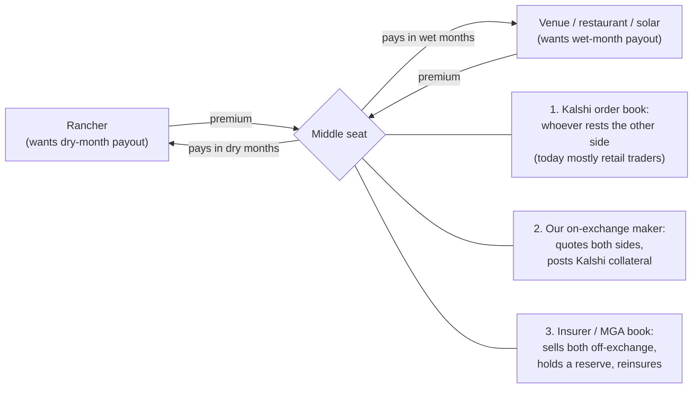

# 26: The two-way weather market, and what an insurer or other intermediary would cost, earn and risk

**Proposal cell:** post-Milestone II expansion research, follow-up to doc 25 (who should sit in the middle of a two-way weather market, and what it costs). Owners: team  |  **Status:** DRAFT, first pass. Reproduce with `python scripts/run_intermediary_capital.py` (about 10 s, committed data only; rewrites the AUTO block below and `data/processed/intermediary_*.csv`).

**Last updated:** 2026-11-20

**Headline: an intermediary helps only if it brings the other side of the trade or the buyers. A traditional fronted insurer adds about 33% of premium in costs and loses money on the ranch book at any realistic price. Capital is the smaller cost; climate drift is the bigger one.**

1. **The two-way structure saves real capital, but only if the wet side shows up.** With equal wet and dry premium at the ranchers' own stations and months, the money an intermediary must hold falls by about 60%: from $39.6M to $15.2M for our Kalshi maker on a $10M-a-year book, and from $28.1M to $9.6M for a lean insurer. Its break-even price load falls from 14% to 6% (maker) or 9% (lean insurer). At today's measured flow, about 1 wet dollar per 80 dry (doc 25), the saving is nil: 1-in-200 loss 4.00 vs 4.01 per $1 of expected payout.
2. **A fronted insurer/MGA is the most expensive middle.** Fronting fee, MGA and producer commission, premium tax and admin add about 33% of premium. The hedger would pay $1.49-1.59 per $1 of expected payout. Trading Kalshi directly costs $1.15 (doc 09's 1.09 price plus the taker fee), and subsidized PRF costs a rancher $0.61. Cheap reinsurance capital (10.5% cost of equity) does not rescue it: capital costs an insurer only 0-7% of premium.
3. **A lean carrier and our own Kalshi maker cost about the same.** Both break even near a 14% load on the ranch-only book. Kalshi's full collateral costs the maker about 12% of premium; the carrier's smaller 1-in-200 reserve costs about 7%, plus 6% in expenses. Kalshi's same-event collateral return only matters once there are calls to net against: it cuts the balanced book's break-even from 9% to 6%.
4. **Pricing error is the biggest loss.** Priced on 1951-1995 and paid 1996-2025, the south-central winter books paid out 1.18-1.22 per $1 of expected payout. Every intermediary loses money there at both a 9% and a 20% load. The worst season, Nov 2008-Feb 2009, costs about $23-27M on the $10M book. Only the national balanced book is profitable out of sample (maker at 20%: +$0.45M a year).
5. **The intermediaries worth having do not hold the risk.** They are distributors (a broker, a co-op, a hay buyer that finances the premium to harvest), the carrier behind a 508(h) endorsement, and whoever brings wet-side buyers to the same station-months. That agrees with doc 25's "fix the menu, sell the engine, seed the book".

These are modeled rain-index payouts on airport stations, not farm or venue income. The demand weights come from doc 25 and are biased high. All cost inputs are listed with sources in the numbers table.

## The two-way market structure

### One event, two kinds of hedger

Kalshi lists one monthly rain event per city (for example `KXRAINDALM-26NOV`, Dallas-Fort Worth, November). The event is a ladder of binary contracts, "will DFW get more than X inches this month?", one per strike. Each contract has a YES holder and a NO holder, and both prepay: YES pays the price, NO pays $1 minus the price, so the pot always holds the $1 the winner collects (doc 05).

- **Dry side (a put).** A dryland rancher loses forage when the month is dry. It buys NO on the strikes below normal, which pay when rain comes in under them. Stacked across strikes, that is a put on the month's rain: nothing above the 30th percentile, rising to the full limit at zero rain (doc 21's Companion builds this kind of put).
- **Wet side (a call).** A restaurant, a ballpark, a contractor or a solar farm loses money when the month is wet. It buys YES on the strikes above normal, which is a call: nothing below the 70th percentile, rising to the full limit at the 95th.

The two hedges pay in opposite states of the same month. A dry month pays the rancher and not the venue; a wet month pays the venue and not the rancher; a middling month pays neither. They never pay together.

### Who sits in the middle

Somebody has to take the other side of each hedge. There are three ways to arrange it:

1. **No intermediary.** The hedger trades the order book against whoever is resting there, mostly retail traders arriving through Robinhood, Coinbase and weather.com (doc 25). Each seller posts full collateral for its own side.
2. **Our on-exchange market maker.** We quote both sides at the same station-month. With Kalshi's opt-in directional collateral return (the `DIRECNET` tag on every monthly rain series), a position that is short both the put and the call posts only the event's worst case, not both maxima (doc 25). Collateral is posted month by month, because Kalshi lists one month at a time.
3. **An insurer or MGA book.** A carrier sells the rancher and the venue contracts off-exchange, on insurance paper, and holds a reserve against the whole season's loss. It can net across stations and months, which Kalshi cannot. It needs a licensed carrier (its own, or a fronting carrier), a reinsurer behind it, and distribution.

Two other roles hold no weather risk. A **broker** (introducing broker or app) routes hedgers to Kalshi for a commission. A **premium financier** (a hay buyer, co-op or lender) pays the premium up front and collects it at sale, which is what raised take-up from 5% to 72% in Kenya (Casaburi & Willis 2018, doc 25).

### Why the middle seat likes two-way flow

If the middle seat sells $1 of expected payout to each side, it collects two premiums but pays at most one side in any month. It also needs less capital. Kalshi's collateral return cuts what must be posted at the event from both sides' maxima (7.07 per $1 of expected payout on the balanced book) to the larger one (3.77). An insurer's 1-in-200 season loss falls from 4.01 to 2.15 (Table A). The catch, from doc 25, is that dry demand at the ranchers' stations in Nov-Feb outweighs wet demand about 80 to 1. A real book there is almost all puts.

## What "capital", "capital cost", "gains" and "losses" mean here

| Term | Meaning in this doc | How it is computed |
|---|---|---|
| Expected payout (pure premium) | What the contracts pay on average | Mean payout over 1951-2025; the $10M book has $10M of it a year |
| Load | Price above expected payout | Premium = (1 + load) x expected payout. Kalshi's observed load is 9% (doc 09); doc 25 assumed 20% |
| Capital | Money that must sit idle so payouts can always be met | Insurer: 1-in-200 season loss minus premium (Solvency II's 99.5% one-year standard). Kalshi maker: before each month, the 1-in-200 loss on months already settled plus that month's full collateral, at its largest |
| Capital cost | What tying the capital up costs | Capital x (required return - interest earned on it) x years held. Required return 12% for a small trading firm (assumption) or 10.5% for reinsurers (Guy Carpenter 2026). Interest 3.5% on Kalshi, 4.2% T-bills for an insurer |
| Expenses | Fees and commissions | Insurer/MGA: fronting 7% + MGA and producer 20% + premium tax 2% + admin 4% = 33% of premium. Lean carrier: 6%. Kalshi maker: 0 (no maker fee on weather); the hedger pays the taker fee, about 5.3% of premium |
| Gain (expected profit) | Premium minus expected payouts, expenses and capital cost | Economic profit: positive only if investors earn more than their required return |
| Loss | The years the contracts pay out more than premium | 1-in-20, 1-in-100 and 1-in-200 season loss (simulated), the worst season since 1951, and a 1996-2025 out-of-sample run |
| Break-even load | The smallest load that covers expenses and capital cost | Solved so expected economic profit is zero |

No capital gains in the tax sense are involved. The "gain" is underwriting profit and the "loss" is payout years.

## Method

**Contracts.** As in doc 25's netting backtest (`run_expansion_netting.py`): on each station's monthly rain, put = clip((K30 − x)/K30, 0, 1) and call = clip((x − K70)/(K95 − K70), 0, 1), where K is the station-month percentile. Each contract is scaled so its expected payout is one unit.

**Books.**
- *Ranch puts, south-central Nov-Feb.* DFW, OKC, SAT, AUS, CLL and HOU, weighted by doc 25's modeled rancher demand per station.
- *Two-way at today's flow.* The same, plus calls at the observed 1:80 wet:dry premium ratio.
- *Two-way balanced.* The same, plus an equal premium of calls at every station-month.
- *National books.* All 34 long-record Kalshi stations, all 12 months (393 station-months with both contracts): puts only, and puts plus equal-premium calls. They show what diversification alone buys.

**Loss distribution.** One value per season (Nov-Feb, or the calendar year for national books), 1951-2025. Only 68-75 seasons exist, so the 1-in-100 and 1-in-200 come from 100,000 simulated seasons. The simulation keeps each station-month's own rain history and its correlation with the others (a Gaussian copula). For each book it uses a Student-t copula instead when that matches the observed spread of season payouts better. The Texas winter book needs the fatter-tailed t(10) because its dry months cluster in La Niña winters. Even so, the simulated 1-in-20 (2.66) sits below the empirical 3.00, so its tail may still be understated.

**Intermediaries and costs.** See the term table and the numbers table. The insurer holds its reserve for the season plus a month to settle (5 months for Nov-Feb, 12 for national books). The Kalshi maker holds its capital for the same span, so the two are compared on the same footing.

**Out of sample.** Strikes and expected payouts are fitted on 1951-1995, then paid on 1996-2025 (doc 25's split). Expenses and capital cost are charged every year.

## Results

<!-- BEGIN AUTO: intermediary capital (scripts/run_intermediary_capital.py) -->

**Table A. How much each book can lose, per $1 of expected payout (pure premium).** Empirical = 75 season years 1951-2025; 1-in-100 and 1-in-200 from the copula simulation. Kalshi collateral = total maximum loss posted across the book's monthly events (each held about one month).

| Book | Station-months | Copula | Worst year (season) | 1-in-20 | 1-in-100 | 1-in-200 | Kalshi collateral, separate | Kalshi collateral, netted |
|---|---|---|---|---|---|---|---|---|
| Ranch puts only, south-central Nov-Feb | 24 | t(10) | 3.44 (1970) | 2.66 | 3.64 | 4.01 | 7.40 | 7.40 |
| Two-way at today's flow (wet:dry 1:80) | 24 | t(10) | 3.40 (1970) | 2.65 | 3.62 | 4.00 | 7.40 | 7.32 |
| Two-way balanced (wet = dry) | 24 | Gaussian | 1.83 (1991) | 1.69 | 2.04 | 2.15 | 7.07 | 3.77 |
| One-way puts, 34 stations, all months | 393 | Gaussian | 1.81 (1963) | 1.46 | 1.69 | 1.77 | 8.90 | 8.90 |
| Two-way balanced, 34 stations, all months | 393 | Gaussian | 1.19 (1998) | 1.25 | 1.36 | 1.41 | 7.79 | 4.60 |

Simulation check (simulated vs empirical over the season years with data): Ranch puts only, south-central Nov-Feb: sd 0.84 vs 0.85, 1-in-20 2.66 vs 3.00 (68 seasons); Two-way at today's flow (wet:dry 1:80): sd 0.83 vs 0.83, 1-in-20 2.65 vs 2.97 (68 seasons); Two-way balanced (wet = dry): sd 0.39 vs 0.38, 1-in-20 1.69 vs 1.64 (68 seasons); One-way puts, 34 stations, all months: sd 0.26 vs 0.23, 1-in-20 1.46 vs 1.41 (75 seasons); Two-way balanced, 34 stations, all months: sd 0.15 vs 0.09, 1-in-20 1.25 vs 1.17 (75 seasons).

**Table B. Break-even load: what each intermediary must charge above expected payouts.** Capital = money on hand for the season: an insurer's 1-in-200 season loss net of premium; for a Kalshi maker, the 1-in-200 loss on months already settled plus the current month's full collateral, at its largest. Capital cost = capital x (required return - interest earned) x years held. Break-even load covers expenses plus capital cost. The hedger's all-in cost adds fees the hedger pays (Kalshi taker fee, broker commission). Direct-Kalshi and broker rows use today's observed Kalshi price (load 9%, doc 09).

| Book | Intermediary | Capital per $1 premium, at that price | Held (yrs) | Capital cost, % premium | Expenses, % premium | Break-even load | Hedger pays per $1 expected payout |
|---|---|---|---|---|---|---|---|
| Ranch puts only, south-central Nov-Feb | Hedger trades Kalshi directly (no intermediary) | 0 (seller on Kalshi posts it) | 0.00 | 0.0% | 0.0% | n/a (market price) | 1.15 |
| Ranch puts only, south-central Nov-Feb | Our on-exchange maker, Kalshi collateral return | 3.52 | 0.42 | 12.4% | 0.0% | 14.2% | 1.20 |
| Ranch puts only, south-central Nov-Feb | Broker routes the hedger to Kalshi (no capital) | 0 (seller on Kalshi posts it) | 0.00 | 0.0% | 0.0% | n/a (market price) | 1.20 |
| Ranch puts only, south-central Nov-Feb | Insurer/MGA book, fronted and reinsured | 1.52 | 0.42 | 4.0% | 33.0% | 58.7% | 1.59 |
| Ranch puts only, south-central Nov-Feb | Lean insurer book (existing carrier or captive, no MGA layer) | 2.50 | 0.42 | 6.6% | 6.0% | 14.4% | 1.14 |
| Two-way balanced (wet = dry) | Hedger trades Kalshi directly (no intermediary) | 0 (seller on Kalshi posts it) | 0.00 | 0.0% | 0.0% | n/a (market price) | 1.15 |
| Two-way balanced (wet = dry) | Our on-exchange maker, Kalshi collateral return | 1.57 | 0.42 | 5.5% | 0.0% | 5.9% | 1.12 |
| Two-way balanced (wet = dry) | Our on-exchange maker, no collateral return | 2.31 | 0.42 | 8.2% | 0.0% | 8.9% | 1.15 |
| Two-way balanced (wet = dry) | Broker routes the hedger to Kalshi (no capital) | 0 (seller on Kalshi posts it) | 0.00 | 0.0% | 0.0% | n/a (market price) | 1.20 |
| Two-way balanced (wet = dry) | Insurer/MGA book, fronted and reinsured | 0.42 | 0.42 | 1.1% | 33.0% | 51.8% | 1.52 |
| Two-way balanced (wet = dry) | Lean insurer book (existing carrier or captive, no MGA layer) | 0.97 | 0.42 | 2.5% | 6.0% | 9.3% | 1.09 |
| Two-way balanced, 34 stations, all months | Hedger trades Kalshi directly (no intermediary) | 0 (seller on Kalshi posts it) | 0.00 | 0.0% | 0.0% | n/a (market price) | 1.15 |
| Two-way balanced, 34 stations, all months | Our on-exchange maker, Kalshi collateral return | 0.59 | 1.00 | 5.0% | 0.0% | 5.3% | 1.11 |
| Two-way balanced, 34 stations, all months | Our on-exchange maker, no collateral return | 0.81 | 1.00 | 6.9% | 0.0% | 7.4% | 1.13 |
| Two-way balanced, 34 stations, all months | Broker routes the hedger to Kalshi (no capital) | 0 (seller on Kalshi posts it) | 0.00 | 0.0% | 0.0% | n/a (market price) | 1.20 |
| Two-way balanced, 34 stations, all months | Insurer/MGA book, fronted and reinsured | 0.00 | 1.00 | 0.0% | 33.0% | 49.3% | 1.49 |
| Two-way balanced, 34 stations, all months | Lean insurer book (existing carrier or captive, no MGA layer) | 0.29 | 1.00 | 1.9% | 6.0% | 8.5% | 1.09 |

**Table C. Gains and losses on a $10M book (expected payouts a year).** Load 9% = today's Kalshi price (doc 09), which a new seller has to match; 20% = doc 25's base case. Peak capital = most money tied up at once. Expected profit is after expenses and after paying for capital (required return minus interest). Return on peak capital = expected profit before the capital charge, plus interest, over peak capital. Out-of-sample (OOS) columns price on 1951-1995 and pay 1996-2025 (30 seasons), charging expenses and capital cost every year.

| Book | Intermediary | Load | Peak capital | Expected profit / yr | Return on peak capital | OOS loss ratio | OOS mean P&L / yr | OOS worst year (season) | OOS losing years | OOS 30-yr total | OOS max drawdown |
|---|---|---|---|---|---|---|---|---|---|---|---|
| Ranch puts only, south-central Nov-Feb | Our on-exchange maker, Kalshi collateral return | 9% | $40.67M | -$0.54M | 3.7% | 1.18 | -$2.33M | -$24.17M (2008) | 13 of 27 | -$62.92M | $90.79M |
| Ranch puts only, south-central Nov-Feb | Lean insurer book (existing carrier or captive, no MGA layer) | 9% | $29.15M | -$0.52M | 2.6% | 1.18 | -$2.31M | -$24.15M (2008) | 13 of 27 | -$62.35M | $90.46M |
| Ranch puts only, south-central Nov-Feb | Insurer/MGA book, fronted and reinsured | 9% | $29.15M | -$3.46M | -7.5% | 1.18 | -$5.25M | -$27.09M (2008) | 17 of 27 | -$141.81M | $150.83M |
| Ranch puts only, south-central Nov-Feb | Our on-exchange maker, Kalshi collateral return | 20% | $39.57M | $0.60M | 6.5% | 1.18 | -$1.19M | -$23.03M (2008) | 13 of 27 | -$32.17M | $72.57M |
| Ranch puts only, south-central Nov-Feb | Lean insurer book (existing carrier or captive, no MGA layer) | 20% | $28.05M | $0.54M | 6.3% | 1.18 | -$1.25M | -$23.08M (2008) | 13 of 27 | -$33.65M | $73.45M |
| Ranch puts only, south-central Nov-Feb | Insurer/MGA book, fronted and reinsured | 20% | $28.05M | -$2.70M | -5.2% | 1.18 | -$4.49M | -$26.32M (2008) | 16 of 27 | -$121.13M | $132.45M |
| Two-way balanced (wet = dry) | Our on-exchange maker, Kalshi collateral return | 9% | $16.27M | $0.32M | 7.0% | 1.22 | -$1.88M | -$8.09M (2008) | 17 of 27 | -$50.74M | $63.32M |
| Two-way balanced (wet = dry) | Lean insurer book (existing carrier or captive, no MGA layer) | 9% | $10.65M | -$0.03M | 4.1% | 1.22 | -$2.24M | -$8.45M (2008) | 18 of 27 | -$60.39M | $70.82M |
| Two-way balanced (wet = dry) | Insurer/MGA book, fronted and reinsured | 9% | $10.65M | -$2.98M | -23.6% | 1.22 | -$5.18M | -$11.39M (2008) | 26 of 27 | -$139.85M | $139.85M |
| Two-way balanced (wet = dry) | Our on-exchange maker, Kalshi collateral return | 20% | $15.17M | $1.46M | 14.6% | 1.22 | -$0.74M | -$6.95M (2008) | 13 of 27 | -$19.99M | $39.74M |
| Two-way balanced (wet = dry) | Lean insurer book (existing carrier or captive, no MGA layer) | 20% | $9.55M | $1.03M | 15.2% | 1.22 | -$1.17M | -$7.39M (2008) | 15 of 27 | -$31.70M | $48.50M |
| Two-way balanced (wet = dry) | Insurer/MGA book, fronted and reinsured | 20% | $9.55M | -$2.21M | -18.8% | 1.22 | -$4.41M | -$10.63M (2008) | 23 of 27 | -$119.18M | $119.19M |
| Two-way balanced, 34 stations, all months | Our on-exchange maker, Kalshi collateral return | 9% | $5.84M | $0.40M | 18.9% | 1.11 | -$0.74M | -$2.33M (1998) | 22 of 30 | -$22.26M | $22.31M |
| Two-way balanced, 34 stations, all months | Lean insurer book (existing carrier or captive, no MGA layer) | 9% | $3.15M | $0.05M | 12.0% | 1.11 | -$1.10M | -$2.68M (1998) | 24 of 30 | -$32.96M | $32.96M |
| Two-way balanced, 34 stations, all months | Insurer/MGA book, fronted and reinsured | 9% | $3.15M | -$2.90M | -81.3% | 1.11 | -$4.04M | -$5.62M (1998) | 30 of 30 | -$121.25M | $121.25M |
| Two-way balanced, 34 stations, all months | Our on-exchange maker, Kalshi collateral return | 20% | $4.74M | $1.60M | 45.7% | 1.11 | $0.45M | -$1.13M (1998) | 12 of 30 | $13.55M | $1.92M |
| Two-way balanced, 34 stations, all months | Lean insurer book (existing carrier or captive, no MGA layer) | 20% | $2.05M | $1.15M | 66.5% | 1.11 | $0.00M | -$1.58M (1998) | 14 of 30 | $0.14M | $3.26M |
| Two-way balanced, 34 stations, all months | Insurer/MGA book, fronted and reinsured | 20% | $2.05M | -$2.09M | -91.2% | 1.11 | -$3.24M | -$4.82M (1998) | 30 of 30 | -$97.06M | $97.06M |

**Table D. Break-even load under other cost assumptions.** Insurer rows vary the required return on capital and the expense share (6% = lean, 33% = fronted MGA). Maker rows have no expenses; only the required return varies.

| Book | Who | Required return | Expenses 6% | 15% | 25% | 33% |
|---|---|---|---|---|---|---|
| Ranch puts only, south-central Nov-Feb | insurer | 8% | 10.6% | 22.2% | 38.1% | 54.3% |
| Ranch puts only, south-central Nov-Feb | insurer | 10% | 14.4% | 26.1% | 42.4% | 58.7% |
| Ranch puts only, south-central Nov-Feb | insurer | 15% | 19.8% | 31.9% | 48.5% | 65.1% |
| Ranch puts only, south-central Nov-Feb | maker, collateral return | 8% | 7.7% (no expenses) | | |  |
| Ranch puts only, south-central Nov-Feb | maker, collateral return | 12% | 14.2% (no expenses) | | |  |
| Ranch puts only, south-central Nov-Feb | maker, collateral return | 20% | 26.7% (no expenses) | | |  |
| Two-way balanced (wet = dry) | insurer | 8% | 8.0% | 19.2% | 34.8% | 50.6% |
| Two-way balanced (wet = dry) | insurer | 10% | 9.3% | 20.6% | 36.1% | 51.8% |
| Two-way balanced (wet = dry) | insurer | 15% | 11.4% | 22.6% | 38.0% | 53.4% |
| Two-way balanced (wet = dry) | maker, collateral return | 8% | 3.2% (no expenses) | | |  |
| Two-way balanced (wet = dry) | maker, no collateral return | 8% | 4.8% (no expenses) | | |  |
| Two-way balanced (wet = dry) | maker, collateral return | 12% | 5.9% (no expenses) | | |  |
| Two-way balanced (wet = dry) | maker, no collateral return | 12% | 8.9% (no expenses) | | |  |
| Two-way balanced (wet = dry) | maker, collateral return | 20% | 11.0% (no expenses) | | |  |
| Two-way balanced (wet = dry) | maker, no collateral return | 20% | 16.8% (no expenses) | | |  |
| Two-way balanced, 34 stations, all months | insurer | 8% | 7.5% | 18.5% | 33.6% | 49.3% |
| Two-way balanced, 34 stations, all months | insurer | 10% | 8.5% | 19.2% | 33.9% | 49.3% |
| Two-way balanced, 34 stations, all months | insurer | 15% | 9.9% | 20.2% | 34.2% | 49.3% |
| Two-way balanced, 34 stations, all months | maker, collateral return | 8% | 2.9% (no expenses) | | |  |
| Two-way balanced, 34 stations, all months | maker, no collateral return | 8% | 4.1% (no expenses) | | |  |
| Two-way balanced, 34 stations, all months | maker, collateral return | 12% | 5.3% (no expenses) | | |  |
| Two-way balanced, 34 stations, all months | maker, no collateral return | 12% | 7.4% (no expenses) | | |  |
| Two-way balanced, 34 stations, all months | maker, collateral return | 20% | 9.5% (no expenses) | | |  |
| Two-way balanced, 34 stations, all months | maker, no collateral return | 20% | 13.4% (no expenses) | | |  |

<!-- END AUTO: intermediary capital (scripts/run_intermediary_capital.py) -->

### Reading the tables

**Table A: the two-way structure, and diversification, cut the tail.**
- Adding equal wet premium at the same south-central station-months cuts the 1-in-200 loss from 4.01 to 2.15 per $1 of expected payout, and Kalshi's netted collateral from 7.40 to 3.77.
- At today's 1:80 flow nothing changes: 4.00 and 7.32.
- Spreading puts over 34 stations and 12 months, with no wet side at all, cuts the 1-in-200 to 1.77. Adding the wet side there cuts it to 1.41.
- Kalshi collateral does not shrink with diversification (8.90 for national puts), because it is posted event by event.

**Table B: what the hedger would pay, per $1 of expected payout.**

| Route | Ranch-only book | Two-way balanced | National balanced |
|---|---|---|---|
| Subsidized PRF (farmer share, doc 09) | 0.61 | n/a | n/a |
| Kalshi directly, today's book (1.09 + taker fee) | 1.15 | 1.15 | 1.15 |
| Our Kalshi maker at break-even (+ taker fee) | 1.20 | 1.12 | 1.11 |
| Lean carrier at break-even | 1.14 | 1.09 | 1.09 |
| Broker to Kalshi (5% commission, assumption) | 1.20 | 1.20 | 1.20 |
| Fronted insurer/MGA at break-even | 1.59 | 1.52 | 1.49 |

What drives each row:
- **The fronted MGA is uncompetitive everywhere.** Its 33% expense stack does it, not capital: capital cost is 0-4% of premium for that insurer.
- **Diversification and the opposite side help different intermediaries.** For the lean carrier, diversification does most of the work: ranch-only 14.4%, national puts only 10.8%, national balanced 8.5%. For the Kalshi maker, the opposite side does: ranch-only 14.2%, national puts 10.6%, national balanced 5.3%. Kalshi nets only within an event, so a maker gains from wet flow at the same station-month and little from spreading puts around the country.

**Table C: gains and losses on a $10M book.**
- **Ranch-only book at Kalshi's 9% price.** Neither our maker nor a lean carrier covers its cost of capital (−$0.5M a year in expectation). At a 20% load, both earn about +$0.6M a year on $28-40M of capital, a 6-7% return against the 10.5-12% investors require.
- **The balanced two-way book** earns 14-15% at a 20% load, with $10-15M of capital.
- **Out of sample, every south-central book loses money.** Over 27 seasons, ranch-only and balanced, maker and lean carrier alike, at both loads: −$0.7M to −$2.3M a year, and the 2008 season alone costs about $23M on the ranch book. Winter rain in this region drifted away from its 1951-1995 history (loss ratio 1.18 on puts, 1.22 with calls). That costs more than any capital or fee line.
- **Only the national balanced book makes money out of sample:** maker +$0.45M a year at a 20% load, worst year −$1.1M, max drawdown $1.9M.

**Table D: the ranking does not depend on the cost assumptions.**
- At a 7.5% required return, the cheapest capital in the range (near Swiss Re's 7.3% estimate), the fronted insurer still needs a 54% load on the ranch book.
- Cut its expenses to 15% and the ranch book still needs 22-32%.
- The maker's break-even moves with its required return: 8% to 27% on the ranch book as that return goes from 8% to 20%.

## Would we benefit from insurance companies or other intermediaries?

| Intermediary | What it brings | What it costs | Verdict |
|---|---|---|---|
| Fronted insurer / MGA, reinsured | Insurance paper (needed for non-ECP buyers and loss-linked triggers; doc 25's ECP rules); netting across stations and months; seasonal contracts sold before Kalshi lists the months; access to about $800B of reinsurance capital | About 33% of premium in fronting, commission, tax and admin; licensing; a fronting partner | **No for rain-index ranch cover**: the hedger would pay 1.49-1.59 against 1.15 on Kalshi. Worth it only for products Kalshi cannot list (loss-linked cover, day-count or snow wet sides, cross-city pools), as doc 25 concluded |
| Lean carrier (an existing AIP or a captive, no MGA layer) | The same reserve-based book without the distribution stack | About 6% expenses plus capital | **About even with our own maker**: break-even 14% ranch-only, 9% balanced. Under a 508(h) endorsement, FCIC subsidy and reinsurance would change these numbers completely (not modeled) |
| Reinsurer / ILS fund (Nephila and others) | Cheap capital: 10.5% cost of equity, cat-bond multiples near 2.4x expected loss | Reached only through a carrier | **Small gain.** Capital costs 0-12% of premium in every row, so cheaper capital saves at most a few points |
| Our on-exchange maker | Two-sided quotes; same-event collateral netting; no license needed for proprietary trading (doc 25, inference) | Full collateral; 12% required return (assumption) | **Only with wet flow at the same station-months**: break-even 6% balanced vs 14% ranch-only, against Kalshi's 9% today |
| Broker / app routing to Kalshi | Origination; no capital | About 5% commission (assumption) on top of Kalshi's price | **Yes, if it raises take-up.** It fixes distribution, the binding constraint in doc 25 |
| Premium financier (hay buyer, co-op, lender) | Pay at harvest; take-up 5% to 72% in the Kenyan experiment | Interest on the premium for about 6 months: 4% of premium at an assumed 8% rate, plus default risk | **Yes.** The cheapest lever per dollar in this table. Doc 25: lenders are distributors and financiers, not hedgers |
| PRF insurers (AIPs) as the wet side | n/a | n/a | **No.** They are short the same drought, on the rancher's side (doc 25) |

So yes, we would benefit from intermediaries, but not from one that holds rain risk for ranchers alone. The ones that pay for themselves bring buyers (brokers, financiers), bring the other side (wet-side originators at the same station-months), or bring a subsidy (508(h)). A risk-holding insurer earns its cost only on a diversified, two-sided book, and even then the 1996-2025 run says recent-window pricing matters more than who holds the capital.

## Caveats

- **Kalshi lists one month at a time** (doc 25). The maker cannot sell a season up front, and the hedger cannot lock in Nov-Feb before PRF closes on Dec 1. The insurer can, but then it carries ENSO risk: history-priced Texas winter calls ran 35-48% underpriced after El Niño autumns (doc 25).
- **Fills are not modeled.** At saved depth the ranch book cannot be filled on Kalshi at all (doc 22: demand is about 330x the resting NO depth). This doc prices an intermediary that would supply that depth.
- **Adverse selection** in the last weeks of a month (doc 25's market-maker notes) is not charged. A maker that quotes all month needs a wider spread than the break-even load.
- **Fixed costs** (staff, licensing, actuarial, systems) are excluded. They raise the break-even for small books and favor the no-license routes.
- **Cost inputs are partly secondary.** The 5-10% fronting fee comes from one undated trade page, and the MGA commission from one legal case and one public company. No parametric loss or expense ratio was found. The admin share, the broker commission, the financing rate and the 12% maker return are assumptions.
- **The hold period is conservative for the insurer and generous for the maker.** Both hold capital for the whole season. A reserve could be released as months settle, and a maker who stopped quoting after a loss would need less.
- **The tail model.** The 1-in-200 rests on a copula fitted to 68-75 seasons. On the Texas book the empirical 1-in-20 (3.00) is above the simulated one (2.66), so its tail may still be understated.
- **Demand weights** are doc 25's modeled rancher demand, which is biased high: Texas already insures 27% of PRF liability in Nov-Feb.

## Next steps

1. Rerun Table C with doc 25's recent-window and trend pricing (last-15-year pricing brought pair loss ratios to 1.01-1.05) to see whether the south-central book survives once priced on recent climate.
2. Paper-trade the two-sided maker this winter on the live December-February books, with collateral return on, and record fills and adverse selection.
3. Get one real fronting quote and one parametric expense ratio, to replace the secondary 7% and 20%.
4. Model 508(h) economics with FCIC subsidy and reinsurance, the one carrier route doc 25 ranks near the top.

## Numbers table

| Number | Value | Source | Status |
|---|---|---|---|
| Kalshi load on farm hedges, central (range) | 1.09 (0.89-1.31) per $1 expected payout | [doc 09](09_payout_comparison.md) Table 6 | internal, computed |
| Subsidized PRF farmer load | 0.61 | [doc 09](09_payout_comparison.md) Table 6 | internal, computed |
| Kalshi taker fee; maker fee on weather | 0.07 x C x P x (1 − P); none found on weather series | [Kalshi fee schedule (CFTC filing, 2022)](https://www.cftc.gov/filings/orgrules/rule091222kexdcm003.pdf); [Kalshi Help: fees (Apr 2026)](https://help.kalshi.com/en/articles/13823805-fees); [doc 05](../research/05_kalshi_weather_markets.md) | sourced; the current schedule PDF was rate-limited |
| Taker fee as a share of premium | about 5.3% (0.07 x (1 − 0.24)) | team computation; hit rate 0.24 from [expansion_netting_summary.csv](../../data/processed/expansion_netting_summary.csv) | computed |
| Kalshi interest on cash and positions | 3.50% APY | [Kalshi Help, 2026-10-20](https://help.kalshi.com/en/articles/13823847-apy-on-kalshi) | sourced |
| Kalshi directional collateral return (`DIRECNET`) | on every monthly rain series | [Kalshi Help](https://help.kalshi.com/en/articles/13823816-collateral-return); [doc 25](25_weather_hedging_expansion.md) | sourced; tag meaning inferred |
| 3-month T-bill | 4.21% (2026-11-02) | [lens_counterparties_capital.md](../research/expansion_notes/lens_counterparties_capital.md) | sourced |
| Reinsurer cost of equity (ROE) | 10.5% (16.6%), 2026 | [Reinsurance News, Guy Carpenter](https://www.reinsurancene.ws/guy-carpenter-expects-reinsurance-industry-to-generate-roe-of-16-6-in-2026/) | sourced, secondary |
| Reinsurer WACC; cost of equity | 8.23% (2025); 9.6% | [BusinessWire, AM Best](https://www.businesswire.com/news/home/20250827246459/en/Bests-Market-Segment-Report-Global-Reinsurers-Met-Cost-of-Capital-for-Second-Consecutive-Year-in-2024) | snippet; 2026 update URL unconfirmed |
| Non-life cost of capital, medium term | about 7.3% | [Insurance Business, Swiss Re sigma, 2026-11-18](https://www.insurancebusinessmag.com/reinsurance/news/breaking-news/swiss-re-sigma-flags-growth-recovery-but-tighter-reinsurer-margins-597829.aspx) | sourced, secondary |
| Small trading firm required return | 12% | doc 25 lens note | assumption |
| Solvency II capital standard | 99.5% one-year VaR | [Directive 2009/138/EC Art. 101](https://legislation.gov.uk/eudr/2009/138/article/101/data.htm) | sourced |
| Solvency II risk-margin cost-of-capital rate | 6%, falling to 4.75% from 2027-01-30 | [Directive (EU) 2025/2](https://eur-lex.europa.eu/eli/dir/2025/2/oj/eng) | sourced; context only, not used |
| Fronting fee | 5-10% of premium (7% used) | [Coverager](https://coverager.com/understanding-insurance-mgas-fronters-and-reinsurers/) | secondary, undated |
| Fronting carriers' retention | about 10-20% of premium | [Risk & Insurance, AM Best](https://riskandinsurance.com/us-pc-fronting-market-estimated-30-billion-as-mga-growth-fuels-expansion/) | snippet |
| MGA commission incl. producer (used) | 20.6% (Lincoln General case); over 20% (TWFG MGA channel); 20% used | [IRMI 2023](https://irmi.com/articles/expert-commentary/the-interplay-between-fronting-and-mga-arrangements); [Insurance Business](https://www.insurancebusinessmag.com/us/news/breaking-news/twfgs-mga-channel-reshapes-platform-economics-as-margins-compress-from-q2-highs-596310.aspx) | secondary |
| Agent commission, multi-peril crop; private crop | 8%; 19% (2024) | [Insurance Journal, Big "I" / AM Best](https://www.insurancejournal.com/magazines/mag-features/2025/08/04/834123.htm) | sourced |
| Lloyd's expense ratio (cross-check on the 33% stack) | 35.6% (FY2025) | [Lloyd's FY2025 results](https://www.lloyds.com/insights/media-centre/press-releases/lloyds-announces-full-year-results-2025) | sourced |
| Premium tax | 2% (Texas 1.6%) | general state range | assumption, unverified |
| Insurer admin, parametric | 4% | none found | assumption |
| Broker commission on a routed hedge | 5% | none found | assumption |
| Premium financing rate | 8% for about 6 months | none found | assumption |
| Cat-bond loss multiple | 2.4-2.5x (2026) | [Artemis](https://www.artemis.bm/news/as-cat-bond-loss-multiples-tighten-am-best-urges-investors-towards-greater-selectivity/) | sourced, secondary |
| Global reinsurance capital | about $800B | [Reinsurance News, Aon](https://www.reinsurancene.ws/record-800bn-reinsurance-capital-offers-insurers-growth-opportunities-heading-into-1-1-aon/) | sourced (doc 25) |
| Wet:dry premium ratio, shared stations Nov-Feb | 0.012 (about 1:80) | [weather_demand_segment.csv](../../data/processed/weather_demand_segment.csv); [doc 25](25_weather_hedging_expansion.md) | modeled |
| Ranch station weights | doc 25 rancher contracts by station | [weather_demand_depth.csv](../../data/processed/weather_demand_depth.csv) | modeled, biased high |
| Take-up, upfront vs pay at harvest | 5% vs 72% | [Casaburi & Willis 2018](https://www.aeaweb.org/doi/10.1257/aer.20171526) | sourced (doc 25) |
| All Table A-D values | see tables | [intermediary_book_risk.csv](../../data/processed/intermediary_book_risk.csv), [intermediary_economics.csv](../../data/processed/intermediary_economics.csv), [intermediary_backtest.csv](../../data/processed/intermediary_backtest.csv), [intermediary_sensitivity.csv](../../data/processed/intermediary_sensitivity.csv) | computed, `scripts/run_intermediary_capital.py` |
