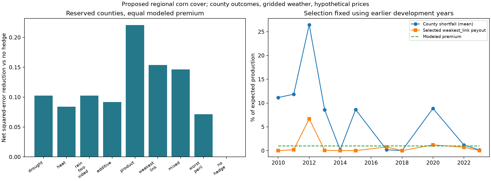

# 27: Multi-county validation of proposed corn weather cover

**2026-11-08, `maya-experiments`. Protocol recorded before downloading or scoring the new
county outcomes.** Doc 26 is exploratory prior evidence. This study preserves it, the dairy
studies, the PRF research and the companion app. No change to the team's approved direction.

## Plain-English conclusion after the frozen evaluation

This is better evidence than the single-county pilot: multiple counties, shared payout weights,
reserved counties, a far smaller tuning search, an equal modeled price and dependence-aware
intervals. It is **not confirmation of a commercially superior exotic policy**. Every primary
held-out skill interval spans zero. The selected family's point estimate is encouraging but
uncertain. The mixed interaction improves on additive cover in two held-out counties, but the
paired interval includes no improvement. The pre-specified interaction evidence checks fail.

Most of the improvement is still associated with the already-known 2012 event. Removing that
event makes the primary selected policy worse than no hedge on net squared error, while its
gross HE remains slightly positive. Its loss matching is partial, not full crop insurance.
The rule pays in multiple county-years, so doc 26's literal single-payout problem is reduced;
the dependence on a major disaster remains. See the generated sensitivity tables for values.

The primary nonnegative fit gives wet-spring protection zero weight. This does not show excess
rain is harmless: a point rainfall proxy is not soil saturation, planting delay, drainage or
actual insured damage, and this small fitted design may miss those relationships. One missing
development-county yield also removes the known wet 2019 season from the shared final cohort.
No county or year was replaced to improve the result. Do not generalize the result as a fair
test of all possible excess-rain products.

The synthetic additive binary basket approximates the frozen mixed payout fairly closely in
this observed sample. That is **payoff replication**, a different question from protecting crop
losses. It uses invented index contracts, short positions and a cash term, with no verified
bid/ask prices, depth or collateral. Some replica payouts are negative. It is an optimistic
diagnostic and cannot be presented as an executable hedge or arbitrage. Exact interaction
spanning is still a different mathematical question from approximate fit on observed weather.

### What to do with these findings

Keep the PRF Companion app and the rainfall/dairy results. Frame this extension as testing what
new joint instruments could add and identifying the conditions under which they help. The
next useful research is improved exposure/measurement and a separately chosen confirmation
sample, not more threshold searching on these test outcomes. A farmer's actual loss or a clearly
defined insured-loss target would be more direct than a shortfall from our estimated trend.

For a course deliverable, a modest contract-design screen could compare simple vs joint payouts,
show the basis/replication gap, and label prices as modeled. A mock/testnet settlement component
could demonstrate a fixed payout rule, escrow and weather-oracle input if the TA wants blockchain.
Neither software nor a smart contract makes a weak economic relationship stronger. Preserve
the original topic's emphasis on executable event primitives, settlement, liquidity and capital.

## Read the files

- `scripts/pull_compound_panel.py`: public, cached NASS exports and ACIS gridded weather;
  commits compact inputs and `panel_source_manifest.json` with request hashes. No credentials.
- `src/agri_hedge/compound_panel.py`: aggregation, earlier-only baselines, per-county weather
  transforms, shared constrained coefficients, temporal selection and whole-year intervals.
- `scripts/run_compound_panel.py`: offline reproduction and all `panel_*` result CSVs, frozen
  model JSON, figure and AUTO tables. Does not alter old studies or the app.
- `tests/test_compound_panel.py`: county/future-label isolation, equal-price and cap constraints,
  shared cohorts, cost-sensitive scoring, paired-year resampling and missing-data forecasts.

Sources: [NASS Quick Stats](https://quickstats.nass.usda.gov/),
[ACIS](https://www.rcc-acis.org/docs_webservices.html), and the existing Census coordinate file.
The wet-spring feature is motivated by the already-known planting-delay mechanism, documented
in [NASS's 2019 Crop Production Summary](https://www.nass.usda.gov/Publications/Todays_Reports/reports/cropan20.pdf).
As a source audit, the official [Illinois 2024 county estimates](https://data.nass.usda.gov/Statistics_by_State/Illinois/Publications/County_Estimates/2025/20250506-IL-Corn-County-Estimates-2024.pdf)
also omit Champaign; no replacement value has been invented for its absent Quick Stats row.

## Question and decision rule

Does a joint heat/drought payout add repeatable protection beyond simpler weather cover against
observed corn-yield shortfalls, at an equal modeled premium? This is **parametric insurance
design**, not arbitrage, a weather forecast, a causal crop-damage model or a live insurance offer.
Parametric means the payment follows a measured index instead of an adjusted individual claim.

Success requires the selected policy to improve final-test net squared payout error over no
hedge on the held-out counties. A specific claim that the interaction helps additionally needs
a positive paired-year interval for mixed minus additive protection and improvement in at least
two of the three held-out counties. Report results excluding 2012 without refitting. Treat all
criteria as evidence checks, not a guarantee of commercial value or a grade. Report failures.

## Fixed sample and separation

This is a small convenience panel of corn-producing counties in Illinois, Iowa and Indiana,
selected by geography before new yield downloads, not by hedge scores. It is not a random or
nationally representative sample. Kane is excluded because doc 26 has already inspected it.

| State | County | FIPS | Use |
| --- | --- | --- | --- |
| IL | Champaign | 17019 | development |
| IL | La Salle | 17099 | development |
| IL | McLean | 17113 | development |
| IL | Sangamon | 17167 | held-out county |
| IA | Boone | 19015 | development |
| IA | Polk | 19153 | development |
| IA | Webster | 19187 | development |
| IA | Story | 19169 | held-out county |
| IN | Benton | 18007 | development |
| IN | Clinton | 18023 | development |
| IN | White | 18181 | development |
| IN | Tippecanoe | 18157 | held-out county |

- Outcome: annual NASS SURVEY corn-grain bushels per harvested acre, TOTAL domain, all production
  practices. Retrieve earlier history for baselines; never fill suppressed/missing yields. Current
  revised histories are used, not archived real-time releases; revisions remain a limitation.
- Weather: ACIS NRCC grid 1 at each county's Census Gazetteer internal point, reusing coordinates
  already committed in `rowcrop_county_station_distance.csv`. This is a gridded point estimate,
  not a farm thermometer, county cropland average or verified Kalshi settlement reading.
- Weather years 1980-2024. Require complete April-July daily precipitation and Tmin/Tmax.
  No interpolation. Complete-year cohorts are shared across families. Record all exclusions.
- Baseline: previous 20 available annual yields, minimum 15, linear trend forecast using earlier
  years only (same rule as doc 26). Loss is positive fractional shortfall below that forecast.
  It includes all causes and errors in the baseline, not identified heat/drought claims.
- Develop on the nine development counties only. Temporal folds: fit through 1994 / validate
  1995-1999; through 1999 / 2000-2004; through 2004 / 2005-2009. Refit through 2009 after selection.
- Final evaluation: 2010-2024, separately on development counties and the three held-out counties,
  using a common complete final-year cohort across all counties. No held-out-county losses enter
  fitting or selection in any period. Their earlier weather calibrates their local index, and
  earlier yields set their pre-season production baseline: transfer of payout weights is tested,
  not zero access to a new county's history.
- Final years are held out from this algorithm, but broad events such as 2012/2019 are already
  known from earlier work. Counties in one year share weather shocks: do not count their rows as
  independent years or claim the sample is scientifically untouched in every respect.

## Fixed features, families and small tuning search

All weather transforms are calibrated on weather available through the fitting cutoff only.
Per county: severity is clipped to [0,1], scaled by that county's earlier 90th-10th percentile
index range. D = June-July rainfall below its earlier median. H = June-July heat exposure above
its earlier median. Heat exposure integrates degrees above 29 C under each day's Tmin/Tmax
sinusoid, as in doc 26. W = April-May rainfall above its earlier 75th percentile. The wet-spring
feature addresses the known omitted peril of planting-season excess rain; it is a fixed benchmark
introduced before inspecting this panel, not a feature discovered by searching its test scores.

| Family | Features | Role |
| --- | --- | --- |
| drought | D | Match the previous drought-only benchmark |
| heat | H | Heat alone |
| rain_two_sided | D, W | Stronger rainfall-only benchmark |
| additive | D, H, W | Separate protection for all three fixed exposures |
| product | D*H | Joint-only cover |
| weakest_link | min(D,H) | Requires both stresses |
| mixed | D, H, W, D*H | Same additive cover plus an interaction |
| worst_peril | max(D,H) | Worse of drought or heat |

One pooled nonnegative coefficient vector per family, shared across counties. Sum of weights
at most 0.30. No fitted county-specific payoff coefficients, flexible time window, trigger search,
tree, neural network or new feature search. Only ridge penalty is selected from 0, 0.01, 0.10.
This gives 24 candidates per budget regime, compared with doc 26's much larger search.

Primary regime: equal modeled premium **1% of expected production**, with a 10% load; require
training-average payout = 0.01/1.10 and the same 30% payout cap. If a family cannot meet this
budget under its cap, flag it infeasible; do not increase the cap or quietly change the price.
This is a pooled experimental price, not a county-specific actuarial quote.

Secondary regime: same 30% cap without the equal-premium constraint. Price each frozen family at
1.10 times its development-training mean payout. This reveals how conclusions change when price
is not matched. It cannot replace the primary result if it looks better. Constant fractional
premiums mean gross/net HE coincide; report price-sensitive error and tail measures as well.

Fit centered error plus ridge under the stated constraints. Select penalty and overall family
by pooled temporal-validation **net squared-error reduction** relative to no hedge:
`1 - mean((loss - payout + premium)^2) / mean(loss^2)`.
Validation uses equal county-year weights on a common development cohort. Stable table order
breaks exact ties. Recommend no hedge if no family scores above zero. Freeze selection before
final scores. Retain every family's final results; do not select the best test performer.

## Evidence, replication and uncertainty

Report HE (variance reduction), net squared-error reduction, average payout/premium, recovery of
observed shortfalls, overpayments, 95th-percentile net shortfall, and each county separately.
Primary comparison: mixed minus additive on the held-out counties. Use paired **whole-year**
bootstrap draws with all counties kept together, 4,000 draws and seed 473. Intervals condition on
the fitted models, assume resampled years are exchangeable, and omit selection uncertainty and
serial dependence. Fifteen final years provide limited evidence even with many county rows.

For the frozen mixed payout, fit a static additive approximation with an intercept/cash term
and separate binary threshold contracts on D, H and W at 0.10, 0.25, 0.50, 0.75. Fit on development
training weather only; report final payoff-approximation error separately from crop-loss protection.
Allow signed positions here as an optimistic spanning diagnostic; costs, collateral, financing,
actual strike availability and liquidity are not modeled. These are synthetic index primitives,
not verified executable Kalshi orders. A nonzero approximation error demonstrates a gap for this
finite basis/sample, not a universal impossibility theorem. The rectangular cross-difference
argument in doc 26 establishes the general nonseparability of a genuine interaction.

The study does not establish superiority to subsidized crop insurance, create a counterparty,
or reconcile historical ACIS values with final settlement sources. A mock/testnet settlement
demo remains a separate possible deliverable after the empirical question is assessed.

## Sources, reproduction and results

New source requests and SHA-256 hashes will be recorded in `panel_source_manifest.json`; prepared
inputs and all exclusions will be committed. Source data are parsed as data, never executed.
Results, exact cohorts and numbers tables will be generated below without overwriting prior studies.

<!-- AUTO: panel start -->
## Generated results and numbers tables

Reproduce offline: `.venv/Scripts/python.exe scripts/run_compound_panel.py`. Download inputs only when absent: `scripts/pull_compound_panel.py` (cached public requests, no key).

| Item | Value | Source |
| --- | --- | --- |
| Panel | 12 counties; 9 development, 3 held out | panel_counties.csv |
| Final common years | 2010, 2011, 2012, 2013, 2014, 2015, 2017, 2018, 2020, 2022, 2023 | panel_annual.csv / common_years |
| Final county-year rows | 132 total; 33 held-out-county rows | panel_predictions.csv, per family |
| Incomplete source county-years | 6 | panel_cohort_audit.csv (all retained, with reasons) |
| Primary premium / load / maximum payout | 1% expected production / 10% / 30% | protocol; panel_models.json |
| Quantiles / windows | D median June-July rain; H median June-July DD29; W 75th April-May rain; scales 90th-10th | compound_panel.fit_model |
| Search size | 8 families x 3 penalties = 24 per regime; 2 regimes | panel_cv.csv |
| Production baseline | previous 20 available observations, minimum 15 | compound.preseason_yields |
| Bootstrap | 4,000 whole-year draws; seed 473; conditional fixed models | compound_panel.paired_year_interval |
| Synthetic primitive basis | cash + 12 binary indicators (3 severities x 4 strikes: 0.10, 0.25, 0.50, 0.75) | compound_panel.primitive_basis |

Source exclusions (no imputation or replacement counties):

| FIPS | County | Year | Reason |
| --- | --- | --- | --- |
| 17019 | Champaign | 2024 | missing yield |
| 17099 | La Salle | 2021 | missing yield |
| 18023 | Clinton | 2019 | missing yield |
| 18181 | White | 2021 | missing yield |
| 18181 | White | 2024 | missing yield |
| 18157 | Tippecanoe | 2016 | missing yield |

**Metric meanings:** HE is variance reduction. Net error skill is reduction in squared signed loss-minus-payout-plus-premium error, relative to no hedge. Neither is profit, causal damage explained, or the share of losses reimbursed. Recovery measures matched payouts capped at the observed shortfall. Premium and tail numbers are percentages of expected production. Constant fractional premiums make net HE equal gross HE.

**Pre-test recommendations:** primary `weakest_link`; secondary cap-only `weakest_link`. Chosen using development-county temporal validation, not final scores.

### Primary: matched modeled premium

| County group | Family | HE | Net error skill | Conditional 95% interval | Loss recovered | Mean premium | 95th net shortfall |
| --- | --- | --- | --- | --- | --- | --- | --- |
| development | drought | 0.095 | 0.072 | [-0.114, 0.141] | 8.6% | 1.00% | 28.07% |
| held_out | drought | 0.171 | 0.103 | [-0.117, 0.201] | 9.7% | 1.00% | 23.48% |
| development | heat | 0.146 | 0.081 | [-0.116, 0.167] | 9.5% | 1.00% | 28.18% |
| held_out | heat | 0.151 | 0.084 | [-0.104, 0.179] | 10.8% | 1.00% | 25.37% |
| development | rain_two_sided | 0.095 | 0.072 | [-0.114, 0.141] | 8.6% | 1.00% | 28.07% |
| held_out | rain_two_sided | 0.171 | 0.103 | [-0.117, 0.201] | 9.7% | 1.00% | 23.48% |
| development | additive | 0.136 | 0.081 | [-0.096, 0.158] | 9.3% | 1.00% | 28.07% |
| held_out | additive | 0.160 | 0.092 | [-0.084, 0.182] | 10.8% | 1.00% | 24.85% |
| development | product | 0.246 | 0.170 | [-0.129, 0.322] | 12.4% | 1.00% | 27.91% |
| held_out | product | 0.321 | 0.221 | [-0.130, 0.448] | 14.8% | 1.00% | 23.47% |
| development | weakest_link | 0.170 | 0.108 | [-0.126, 0.218] | 9.6% | 1.00% | 28.18% |
| held_out | weakest_link | 0.248 | 0.154 | [-0.126, 0.317] | 11.5% | 1.00% | 23.53% |
| development | mixed | 0.183 | 0.118 | [-0.109, 0.223] | 10.5% | 1.00% | 28.07% |
| held_out | mixed | 0.230 | 0.146 | [-0.093, 0.290] | 12.3% | 1.00% | 23.44% |
| development | worst_peril | 0.115 | 0.070 | [-0.086, 0.134] | 9.1% | 1.00% | 28.07% |
| held_out | worst_peril | 0.130 | 0.071 | [-0.077, 0.141] | 10.4% | 1.00% | 25.38% |
| development | no_hedge | 0.000 | 0.000 | [0.000, 0.000] | 0.0% | 0.00% | 27.18% |
| held_out | no_hedge | 0.000 | 0.000 | [0.000, 0.000] | 0.0% | 0.00% | 26.53% |

### Does the interaction add protection over the full additive benchmark?

| Regime | County group | Years | Mixed minus additive net skill | Paired-year 95% interval |
| --- | --- | --- | --- | --- |
| equal_premium | development | all | 0.0362 | [-0.0376, 0.0682] |
| equal_premium | development | without_2012 | -0.0210 | [-0.0459, -0.0052] |
| equal_premium | held_out | all | 0.0546 | [-0.0442, 0.1125] |
| equal_premium | held_out | without_2012 | -0.0207 | [-0.0560, 0.0034] |
| cap_only | development | all | 0.0280 | [-0.0473, 0.0605] |
| cap_only | development | without_2012 | -0.0306 | [-0.0568, -0.0184] |
| cap_only | held_out | all | 0.0417 | [-0.0415, 0.0912] |
| cap_only | held_out | without_2012 | -0.0241 | [-0.0505, -0.0049] |

### Held-out counties, primary regime

| State | County | Family | HE | Net error skill | Recovery | Payout years / test years |
| --- | --- | --- | --- | --- | --- | --- |
| IL | Sangamon | drought | 0.252 | 0.128 | 9.0% | 3/11 |
| IN | Tippecanoe | drought | 0.153 | 0.110 | 11.3% | 3/11 |
| IA | Story | drought | 0.122 | 0.075 | 8.7% | 6/11 |
| IL | Sangamon | heat | 0.216 | 0.125 | 12.6% | 4/11 |
| IN | Tippecanoe | heat | 0.163 | 0.107 | 11.6% | 4/11 |
| IA | Story | heat | 0.080 | 0.028 | 8.8% | 7/11 |
| IL | Sangamon | rain_two_sided | 0.252 | 0.128 | 9.0% | 3/11 |
| IN | Tippecanoe | rain_two_sided | 0.153 | 0.110 | 11.3% | 3/11 |
| IA | Story | rain_two_sided | 0.122 | 0.075 | 8.7% | 6/11 |
| IL | Sangamon | additive | 0.230 | 0.128 | 11.6% | 5/11 |
| IN | Tippecanoe | additive | 0.163 | 0.110 | 12.4% | 5/11 |
| IA | Story | additive | 0.096 | 0.044 | 8.8% | 8/11 |
| IL | Sangamon | product | 0.491 | 0.355 | 19.9% | 2/11 |
| IN | Tippecanoe | product | 0.385 | 0.301 | 18.1% | 2/11 |
| IA | Story | product | 0.101 | 0.029 | 8.3% | 5/11 |
| IL | Sangamon | weakest_link | 0.364 | 0.238 | 13.6% | 2/11 |
| IN | Tippecanoe | weakest_link | 0.278 | 0.197 | 13.2% | 2/11 |
| IA | Story | weakest_link | 0.113 | 0.042 | 8.4% | 5/11 |
| IL | Sangamon | mixed | 0.350 | 0.229 | 14.8% | 5/11 |
| IN | Tippecanoe | mixed | 0.256 | 0.188 | 14.5% | 5/11 |
| IA | Story | mixed | 0.097 | 0.037 | 8.6% | 8/11 |
| IL | Sangamon | worst_peril | 0.180 | 0.085 | 10.4% | 5/11 |
| IN | Tippecanoe | worst_peril | 0.121 | 0.080 | 12.2% | 5/11 |
| IA | Story | worst_peril | 0.096 | 0.051 | 8.9% | 8/11 |
| IL | Sangamon | no_hedge | 0.000 | 0.000 | 0.0% | 0/11 |
| IN | Tippecanoe | no_hedge | 0.000 | 0.000 | 0.0% | 0/11 |
| IA | Story | no_hedge | 0.000 | 0.000 | 0.0% | 0/11 |

### Remove 2012 without refitting, primary held-out counties

| Family | HE | Net error skill | Recovery |
| --- | --- | --- | --- |
| drought | 0.052 | -0.022 | 6.2% |
| heat | 0.052 | -0.029 | 8.0% |
| rain_two_sided | 0.052 | -0.022 | 6.2% |
| additive | 0.058 | -0.022 | 8.0% |
| product | 0.034 | -0.080 | 3.3% |
| weakest_link | 0.047 | -0.058 | 4.3% |
| mixed | 0.051 | -0.043 | 6.3% |
| worst_peril | 0.061 | -0.011 | 9.0% |
| no_hedge | 0.000 | 0.000 | 0.0% |

### Secondary: equal cap, prices can differ

| County group | Family | HE | Net error skill | Modeled premium |
| --- | --- | --- | --- | --- |
| development | drought | 0.112 | 0.085 | 1.24% |
| held_out | drought | 0.204 | 0.122 | 1.24% |
| development | heat | 0.299 | 0.156 | 2.46% |
| held_out | heat | 0.301 | 0.159 | 2.46% |
| development | rain_two_sided | 0.112 | 0.088 | 1.29% |
| held_out | rain_two_sided | 0.209 | 0.129 | 1.29% |
| development | additive | 0.329 | 0.191 | 3.21% |
| held_out | additive | 0.397 | 0.220 | 3.21% |
| development | product | 0.166 | 0.115 | 0.63% |
| held_out | product | 0.223 | 0.153 | 0.63% |
| development | weakest_link | 0.161 | 0.102 | 0.93% |
| held_out | weakest_link | 0.235 | 0.146 | 0.93% |
| development | mixed | 0.364 | 0.219 | 3.29% |
| held_out | mixed | 0.447 | 0.262 | 3.29% |
| development | worst_peril | 0.268 | 0.156 | 2.88% |
| held_out | worst_peril | 0.300 | 0.154 | 2.88% |
| development | no_hedge | 0.000 | 0.000 | 0.00% |
| held_out | no_hedge | 0.000 | 0.000 | 0.00% |

### Primary held-out price sensitivity, no refitting

| Family | Net skill: 0% load | 10% load | 25% load |
| --- | --- | --- | --- |
| drought | 0.111 | 0.103 | 0.089 |
| heat | 0.093 | 0.084 | 0.071 |
| rain_two_sided | 0.111 | 0.103 | 0.089 |
| additive | 0.101 | 0.092 | 0.079 |
| product | 0.229 | 0.221 | 0.208 |
| weakest_link | 0.163 | 0.154 | 0.141 |
| mixed | 0.155 | 0.146 | 0.133 |
| worst_peril | 0.080 | 0.071 | 0.058 |
| no_hedge | 0.000 | 0.000 | 0.000 |

### Synthetic static replication of the frozen mixed payout

| Regime | County group | Payoff approximation RMSE / expected production | Payoff replication HE | Negative replica rows |
| --- | --- | --- | --- | --- |
| equal_premium | development | 0.447% | 0.923 | 41 |
| equal_premium | held_out | 0.435% | 0.947 | 16 |
| cap_only | development | 0.685% | 0.975 | 36 |
| cap_only | held_out | 0.760% | 0.976 | 14 |

This is an optimistic signed-position diagnostic of the **proposed payout**, not its protection against crop loss, nor executable exchange replication. Negative replica payouts would require extra collateral. Finite strikes cause errors even for separable payoffs.

### Frozen fitted weights and prices

| Regime | Family | Ridge | Weights in feature-table order | Premium fraction | Training rows | Training years |
| --- | --- | --- | --- | --- | --- | --- |
| equal_premium | drought | 0.0 | 0.068879 | 0.010000 | 270 | 1980, 1981, 1982, 1983, 1984, 1985, 1986, 1987, 1988, 1989, 1990, 1991, 1992, 1993, 1994, 1995, 1996, 1997, 1998, 1999, 2000, 2001, 2002, 2003, 2004, 2005, 2006, 2007, 2008, 2009 |
| equal_premium | heat | 0.0 | 0.042577 | 0.010000 | 270 | 1980, 1981, 1982, 1983, 1984, 1985, 1986, 1987, 1988, 1989, 1990, 1991, 1992, 1993, 1994, 1995, 1996, 1997, 1998, 1999, 2000, 2001, 2002, 2003, 2004, 2005, 2006, 2007, 2008, 2009 |
| equal_premium | rain_two_sided | 0.0 | 0.068879, 0.000000 | 0.010000 | 270 | 1980, 1981, 1982, 1983, 1984, 1985, 1986, 1987, 1988, 1989, 1990, 1991, 1992, 1993, 1994, 1995, 1996, 1997, 1998, 1999, 2000, 2001, 2002, 2003, 2004, 2005, 2006, 2007, 2008, 2009 |
| equal_premium | additive | 0.1 | 0.018794, 0.030959, 0.000000 | 0.010000 | 270 | 1980, 1981, 1982, 1983, 1984, 1985, 1986, 1987, 1988, 1989, 1990, 1991, 1992, 1993, 1994, 1995, 1996, 1997, 1998, 1999, 2000, 2001, 2002, 2003, 2004, 2005, 2006, 2007, 2008, 2009 |
| equal_premium | product | 0.0 | 0.156172 | 0.010000 | 270 | 1980, 1981, 1982, 1983, 1984, 1985, 1986, 1987, 1988, 1989, 1990, 1991, 1992, 1993, 1994, 1995, 1996, 1997, 1998, 1999, 2000, 2001, 2002, 2003, 2004, 2005, 2006, 2007, 2008, 2009 |
| equal_premium | weakest_link | 0.0 | 0.107009 | 0.010000 | 270 | 1980, 1981, 1982, 1983, 1984, 1985, 1986, 1987, 1988, 1989, 1990, 1991, 1992, 1993, 1994, 1995, 1996, 1997, 1998, 1999, 2000, 2001, 2002, 2003, 2004, 2005, 2006, 2007, 2008, 2009 |
| equal_premium | mixed | 0.1 | 0.009457, 0.020692, 0.000000, 0.058831 | 0.010000 | 270 | 1980, 1981, 1982, 1983, 1984, 1985, 1986, 1987, 1988, 1989, 1990, 1991, 1992, 1993, 1994, 1995, 1996, 1997, 1998, 1999, 2000, 2001, 2002, 2003, 2004, 2005, 2006, 2007, 2008, 2009 |
| equal_premium | worst_peril | 0.0 | 0.034892 | 0.010000 | 270 | 1980, 1981, 1982, 1983, 1984, 1985, 1986, 1987, 1988, 1989, 1990, 1991, 1992, 1993, 1994, 1995, 1996, 1997, 1998, 1999, 2000, 2001, 2002, 2003, 2004, 2005, 2006, 2007, 2008, 2009 |
| cap_only | drought | 0.1 | 0.085649 | 0.012435 | 270 | 1980, 1981, 1982, 1983, 1984, 1985, 1986, 1987, 1988, 1989, 1990, 1991, 1992, 1993, 1994, 1995, 1996, 1997, 1998, 1999, 2000, 2001, 2002, 2003, 2004, 2005, 2006, 2007, 2008, 2009 |
| cap_only | heat | 0.1 | 0.104792 | 0.024612 | 270 | 1980, 1981, 1982, 1983, 1984, 1985, 1986, 1987, 1988, 1989, 1990, 1991, 1992, 1993, 1994, 1995, 1996, 1997, 1998, 1999, 2000, 2001, 2002, 2003, 2004, 2005, 2006, 2007, 2008, 2009 |
| cap_only | rain_two_sided | 0.1 | 0.085571, 0.007128 | 0.012867 | 270 | 1980, 1981, 1982, 1983, 1984, 1985, 1986, 1987, 1988, 1989, 1990, 1991, 1992, 1993, 1994, 1995, 1996, 1997, 1998, 1999, 2000, 2001, 2002, 2003, 2004, 2005, 2006, 2007, 2008, 2009 |
| cap_only | additive | 0.1 | 0.065294, 0.094587, 0.007012 | 0.032131 | 270 | 1980, 1981, 1982, 1983, 1984, 1985, 1986, 1987, 1988, 1989, 1990, 1991, 1992, 1993, 1994, 1995, 1996, 1997, 1998, 1999, 2000, 2001, 2002, 2003, 2004, 2005, 2006, 2007, 2008, 2009 |
| cap_only | product | 0.1 | 0.097707 | 0.006256 | 270 | 1980, 1981, 1982, 1983, 1984, 1985, 1986, 1987, 1988, 1989, 1990, 1991, 1992, 1993, 1994, 1995, 1996, 1997, 1998, 1999, 2000, 2001, 2002, 2003, 2004, 2005, 2006, 2007, 2008, 2009 |
| cap_only | weakest_link | 0.1 | 0.100029 | 0.009348 | 270 | 1980, 1981, 1982, 1983, 1984, 1985, 1986, 1987, 1988, 1989, 1990, 1991, 1992, 1993, 1994, 1995, 1996, 1997, 1998, 1999, 2000, 2001, 2002, 2003, 2004, 2005, 2006, 2007, 2008, 2009 |
| cap_only | mixed | 0.1 | 0.056569, 0.085408, 0.007143, 0.064747 | 0.032862 | 270 | 1980, 1981, 1982, 1983, 1984, 1985, 1986, 1987, 1988, 1989, 1990, 1991, 1992, 1993, 1994, 1995, 1996, 1997, 1998, 1999, 2000, 2001, 2002, 2003, 2004, 2005, 2006, 2007, 2008, 2009 |
| cap_only | worst_peril | 0.1 | 0.100613 | 0.028836 | 270 | 1980, 1981, 1982, 1983, 1984, 1985, 1986, 1987, 1988, 1989, 1990, 1991, 1992, 1993, 1994, 1995, 1996, 1997, 1998, 1999, 2000, 2001, 2002, 2003, 2004, 2005, 2006, 2007, 2008, 2009 |

### Pre-specified evidence checks

| Check | Result | Source |
| --- | --- | --- |
| primary_selected_policy | weakest_link | panel_models.json; summary and paired-year comparisons |
| selected_final_skill_positive | True | panel_models.json; summary and paired-year comparisons |
| mixed_increment_interval_positive | False | panel_models.json; summary and paired-year comparisons |
| held_out_counties_mixed_beats_additive | 2 | panel_models.json; summary and paired-year comparisons |
| interaction_evidence_checks_pass | False | panel_models.json; summary and paired-year comparisons |

All candidates, individual county results, source suppressions, audit exclusions, payouts, costs, overpayments and tail measures are retained in the `panel_*.csv` files. Exact transforms, coefficients, input hashes and environment versions are in `panel_models.json`. Download provenance is in `panel_source_manifest.json`.

<!-- AUTO: panel end -->
