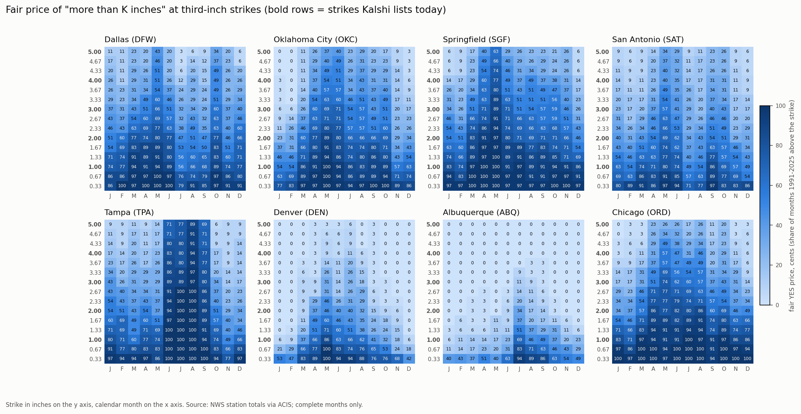
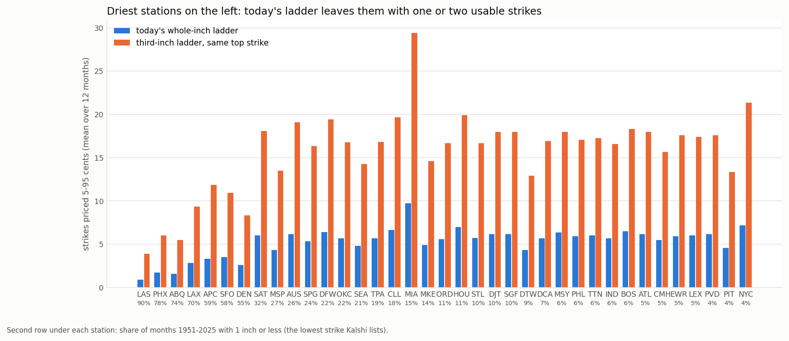
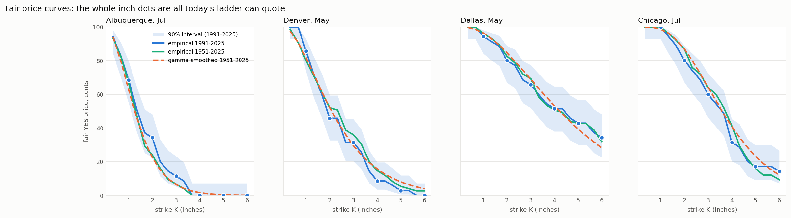
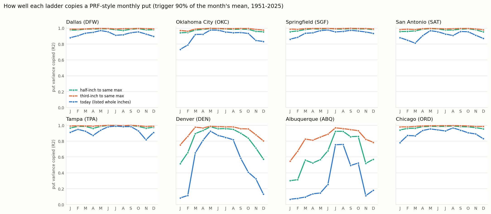

# 27: Fair prices for third-inch rain strikes at Kalshi's weather stations

**Proposal cell:** follow-up to docs 08 and 17 (strike design) and 09 (fair pricing); requested 2026-11-15 ("use historical rainfall records to find the fair pricing for third-inch strikes in the important weather markets")  |  **Status:** DRAFT (all numbers reproducible with `python scripts/run_third_inch_pricing.py`; not independently fact-checked)  |  **Last updated:** 2026-11-15

Code: `src/agri_hedge/exotics.py` (strike grids, empirical and gamma-smoothed probabilities, Wilson intervals, ladder-resolution metrics), `scripts/run_third_inch_pricing.py` (study loop, figures, the tables between the AUTO markers), tests in `tests/test_exotics.py`.
Data written: `data/processed/third_inch_fair_prices.csv` (14,842 rows: one per station x calendar month x third-inch strike), `third_inch_ladder_resolution.csv` (1,332 rows), `third_inch_station_summary.csv` (37 stations); figures `docs/figures/x1_*.png`.
Inputs: `station_monthly_precip.csv` (NWS station totals via ACIS, complete months only, 1891-2025), `station_map.csv`, `kalshi_rain_markets.parquet` (the strikes each series has listed), `kalshi_rain_markets_summary.csv` (volume).

## The question

Kalshi's monthly rain ladders are "more than K inches" contracts at whole-inch strikes, usually 1 to 7 (doc 05). A third-inch ladder would add strikes at 0.33, 0.67, 1.33, 1.67, 2.33, ... and keep every whole-inch strike. This document prices every such strike at all 37 stations from station history, says how precise those prices are, and measures what the finer ladder buys: how much of each month's rainfall distribution a ladder can see, and how well it can copy a PRF-style linear payout. The "important" markets are the ten series with the most volume (New York, Los Angeles, Houston, Seattle, San Francisco, Miami, Chicago, Dallas, Denver, Austin) plus the seven PRF study sites, 15 stations in all.

Terms. **Fair YES price** = the share of past complete months in which the station's total exceeded the strike, in cents per $1 contract; the NO side is 100 minus that. **Informative strike** = one priced between 5 and 95 cents; strikes outside that band pay almost surely one way and carry almost no information. **Coarsest bin** = the largest share of past months a ladder lumps into one outcome bin (below its lowest strike, between two strikes, or above its highest). **Put fit** = the share of a PRF-style monthly put's year-to-year variance that the best long-only NO ladder copies, where the put pays max(0, (T - rain) / T) with T = 90% of the month's mean. Because the put is a known function of the same rain the ladder settles on, this is measured in sample: it is a discretization error, not a forecast.

## Key findings

- **Third-inch strikes triple the number of usable strikes.** Averaged over the 12 calendar months, today's ladder has 5.3 informative strikes per station (5.4 at the 15 important stations); a third-inch ladder over the same range has 15.7 (16.3). In 41 of the 444 station-months today's ladder has at most one informative strike; the third-inch ladder has two or fewer in only 17.
- **The gain is concentrated in dry months, which are exactly PRF's problem months.** In the 66 station-months where more than half of all months end at 1 inch or less, today's ladder averages 1.3 informative strikes, copies only 25% of a monthly put's variance, and lumps 83% of outcomes into one bin. Half-inch strikes lift the put fit to 53% and third-inch strikes to 67%. At Albuquerque today's ladder copies less than half the put in 9 of 12 months and at Denver in 5; with third-inch strikes neither has such a month. Los Angeles and San Francisco keep 4 such months each because their summers have almost no rain to insure, which no strike set can fix.
- **Sub-inch strikes are the most valuable additions.** The 0.33 and 0.67 inch strikes are informative in every Albuquerque month, 92% of Denver, Las Vegas and Phoenix months, about three quarters of Los Angeles and San Francisco months, and still 54-62% of months at Dallas, Oklahoma City and Tampa. Across all stations 42% of sub-inch strike-months are informative, against none today because the lowest listed strike is 1 inch.
- **In humid months the finer ladder matters little.** Where fewer than one month in five ends at 1 inch or less (Springfield, Houston, New York, Miami, Chicago and most of the east), today's ladder already copies 90-97% of a monthly put; third-inch strikes raise that to 99%. Doc 17 found that half-inch strikes did not improve the farm hedges out of sample; those farms sit in the humid class, and the gain measured here is in-sample payoff shape, not out-of-sample forecast skill. Doc 28 tests the third-inch ladder out of sample.
- **The prices themselves are far less precise than the strike spacing.** Adjacent third-inch strikes differ by a median 2.9 cents in fair price (8.6 cents for whole inches, and 16 whole-inch gaps exceed 40 cents). But the 90% confidence interval on a single strike's price from 35 years of history is 21 cents wide on average, and 27 cents wide for strikes near 50 cents. A third-inch ladder therefore resolves differences the data cannot confirm. The fix is to quote from a smoothed distribution rather than raw frequencies: a zero-inflated gamma fitted to 1951-2025 moves the informative prices by 4.6 cents on average (at most 24) and removes the 1-in-35 jumps.
- **Climatology drifts.** Between 1951-1990 and 1991-2025 the fair price of an informative strike moved by 5.2 cents on average, by more than 15 cents in 7% of strike-months, and by more than its own confidence half-width in 22%. Most eastern stations got wetter (Miami +9 cents, Minneapolis +7, St. Louis, Lexington and Columbus +6, Dallas and New York +5); Denver got drier (-3). A pricing model should weight recent decades or include a trend; the tables here use 1991-2025 as the primary window for that reason, with 1951-2025 and the smoothed fit as checks.
- **Fees favour the near-certain strikes.** Kalshi's taker fee is 0.07 x P x (1 - P) per contract, so it peaks at 1.75 cents at 50 cents and is a tenth of that at 5 or 95 cents. Informative third-inch strikes pay roughly the same per-contract fee as informative whole-inch strikes (Table 5); what changes is that a ladder with more informative legs holds more of its notional in fee-bearing contracts.
- **Nothing in Kalshi's rules stops this.** The RAINM contract terms define the strike as any amount from 0.00 to 100.00 inches in 0.01-inch increments, treat trace as 0.00, settle "above K" as strictly greater than K, and also allow "at least" and "between" forms, so a 0.33-inch strike is already permitted. Kalshi did list half-inch strikes: in 2024 New York's ladder carried 1.5, 2.5, 3.5, 4.5 and 5.5 inch contracts (34 markets, $118,000 of volume, a median of $2,400 per market against $3,000 for the whole-inch markets listed the same year). They were dropped to 4 markets in 2025 and none in 2026.

## Numbers table

"Computed" = produced by `scripts/run_third_inch_pricing.py` (run 2026-11-15) from the files named above. Station-month counts are over 37 stations x 12 months = 444 (every station has at least 20 complete months per calendar month; three series share stations or are new, see Methods).

| Quantity | Value | Units | Region / period | Source | Verification |
|---|---|---|---|---|---|
| Stations priced / strike-month prices | 37 / 14,842 | count | 1991-2025 primary window | `third_inch_fair_prices.csv` | CONFIRMED (computed) |
| Informative strikes per station-month: today / half-inch / third-inch | 5.3 / 10.5 / 15.7 | strikes | all stations, 1951-2025 | `third_inch_station_summary.csv` | CONFIRMED (computed) |
| Same, 15 important stations: today / third-inch | 5.4 / 16.3 | strikes | | same | CONFIRMED (computed) |
| Station-months with <= 1 informative strike today / <= 2 today / <= 2 third-inch | 41 / 59 / 17 | of 444 | | `third_inch_ladder_resolution.csv` | CONFIRMED (computed) |
| Put fit R2: today / half / third (mean over station-months) | 0.83 / 0.91 / 0.94 | share of variance | 1951-2025 | same | CONFIRMED (computed) |
| Station-months with put fit < 0.5: today / half / third | 56 / 29 / 17 | of 444 | | same | CONFIRMED (computed) |
| Dry station-months (P(<= 1 in) > 0.5): informative today / half / third | 1.3 / 3.0 / 4.7 | strikes | 66 station-months | Table 4 | CONFIRMED (computed) |
| Dry station-months: put fit today / half / third | 0.25 / 0.53 / 0.67 | share | same | Table 4 | CONFIRMED (computed) |
| Dry station-months: coarsest bin today / third | 0.83 / 0.59 | share of months | same | Table 4 | CONFIRMED (computed) |
| Months with put fit < 0.5 today vs third-inch: ABQ / DEN / LAX / SFO | 9 vs 0 / 5 vs 0 / 6 vs 4 / 5 vs 4 | months | 1951-2025 | `third_inch_ladder_resolution.csv` | CONFIRMED (computed) |
| Share of sub-inch strike-months informative: all / ABQ / DEN / PHX / LAS / LAX / SFO / OKC / DFW / TPA | 42% / 100% / 92% / 96% / 92% / 75% / 71% / 62% / 54% / 54% | share | 1991-2025 | `third_inch_fair_prices.csv` | CONFIRMED (computed) |
| Median fair-price step between adjacent strikes: third-inch / whole-inch; largest whole-inch step; whole-inch steps >= 40c | 2.9c / 8.6c; 56c; 16 | cents | informative strikes, 1991-2025 | same | CONFIRMED (computed) |
| 90% Wilson CI width, informative strikes: mean / near 50c | 21c / 27c | cents | n = 35 years | same; Table 3 | CONFIRMED (computed) |
| Gamma-smoothed minus empirical price, informative strikes: mean abs / max | 4.6c / 24c | cents | | same | CONFIRMED (computed) |
| Trend 1951-1990 to 1991-2025: mean abs shift / share > 15c / share > CI half-width (informative) | 5.2c / 7.2% / 22% | | all strike-months | same | CONFIRMED (computed) |
| Signed shift by station (informative strikes): MIA / MSP / STL, LEX, CMH / DFW, NYC / DEN | +9 / +7 / +6 / +5 / -3 | cents | | same | CONFIRMED (computed) |
| Taker fee at 50c / at 5c or 95c | 1.75c / 0.33c | cents per contract | 0.07 x P x (1 - P) | Kalshi fee schedule via docs 05, 09 | CONFIRMED (05) |
| RAINM strike increments / trace / missing day / "above" | 0.01 in / 0.00 in / 0.00 in / strictly greater | rule | Kalshi contract terms (PDF dated 2026-11-10) | https://kalshi-public-docs.s3.amazonaws.com/contract_terms/RAINM.pdf (read 2026-11-15) | CONFIRMED (read) |
| NYC half-inch strikes 2024: markets / volume / median per market vs whole-inch | 34 / $118,237 / $2,420 vs $3,032 | | KXRAINNYCM, 2024 | `kalshi_rain_markets.parquet` | CONFIRMED (computed) |
| NYC half-inch strikes 2025 / 2026 | 4 markets / none | | same | same | CONFIRMED (computed) |
| Top-10 volume series | NYC 2.77M, LAX 2.13M, HOU 1.50M, SEA 1.49M, SFO 1.46M, MIA 1.43M, CHI 1.21M, DAL 1.12M, DEN 0.93M, AUS 0.70M | contracts traded | to 2026-10-29 | `kalshi_rain_markets_summary.csv` | CONFIRMED (05b) |
| Check against doc 08: P(DFW Jan <= 1 in), 1951-2009 | 0.305085 | share | | `replication_weights.csv` | CONFIRMED (asserted in script) |

## Methods

### Data

| Item | What we used | Why |
|---|---|---|
| Station totals | `station_monthly_precip.csv`: monthly totals at each series' settlement station, months with any missing day set to unknown; threaded (predecessor-station) records fill the early years at DFW, DEN, ORD and others | 06c showed these totals reproduce 922 of 922 settled Kalshi outcomes |
| Stations | the 37 `KX...` monthly-rain series in `station_map.csv`; Chicago is priced at O'Hare (its station since Sep 2026), not Midway | one price table per series |
| Listed strikes | union of whole-inch strikes each series has ever listed (1-7 for most; 1-10 at Chicago, Dallas and Denver; up to 16 at Miami; 1-13 at New York); series with only one month listed get 1-7 | the "today" ladder for the resolution comparison |
| Windows | 1991-2025 (primary, 35 years, as in doc 09); 1951-2025 (75 years); the full record; 1951-1990 for the trend check | recent window limits drift; longer window limits sampling error |

A difference from Kalshi's rules: Kalshi counts a day whose value is missing from the climate report as 0.00 inches, while we drop the month as unknown. The 06c check found no settled market where this mattered.

### Fair prices

For strike K the fair YES price is the share of complete months in the window with total > K (NWS totals are in hundredths, so "more than 0.33" is settled YES at 0.34). Three estimates are reported for each strike-month:

1. **Empirical 1991-2025** (`p_yes_recent35`) with a 90% Wilson score interval (`ci90_lo`, `ci90_hi`). With 35 years the interval is about +/-10 cents for a strike near 50 cents.
2. **Empirical 1951-2025** and the full record (`p_yes_std75`, `p_yes_full`).
3. **Smoothed** (`p_yes_gamma`): a zero-inflated gamma fitted by maximum likelihood to the 1951-2025 months (P(no measurable rain) plus a gamma for the wet months). It gives a smooth, strictly decreasing price curve and a tail price for strikes above anything on record.

The trend check compares the 1951-1990 and 1991-2025 shares. Fees use Kalshi's taker formula at the fair price.

### Ladder resolution

For each station-month three ladders are compared over the same strike range: today's listed whole-inch strikes, half-inch steps, and third-inch steps. Metrics (1951-2025): number of informative strikes; coarsest bin; and the put fit, the in-sample R2 of the best non-negative NO ladder (NNLS, no ridge) against a PRF-style monthly put with trigger 0.9 x the month's mean. Months with fewer than 20 complete years are skipped.

## Results

<!-- BEGIN AUTO: third-inch pricing tables (scripts/run_third_inch_pricing.py) -->
Generated by `scripts/run_third_inch_pricing.py`. Fair YES price = share of complete months 1991-2025 whose total exceeded the strike, in cents. "Smoothed" = zero-inflated gamma fit to 1951-2025. CI = 90% Wilson interval on the 1991-2025 share. Informative = priced 5-95 cents.

**Table 1. Each Kalshi rain station: how many strikes carry information, today's ladder vs a third-inch ladder (mean over the 12 calendar months, 1951-2025).** Coarsest bin = largest share of months the ladder lumps into one outcome bin. Put fit = share of a PRF-style monthly put's variance the best NO ladder copies.
| City | Station | Why it matters | Median month (in) | P(month <= 1 in) | Informative strikes today | Third-inch | Coarsest bin today | Third-inch | Put fit today | Third-inch |
|---|---|---|---|---|---|---|---|---|---|---|
| Albuquerque | ABQ | PRF study site | 0.39 | 0.74 | 1.6 | 5.5 | 0.75 | 0.41 | 0.30 | 0.83 |
| Denver | DEN | PRF site, top-10 volume | 0.99 | 0.55 | 2.6 | 8.3 | 0.56 | 0.27 | 0.55 | 0.92 |
| Los Angeles | LAX | top-10 volume | 0.24 | 0.70 | 2.8 | 9.3 | 0.70 | 0.57 | 0.49 | 0.67 |
| San Francisco | SFO | top-10 volume | 0.69 | 0.58 | 3.5 | 10.9 | 0.60 | 0.49 | 0.53 | 0.68 |
| Seattle | SEA | top-10 volume | 2.95 | 0.21 | 4.8 | 14.2 | 0.36 | 0.20 | 0.84 | 0.98 |
| Chicago | ORD | top-10 volume | 2.56 | 0.11 | 5.6 | 16.7 | 0.32 | 0.14 | 0.90 | 0.99 |
| Oklahoma City | OKC | PRF study site | 2.50 | 0.22 | 5.7 | 16.8 | 0.30 | 0.16 | 0.90 | 0.99 |
| Tampa | TPA | PRF study site | 2.06 | 0.19 | 5.7 | 16.8 | 0.37 | 0.25 | 0.93 | 0.99 |
| San Antonio | SAT | PRF study site | 1.68 | 0.32 | 6.0 | 18.1 | 0.34 | 0.17 | 0.91 | 0.99 |
| Austin | AUS | top-10 volume | 2.00 | 0.26 | 6.2 | 19.1 | 0.29 | 0.14 | 0.93 | 0.99 |
| Springfield | SGF | PRF study site | 3.17 | 0.10 | 6.2 | 18.0 | 0.25 | 0.14 | 0.94 | 0.99 |
| Dallas | DFW | PRF site, top-10 volume | 2.17 | 0.22 | 6.4 | 19.4 | 0.27 | 0.12 | 0.93 | 0.99 |
| Houston | HOU | top-10 volume | 3.31 | 0.11 | 7.0 | 19.9 | 0.25 | 0.20 | 0.97 | 1.00 |
| New York | NYC | top-10 volume | 3.63 | 0.04 | 7.2 | 21.3 | 0.24 | 0.12 | 0.95 | 0.99 |
| Miami | MIA | top-10 volume | 3.88 | 0.15 | 9.8 | 29.4 | 0.23 | 0.11 | 0.95 | 1.00 |
| Las Vegas | LAS |  | 0.16 | 0.90 | 0.9 | 3.9 | 0.90 | 0.70 | 0.15 | 0.62 |
| Phoenix | PHX |  | 0.44 | 0.78 | 1.8 | 6.0 | 0.78 | 0.51 | 0.30 | 0.78 |
| Napa | APC |  | 0.70 | 0.59 | 3.3 | 11.8 | 0.60 | 0.48 | 0.54 | 0.68 |
| Detroit | DTW |  | 2.50 | 0.09 | 4.3 | 12.9 | 0.32 | 0.15 | 0.90 | 0.99 |
| Minneapolis | MSP |  | 2.08 | 0.27 | 4.3 | 13.5 | 0.37 | 0.16 | 0.79 | 0.97 |
| Pittsburgh | PIT |  | 2.97 | 0.04 | 4.6 | 13.3 | 0.30 | 0.14 | 0.91 | 0.99 |
| Milwaukee | MKE |  | 2.63 | 0.14 | 4.9 | 14.6 | 0.29 | 0.14 | 0.90 | 0.99 |
| St Petersburg | SPG |  | 1.70 | 0.24 | 5.3 | 16.3 | 0.34 | 0.20 | 0.91 | 0.99 |
| Columbus | CMH |  | 2.96 | 0.05 | 5.5 | 15.7 | 0.29 | 0.13 | 0.92 | 0.99 |
| Washington Dc | DCA |  | 3.00 | 0.07 | 5.7 | 16.9 | 0.27 | 0.12 | 0.93 | 0.99 |
| Indianapolis | IND |  | 2.91 | 0.06 | 5.7 | 16.6 | 0.27 | 0.12 | 0.93 | 0.99 |
| St. Louis | STL |  | 2.81 | 0.10 | 5.8 | 16.7 | 0.27 | 0.14 | 0.92 | 0.99 |
| Newark | EWR |  | 3.37 | 0.05 | 5.9 | 17.6 | 0.27 | 0.13 | 0.95 | 0.99 |
| Philadelphia | PHL |  | 3.30 | 0.06 | 5.9 | 17.1 | 0.26 | 0.12 | 0.94 | 0.99 |
| Lexington | LEX |  | 3.67 | 0.05 | 6.0 | 17.4 | 0.24 | 0.12 | 0.95 | 0.99 |
| Trenton | TTN |  | 3.54 | 0.06 | 6.0 | 17.2 | 0.30 | 0.16 | 0.96 | 1.00 |
| Atlanta | ATL |  | 3.79 | 0.05 | 6.2 | 18.0 | 0.24 | 0.13 | 0.95 | 0.99 |
| West Palm Beach | DJT |  | 3.76 | 0.10 | 6.2 | 18.0 | 0.34 | 0.28 | 0.96 | 1.00 |
| Providence | PVD |  | 3.45 | 0.04 | 6.2 | 17.6 | 0.23 | 0.12 | 0.95 | 0.99 |
| New Orleans | MSY |  | 4.55 | 0.06 | 6.3 | 18.0 | 0.25 | 0.23 | 0.97 | 1.00 |
| Boston | BOS |  | 3.29 | 0.06 | 6.5 | 18.3 | 0.25 | 0.12 | 0.95 | 0.99 |
| College Station | CLL |  | 2.79 | 0.18 | 6.7 | 19.7 | 0.26 | 0.14 | 0.95 | 0.99 |

**Table 2-DFW. Dallas (DFW): fair YES price in cents of "more than K inches" by month, 1991-2025.** Rows at whole inches are what Kalshi lists today; the others are the third-inch additions.
| Strike | Jan | Feb | Mar | Apr | May | Jun | Jul | Aug | Sep | Oct | Nov | Dec |
|---|---|---|---|---|---|---|---|---|---|---|---|---|
| > 0.33 | 86 | 100 | 97 | 100 | 100 | 100 | 79 | 91 | 85 | 97 | 91 | 91 |
| > 0.67 | 86 | 86 | 97 | 97 | 100 | 97 | 76 | 74 | 79 | 97 | 86 | 80 |
| > 1.00 | 74 | 77 | 94 | 91 | 94 | 89 | 56 | 66 | 68 | 89 | 74 | 77 |
| > 1.33 | 71 | 74 | 91 | 89 | 91 | 80 | 56 | 60 | 65 | 83 | 60 | 71 |
| > 1.67 | 54 | 69 | 83 | 89 | 89 | 80 | 53 | 54 | 50 | 83 | 51 | 71 |
| > 2.00 | 51 | 60 | 77 | 74 | 80 | 77 | 47 | 51 | 47 | 77 | 46 | 66 |
| > 2.33 | 46 | 43 | 63 | 69 | 77 | 63 | 38 | 49 | 35 | 63 | 40 | 60 |
| > 2.67 | 43 | 37 | 54 | 60 | 69 | 57 | 32 | 43 | 32 | 63 | 37 | 46 |
| > 3.00 | 37 | 31 | 43 | 51 | 66 | 51 | 32 | 34 | 29 | 60 | 37 | 40 |
| > 3.33 | 29 | 23 | 34 | 49 | 60 | 46 | 26 | 29 | 24 | 51 | 29 | 34 |
| > 3.67 | 26 | 23 | 31 | 34 | 54 | 37 | 24 | 29 | 24 | 49 | 26 | 29 |
| > 4.00 | 26 | 11 | 29 | 31 | 51 | 26 | 12 | 29 | 15 | 49 | 26 | 26 |

**Table 2-OKC. Oklahoma City (OKC): fair YES price in cents of "more than K inches" by month, 1991-2025.** Rows at whole inches are what Kalshi lists today; the others are the third-inch additions.
| Strike | Jan | Feb | Mar | Apr | May | Jun | Jul | Aug | Sep | Oct | Nov | Dec |
|---|---|---|---|---|---|---|---|---|---|---|---|---|
| > 0.33 | 77 | 83 | 97 | 97 | 100 | 97 | 94 | 97 | 100 | 100 | 89 | 86 |
| > 0.67 | 63 | 69 | 89 | 97 | 100 | 94 | 86 | 89 | 89 | 94 | 71 | 74 |
| > 1.00 | 54 | 54 | 86 | 91 | 100 | 94 | 86 | 83 | 89 | 89 | 57 | 63 |
| > 1.33 | 46 | 46 | 71 | 89 | 94 | 86 | 74 | 80 | 86 | 80 | 43 | 54 |
| > 1.67 | 37 | 31 | 66 | 80 | 91 | 83 | 74 | 74 | 80 | 71 | 34 | 43 |
| > 2.00 | 23 | 31 | 60 | 77 | 89 | 80 | 66 | 66 | 66 | 69 | 29 | 34 |
| > 2.33 | 11 | 26 | 46 | 69 | 80 | 77 | 57 | 57 | 51 | 60 | 26 | 26 |
| > 2.67 | 9 | 14 | 37 | 63 | 71 | 71 | 54 | 57 | 49 | 51 | 23 | 23 |
| > 3.00 | 6 | 6 | 26 | 60 | 69 | 71 | 54 | 57 | 43 | 51 | 20 | 17 |
| > 3.33 | 3 | 0 | 20 | 54 | 63 | 60 | 46 | 51 | 43 | 49 | 17 | 11 |
| > 3.67 | 3 | 0 | 14 | 40 | 57 | 57 | 34 | 43 | 37 | 40 | 14 | 9 |
| > 4.00 | 3 | 0 | 11 | 37 | 54 | 51 | 34 | 43 | 31 | 31 | 14 | 6 |

**Table 2-SGF. Springfield (SGF): fair YES price in cents of "more than K inches" by month, 1991-2025.** Rows at whole inches are what Kalshi lists today; the others are the third-inch additions.
| Strike | Jan | Feb | Mar | Apr | May | Jun | Jul | Aug | Sep | Oct | Nov | Dec |
|---|---|---|---|---|---|---|---|---|---|---|---|---|
| > 0.33 | 97 | 97 | 100 | 100 | 100 | 97 | 97 | 97 | 97 | 100 | 100 | 97 |
| > 0.67 | 94 | 83 | 100 | 100 | 100 | 97 | 97 | 91 | 91 | 97 | 97 | 91 |
| > 1.00 | 83 | 74 | 97 | 100 | 100 | 91 | 97 | 89 | 91 | 94 | 91 | 86 |
| > 1.33 | 74 | 66 | 89 | 97 | 100 | 89 | 91 | 86 | 89 | 85 | 71 | 69 |
| > 1.67 | 63 | 60 | 86 | 97 | 97 | 89 | 89 | 77 | 83 | 74 | 71 | 54 |
| > 2.00 | 54 | 51 | 83 | 91 | 97 | 80 | 71 | 69 | 71 | 71 | 66 | 46 |
| > 2.33 | 54 | 43 | 74 | 86 | 94 | 74 | 69 | 66 | 63 | 68 | 57 | 43 |
| > 2.67 | 46 | 31 | 66 | 74 | 91 | 71 | 66 | 63 | 57 | 59 | 51 | 31 |
| > 3.00 | 34 | 26 | 51 | 71 | 89 | 71 | 51 | 54 | 57 | 59 | 46 | 26 |
| > 3.33 | 31 | 23 | 49 | 63 | 89 | 63 | 51 | 51 | 51 | 56 | 40 | 23 |
| > 3.67 | 26 | 20 | 34 | 63 | 80 | 51 | 43 | 51 | 49 | 47 | 37 | 17 |
| > 4.00 | 14 | 17 | 29 | 60 | 77 | 49 | 37 | 49 | 37 | 38 | 31 | 14 |

**Table 2-SAT. San Antonio (SAT): fair YES price in cents of "more than K inches" by month, 1991-2025.** Rows at whole inches are what Kalshi lists today; the others are the third-inch additions.
| Strike | Jan | Feb | Mar | Apr | May | Jun | Jul | Aug | Sep | Oct | Nov | Dec |
|---|---|---|---|---|---|---|---|---|---|---|---|---|
| > 0.33 | 80 | 89 | 91 | 86 | 97 | 94 | 71 | 77 | 97 | 83 | 83 | 86 |
| > 0.67 | 69 | 63 | 86 | 83 | 91 | 85 | 57 | 63 | 89 | 77 | 69 | 54 |
| > 1.00 | 63 | 54 | 74 | 71 | 80 | 74 | 49 | 54 | 86 | 69 | 57 | 49 |
| > 1.33 | 54 | 46 | 63 | 63 | 77 | 74 | 40 | 46 | 77 | 57 | 54 | 43 |
| > 1.67 | 43 | 40 | 51 | 60 | 74 | 62 | 37 | 43 | 63 | 57 | 46 | 34 |
| > 2.00 | 40 | 31 | 43 | 54 | 69 | 62 | 34 | 43 | 54 | 51 | 29 | 31 |
| > 2.33 | 34 | 26 | 34 | 46 | 66 | 53 | 29 | 34 | 51 | 49 | 23 | 29 |
| > 2.67 | 31 | 17 | 29 | 46 | 63 | 47 | 29 | 26 | 46 | 46 | 20 | 20 |
| > 3.00 | 23 | 17 | 20 | 37 | 57 | 41 | 29 | 20 | 40 | 43 | 17 | 17 |
| > 3.33 | 20 | 17 | 17 | 31 | 54 | 41 | 26 | 20 | 37 | 34 | 17 | 14 |
| > 3.67 | 17 | 11 | 11 | 26 | 49 | 35 | 26 | 17 | 34 | 31 | 11 | 9 |
| > 4.00 | 14 | 9 | 11 | 23 | 40 | 35 | 17 | 17 | 31 | 31 | 11 | 9 |

**Table 2-TPA. Tampa (TPA): fair YES price in cents of "more than K inches" by month, 1991-2025.** Rows at whole inches are what Kalshi lists today; the others are the third-inch additions.
| Strike | Jan | Feb | Mar | Apr | May | Jun | Jul | Aug | Sep | Oct | Nov | Dec |
|---|---|---|---|---|---|---|---|---|---|---|---|---|
| > 0.33 | 97 | 94 | 94 | 97 | 86 | 100 | 100 | 100 | 100 | 94 | 77 | 97 |
| > 0.67 | 91 | 77 | 80 | 83 | 83 | 100 | 100 | 100 | 100 | 83 | 66 | 83 |
| > 1.00 | 80 | 71 | 60 | 77 | 74 | 100 | 100 | 100 | 94 | 74 | 49 | 66 |
| > 1.33 | 71 | 69 | 49 | 71 | 69 | 100 | 100 | 100 | 91 | 69 | 40 | 46 |
| > 1.67 | 60 | 69 | 49 | 60 | 51 | 97 | 100 | 100 | 89 | 57 | 40 | 34 |
| > 2.00 | 54 | 51 | 43 | 54 | 37 | 94 | 100 | 100 | 89 | 51 | 29 | 34 |
| > 2.33 | 54 | 43 | 37 | 43 | 37 | 94 | 100 | 100 | 86 | 40 | 23 | 26 |
| > 2.67 | 43 | 40 | 34 | 34 | 31 | 91 | 100 | 100 | 86 | 37 | 20 | 23 |
| > 3.00 | 43 | 26 | 31 | 29 | 29 | 89 | 89 | 97 | 80 | 34 | 14 | 17 |
| > 3.33 | 34 | 20 | 29 | 29 | 29 | 86 | 89 | 97 | 80 | 20 | 14 | 14 |
| > 3.67 | 23 | 17 | 26 | 17 | 26 | 86 | 80 | 94 | 77 | 17 | 9 | 14 |
| > 4.00 | 17 | 14 | 20 | 17 | 23 | 83 | 80 | 94 | 77 | 17 | 9 | 14 |

**Table 2-DEN. Denver (DEN): fair YES price in cents of "more than K inches" by month, 1991-2025.** Rows at whole inches are what Kalshi lists today; the others are the third-inch additions.
| Strike | Jan | Feb | Mar | Apr | May | Jun | Jul | Aug | Sep | Oct | Nov | Dec |
|---|---|---|---|---|---|---|---|---|---|---|---|---|
| > 0.33 | 53 | 47 | 83 | 89 | 100 | 94 | 94 | 88 | 76 | 76 | 68 | 42 |
| > 0.67 | 21 | 29 | 66 | 77 | 100 | 83 | 74 | 76 | 65 | 53 | 24 | 18 |
| > 1.00 | 6 | 9 | 37 | 66 | 86 | 63 | 66 | 62 | 41 | 32 | 18 | 6 |
| > 1.33 | 0 | 3 | 20 | 51 | 71 | 60 | 51 | 38 | 26 | 24 | 15 | 0 |
| > 1.67 | 0 | 0 | 11 | 49 | 60 | 46 | 43 | 35 | 24 | 18 | 9 | 0 |
| > 2.00 | 0 | 0 | 9 | 37 | 46 | 40 | 40 | 32 | 15 | 9 | 6 | 0 |
| > 2.33 | 0 | 0 | 9 | 29 | 46 | 26 | 31 | 29 | 9 | 3 | 3 | 0 |
| > 2.67 | 0 | 0 | 9 | 9 | 31 | 14 | 26 | 29 | 6 | 3 | 0 | 0 |
| > 3.00 | 0 | 0 | 9 | 9 | 31 | 14 | 26 | 18 | 3 | 3 | 0 | 0 |
| > 3.33 | 0 | 0 | 6 | 3 | 26 | 11 | 26 | 15 | 3 | 0 | 0 | 0 |
| > 3.67 | 0 | 0 | 3 | 3 | 14 | 11 | 20 | 9 | 3 | 0 | 0 | 0 |
| > 4.00 | 0 | 0 | 0 | 3 | 9 | 6 | 11 | 6 | 3 | 0 | 0 | 0 |

**Table 2-ABQ. Albuquerque (ABQ): fair YES price in cents of "more than K inches" by month, 1991-2025.** Rows at whole inches are what Kalshi lists today; the others are the third-inch additions.
| Strike | Jan | Feb | Mar | Apr | May | Jun | Jul | Aug | Sep | Oct | Nov | Dec |
|---|---|---|---|---|---|---|---|---|---|---|---|---|
| > 0.33 | 40 | 43 | 37 | 51 | 40 | 63 | 94 | 89 | 86 | 63 | 54 | 49 |
| > 0.67 | 11 | 14 | 17 | 23 | 20 | 31 | 83 | 71 | 63 | 46 | 43 | 29 |
| > 1.00 | 6 | 11 | 14 | 14 | 17 | 23 | 69 | 46 | 49 | 37 | 20 | 23 |
| > 1.33 | 3 | 6 | 6 | 6 | 11 | 11 | 51 | 37 | 29 | 31 | 11 | 6 |
| > 1.67 | 0 | 6 | 3 | 3 | 11 | 9 | 37 | 20 | 17 | 11 | 6 | 0 |
| > 2.00 | 0 | 0 | 3 | 3 | 0 | 9 | 34 | 17 | 14 | 3 | 0 | 0 |
| > 2.33 | 0 | 0 | 3 | 3 | 0 | 6 | 20 | 14 | 9 | 3 | 0 | 0 |
| > 2.67 | 0 | 0 | 0 | 3 | 0 | 3 | 14 | 11 | 6 | 0 | 0 | 0 |
| > 3.00 | 0 | 0 | 0 | 0 | 0 | 0 | 11 | 9 | 3 | 0 | 0 | 0 |
| > 3.33 | 0 | 0 | 0 | 0 | 0 | 0 | 9 | 3 | 3 | 0 | 0 | 0 |
| > 3.67 | 0 | 0 | 0 | 0 | 0 | 0 | 0 | 3 | 3 | 0 | 0 | 0 |
| > 4.00 | 0 | 0 | 0 | 0 | 0 | 0 | 0 | 0 | 0 | 0 | 0 | 0 |

**Table 2-ORD. Chicago (ORD): fair YES price in cents of "more than K inches" by month, 1991-2025.** Rows at whole inches are what Kalshi lists today; the others are the third-inch additions.
| Strike | Jan | Feb | Mar | Apr | May | Jun | Jul | Aug | Sep | Oct | Nov | Dec |
|---|---|---|---|---|---|---|---|---|---|---|---|---|
| > 0.33 | 100 | 97 | 100 | 100 | 97 | 100 | 100 | 100 | 94 | 100 | 100 | 100 |
| > 0.67 | 97 | 86 | 100 | 100 | 94 | 100 | 100 | 100 | 91 | 100 | 97 | 94 |
| > 1.00 | 83 | 71 | 97 | 94 | 91 | 91 | 100 | 97 | 91 | 97 | 86 | 86 |
| > 1.33 | 71 | 66 | 83 | 94 | 91 | 91 | 94 | 94 | 74 | 89 | 74 | 77 |
| > 1.67 | 54 | 46 | 71 | 89 | 89 | 82 | 89 | 91 | 74 | 80 | 63 | 66 |
| > 2.00 | 34 | 37 | 57 | 86 | 77 | 82 | 80 | 86 | 60 | 69 | 46 | 49 |
| > 2.33 | 34 | 34 | 54 | 77 | 77 | 79 | 74 | 71 | 57 | 54 | 37 | 34 |
| > 2.67 | 29 | 23 | 46 | 71 | 77 | 71 | 69 | 63 | 46 | 49 | 34 | 23 |
| > 3.00 | 17 | 17 | 31 | 51 | 74 | 62 | 60 | 57 | 37 | 43 | 31 | 14 |
| > 3.33 | 14 | 17 | 31 | 49 | 69 | 56 | 54 | 57 | 31 | 34 | 29 | 9 |
| > 3.67 | 9 | 9 | 17 | 37 | 57 | 47 | 49 | 49 | 20 | 31 | 17 | 6 |
| > 4.00 | 3 | 6 | 11 | 31 | 57 | 47 | 31 | 46 | 20 | 29 | 11 | 6 |

**Table 3. How precise a climatological price is.** All station-months and third-inch strikes. CI width = mean 90% Wilson interval width on the 1991-2025 share (35 years). Smoothed gap = mean absolute difference between the gamma-smoothed and the empirical price. Trend shift = mean absolute change in the fair price from 1951-1990 to 1991-2025.
| Fair price band | Strike-months | CI width (cents) | Smoothed gap (cents) | Trend shift (cents) |
|---|---|---|---|---|
| 0-5c | 5506 | 9 | 1 | 2 |
| 5-20c | 3559 | 17 | 3 | 5 |
| 20-40c | 1714 | 25 | 5 | 9 |
| 40-60c | 1195 | 27 | 7 | 11 |
| 60-80c | 1098 | 25 | 6 | 9 |
| 80-95c | 945 | 18 | 4 | 7 |
| 95-100c | 825 | 9 | 2 | 3 |

**Table 4. Ladder resolution by how dry the month is (all 37 stations x 12 months, 1951-2025).** Legs = strikes the best put-copying ladder actually uses.
| Month class | Ladder | Station-months | Informative strikes | Coarsest bin | Put fit (R2) | Legs used |
|---|---|---|---|---|---|---|
| dry month (P(<=1 in) > 0.5) | half-inch to same max | 66 | 3.0 | 0.67 | 0.53 | 1.4 |
| dry month (P(<=1 in) > 0.5) | third-inch to same max | 66 | 4.7 | 0.59 | 0.67 | 1.9 |
| dry month (P(<=1 in) > 0.5) | today (listed whole inches) | 66 | 1.3 | 0.83 | 0.25 | 1.0 |
| mid (0.2-0.5) | half-inch to same max | 84 | 10.7 | 0.21 | 0.97 | 4.2 |
| mid (0.2-0.5) | third-inch to same max | 84 | 16.1 | 0.16 | 0.99 | 6.1 |
| mid (0.2-0.5) | today (listed whole inches) | 84 | 5.2 | 0.34 | 0.88 | 2.4 |
| wet month (P(<=1 in) <= 0.2) | half-inch to same max | 294 | 12.1 | 0.18 | 0.99 | 6.6 |
| wet month (P(<=1 in) <= 0.2) | third-inch to same max | 294 | 18.1 | 0.15 | 0.99 | 9.3 |
| wet month (P(<=1 in) <= 0.2) | today (listed whole inches) | 294 | 6.2 | 0.27 | 0.94 | 3.8 |

**Table 5. Taker fee at the fair price, 0.07 x P x (1 - P) per contract, important stations.** Fees are highest near 50 cents, so informative strikes cost more to trade than the near-certain ones.
| Strikes | Strike-months | Share informative | Mean fee (cents) | Mean fee, informative only (cents) |
|---|---|---|---|---|
| third-inch additions | 4276 | 55% | 0.65 | 1.07 |
| whole-inch strikes | 2086 | 54% | 0.64 | 1.08 |
<!-- END AUTO: third-inch pricing tables (scripts/run_third_inch_pricing.py) -->









## What this means

1. **For the arid PRF sites, third-inch strikes are the difference between a usable and an unusable ladder.** At Albuquerque and Denver, and at the dry western cities Kalshi already lists (Los Angeles, San Francisco, Las Vegas, Phoenix), the 1-inch floor puts most months below the lowest strike. Listing 0.33 and 0.67 inch strikes would be enough to recover most of the shape; the full third-inch grid is a convenience beyond that.
2. **In the humid Plains and the east, the case is weak.** Today's ladder already copies 90-97% of a monthly put there. The money is in two-month contracts (doc 17) and in liquidity (docs 12, 22), not finer strikes.
3. **Quote from a smoothed curve, not raw frequencies.** Climatological prices at third-inch spacing are known only to about +/-10 cents each. A market maker or our platform should quote the gamma-smoothed curve, weight recent decades, and widen quotes where the trend shift exceeds the sampling interval.
4. **Kalshi can list these today.** The contract terms permit 0.01-inch strikes and New York traded half-inch strikes through 2024. The 2024 experience, roughly 20% less volume per half-inch market than per whole-inch market in the same year, suggests the added strikes split rather than grow volume, which is a liquidity question for doc 28's "assume enough volume" framing.

## Reproduce

```bash
python scripts/run_third_inch_pricing.py     # about 30 seconds, no network
python -m pytest tests/test_exotics.py
```
