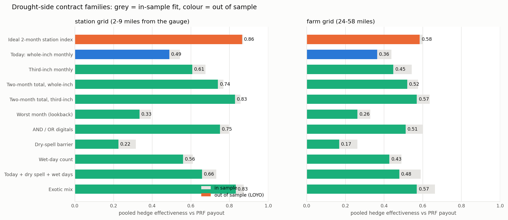
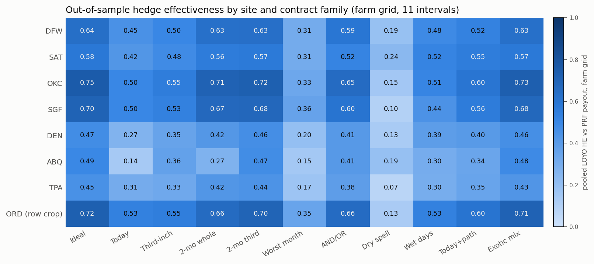
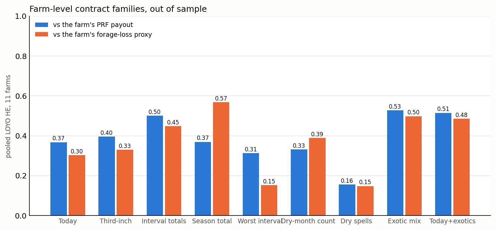
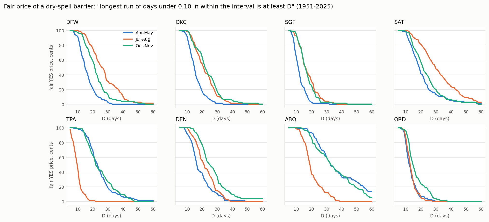

# 28: Which exotic rain payouts would work as farm insurance on Kalshi?

**Proposal cell:** follow-up to docs 17 (contract proposals) and 27 (third-inch strikes); requested 2026-11-15 ("see how viable certain exotic options payouts would be for farming insurance on Kalshi, assuming there is enough volume")  |  **Status:** DRAFT (all numbers reproducible with `python scripts/run_exotic_payouts.py`; not independently fact-checked)  |  **Last updated:** 2026-11-15

Code: `src/agri_hedge/exotics.py` (payoff builders for every contract family, daily path statistics, pricing), `scripts/run_exotic_payouts.py` (study loop, figures, the tables between the AUTO markers), `scripts/run_convex_payouts.py` (the convex-payout section), tests in `tests/test_exotics.py`. Fitting and metrics reuse `agri_hedge.replicate` (NNLS with doc 08's ridge penalties, leave-one-year-out evaluation, pooled hedge effectiveness).
Data written: `data/processed/exotic_interval_results.csv` (every case x family x evaluation set), `exotic_family_summary.csv`, `exotic_farm_results.csv`, `exotic_corn_results.csv`, `exotic_basket_results.csv`, `exotic_event_prices.csv`; figures `docs/figures/x2_*.png`.
Inputs: station monthly and daily totals (`station_monthly_precip.csv`, `station_daily_precip_study.parquet`, 1951-2025), the NCEI PRF index at the 16 study grids (`prf_official_index.csv`), the 11 farms (`farms.yaml`, `prf_scenario_results.csv`), the Illinois corn regression (`crop_yield_aux/r1_reestimate_coefficients.csv`), listed Kalshi strikes (`kalshi_rain_markets.parquet`).

## The question and the ground rules

Kalshi's rain products are monthly "more than K inches" binaries. An "exotic" here is any payout that is still a deterministic function of the same NWS station record Kalshi already settles on, but is not a single monthly binary at a whole-inch strike. We ask, for each exotic family: how well does the best portfolio of such contracts copy what a farmer is insured for, what would it cost at fair value plus Kalshi's trading costs, how precise is its price, and can Kalshi list and settle it?

Ground rules.
- **Enough volume is assumed.** No order-book or depth limits; every leg is bought at its climatological fair price plus half a 4.5-cent spread plus the taker fee (doc 09's central scenario). Doc 12 and doc 22 cover what happens when volume is not there.
- **Targets.** (1) PRF's payout per $1 of protection at 90% coverage on the NCEI grid index, for 7 PRF sites x 2 grids (the station's own grid, 2-9 miles from the gauge, and the farm grid, 24-58 miles) x 11 two-month intervals = 154 cases, with Chicago as a row-crop contrast. (2) A mirror-image excess-rain payout max(0, (index - 120) / 100). (3) The 11 representative farms' PRF payouts and their forage-loss proxy from doc 04b. (4) An Illinois corn revenue-loss curve (doc 03a rain-only regression, June-August quadratic) evaluated on Chicago rain.
- **Fitting.** Non-negative least squares (long-only positions), ridge 0.03 for coarse ladders and 0.1 for fine ones as chosen in doc 08, judged out of sample by leave-one-year-out (LOYO) over 1951-2025. In-sample numbers are shown to expose overfitting.
- **Hedge effectiveness (HE)** = 1 - Var(target - hedge) / Var(target), pooled over cases by their variance. A **false alarm** is a year in which the target pays under 2 cents per $ but the hedge pays over 10 cents; **tail capture** is the hedge's payout as a share of the target's in years with grid index below 70. **Load** = all-in cost per $1 of expected payout. **Thin** = the share of a hedge's fair cost sitting on legs that paid in fewer than 5 of 75 years, whose prices rest on almost no history.

### The contract families

| Family | Payoff | Needs |
|---|---|---|
| Today | NO on "month total > K", whole-inch K, both months of the interval | nothing (listed) |
| Third-inch monthly | same at K = 0.33, 0.67, 1.00, ... 7.00 | new strikes (doc 27) |
| Two-month total | NO on "sum of the two months > K", whole or third-inch K | new contract: a range/threshold on the sum of two monthly climate reports |
| Worst month (lookback) | NO on "the drier of the two months > K" | new contract |
| AND / OR digitals | pays if both months are at or below quantile-matched strikes (AND), or if either is (OR) | new contract |
| Dry-spell barrier | pays if the longest run of days under 0.10 in within the interval is at least D (7-42 days) | new contract on daily values |
| Wet-day count | pays if the number of days with 0.10 in or more is at most N (2-15) | new contract on daily values |
| One-day maximum (flood digital) | pays if any day in the interval had at least X inches (1-4) | new contract on daily values |
| Farm level | season total over the insured months, worst insured interval, count of dry insured months, per-interval dry spells | new contracts |
| Two-station basket | ideal two-month put on the average, or the drier, of two nearby stations | new settlement rule |
| Corn collar | NO ladder (drought) plus YES ladder (excess) on June-August months | listed (whole-inch) or new strikes |

## Key findings

- **A two-month-total contract is the exotic that matters, and third-inch strikes finish the job.** Against PRF at the farm grid, the best portfolio of today's monthly whole-inch contracts removes 36% of payout variance out of sample. A ladder on the two-month total at whole-inch strikes reaches 52%, and at third-inch strikes 57%, which equals the ideal contract on the station's own two-month index (58%). At the station grid the same steps are 49% to 74% to 83% against an ideal of 86%. The two-month third-inch ladder beats today's ladder by more than 0.05 in 71 of 77 farm-grid cases and is never worse by that much. It also halves false alarms (48% to 22% of no-PRF years), lifts deep-drought capture from 57% to 66%, and has a lower fair cost (16.4 against 17.7 cents per $ of protection) because it stops paying on one dry month in a normal pair.
- **Nothing more exotic adds anything against PRF.** Putting the two-month total, the worst-month lookback and the AND/OR digitals together (the "exotic mix") gives the same 57% as the two-month total alone. PRF is a function of the two-month sum, so once a contract on that sum exists the remaining error is geography (the gap from 0.58 to 1.00 that doc 16 attributed to the 24-58 miles between gauge and farm), which no payoff shape on this station can recover.
- **The AND/OR joint digital is a respectable fallback (51% at the farm grid, 75% at the station grid) with only 8 legs.** It is a single binary per strike pair ("both April and May at or below their strikes"), which is easy to settle and to explain, and it costs no more than today's ladder. It is worth listing if a sum-of-two-reports contract is harder to certify than a joint condition on two reports.
- **Third-inch strikes on today's monthly contracts help, mostly where it is dry.** They raise farm-grid HE from 36% to 45% over all intervals (36 of 77 cases improve by more than 0.05, 2 get worse), from 19% to 36% at Albuquerque and Denver and from 44% to 48% elsewhere. At the 11 farm policies the gain is 0.37 to 0.40, consistent with doc 17's finding that finer strikes barely moved the humid farms. Finer strikes are a rule change, not a new contract, so they are the cheapest step; they should be listed first at the dry western stations (doc 27).
- **Path-dependent contracts are a different peril, not a PRF replica.** A dry-spell barrier removes 17% of PRF variance at the farm grid and is worse than today's ladder in 60 of 77 cases. A wet-day count does better (43%), roughly matching today's ladder, and adding both to today's ladder reaches 48%. A long dry spell inside a two-month window is compatible with a normal total (one storm), so it cannot copy an amount-based index. The same holds for the forage-loss proxy (15%), but that proxy is itself built from rainfall totals, so this study cannot say whether a dry-spell contract tracks real pasture stress better than totals do. Their fair prices are tabulated anyway (Table I): a 21-day spell in April-May occurs in 17% of years at Dallas, 13% at Oklahoma City, 32% at Denver, 59% at Tampa and 92% at Albuquerque.
- **The flood digital does not hedge the excess-rain index either.** A contract paying when any day in the interval reaches 2 or 3 inches removes 10% of the wet-index variance at the farm grid (20% at the station grid). Monthly YES ladders reach 37% (56%), and a YES ladder on the two-month total 47% (75%). One-day maxima are an intensity peril with no loss model in this project; they should not be sold as excess-rainfall index cover. Wet-side prices are also the least reliable: 6-12% of fair cost sits on legs that have paid fewer than five times since 1951, against 1-2% on the drought side.
- **For what a farm actually loses, one season-total contract beats everything PRF-shaped.** Against the 11 farms' forage-loss proxy, today's ladder removes 30% of variance, the per-interval two-month totals 45%, and a single ladder on the season total over the insured months 57%, with 7 of 11 farms at or above 0.5 (Dallas grazing 0.80, Springfield grazing 0.78). It is also the cheapest family (load 1.08). Part of this is construction: the proxy is the farm's elasticity times the shortfall of its allocation-weighted season index, so a season total is nearly the right statistic by design (doc 13 makes the same point about PRF). Against PRF's own payout the season total is poor (37%), because PRF pays interval by interval. It is the best station-settled loss hedge, with one contract instead of 17-58 legs, no interval elections, and payouts tied to the season the grass grew in. It does not beat PRF on fit to loss. Checked 2026-11-15 against the same proxy: PRF as sold has negative HE (pooled about -3.4, median -2.75), because it pays several times the modeled loss, but PRF resized to the loss (best scale about a quarter of the policy, scored out of sample) reaches 0.66, since it settles on the farm's own grid. PRF cannot actually be bought at that size.
- **Two-sided collars are the right form for row crops, and path statistics add nothing.** On the Illinois corn curve applied to Chicago rain (14% of loss dollars come from Julys wetter than the 5.6-inch yield peak), a drought-only whole-inch ladder removes 49% of loss variance, a whole-inch collar 54%, a third-inch collar 58%; adding dry spells and one-day maxima leaves 53-57% out of sample while raising the in-sample fit to 72-74%, the signature of overfitting. These numbers contain no geography (target and hedge use the same gauge), so they are an upper bound for a farm 20-50 miles away.
- **Two-station baskets help only when both stations are close to the farm.** For the Atascosa County grid, averaging San Antonio and Austin (80 miles apart) gives 0.59 against 0.58 for San Antonio alone. For the Kane County grid, averaging O'Hare and Midway gives 0.76 against 0.72. "Drier of the two" never beats the better single station.
- **Cost and price precision are not what separates the families.** Loads run 1.07-1.14 per $1 of expected payout for every drought-side family (today's ladder 1.09); fair costs are 16-18 cents per $ of protection; thin shares are at most 2%. The two-month third-inch ladder uses about 36 legs per interval, against 6 today, which matters for a farmer placing orders but not for cost, since fees are per contract and the contract count per $ of expected payout is similar (0.53 against 0.42).

### Viability scorecard

Verdicts assume enough volume. "Fit" is LOYO HE at the farm grid against PRF (interval study) unless stated.

| Contract | Fit vs PRF | Fit vs forage loss (farm block) | False alarms | Price precision | Listing path | Verdict |
|---|---|---|---|---|---|---|
| Today's whole-inch monthly ladder | 0.36 | 0.30 | 48% | good | listed | baseline |
| Third-inch monthly strikes | 0.45 (0.36 at ABQ/DEN) | 0.33 | 45% | good; quote smoothed (doc 27) | rule change: strikes at 0.01-in increments are already allowed | **viable, do first at dry stations** |
| Two-month total, third-inch | 0.57 (= ideal 0.58) | 0.45 | 22% | good | new series: threshold on the sum of two monthly reports | **viable, best PRF replica** |
| Two-month total, whole-inch | 0.52 | | 23% | good | same | viable |
| AND / OR joint digitals | 0.51 | | 28% | good | new series: joint condition on two reports, 8 legs | viable fallback |
| Wet-day count | 0.43 | | 31% | good | new series on daily report values | marginal; no gain over totals |
| Worst-month lookback | 0.26 | 0.15 | 45% | good | new series | not viable |
| Dry-spell barrier | 0.17 | 0.15 | 55% | fair (ABQ spells are near-certain) | new series on daily values; a consecutive-day temperature contract is the nearest Kalshi precedent | not viable as index cover; untested as a stress peril |
| One-day maximum (flood) | 0.10 (wet index) | | | poor (6-12% thin) | new series on daily values | not viable as excess-rain cover |
| Season-total contract | 0.37 | **0.57**, 7 of 11 farms >= 0.5 | | good | new series: threshold on a 4-8 month sum | **viable as a loss-based product, not a PRF copy** |
| Count of dry insured months | 0.33 | 0.39 | | good | new series | marginal, simple |
| Two-station basket | +0.01 to +0.04 over one station | | | good | new settlement rule | only where two gauges are near the farm |
| Corn collar (NO + YES, third-inch) | 0.58 vs loss curve, no geography | | | good | listed strikes give 0.54 | viable form for row crops |

## Convex (tail-heavy) payouts: cover that ignores a 10% shortfall and pays a lot at 70%

Added 2026-11-15 in answer to "would this be better for contracts that insure very little rainfall more, like exponential payouts?" Code: `scripts/run_convex_payouts.py`; data `exotic_convex_results.csv`, `exotic_convex_strike_coverage.csv`. Same sites, grids, intervals, fitting and pricing as above. Targets per $1 of maximum payout on the grid index I: PRF 90% (linear from a 10% shortfall, the reference); linear from a 50% shortfall; quadratic in the shortfall; exponential in the shortfall, (e^(5s) - 1)/(e^5 - 1), which pays 0.4% at a 10% shortfall and 22% at 70%; and a digital paying 1 when I <= 30. Any such payoff is a long-only combination of NO contracts with more weight at lower strikes, so the question is whether the low strikes exist, how well they transfer to the farm, and what they cost.

- **The more convex the payout, the worse today's ladder is and the more the new strikes matter.** At the farm grid, out of sample, today's whole-inch monthly ladder removes 36% of the variance of the linear PRF payout but 31% of the quadratic, 20% of the exponential, 19% of the deep-linear and 11% of the 70% digital. Third-inch strikes raise these to 45 / 42 / 32 / 29 / 20%, a 25% relative gain for the linear payout but 60-80% for the convex ones. Adding 0.10-inch strikes below 1 inch gives another 2-4 points (exponential 36%; Albuquerque 22% to 33%). The two-month total at third-inch strikes reaches 57 / 55 / 45 / 43 / 31%.
- **The reason is where the tail strikes sit.** A 70% monthly shortfall is 0.3 x the month's mean. That strike is below 1 inch, today's lowest, in 9 of 12 months at Dallas and Oklahoma City, 8 at San Antonio and Tampa, 7 at Chicago, and all 12 at Denver and Albuquerque; at Albuquerque it is below 0.33 inch in 10 months. A convex payout puts its weight exactly where today's ladder has no strike.
- **Geography costs more for tail cover.** The ideal contract on the station's own two-month index holds 80-87% at the station grid for every target except the digital (47%), but at the farm grid it falls from 58% (linear) to 55% (exponential), 49% (deep-linear) and 27% (digital). The gauge and a farm 24-58 miles away agree on "below normal" far more often than on "70% below normal". Deep shortfalls are local.
- **Tail events are rare, so prices are thin and the tick bites.** The farm grid's two-month index is 30 or less in 1-11% of interval-years (San Antonio 11%, Albuquerque 9%, Dallas 6%, Springfield and Denver 2%, Chicago 1%) and 50 or less in 7-24%. Fair cost per $1 of maximum payout is 16.4 cents for the linear payout but 4-5 cents for the convex ones. Loads on the two-month third-inch hedge rise from 1.11 (linear) to 1.15 (exponential), 1.21 (deep-linear) and 1.26 (digital), and to 1.13 / 1.17 / 1.24 / 1.30 once every ask is rounded up to a whole cent. Legs priced under 10 cents carry 4% of the linear hedge's fair cost but 9-24% of the convex hedges', and legs that have paid fewer than five times since 1951 carry 2% against 4-12%. A single deep-tail contract (the "ideal" column) would trade as a 4-cent longshot whose price rests on a handful of years; its load column (1.4-1.8) overstates this because it applies a binary's half-spread to a continuous payoff, but the direction is right.
- **Verdict.** Convex cover is the case where third-inch and sub-inch strikes and the two-month total are most valuable, and also where geography and price precision are worst. A farmer who wants a lot of cover at a 70% shortfall and none at 10% should buy the two-month total ladder at third-inch strikes with convex weights (45% of the exponential target's variance at the farm grid against 20% today, false alarms 3%), accept a load near 1.15-1.25, and avoid a pure 70% digital (31% at best, paying once in 10-50 years, 12% of its cost on thin legs). PRF cannot offer this shape at all: its lowest coverage is 70% and its payout is linear below the trigger. Choosing the payoff shape is a real advantage of a ladder over PRF, and it is sharpest for the tail-heavy buyer.

<!-- BEGIN AUTO: convex payout tables (scripts/run_convex_payouts.py) -->
Generated by `scripts/run_convex_payouts.py`. Targets are functions of the farm or station grid's PRF index per $1 of maximum payout. Load (tick) = all-in cost per $1 of expected payout when every ask is rounded up to the next whole cent (minimum 1 cent) and the taker fee is added; cheap legs = share of fair cost on legs priced under 10 cents; thin = share on legs that paid in fewer than 5 of 75 years.

**Table J-farm. Convex targets at the farm grid (7 PRF sites x 11 intervals).** P(pays) = share of years the target pays more than 1 cent per $; P(> 10c) = share paying more than 10 cents.
| Target | Family | P(pays) | P(> 10c) | Mean payout ($/$) | HE LOYO | HE in-sample | Tail capture | False alarms | Fair cost ($/$) | Load | Load (tick) | Cheap legs | Thin | Legs |
|---|---|---|---|---|---|---|---|---|---|---|---|---|---|---|
| PRF 90% (linear from a 10% shortfall) | Ideal: same payoff on the station's two-month index | 47% | 39% | 0.164 | 0.58 | 0.60 | 0.68 | 0.11 | 0.141 | 1.19 | 1.23 | 3% | 0% | 1.0 |
| PRF 90% (linear from a 10% shortfall) | Today: monthly whole-inch | 47% | 39% | 0.164 | 0.36 | 0.44 | 0.57 | 0.48 | 0.177 | 1.09 | 1.10 | 2% | 0% | 5.9 |
| PRF 90% (linear from a 10% shortfall) | Monthly third-inch | 47% | 39% | 0.164 | 0.45 | 0.54 | 0.60 | 0.45 | 0.177 | 1.10 | 1.12 | 2% | 1% | 15.9 |
| PRF 90% (linear from a 10% shortfall) | Monthly 0.10-inch below 1 in, third-inch above | 47% | 39% | 0.164 | 0.46 | 0.59 | 0.62 | 0.42 | 0.177 | 1.12 | 1.13 | 4% | 2% | 25.9 |
| PRF 90% (linear from a 10% shortfall) | Two-month total, third-inch | 47% | 39% | 0.164 | 0.57 | 0.64 | 0.66 | 0.22 | 0.164 | 1.11 | 1.13 | 4% | 2% | 36.4 |
| Linear from a 50% shortfall | Ideal: same payoff on the station's two-month index | 15% | 12% | 0.051 | 0.49 | 0.55 | 0.66 | 0.04 | 0.040 | 1.58 | 1.69 | 79% | 51% | 0.9 |
| Linear from a 50% shortfall | Today: monthly whole-inch | 15% | 12% | 0.051 | 0.19 | 0.27 | 0.61 | 0.18 | 0.059 | 1.12 | 1.13 | 4% | 1% | 3.7 |
| Linear from a 50% shortfall | Monthly third-inch | 15% | 12% | 0.051 | 0.29 | 0.41 | 0.66 | 0.16 | 0.059 | 1.15 | 1.17 | 7% | 2% | 9.8 |
| Linear from a 50% shortfall | Monthly 0.10-inch below 1 in, third-inch above | 15% | 12% | 0.051 | 0.32 | 0.50 | 0.68 | 0.14 | 0.060 | 1.19 | 1.22 | 14% | 6% | 17.9 |
| Linear from a 50% shortfall | Two-month total, third-inch | 15% | 12% | 0.051 | 0.43 | 0.54 | 0.72 | 0.09 | 0.051 | 1.21 | 1.24 | 16% | 7% | 37.0 |
| Quadratic in the shortfall | Ideal: same payoff on the station's two-month index | 48% | 28% | 0.102 | 0.58 | 0.61 | 0.67 | 0.04 | 0.086 | 1.29 | 1.34 | 35% | 8% | 1.0 |
| Quadratic in the shortfall | Today: monthly whole-inch | 48% | 28% | 0.102 | 0.31 | 0.39 | 0.57 | 0.28 | 0.111 | 1.10 | 1.11 | 2% | 0% | 5.4 |
| Quadratic in the shortfall | Monthly third-inch | 48% | 28% | 0.102 | 0.42 | 0.52 | 0.60 | 0.25 | 0.111 | 1.11 | 1.13 | 3% | 1% | 15.0 |
| Quadratic in the shortfall | Monthly 0.10-inch below 1 in, third-inch above | 48% | 28% | 0.102 | 0.44 | 0.58 | 0.62 | 0.22 | 0.111 | 1.13 | 1.15 | 6% | 2% | 24.8 |
| Quadratic in the shortfall | Two-month total, third-inch | 48% | 28% | 0.102 | 0.55 | 0.62 | 0.67 | 0.10 | 0.102 | 1.13 | 1.15 | 6% | 3% | 36.4 |
| Exponential in the shortfall (k = 5) | Ideal: same payoff on the station's two-month index | 40% | 12% | 0.043 | 0.55 | 0.62 | 0.67 | 0.01 | 0.035 | 1.66 | 1.79 | 91% | 73% | 1.0 |
| Exponential in the shortfall (k = 5) | Today: monthly whole-inch | 40% | 12% | 0.043 | 0.20 | 0.28 | 0.58 | 0.09 | 0.048 | 1.10 | 1.12 | 3% | 0% | 4.9 |
| Exponential in the shortfall (k = 5) | Monthly third-inch | 40% | 12% | 0.043 | 0.32 | 0.43 | 0.62 | 0.08 | 0.048 | 1.13 | 1.14 | 4% | 1% | 13.5 |
| Exponential in the shortfall (k = 5) | Monthly 0.10-inch below 1 in, third-inch above | 40% | 12% | 0.043 | 0.36 | 0.53 | 0.64 | 0.06 | 0.049 | 1.16 | 1.18 | 9% | 3% | 23.0 |
| Exponential in the shortfall (k = 5) | Two-month total, third-inch | 40% | 12% | 0.043 | 0.45 | 0.56 | 0.68 | 0.03 | 0.043 | 1.15 | 1.17 | 9% | 4% | 36.5 |
| Pays 1 if the index is 30 or less (70% shortfall) | Ideal: same payoff on the station's two-month index | 5% | 5% | 0.054 | 0.27 | 0.37 | 0.58 | 0.03 | 0.036 | 1.41 | 1.48 | 62% | 26% | 0.6 |
| Pays 1 if the index is 30 or less (70% shortfall) | Today: monthly whole-inch | 5% | 5% | 0.054 | 0.11 | 0.20 | 0.69 | 0.24 | 0.064 | 1.12 | 1.13 | 4% | 0% | 2.2 |
| Pays 1 if the index is 30 or less (70% shortfall) | Monthly third-inch | 5% | 5% | 0.054 | 0.20 | 0.33 | 0.75 | 0.22 | 0.065 | 1.16 | 1.18 | 9% | 2% | 5.8 |
| Pays 1 if the index is 30 or less (70% shortfall) | Monthly 0.10-inch below 1 in, third-inch above | 5% | 5% | 0.054 | 0.20 | 0.40 | 0.79 | 0.19 | 0.067 | 1.22 | 1.25 | 17% | 7% | 11.1 |
| Pays 1 if the index is 30 or less (70% shortfall) | Two-month total, third-inch | 5% | 5% | 0.054 | 0.31 | 0.44 | 0.78 | 0.12 | 0.054 | 1.26 | 1.30 | 24% | 12% | 28.0 |

**Table J-station. Convex targets at the station grid (7 PRF sites x 11 intervals).** P(pays) = share of years the target pays more than 1 cent per $; P(> 10c) = share paying more than 10 cents.
| Target | Family | P(pays) | P(> 10c) | Mean payout ($/$) | HE LOYO | HE in-sample | Tail capture | False alarms | Fair cost ($/$) | Load | Load (tick) | Cheap legs | Thin | Legs |
|---|---|---|---|---|---|---|---|---|---|---|---|---|---|---|
| PRF 90% (linear from a 10% shortfall) | Ideal: same payoff on the station's two-month index | 47% | 40% | 0.165 | 0.86 | 0.87 | 0.89 | 0.05 | 0.161 | 1.19 | 1.23 | 3% | 0% | 1.0 |
| PRF 90% (linear from a 10% shortfall) | Today: monthly whole-inch | 47% | 40% | 0.165 | 0.49 | 0.54 | 0.66 | 0.45 | 0.184 | 1.10 | 1.11 | 2% | 0% | 5.6 |
| PRF 90% (linear from a 10% shortfall) | Monthly third-inch | 47% | 40% | 0.165 | 0.61 | 0.68 | 0.70 | 0.40 | 0.185 | 1.11 | 1.12 | 3% | 1% | 16.2 |
| PRF 90% (linear from a 10% shortfall) | Monthly 0.10-inch below 1 in, third-inch above | 47% | 40% | 0.165 | 0.64 | 0.73 | 0.72 | 0.37 | 0.185 | 1.13 | 1.14 | 5% | 2% | 27.8 |
| PRF 90% (linear from a 10% shortfall) | Two-month total, third-inch | 47% | 40% | 0.165 | 0.83 | 0.86 | 0.83 | 0.09 | 0.165 | 1.13 | 1.15 | 5% | 2% | 40.8 |
| Linear from a 50% shortfall | Ideal: same payoff on the station's two-month index | 15% | 12% | 0.050 | 0.80 | 0.83 | 0.96 | 0.02 | 0.050 | 1.78 | 1.93 | 80% | 53% | 1.0 |
| Linear from a 50% shortfall | Today: monthly whole-inch | 15% | 12% | 0.050 | 0.23 | 0.31 | 0.71 | 0.18 | 0.060 | 1.14 | 1.15 | 7% | 1% | 3.5 |
| Linear from a 50% shortfall | Monthly third-inch | 15% | 12% | 0.050 | 0.38 | 0.49 | 0.76 | 0.15 | 0.061 | 1.17 | 1.19 | 10% | 3% | 9.9 |
| Linear from a 50% shortfall | Monthly 0.10-inch below 1 in, third-inch above | 15% | 12% | 0.050 | 0.44 | 0.61 | 0.80 | 0.14 | 0.062 | 1.22 | 1.25 | 17% | 7% | 19.3 |
| Linear from a 50% shortfall | Two-month total, third-inch | 15% | 12% | 0.050 | 0.65 | 0.73 | 0.88 | 0.04 | 0.050 | 1.27 | 1.31 | 25% | 12% | 39.7 |
| Quadratic in the shortfall | Ideal: same payoff on the station's two-month index | 47% | 29% | 0.102 | 0.87 | 0.88 | 0.90 | 0.01 | 0.099 | 1.29 | 1.34 | 35% | 8% | 1.0 |
| Quadratic in the shortfall | Today: monthly whole-inch | 47% | 29% | 0.102 | 0.41 | 0.47 | 0.66 | 0.27 | 0.115 | 1.10 | 1.12 | 2% | 0% | 5.2 |
| Quadratic in the shortfall | Monthly third-inch | 47% | 29% | 0.102 | 0.55 | 0.63 | 0.70 | 0.22 | 0.115 | 1.12 | 1.14 | 4% | 1% | 14.9 |
| Quadratic in the shortfall | Monthly 0.10-inch below 1 in, third-inch above | 47% | 29% | 0.102 | 0.60 | 0.71 | 0.73 | 0.19 | 0.116 | 1.15 | 1.17 | 7% | 3% | 25.9 |
| Quadratic in the shortfall | Two-month total, third-inch | 47% | 29% | 0.102 | 0.79 | 0.83 | 0.84 | 0.02 | 0.102 | 1.16 | 1.18 | 8% | 3% | 40.7 |
| Exponential in the shortfall (k = 5) | Ideal: same payoff on the station's two-month index | 41% | 12% | 0.043 | 0.85 | 0.88 | 0.91 | 0.00 | 0.042 | 1.66 | 1.79 | 91% | 73% | 1.0 |
| Exponential in the shortfall (k = 5) | Today: monthly whole-inch | 41% | 12% | 0.043 | 0.27 | 0.33 | 0.68 | 0.08 | 0.049 | 1.11 | 1.13 | 3% | 1% | 4.8 |
| Exponential in the shortfall (k = 5) | Monthly third-inch | 41% | 12% | 0.043 | 0.42 | 0.51 | 0.73 | 0.06 | 0.050 | 1.14 | 1.16 | 6% | 2% | 13.7 |
| Exponential in the shortfall (k = 5) | Monthly 0.10-inch below 1 in, third-inch above | 41% | 12% | 0.043 | 0.49 | 0.64 | 0.76 | 0.06 | 0.050 | 1.18 | 1.20 | 11% | 4% | 24.6 |
| Exponential in the shortfall (k = 5) | Two-month total, third-inch | 41% | 12% | 0.043 | 0.65 | 0.73 | 0.85 | 0.01 | 0.043 | 1.19 | 1.22 | 14% | 6% | 40.7 |
| Pays 1 if the index is 30 or less (70% shortfall) | Ideal: same payoff on the station's two-month index | 5% | 5% | 0.051 | 0.47 | 0.61 | 0.88 | 0.03 | 0.046 | 1.49 | 1.56 | 70% | 37% | 0.8 |
| Pays 1 if the index is 30 or less (70% shortfall) | Today: monthly whole-inch | 5% | 5% | 0.051 | 0.12 | 0.21 | 0.80 | 0.23 | 0.062 | 1.14 | 1.16 | 8% | 1% | 2.4 |
| Pays 1 if the index is 30 or less (70% shortfall) | Monthly third-inch | 5% | 5% | 0.051 | 0.23 | 0.37 | 0.86 | 0.21 | 0.064 | 1.19 | 1.22 | 14% | 4% | 6.4 |
| Pays 1 if the index is 30 or less (70% shortfall) | Monthly 0.10-inch below 1 in, third-inch above | 5% | 5% | 0.051 | 0.28 | 0.49 | 0.91 | 0.18 | 0.066 | 1.27 | 1.31 | 25% | 12% | 13.5 |
| Pays 1 if the index is 30 or less (70% shortfall) | Two-month total, third-inch | 5% | 5% | 0.051 | 0.45 | 0.58 | 0.89 | 0.09 | 0.051 | 1.34 | 1.39 | 37% | 19% | 32.3 |

**Table K. Exponential target (k = 5) at the farm grid, pooled LOYO HE by site.** P(> 10c) = share of years the target pays more than 10 cents per $ of maximum payout.
| Site | Ideal | Today | Third-inch | Fine sub-inch | Two-month third | P(> 10c) |
|---|---|---|---|---|---|---|
| DFW | 0.57 | 0.32 | 0.38 | 0.39 | 0.52 | 13% |
| SAT | 0.55 | 0.29 | 0.39 | 0.39 | 0.48 | 21% |
| OKC | 0.73 | 0.29 | 0.39 | 0.39 | 0.58 | 12% |
| SGF | 0.73 | 0.37 | 0.41 | 0.42 | 0.58 | 7% |
| DEN | 0.34 | 0.14 | 0.26 | 0.28 | 0.35 | 8% |
| ABQ | 0.51 | 0.04 | 0.22 | 0.33 | 0.35 | 16% |
| TPA | 0.34 | 0.20 | 0.22 | 0.20 | 0.34 | 9% |
| ORD | 0.68 | 0.36 | 0.37 | 0.36 | 0.55 | 5% |

**Table L. Where the tail strikes sit.** For each station, the number of calendar months (of 12) in which a 70% monthly shortfall (0.3 x the month's mean) falls below today's lowest strike (1 inch) and below the lowest third-inch strike (0.33 inch), and the same for a 50% shortfall; plus the share of months on record at or below 30% and 50% of the month's mean (1951-2025).
| Station | Mean monthly rain (in) | Months with 70% strike < 1 in | < 0.33 in | Months with 50% strike < 1 in | P(month <= 30% of mean) | P(<= 50%) |
|---|---|---|---|---|---|---|
| ABQ | 0.71 | 12 | 10 | 12 | 25% | 36% |
| DEN | 1.25 | 12 | 5 | 11 | 15% | 29% |
| DFW | 2.87 | 9 | 0 | 0 | 17% | 30% |
| OKC | 2.87 | 9 | 0 | 4 | 16% | 28% |
| ORD | 3.00 | 7 | 0 | 2 | 6% | 19% |
| SAT | 2.53 | 8 | 0 | 4 | 23% | 37% |
| SGF | 3.58 | 4 | 0 | 0 | 10% | 23% |
| TPA | 4.01 | 8 | 0 | 1 | 14% | 26% |

**Table M. How often the farm grid's two-month index falls below 30, 50, 70 and 90 (all 11 intervals, 1951-2025).**
| Site | Farm grid | Index <= 30 | <= 50 | <= 70 | <= 90 |
|---|---|---|---|---|---|
| DFW | 15429 | 6% | 17% | 33% | 49% |
| SAT | 10626 | 11% | 24% | 36% | 51% |
| OKC | 18129 | 4% | 15% | 30% | 47% |
| SGF | 20845 | 2% | 10% | 27% | 47% |
| DEN | 23204 | 2% | 11% | 27% | 46% |
| ABQ | 17497 | 9% | 20% | 33% | 49% |
| TPA | 8893 | 3% | 11% | 23% | 45% |
| ORD | 26267 | 1% | 7% | 23% | 42% |
<!-- END AUTO: convex payout tables (scripts/run_convex_payouts.py) -->

## Numbers table

"Computed" = produced by `scripts/run_exotic_payouts.py` and `scripts/run_convex_payouts.py` (run 2026-11-15). HE values are pooled LOYO unless stated.

| Quantity | Value | Units | Region / period | Source | Verification |
|---|---|---|---|---|---|
| Farm grid, drought side: ideal / today / third-inch / 2-month whole / 2-month third / worst month / AND-OR / dry spell / wet days / today+path / exotic mix | 0.58 / 0.36 / 0.45 / 0.52 / 0.57 / 0.26 / 0.51 / 0.17 / 0.43 / 0.48 / 0.57 | HE | 77 cases, 1951-2025 | Table A-farm | CONFIRMED (computed) |
| Station grid, same order | 0.86 / 0.49 / 0.61 / 0.74 / 0.83 / 0.33 / 0.75 / 0.22 / 0.56 / 0.66 / 0.83 | HE | 77 cases | Table A-station | CONFIRMED (computed) |
| In-sample HE, farm grid: today / third / 2-month third / exotic mix | 0.44 / 0.54 / 0.64 / 0.66 | HE | | Table A-farm | CONFIRMED (computed) |
| Cases where 2-month third-inch beats today by > 0.05 / is worse by > 0.05 | 71 / 0 of 77 (farm); 76 / 0 (station) | cases | | `exotic_interval_results.csv` | CONFIRMED (computed) |
| Same for third-inch monthly | 36 / 2 (farm); 39 / 0 (station) | cases | | same | CONFIRMED (computed) |
| Same for dry-spell barrier | 9 / 60 (farm) | cases | | same | CONFIRMED (computed) |
| Third-inch monthly vs today, arid (ABQ, DEN) / humid sites, farm grid | 0.19 to 0.36 / 0.44 to 0.48 | HE | | same | CONFIRMED (computed) |
| False-alarm rate: today / third / 2-month third / ideal | 0.48 / 0.45 / 0.22 / 0.11 | share of no-PRF years | farm grid | Table A-farm | CONFIRMED (computed) |
| Tail capture: today / 2-month third / ideal | 0.57 / 0.66 / 0.68 | ratio | farm grid, index < 70 | Table A-farm | CONFIRMED (computed) |
| Fair cost: today / 2-month / ideal | 0.177 / 0.164 / 0.141 | $ per $ protection | farm grid | Table A-farm | CONFIRMED (computed) |
| Load range, drought families / today | 1.07-1.14 / 1.09 | $ per $ expected payout | | Table A-farm | CONFIRMED (computed) |
| Thin share, drought / wet families | <= 2% / 6-12% | share of fair cost | | Tables A, D | CONFIRMED (computed) |
| Legs per interval: today / 2-month third / AND-OR | 5.9 / 36.4 / 8.2 | legs | farm grid | Table A-farm | CONFIRMED (computed) |
| Wet index, farm grid: today YES / third YES / 2-month YES / flood digital / 2-month + flood | 0.37 / 0.38 / 0.47 / 0.10 / 0.46 | HE | | Table D-farm | CONFIRMED (computed) |
| Wet index, station grid: today YES / 2-month YES / flood digital | 0.56 / 0.75 / 0.20 | HE | | Table D-station | CONFIRMED (computed) |
| Farms vs PRF payout: today / third / interval totals / season total / exotic mix | 0.37 / 0.40 / 0.50 / 0.37 / 0.53 | HE | 11 farms | Table E-prf_payout | CONFIRMED (computed) |
| Farms vs forage loss: today / third / interval totals / season total / dry-month count / exotic mix | 0.30 / 0.33 / 0.45 / 0.57 / 0.39 / 0.50 | HE | 11 farms | Table E-forage_loss | CONFIRMED (computed) |
| Season total vs forage loss: farms >= 0.5 / best two | 7 of 11 / DFW_graze 0.80, SGF_graze 0.78 | | | Tables E, F | CONFIRMED (computed) |
| Corn collar on ORD rain: drought-only / whole collar / third collar / + path (LOYO; in-sample) | 0.49 / 0.54 / 0.58 / 0.53-0.57 (0.72-0.74) | HE | IL corn rain-only regression | Table G | CONFIRMED (computed) |
| Corn loss: mean / share of dollars from wet Julys / July yield peak / July normal | $78 per acre / 14% / 5.6 in / 3.9 in | | ORD 1951-2025 | Table G | CONFIRMED (computed) |
| Baskets: SAT alone / AUS / average; ORD / MDW / average | 0.58 / 0.45 / 0.59; 0.72 / 0.64 / 0.76 | HE | farm grids, 11 intervals | Table H | CONFIRMED (computed) |
| P(dry spell >= 21 d, Apr-May): DFW / OKC / SGF / DEN / ABQ / TPA | 17% / 13% / 1% / 32% / 92% / 59% | share of years | 1951-2025 | Table I | CONFIRMED (computed) |
| P(1-day max >= 2 in, Jun-Jul): TPA / OKC / DFW / DEN / ABQ | 67% / 44% / 35% / 5% / 0% | share of years | 1951-2025 | Table I | CONFIRMED (computed) |
| Convex targets, farm grid, today / third-inch / fine sub-inch / 2-month third / ideal: linear | 0.36 / 0.45 / 0.46 / 0.57 / 0.58 | HE | 77 cases | Table J-farm | CONFIRMED (computed) |
| Same: quadratic | 0.31 / 0.42 / 0.44 / 0.55 / 0.58 | HE | | Table J-farm | CONFIRMED (computed) |
| Same: exponential (k = 5) | 0.20 / 0.32 / 0.36 / 0.45 / 0.55 | HE | | Table J-farm | CONFIRMED (computed) |
| Same: linear from a 50% shortfall | 0.19 / 0.29 / 0.32 / 0.43 / 0.49 | HE | | Table J-farm | CONFIRMED (computed) |
| Same: digital at index <= 30 | 0.11 / 0.20 / 0.20 / 0.31 / 0.27 | HE | | Table J-farm | CONFIRMED (computed) |
| Ideal contract at the station grid: linear / exponential / deep-linear / digital | 0.86 / 0.85 / 0.80 / 0.47 | HE | | Table J-station | CONFIRMED (computed) |
| Load of the 2-month third-inch hedge: linear / exponential / deep / digital (plain; with 1-cent tick) | 1.11 / 1.15 / 1.21 / 1.26 (1.13 / 1.17 / 1.24 / 1.30) | $ per $ expected | farm grid | Table J-farm | CONFIRMED (computed) |
| Share of fair cost on legs under 10c / on thin legs, 2-month third-inch: linear vs convex | 4% / 2% vs 9-24% / 4-12% | share | farm grid | Table J-farm | CONFIRMED (computed) |
| Months (of 12) where a 70% shortfall strike is below 1 in: DFW, OKC / SAT, TPA / ORD / DEN, ABQ; below 0.33 in at ABQ / DEN | 9 / 8 / 7 / 12; 10 / 5 | months | 1951-2025 means | Table L | CONFIRMED (computed) |
| Farm-grid two-month index <= 30: SAT / ABQ / DFW / OKC / TPA / SGF, DEN / ORD | 11% / 9% / 6% / 4% / 3% / 2% / 1% | share of interval-years | 1951-2025 | Table M | CONFIRMED (computed) |
| Doc 17 comparison: half-inch strikes on 11 farm policies | 0.34 to 0.34; two-month contracts 0.34 to 0.48 | HE | milestone-2 branch | doc 17 | CONFIRMED (doc 17) |
| Doc 16 comparison: geography + settlement loss | 0.48 of 0.83 | HE | | doc 16 | CONFIRMED (doc 16) |
| Kalshi rules: strike increments / trace / "between" allowed | 0.01 in / 0.00 / yes | | RAINM contract terms, PDF dated 2026-11-10 | https://kalshi-public-docs.s3.amazonaws.com/contract_terms/RAINM.pdf (read 2026-11-15) | CONFIRMED (read) |
| Nearest Kalshi precedent for a count or consecutive-day contract | "Will at least <count> Qualifying Days occur within a single <window>-consecutive-day span" (temperature) | | CFTC rule filing summary | seen only in a search snippet of a cftc.gov filing | UNCONFIRMED |

## Methods

### Data and cases

The interval study uses the 7 PRF sites and Chicago, their station and farm PRF grids from `study_grids.csv`, and all 11 PRF intervals, 1951-2025. Station monthly totals are the complete-month series of doc 06c; daily values come from the same ACIS records (`station_daily_precip_study.parquet`), with a year's interval marked unknown if any day is missing. Listed strikes are the whole-inch strikes each series has ever listed up to 7 inches (1-7 at every study series). Third-inch ladders run 0.33 to 7.00. Two-month-total ladders run to the wettest two months on record so a cash-like top leg exists, as in doc 08.

The daily path statistics are the longest run of days under 0.10 inch, the number of days at or above 0.10 inch, and the largest one-day total within the interval. The 0.10-inch threshold is the usual agronomic definition of a day that wets the root zone; 0.01 inch (the NWS "measurable" threshold) is also computed.

The farm block takes each farm's coverage level, interval allocation and farm grid from `farms.yaml`, forms its PRF payout per $ of protection from the NCEI index, and takes the forage-loss proxy from `prf_scenario_results.csv` (doc 04b: elasticity times the shortfall of the allocation-weighted season index, valued at market hay price or pasture rent). The script checks that its PRF payout matches the scenario file's indemnity.

The corn study applies the doc 03a rain-only 1980-2025 Illinois regression to O'Hare monthly rain: yield change = sum over May-August of b1 (r - normal) + b2 (r^2 - normal^2), loss = max(0, -yield change x $4.70). The loss is relative to a year with normal rain in every month, which is near the yield optimum, so its mean is large (about $78 per acre); hedge effectiveness measures variance, not level.

### Pricing

Each fitted hedge is priced at the in-sample frequency of each leg plus 2.25 cents (half of the 4.5-cent median contested spread, doc 05) and Kalshi's taker fee 0.07 x P x (1 - P). Fair cost and load are per $1 of protection and per $1 of expected payout. The thin share flags legs that paid in fewer than 5 of 75 years. Capital cost (31 days at the T-bill rate, about 0.3% of outlay in doc 09) is omitted.

## Results

<!-- BEGIN AUTO: exotic payout tables (scripts/run_exotic_payouts.py) -->
Generated by `scripts/run_exotic_payouts.py`. HE = hedge effectiveness, the share of the target's year-to-year payout variance the hedge removes; pooled over cases. LOYO = leave-one-year-out (out of sample), 1951-2025. Fair cost = expected payout per $1 of protection. Load = all-in cost (fair + half a 4.5c spread + taker fee) per $1 of expected payout. Thin = share of the fair cost on legs that paid in fewer than 5 of 75 years (their price rests on almost no history).

**Table A-farm. Drought-side families against PRF payouts at the farm grid (7 PRF sites x 11 intervals = 77 cases, 90% coverage, NCEI index).**
| Family | Status | HE LOYO | HE in-sample | Median HE | Tail capture | False alarms | Fair cost ($/$) | Contracts per $ | Load | Thin | Legs |
|---|---|---|---|---|---|---|---|---|---|---|---|
| Ideal: PRF formula on the station's two-month index (scaled) | reference | 0.58 | 0.60 | 0.57 | 0.68 | 0.11 | 0.141 | 0.75 | 1.19 | 0% | 1.0 |
| Today: monthly NO ladder, whole-inch strikes | buildable today | 0.36 | 0.44 | 0.37 | 0.57 | 0.48 | 0.177 | 0.42 | 1.09 | 0% | 5.9 |
| Monthly NO ladder, third-inch strikes | new strikes | 0.45 | 0.54 | 0.42 | 0.60 | 0.45 | 0.177 | 0.49 | 1.10 | 1% | 15.9 |
| Two-month total, whole-inch strikes | new contract | 0.52 | 0.58 | 0.52 | 0.65 | 0.23 | 0.164 | 0.50 | 1.11 | 2% | 13.0 |
| Two-month total, third-inch strikes | new contract | 0.57 | 0.64 | 0.56 | 0.66 | 0.22 | 0.164 | 0.53 | 1.11 | 2% | 36.4 |
| Worst month of the two (lookback), third-inch strikes | new contract | 0.26 | 0.33 | 0.24 | 0.50 | 0.45 | 0.164 | 0.33 | 1.07 | 0% | 15.8 |
| Both-months-dry AND / either-month-dry OR digitals | new contract | 0.51 | 0.60 | 0.51 | 0.65 | 0.28 | 0.161 | 0.56 | 1.12 | 2% | 8.2 |
| Longest dry spell >= D days (barrier) | new contract | 0.17 | 0.26 | 0.12 | 0.44 | 0.55 | 0.163 | 0.39 | 1.07 | 1% | 6.1 |
| Wet days (>= 0.10 in) <= N | new contract | 0.43 | 0.49 | 0.41 | 0.58 | 0.31 | 0.161 | 0.47 | 1.11 | 2% | 6.3 |
| Today's ladder + dry spell + wet days | new contract | 0.48 | 0.59 | 0.47 | 0.64 | 0.36 | 0.174 | 0.56 | 1.12 | 2% | 10.3 |
| Two-month total + worst month + AND/OR (third-inch) | new contract | 0.57 | 0.66 | 0.56 | 0.68 | 0.24 | 0.165 | 0.56 | 1.12 | 2% | 28.9 |

**Table A-station. Drought-side families against PRF payouts at the station grid (7 PRF sites x 11 intervals = 77 cases, 90% coverage, NCEI index).**
| Family | Status | HE LOYO | HE in-sample | Median HE | Tail capture | False alarms | Fair cost ($/$) | Contracts per $ | Load | Thin | Legs |
|---|---|---|---|---|---|---|---|---|---|---|---|
| Ideal: PRF formula on the station's two-month index (scaled) | reference | 0.86 | 0.87 | 0.88 | 0.89 | 0.05 | 0.161 | 0.86 | 1.19 | 0% | 1.0 |
| Today: monthly NO ladder, whole-inch strikes | buildable today | 0.49 | 0.54 | 0.54 | 0.66 | 0.45 | 0.184 | 0.46 | 1.10 | 0% | 5.6 |
| Monthly NO ladder, third-inch strikes | new strikes | 0.61 | 0.68 | 0.59 | 0.70 | 0.40 | 0.185 | 0.55 | 1.11 | 1% | 16.2 |
| Two-month total, whole-inch strikes | new contract | 0.74 | 0.77 | 0.81 | 0.81 | 0.10 | 0.165 | 0.57 | 1.13 | 2% | 14.3 |
| Two-month total, third-inch strikes | new contract | 0.83 | 0.86 | 0.84 | 0.83 | 0.09 | 0.165 | 0.61 | 1.13 | 2% | 40.8 |
| Worst month of the two (lookback), third-inch strikes | new contract | 0.33 | 0.39 | 0.33 | 0.55 | 0.36 | 0.165 | 0.35 | 1.08 | 0% | 16.6 |
| Both-months-dry AND / either-month-dry OR digitals | new contract | 0.75 | 0.80 | 0.76 | 0.80 | 0.20 | 0.166 | 0.65 | 1.14 | 2% | 8.8 |
| Longest dry spell >= D days (barrier) | new contract | 0.22 | 0.32 | 0.17 | 0.48 | 0.48 | 0.164 | 0.42 | 1.08 | 1% | 6.2 |
| Wet days (>= 0.10 in) <= N | new contract | 0.56 | 0.61 | 0.53 | 0.66 | 0.23 | 0.163 | 0.53 | 1.12 | 2% | 6.4 |
| Today's ladder + dry spell + wet days | new contract | 0.66 | 0.73 | 0.66 | 0.75 | 0.30 | 0.180 | 0.62 | 1.13 | 2% | 9.8 |
| Two-month total + worst month + AND/OR (third-inch) | new contract | 0.83 | 0.87 | 0.84 | 0.85 | 0.09 | 0.167 | 0.65 | 1.14 | 2% | 26.0 |

**Table B. Pooled LOYO HE by site at the farm grid (11 intervals each).**
| Site | Ideal | Today | Third-inch | 2-mo whole | 2-mo third | Worst month | AND/OR | Dry spell | Wet days | Today+path | Exotic mix |
|---|---|---|---|---|---|---|---|---|---|---|---|
| DFW | 0.64 | 0.45 | 0.50 | 0.63 | 0.63 | 0.31 | 0.59 | 0.19 | 0.48 | 0.52 | 0.63 |
| SAT | 0.58 | 0.42 | 0.48 | 0.56 | 0.57 | 0.31 | 0.52 | 0.24 | 0.52 | 0.55 | 0.57 |
| OKC | 0.75 | 0.50 | 0.55 | 0.71 | 0.72 | 0.33 | 0.65 | 0.15 | 0.51 | 0.60 | 0.73 |
| SGF | 0.70 | 0.50 | 0.53 | 0.67 | 0.68 | 0.36 | 0.60 | 0.10 | 0.44 | 0.56 | 0.68 |
| DEN | 0.47 | 0.27 | 0.35 | 0.42 | 0.46 | 0.20 | 0.41 | 0.13 | 0.39 | 0.40 | 0.46 |
| ABQ | 0.49 | 0.14 | 0.36 | 0.27 | 0.47 | 0.15 | 0.41 | 0.19 | 0.30 | 0.34 | 0.48 |
| TPA | 0.45 | 0.31 | 0.33 | 0.42 | 0.44 | 0.17 | 0.38 | 0.07 | 0.30 | 0.35 | 0.43 |
| ORD (row crop, contrast) | 0.72 | 0.53 | 0.55 | 0.66 | 0.70 | 0.35 | 0.66 | 0.13 | 0.53 | 0.60 | 0.71 |

**Table C. Pooled LOYO HE by interval at the farm grid (7 PRF sites).**
| Interval | Today | Third-inch | 2-mo third | Worst month | Dry spell | Today+path | Exotic mix |
|---|---|---|---|---|---|---|---|
| Jan-Feb | 0.39 | 0.51 | 0.66 | 0.31 | 0.14 | 0.46 | 0.66 |
| Feb-Mar | 0.40 | 0.49 | 0.63 | 0.24 | 0.14 | 0.48 | 0.63 |
| Mar-Apr | 0.36 | 0.46 | 0.58 | 0.28 | 0.18 | 0.48 | 0.58 |
| Apr-May | 0.32 | 0.44 | 0.57 | 0.22 | 0.23 | 0.48 | 0.57 |
| May-Jun | 0.28 | 0.36 | 0.46 | 0.21 | 0.13 | 0.42 | 0.45 |
| Jun-Jul | 0.33 | 0.36 | 0.43 | 0.25 | 0.12 | 0.42 | 0.43 |
| Jul-Aug | 0.35 | 0.38 | 0.49 | 0.22 | 0.20 | 0.50 | 0.50 |
| Aug-Sep | 0.31 | 0.36 | 0.46 | 0.22 | 0.08 | 0.43 | 0.48 |
| Sep-Oct | 0.35 | 0.41 | 0.55 | 0.23 | 0.14 | 0.45 | 0.54 |
| Oct-Nov | 0.46 | 0.49 | 0.63 | 0.27 | 0.23 | 0.55 | 0.61 |
| Nov-Dec | 0.36 | 0.53 | 0.63 | 0.34 | 0.20 | 0.53 | 0.64 |

**Table D-farm. Excess-rain families against a wet payout max(0, (index - 120) / 100) at the farm grid.**
| Family | Status | HE LOYO | HE in-sample | Median HE | Fair cost ($/$) | Load | Thin | Legs |
|---|---|---|---|---|---|---|---|---|
| Today: monthly YES ladder, whole-inch strikes | buildable today | 0.37 | 0.54 | 0.33 | 0.129 | 1.21 | 7% | 8.1 |
| Monthly YES ladder, third-inch strikes | new strikes | 0.38 | 0.56 | 0.32 | 0.138 | 1.19 | 6% | 20.9 |
| Two-month total YES, whole-inch strikes | new contract | 0.47 | 0.62 | 0.43 | 0.124 | 1.22 | 9% | 12.3 |
| One-day maximum >= X in (flood digital) | new contract | 0.10 | 0.23 | 0.07 | 0.098 | 1.22 | 11% | 3.9 |
| Today's YES ladder + one-day maximum | new contract | 0.36 | 0.56 | 0.33 | 0.129 | 1.22 | 8% | 9.2 |
| Two-month total YES + one-day maximum | new contract | 0.46 | 0.63 | 0.43 | 0.124 | 1.23 | 9% | 11.5 |

**Table D-station. Excess-rain families against a wet payout max(0, (index - 120) / 100) at the station grid.**
| Family | Status | HE LOYO | HE in-sample | Median HE | Fair cost ($/$) | Load | Thin | Legs |
|---|---|---|---|---|---|---|---|---|
| Today: monthly YES ladder, whole-inch strikes | buildable today | 0.56 | 0.70 | 0.55 | 0.136 | 1.23 | 7% | 8.2 |
| Monthly YES ladder, third-inch strikes | new strikes | 0.58 | 0.72 | 0.56 | 0.142 | 1.21 | 6% | 22.0 |
| Two-month total YES, whole-inch strikes | new contract | 0.75 | 0.85 | 0.75 | 0.126 | 1.27 | 12% | 13.6 |
| One-day maximum >= X in (flood digital) | new contract | 0.20 | 0.33 | 0.17 | 0.102 | 1.24 | 11% | 4.3 |
| Today's YES ladder + one-day maximum | new contract | 0.55 | 0.72 | 0.54 | 0.136 | 1.24 | 8% | 9.7 |
| Two-month total YES + one-day maximum | new contract | 0.75 | 0.85 | 0.75 | 0.127 | 1.27 | 12% | 12.3 |

**Table E-prf_payout. Farm-level families against the farm's PRF payout, 11 farms, LOYO 1951-2025.** Fair cost per $1 of policy protection.
| Family | HE LOYO (pooled) | HE in-sample | Median farm HE | Worst farm | Best farm | Farms >= 0.5 | Fair cost ($/$) | Load | Thin | Legs |
|---|---|---|---|---|---|---|---|---|---|---|
| Today: monthly whole-inch NO on insured months | 0.37 | 0.56 | 0.38 | 0.12 | 0.51 | 1 of 11 | 0.148 | 1.10 | 1% | 17.0 |
| Monthly third-inch NO | 0.40 | 0.62 | 0.44 | 0.10 | 0.56 | 2 of 11 | 0.148 | 1.11 | 1% | 44.5 |
| Two-month totals of insured intervals (third-inch) | 0.50 | 0.67 | 0.51 | 0.22 | 0.65 | 8 of 11 | 0.143 | 1.12 | 2% | 58.2 |
| Whole-season total (third-inch) | 0.37 | 0.49 | 0.38 | 0.14 | 0.63 | 2 of 11 | 0.141 | 1.08 | 1% | 57.5 |
| Worst insured interval (lookback on interval index) | 0.31 | 0.40 | 0.36 | 0.13 | 0.40 | 0 of 11 | 0.135 | 1.07 | 0% | 6.4 |
| Count of dry insured months | 0.33 | 0.41 | 0.33 | 0.16 | 0.46 | 0 of 11 | 0.138 | 1.07 | 1% | 5.8 |
| Dry spells in each insured interval | 0.16 | 0.35 | 0.14 | -0.11 | 0.37 | 0 of 11 | 0.142 | 1.08 | 1% | 14.3 |
| All exotics together | 0.53 | 0.71 | 0.56 | 0.26 | 0.69 | 6 of 11 | 0.144 | 1.12 | 2% | 58.7 |
| Today's ladder + all exotics | 0.51 | 0.73 | 0.55 | 0.26 | 0.69 | 6 of 11 | 0.145 | 1.12 | 2% | 64.3 |

**Table E-forage_loss. Farm-level families against the farm's forage-loss proxy (doc 04b), 11 farms, LOYO 1951-2025.** Fair cost per $1 of policy protection.
| Family | HE LOYO (pooled) | HE in-sample | Median farm HE | Worst farm | Best farm | Farms >= 0.5 | Fair cost ($/$) | Load | Thin | Legs |
|---|---|---|---|---|---|---|---|---|---|---|
| Today: monthly whole-inch NO on insured months | 0.30 | 0.53 | 0.28 | 0.15 | 0.37 | 0 of 11 | 0.034 | 1.11 | 1% | 14.5 |
| Monthly third-inch NO | 0.33 | 0.58 | 0.33 | 0.13 | 0.41 | 0 of 11 | 0.034 | 1.13 | 2% | 34.9 |
| Two-month totals of insured intervals (third-inch) | 0.45 | 0.63 | 0.42 | 0.26 | 0.57 | 2 of 11 | 0.033 | 1.13 | 2% | 37.5 |
| Whole-season total (third-inch) | 0.57 | 0.67 | 0.51 | 0.31 | 0.80 | 7 of 11 | 0.030 | 1.12 | 2% | 64.1 |
| Worst insured interval (lookback on interval index) | 0.15 | 0.26 | 0.14 | -0.03 | 0.21 | 0 of 11 | 0.029 | 1.07 | 1% | 6.2 |
| Count of dry insured months | 0.39 | 0.46 | 0.35 | 0.20 | 0.51 | 1 of 11 | 0.029 | 1.10 | 2% | 5.5 |
| Dry spells in each insured interval | 0.15 | 0.33 | 0.13 | -0.14 | 0.34 | 0 of 11 | 0.031 | 1.11 | 2% | 11.0 |
| All exotics together | 0.50 | 0.68 | 0.45 | 0.26 | 0.63 | 3 of 11 | 0.033 | 1.14 | 3% | 43.1 |
| Today's ladder + all exotics | 0.48 | 0.70 | 0.44 | 0.23 | 0.61 | 3 of 11 | 0.033 | 1.14 | 3% | 46.8 |

**Table F. Each farm: LOYO HE against its PRF payout by family.**
| Farm | Today | Third-inch | Interval totals | Season total | Worst interval | Dry-month count | Dry spells | Exotic mix | Today+exotics |
|---|---|---|---|---|---|---|---|---|---|
| ABQ_graze | 0.12 | 0.10 | 0.22 | 0.14 | 0.13 | 0.16 | 0.12 | 0.26 | 0.26 |
| DEN_graze | 0.30 | 0.34 | 0.51 | 0.39 | 0.27 | 0.22 | 0.25 | 0.56 | 0.55 |
| DFW_graze | 0.48 | 0.50 | 0.56 | 0.49 | 0.21 | 0.41 | 0.33 | 0.62 | 0.59 |
| DFW_hay | 0.49 | 0.54 | 0.51 | 0.34 | 0.29 | 0.46 | 0.37 | 0.63 | 0.61 |
| OKC_graze | 0.51 | 0.56 | 0.64 | 0.38 | 0.38 | 0.33 | 0.14 | 0.69 | 0.69 |
| OKC_hay | 0.46 | 0.44 | 0.50 | 0.47 | 0.36 | 0.33 | -0.11 | 0.45 | 0.47 |
| SAT_graze | 0.26 | 0.32 | 0.45 | 0.31 | 0.31 | 0.34 | 0.10 | 0.46 | 0.41 |
| SGF_graze | 0.42 | 0.47 | 0.65 | 0.63 | 0.40 | 0.40 | 0.19 | 0.68 | 0.66 |
| SGF_hay | 0.36 | 0.45 | 0.56 | 0.52 | 0.36 | 0.33 | 0.22 | 0.59 | 0.60 |
| TPA_graze | 0.38 | 0.38 | 0.52 | 0.22 | 0.36 | 0.35 | 0.11 | 0.48 | 0.50 |
| TPA_hay | 0.33 | 0.28 | 0.45 | 0.28 | 0.39 | 0.24 | 0.01 | 0.46 | 0.44 |

**Table G. Illinois corn revenue loss (doc 03a rain-only regression applied to Chicago O'Hare rain, Jun-Aug quadratic), hedged with contracts on the same station's rain.** Because target and hedge use the same gauge, HE here measures payoff-shape fit only, with no geography. Loss per $100 of value per acre; mean loss $78/acre, 14% of loss dollars come from Julys wetter than the yield peak (5.6 in; normal 3.9 in).
| Family | HE LOYO | HE in-sample | Corr | Fair cost ($/$) | Load | Thin | Legs |
|---|---|---|---|---|---|---|---|
| Drought side only: monthly NO, whole-inch (Jun-Aug) | 0.49 | 0.56 | 0.70 | 0.799 | 1.11 | 3% | 10.0 |
| Collar: monthly NO + YES, whole-inch | 0.54 | 0.67 | 0.74 | 0.817 | 1.16 | 3% | 15.0 |
| Collar: monthly NO + YES, third-inch | 0.58 | 0.71 | 0.77 | 0.821 | 1.16 | 2% | 38.0 |
| Collar whole-inch + dry spells + one-day maxima | 0.53 | 0.72 | 0.73 | 0.822 | 1.18 | 8% | 21.0 |
| Collar third-inch + dry spells + one-day maxima | 0.57 | 0.74 | 0.77 | 0.826 | 1.17 | 4% | 42.0 |

**Table H. Two-station baskets: ideal two-month index put on one station, the other, their average, or the drier of the two, against the farm grid's PRF payout (11 intervals, LOYO scale fit).**
| Farm | Settles on | HE LOYO | Median HE | Corr |
|---|---|---|---|---|
| SAT | SAT alone | 0.58 | 0.61 | 0.75 |
| SAT | AUS alone | 0.45 | 0.44 | 0.67 |
| SAT | average of SAT and AUS | 0.59 | 0.54 | 0.76 |
| SAT | drier of SAT and AUS | 0.58 | 0.51 | 0.75 |
| ORD | ORD alone | 0.72 | 0.73 | 0.83 |
| ORD | MDW alone | 0.64 | 0.66 | 0.77 |
| ORD | average of ORD and MDW | 0.76 | 0.78 | 0.85 |
| ORD | drier of ORD and MDW | 0.70 | 0.74 | 0.81 |

**Table I. Fair prices of path-dependent events, 1951-2025 (share of years).** Dry spell = longest run of days under 0.10 in within the two months; wet days = days with at least 0.10 in.
| Site | Interval | Median dry spell (days) | P(spell >= 14 d) | >= 21 d | >= 28 d | Median wet days | P(wet days <= 6) | <= 10 | P(1-day max >= 2 in) | >= 3 in |
|---|---|---|---|---|---|---|---|---|---|---|
| DFW | Apr-May | 14 | 60% | 17% | 5% | 11 | 12% | 48% | 47% | 13% |
| DFW | Jun-Jul | 22 | 89% | 64% | 28% | 8 | 41% | 77% | 35% | 7% |
| DFW | Aug-Sep | 22 | 89% | 55% | 35% | 7 | 46% | 88% | 31% | 15% |
| SAT | Apr-May | 18 | 77% | 40% | 16% | 8 | 29% | 67% | 41% | 13% |
| SAT | Jun-Jul | 25 | 91% | 65% | 41% | 7 | 47% | 82% | 39% | 18% |
| SAT | Aug-Sep | 22 | 95% | 59% | 21% | 7 | 45% | 80% | 35% | 19% |
| OKC | Apr-May | 14 | 59% | 13% | 4% | 12 | 8% | 40% | 53% | 21% |
| OKC | Jun-Jul | 18 | 80% | 37% | 12% | 10 | 13% | 59% | 44% | 20% |
| OKC | Aug-Sep | 17 | 76% | 32% | 20% | 8 | 25% | 65% | 28% | 15% |
| SGF | Apr-May | 11 | 24% | 1% | 1% | 14 | 0% | 9% | 48% | 12% |
| SGF | Jun-Jul | 14 | 52% | 21% | 7% | 12 | 5% | 29% | 32% | 12% |
| SGF | Aug-Sep | 17 | 71% | 35% | 11% | 11 | 12% | 48% | 40% | 12% |
| DEN | Apr-May | 16 | 73% | 32% | 13% | 9 | 21% | 68% | 11% | 4% |
| DEN | Jun-Jul | 21 | 80% | 53% | 23% | 7 | 39% | 75% | 5% | 1% |
| DEN | Aug-Sep | 21 | 91% | 54% | 30% | 6 | 55% | 89% | 1% | 0% |
| ABQ | Apr-May | 32 | 99% | 92% | 69% | 3 | 92% | 100% | 0% | 0% |
| ABQ | Jun-Jul | 28 | 100% | 83% | 52% | 5 | 68% | 97% | 0% | 0% |
| ABQ | Aug-Sep | 23 | 91% | 64% | 31% | 6 | 56% | 93% | 0% | 0% |
| TPA | Apr-May | 23 | 95% | 59% | 27% | 6 | 55% | 83% | 36% | 13% |
| TPA | Jun-Jul | 11 | 28% | 3% | 0% | 20 | 0% | 3% | 67% | 31% |
| TPA | Aug-Sep | 10 | 20% | 4% | 0% | 19 | 0% | 0% | 64% | 29% |
| ORD | Apr-May | 12 | 32% | 7% | 1% | 15 | 1% | 19% | 21% | 5% |
| ORD | Jun-Jul | 12 | 35% | 4% | 0% | 13 | 3% | 26% | 27% | 8% |
| ORD | Aug-Sep | 15 | 56% | 27% | 7% | 11 | 5% | 39% | 32% | 9% |
<!-- END AUTO: exotic payout tables (scripts/run_exotic_payouts.py) -->









## What this means

1. **Ask Kalshi for two things, in this order: sub-inch strikes at the dry stations, then a two-month-total series.** The first is a parameter change under the existing contract terms. The second is a new series that settles on the sum of two monthly climate reports and takes the farm-grid replica from 0.36 to 0.57, the level of a perfect station contract. Doc 17's two-month proposal (0.34 to 0.48 on the farm policies at whole inches) and this study agree; third-inch strikes on the two-month total add a further 0.05, nearly all at Albuquerque and Denver.
2. **Do not propose lookbacks, barriers, or flood digitals as PRF replicas.** They copy a quarter or less of PRF's variance and raise false alarms. If the team wants a pasture-stress product built on dry spells, it needs a loss model driven by daily rain, which this project does not have; the fair prices in Table I are ready for that work.
3. **The season-total contract is the candidate that beats PRF on terms rather than on price.** One contract on the insured season's total rain tracks modeled forage loss better than PRF-shaped portfolios (0.57 against 0.30 for today's ladder and 0.45 for interval sums), is the cheapest to carry, and removes interval elections. It would be sold as loss-based cover, not as a PRF copy, and the loss model it is judged against shares its construction, so the next step is to test it against the doc 13 model variants (growth-curve timing, replacement value) on the milestone-2 branch.
4. **For row crops, list both sides.** The corn curve needs YES contracts for wet Julys; a third-inch collar on June-August reaches 0.58 of the loss variance with no geography, and daily path contracts add nothing out of sample.
5. **Geography stays the binding constraint.** With enough volume and the right contract, a farm 24-58 miles from the gauge gets about 0.58 of its PRF variance hedged. The remaining 0.42 needs a contract settled on gridded rain (doc 17's P4), or a denser gauge network, not a cleverer payoff.

## Reproduce

```bash
python scripts/run_exotic_payouts.py           # about 5 minutes, no network
python scripts/run_exotic_payouts.py --quick   # two sites, no farm block, about 1 minute
python scripts/run_convex_payouts.py           # convex-payout section, about 3 minutes
python -m pytest tests/test_exotics.py
```
