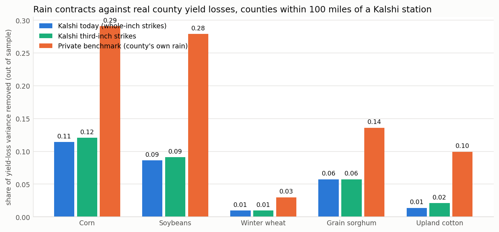
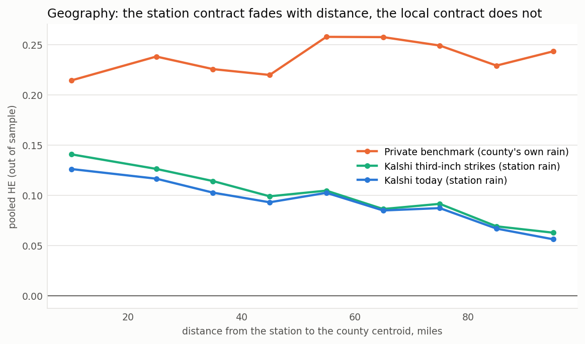
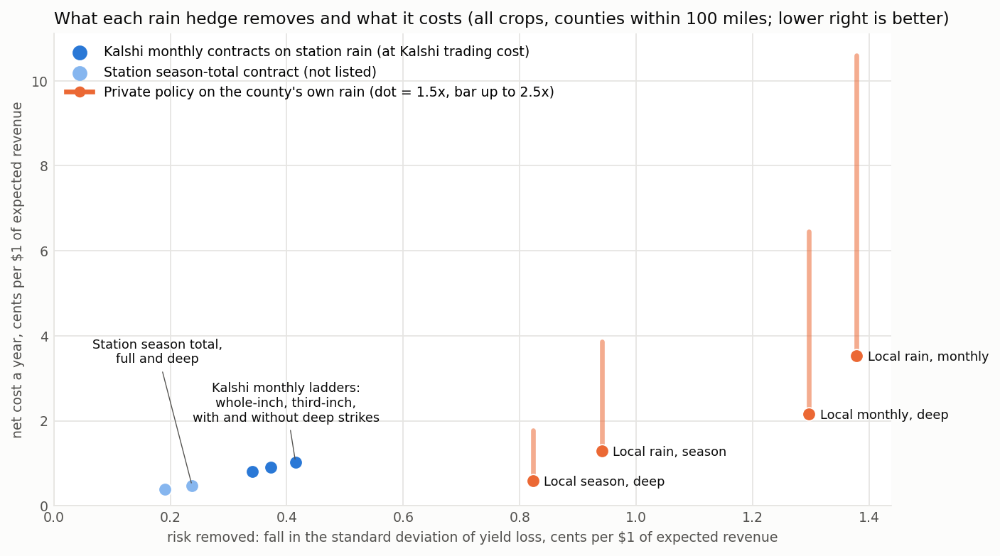
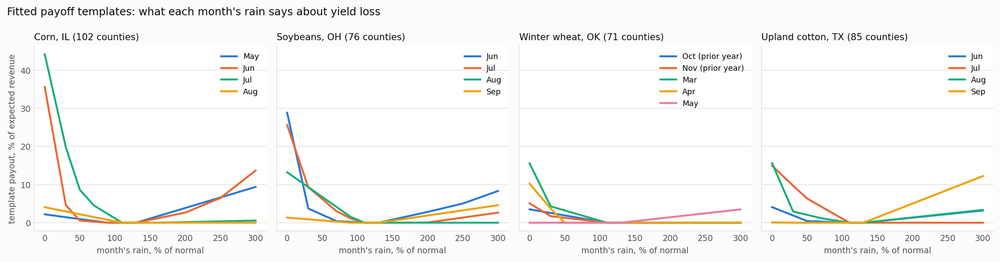

# 29: Kalshi rain contracts against private rain cover for commercial crops

**Proposal cell:** follow-up to docs 02, 27 and 28; requested 2026-11-15 ("PRF insures forage land and not farmland ... see how good our Kalshi insurance is compared to private options for rainfall insuring commercial crops that are not covered in PRF ... and what would happen for 1/3 strike prices")  |  **Status:** DRAFT (computed numbers reproducible with `python scripts/run_crop_rain_benchmark.py`; market research not independently fact-checked)  |  **Last updated:** 2026-11-15  |  **Branch:** milestone-1

Code: `src/agri_hedge/cropbench.py` (yield loss, payoff templates, binary ladders, break-even load), `scripts/pull_crop_county_data.py` (data pull), `scripts/run_crop_rain_benchmark.py` (study, figures, the tables between the AUTO markers), tests in `tests/test_cropbench.py`.
Data written: `data/processed/county_crop_yields.parquet`, `county_crop_acres.csv`, `county_monthly_precip.parquet`, `county_centroids.csv` (inputs pulled once); `crop_benchmark_cases.parquet`, `crop_benchmark_summary.csv`, `crop_benchmark_cost.csv`, `crop_benchmark_coverage.csv`, `crop_benchmark_templates.csv`, `crop_benchmark_percounty_check.csv` (results); figures `docs/figures/x3_*.png`.

## The question

PRF is the wrong benchmark for corn, soybeans, wheat, sorghum and cotton, because it only insures grazing and hay land. For these crops the comparison is between a Kalshi rain hedge and whatever rainfall cover a crop farmer can buy privately. This document answers three things:

1. What rainfall-specific cover can a US commercial crop farmer buy today, and at what price?
2. How much of a real crop loss does a Kalshi rain hedge remove, compared with a private policy that settles on rain at the farm's own location?
3. How much would third-inch strikes improve the Kalshi hedge for these crops?

The test uses real losses. The target is each county's yield shortfall below its own trend, from USDA county yields for 1960-2025, at 1,048 county-crop pairs within 100 miles of a Kalshi rain station. Docs 08 and 28 measured how well contracts copy a rainfall formula. Here heat, pests, planting dates and everything else rain cannot see count against every rain contract.

## Key findings

- **There is no off-the-shelf private rainfall policy for an ordinary row-crop farm.** What exists is bespoke parametric cover sold through brokers (Arbol is the most accessible), agribusiness-scale programs (Descartes, Sompo, Swiss Re), and federal index cover limited to forage, bees and coastal tropical storms. The one mass-market farm product, Climate Corporation's Total Weather Insurance, ended in 2015. CME listed rainfall futures on single airport stations in 2010 and delisted them in 2014 with no open interest. Row-crop farmers instead rely on subsidized yield and revenue insurance, which covered about 89% of major field-crop acres in 2024 and already pays for drought (41% of indemnities since 2000) and excess moisture (27%).
- **No private provider publishes what its rain cover costs relative to expected payout.** Our working range is a premium of 1.5 to 2.5 times expected payout. That is an inference from commissions, surplus-lines taxes and published loadings for comparable index products, not a documented figure. Kalshi's all-in cost on the hedges below is 1.19 to 1.29 times expected payout.
- **Rain alone is a weak hedge for row-crop yield, whoever sells it.** A policy paying on the county's own rain removes 24% of the year-to-year variance of county yield loss out of sample (29% for corn, 28% for soybeans, 3% for winter wheat). No rain contract in this study removes more.
- **Today's Kalshi contracts remove 9%, about a third of what local rain removes.** The gap is geography. The station hedge removes 12% of loss variance within 25 miles of the station, 10% at 25-50 miles and 8% at 50-100 miles. The same payoff on the county's own rain removes 22-25% at every distance.
- **Third-inch strikes add almost nothing for these crops.** They raise the Kalshi hedge from 8.6% to 9.1% of loss variance. A contract with exact payoffs (0.01-inch strikes) reaches 9.0%, so nothing is left to gain from finer strikes. Within 25 miles the gain is 11.9% to 13.4%. Third-inch strikes improve the hedge by more than 0.02 in 23% of counties and worsen it by that much in 12%. The reason is that row crops near Kalshi stations grow where a normal season month brings 3-4 inches, so whole-inch strikes already resolve the payoff. This is the opposite of the forage result in docs 27 and 28, where third-inch strikes roughly doubled the fit at Albuquerque and Denver.
- **Few crop acres are near a station.** 6.5% of corn acres, 7.0% of soybean acres, 4.7% of winter wheat, 2.0% of cotton and 1.9% of sorghum lie within 50 miles of a Kalshi rain station. About 1% lie within 25 miles. The median corn acre is 150 miles away.
- **Kalshi is cheaper per dollar of payout but not per unit of risk removed.** Per cent of standard deviation removed, the Kalshi hedge costs the buyer about 2.4-2.5 cents a year in expectation. A private monthly policy with the same payoff costs the same per unit of risk at a loading of 1.48, and less below that. A private season-total policy with a deductible costs 0.72 at a 1.5 loading and 2.16 at 2.5, so it beats today's Kalshi contracts across the whole estimated price range while removing twice the risk. Within 25 miles of a station the Kalshi figure improves to about 1.6-1.7.
- **In dollars the hedge is small either way.** For corn (expected revenue $890 an acre, standard deviation of yield loss $96), the third-inch Kalshi hedge costs about $10 an acre a year net and removes about $5 of that standard deviation. A private monthly policy at 1.5 times costs about $21 and removes $14. A private season-total policy costs about $6 and removes $9.
- **The hedge does pay more in bad years, but not much more.** In years when a county loses more than 20% of expected revenue (12% of county-years, mean loss 32 cents per $1), today's Kalshi hedge pays 6.6 cents per $1 against 3.4 cents in no-loss years. The local-rain policy pays 12.6 cents against 4.5.
- **Adding the excess-rain side does not help on real yields.** The drought-only ladder removes 9.1% and the two-sided ladder 8.6%. Doc 28 found a gain from two-sided collars against a rainfall loss formula for Illinois corn. That gain does not survive the move to real county yields and station distance.
- **What this means for the project.** Against private cover for commercial crops, Kalshi's advantages are access and price per contract: any size, no broker, no minimum premium, loads near 1.2. Its disadvantage is fit, and for row crops that comes from station distance, not strike spacing. More settlement locations in crop country would help; finer strikes would not. Third-inch strikes should be argued for forage in dry regions (docs 27, 28), not for row crops. A realistic row-crop use is a small supplement for corn and soybean farms within about 25 miles of a station, bought alongside federal crop insurance.

## What a commercial crop farmer can buy today

Source flags: **[P]** = the primary page was read; **[S]** = seen only in a search snippet. None of this was independently fact-checked.

| Product | Peril | Settles on | Who can buy | Pricing evidence | Status |
|---|---|---|---|---|---|
| Arbol | Low rain, excess rain, excess soil moisture | CPC or PRISM gridded precipitation at the buyer's location | Sold only through licensed agents and brokers; says it serves "small farmers to large corporations"; no minimum published | Illustrative Kansas spring low-rain quote on a $500,000 limit: premium $36,340 to $63,650 depending on trigger, a rate on line of 7.3% to 12.7%. Expected loss not given. [P] | Active |
| Descartes Underwriting | Drought, excess rain | Bespoke precipitation and soil-moisture data | Agribusiness, co-ops, food companies; up to $80M per contract | None [S] | Active |
| AgriSompo WeatherLock | Rain, temperature; fixed payout per inch or degree | Bespoke | Described as bespoke for the agricultural industry | None [S] | Active |
| Swiss Re Corporate Solutions, PartnerRe, Munich Re with Farmers Edge | Rain, soil moisture, temperature indexes | Station and satellite data | Mainly agribusiness and insurer programs | None [S] | Active, bespoke |
| Climate Corporation Total Weather Insurance | Season-long drought, excess rain, heat for corn, soybeans, wheat | 2.5-mile grids | Individual farmers through agents, as a supplement to federal insurance | $30-40 an acre for full corn packages; paid on 80% of 2012 corn policies. No loss ratio published. [P]/[S] | Ended 2015 (insurance arm sold to AmTrust) |
| USDA Hurricane Insurance Protection, Tropical Storm option | Named storm with at least 6 inches of rain in 4 days | NOAA CPC grids averaged over the county | Farmers with an underlying policy in Gulf and Atlantic counties and Hawaii | Subsidy 65%, reported raised to 80% for 2026 [P]/[S] | Active |
| USDA Rainfall Index Annual Forage, Apiculture | Low rain | Same grid index as PRF | Annual forage crops and honey only; no grain crops | Subsidized | Active |
| CME rainfall futures and options | Monthly and seasonal rain, March-October | One airport station in each of 9 cities, including O'Hare and DFW | Futures accounts | "Trading volume currently close to zero" [S] | Listed 2010, delisted 2014 with no open interest |

Three points follow from the table.

- **Access is the real barrier.** California recorded 67 parametric surplus-lines transactions worth $6.75 million in 2024, about $100,000 of premium each [S]. That is commercial scale. A 500-acre farm insuring a few cents per dollar of revenue is far below it.
- **The pricing range is an estimate.** Broker commissions of 15-25% on specialty lines, surplus-lines taxes of 1-5% by state, and insurer expense and risk margins imply a premium of roughly 1.5 to 2.2 times expected payout. Published loadings for other index products bracket that: 1.56 times for India's weather-based crop insurance and about 3 times for early Indian rainfall policies [S]. We use 1.5, 2.0 and 2.5.
- **CME tried the Kalshi design and it failed for lack of trading.** Its rainfall contracts settled on single airport stations in nine cities, two of which Kalshi also uses. Doc 12 covers liquidity; this document assumes enough volume.

## Numbers table

"Computed" = produced by `scripts/run_crop_rain_benchmark.py` (run 2026-11-15). HE = hedge effectiveness, out of sample, pooled over counties.

| Quantity | Value | Units | Region / period | Source | Verification |
|---|---|---|---|---|---|
| County-crop cases / stations with at least one case / states | 1,048 / 23 / mostly OH, IN, IL, TX, MN, WI, MI, MO | | counties within 100 mi, at least 5,000 acres, at least 45 yield years | `crop_benchmark_cases.parquet` | CONFIRMED (computed) |
| Cases by crop: corn / soybeans / winter wheat / cotton / sorghum | 434 / 396 / 166 / 33 / 19 | cases | | Table C | CONFIRMED (computed) |
| Share of acres within 50 mi of a station: corn / soybeans / winter wheat / cotton / sorghum | 6.5 / 7.0 / 4.7 / 2.0 / 1.9 | % | NASS acres harvested, 2018-2022 mean | Table A | CONFIRMED (computed) |
| Share within 25 mi / 100 mi, corn | 1.0 / 29.5 | % | | Table A | CONFIRMED (computed) |
| Median corn acre's distance to a station | 150 | miles | | Table A | CONFIRMED (computed) |
| Mean yield loss / its standard deviation, all cases | 6 / 10.0 | cents per $1 of expected revenue | 1960-2025 | `crop_benchmark_summary.csv` | CONFIRMED (computed) |
| HE, Kalshi today (both sides) / drought only / third-inch / exact station payoff | 0.086 / 0.091 / 0.091 / 0.090 | HE | all cases | Table B | CONFIRMED (computed) |
| HE, policy on county's own rain: monthly / season total | 0.240 / 0.162 | HE | all cases | Table B | CONFIRMED (computed) |
| HE in sample: Kalshi today / third-inch / county rain monthly | 0.13 / 0.14 / 0.34 | HE | | Table B | CONFIRMED (computed) |
| HE by distance, 0-25 / 25-50 / 50-100 mi: Kalshi today | 0.119 / 0.101 / 0.080 | HE | | Table D | CONFIRMED (computed) |
| Same: third-inch | 0.134 / 0.109 / 0.083 | HE | | Table D | CONFIRMED (computed) |
| Same: county's own rain, monthly | 0.216 / 0.227 / 0.246 | HE | | Table D | CONFIRMED (computed) |
| Station-to-county season rain correlation, 0-25 / 25-50 / 50-100 mi | 0.86 / 0.77 / 0.66 | correlation | | Table D | CONFIRMED (computed) |
| HE by crop, Kalshi today / third-inch / county rain: corn | 0.114 / 0.121 / 0.291 | HE | | Table C | CONFIRMED (computed) |
| Same: soybeans | 0.086 / 0.091 / 0.279 | HE | | Table C | CONFIRMED (computed) |
| Same: winter wheat / sorghum / cotton | 0.010, 0.010, 0.030 / 0.057, 0.057, 0.136 / 0.014, 0.021, 0.099 | HE | | Table C | CONFIRMED (computed) |
| Counties where third-inch beats / trails whole-inch by more than 0.02 | 23 / 12 | % of cases | | `crop_benchmark_cases.parquet` | CONFIRMED (computed) |
| Kalshi load: today / third-inch / third-inch deep strikes | 1.19 / 1.22 / 1.29 | $ per $ of expected payout | | Table B | CONFIRMED (computed) |
| Risk removed: Kalshi today / third-inch / county rain monthly / county season total | 0.37 / 0.42 / 1.38 / 0.94 | cents of SD per $1 of revenue | | Table F | CONFIRMED (computed) |
| Net cost per unit of risk: Kalshi today / third-inch | 2.45 / 2.47 | cents per cent | | Table F | CONFIRMED (computed) |
| Same: private monthly at 1.5x / private season total with deductible at 1.5x, 2.0x, 2.5x | 2.56 / 0.72, 1.44, 2.16 | cents per cent | | Table F | CONFIRMED (computed) |
| Break-even private load, like-for-like monthly template: full / deep strikes | 1.48 / 1.74 | premium / expected payout | | Table F | CONFIRMED (computed) |
| Kalshi net cost per unit of risk within 25 mi | 1.6-1.7 | cents per cent | | Table F2 | CONFIRMED (computed) |
| Corn, per acre: expected revenue / SD of loss / Kalshi third-inch net cost, SD removed | $890 / $96 / $10.03, $4.78 | $ per acre | 2025 trend yield x $4.70 | Table G | CONFIRMED (computed) |
| Corn, per acre at 1.5x: private monthly net cost, SD removed / private season total | $20.54, $14.49 / $6.22, $9.37 | $ per acre | | Table G | CONFIRMED (computed) |
| Bad years (loss above 20%): share of county-years / mean loss | 12 / 32 | % / cents per $1 | | Table B2 | CONFIRMED (computed) |
| Payout in bad years / no-loss years: Kalshi today; county rain monthly | 6.6 / 3.4; 12.6 / 4.5 | cents per $1 | | Table B2 | CONFIRMED (computed) |
| Per-county ladder fit, in sample / out of sample: station whole-inch; county rain third-inch | 0.46 / -0.10; 0.63 / 0.12 | HE | random 120 cases | Table I | CONFIRMED (computed) |
| Arbol illustrative quote: premium on a $500,000 limit; rate on line | $36,340 / $41,700 / $63,650; 7.3% / 8.3% / 12.7% | | Kansas county, spring low rain | https://insurance.arbol.io/product/low-precipitation | page read by the research pass; not re-checked |
| Total Weather Insurance: price; share of 2012 corn policies paid | $30-40 per acre; 80% | | 2012-2013 | https://www.artemis.bm/news/climate-corporation-pay-out-on-80-of-corn-crop-weather-insurance-policies/ ; farmprogress.com | payout share read; price from a snippet |
| CME rainfall futures: launch / delisting | 1 Nov 2010 / 2014, no open interest | | 9 cities | https://www.artemis.bm/news/cme-to-launch-rainfall-futures-in-nine-u-s-cities ; CME advisory SER-7216 | launch read; delisting from a snippet |
| Drought / excess moisture share of crop insurance indemnities | 41 / 27 | % | since 2000 | https://www.ers.usda.gov/topics/farm-practices-management/risk-management/crop-insurance-at-a-glance | page read; not re-checked |
| Share of major field-crop acres insured | about 89 | % | 2024 | same ERS page | page read; not re-checked |
| California parametric surplus-lines business | 67 transactions, $6.75M premium | | 2024 | https://ains.assembly.ca.gov/media/276 | UNCONFIRMED (snippet) |
| Surplus-lines tax: Iowa / Kansas, Nebraska / Illinois / Texas | 0.95 / 3 / 3.5 / 4.85 | % of premium | 2025 | https://surplusmanual.lockelord.com/appendix-a/ | UNCONFIRMED (snippet) |
| Index insurance loadings elsewhere: India weather-based crop insurance / early Indian rainfall policies | 1.56 / about 3 | premium / expected payout | | Negi and Ramaswami brief; Giné, Townsend and Vickery 2007 | UNCONFIRMED (snippets) |
| Private rain cover loading for a mid-size US farm | 1.5-2.5 | premium / expected payout | | our inference from the rows above | ASSUMPTION |

## Methods

### Data

- **Yields.** USDA NASS Quick Stats county survey yields, 1960-2025, for corn grain, soybeans, winter wheat, grain sorghum and upland cotton. A county's non-irrigated series is used when it has at least 45 years; otherwise the all-practices series. Only 9 of the 1,048 cases have a long non-irrigated series, so irrigated acres are mixed in where they exist.
- **Loss.** A quadratic time trend is fitted to each county's yield. Loss = max(0, 1 - yield / trend), the revenue shortfall per $1 of expected revenue at a fixed price.
- **Local rain.** NOAA nClimDiv county monthly precipitation (the county-area average). This stands in for the gridded rain a private parametric policy settles on at the buyer's location.
- **Station rain.** The 33 Kalshi monthly-rain stations with a complete record since 1960 (O'Hare for Chicago; Napa, St Petersburg and Trenton start in 1998 and are left out). Each county is paired with its nearest station by centroid distance.
- **Season months.** Corn and sorghum May-August; soybeans and cotton June-September; winter wheat October-November of the prior year and March-May.
- **Cases.** County-crop pairs within 100 miles of a station with at least 5,000 harvested acres (2018-2022 mean) and at least 45 yield years.

### Why a state template and not a county-by-county fit

Docs 08 and 28 fit each ladder by non-negative least squares on one site's history. That works when the target is a rainfall formula. Against real yields the signal is too weak: a county-by-county ladder fits 46-63% of loss variance in sample and -10% to 12% out of sample (Table I).

The study therefore fits one payoff shape per crop and state:

1. **Template.** For each crop and state (states with fewer than 8 counties are pooled), loss is regressed on puts and calls on each season month's rain as a share of its normal: puts at 30, 50, 70, 90 and 110% of normal, calls at 130, 160, 200 and 250%. Coefficients are non-negative, with a free intercept. All 5,396 county-crop series in the country are used, each with its own county rain. A second template uses the season total (puts at 40-100%, calls at 115-180%). "Deep strikes only" templates keep puts at or below 70% and calls at or above 160% (150% for the season total), like a policy with a deductible.
2. **Private benchmark.** The template is paid on the county's own rain.
3. **Kalshi hedge.** The template is paid on the station's rain. Each put or call is replaced by the long-only ladder of NO or YES binaries that copies it best on the station's history, at today's whole-inch strikes or at third-inch strikes. The exact payoff on station rain is the limit of ever finer strikes.
4. **Hedge ratio.** Each contract family gets one minimum-variance hedge ratio per crop and distance band, pooled over counties.
5. **Out of sample.** For each evaluated year, both the template and the hedge ratio are fitted without that year.

### Cost

- **Kalshi.** Each binary is priced at its historical frequency plus 2.25 cents (half the 4.5-cent median contested spread, doc 05) plus the taker fee 0.07 x P x (1 - P). Enough volume is assumed.
- **Private.** Expected payout times 1.5, 2.0 or 2.5.
- **Risk removed** is the fall in the standard deviation of the loss, out of sample, acre-weighted over counties. **Net cost** is (load - 1) x expected payout, what the buyer gives up a year in expectation. **Break-even private load** is the loading at which the private policy's net cost per unit of risk removed equals the Kalshi hedge's.

## Results

<!-- BEGIN AUTO: crop benchmark tables (scripts/run_crop_rain_benchmark.py) -->
Generated by `scripts/run_crop_rain_benchmark.py`. Target = county yield shortfall below trend per $1 of expected revenue, NASS 1960-2025. HE = share of the year-to-year variance of that loss the hedge removes, pooled over counties; LOYO = the evaluated year is left out of both the payoff template and the hedge ratio. Fair cost = expected payout per $1 of expected revenue. Load = all-in Kalshi cost (fair + half a 4.5c spread + taker fee) per $1 of expected payout.

**Table A. Where the crops are relative to Kalshi's rain stations** (acres harvested, NASS 2018-2022 mean; 33 stations with a complete record since 1960; distance from the county centroid).
| Crop | Acres (M) | Within 25 mi | Within 50 mi | Within 100 mi | Median acre's distance (mi) |
|---|---|---|---|---|---|
| Corn | 80.8 | 1.0% | 6.5% | 29.5% | 150 |
| Soybeans | 83.4 | 1.2% | 7.0% | 29.7% | 153 |
| Winter wheat | 23.0 | 1.5% | 4.7% | 19.5% | 181 |
| Grain sorghum | 5.1 | 0.4% | 1.9% | 5.8% | 222 |
| Upland cotton | 9.1 | 0.2% | 2.0% | 8.7% | 197 |

**Table B. All crops, all counties within 100 miles of a station (1048 county-crop cases).** The load column is Kalshi's trading cost; a private policy carries the insurer's loading instead (Table F).
| Contract | HE LOYO | HE in-sample | Median county HE | Counties with HE >= 0.2 | Hedge ratio | Fair cost ($/$) | Kalshi load | Thin | Legs |
|---|---|---|---|---|---|---|---|---|---|
| Kalshi today: whole-inch monthly, drought side only | 0.09 | 0.13 | 0.05 | 15% | 0.48 | 0.042 | 1.19 | 11% | 14.5 |
| Kalshi today: whole-inch monthly, both sides | 0.09 | 0.13 | 0.05 | 15% | 0.46 | 0.047 | 1.19 | 11% | 22.6 |
| Kalshi third-inch monthly, both sides | 0.09 | 0.14 | 0.06 | 15% | 0.46 | 0.047 | 1.22 | 11% | 51.6 |
| Station rain, exact payoff (0.01-inch strikes) | 0.09 | 0.14 | 0.06 | 15% | 0.44 | 0.046 |  |  |  |
| Private benchmark: county's own rain, monthly | 0.24 | 0.34 | 0.21 | 52% | 0.88 | 0.071 |  |  |  |
| Private benchmark: county's own rain, season total | 0.16 | 0.21 | 0.15 | 33% | 0.92 | 0.026 |  |  |  |
| Kalshi today, deep strikes only | 0.08 | 0.12 | 0.04 | 13% | 0.46 | 0.032 | 1.26 | 17% | 15.3 |
| Kalshi third-inch, deep strikes only | 0.08 | 0.13 | 0.04 | 13% | 0.45 | 0.031 | 1.29 | 17% | 31.1 |
| Private: county's own rain, monthly, deep strikes only | 0.22 | 0.31 | 0.19 | 48% | 0.89 | 0.043 |  |  |  |
| Private: county's own rain, season total, deep strikes only | 0.13 | 0.16 | 0.11 | 26% | 0.94 | 0.012 |  |  |  |
| Station season total, whole-inch strikes (new contract) | 0.06 | 0.08 | 0.04 | 4% | 0.50 | 0.017 | 1.28 | 18% | 12.4 |
| Station season total, deep strikes only (new contract) | 0.04 | 0.06 | 0.03 | 3% | 0.48 | 0.008 | 1.48 | 41% | 5.4 |

**Table B2. Does the hedge pay in the bad years?** Bad year = county loss above 20% of expected revenue (12% of county-years, mean loss 32 cents per $1); no-loss year = loss under 2%. Payouts are out of sample, in cents per $1 of expected revenue.
| Contract | Average payout | Payout in bad years | Payout in no-loss years | Bad-year payout above average | Share of the bad-year loss paid |
|---|---|---|---|---|---|
| Kalshi today: whole-inch monthly, drought side only | 4.20 | 6.46 | 3.08 | 2.26 | 20% |
| Kalshi today: whole-inch monthly, both sides | 4.70 | 6.56 | 3.41 | 1.86 | 20% |
| Kalshi third-inch monthly, both sides | 4.67 | 6.67 | 3.35 | 2.00 | 21% |
| Station rain, exact payoff (0.01-inch strikes) | 4.62 | 6.51 | 3.23 | 1.89 | 20% |
| Private benchmark: county's own rain, monthly | 7.07 | 12.57 | 4.46 | 5.50 | 39% |
| Private benchmark: county's own rain, season total | 2.58 | 6.72 | 1.38 | 4.14 | 21% |
| Kalshi today, deep strikes only | 3.18 | 5.05 | 2.20 | 1.87 | 16% |
| Kalshi third-inch, deep strikes only | 3.13 | 5.13 | 2.12 | 2.00 | 16% |
| Private: county's own rain, monthly, deep strikes only | 4.31 | 9.74 | 2.28 | 5.44 | 30% |
| Private: county's own rain, season total, deep strikes only | 1.19 | 4.42 | 0.30 | 3.23 | 14% |
| Station season total, whole-inch strikes (new contract) | 1.67 | 3.24 | 1.16 | 1.56 | 10% |
| Station season total, deep strikes only (new contract) | 0.82 | 2.02 | 0.44 | 1.20 | 6% |

**Table C. Pooled LOYO HE by crop** (mean loss and its standard deviation are per $1 of expected revenue, acre-weighted).
| Crop | Cases | Mean loss | SD of loss | Today, drought only | Today, both sides | Third-inch | Station, exact | Local rain, monthly | Local rain, season |
|---|---|---|---|---|---|---|---|---|---|
| Corn | 434 | 0.060 | 0.107 | 0.12 | 0.11 | 0.12 | 0.12 | 0.29 | 0.19 |
| Soybeans | 396 | 0.054 | 0.089 | 0.09 | 0.09 | 0.09 | 0.09 | 0.28 | 0.19 |
| Winter wheat | 166 | 0.077 | 0.113 | 0.00 | 0.01 | 0.01 | 0.01 | 0.03 | 0.07 |
| Grain sorghum | 19 | 0.095 | 0.138 | 0.06 | 0.06 | 0.06 | 0.06 | 0.14 | 0.09 |
| Upland cotton | 33 | 0.102 | 0.136 | 0.04 | 0.01 | 0.02 | 0.02 | 0.10 | 0.07 |

**Table D. Pooled LOYO HE by distance from the station** (all crops). Rain correlation = station season total against the county's own. The local-rain columns do not use the station; they vary across bands only because the counties differ.
| Distance | Cases | Rain correlation | Today, drought only | Today, both sides | Third-inch | Station, exact | Local rain, monthly | Local rain, season |
|---|---|---|---|---|---|---|---|---|
| 0-25 mi | 61 | 0.86 | 0.13 | 0.12 | 0.13 | 0.14 | 0.22 | 0.14 |
| 25-50 mi | 231 | 0.77 | 0.11 | 0.10 | 0.11 | 0.11 | 0.23 | 0.15 |
| 50-100 mi | 756 | 0.66 | 0.08 | 0.08 | 0.08 | 0.08 | 0.25 | 0.17 |

**Table D2. Pooled LOYO HE by crop and distance.** Cells with fewer than 5 cases share the crop-wide hedge ratio.
| Crop | Distance | Cases | Today, drought only | Today, both sides | Third-inch | Station, exact | Local rain, monthly | Local rain, season |
|---|---|---|---|---|---|---|---|---|
| Corn | 0-25 mi | 23 | 0.15 | 0.14 | 0.15 | 0.15 | 0.24 | 0.15 |
| Corn | 25-50 mi | 94 | 0.14 | 0.13 | 0.14 | 0.14 | 0.28 | 0.16 |
| Corn | 50-100 mi | 317 | 0.12 | 0.11 | 0.11 | 0.11 | 0.30 | 0.19 |
| Soybeans | 0-25 mi | 26 | 0.17 | 0.16 | 0.18 | 0.18 | 0.28 | 0.16 |
| Soybeans | 25-50 mi | 92 | 0.11 | 0.10 | 0.11 | 0.12 | 0.26 | 0.18 |
| Soybeans | 50-100 mi | 278 | 0.08 | 0.07 | 0.08 | 0.08 | 0.28 | 0.19 |
| Winter wheat | 0-25 mi | 8 | 0.02 | 0.02 | 0.04 | 0.04 | 0.06 | 0.11 |
| Winter wheat | 25-50 mi | 33 | -0.00 | 0.01 | 0.01 | 0.00 | 0.02 | 0.08 |
| Winter wheat | 50-100 mi | 125 | 0.00 | 0.01 | 0.01 | 0.01 | 0.03 | 0.06 |
| Grain sorghum | 0-25 mi | 2 | 0.02 | 0.01 | -0.03 | -0.01 | 0.07 | 0.04 |
| Grain sorghum | 25-50 mi | 5 | 0.09 | 0.09 | 0.11 | 0.10 | 0.17 | 0.09 |
| Grain sorghum | 50-100 mi | 12 | 0.05 | 0.05 | 0.05 | 0.05 | 0.14 | 0.10 |
| Upland cotton | 0-25 mi | 2 | 0.10 | 0.08 | 0.11 | 0.12 | 0.13 | 0.03 |
| Upland cotton | 25-50 mi | 7 | 0.03 | 0.01 | 0.02 | 0.02 | 0.05 | 0.04 |
| Upland cotton | 50-100 mi | 24 | 0.04 | 0.01 | 0.02 | 0.02 | 0.11 | 0.08 |

**Table E. What third-inch strikes add, by how wet the station's season months are** (mean rain per season month at the station). Better / worse = share of counties where third-inch strikes beat / trail today's whole-inch strikes by more than 0.02 of HE.
| Station season-month mean | Cases | Today, both sides | Third-inch | Station, exact | Better | Worse | Local rain, monthly |
|---|---|---|---|---|---|---|---|
| under 2 in | 23 | 0.01 | 0.02 | 0.03 | 35% | 13% | 0.10 |
| 2-3 in | 47 | 0.01 | 0.02 | 0.03 | 9% | 4% | 0.05 |
| 3-4 in | 743 | 0.06 | 0.07 | 0.07 | 25% | 9% | 0.24 |
| over 4 in | 235 | 0.17 | 0.16 | 0.16 | 20% | 20% | 0.28 |

**Table F. Risk removed against what it costs, all crops.** Risk removed = fall in the standard deviation of the loss, cents per $1 of expected revenue, out of sample. Net cost = what the buyer gives up a year in expectation, (load - 1) x expected payout. Cost per unit of risk = net cost / risk removed. Break-even private load = the loading at which the same template paid on the county's own rain costs the same per unit of risk; a private policy priced above it is the worse buy on this measure.
| Design | Priced at | HE | Expected payout (c) | Risk removed (c) | Net cost a year (c) | Cost per unit of risk | Break-even private load |
|---|---|---|---|---|---|---|---|
| Kalshi today: whole-inch monthly, both sides | Kalshi, load 1.19 | 0.09 | 4.70 | 0.37 | 0.92 | 2.45 | 1.48 |
| Kalshi third-inch monthly, both sides | Kalshi, load 1.22 | 0.09 | 4.67 | 0.42 | 1.02 | 2.47 | 1.48 |
| Private benchmark: county's own rain, monthly | private at 1.5x | 0.24 | 7.07 | 1.38 | 3.53 | 2.56 |  |
| Private benchmark: county's own rain, monthly | private at 2.0x | 0.24 | 7.07 | 1.38 | 7.07 | 5.13 |  |
| Private benchmark: county's own rain, monthly | private at 2.5x | 0.24 | 7.07 | 1.38 | 10.60 | 7.69 |  |
| Private benchmark: county's own rain, season total | private at 1.5x | 0.16 | 2.58 | 0.94 | 1.29 | 1.37 |  |
| Private benchmark: county's own rain, season total | private at 2.0x | 0.16 | 2.58 | 0.94 | 2.58 | 2.74 |  |
| Private benchmark: county's own rain, season total | private at 2.5x | 0.16 | 2.58 | 0.94 | 3.87 | 4.11 |  |
| Kalshi today, deep strikes only | Kalshi, load 1.26 | 0.08 | 3.18 | 0.34 | 0.82 | 2.39 | 1.72 |
| Kalshi third-inch, deep strikes only | Kalshi, load 1.29 | 0.08 | 3.13 | 0.37 | 0.92 | 2.46 | 1.74 |
| Private: county's own rain, monthly, deep strikes only | private at 1.5x | 0.22 | 4.31 | 1.30 | 2.15 | 1.66 |  |
| Private: county's own rain, monthly, deep strikes only | private at 2.0x | 0.22 | 4.31 | 1.30 | 4.31 | 3.32 |  |
| Private: county's own rain, monthly, deep strikes only | private at 2.5x | 0.22 | 4.31 | 1.30 | 6.46 | 4.98 |  |
| Private: county's own rain, season total, deep strikes only | private at 1.5x | 0.13 | 1.19 | 0.82 | 0.59 | 0.72 |  |
| Private: county's own rain, season total, deep strikes only | private at 2.0x | 0.13 | 1.19 | 0.82 | 1.19 | 1.44 |  |
| Private: county's own rain, season total, deep strikes only | private at 2.5x | 0.13 | 1.19 | 0.82 | 1.78 | 2.16 |  |
| Station season total, whole-inch strikes (new contract) | Kalshi, load 1.28 | 0.06 | 1.67 | 0.24 | 0.47 | 1.96 | 1.72 |
| Station season total, deep strikes only (new contract) | Kalshi, load 1.48 | 0.04 | 0.82 | 0.19 | 0.39 | 2.06 | 2.43 |

**Table F-corn. The same for corn.**
| Design | Priced at | HE | Expected payout (c) | Risk removed (c) | Net cost a year (c) | Cost per unit of risk | Break-even private load |
|---|---|---|---|---|---|---|---|
| Kalshi today: whole-inch monthly, both sides | Kalshi, load 1.21 | 0.11 | 5.45 | 0.52 | 1.14 | 2.21 | 1.50 |
| Kalshi third-inch monthly, both sides | Kalshi, load 1.23 | 0.12 | 5.39 | 0.57 | 1.26 | 2.21 | 1.50 |
| Private benchmark: county's own rain, monthly | private at 1.5x | 0.29 | 7.42 | 1.68 | 3.71 | 2.21 |  |
| Private benchmark: county's own rain, monthly | private at 2.0x | 0.29 | 7.42 | 1.68 | 7.42 | 4.42 |  |
| Private benchmark: county's own rain, monthly | private at 2.5x | 0.29 | 7.42 | 1.68 | 11.13 | 6.62 |  |
| Private benchmark: county's own rain, season total | private at 1.5x | 0.19 | 2.69 | 1.14 | 1.34 | 1.18 |  |
| Private benchmark: county's own rain, season total | private at 2.0x | 0.19 | 2.69 | 1.14 | 2.69 | 2.36 |  |
| Private benchmark: county's own rain, season total | private at 2.5x | 0.19 | 2.69 | 1.14 | 4.03 | 3.54 |  |
| Kalshi today, deep strikes only | Kalshi, load 1.27 | 0.11 | 3.78 | 0.50 | 1.02 | 2.05 | 1.72 |
| Kalshi third-inch, deep strikes only | Kalshi, load 1.30 | 0.11 | 3.70 | 0.54 | 1.13 | 2.10 | 1.74 |
| Private: county's own rain, monthly, deep strikes only | private at 1.5x | 0.28 | 4.62 | 1.63 | 2.31 | 1.42 |  |
| Private: county's own rain, monthly, deep strikes only | private at 2.0x | 0.28 | 4.62 | 1.63 | 4.62 | 2.84 |  |
| Private: county's own rain, monthly, deep strikes only | private at 2.5x | 0.28 | 4.62 | 1.63 | 6.93 | 4.25 |  |
| Private: county's own rain, season total, deep strikes only | private at 1.5x | 0.15 | 1.40 | 1.05 | 0.70 | 0.66 |  |
| Private: county's own rain, season total, deep strikes only | private at 2.0x | 0.15 | 1.40 | 1.05 | 1.40 | 1.33 |  |
| Private: county's own rain, season total, deep strikes only | private at 2.5x | 0.15 | 1.40 | 1.05 | 2.10 | 1.99 |  |
| Station season total, whole-inch strikes (new contract) | Kalshi, load 1.32 | 0.06 | 1.79 | 0.27 | 0.58 | 2.17 | 1.92 |
| Station season total, deep strikes only (new contract) | Kalshi, load 1.51 | 0.05 | 0.96 | 0.24 | 0.49 | 2.01 | 2.52 |

**Table F-soybeans. The same for soybeans.**
| Design | Priced at | HE | Expected payout (c) | Risk removed (c) | Net cost a year (c) | Cost per unit of risk | Break-even private load |
|---|---|---|---|---|---|---|---|
| Kalshi today: whole-inch monthly, both sides | Kalshi, load 1.18 | 0.09 | 4.14 | 0.28 | 0.75 | 2.70 | 1.49 |
| Kalshi third-inch monthly, both sides | Kalshi, load 1.21 | 0.09 | 4.12 | 0.31 | 0.84 | 2.70 | 1.49 |
| Private benchmark: county's own rain, monthly | private at 1.5x | 0.28 | 7.03 | 1.27 | 3.51 | 2.77 |  |
| Private benchmark: county's own rain, monthly | private at 2.0x | 0.28 | 7.03 | 1.27 | 7.03 | 5.55 |  |
| Private benchmark: county's own rain, monthly | private at 2.5x | 0.28 | 7.03 | 1.27 | 10.54 | 8.32 |  |
| Private benchmark: county's own rain, season total | private at 1.5x | 0.19 | 2.51 | 0.79 | 1.26 | 1.60 |  |
| Private benchmark: county's own rain, season total | private at 2.0x | 0.19 | 2.51 | 0.79 | 2.51 | 3.20 |  |
| Private benchmark: county's own rain, season total | private at 2.5x | 0.19 | 2.51 | 0.79 | 3.77 | 4.79 |  |
| Kalshi today, deep strikes only | Kalshi, load 1.25 | 0.08 | 2.70 | 0.23 | 0.66 | 2.84 | 1.79 |
| Kalshi third-inch, deep strikes only | Kalshi, load 1.28 | 0.08 | 2.66 | 0.25 | 0.75 | 2.94 | 1.82 |
| Private: county's own rain, monthly, deep strikes only | private at 1.5x | 0.25 | 4.12 | 1.15 | 2.06 | 1.80 |  |
| Private: county's own rain, monthly, deep strikes only | private at 2.0x | 0.25 | 4.12 | 1.15 | 4.12 | 3.59 |  |
| Private: county's own rain, monthly, deep strikes only | private at 2.5x | 0.25 | 4.12 | 1.15 | 6.18 | 5.39 |  |
| Private: county's own rain, season total, deep strikes only | private at 1.5x | 0.15 | 0.97 | 0.64 | 0.48 | 0.76 |  |
| Private: county's own rain, season total, deep strikes only | private at 2.0x | 0.15 | 0.97 | 0.64 | 0.97 | 1.52 |  |
| Private: county's own rain, season total, deep strikes only | private at 2.5x | 0.15 | 0.97 | 0.64 | 1.45 | 2.28 |  |
| Station season total, whole-inch strikes (new contract) | Kalshi, load 1.23 | 0.07 | 1.62 | 0.22 | 0.38 | 1.74 | 1.54 |
| Station season total, deep strikes only (new contract) | Kalshi, load 1.43 | 0.05 | 0.71 | 0.14 | 0.30 | 2.15 | 2.42 |

**Table F2. Kalshi designs by distance** (all crops).
| Distance | Kalshi design | Cases | HE | Risk removed (c) | Kalshi load | Net cost a year (c) | Cost per unit of risk | Break-even private load |
|---|---|---|---|---|---|---|---|---|
| 0-25 mi | Kalshi today: whole-inch monthly, both sides | 61 | 0.12 | 0.66 | 1.19 | 1.13 | 1.70 | 1.30 |
| 0-25 mi | Kalshi third-inch monthly, both sides | 61 | 0.13 | 0.79 | 1.22 | 1.33 | 1.69 | 1.29 |
| 0-25 mi | Kalshi today, deep strikes only | 61 | 0.11 | 0.63 | 1.25 | 1.01 | 1.61 | 1.43 |
| 0-25 mi | Kalshi third-inch, deep strikes only | 61 | 0.13 | 0.77 | 1.29 | 1.21 | 1.58 | 1.43 |
| 0-25 mi | Station season total, whole-inch strikes (new contract) | 61 | 0.10 | 0.44 | 1.26 | 0.60 | 1.37 | 1.33 |
| 0-25 mi | Station season total, deep strikes only (new contract) | 61 | 0.09 | 0.41 | 1.45 | 0.53 | 1.29 | 1.56 |
| 25-50 mi | Kalshi today: whole-inch monthly, both sides | 231 | 0.10 | 0.49 | 1.20 | 0.98 | 2.02 | 1.40 |
| 25-50 mi | Kalshi third-inch monthly, both sides | 231 | 0.11 | 0.53 | 1.22 | 1.11 | 2.08 | 1.42 |
| 25-50 mi | Kalshi today, deep strikes only | 231 | 0.09 | 0.44 | 1.26 | 0.87 | 1.98 | 1.61 |
| 25-50 mi | Kalshi third-inch, deep strikes only | 231 | 0.10 | 0.47 | 1.30 | 0.98 | 2.07 | 1.64 |
| 25-50 mi | Station season total, whole-inch strikes (new contract) | 231 | 0.08 | 0.31 | 1.28 | 0.52 | 1.66 | 1.54 |
| 25-50 mi | Station season total, deep strikes only (new contract) | 231 | 0.06 | 0.27 | 1.48 | 0.46 | 1.70 | 2.12 |
| 50-100 mi | Kalshi today: whole-inch monthly, both sides | 756 | 0.08 | 0.33 | 1.19 | 0.89 | 2.69 | 1.52 |
| 50-100 mi | Kalshi third-inch monthly, both sides | 756 | 0.08 | 0.37 | 1.22 | 0.99 | 2.68 | 1.52 |
| 50-100 mi | Kalshi today, deep strikes only | 756 | 0.07 | 0.30 | 1.26 | 0.79 | 2.62 | 1.79 |
| 50-100 mi | Kalshi third-inch, deep strikes only | 756 | 0.08 | 0.33 | 1.29 | 0.88 | 2.70 | 1.81 |
| 50-100 mi | Station season total, whole-inch strikes (new contract) | 756 | 0.05 | 0.21 | 1.28 | 0.45 | 2.13 | 1.81 |
| 50-100 mi | Station season total, deep strikes only (new contract) | 756 | 0.03 | 0.16 | 1.48 | 0.37 | 2.30 | 2.64 |

**Table G. Dollars per acre, deep-strike designs** (each at its minimum-variance size; expected revenue = 2025 trend yield x the 2026/27 WASDE price, acre-weighted over the study counties; private premiums at 1.5x).
| Crop | Expected revenue | SD of yield loss | Kalshi third-inch: cost | net cost a year | SD removed | Private monthly: premium | net cost a year | SD removed | Private season total: premium | net cost a year | SD removed |
|---|---|---|---|---|---|---|---|---|---|---|---|
| Corn | $890 | $96 | $42.99 | $10.03 | $4.78 | $61.62 | $20.54 | $14.49 | $18.66 | $6.22 | $9.37 |
| Soybeans | $679 | $60 | $23.09 | $5.06 | $1.72 | $41.94 | $13.98 | $7.78 | $9.84 | $3.28 | $4.32 |
| Winter wheat | $315 | $36 | $9.88 | $2.36 | $0.47 | $15.44 | $5.15 | $1.10 | $5.39 | $1.80 | $2.09 |
| Grain sorghum | $263 | $36 | $17.31 | $2.50 | $1.16 | $25.92 | $8.64 | $2.61 | $6.91 | $2.30 | $1.49 |
| Upland cotton | $745 | $101 | $31.70 | $5.45 | $0.66 | $62.90 | $20.97 | $5.27 | $18.53 | $6.18 | $2.90 |

**Table H. By station** (stations with at least 5 county-crop cases).
| Station | Cases | Mean distance (mi) | Season-month mean (in) | Rain correlation | Today, both sides | Third-inch | Station, exact | Local rain, monthly |
|---|---|---|---|---|---|---|---|---|
| IND | 133 | 63 | 3.90 | 0.70 | 0.27 | 0.26 | 0.26 | 0.37 |
| STL | 111 | 65 | 3.73 | 0.74 | 0.08 | 0.09 | 0.09 | 0.26 |
| CMH | 101 | 58 | 3.83 | 0.70 | 0.01 | 0.02 | 0.03 | 0.17 |
| MSP | 94 | 64 | 3.79 | 0.65 | -0.05 | -0.02 | -0.02 | 0.10 |
| DTW | 92 | 67 | 3.17 | 0.58 | 0.07 | 0.08 | 0.09 | 0.21 |
| DCA | 77 | 63 | 3.69 | 0.75 | 0.16 | 0.14 | 0.14 | 0.44 |
| ORD | 67 | 68 | 3.83 | 0.66 | 0.01 | 0.01 | 0.00 | 0.33 |
| LEX | 62 | 63 | 4.33 | 0.63 | 0.18 | 0.18 | 0.17 | 0.29 |
| MKE | 55 | 63 | 3.41 | 0.71 | 0.01 | 0.03 | 0.04 | 0.09 |
| SGF | 45 | 66 | 4.07 | 0.69 | 0.08 | 0.08 | 0.08 | 0.30 |
| DFW | 31 | 61 | 3.21 | 0.80 | 0.05 | 0.06 | 0.06 | 0.13 |
| PIT | 30 | 60 | 3.69 | 0.64 | 0.06 | 0.06 | 0.04 | 0.23 |
| OKC | 29 | 70 | 3.47 | 0.73 | 0.03 | 0.02 | 0.03 | 0.08 |
| CLL | 25 | 57 | 3.39 | 0.76 | 0.11 | 0.12 | 0.11 | 0.18 |
| PHL | 24 | 52 | 3.94 | 0.74 | 0.15 | 0.18 | 0.16 | 0.36 |
| SAT | 20 | 59 | 3.05 | 0.72 | 0.08 | 0.08 | 0.08 | 0.14 |
| DEN | 14 | 53 | 1.65 | 0.77 | 0.00 | 0.02 | 0.03 | 0.11 |
| HOU | 13 | 60 | 5.30 | 0.78 | 0.11 | 0.13 | 0.11 | 0.18 |
| ATL | 8 | 88 | 4.18 | 0.59 | 0.07 | 0.07 | 0.06 | 0.22 |
| SFO | 6 | 77 | 0.84 | 0.86 | 0.05 | 0.05 | 0.04 | 0.04 |
| MSY | 5 | 81 | 6.19 | 0.70 | -0.09 | -0.09 | -0.08 | -0.04 |

**Table I. Check: fitting a ladder county by county instead of using a state template** (random sample of cases, NNLS with a free intercept and doc 08's ridge penalties). The gap between in-sample and out-of-sample fit is the reason the template method is used.
| Ladder | Cases | HE in-sample | HE LOYO | Median county HE (LOYO) | Legs used |
|---|---|---|---|---|---|
| Station rain, whole-inch | 120 | 0.46 | -0.10 | -0.13 | 28.0 |
| Station rain, third-inch | 120 | 0.56 | -0.05 | -0.08 | 81.7 |
| County rain, third-inch | 120 | 0.63 | 0.12 | 0.11 | 78.5 |
<!-- END AUTO: crop benchmark tables (scripts/run_crop_rain_benchmark.py) -->

## Caveats

- **County yields, not farm yields.** A farm's yield varies more than its county's, and the extra variation is mostly unrelated to rain. Every rain contract would remove a smaller share of a single farm's loss than shown here. The ranking of contracts should not change.
- **The private benchmark is generous in one way and harsh in another.** It uses the county-average rain against the county-average yield, which is the best case for a local index. It also uses the same payoff shapes as the Kalshi hedge; an insurer with more data, temperature or soil moisture could do better.
- **The private loading is an estimate.** No provider publishes it. If private cover is priced below about 1.5 times expected payout, it beats Kalshi on every measure here. If it is unavailable to a farm of ordinary size, the comparison is moot for that farm.
- **Federal crop insurance is not modelled.** Most of these farms already hold a subsidized policy that pays on actual yield or revenue. A rain contract would be bought on top of it, and part of what it hedges is already insured.
- **Rain only.** Heat is the other half of a drought loss. Kalshi lists temperature contracts; a rain-plus-heat hedge was not tested.
- **Hedge sizes and templates were chosen to remove variance, not to minimize cost.** The full templates pay a little in most years, which raises expected payout and with it the net cost of both Kalshi and private versions. The deep-strike variants show the effect of removing that.
- **Thin samples.** Sorghum (19 cases) and cotton (33) are barely represented near Kalshi stations, and most of the cotton and sorghum counties used are in Texas and Oklahoma. Their numbers are indicative only.
- **Irrigation.** All-practices yields include irrigated acres in the few study counties that have them (parts of Texas, Colorado and California), which mutes the rain response there.
- **Station results are noisy one at a time.** Table H ranges from 0.27 at Indianapolis to slightly negative at Minneapolis with 66 years each; only the pooled figures should be quoted.
- **Volume is assumed.** Doc 05b and doc 09 show today's order books cannot fill even small hedges.
