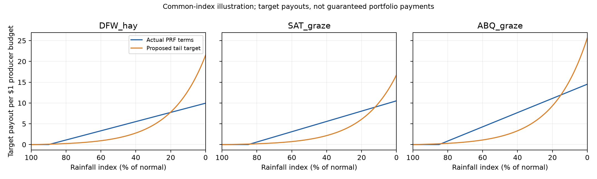

# 30: Matched-premium drought diagnostics and actual PRF payout curves

**Status: exploratory, frozen before this run, 2026-11-21.** Evaluation years were already
inspected in prior project work. This comparison is not fresh confirmation, farm-income
validation, or a claim that proposed instruments can be traded. Run offline:

```powershell
$env:PYTHONPATH = 'src'
python scripts/run_matched_premium.py
```

Use the project's existing `.venv` interpreter explicitly. The script writes only its
`maya_matched_premium_*` outputs, the figure below and this AUTO table.

## Question and frozen choices

At a fixed producer-paid annual premium, how do broad PRF protection, an open-month
companion and catastrophe-focused contracts trade ordinary payouts against severe-state
coverage? Does the conclusion change under a saved-depth capacity stress?

- Cases: `DFW_hay`, `SAT_graze`, `ABQ_graze`, geographic contrasts inherited from the study.
- Fit: 1951-2000. Evaluate: 2001-2025 on complete common years. Cases and periods are fixed;
  their data are not new to this project.
- Actual PRF: each profile's 2026 actuarial terms and producer premium from
  `prf_scenario_results.csv`, counterfactually applied to the official NCEI historical
  index. These are actual policy rules, not what historical policyholders were paid.
- Budget: that profile's current annual PRF producer premium. A mixed policy reallocates
  80% to PRF and 20% to market cover. **It reduces PRF protection**; it does not keep the
  original PRF policy and acquire extra protection for free. The 80/20 split is a disclosed
  fixed illustration, not an estimated optimal allocation. Its implied productivity factor
  remains above the minimum in these three cases; the small official dollar-rounding
  differences from reissuing a policy are not modeled.
- Companion: equal-weight drought targets on the unselected months among Jan, Feb, Nov,
  Dec; monthly normals learned from fitting years. This fixed winter design is not a
  reproduction of doc 21's automatically selected months.
- Catastrophe target: the previously studied exponential `(exp(5s)-1)/(exp(5)-1)`, with
  `s=max(0,1-I/100)`, allocated over the farmer's selected intervals. The coefficient 5 is
  inherited, not retuned to these results.
- After inspecting the first exponential run, we added the prior deck's disaster-only
  `max(0,(50-I)/50)` and binary `1{I<=30}` as explicitly exploratory family sensitivities.
  All families are retained, including failures. This expansion is not fresh validation.
- Listed-strike fit: nonnegative ridge least squares, penalty 0.03 per observation, the
  prior whole-inch baseline. Proposed two-month third-inch fit: penalty 0.10 inherited
  from the finer-ladder baseline. Model coefficients, prices and position sizes use only
  fitting years; the instrument ladders reflect the saved contemporary menu.
- Whole-contract counts, frozen across evaluation years, constrained to the same budget.
  Prices are fitting-period frequencies plus 2.25-cent half-spread, rounded retail taker
  fees, and 4.05% opportunity cost for 31 days. A 6.55-cent half-spread is the price stress.
  This is a static counterfactual pricing convention, not a claim that old climatological
  prices can be locked in before a season with today's listing horizon.

## Metrics and what counts as improvement

The loss target is the existing rain-to-forage-loss **model**, using NRCS growth timing,
not actual farm loss observations. It is included to expose dependence on the chosen
target, not to establish agricultural effectiveness. There are two distinct questions:

1. Payout fit: HE and RMSE against PRF or the proposed target.
2. Protection under the loss proxy: HE against modeled loss; mean net loss and uncovered
   shortfall in the five worst proxy-loss evaluation years.

`HE=1-Var(loss-payout)/Var(loss)`. HE ignores constant bias and premiums. Net-loss metrics
therefore include premiums, while unspent money remains cash. Positive improvement versus
PRF means less average `max(loss + premium - payout, 0)` in those five years.

The severe-rain indicator means at least one selected two-month interval has `I<=30`.
This is distinct from the five worst annual modeled-loss years.

## Desired cover, simulated portfolio, and capacity

- **Target curve:** the desired formula at the farm's index.
- **Unlimited-depth replay:** historical airport-settled contract payouts from fixed,
  budget-constrained counts. This still assumes the necessary months can be purchased.
- **Saved-depth proxy:** cap each calendar month's listed ladder using November 2026
  quantities within 10 cents of fitting-period fair value. Reusing November books is a
  capacity sensitivity, **not evidence of executable historical or full-season orders**.
  It uses the same modeled prices to isolate capacity, not a live walked execution cost.
- Proposed two-month instruments have no observed depth. No invented executable fill
  is assigned to them.

## Actual PRF curve reconstruction

For profile protection `P`, annual producer premium `C` and coverage level `c`, if all
selected intervals hypothetically have the same index `I`:

`PRF payout per dollar of producer premium = (P/C) * max(0,(100c-I)/(100c))`.

The interval shares sum to one. `P` and `C` come from the profile's actuarial calculation;
the subsidy is already included in `C`. This does not apply a subsidy to a Kalshi-priced
portfolio. Different farm rates imply different curves. We do not assert that any one of
these reproduces the undocumented dashed curve in the final presentation.



## Results

<!-- BEGIN AUTO: matched premium -->

| Farm | Policy | Capacity | Loss-proxy HE | Mean payout ($) | Worst-five shortfall ($) | Improvement vs PRF ($) |
|---|---|---|---:|---:|---:|---:|
| ABQ_graze | market_linear | saved_depth_proxy | 0.123 | 2160 | 7700 | -7700 |
| ABQ_graze | market_linear | unlimited | 0.015 | 12424 | 5345 | -5345 |
| ABQ_graze | prf80_companion20 | saved_depth_proxy | -13.712 | 19902 | 0 | 0 |
| ABQ_graze | prf80_companion20 | unlimited | -13.726 | 20107 | 0 | 0 |
| ABQ_graze | prf80_tail_deep5020 | saved_depth_proxy | -13.645 | 19443 | 0 | 0 |
| ABQ_graze | prf80_tail_deep5020 | unlimited | -13.876 | 20366 | 0 | 0 |
| ABQ_graze | prf80_tail_digital3020 | saved_depth_proxy | -13.579 | 19143 | 0 | 0 |
| ABQ_graze | prf80_tail_digital3020 | unlimited | -13.966 | 20433 | 0 | 0 |
| ABQ_graze | prf80_tail_exp520 | saved_depth_proxy | -13.647 | 19481 | 0 | 0 |
| ABQ_graze | prf80_tail_exp520 | unlimited | -13.809 | 20285 | 0 | 0 |
| ABQ_graze | prf_only | saved_depth_proxy | -22.928 | 22274 | 0 | 0 |
| ABQ_graze | prf_only | unlimited | -22.928 | 22274 | 0 | 0 |
| ABQ_graze | tail_deep50_listed | saved_depth_proxy | 0.118 | 1900 | 7694 | -7694 |
| ABQ_graze | tail_deep50_listed | unlimited | -0.115 | 12738 | 4900 | -4900 |
| ABQ_graze | tail_deep50_proposed_sum_third | unlimited | -5.717 | 13126 | 3909 | -3909 |
| ABQ_graze | tail_digital30_listed | saved_depth_proxy | 0.085 | 1478 | 7670 | -7670 |
| ABQ_graze | tail_digital30_listed | unlimited | -0.225 | 13068 | 3623 | -3623 |
| ABQ_graze | tail_digital30_proposed_sum_third | unlimited | -7.172 | 12899 | 4773 | -4773 |
| ABQ_graze | tail_exp5_listed | saved_depth_proxy | 0.118 | 1900 | 7694 | -7694 |
| ABQ_graze | tail_exp5_listed | unlimited | -0.018 | 12333 | 5441 | -5441 |
| ABQ_graze | tail_exp5_proposed_sum_third | unlimited | -3.362 | 13026 | 3277 | -3277 |
| DFW_hay | market_linear | saved_depth_proxy | 0.055 | 445 | 6987 | -6674 |
| DFW_hay | market_linear | unlimited | 0.196 | 3770 | 5833 | -5520 |
| DFW_hay | prf80_companion20 | saved_depth_proxy | 0.152 | 6291 | 413 | -100 |
| DFW_hay | prf80_companion20 | unlimited | 0.148 | 6319 | 401 | -88 |
| DFW_hay | prf80_tail_deep5020 | saved_depth_proxy | 0.129 | 6029 | 465 | -151 |
| DFW_hay | prf80_tail_deep5020 | unlimited | 0.056 | 6427 | 437 | -123 |
| DFW_hay | prf80_tail_digital3020 | saved_depth_proxy | 0.132 | 6016 | 460 | -146 |
| DFW_hay | prf80_tail_digital3020 | unlimited | 0.036 | 6405 | 447 | -134 |
| DFW_hay | prf80_tail_exp520 | saved_depth_proxy | 0.133 | 6018 | 457 | -144 |
| DFW_hay | prf80_tail_exp520 | unlimited | 0.070 | 6443 | 419 | -105 |
| DFW_hay | prf_only | saved_depth_proxy | -0.357 | 7120 | 314 | 0 |
| DFW_hay | prf_only | unlimited | -0.357 | 7120 | 314 | 0 |
| DFW_hay | tail_deep50_listed | saved_depth_proxy | 0.042 | 357 | 7005 | -6691 |
| DFW_hay | tail_deep50_listed | unlimited | -0.187 | 3654 | 5986 | -5673 |
| DFW_hay | tail_deep50_proposed_sum_third | unlimited | -0.538 | 2539 | 7425 | -7111 |
| DFW_hay | tail_digital30_listed | saved_depth_proxy | 0.042 | 357 | 7005 | -6691 |
| DFW_hay | tail_digital30_listed | unlimited | -0.134 | 3546 | 5918 | -5604 |
| DFW_hay | tail_digital30_proposed_sum_third | unlimited | -1.023 | 2249 | 8068 | -7755 |
| DFW_hay | tail_exp5_listed | saved_depth_proxy | 0.044 | 371 | 6986 | -6672 |
| DFW_hay | tail_exp5_listed | unlimited | -0.078 | 3732 | 5935 | -5621 |
| DFW_hay | tail_exp5_proposed_sum_third | unlimited | -0.120 | 2813 | 6820 | -6506 |
| SAT_graze | market_linear | saved_depth_proxy | 0.005 | 59 | 6477 | -5952 |
| SAT_graze | market_linear | unlimited | -0.465 | 3461 | 5604 | -5079 |
| SAT_graze | prf80_companion20 | saved_depth_proxy | -1.109 | 5647 | 748 | -223 |
| SAT_graze | prf80_companion20 | unlimited | -1.123 | 5917 | 689 | -164 |
| SAT_graze | prf80_tail_deep5020 | saved_depth_proxy | -1.081 | 5272 | 779 | -254 |
| SAT_graze | prf80_tail_deep5020 | unlimited | -1.388 | 6009 | 682 | -157 |
| SAT_graze | prf80_tail_digital3020 | saved_depth_proxy | -1.081 | 5272 | 779 | -254 |
| SAT_graze | prf80_tail_digital3020 | unlimited | -1.411 | 5990 | 694 | -169 |
| SAT_graze | prf80_tail_exp520 | saved_depth_proxy | -1.081 | 5272 | 779 | -254 |
| SAT_graze | prf80_tail_exp520 | unlimited | -1.387 | 6004 | 703 | -178 |
| SAT_graze | prf_only | saved_depth_proxy | -2.429 | 6553 | 525 | 0 |
| SAT_graze | prf_only | unlimited | -2.429 | 6553 | 525 | 0 |
| SAT_graze | tail_deep50_listed | saved_depth_proxy | -0.004 | 30 | 6477 | -5952 |
| SAT_graze | tail_deep50_listed | unlimited | -1.322 | 3834 | 5524 | -4999 |
| SAT_graze | tail_deep50_proposed_sum_third | unlimited | -2.063 | 3889 | 4205 | -3680 |
| SAT_graze | tail_digital30_listed | saved_depth_proxy | -0.004 | 30 | 6477 | -5952 |
| SAT_graze | tail_digital30_listed | unlimited | -1.571 | 3736 | 5709 | -5184 |
| SAT_graze | tail_digital30_proposed_sum_third | unlimited | -2.775 | 4169 | 4160 | -3635 |
| SAT_graze | tail_exp5_listed | saved_depth_proxy | -0.004 | 30 | 6477 | -5952 |
| SAT_graze | tail_exp5_listed | unlimited | -1.088 | 3811 | 5270 | -4745 |
| SAT_graze | tail_exp5_proposed_sum_third | unlimited | -1.696 | 3781 | 4168 | -3643 |

<!-- END AUTO: matched premium -->

## Uncertainty and limits

### Interpretation of this run

- For the Dallas hay profile, maximum PRF payout divided by producer premium is
  `36652 / 3683.33 = 9.9508`. The corresponding San Antonio and Albuquerque profile
  ratios are 10.5222 and 14.5175. These case-specific curves replace an undocumented
  generic "actual PRF" curve; they are not proof of its original construction.
- None of the fixed-budget mixed strategies reduces the mean uncovered shortfall in
  the five worst modeled-loss evaluation years relative to PRF alone in these cases.
  The 80/20 winter mixture's shortfall is about $88 higher at Dallas and $164 higher
  at San Antonio; Albuquerque is tied at zero. Those are model-conditional results,
  not a universal rejection of supplemental cover or doc 21's separate index-fit result.
- There are isolated gross-payout advantages. The exploratory proposed two-month
  disaster-only family pays Albuquerque $26,560 in 2018 versus PRF's $25,055 at the same
  $12,119.85 annual budget. Both already exceed the $4,272 modeled loss proxy. Thus
  the extra payment does not establish more useful loss protection in that case.
- Desired target gains often fail to survive airport replication. For example, the
  proposed digital target beats the Dallas PRF payout in all three evaluation years
  flagged by a severe selected interval; its fitted airport portfolio does so in none.
  These are three case-years, not three independent scientific replications.
- Some loss-proxy HE scores are strongly negative even for PRF. In particular, the
  rent-valued Albuquerque modeled forage loss is much smaller than its insured value,
  so payments can add variance while already covering the modeled shortfall. This is
  a target/calibration limitation. It does not establish that PRF harms actual farmers.

These results support separating **target design**, **portfolio replication** and
**actual loss protection**. Larger catastrophe targets are a genuine design tradeoff;
this small replay does not establish a deployable protection advantage.

The CSV includes paired two-year-block bootstrap intervals (2,000 draws, seed 473), a
remove-the-worst-proxy-loss-year sensitivity and wide-spread prices. Resampling keeps
policy outcomes paired within the same year. The intervals are conditional on fitted
contracts and this loss proxy; they omit coefficient uncertainty, model-selection bias,
unobserved farm noise, climate shifts and market behavior. No extra catastrophe years
appear through bootstrap sampling. Results whose interval spans zero remain uncertain.

Inputs and units are recorded in `maya_matched_premium_method.json`; yearly payouts,
contracts, summary statistics and schematic curves are committed separately. This work
does not retune the prior Maya experiments or alter the companion app.

## Numbers table

Every generated result above is sourced to `scripts/run_matched_premium.py` and
`data/processed/maya_matched_premium_summary.csv`. Curve coordinates are in
`maya_actual_prf_curves.csv`; the primitive policy premiums are in
`prf_scenario_results.csv` and trace to the RMA actuarial input files.
