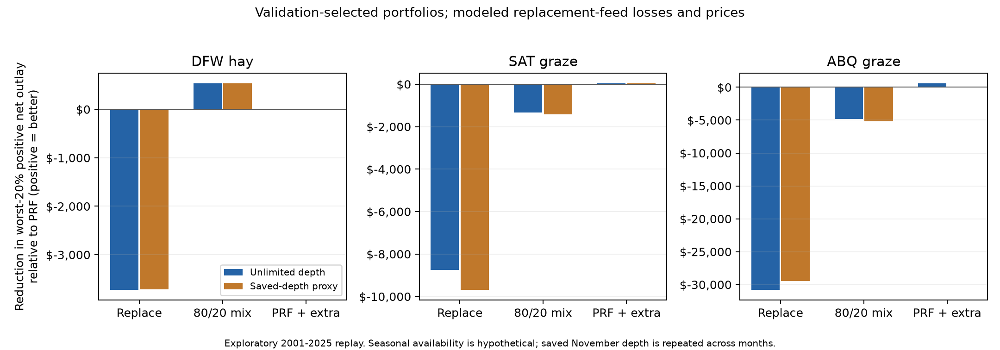
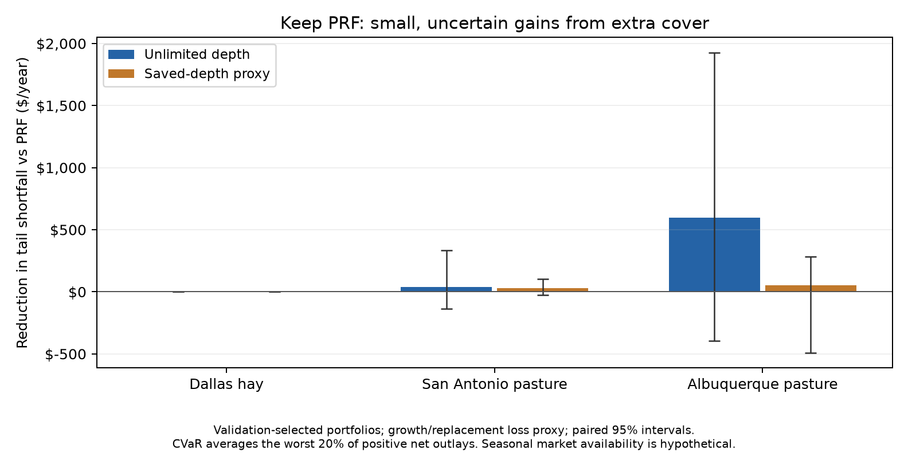

# 34 Direct optimization of drought cover under budgets and depth limits

**Exploratory protocol declared November 22, 2026, before this experiment's outputs.**
The evaluation years have already been inspected elsewhere in this project. This is
a controlled extension, not fresh independent confirmation. All earlier studies remain.

## Question and fixed protocol

Does choosing contract counts directly to reduce bad-year shortfalls improve on
fitting a desired payout curve and scaling it to a premium budget?

The machine-readable specification is
[`maya_direct_protocol.json`](../../data/scenarios/maya_direct_protocol.json).
Its choices are fixed before generating results:

- Dallas hay, San Antonio pasture and Albuquerque pasture cases, unchanged from doc 30.
- Fit 1951-1985; select using 1986-2000; refit the selected method on 1951-2000;
  replay 2001-2025. All candidates' replay results are retained. Evaluation outcomes
  do not select the trigger, exponent, method, cost scenario or loss valuation.
- Primary loss is the existing growth-timed, replacement-feed-valued model. Freeze
  the resulting portfolios and evaluate all six existing timing/valuation variants.
  This does not validate actual farm losses, the inherited elasticity or curvature.
- Compare market-only replacement, 80% PRF/20% market reallocation, and 100% PRF
  with an additional 20% budget. Always allow unspent cash. PRF-alone is the common
  reference; the add-on comparison gives that reference the same extra resources.
- Use long NO positions at the saved stations' observed whole-inch strikes 1-7,
  repeated over all twelve calendar months. No proposed finer or two-month strikes.
  This is a full-season market-availability what-if; it is not a claim all those
  contracts can be bought together today. Both methods use exactly this same menu.
- Compare unlimited depth with the saved November 2 book repeated across months,
  with the inherited 10-cent price cutoff. Direct optimization includes these caps
  while choosing quantities; target fitting scales then caps the quantities.
- Candidate curves are `M*clip((T-I)/T,0,1)^p`, with T in {70,90,100}, p in {1,2,3},
  plus the inherited exponential k=5 with shortfall measured from index 100.
  I is the primary model's growth-weighted seasonal farm-grid rainfall index.
  The nine power combinations plus exponential, direct optimization and cash are
  the entire declared family. M is determined by the budget, not selected on replay.
- Primary objective is empirical CVaR at 80%: the average of the worst 20% of positive
  `loss + premium - payout` outcomes. This differs from the separate metric averaging
  shortfalls in the five worst underlying-loss years; report both.
- Select on validation CVaR. Within one cent, prefer lower mean positive net outlay,
  then lower cost, then stable candidate order. Also report the direct method and
  best validation-selected shape even when the overall selector chooses cash.

## Pricing, rounding and controls

The fitting-stage purchase probability is the empirical station frequency in the
fitting years only, plus the inherited 2.25-cent half-spread, bounded to 1-99 cents.
Refitting updates those probabilities using pre-2001 years only. Use a 7% taker-fee
formula with per-leg cent rounding and 4.05% annual carry over 31 days, as in doc 30.
These are modeled prices, not historical quotes or current conditional forecasts.

The direct method solves a continuous linear programme for nonnegative contract
counts, then floors counts to whole contracts. Its budget reserves one cent per
possible leg for fee rounding. A second solve minimizes cost within one cent of
the best training CVaR. Exact rounded fees and budget/depth feasibility are checked
after rounding. Fractional optimization is a relaxation, not a proof of the optimal
integer portfolio.

Wider 6.55-cent spreads and 180-day carry are separate stresses. Freeze the selected
method and contract proportions; reduce quantities only if necessary to preserve the
original budget. No stress scenario selects a new winning method. The instrument menu,
seasonal index and inherited loss calibration are contemporary counterfactual inputs,
so the split is not a fully historical information-set backtest.
In particular, the inherited rainfall-to-forage calibration and scenario values are
not re-estimated as of each historical fitting date. Excluding post-2000 years from
portfolio fitting does not establish an independent agricultural-loss validation.

Compare target fitting and direct optimization on the same expanded monthly menu.
Differences from doc 30 can also reflect this menu and the annual seasonal target;
do not attribute all changes relative to that earlier study to the optimizer alone.

## Evaluation and uncertainty

Report premiums, cash, quantities, CVaR, worst-five-loss-year shortfalls, annual mean
net outlay, HE against the stated loss proxy and severe-interval payout misses.
Use the declared paired two-year-block bootstrap (2,000 draws, seed 473) for selected
methods and the direct method, and remove the single worst underlying-loss year.
These sensitivities do not capture all model, selection or climate uncertainty and
cannot add unobserved catastrophes. Report sensitivity disagreements explicitly.

## Results

The earlier-year selector produces modest, conditional add-on benefits; it does not
find a reliable PRF replacement. The table reports the **validation-selected** method,
not whichever method looks best after replay. Positive dollars mean less tail shortfall.
"Cash" means no market purchase with that arm's fixed PRF share: it retains all PRF
only in the add-on arm. The three arms are separate comparisons, not choices made
using evaluation outcomes.

<!-- BEGIN AUTO: direct tail -->

| Farm | Budget decision | Depth | Validation-selected method | CVaR improvement vs PRF ($/yr) | 95% paired interval | Worst-five-loss-year improvement ($/yr) |
|---|---|---|---|---:|---|---:|
| DFW_hay | replacement | unlimited | cash | -3721 | [-6872, -1390] | -6658 |
| DFW_hay | reallocation | unlimited | cash | 537 | [-159, 737] | -130 |
| DFW_hay | addon | unlimited | cash | 0 | [0, 0] | 0 |
| DFW_hay | replacement | saved_depth_proxy | power_T90_p3 | -3714 | [-6793, -1375] | -6648 |
| DFW_hay | reallocation | saved_depth_proxy | cash | 537 | [-159, 737] | -130 |
| DFW_hay | addon | saved_depth_proxy | cash | 0 | [0, 0] | 0 |
| SAT_graze | replacement | unlimited | direct_cvar | -8737 | [-11320, -2277] | -9187 |
| SAT_graze | reallocation | unlimited | power_T100_p1 | -1339 | [-2491, -397] | -1871 |
| SAT_graze | addon | unlimited | power_T100_p1 | 41 | [-135, 335] | 149 |
| SAT_graze | replacement | saved_depth_proxy | power_T70_p1 | -9676 | [-14214, -2379] | -10084 |
| SAT_graze | reallocation | saved_depth_proxy | power_T70_p1 | -1420 | [-2620, -392] | -2005 |
| SAT_graze | addon | saved_depth_proxy | power_T70_p1 | 32 | [-27, 105] | 14 |
| ABQ_graze | replacement | unlimited | direct_cvar | -30764 | [-46288, -11118] | -34462 |
| ABQ_graze | reallocation | unlimited | direct_cvar | -4813 | [-8786, -1035] | -6892 |
| ABQ_graze | addon | unlimited | direct_cvar | 596 | [-396, 1928] | 1262 |
| ABQ_graze | replacement | saved_depth_proxy | direct_cvar | -29431 | [-43593, -10776] | -33129 |
| ABQ_graze | reallocation | saved_depth_proxy | power_T100_p1 | -5153 | [-8393, -1028] | -6672 |
| ABQ_graze | addon | saved_depth_proxy | power_T100_p1 | 55 | [-493, 286] | -67 |

<!-- END AUTO: direct tail -->

## Interpretation

### Direct quantities versus target fitting

On the Albuquerque add-on with unlimited depth, validation selects the direct method.
Its primary-proxy tail-shortfall reduction is about $596/year, compared with $124/year
for the best validation-selected target curve (trigger 70, quadratic power 2). Both
have the same instrument menu and approximately the same $2,424 extra budget. This is
a controlled example where optimizing the risk objective helps more than fitting a
preset curve. It is not a universal advantage of the direct algorithm: at saved depth,
the earlier-year selector instead prefers a linear target.

For that unlimited-depth Albuquerque direct add-on, baseline tail outlay is $97,080
and portfolio tail outlay is $96,485: about a 0.6% reduction, not a large transformation
of farm risk. Its paired interval spans a loss and a gain, so improved replay performance
does not establish a reliable future gain. These losses are particularly uncertain:
the inherited Albuquerque forage calibration is model-based and weak (docs 13/32).

### Liquidity, pricing and loss sensitivity

The validation-selected Albuquerque saved-depth add-on gives only about $55/year of
CVaR improvement. It worsens the separate five-worst-underlying-loss-years metric by
about $67/year. Its central-price average net payout minus additional cost is negative.
Wider spreads reverse the small CVaR advantage. San Antonio's selected add-ons have
small gains whose intervals span zero and whose signs depend on valuation. Dallas's
add-on selector keeps the extra budget as cash.

The Albuquerque unlimited-depth direct add-on has positive point-estimate CVaR gains
under all six fixed loss variants, but saved-depth gains change sign across variants.
None of the primary validation-selected results has a strictly positive lower 95%
CVaR-improvement bound. These checks are conditional on the fitted portfolios; they
do not account fully for parameter selection, uncertain forage responses or future climate.

The interval and parameter search were not expanded after these results. In particular,
the Dallas direct add-on has a favorable unlimited-depth replay, but the earlier
validation preferred cash. We retain that direct-method result as a declared comparison
and do not replace the selector's cash decision using hindsight.

### What the risk metric means

CVaR here averages the worst positive **net outlays after payouts and premiums**.
The five-worst-loss-years metric instead fixes years by underlying modeled forage loss.
Those can rank designs differently. For example, Dallas's 80%-PRF/cash arm reduces
CVaR by saving premiums, while worsening shortfalls in its five worst forage-loss years.
That is a change in financial tradeoffs, not evidence that an extra contract helped.

The optimization is based on

`Z_t = max(0, L_t + original_PRF_share*C + market_cost - original_PRF_share*P_t - X_t*n)`.

Here L is modeled forage loss, C/P are original PRF premium/payout, X contains binary
airport outcomes, and n contains contract quantities. The linear programme minimizes
`z + mean(max(Z-z,0))/(1-alpha)` with alpha=0.8, budget and depth bounds. An equivalent
linear form uses auxiliary tail-excess variables. The general CVaR formulation follows
[Rockafellar and Uryasev (2000)](https://doi.org/10.21314/JOR.2000.038); applying it to
these counterfactual weather portfolios and inherited loss proxies is this experiment.

## Selected supporting numbers

Every value below comes from `maya_direct_summary.csv`, central prices and the
growth/replacement loss proxy unless another sensitivity is named. These are annual
model dollars, not observed farm-income savings.

| Comparison or audit | Value | Scope |
|---|---:|---|
| Albuquerque unlimited add-on extra cost | $2,422.84 | Direct method, validation selected |
| Same: contract count | 5,031 | Monthly whole-inch NO contracts across the hypothetical season |
| Same: baseline / portfolio CVaR | $97,080 / $96,485 | About 0.6% reduction |
| Same: CVaR improvement, paired 95% interval | $596, [-$396, $1,928] | Uncertain tail benefit |
| Same: improvement in five worst underlying-loss years | $1,262 | Different metric from CVaR |
| Same: average net gain vs PRF-plus-cash | $797, interval [$66, $1,469] | Historical conditional replay, not expected trading profit |
| Same: best validation-selected curve CVaR gain | $124 | Trigger 70 / power 2, not selected on replay |
| Same: direct-method wide-spread / long-carry CVaR gain | $347 / $547 | Frozen proportions, budget preserved |
| Same: CVaR gain after dropping the single worst underlying-loss year | $866 | Conditional sensitivity, not new catastrophe data |
| Same: CVaR point-estimate range over six loss variants | $399 to $1,262 | No refit to alternate valuations |
| Albuquerque saved-depth selected add-on cost | $1,474.02 | Linear trigger 100; some extra budget remains cash |
| Same: central / wide-spread CVaR gain | $55 / -$24 | Small advantage is price-sensitive |
| Same: five-worst-loss-year improvement | -$67 | This metric worsens |
| Same: average net gain vs cash | -$125 | Extra cover costs money on average in this replay |
| Same: CVaR range across six loss variants | -$174 to $55 | Valuation-dependent sign |
| San Antonio selected add-on CVaR improvement | $41 unlimited / $32 saved depth | Small; paired intervals span zero |
| Dallas selected add-on | No purchase | Validation selects cash, not the later favorable direct replay |
| Evaluation exclusions | Dallas 2025: two airport months; San Antonio 2023: one | `maya_direct_missing_years.csv`; no interpolation |
| Below-training-fair ceiling legs in the losing Albuquerque saved-depth replacement | 1,540 contracts | `maya_direct_price_boundary_audit.csv`; none in the selected add-ons |

The saved book is repeated across months and prices remain modeled; caps are not a
walk through actual seasonal quotes. A whole-season purchase at these counts/prices
has not been established. Training probabilities at exactly one can also interact
with the 99-cent ask ceiling; the boundary-price audit records such holdings. None
of the nonzero validation-selected add-ons holds these below-training-fair ceiling legs.
The affected Albuquerque replacement still loses against PRF. Historical frequency
one is not certainty about future weather, and this pricing convention is not evidence
of an executable arbitrage. No additional parameter or pricing search followed the audit.





## Sources and reproducibility

Fixed choices are sourced to the protocol JSON, inherited prices to doc 30, and loss
assumptions to docs 13/32. The protocol was committed as `bb50e11` before the first
real-data run. Numerical results are sourced to `scripts/run_direct_tail.py` and the
following committed outputs in `data/processed/`:

- `maya_direct_validation.csv`: all candidate scores from the earlier validation years.
- `maya_direct_selection.csv`: selected methods, periods, counts of complete years and budgets.
- `maya_direct_fit_audit.csv`: fitting CVaR, continuous references for the direct method,
  rounded-ticket costs, budget slack and depth feasibility for both fitting stages.
- `maya_direct_tickets.csv`: nonzero initial-fit and refitted whole-contract positions;
  omitted positions are zero. Central costs are in the summary; stress counts are
  reproducible by the fixed proportional downscaling rule.
- `maya_direct_prices.csv`: every fitting-stage modeled price and capacity bound.
- `maya_direct_years.csv`: all candidates' replay payouts, costs and retained cash under all price stresses.
- `maya_direct_summary.csv`: all candidates, all six loss variants, all cost scenarios;
  uncertainty intervals for selected methods and the direct comparator.
- `maya_direct_missing_years.csv`: complete-year exclusions and their causes.
- `maya_direct_price_boundary_audit.csv`: selected positions affected by probability/ask boundaries.
- `maya_direct_method.json`: exact protocol and input/code hashes.
- Both figures above are also committed as PDFs under `docs/figures/`.

Run offline from this checkout using the project environment:

```powershell
$env:PYTHONPATH = 'src'
.venv\Scripts\python.exe scripts/run_direct_tail.py
```

In the separate worktree on Maya's current computer, use the original checkout's
interpreter as explained in [the evidence guide](../PAPER_EVIDENCE_GUIDE.md).
No real orders, external messages, installations or app changes are part of this experiment.
