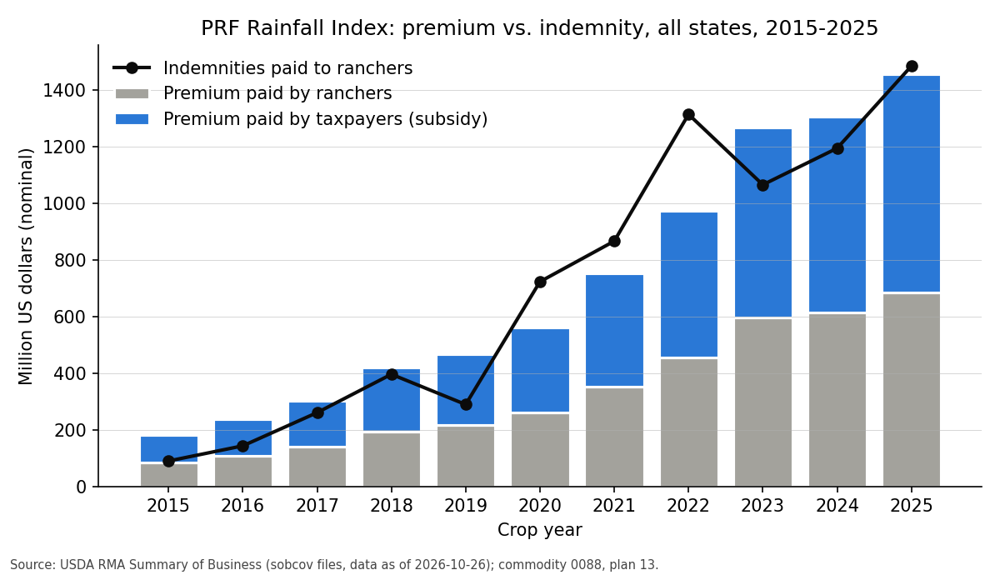
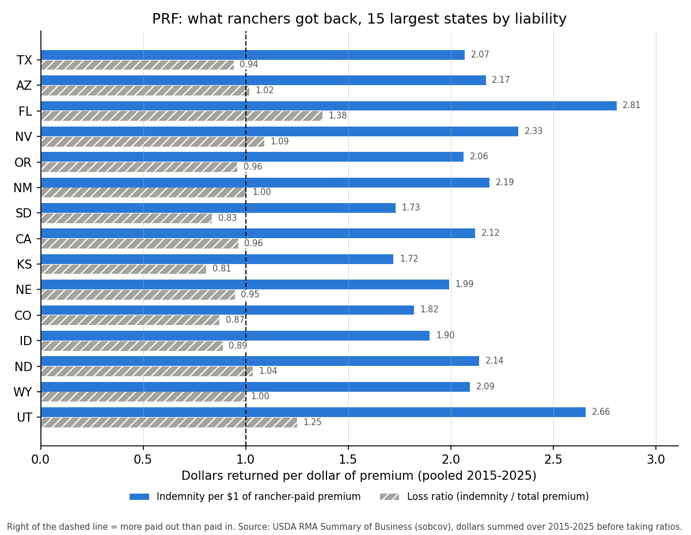

# How US farmers currently buy weather-related insurance

**Proposal cell:** Extra / team (R4)  |  **Status:** VERIFIED (exceptions listed under "Unverified claims and open questions")  |  **Last updated:** 2026-10-29

Companion files:
- [`data/processed/prf_summary_of_business_state.csv`](../../data/processed/prf_summary_of_business_state.csv): PRF Rainfall Index experience by state and crop year, 2015-2026 (473 rows; column definitions in section 5.1).
- [`scripts/pull_rma_sob.py`](../../scripts/pull_rma_sob.py): downloads the RMA Summary of Business files, writes the CSV and both figures, and prints every PRF table in section 5. Run `python -I scripts/pull_rma_sob.py` from the repo root (raw zips cached in `data/raw/rma_sob/`).
- Figures: [`r4_prf_national_timeseries.png`](../figures/r4_prf_national_timeseries.png), [`r4_prf_state_returns.png`](../figures/r4_prf_state_returns.png).

Status labels:
- **CONFIRMED**: we read it in the primary document (statute, regulation, RMA/FSA/CFTC/CME filing, the paper itself) or in RMA's own data files.
- **DERIVED**: we computed it from CONFIRMED inputs; the method is stated. All PRF market numbers in section 5 are DERIVED from RMA's Summary of Business files. As a check, our 2025 all-plan totals from the same files reproduce RMA's published national Summary of Business report to the dollar (section 1.4).
- **UNVERIFIED**: from a secondary source, an abstract only, a company claim, or our inference.

Jargon used throughout:
- **Premium**: the price of an insurance policy. **Total premium** is the full actuarial price; **producer-paid** (farmer-paid) premium is what is left after the government's **premium subsidy**.
- **Liability**: the maximum the policy can pay (the "face value" of the protection).
- **Indemnity**: a claim payment.
- **Loss ratio**: indemnity / total premium. Above 1.0 means the policy paid out more than its full price.
- **Return per producer dollar** (our term): indemnity / producer-paid premium, i.e. what a rancher got back per dollar out of pocket.
- **Actual-loss (or "farm-level") policy**: pays when the farmer's own measured yield or revenue falls short. **Area policy**: pays when the county's average yield or revenue falls short. **Index policy**: pays when a measured weather number (rainfall, wind speed) crosses a trigger, regardless of what happened on the farm.
- **Basis risk**: the chance that an index policy pays nothing when the farmer had a loss (or pays when there was none).
- **Crop year / reinsurance year**: the crop year is the year a crop is harvested (for PRF, the calendar year insured). The reinsurance year runs July 1 to June 30 and is named for the year in which it ends.

## Key findings

- **Farmers never buy federal crop insurance from USDA directly.** USDA's Risk Management Agency (RMA) designs and prices the policies. The Federal Crop Insurance Corporation (FCIC) reinsures them and pays the subsidies. Twelve private Approved Insurance Providers (AIPs), the same 12 in reinsurance years 2025, 2026 and 2027, sell them through state-licensed agents. On 2025 crop policies, taxpayers paid **$10.59 billion of the $16.83 billion total premium (62.9%)**. On top of that, companies receive expense reimbursements (about $2.35 billion in 2024) and underwriting gains ($3.24 billion in reinsurance year 2025).
- **Most weather risk is insured through actual-loss policies, not index policies.** Revenue Protection alone carried $103.2 billion of liability in 2025, and it pays for drought, excess moisture, hail, wind, frost and freeze losses on the farm. **PRF is by far the largest index product:** $6.55 billion of liability, 67,872 policies earning premium and 298 million acres in 2025. That is **53% of all federally insured acres but only 4.1% of liability**.
- **The July 2025 reconciliation law (P.L. 119-21, the "One Big Beautiful Bill Act", OBBBA) made federal coverage cheaper for row crops but did not change PRF's base subsidy.**
  - Row-crop changes: subsidy at 75% coverage rose from 55% to 60%, at 80% from 48% to 51%, and at 85% from 38% to 41% (basic/optional units).
  - SCO now reaches 90% with an 80% subsidy, and the ARC restriction on SCO is gone. RMA extended the 80% subsidy to ECO, HIP-WI and FIP-SI.
  - PRF keeps 59% / 55% / 51%. Its only OBBBA change is the beginning-farmer extension (10 years, up to +15 subsidy points).
- **PRF grew 7.5-fold in liability from 2015 to 2025** ($0.88 billion to $6.55 billion). The subsidy rate held at about 53%.
  - Pooled over 2015-2025, the loss ratio was 0.99 and ranchers got back **$2.11 for every $1 of premium they paid**: $7.84 billion in indemnities against $3.72 billion of producer-paid premium.
  - Pooled returns exceeded $1 per producer dollar in 43 of 44 states, and in all 20 states that each hold more than 1% of PRF liability.
- **PRF is bought for its payouts.**
  - In 2025, **95% of policies earning premium received an indemnity**.
  - 90% coverage (the lowest-subsidy tier) carried 57.7% of liability.
  - **Jan-Feb, when little forage grows, was the single most-insured interval (13.5% of liability; 16.7% in our six study states).**
  - The literature finds the same interval "gaming". From 2027, RMA caps Jan-Feb at 25% of value and requires livestock at 25% or more of an average stocking rate on insured grazing acres.
- **Study states, pooled 2015-2025** (full tables in section 5):

  | State | Loss ratio | Return per producer $ | Years with loss ratio above 1 (of 11) |
  |---|---|---|---|
  | FL | 1.38 | 2.81 | 7 |
  | NM | 1.00 | 2.19 | 6 |
  | TX | 0.94 | 2.07 | 5 |
  | CO | 0.87 | 1.82 | 5 |
  | OK | 0.78 | 1.64 | 2 |
  | MO | 0.72 | 1.48 | 3 |

  Hardee County FL (our Tampa farm county) returned $3.20 per producer dollar. Grady County OK (our Oklahoma City farm county) returned $1.04.
- **USDA's Farm Service Agency (FSA) adds drought protection that costs ranchers nothing.**
  - The Livestock Forage Disaster Program (LFP) pays 60% of a monthly feed cost per head, times 1 to 5 payments, set by U.S. Drought Monitor ratings. From 2026 the first payment triggers after only 4 weeks of D2 drought (was 8).
  - LFP paid $1.78 billion in FY2023 (CRS figure in inflation-adjusted dollars; CRS does not state the base year for this FY series), more than PRF's 2023 indemnities of $1.07 billion (nominal). It stacks with PRF with no offset.
  - Ad hoc aid is large: $30.78 billion in the American Relief Act 2025, then the $11 billion Farmer Bridge Assistance program. That aid pays more to farmers who carried federal insurance or NAP, and often requires buying it for the next two years.
- **The private market is small and mostly not for farmers.**
  - Crop-hail: $1.30 billion premium in 2025, state-regulated, unsubsidized.
  - CME delisted its rainfall futures in 2014; only temperature (heating/cooling degree day) contracts remain.
  - Over-the-counter (OTC) weather deals serve energy firms and large agribusiness.
  - Parametric startups such as Arbol sell through licensed agents.
  - Kalshi is a CFTC-designated contract market whose rain contracts are retail-accessible, but its position accountability level is $25,000 per strike per member.
- **Research on index insurance finds high basis risk and price-sensitive demand.**
  - PRF fails to pay in 26-46% of loss events in ranch studies.
  - Participants "almost always incur net losses if premium subsidies are excluded".
  - Producers choose intervals to maximize payouts rather than to cut risk.
  - In general, index-insurance take-up depends on price, trust and liquidity.
- **Bottom line for our product: on the risk PRF covers, a Kalshi hedge costs roughly 2 to 3 times as much per dollar of expected payout.** A rancher pays about $0.47 per $1 of expected PRF indemnity, against about $1.00-$1.40 per $1 of expected Kalshi payout once taker fees and spreads are added (DERIVED, section 7). A Kalshi product cannot win head-to-head on subsidized PRF risk. Its niches are the perils, periods, coverage bands and people that PRF does not serve.

## Numbers table

Every number used in this doc appears here, with its source. "SOB" means the RMA Summary of Business state/county/crop files with coverage level (`sobcov_<year>.zip`, data as of 2026-10-26, https://pubfs-rma.fpac.usda.gov/pub/Web_Data_Files/Summary_of_Business/state_county_crop/), read by `scripts/pull_rma_sob.py`. "TPU" is the type/practice/unit file in the same folder (`sobtpu_2025.zip`, dated 2026-10-24).

### Delivery system and taxpayer cost

| Quantity | Value | Units | Region / period | Source (URL + page/table) | Verification |
|---|---|---|---|---|---|
| FCIC board composition | 3 USDA + 6 private-sector members (4 farmers, 1 insurance professional, 1 reinsurance/regulation expert) | members | current | RMA "About the Risk Management Agency" fact sheet, p.1, https://rma.usda.gov/sites/default/files/2025-02/About-the-Risk-Management-Agency-Fact-Sheet.pdf | CONFIRMED |
| Approved Insurance Providers | 12 | companies | RY 2025, 2026, 2027 | RMA insurance control elements D00100 files, https://pubfs-rma.fpac.usda.gov/pub/References/insurance_control_elements/PASS/2026/2026_D00100_IceAip_YTD.txt (and 2025, 2027); RMA AIP API https://public-rma.fpac.usda.gov/Api/AIP/v1/CurrentReinsuranceYear/SRA (copy in data/raw/rma_sob/aip_sra.json) | CONFIRMED |
| AIPs in 2021 | 16 | companies | 2021 | CRS R46686, p.1, https://www.everycrsreport.com/reports/R46686.html | CONFIRMED |
| SRA term | single-year agreement; 2027 SRA effective 2026-07-01 | | RY2027 | SRA 2027 preamble, https://www.rma.usda.gov/sites/default/files/2026-03/SRA_2027.pdf; RMA IS-26-001 | CONFIRMED |
| SRA financial-terms renegotiation | for RY2011, then at most once per 5 reinsurance years | | statute | 7 USC 1508(k)(8), https://www.govinfo.gov/link/uscode/7/1508?link-type=html | CONFIRMED |
| Assigned Risk Fund retention | 20% of premium and losses; at most 75% of a company's premium in a state | percent | RY2027 | SRA 2027 §II(b)(3), p.14 | CONFIRMED |
| Commercial Fund retention | at least 35%, in 5% steps | percent | RY2027 | SRA 2027 §II(b)(4), p.15 | CONFIRMED |
| Commercial Fund gain share kept by company, loss ratio 65-100% | 75 (State Group 1) / 97.5 (Groups 2-3) | percent | RY2027 | SRA 2027 §II(b)(6)(A), pp.17-18 | CONFIRMED |
| Commercial Fund gain share kept, loss ratio 50-65% and below 50% | 40 / 40 and 5 / 5 | percent | RY2027 | SRA 2027 §II(b)(6)(A) | CONFIRMED |
| Commercial Fund loss share kept, loss ratio 100-160% / 160-220% / 220-500% / above 500% | 65 or 42.5 / 45 or 20 / 10 or 5 / 0 (Group 1 or Groups 2-3) | percent | RY2027 | SRA 2027 §II(b)(5)(A), pp.15-16 | CONFIRMED |
| Net book quota share ceded to FCIC | 6.5 | percent of net gain or loss | RY2027 | SRA 2027 §II(b)(8), p.20 | CONFIRMED |
| Underwriting gains to AIPs | 2.430 / 1.301 / 1.947 / 1.809 / 3.238 | $ billion | RY2021 / 2022 / 2023 / 2024 / 2025 | RMA SRA national reports, e.g. https://pubfs-rma.fpac.usda.gov/pub/Web_Data_Files/Reinsurance_Reports/standard_reinsurance_agreement_reports/2024_Standard_Reinsurance_Report_National.pdf, p.1 "Total" | CONFIRMED |
| Average underwriting gain; company return on retained premium vs market benchmark | about 1.4 $ billion per year; 16.8% vs 10.2% | | 2011-2022 | GAO-24-106086 summary, https://www.gao.gov/products/gao-24-106086 | CONFIRMED (page read via fetch tool) |
| Paid to companies; federal cost; premium subsidies | 3.7 (2.2 A&O + 1.5 gains); 17.3; about 12 | $ billion | 2022 | GAO-24-106086 | CONFIRMED (page read via fetch tool) |
| A&O rate (share of net book premium) | 21.9 most policies; 18.5 revenue plans with harvest price; 12.0 area plans (SCO, STAX); 20.1 area plans not widely available in 2008; CAT 0 plus 6.0 loss-adjustment payment | percent | RY2027 | SRA 2027 §III(a)(2)(C)-(F), pp.22-23 | CONFIRMED |
| A&O industry cap and floor multipliers | 0.615 (cap) / 0.489 (floor) × liability × 2008 rates × inflation factor | | RY2027 | SRA 2027 §III(a)(2)(G)-(H), pp.23-24 | CONFIRMED |
| A&O inflation factor | 1.0793 / 1.1085 | factor | RY2026 / RY2027 | SRA 2026 (3-6-26), https://www.rma.usda.gov/sites/default/files/2026-03/SRA_2026-3-6-26.pdf; SRA 2027 §III(a)(2)(G)(i)(IV) | CONFIRMED |
| OBBBA §10503 A&O snapback | +6 percent of net book premium in states with loss ratio above 120 percent | percent | RY2026+ | P.L. 119-21 §10503, 139 Stat. 104-106, https://www.govinfo.gov/content/pkg/PLAW-119publ21/html/PLAW-119publ21.htm | CONFIRMED |
| OBBBA §10503 specialty-crop A&O floor | 17 | percent | RY2026+ | same | CONFIRMED |
| A&O paid | average 1.7 (2015-2024); 2.1 / 2.3 / 2.35 | $ billion per year | 2022 / 2023 / 2024 | farmdoc daily, Aug 14 2025, pp.1-2, https://farmdocdaily.illinois.edu/wp-content/uploads/2025/08/fdd081425.pdf | CONFIRMED (university source; CBO figures inside are second-hand) |
| CBO score of the A&O snapback | 1.275 | $ billion | FY2025-2034 | same farmdoc piece, citing CBO | UNVERIFIED |
| Agent compensation cap | 80% of A&O + CAT LAE per state; up to 100% only out of underwriting gains | percent | RY2027 | SRA 2027 §III(a)(4)(B)-(C), pp.26-27 | CONFIRMED |
| Average agent commission | 17.3 (US); 20.3 (5 Corn Belt states); 14.2 (other 45 states) | percent of premium | 2007 | GAO-09-445, https://www.gao.gov/assets/a289076.html | CONFIRMED (page read via fetch tool) |
| Crop-book liability / total premium / subsidy / indemnity / loss ratio, all plans | 181.62 / 18.11 / 11.33 / 17.80 / 0.98 (**corrected** 2026-11-01; was 208.04 / 19.19 / 11.75 / 19.03 / 0.99) | $ billion | 2023 | RMA SOB national report sobrpt2023-2026.pdf p.1 "Combined Business" (as of 2026-11-02), https://pubfs-rma.fpac.usda.gov/pub/sob/current_week/ ; matches our sum of sobcov_2023. The old values came from sobrpt2014-2023.pdf, whose 2022-2023 columns are on a different basis from the 2024-2026 rows (see Fact-check log) | CONFIRMED (fact-check) |
| same | 158.68 / 15.88 / 9.88 / 15.17 / 0.96 | $ billion | 2024 | sobrpt2024-2027.pdf p.1, same folder | CONFIRMED |
| same | 159.37 / 16.83 / 10.59 / 11.59 / 0.69 | $ billion | 2025 | sobrpt2024-2027.pdf p.1; reproduced exactly by our sum of sobcov_2025 | CONFIRMED |
| same (incomplete year) | 168.05 / 18.92 / 13.15 / 5.81 / n.a. | $ billion | 2026 | sobrpt2024-2027.pdf p.1 | CONFIRMED |
| Subsidy share of crop-book premium | 62.6 (**corrected**, was 61.2) / 62.2 / 62.9 / 69.5 | percent | 2023 / 2024 / 2025 / 2026 (incomplete) | computed from rows above | DERIVED |
| All RMA business incl. livestock: liability / premium / subsidy | 199.55 / 18.55 / 11.24 | $ billion | 2025 | sobrpt2024-2027.pdf p.3 | CONFIRMED |
| Policies earning premium, crop book | 1,218,348 / 1,326,536 | policies | 2024 / 2025 | sobrpt2024-2027.pdf; 2025 also our sobcov sum | CONFIRMED |
| Premium subsidies; share of premium | about 15; about 66 | $ billion; percent | 2026 | CRS IF12201, p.1, https://www.everycrsreport.com/files/2026-10-19_IF12201_a0e8c99608de21e2ab8795ba94ba1ebcd2f0baee.pdf | CONFIRMED |
| Federal crop insurance outlays | 12.1 | $ billion per year (2026 dollars) | FY2016-FY2025 average | CRS IF12201, p.1 | CONFIRMED |
| OBBBA crop-insurance cost | about +6 | $ billion | FY2025-2034 | CRS IF12201, p.2, citing CBO | CONFIRMED (CRS) |
| Statutory rating target | premiums plus subsidies at least equal indemnities on average (loss ratio ≤ 1.0) | | statute | CRS IF12201, p.2 | CONFIRMED |
| ERS: insured acres; forage share of insured acres; forage share of liability | 543 million; 19% (2016) to 56% (2024); about 4% | acres; percent | 2024 | ERS "Crop Insurance at a Glance" (updated 2025-09-23), https://www.ers.usda.gov/topics/farm-practices-management/risk-management/crop-insurance-at-a-glance | CONFIRMED |
| ERS: program loss ratio; premium subsidies; insured share of 8 major crops' acreage | 0.85 (since 1997); 10.4 $ billion (2024); about 89% | | | same | CONFIRMED |

### Buying a policy (general and PRF)

| Quantity | Value | Units | Region / period | Source (URL + page/table) | Verification |
|---|---|---|---|---|---|
| Late-premium interest | 1.25 | percent simple interest per month, from 30 days after the billing date | all policies | Basic Provisions 26-BR §24(a), p.42, https://www.rma.usda.gov/sites/default/files/2025-11/Basic-Provisions-26-BR.pdf | CONFIRMED |
| Notice of loss | within 72 hours of discovery, and no later than 15 days after end of the insurance period; phone notice confirmed in writing within 15 days | | actual-loss policies | 26-BR §14(b), p.25 | CONFIRMED |
| Claim payment deadline | 30 | days after agreement on the claim | actual-loss policies | 26-BR §14(f), p.27 | CONFIRMED |
| CAT administrative fee | 655 | $ per crop per county | statute | 7 USC 1508(b)(5)(A) | CONFIRMED |
| Buy-up administrative fee (PRF) | 30 | $ per crop per county | 2027 | [01_usda_prf_mechanics.md](01_usda_prf_mechanics.md) (7 USC 1508(c)(10)(A); Basic Provisions 27.1-RI §11(e)) | CONFIRMED (R3) |
| PRF sales closing, acreage reporting, cancellation dates | December 1 of the prior year (2026-12-01 for crop year 2027) | date | 2027 | 27-RI-PRF Crop Provisions §9, p.3, https://www.rma.usda.gov/sites/default/files/2026-09/rainfall-index-pasture-rangeland-forage-crop-provisions-27-ri-prf.pdf; ADM A00200 via R3 | CONFIRMED |
| PRF premium billing date | September 1 (2027-09-01) | date | 2027 | ADM A00200 via [01](01_usda_prf_mechanics.md); UGA PRF page https://prfinsurance.caes.uga.edu/?p=268 | CONFIRMED |
| PRF insurance period | Jan 1 - Dec 31 | | 2027 | Rainfall Index Basic Provisions 27.1-RI §12(a), p.15, https://www.rma.usda.gov/sites/default/files/2026-08/Rainfall%20Index%20Plan%20Common%20Policy%2027.1-Ri.pdf | CONFIRMED |
| PRF indemnity payment deadline | 60 | days after RMA publishes the final grid index | 2027 | 27.1-RI §8(d), p.13 | CONFIRMED |
| PRF coverage level; productivity factor | 70-90 (5-point steps); 60-150 | percent | 2027 | 27-RI-PRF §5 | CONFIRMED |
| PRF allocation rules | at least 2 intervals; at least 10% of value each; at most 50/60/70% per interval by state; Jan-Feb at most 25% from 2027 (California 50%) | percent of value | 2027 | 27-RI-PRF §2(a); PM-26-053, https://www.rma.usda.gov/policy-procedure/bulletins-memos/product-management-bulletin/pm-26-053-rainfall-index-crop; [01](01_usda_prf_mechanics.md) | CONFIRMED |
| PRF stocking requirement | livestock at least 25% of an average stocking rate on insured grazing acres; records kept 3 years | percent | 2027 | PM-26-053 (2026-09-08) | CONFIRMED |
| PRF premium subsidy | 59 (70-75% coverage), 55 (80-85%), 51 (90%) | percent of premium | 2025-2027, unchanged by OBBBA | 7 USC 1508(e)(7); RMA handbook FCIC-18150-1 (90% = 51%), https://www.rma.usda.gov/sites/default/files/2026-08/Rainfall%20Index%20Insurance%20Standards%20Handbook%202027-18150.pdf | CONFIRMED |
| Beginning-farmer extra subsidy, rainfall index plans | +15 (years 1-2), +13 (year 3), +11 (year 4), +10 (years 5-10) | percentage points | 2026+ | 26-RI §11(g), https://www.rma.usda.gov/sites/default/files/2025-08/Rainfall-Index-Plan-Common-Policy-26-RI.pdf | CONFIRMED |

### Product menu and OBBBA

| Quantity | Value | Units | Region / period | Source (URL + page/table) | Verification |
|---|---|---|---|---|---|
| Individual-plan coverage | 50 to 85 (5-point steps); YP price election 55-100% | percent | statute / current | 7 USC 1508(e)(3), (c)(4)(A); RMA insurance plans page, https://www.rma.usda.gov/about-crop-insurance/managing-farm-risk/insurance-plans | CONFIRMED |
| CAT coverage | 50% of yield at 55% of price | | statute | 7 USC 1508(b) | CONFIRMED |
| Coverage caps after OBBBA | individual 85; multi-commodity (whole-farm) 90; area 95 | percent | 2026+ | P.L. 119-21 §10502(a)(1) | CONFIRMED |
| ARPI protection factor | 80-120 | percent | current | 7 CFR 407.9 §3, https://www.law.cornell.edu/cfr/text/7/407.9 | CONFIRMED |
| Area revenue subsidy | 59 / 55 / 49 / 44 at 70-<75 / 75-<85 / 85-<90 / ≥90% coverage | percent | statute | 7 USC 1508(e)(6) | CONFIRMED |
| Area yield (and rainfall index) subsidy | 59 / 55 / 51 at 70-<80 / 80-<90 / ≥90% | percent | statute | 7 USC 1508(e)(7) | CONFIRMED |
| SCO band after OBBBA | trigger: county loss more than 10% (was 14%); band up to 90% (was 86%) | percent | 2026 via ECO, 2027 endorsement | P.L. 119-21 §10502(a)(2); MGR-25-006, https://www.rma.usda.gov/print/pdf/node/7661; 27-SCO, https://www.rma.usda.gov/sites/default/files/2026-06/SCO%20Endorsement%2027-SCO.pdf | CONFIRMED |
| SCO subsidy | 65 to 80 | percent | 2026+ | P.L. 119-21 §10502(b); MGR-25-006 | CONFIRMED |
| ECO trigger and band | 90 or 95 trigger, band down to 86 (to 2026); 95 trigger, band down to 90 (2027) | percent | | ECO fact sheet (July 2024), https://www.rma.usda.gov/sites/default/files/2024-11/Enhanced%20Coverage%20Option%20Fact%20Sheet.pdf; 27-ECO §1 | CONFIRMED |
| OBBBA individual-coverage subsidy, basic/optional units | 55-<65%: 64 to 69; 65-<75%: 59 to 64; 75-<80%: 55 to 60; 80-<85%: 48 to 51; 85%+: 38 to 41 | percent | 2026+ | P.L. 119-21 §10504 | CONFIRMED |
| RMA 2026 enterprise-unit subsidy | 80 at 50-75%; 71 at 80%; 56 at 85% | percent | 2026 | MGR-25-006 §C | CONFIRMED |
| Beginning farmer definition | up to 10 crop years (was 5); extra +5 / +3 / +1 points in years 1-2 / 3 / 4 | | 2026+ | P.L. 119-21 §10501 | CONFIRMED |
| WFRP coverage; revenue cap; subsidy | 50-90; 17 $ million; 80 (50-75%), 71 (80%), 56 (85-90%) | percent; $ | 2026 | RMA WFRP FAQ 2026, https://www.rma.usda.gov/about-crop-insurance/frequently-asked-questions/whole-farm-revenue-protection-plan-2026 | CONFIRMED |
| Micro Farm revenue cap | 350,000 (first year) / 400,000 (carry-over) | $ | 2026 | RMA Micro Farm FAQ 2026, https://www.rma.usda.gov/about-crop-insurance/frequently-asked-questions/micro-farm-2026 | CONFIRMED |
| HIP-WI hurricane trigger | sustained winds at least 64 knots (74 mph) in county or adjacent county; band from 95% down to underlying coverage | | 2026 | 26-HIP-WI §1, https://www.rma.usda.gov/sites/default/files/2025-04/2026%20HIP-WI-TS%20Endorsement%20v3_0.pdf | CONFIRMED |
| Tropical Storm option | 39-73 mph (34-63 knots) winds and at least 6 inches of rain over 4 days; pays 50% of the hurricane protection amount; up to 2 indemnities | | added for 2023 | 26-HIP-WI §1, §12; PM-23-008, https://www.rma.usda.gov/policy-procedure/bulletins-memos/product-management-bulletin/2023/pm-23-008-hurricane-insurance | CONFIRMED |
| HIP-WI reach | more than 70 crops in 23 states; written agreements from 2027 | | 2027 | RMA release 2026-04-30, https://www.rma.usda.gov/news-events/news/2026/washington-dc/usda-expands-hurricane-insurance-protection-crops-insured | CONFIRMED |
| PACE coverage; states | 75-90 percent; 11 states | | 2025 | PACE fact sheet (Dec 2024), https://www.rma.usda.gov/sites/default/files/2024-02/Post-Application-Coverage-Endorsement-Fact-Sheet.pdf | CONFIRMED |
| STAX band; subsidy | 10-30% of expected county revenue; 80% subsidy | percent | statute | 7 USC 1508b | CONFIRMED |
| Vegetation Index PRF replaced by Rainfall Index | 2016 | crop year | | PM-15-044, https://legacy.rma.usda.gov/bulletins/pm/2015/15-044.pdf | CONFIRMED |
| PRF grid size | 0.25 degree (about 17 × 17 miles) | | | PRF fact sheet (Sept 2025), https://www.rma.usda.gov/sites/default/files/2024-02/Pasture-Rangeland-Forage-Pilot-Insurance-Program-Fact-Sheet.pdf | CONFIRMED |
| National liability / premium / subsidy / indemnity / policies earning premium by plan | Table 2.1 | $ million; policies | 2025 | SOB sobcov_2025, summed by plan code | DERIVED |
| Rainfall Index plan by commodity: PRF / Annual Forage / Apiculture / masked "All Other Crops" liability | 6,547.0 / 1,222.1 / 461.8 / 432.7 | $ million | 2025 | SOB sobcov_2025, plan 13 | DERIVED |
| Annual Forage / Apiculture policies earning premium | 8,480 / 5,591 | policies | 2025 | same | DERIVED |
| PRF share of federal crop program | liability 4.1; premium 8.7; subsidy 7.3; indemnity 12.8; policies 5.1; acres 53.2 (298.3 of 561.2 million) | percent | 2025 | SOB sobcov_2025 | DERIVED |
| Premium rate (premium / liability) | Rainfall Index plan 0.231 (PRF alone 0.223) vs RP 0.095, YP 0.063 | $ per $ liability | 2025 | SOB sobcov_2025 | DERIVED |

### FSA programs and ad hoc aid

| Quantity | Value | Units | Region / period | Source (URL + page/table) | Verification |
|---|---|---|---|---|---|
| NAP basic coverage | 50% of approved yield at 55% of average market price | | current | FSA NAP page, https://www.fsa.usda.gov/resources/programs/noninsured-disaster-assistance-program-nap | CONFIRMED |
| NAP buy-up | 50-65% of production in 5-point steps at 100% of price; not for grazed crops | | current | FSA NAP fact sheet 2023, p.2, https://dts.fsa.usda.gov/Assets/USDA-FSA-Public/usdafiles/FactSheets/2023/fsa_nap_noninsuredcropdisasterassistance_factsheet_2023.pdf; 7 USC 7333(a)(1)(A)(ii) | CONFIRMED |
| NAP service fee | 325 per crop per county; capped at 825 per producer per county and 1,950 total | $ | current | FSA NAP page; 7 USC 7333(k)(1) | CONFIRMED |
| NAP buy-up premium; premium cap | 5.25% of (acres × yield × coverage × price × share); 15,750 | percent; $ | current | NAP fact sheet p.2; 7 CFR 1437.7(d) | CONFIRMED |
| NAP waiver for limited-resource, beginning, socially disadvantaged, veteran farmers | fee waived; buy-up premium cut 50% | | statute | 7 USC 7333(k)(2), (l)(3) | CONFIRMED |
| NAP payment limits | 125,000 basic; 300,000 buy-up | $ per crop year | current | 7 CFR 1400.1(f), Table 1 | CONFIRMED |
| NAP indemnities | low 122 (2023), high 454 (2012); about 3,000 total | $ million (inflation-adjusted) | 2011-2023 | CRS R48245, https://www.everycrsreport.com/reports/R48245.html | CONFIRMED |
| LFP drought triggers (number of monthly payments) | 1: D2 ≥4 consecutive weeks; 2: D2 7 of previous 8 weeks; 3: D3 any time; 4: D3 ≥4 weeks or D4 any time; 5: D4 ≥4 weeks | payments | PY2026+ | 7 CFR 1416.207(b)-(f) (eCFR, 2026-10-27); 91 FR 42313, https://www.federalregister.gov/documents/2026/07/09/2026-13878/supplemental-disaster-assistance-programs-marketing-assistance-loans-and-sugar-provisions | CONFIRMED |
| Old LFP D2 trigger | 8 consecutive weeks | weeks | before 2026 | 91 FR 42313 §II.B | CONFIRMED |
| Cost of OBBBA LFP change | 343 | $ million per year | | 91 FR 42313, regulatory analysis | CONFIRMED |
| LFP payment rate | 60% of monthly feed cost (80% of that rate if livestock were sold due to drought in the prior two years); feed cost = 30 days × 15.7 lb corn/day (adult beef cow) × corn $/lb | | current | 7 CFR 1416.207(g)-(m) | CONFIRMED |
| LFP monthly feed cost, adult beef cow; payment per head per month | 58.12 and 34.87 (2023); 52.56 and 31.54 (2024) | $ | 2023, 2024 | 90 FR 22614, https://www.federalregister.gov/d/2025-09581 | CONFIRMED |
| LFP payment limit | 125,000 | $ per person per program year | current | 7 USC 9081(f)(2); 7 CFR 1400.1(f) | CONFIRMED |
| LFP and crop insurance or NAP not "the same loss" | no offset | | FY2014+ | statutory note to 7 USC 1508 (§733 of P.L. 113-235), https://www.law.cornell.edu/uscode/text/7/1508 | CONFIRMED |
| LFP payments | 338 / 186 / 615 / 1,287 / 1,777 | $ million (inflation-adjusted, base year not stated; **corrected** 2026-11-01, was "2022 dollars") | FY2019 / 2020 / 2021 / 2022 / 2023 | CRS R48082, https://www.everycrsreport.com/reports/R48082.html | CONFIRMED |
| LFP obligations | 1,252 / 1,510 | $ million (nominal) | FY2024 / FY2025 | OMB Federal Program Inventory, https://fpi.omb.gov/program/10.109.html | CONFIRMED (page data) |
| LFP improper-payment rate | 13.7 | percent | FY2023 | CRS R48082 | CONFIRMED |
| Worked LFP example | 9,462 | $ (100 cows × $31.54 × 3 payments) | 2024 rates | computed | DERIVED |
| ELAP water hauling; feed/livestock hauling | $0.10 per gallon; 60% of above-normal cost (90% for underserved), $3.50 per mile, first 25 and beyond 1,000 miles excluded | | 2025 | FSA ELAP livestock fact sheet (May 2025), pp.2-3, https://www.fsa.usda.gov/sites/default/files/2025-06/FSA_ELAP_Livestock_FactSheet_2025e.pdf | CONFIRMED |
| ELAP grazing-loss rate | 1.38 per head per day, at most 150 days | $ | 2025 | same, p.2 | CONFIRMED |
| ELAP obligations | 360 / 364 | $ million | FY2023 / FY2024 | https://fpi.omb.gov/program/10.110.html | CONFIRMED (page data) |
| ERP (2020-2021 losses) | 10 | $ billion | | 87 FR 30164, https://www.federalregister.gov/d/2022-10628 | CONFIRMED |
| ERP 2022 | about 3.74 | $ billion | | 88 FR 74404, https://www.federalregister.gov/d/2023-24009 | CONFIRMED |
| ERP 2022 payment cap | 90% of loss if insured or on NAP; 70% if not | percent | | 91 FR 52664, https://www.federalregister.gov/d/2026-16661 | CONFIRMED |
| ELRP | 750 (2021 losses); 494.5 (2022 losses) | $ million | | CRS R48082 | CONFIRMED |
| American Relief Act 2025 agriculture | 30.78 total, of which 10 economic aid (ECAP); plus 0.22 block grants | $ billion | Dec 2024 | P.L. 118-158 Div. B Title I, https://www.govinfo.gov/content/pkg/PLAW-118publ158/html/PLAW-118publ158.htm | CONFIRMED |
| ECAP | up to 10 | $ billion | 2025 | 90 FR 12696, https://www.federalregister.gov/d/2025-04604 | CONFIRMED |
| SDRP allocation | about 16.09 | $ billion | 2025 | 90 FR 30561, https://www.federalregister.gov/d/2025-12803 | CONFIRMED |
| SDRP payment factors | 75% (CAT) up to 95% (buy-up ≥80%); uninsured capped at 70% | percent | Stage 1 | same | CONFIRMED |
| SDRP future insurance requirement | crop insurance or NAP at ≥60% coverage for the next 2 available crop years | | | 7 CFR 760.2216 (90 FR 30561) | CONFIRMED |
| SDRP Stage 2 | 7.6 gross losses × 35% ≈ 2.7 | $ billion | 2025-2026 | 90 FR 51956, https://www.federalregister.gov/d/2025-20132 | CONFIRMED |
| ELRP 2023/2024 | about 1; 35% of gross LFP payment | $ billion | | 90 FR 22614 | CONFIRMED |
| Farmer Bridge Assistance | 11; no insurance purchase requirement | $ billion | 2025 crops | 91 FR 8360, https://www.federalregister.gov/d/2026-03456 | CONFIRMED |
| Specialty-crop companion (ASCF) | about 1.625 | $ billion | 2026 | 91 FR 32307, https://www.federalregister.gov/d/2026-10930 | CONFIRMED |
| USDA ad hoc and supplemental aid | 77.8 (plus 14.5 non-USDA pandemic aid) | $ billion | 2018-2023 | farmdoc daily, Nov 4 2024, citing ERS, https://farmdocdaily.illinois.edu/2024/11/reviewing-the-latest-ad-hoc-payment-proposal-in-congress.html | CONFIRMED (secondary analysis of ERS data) |
| Federal support to crop farms | ad hoc disaster 2.1; ad hoc economic 5.0; total 15.8 | $ billion per year | 2015-2024 average | farmdoc daily, Jun 23 2026, https://farmdocdaily.illinois.edu/2026/06/farmer-support-for-crop-farmers-from-federal-programs-2015-2024.html | CONFIRMED |
| Sum of ad hoc programs | about 121 | $ billion | 2018 to mid-2026 | our sum of 77.8 + 30.78 + 0.22 + 11 + 1.625; mixes appropriated and paid | UNVERIFIED |

### Private market and regulation

| Quantity | Value | Units | Region / period | Source (URL + page/table) | Verification |
|---|---|---|---|---|---|
| Crop-hail premium; liability; loss ratio; states | 1.302; 43.768; about 0.80; 42 | $ billion; $ billion; ratio; states | 2025 | NCIS 2025 Year in Review, Figure 24, https://cropinsuranceinamerica.org/wp-content/uploads/2026/07/FINAL-2025-Year-in-Review.pdf | CONFIRMED |
| Crop-hail premium history | 1,167.3 (2021); 1,383.1 (2022); 1,426.2 (2023); -3.7% (2024); -5.1% (2025) | $ million; percent change | | same | CONFIRMED |
| Private supplemental product filing | at least 150 days before first sales closing; RMA review 75 days | days | 2025 | RMA Document and Supplemental Standards Handbook FCIC-24040, Part 2 §§201-203, https://www.rma.usda.gov/sites/default/files/2025-06/Document%20and%20Supplemental%20Standards%20Handbook.pdf | CONFIRMED |
| Hail and Fire Exclusion option deadline | 72 | hours after the private hail policy takes effect | | FCIC-24040, Exhibit 29, p.93 | CONFIRMED |
| Private replant add-on example | up to 50 | $ per acre | | Farmers Mutual Hail, https://www.fmh.com/insurance/crop-hail/private-products/replant-premier | CONFIRMED (company page) |
| CME rainfall and snowfall futures/options delisted; size | 10 cities; $500 per index point (1 inch); no open interest at delisting | | Oct 2014 | CME Submission 14-384, pp.1-5, https://www.cftc.gov/filings/ptc/ptc102314cmedcm007.pdf | CONFIRMED |
| CME US degree-day cities | 9 (2021); +4 added in 2023 (Boston, Burbank, Houston, Philadelphia) | cities | | CME submissions, https://www.cftc.gov/filings/ptc/ptc081021cmedcm002.pdf ; https://www.cftc.gov/filings/ptc/ptc0504231458.pdf | CONFIRMED |
| CME degree-day contract size | 20 | $ per index point | 2023 | CME Submission 23-177 | CONFIRMED |
| CME weather locations; monthly average volume | 18 locations (2024); about 11,500 (2021-22), 42,052 (2023), 20,660 (2024) | contracts per month | | Artemis (Jul 31 2024); GARP (Feb 20 2025), https://www.garp.org/risk-intelligence/sustainability-climate/how-weather-derivatives-250220 | UNVERIFIED |
| OTC weather market size | 2.4 OTC notional; 11.8 total | $ billion | Apr 2010 - Mar 2011 | WRMA/PwC survey as reported by Artemis, https://www.artemis.bm/news/weather-derivatives-market-grew-by-20-in-2010-2011-says-wrma/ | UNVERIFIED |
| Nephila estimate of weather risk market | about 10 | $ billion per year | 2019 | Intelligent Insurer interview, https://intelligentinsurer.com/insurance/business-briefing-nephila-climate-weather-risk | UNVERIFIED (company claim) |
| Arbol Series B; prior-year gross written premium | 60; 250 | $ million | May 2024 | Pulse 2.0 report, https://pulse2.com/arbol-parametric-insurtech-company-raises-60-million/ | UNVERIFIED (press report of company claims) |
| Kalshi DCM designation | order 2020-11-03; announced 2020-11-04 | date | | CFTC release 8302-20, https://www.cftc.gov/PressRoom/PressReleases/8302-20 | CONFIRMED |
| Kalshi amended order (FCMs may intermediate) | 2025-01-17 | date | | https://www.cftc.gov/filings/documents/2025/orgdcmkexkalshiamord250117.pdf | CONFIRMED |
| Kalshi weather position limit (2021) / accountability level (2026) | 25,000 per member / 25,000 per strike per member | $ | 2021 / 2026 | Kalshi filings, https://www.cftc.gov/filings/ptc/ptc090721kexdcm001.pdf ; https://www.cftc.gov/filings/ptc/ptc0604265365.pdf | CONFIRMED |
| Kalshi minimum age | 18 | years | | Kalshi help center, https://help.kalshi.com/en/articles/13823778-signing-up-as-an-individual | CONFIRMED |
| Kalshi weather category growth | +500% this year; about 1.1 $ billion annualized | | Aug 2026 | Bloomberg via Claims Journal, https://www.claimsjournal.com/news/national/2026/08/31/339851.htm | UNVERIFIED (company claim) |
| CFTC proposed event-contract rule; withdrawal | proposed 2024-05-10; withdrawn 2026-02-04 | date | | CFTC releases 8907-24 and 9179-26, https://www.cftc.gov/PressRoom/PressReleases/8907-24 ; https://www.cftc.gov/PressRoom/PressReleases/9179-26 | CONFIRMED |
| Polymarket US (QCX LLC) DCM designation | 2025-07-09 | date | | CFTC registry, https://www.cftc.gov/IndustryOversight/IndustryFilings/TradingOrganizations/49571 | CONFIRMED |
| New York parametric weather insurance statute | S9420, Chapter 569, signed 2024-12-13 | | NY | https://legislation.nysenate.gov/pdf/bills/2023/s9420 | CONFIRMED |

### PRF market data (our computations from RMA SOB)

| Quantity | Value | Units | Region / period | Source (URL + page/table) | Verification |
|---|---|---|---|---|---|
| PRF commodity code; plan code | 0088 "Pasture,Rangeland,Forage"; 13 "RI" (Rainfall Index) | code | 2015-2027 files | SOB sobcov files, fields 6 and 8 (layout: SOB_State_County_Crop_with_Coverage_Level_1989_Forward.pdf in the SOB folder) | CONFIRMED |
| Commodity 0088 rows by plan | plan 13 only, buy-up only, every year 2016-2027; in 2015 also plan 14 "VI" (Vegetation Index): 38.1 $ million liability, 275 policies | | 2015-2027 | SOB sobcov files | CONFIRMED |
| All values in Tables 2.1 (sizes) and 5.1-5.6 and the study-state by-year table | see tables | | 2015-2026 | SOB sobcov and TPU files, summed by `scripts/pull_rma_sob.py` | DERIVED |
| TX PRF policies earning premium | 8,578 (2015); 7,153 (2018); 15,058 (2025) | policies | TX | CSV | DERIVED |
| PRF Rainfall Index available nationally | all 48 contiguous states from 2016 | | | Cho & Brorsen (2021), p.85; Carlson [Westerhold] et al. (2017) | CONFIRMED |
| Liability per acre, 2025 | AZ 9.29; NV 12.44; NM 12.99; CO 16.77; TX 28.07; OK 43.03; MO 127.36; FL 184.50 | $ per acre | 2025 | CSV | DERIVED |
| Same AIP codes in all three years | CM, CP, EF, FA, FH, GA, HU, NA, PL, PS, RH, WN | | RY2025-2027 | RMA D00100 files (copies in data/raw/rma_sob/) | CONFIRMED |
| PRF growth 2015 to 2025 | liability ×7.5; acres ×6.7; policies earning premium ×3.6 | ratio | US | Table 5.1 | DERIVED |
| Pooled 2015-2025 PRF totals | total premium 7,933.6; subsidy 4,216.6 (53.1%); producer-paid 3,717.0; indemnity 7,836.3; net transfer to ranchers 4,119.3 | $ million | US | Table 5.1 summed | DERIVED |
| Pooled 2015-2025 loss ratio; return per producer $ | 0.99; 2.11 | ratio | US | same | DERIVED |
| 2021-2025 loss ratio; return per producer $ | 1.03; 2.19 | ratio | US | same | DERIVED |
| State-years with loss ratio above 1; with return above 1 | 161 and 337 of 428 | state-years | 2015-2025 | CSV | DERIVED |
| Liability-weighted share of state-years with return above 1; with loss ratio above 1 | 89.8; 47.8 | percent of liability | 2015-2025 | CSV | DERIVED |
| States with pooled return above 1; with pooled loss ratio above 1 | 43 and 12 of 44 (FL 1.38, UT 1.25, WA 1.22, NV 1.09, ND 1.04, AZ 1.02 among them) | states | 2015-2025 | script output (pooled by state); Figure 2 | DERIVED |
| States each holding more than 1% of liability: return above 1; loss ratio above 1 | 20 of 20; 7 of 20 | states | 2015-2025 | script output (pooled by state) | DERIVED |
| Share of PRF policies earning premium that were indemnified | 95.4 | percent | 2025 | CSV (policies_indemnified / policies_earning_premium) | DERIVED |
| Liability per acre; producer-paid premium per acre | 21.95; 2.30 | $ per acre | US 2025 | CSV | DERIVED |
| Top-10 and top-3 state share of liability | 68.5; 30.3 | percent | 2025 | Table 5.2 | DERIVED |
| PRF liability in TPU file vs sobcov | 6,598.3 vs 6,547.0 (+0.78%) | $ million | 2025 | SOB TPU and sobcov 2025 | DERIVED |
| Grazing / haying share of PRF acres; of liability | 97.4 / 2.6; 73.4 / 26.6 | percent | 2025 | TPU 2025, type codes 007 and 030 | DERIVED |
| 2027 PRF policies sold so far; earning premium so far; liability so far | 75,205; 4,206; 579.0 $ million | | 2027 file, as of 2026-10-26 | SOB sobcov_2027 | DERIVED |

### Literature (section 6)

| Quantity | Value | Units | Region / period | Source (URL + page/table) | Verification |
|---|---|---|---|---|---|
| PRF insured acres vs permanent pasture and range | about 50 vs about 415 | million acres | 2016 | Goodrich, Yu & Vandeveer (2020), p.30, doi:10.1057/s41288-019-00149-3 | CONFIRMED |
| Share of PRF liability / acres at 85-90% coverage | over 85 / over 82 | percent | NE and KS, 2013-2017 | same, p.34 fn.5 | CONFIRMED |
| PRF premium rate by interval | 23-26 cents (Jan-Mar, Oct-Dec) vs under 20 cents (Apr-Sep) | per $ liability | 2017 | same, Fig. 1, pp.32-33 | CONFIRMED |
| PRF false-negative probability (loss, no payment) | 26 (ranch data), 42.7 (field data); 5-8.8 points from index design | percent | KS and NE ranches | Yu, Vandeveer, Volesky & Harmoney (2019), Table 5, p.189, doi:10.22004/ag.econ.281319 | CONFIRMED |
| PRF false-negative probability; payments not covering loss; shortfall | 31-46 (one interval), 14-25 (both); 36; 1.74-2.73 | percent; percent; $ per acre | California | Keller & Saitone (2022), doi:10.1111/ajae.12282 | UNVERIFIED (abstract only) |
| PRF policies; coverage; acres; share of pasture and hay land; corn share insured | 28,538; over 1 $ billion; 52.3 million; about 8 of 649.5 million acres; 87 | | 2016 | Carlson [Westerhold] et al., Cornhusker Economics, 2017-11-01, http://digitalcommons.unl.edu/agecon_cornhusker/934 | CONFIRMED |
| Rain drop needed to trigger at 90% coverage, grid example | 0.058 inch (Nov-Dec) vs over 0.763 inch (May-Jun) | inches | NE grid | same | CONFIRMED |
| Insured share of pasture | 8 (2016); 22 (2019) | percent | US | Cho & Brorsen (2021), p.85, doi:10.22004/ag.econ.303607 | CONFIRMED |
| PRF index correlation with Oklahoma Mesonet rain | 0.94 | correlation | OK | same | CONFIRMED |
| Productivity factor above which PRF increases risk | 89 | percent | OK | same, p.94 | CONFIRMED |
| Oklahoma expected loss ratio; producer return; effective subsidy | 0.86; 1.76× (0.86/0.49); 43% | | 43 OK counties, 2011-2016 | same, p.94 | CONFIRMED |
| Lowest county loss ratio | 9 (Kingfisher) | percent | OK | same, p.95 | CONFIRMED |
| Annual Forage simulation, per acre over 40 years | producer premium 461; payout 661; subsidy 480.09; without subsidy producers lose 280; payout beats premium in 20 of 40 years | $ per acre | Burneyville OK, 1974-2014 | Maples, Brorsen & Biermacher (2016), p.46, doi:10.1017/aae.2016.3 | CONFIRMED |
| Southern loss ratio, equal-weight 11-interval strategy; uncertainty strategy | 0.79 (SD 0.20); 0.83 (SD 0.33) | ratio | South, 2017-2024 | Southern Ag Today, 2025-11-10, https://southernagtoday.org/2025/11/03/understanding-interval-based-enrollment-risk-in-prf-how-interval-selection-strategies-can-impact-protection-across-the-south/ | CONFIRMED |
| PRF enrollment share of eligible acreage | 33 (US); 2 (Northeast); 22 (Southeast) | percent | | Davidson & Goodrich (2023), Introduction, doi:10.1002/aepp.13215 | CONFIRMED |
| Northeast/Southeast farmers: familiar with PRF; ever enrolled | 47; 8 | percent | survey of nearly 300 farmers | same | CONFIRMED |
| Reasons for not enrolling (among those aware) | 16 premiums too high; 13 too complicated; 31 not relevant; 9 no agent; 6 annual forage not covered; 25 other | percent | same | same | CONFIRMED |
| Enrolled PRF acres | over 201 million | acres | 2021 | Zapata & García (2022), p.286, doi:10.1017/aae.2022.7 | CONFIRMED |
| Pastureland value effect of PRF availability | at least 4 | percent | | Ifft, Wu & Kuethe (2014), doi:10.1017/S1068280500005505 | UNVERIFIED (abstract only) |
| Index insurance price elasticity of take-up | about 1.04-1.16 (10% price cut raises take-up about 10-12%) | elasticity | India | Cole et al. (2013), doi:10.1257/app.5.1.104 | CONFIRMED |
| Take-up gain from trusted endorsement; non-buyers citing insufficient funds | 36; 81 (Andhra Pradesh), 28 (Gujarat) | percent | India | same | CONFIRMED |
| Demand at actuarially fair price | 40-50 | percent of farmers | Ghana | Karlan et al. (2014), doi:10.1093/qje/qju002 (working paper version) | CONFIRMED (working paper) |
| Take-up drop after an insured year without payout | 35-38 | percentage points | Ghana | same | CONFIRMED (working paper) |
| Risk remaining with index livestock insurance holders | 69 | percent of original risk | Kenya | Jensen, Barrett & Mude (2016), doi:10.1093/ajae/aaw046 | UNVERIFIED (abstract only) |
| US average crop insurance subsidy | about 60 | percent | | Du, Feng & Hennessy (2017), doi:10.1093/ajae/aaw035 | UNVERIFIED (abstract only) |
| Acreage response to a 10% subsidy increase | 0.43% (elasticity 1.24) | percent | US | Yu, Smith & Sumner (2018), doi:10.1093/ajae/aax058 | UNVERIFIED (abstract only) |

### Kalshi comparison (section 7)

| Quantity | Value | Units | Region / period | Source (URL + page/table) | Verification |
|---|---|---|---|---|---|
| Kalshi taker fee | round up(0.07 × C × P × (1-P)); weather series have no maker fee | $ | 2026 | [05_kalshi_weather_markets.md](05_kalshi_weather_markets.md) (Kalshi fee schedule filed with CFTC) | CONFIRMED (R5) |
| Fee at P = $0.20 | 5.6 | percent of premium | | same | CONFIRMED (R5, arithmetic) |
| Median quoted spread, contested strikes | 4.5 | cents | 12 settled events, 2026 | same | CONFIRMED (R5) |
| Mean daily-close spread | 13.1 (9.7 at DFW) | cents | all monthly-rain markets | [05b_kalshi_liquidity_stats.md](../analysis/05b_kalshi_liquidity_stats.md) | CONFIRMED (B2) |
| Drought payout buyable at ≤ $0.95 | 436 (DFW, Nov 2026) | $ | 2026-10-29 snapshot | same | CONFIRMED (B2) |
| Share of volume within 0.5 inch of median outcome | 21.5 | percent | all markets | same | CONFIRMED (B2) |
| Cost per $1 of expected payout: PRF (observed) | 0.47 (= 1/2.11) | $ | US 2015-2025 | Table 5.1 | DERIVED |
| Cost per $1 of expected payout: PRF if rates are fair | 0.41 / 0.45 / 0.49 (= 1 - subsidy at 70-75 / 80-85 / 90% coverage); 0.34 for a beginning farmer at 90% (51 + 15 points) | $ | | subsidy schedule | DERIVED |
| Cost per $1 of expected payout: Kalshi | about 1.00 (resting limit order) to 1.38 (P = 0.20, half of a 13.1-cent spread, taker fee) | $ | | formula in section 7 | DERIVED |

## Detail

### 1. The Federal Crop Insurance Program delivery system

#### 1.1 Who does what

Federal crop insurance is a public-private partnership. The government writes the rules and carries most of the risk. Private companies do the selling and the paperwork.

| Actor | What it does | How money flows |
|---|---|---|
| Farmer or rancher | Chooses a plan, coverage level and units; reports acres; pays the farmer-paid premium | Pays premium (after subsidy) plus an administrative fee: $655 per crop per county for catastrophic (CAT) coverage, $30 per crop per county for buy-up coverage such as PRF |
| Crop insurance agent | Licensed by the state ("Agent" in the SRA means a person "licensed by the State"). Explains options, takes the application and acreage report, services the policy. Find one with RMA's Agent Locator (https://public-rma.fpac.usda.gov/apps/AgentLocator/#/) | Paid a commission by the insurance company, never by the farmer directly |
| Approved Insurance Provider (AIP) | Private insurer that has signed the Standard Reinsurance Agreement (SRA). Issues the policy, bills premium, adjusts claims, pays indemnities | Receives an A&O expense subsidy from FCIC; keeps part of the underwriting gain or loss |
| Risk Management Agency (RMA) | USDA agency. Its Administrator serves as FCIC's manager. It develops and maintains products, sets premium rates in the actuarial documents, and polices compliance | Federal budget |
| Federal Crop Insurance Corporation (FCIC) | A "wholly owned government corporation". Its board (3 USDA + 6 private-sector members) approves new products, including privately developed ones submitted under section 508(h). It reinsures the AIPs and pays subsidies | Pays premium subsidy, A&O, and its share of losses |
| Congress / taxpayers | Set subsidy rates and the rating target. By statute, farmer-paid premium plus subsidy should on average cover indemnities, a target loss ratio of 1.0 or less | About $12.1 billion a year in outlays (FY2016-FY2025 average, 2026 dollars) |

PRF itself is an RMA-developed product. Annual Forage and Apiculture are privately developed 508(h) products (2026 Rainfall Index handbook FCIC-18150, para 1.B). AIPs must offer the rainfall index plans "to all eligible producers" (same handbook, para 1.E).

**The 12 AIPs for reinsurance year 2027** are listed below, with the parent company RMA lists. RMA's D00100 files carry the same 12 company codes for 2025, 2026 and 2027.
- ACE American Insurance Co. (parent: Rain and Hail L.L.C.)
- American Agri-Business Insurance Co. (AgriSompo North America)
- American Agricultural Insurance Co. (American Farm Bureau Insurance Services)
- Clear Blue Insurance Co. (Precision Risk Management)
- Country Mutual
- Farmers Mutual Hail
- Great American
- Hudson Insurance Co. (Hudson Crop Insurance Services)
- NAU Country
- Palomar Specialty (Palomar Crop Insurance Services)
- Producers Agriculture Insurance Co. (Pro Ag Management)
- Rural Community Insurance Co. (RCIS)

In 2021 there were 16 AIPs; CRS attributes the decline "largely" to industry consolidation. RMA does not publish premium by company, so we could not verify which AIPs are largest (see open questions). Company websites and press releases tie Rain and Hail to Chubb, RCIS to Zurich, NAU Country to QBE and ProAg to Tokio Marine HCC (UNVERIFIED).

#### 1.2 The Standard Reinsurance Agreement (SRA): how risk is shared

The SRA is a single-year contract between FCIC and each AIP. The 2027 SRA took effect 2026-07-01, and reinsurance years run July 1 to June 30. Its financial terms were set for reinsurance year 2011 and can be renegotiated at most once every five reinsurance years (7 USC 1508(k)(8)).

- **Two funds.** For each policy, the company chooses a fund.
  - **Assigned Risk Fund:** the company keeps only 20% of the premium and losses. At most 75% of a company's premium in a state can go here.
  - **Commercial Fund:** the company keeps at least 35%.
- **Gains and losses are shared by state group and loss ratio.** For example, in the Commercial Fund:
  - When a state's loss ratio is 65-100%, the company keeps 75% (State Group 1: IL, IN, IA, MN, NE) or 97.5% (Groups 2-3, which include TX and OK) of the gain on that band.
  - At loss ratios of 220-500%, the company bears only 10% or 5% of the loss on that band. Above 500%, FCIC takes all of it.
- **Quota share.** The company then cedes 6.5% of its net gain or loss to FCIC.
- **Results.** Underwriting gains to AIPs were $2.43 billion (RY2021), $1.30 billion (RY2022), $1.95 billion (RY2023), $1.81 billion (RY2024) and $3.24 billion (RY2025). GAO found an average return on retained premium of 16.8% (2011-2022) against a 10.2% market benchmark.

#### 1.3 A&O reimbursements and agent commissions

- **Administrative and operating (A&O) subsidy.** FCIC pays companies a share of net book premium to cover sales and loss-adjustment costs:
  - 21.9% for most policies;
  - 18.5% for revenue plans with harvest-price protection;
  - 12.0% for area plans such as SCO and STAX;
  - CAT policies get no A&O but a 6.0% loss-adjustment payment.
- **Cap and floor.** An industry-wide cap (0.615) and floor (0.489) scale total A&O to liability, 2008 premium rates and an inflation factor. The factor is 1.0793 for RY2026 and 1.1085 for RY2027.
- **OBBBA §10503 additions:**
  - an extra 6% of net book premium in states where the loss ratio exceeds 120%;
  - a 17% A&O floor for specialty crops;
  - an annual inflation adjustment.
- **Totals.** A&O averaged $1.7 billion a year over 2015-2024 and reached $2.35 billion in 2024 (farmdoc daily).
- **Agent pay.** Agents are paid by the AIP or its managing general agent. Under SRA §III(a)(4), total agent compensation in a state may not exceed 80% of the A&O subsidy (plus CAT loss-adjustment pay), rising to at most 100% only out of underwriting gains. The most recent national commission figure we found is GAO's 2007 average of 17.3% of premium (20.3% in five Corn Belt states, 14.2% elsewhere).
- **Why this matters for us.** A farmer's agent is paid by the insurer, out of a government expense subsidy, at a percentage of premium. Nobody in that chain is paid to sell a farmer a Kalshi hedge.

#### 1.4 What taxpayers pay

RMA national Summary of Business, crop book (excludes livestock price plans), in $ billion. The 2023 row was corrected in the 2026-11-01 fact-check: it now comes from the same report as 2024-2026 (sobrpt2023-2026.pdf), and it matches our sum of `sobcov_2023`. The 2026 row is a 2026-10-26 snapshot of an incomplete year; the 2026-11-02 report shows $168.10B liability and $6.11B indemnity.

| Crop year | Liability | Total premium | Premium subsidy | Subsidy share | Indemnity | Loss ratio |
|---|---|---|---|---|---|---|
| 2023 | 181.62 | 18.11 | 11.33 | 62.6% | 17.80 | 0.98 |
| 2024 | 158.68 | 15.88 | 9.88 | 62.2% | 15.17 | 0.96 |
| 2025 | 159.37 | 16.83 | 10.59 | 62.9% | 11.59 | 0.69 |
| 2026 (incomplete) | 168.05 | 18.92 | 13.15 | 69.5% | 5.81 | n.a. |

- Our sum of the 2025 `sobcov` file over all plans gives exactly these 2025 totals: $159,368.3M liability, $16,834.5M premium, $10,589.7M subsidy, $11,588.1M indemnity and 1,326,536 policies earning premium. This confirms that the file is complete and parsed correctly.
- The jump in the 2026 subsidy share (69.5%) is the first year of OBBBA's higher subsidy rates. CRS puts 2026 subsidies at about $15 billion, about 66% of premium, counting livestock plans.
- Per GAO, 2022 federal costs were $17.3 billion: about $12 billion of premium subsidy, with the rest going to companies through A&O and underwriting gains.

#### 1.5 What a farmer actually does to buy a policy

General steps, from the Common Crop Insurance Policy Basic Provisions (26-BR) and RMA's "insurance cycle" page:

1. **Find an agent.** Use RMA's Agent Locator. Crop insurance "is sold and delivered solely through private crop insurance agents" (PRF fact sheet).
2. **Apply by the sales closing date.** This is the last day to apply or change coverage for the crop year. Applications signed after it "will not be accepted".
3. **Choose the plan, coverage level and unit structure.** The application must include the farmer's SSN (or the entity's EIN) and the "election of revenue protection, yield protection, or other available plan of insurance; coverage level". Enterprise-unit elections are due by the earliest sales closing date.
4. **File the acreage report** by the acreage reporting date: which fields, which crop, how many acres, what share.
5. **Pay the premium.** It is billed on or after the premium billing date. Interest of 1.25% per month starts once at least 30 days have passed since that date.
6. **Stay eligible.**
   - Delinquent crop-insurance debt makes a farmer ineligible for all policies.
   - Failing conservation compliance, or not filing form AD-1026 with FSA by the premium billing date, forfeits the premium subsidy.
7. **Renewal is automatic.** The policy is "continuous" until canceled in writing by the cancellation date.
8. **Report a loss** (actual-loss plans). Notice is due within 72 hours of discovering damage, and no later than 15 days after the end of the insurance period.
9. **Adjustment and payment.** A loss adjuster appraises the crop. The company pays within 30 days of agreeing on the claim.

**The PRF version is simpler.** PRF has no loss notice, no adjuster and no farm yield records.

| Step | PRF rule (crop year 2027) | Source |
|---|---|---|
| Sales closing, acreage reporting, cancellation | 2026-12-01 (December 1 every year, for the following calendar year) | 27-RI-PRF §9; ADM via [01](01_usda_prf_mechanics.md) |
| What the rancher chooses | Grid(s); intended use (grazing or haying); coverage level 70-90%; productivity factor 60-150%; at least 2 non-overlapping two-month intervals with at least 10% of value each and at most 50-70% each by state; Jan-Feb at most 25% (new for 2027) | 27-RI-PRF §2(a), §5; PM-26-053 |
| New 2027 eligibility condition | Livestock at least 25% of an average stocking rate on insured grazing acres; if not met, "no indemnity is due and full premium is owed" (RMA stocking-rate FAQ) | PM-26-053; RMA FAQ |
| Insurance period | Jan 1 - Dec 31 | 27.1-RI §12(a) |
| Premium billing | 2027-09-01. Premium can be netted against indemnities, so many ranchers pay little cash | ADM; [01](01_usda_prf_mechanics.md) |
| Loss notice | None. "Producers do not need to submit a loss claim or notify their agents" (RMA PRF FAQ). "There are no loss adjustment activities" (handbook para 20) | RMA FAQ; FCIC-18150 |
| Payment | Automatic. Within 60 days after RMA publishes the final grid index, when the index is below the trigger | 27.1-RI §8(d), §13 |

### 2. The product menu for weather risk

Federal policies fall into three families:
- **actual-loss** (the farmer's own yield or revenue);
- **area** (the county's yield or revenue);
- **index** (a measured weather variable).

The Basic Provisions do not list the insured perils; they defer to each crop's Crop Provisions. For corn, sorghum and soybeans, for example (7 CFR 457.113 §9), the insured causes are:
- adverse weather conditions, fire, insects, plant disease, wildlife, earthquake and volcanic eruption;
- failure of the irrigation water supply due to one of those causes;
- for Revenue Protection, a change in the harvest price.

In plain language, RMA describes YP and RP as covering "drought, excessive moisture, hail, wind, frost, insects, and disease". Exclusions (7 CFR 457.8 §12) include:
- acts of people (e.g., chemical drift);
- not following good farming practices;
- water held by dams within design limits;
- failure of irrigation equipment, unless caused by an insured cause;
- poor irrigation practice;
- damage not evident during the insurance period.

**Table 2.1. Weather-relevant federal products.** Sizes are 2025 national totals that we computed from SOB (sobcov_2025, summed by plan code; $ million).

| Product (SOB plan code) | What it insures | Weather perils | Pays on | Coverage | 2025 liability | 2025 premium | 2025 subsidy | 2025 indemnity | 2025 policies earning premium |
|---|---|---|---|---|---|---|---|---|---|
| Revenue Protection, RP (2) | Farm revenue = yield × max(projected, harvest price) | All natural causes in the Crop Provisions, including drought, excess moisture, hail, wind, frost, freeze | Actual loss (unit level) | 50-85% (no CAT) | 103,173.1 | 9,843.9 | 6,372.1 | 5,367.0 | 844,815 |
| RP with Harvest Price Exclusion, RP-HPE (3) | Revenue at the projected price only | same | Actual loss | 50-85% | 676.1 | 25.8 | 15.0 | 16.8 | 4,016 |
| Yield Protection, YP (1) | Yield × projected price | same | Actual loss | 50-85%, CAT 50/55 | 6,999.4 | 438.5 | 279.4 | 470.2 | 68,482 |
| Actual Production History, APH (90) | Yield, for crops without RP (e.g., many specialty and forage crops) | same | Actual loss | 50-85%, CAT | 20,667.5 | 1,284.6 | 768.9 | 1,555.6 | 49,499 |
| Area Risk Protection: area yield AYP (4), area revenue ARP (5), ARP-HPE (6) | County yield or revenue | Any natural cause that lowers the county result | Area (county) | about 70-90% (statutory cap 95%); protection factor 80-120% | 211.5 / 328.9 / 9.1 | 4.3 / 20.7 / 0.5 | 2.2 / 9.3 / 0.2 | 0.5 / 5.1 / 0.3 | 1,378 / 1,504 / 22 |
| Supplemental Coverage Option, SCO (31-33) | Part of the deductible of an underlying policy | County-level loss | Area | Band from the underlying coverage up to 86% (to 2025); up to 90% (2026+) | 352.8 (YP) + 727.1 (RP) + 2.8 (RP-HPE) | 30.3 + 247.4 + 0.2 | 19.7 + 161.5 + 0.2 | 21.9 + 147.1 + 0.9 | 3,232 + 29,744 + 45 |
| Enhanced Coverage Option, ECO (87-89) | Thin band above SCO | County-level loss | Area | 86% to 90 or 95% (to 2026); 90-95% (2027) | 177.2 + 3,588.2 + 23.3 | 54.0 + 1,824.1 + 8.5 | 35.1 + 1,189.5 + 5.5 | 56.7 + 1,036.2 + 9.4 | 3,669 + 171,815 + 752 |
| STAX (35) | Upland cotton county revenue, 10-30% band | County-level loss | Area | 80% subsidy | 117.3 | 48.5 | 38.9 | 41.4 | 4,417 |
| Whole-Farm Revenue Protection, WFRP (76) | Whole-farm revenue from tax records, up to $17 million insured revenue | Adverse weather, fire, insects, disease, wildlife, earthquake, volcano, irrigation failure, price decline | Actual loss (whole farm) | 50-90% (no CAT) | 3,006.9 | 192.8 | 138.3 | 183.5 | 2,069 |
| Micro Farm | Whole-farm revenue for farms up to $350k (first year) / $400k | as WFRP (UNVERIFIED) | Actual loss | 50-90% | not broken out as its own plan in sobcov_2025 | | | | |
| **PRF Rainfall Index (13, commodity 0088)** | Grazing and hay land value | **Single peril: "lack of precipitation"** in two-month intervals on a 0.25° grid | **Index** | 70-90%; productivity factor 60-150%; no CAT | **6,547.0** | **1,458.3** | **772.3** | **1,485.9** | **67,872** |
| Annual Forage (13, commodity 0332) | Annually planted forage (grazing, hay, silage) | Lack of precipitation | Index | 70-90%; CAT available | 1,222.1 | 331.3 | 176.1 | 442.9 | 8,480 |
| Apiculture (13, commodity 1191) | Honey bee colonies (honey, pollen, wax) | Lack of precipitation (as a forage proxy) | Index | 70-90%; no CAT | 461.8 | 121.0 | 62.6 | 118.8 | 5,591 |
| Hurricane Insurance Protection - Wind Index, HIP-WI (37), incl. Tropical Storm option | Part of the underlying policy's deductible | Hurricane: winds ≥64 knots (74 mph) in the county or an adjacent one. Tropical storm (2023+): 39-73 mph winds and ≥6 inches of rain over 4 days, paying 50% of the hurricane amount, up to 2 per year | Index (named storm + county) | Band from 95% down to the underlying coverage; 80% subsidy from 2026 | 2,188.2 | 451.0 | 293.5 | 180.9 | 36,132 |
| Fire Insurance Protection - Smoke Index, FIP-SI (38) | Wine grapes' deductible | Wildfire smoke days (NOAA Hazard Mapping System) | Index | 80% subsidy from 2026 | 9.5 | 1.4 | 0.9 | 0.4 | 101 |
| Post-Application Coverage Endorsement, PACE (27) | Lost yield when wet weather blocks side-dress nitrogen on corn | Wet weather in V3-V10 growth stages | Actual (farm) trigger | 75-90%; non-irrigated corn in 11 states | 0.2 | 0.0 | 0.0 | 0.0 | 25 |

Notes on the table:
- The Rainfall Index plan (13) also contains $432.7M of liability in RMA's masked "All Other Crops" cells (section 5.1), which are a mix of PRF, Annual Forage and Apiculture.
- Prevented planting is a provision inside the actual-loss policies, not a product. It pays a percentage of the guarantee when an insured cause, "general to the surrounding area", stops planting. Drought qualifies only with documented insufficient soil moisture.
- The Vegetation Index version of PRF was replaced by the Rainfall Index from 2016. In 2015 it still carried $38.1M of liability.

**What the July 2025 reconciliation law (P.L. 119-21, OBBBA) changed.** RMA applied it to policies with sales closing dates on or after 2025-07-01 (MGR-25-006).

| Section | Change | Effective |
|---|---|---|
| §10303(b) | Farmers enrolled in the ARC commodity program can now also buy SCO (the ARC/base-acre bar is removed) | 2026 |
| §10501 | "Beginning farmer" now means up to 10 crop years (was 5). Extra subsidy on top of the existing +10 points: +5 (years 1-2), +3 (year 3), +1 (year 4). Totals are +15/13/11/10 points | 2026 (applications by 2025-11-30) |
| §10502(a) | Coverage caps: individual 85%, whole-farm (multi-commodity) 90%, area 95%. SCO triggers at more than 10% county loss (was 14%) and covers up to 90% (was 86%) | 2026 via ECO; SCO endorsement itself 2027 |
| §10502(b) | SCO subsidy 65% to 80%. RMA extended the 80% rate to ECO, MCO, HIP-WI and FIP-SI by its own decision | 2026 |
| §10503 | A&O: +6% snapback in states with loss ratio above 120%; 17% specialty-crop floor; inflation adjustment | RY2026 |
| §10504 | Individual-plan subsidy (basic/optional units): 55-<65%: 64 to 69; 65-<75%: 59 to 64; 75-<80%: 55 to 60; 80-<85%: 48 to 51; 85%: 38 to 41. RMA's 2026 enterprise-unit rates are 80% at 50-75%, 71% at 80%, 56% at 85% | 2026 |
| §10505-10506 | $6M per year for compliance; $10M per year for program integrity | FY2026+ |
| §10507 | The FCIC Board must approve, within 2 years, a pilot of index insurance for poultry growers' weather-driven utility costs | by mid-2027 |
| Not changed | PRF and other area-plan subsidy tiers (59/55/51), 508(h) research funding, NAP coverage terms | |

Related RMA changes for 2026-2027 that touch weather products:
- **PRF (2027):** Jan-Feb capped at 25% of value; livestock stocking requirement; rainfall data from NOAA NCEI instead of CPC.
- **HIP-WI (2027):** stackable with other deductible endorsements; written agreements allowed; NCEI rainfall data.
- **WFRP and Micro Farm (2026):** higher single-commodity subsidies; 90% coverage available to all.
- **Margin Coverage Option (2027):** band from 95% down to 90%.

### 3. FSA programs that act like free weather insurance

USDA's Farm Service Agency (FSA) runs standing disaster programs that need no premium (LFP, ELAP) or a small fee (NAP). Congress also passes frequent ad hoc packages. Together these are the hidden competitor to any paid hedge.

#### 3.1 Noninsured Crop Disaster Assistance Program (NAP)

- **Eligibility.** NAP is for crops without federal crop insurance. By statute (7 USC 7333(a)(2)) it also covers crops whose only federal policy "provides coverage for specific intervals based on weather indexes", which describes PRF. So grazed forage stays NAP-eligible in PRF counties (our reading of the statute; the PRF connection is our inference).
- **Forage is NAP's most common commodity** (CRS R48245).
- **Coverage:**
  - basic: 50% of yield at 55% of price, for a service fee of $325 per crop per county (capped at $825 per producer per county, $1,950 total);
  - buy-up: 50-65% at 100% of price, with a 5.25% premium (cap $15,750). **Buy-up is not available for grazed crops.**
- **Waivers.** Fees are waived, and buy-up premium is halved, for limited-resource, beginning, socially disadvantaged and veteran farmers.
- **Payment limits:** $125,000 (basic) and $300,000 (buy-up) per crop year.
- **Outlays.** NAP indemnities ranged from $122 million (2023) to $454 million (2012), about $3 billion in total over 2011-2023.

#### 3.2 Livestock Forage Disaster Program (LFP): drought-monitor-triggered payments

- **Land eligibility.** LFP pays livestock producers whose grazing land is in a county with a qualifying drought during the county's **normal grazing period**. FSA defines that as the part of the year when grazing animals meet their nutrition needs "without supplemental feed". Rangeland managed by a federal agency and closed because of fire also qualifies.
- **The trigger is the U.S. Drought Monitor**, a weekly national map that rates drought from D0 (abnormally dry) to D4 (exceptional). FSA reads the county's rating week by week (7 CFR 1416.207, as amended for program year 2026):

| U.S. Drought Monitor condition in the county during the normal grazing period | Monthly payments |
|---|---|
| D2 (severe) for at least 4 consecutive weeks (was 8 weeks before 2026) | 1 |
| D2 for at least 7 of the previous 8 consecutive weeks | 2 |
| D3 (extreme) at any time | 3 |
| D3 for at least 4 weeks (not necessarily consecutive), or D4 (exceptional) at any time | 4 |
| D4 for at least 4 weeks (not necessarily consecutive) | 5 |

**Payment formula** (7 CFR 1416.207):

```
corn_price_per_lb   = max(12-month avg, 24-month avg national corn price per bushel before Mar 1) / 56
monthly_feed_cost   = 30 days x feed_grain_equivalent (15.7 lb corn/day for an adult beef cow) x corn_price_per_lb
monthly_rate        = 0.60 x min( monthly_feed_cost x eligible_head,
                                  monthly_feed_cost x eligible_acres / normal_carrying_capacity )
                      (x 0.80 if the producer sold livestock because of drought in either of the 2 prior years)
LFP payment         = monthly_rate x number_of_monthly_payments (1-5), capped at $125,000 per person per year
Fire on federal land: 0.50 x monthly_feed_cost prorated per day x days grazing was barred (max 180) x head
```

- **Published rates.** FSA's adult beef cow feed cost was $58.12 per month in 2023 and $52.56 in 2024. The payments were 60% of that: $34.87 and $31.54 per head per month.
- **Worked example (DERIVED).** 100 cows in a county that hit D3 in 2024 get 100 × $31.54 × 3 = **$9,462**, for no premium.
- **No offset with crop insurance.** By statute, LFP losses are "not considered the same loss" as crop insurance or NAP losses, so a rancher can collect PRF and LFP for the same drought.
- **Outlays.** LFP payments were $615 million, $1.29 billion and $1.78 billion in FY2021-FY2023 (inflation-adjusted; CRS does not state the base year), and obligations were $1.25 billion (FY2024) and $1.51 billion (FY2025). For scale, PRF paid $1.07 billion of indemnities in crop year 2023 (Table 5.1). Fiscal and crop years differ, so this is an order-of-magnitude comparison.
- **OBBBA change.** The cut from 8 to 4 weeks was retroactive to 2026-01-01 and is estimated to cost $343 million a year. FY2023's improper-payment rate was 13.7%.

#### 3.3 Emergency Assistance for Livestock, Honeybees and Farm-Raised Fish (ELAP)

ELAP covers losses that LFP does not:
- grazing losses not due to drought;
- drought water hauling ($0.10 per gallon in 2025; triggered by D3 or 8 consecutive weeks of D2);
- above-normal feed and livestock hauling (60% of the extra cost, 90% for underserved producers, $3.50 per mile, excluding the first 25 miles and anything over 1,000 miles);
- honeybee and farmed-fish losses.

Its 2025 grazing rate is $1.38 per head per day for at most 150 days. Since 2019 ELAP has no payment limit. Obligations were about $360 million in FY2023 and $364 million in FY2024.

#### 3.4 Ad hoc disaster and economic aid

| Program | Losses covered | Amount | Link to insurance |
|---|---|---|---|
| Emergency Relief Program (ERP) | 2020-2021 disasters | $10 billion | Larger payments for insured producers |
| ERP 2022 | 2022 disasters | about $3.74 billion | Payment capped at 90% of loss if insured or on NAP, 70% if not; must buy crop insurance or NAP for the next 2 crop years |
| Emergency Livestock Relief Program (ELRP) | 2021 and 2022 drought | $750 million; $494.5 million | Requires LFP participation |
| American Relief Act 2025 (P.L. 118-158) | 2023-2024 disasters + 2024 economic losses | $30.78 billion total, incl. $10 billion economic aid; plus $220 million block grants | — |
| Emergency Commodity Assistance Program (ECAP) | 2024 low prices | up to $10 billion | No purchase requirement found |
| Supplemental Disaster Relief Program (SDRP) | 2023-2024 disasters | about $16.09 billion (Stage 1); Stage 2: $7.6 billion gross losses × 35% ≈ $2.7 billion | Factor 75% (CAT) to 95% (buy-up ≥80%); uninsured losses capped at 70%; must buy insurance or NAP at ≥60% coverage for 2 years; PRF payees must re-buy PRF |
| ELRP 2023/2024 | Drought and wildfire | about $1 billion (35% of the producer's LFP payment) | Automatic via LFP |
| Farmer Bridge Assistance | 2025 row crops (economic) | $11 billion | No insurance or NAP requirement |
| Specialty-crop companion (ASCF) | 2025 specialty crops | about $1.625 billion | |

Context totals:
- USDA reports $77.8 billion of ad hoc and supplemental farm aid in 2018-2023 (farmdoc daily, citing ERS).
- For crop farms, ad hoc disaster aid averaged $2.1 billion a year and ad hoc economic aid $5.0 billion a year over 2015-2024 (farmdoc daily).
- Adding the programs above gives roughly $121 billion from 2018 to mid-2026. That is our UNVERIFIED sum, mixing appropriated and paid amounts.

The lesson for our project:
- **Ad hoc aid both competes with and reinforces federal insurance.** Farmers expect help after big disasters, which lowers their willingness to pay for protection.
- The help is larger for farmers who held federal coverage, and it often obliges them to buy federal coverage afterwards.
- A Kalshi position is not "federal crop insurance or NAP". Our inference is that it would not count toward those factors or requirements.

### 4. The private market and who regulates it

| Channel | What it is | Size / status | Regulator |
|---|---|---|---|
| Crop-hail | Private, **unsubsidized** policy. Pays percent damage × dollars per acre, often from the first acre. Can be bought "at any time during the growing season" (Nebraska DOI; NAIC). Sold by the same agents and companies as federal policies | $1.302 billion premium and $43.8 billion liability in 2025, 42 states, about 80% loss ratio (NCIS). Premium fell 3.7% (2024) and 5.1% (2025) from $1.426 billion (2023) | State insurance departments. NCIS is the advisory rate organization; rates are filed through NAIC's SERFF system (e.g., Minnesota Bulletin 2021-2) |
| Private add-ons ("supplemental" or "shadow" products) | E.g., Farmers Mutual Hail's replant cover (up to $50/acre on top of federal coverage); wind or green-snap cover | Company products | State regulators. RMA reviews non-reinsured supplemental (NRS) products that are not hail: they must be filed 150 days before sales closing, and RMA checks whether they "materially increase or shift risk" to the federal policy. A company that skips this can lose reinsurance and A&O (FCIC-24040; SRA 2027 §IV(e)) |
| Hail and Fire Exclusion option | A farmer with private hail cover can drop hail and fire from the federal policy for a lower premium, signed within 72 hours of the private policy taking effect | | RMA |
| CME weather futures and options | Exchange-traded heating degree day (HDD) and cooling degree day (CDD) temperature contracts for US, European and Japanese cities; $20 per index point | US list: 9 cities in 2021, plus Boston, Burbank, Houston and Philadelphia in 2023. **CME's rainfall futures (10 US cities, $500 per inch) and snowfall, frost and hurricane contracts were permanently delisted in October 2014 with no open interest** (CME Submission 14-384). Users are "largely operating in the context of the energy industry" (CME) | CFTC |
| OTC weather derivatives | Custom swaps and options from reinsurers and funds (Swiss Re Corporate Solutions, Munich Re, Nephila Climate) for utilities, energy firms, large agribusiness and cooperatives | Last industry survey we found (WRMA/PwC, 2010-11): $2.4 billion OTC notional (UNVERIFIED). Nephila's guess: about $10 billion a year (company claim) | CFTC for swaps ("a weather swap" is a swap under 7 USC 1a(47)); otherwise insurance law if written as insurance |
| Parametric insurance / startups | Arbol: excess rain, low precipitation, freeze, heat, wind and area-yield covers that "work alongside federal crop insurance". "Arbol does not sell directly to producers"; a licensed agent or broker structures cover. Its agency arm is "a licensed general agent". Descartes Underwriting serves mid-size and large agribusiness | Arbol raised a $60M Series B in 2024 and claimed $250M gross written premium (UNVERIFIED) | State insurance regulators. Few states have parametric-specific rules (NAIC). New York's 2024 law (S9420) explicitly permits parametric weather insurance |
| Prediction markets | Kalshi: CFTC-designated contract market since 2020. Weather contracts are self-certified (Rule 40.2). Open to individuals 18+. Rain contracts are $1 binaries with a $25,000 per strike per member accountability level. Polymarket US (QCX LLC) became a DCM in 2025 | Kalshi says its weather category grew 500% in 2026 to about $1.1 billion annualized volume and that "farmers are using Kalshi to buy hedges" (Bloomberg, UNVERIFIED company claim) | CFTC. Its 2024 proposed ban on some event-contract categories (which did not list weather) was withdrawn on 2026-02-04. State gaming actions against Kalshi have targeted sports contracts, not weather (press reports, UNVERIFIED) |

**Regulation map.**
- **RMA/FCIC** govern federal crop insurance. States are preempted from regulating federal policies (7 CFR 400.352), although agents are state-licensed.
- **State insurance departments** regulate private crop-hail, private add-ons and parametric insurance. Insurance generally requires an **insurable interest** (e.g., NY Insurance Law §3401).
- **The CFTC** regulates futures, options, swaps and event contracts, including weather contracts on Kalshi and CME.
- **The legal line.** The CFTC's insurance safe harbor (17 CFR 1.3, "swap" definition) treats a contract as insurance when it requires an insurable interest, requires the loss "to occur and to be proved", limits payment to the value of that interest, and is not traded separately from it. A Kalshi contract has none of these features, so it is a derivative, not insurance.
- **Using both.** The federal Basic Provisions (§22) say nothing prevents "other insurance not authorized under the Act". No source we found addresses derivatives directly. Our reading is that holding a Kalshi hedge does not conflict with a federal policy (UNVERIFIED inference).

### 5. PRF market size from the RMA Summary of Business

#### 5.1 Data, codes and caveats

- **Files.** We used RMA's Summary of Business "State/County/Crop with Coverage Level" files (`sobcov_2015.zip` ... `sobcov_2027.zip`; 28 pipe-delimited fields, layout PDF in the same folder), summed over counties and coverage levels.
- **Codes (verified).** PRF is commodity code **0088** under insurance plan code **13 (RI, Rainfall Index)**.
  - In every file from 2016 to 2027, commodity 0088 appears only with plan 13 and only as buy-up coverage. There is no CAT for PRF.
  - In 2015 the retired Vegetation Index plan (code 14) also appears ($38.1M liability, 275 policies). We exclude it.
  - Plan 13 also contains Annual Forage (0332) and Apiculture (1191).
- **CSV columns** in `data/processed/prf_summary_of_business_state.csv`:
  - identifiers: `year`, `year_complete` (False for 2026), `state_fips`, `state_abbr`, `counties_with_policies`;
  - RMA fields, summed: `policies_sold`, `policies_earning_premium` (policies with reported acres), `policies_indemnified`, `units_earning_premium`, `units_indemnified`, `net_reported_acres`, `liability`, `total_premium`, `subsidy`, `state_private_subsidy`, `additional_subsidy`, `efa_premium_discount` (always 0 for PRF), `indemnity`;
  - our derived columns:
    - `producer_paid_premium` = total premium − subsidy − state/private subsidy − additional subsidy − EFA discount;
    - `loss_ratio` = indemnity / total premium;
    - `subsidy_rate` = subsidy / total premium;
    - `premium_rate` = total premium / liability;
    - `producer_return_per_dollar` = indemnity / producer-paid premium;
    - `net_transfer_to_producers` = indemnity − producer-paid premium;
    - `liability_per_acre`, `producer_premium_per_acre`.

  All dollars are nominal.
- **Caveats:**
  1. **Masking.** RMA protects confidentiality by folding small cells into commodity 9999 "All Other Crops" and/or county 999 "All Other Counties". In 2025, plan 13 has $432.7M of liability in masked 9999 cells. The less aggregated TPU file shows 0.78% more PRF liability than sobcov ($6,598.3M vs $6,547.0M), with larger gaps in some small states (e.g., +$7.4M in OK, +$5.7M in AL). Our state figures are therefore slight **lower bounds**.
  2. **2026 is incomplete.** Late-2026 intervals have not been paid yet, so its loss ratio is not final.
  3. **Fee not included.** Producer cost excludes the $30 administrative fee, which is not in SOB. At 67,872 policies that is about $2 million, about 0.3% of producer premium (DERIVED; the fee is per crop per county, so this is approximate).
  4. **Policy counts.** Counts are per county and crop line. "Policies sold" includes continuous policies that reported no acres. The 2027 file already lists 75,205 PRF policies sold but only 4,206 earning premium, because acreage reports are due 2026-12-01.

#### 5.2 National time series

**Table 5.1. PRF Rainfall Index, all states** ($ million except counts; "Return per producer $" = indemnity / producer-paid premium).

| Year | States | Policies sold | Policies earning premium | Acres (M) | Liability | Total premium | Subsidy | Producer-paid | Indemnity | Loss ratio | Subsidy rate | Return per producer $ |
|---|---|---|---|---|---|---|---|---|---|---|---|---|
| 2015 | 22 | 22,240 | 18,793 | 44.5 | 877.4 | 183.3 | 98.2 | 85.2 | 90.3 | 0.49 | 53.5% | 1.06 |
| 2016 | 37 | 22,644 | 18,420 | 43.0 | 1,170.6 | 237.6 | 128.0 | 109.7 | 143.9 | 0.61 | 53.9% | 1.31 |
| 2017 | 39 | 25,245 | 21,357 | 58.5 | 1,400.7 | 301.9 | 161.0 | 140.9 | 261.2 | 0.87 | 53.3% | 1.85 |
| 2018 | 40 | 29,036 | 25,085 | 74.1 | 1,923.4 | 419.3 | 224.0 | 195.4 | 396.8 | 0.95 | 53.4% | 2.03 |
| 2019 | 41 | 33,025 | 28,611 | 105.9 | 2,122.7 | 466.5 | 248.8 | 217.7 | 290.0 | 0.62 | 53.3% | 1.33 |
| 2020 | 40 | 33,943 | 29,130 | 127.8 | 2,488.1 | 561.7 | 299.4 | 262.2 | 723.9 | 1.29 | 53.3% | 2.76 |
| 2021 | 41 | 40,952 | 36,180 | 172.0 | 3,373.5 | 754.7 | 401.9 | 352.8 | 867.2 | 1.15 | 53.3% | 2.46 |
| 2022 | 42 | 48,705 | 43,539 | 223.7 | 4,282.9 | 973.5 | 517.8 | 455.7 | 1,315.3 | 1.35 | 53.2% | 2.89 |
| 2023 | 41 | 63,519 | 57,943 | 275.9 | 5,611.7 | 1,268.7 | 672.5 | 596.2 | 1,066.4 | 0.84 | 53.0% | 1.79 |
| 2024 | 42 | 69,557 | 62,585 | 273.7 | 5,907.3 | 1,308.0 | 692.8 | 615.2 | 1,195.4 | 0.91 | 53.0% | 1.94 |
| 2025 | 43 | 75,591 | 67,872 | 298.3 | 6,547.0 | 1,458.3 | 772.3 | 685.9 | 1,485.9 | 1.02 | 53.0% | 2.17 |
| 2026 (incomplete) | 45 | 79,828 | 70,341 | 313.1 | 6,985.0 | 1,564.6 | 828.8 | 735.8 | 1,163.5 | 0.74 | 53.0% | 1.58 |
| **Pooled 2015-2025** | | | | | | **7,933.6** | **4,216.6** | **3,717.0** | **7,836.3** | **0.99** | **53.1%** | **2.11** |



*Figure 1. PRF total premium split into the rancher-paid part (gray) and the taxpayer subsidy (blue), with indemnities (black line), 2015-2025. In 4 of 11 years (2020, 2021, 2022, 2025) indemnities exceeded even the full premium, and 2018 came close (0.95). In every year they exceeded what ranchers paid.*

What the series shows:
- **Fast growth.**
  - Liability grew 7.5-fold from 2015 to 2025, acres 6.7-fold (44.5 to 298.3 million) and policies earning premium 3.6-fold (18,793 to 67,872).
  - The jump after 2016 coincides with national availability in the 48 contiguous states, and growth continued through 2023.
  - Average liability is about $22 per acre (2025: $21.95). The rancher pays about $2.30 per acre.
- **The subsidy rate is flat at about 53%.** That is the weighted average of 59/55/51% across coverage choices.
- **Premium is priced close to expected losses, but ranchers pay only about 47% of it.**
  - The pooled 2015-2025 loss ratio is 0.99; it is 1.03 for 2021-2025.
  - So ranchers received $7.84 billion against $3.72 billion paid, a **net transfer of $4.12 billion**, almost exactly the $4.22 billion subsidy.
- **Almost every policy pays something.** In 2025, 95.4% of policies earning premium received an indemnity. Because a rancher insures several intervals, at least one is usually below the trigger. PRF is closer to a recurring rebate than to catastrophe insurance.
- **Comparison with other plans.** PRF's premium rate (premium per dollar of liability) is high: 0.23 for the rainfall index plan, against 0.095 for RP and 0.063 for YP in 2025. A PRF dollar of liability is a frequently paid, shallow-loss dollar.

#### 5.3 Top 10 states, latest complete year (2025)

**Table 5.2. Top 10 PRF states by liability, 2025** ($ million).

| Rank | State | Policies earning premium | Acres (M) | Liability | Share of US liability | Total premium | Subsidy | Producer-paid | Indemnity | Loss ratio | Return per producer $ |
|---|---|---|---|---|---|---|---|---|---|---|---|
| 1 | TX | 15,058 | 38.9 | 1,091.5 | 16.7% | 253.4 | 137.0 | 116.3 | 274.3 | 1.08 | 2.36 |
| 2 | FL | 2,472 | 2.5 | 457.7 | 7.0% | 97.2 | 49.6 | 47.6 | 202.3 | 2.08 | 4.25 |
| 3 | OR | 1,429 | 19.5 | 432.0 | 6.6% | 102.0 | 54.2 | 47.9 | 67.6 | 0.66 | 1.41 |
| 4 | AZ | 820 | 44.4 | 412.9 | 6.3% | 115.9 | 62.7 | 53.2 | 105.5 | 0.91 | 1.98 |
| 5 | NV | 434 | 31.5 | 391.7 | 6.0% | 106.9 | 56.7 | 50.2 | 124.2 | 1.16 | 2.48 |
| 6 | NM | 1,745 | 27.9 | 362.0 | 5.5% | 97.2 | 52.2 | 45.0 | 100.6 | 1.04 | 2.24 |
| 7 | SD | 5,956 | 8.1 | 356.6 | 5.4% | 67.2 | 34.8 | 32.4 | 49.0 | 0.73 | 1.51 |
| 8 | KS | 6,289 | 5.9 | 343.5 | 5.2% | 67.9 | 36.0 | 31.9 | 44.9 | 0.66 | 1.41 |
| 9 | NE | 5,849 | 9.3 | 332.4 | 5.1% | 59.8 | 31.3 | 28.5 | 58.5 | 0.98 | 2.05 |
| 10 | CA | 1,888 | 13.0 | 305.8 | 4.7% | 88.9 | 48.2 | 40.8 | 56.6 | 0.64 | 1.39 |

- **Concentration.** The top 10 states hold 68.5% of PRF liability, and the top 3 hold 30.3%.
- **Two business models.**
  - Arid Western rangeland (AZ, NV, NM): huge acreage at about $9-13 of liability per acre (AZ $9.29, NV $12.44, NM $12.99).
  - High-value hay and improved pasture (FL $184.50 per acre, MO $127.36). Florida insures 2.5 million acres for more liability than Arizona's 44 million.
- **Grazing vs haying.** Grazing is 97.4% of PRF acres but 73.4% of liability; haying is 2.6% of acres and 26.6% of liability (TPU file, 2025).

#### 5.4 Our study states

**Table 5.3. Study states: 2025 and pooled 2015-2025** ($ million).

| State | 2025 policies earning premium | 2025 acres (M) | 2025 liability | 2025 total premium | 2025 subsidy | 2025 producer-paid | 2025 indemnity | 2025 loss ratio | Pooled 2015-25 loss ratio | Pooled return per producer $ | Years loss ratio > 1 (of 11) |
|---|---|---|---|---|---|---|---|---|---|---|---|
| TX | 15,058 | 38.88 | 1,091.5 | 253.4 | 137.0 | 116.3 | 274.3 | 1.08 | 0.94 | 2.07 | 5 |
| OK | 2,563 | 3.67 | 157.9 | 34.3 | 18.0 | 16.3 | 34.5 | 1.01 | 0.78 | 1.64 | 2 |
| MO | 2,244 | 0.64 | 82.1 | 13.5 | 7.0 | 6.6 | 15.3 | 1.13 | 0.72 | 1.48 | 3 |
| CO | 1,715 | 12.48 | 209.3 | 44.4 | 23.1 | 21.2 | 38.8 | 0.88 | 0.87 | 1.82 | 5 |
| NM | 1,745 | 27.88 | 362.0 | 97.2 | 52.2 | 45.0 | 100.6 | 1.04 | 1.00 | 2.19 | 6 |
| FL | 2,472 | 2.48 | 457.7 | 97.2 | 49.6 | 47.6 | 202.3 | 2.08 | 1.38 | 2.81 | 7 |

Loss ratio (and return per producer dollar) by year:

| State | 2015 | 2016 | 2017 | 2018 | 2019 | 2020 | 2021 | 2022 | 2023 | 2024 | 2025 | 2026 (incomplete) |
|---|---|---|---|---|---|---|---|---|---|---|---|---|
| TX | 0.31 (0.69) | 0.39 (0.86) | 0.56 (1.25) | 1.05 (2.35) | 1.06 (2.34) | 0.98 (2.16) | 1.09 (2.39) | 1.37 (3.00) | 0.98 (2.15) | 0.84 (1.84) | 1.08 (2.36) | 0.67 (1.46) |
| OK | 0.30 (0.63) | 0.58 (1.21) | 0.59 (1.24) | 0.66 (1.40) | 0.25 (0.52) | 0.55 (1.16) | 0.96 (2.02) | 1.30 (2.75) | 0.72 (1.53) | 0.77 (1.61) | 1.01 (2.12) | 0.90 (1.89) |
| MO | 0.67 (1.40) | 0.93 (1.93) | 1.23 (2.51) | 0.57 (1.17) | 0.24 (0.49) | 0.38 (0.77) | 0.63 (1.30) | 0.81 (1.68) | 1.11 (2.29) | 0.61 (1.26) | 1.13 (2.33) | 0.28 (0.59) |
| CO | 0.23 (0.48) | 1.11 (2.32) | 0.55 (1.14) | 1.38 (2.91) | 0.67 (1.41) | 1.50 (3.13) | 1.08 (2.25) | 1.23 (2.55) | 0.85 (1.78) | 0.41 (0.85) | 0.88 (1.83) | 0.87 (1.82) |
| NM | n.a. | 0.67 (1.50) | 0.62 (1.38) | 1.08 (2.43) | 0.72 (1.59) | 1.64 (3.67) | 1.24 (2.75) | 1.24 (2.71) | 1.10 (2.39) | 0.60 (1.29) | 1.04 (2.24) | 0.89 (1.91) |
| FL | 0.73 (1.49) | 1.14 (2.33) | 1.60 (3.26) | 1.33 (2.72) | 0.50 (1.03) | 0.95 (1.95) | 0.97 (1.98) | 1.42 (2.89) | 1.64 (3.34) | 1.14 (2.33) | 2.08 (4.25) | 0.99 (2.03) |

New Mexico had no PRF rainfall-index business in 2015; the program was not yet offered there.

What stands out:
- **Ranchers came out ahead most years.** Ranchers got back more than they paid in 9 of 11 years in TX, OK, MO and CO, in 10 of 10 years in NM, and in 11 of 11 years in FL.
- **Even the full price was often beaten.** FL's loss ratio exceeded 1.0 in 7 of 11 years, and NM's in 6.
- **TX participation dipped, then doubled.** Policies earning premium fell from 8,578 (2015) to 7,153 (2018), then rose to 15,058 (2025).
- **OK and MO are the weakest.** Their pooled loss ratios are 0.72-0.78, yet ranchers still got $1.48-$1.64 per dollar paid.

**Table 5.4. Our seven study-site farm counties, pooled 2015-2025** ($ million).

| Site | County | Liability 2015-25 | Total premium | Subsidy | Indemnity | Loss ratio | Return per producer $ |
|---|---|---|---|---|---|---|---|
| DFW | Parker TX | 3.3 | 0.7 | 0.4 | 0.7 | 1.08 | 2.27 |
| SAT | Atascosa TX | 35.4 | 8.5 | 4.6 | 8.6 | 1.01 | 2.20 |
| OKC | Grady OK | 23.0 | 4.3 | 2.2 | 2.2 | 0.50 | 1.04 |
| SGF | Dade MO | 2.4 | 0.4 | 0.2 | 0.3 | 0.80 | 1.69 |
| DEN | Elbert CO | 28.3 | 5.3 | 2.8 | 3.8 | 0.70 | 1.46 |
| ABQ | Torrance NM | 42.9 | 9.7 | 5.2 | 6.8 | 0.71 | 1.53 |
| TPA | Hardee FL | 170.5 | 37.2 | 19.0 | 58.3 | 1.57 | 3.20 |

Small counties (Parker, Dade) may be partly masked into "All Other Counties" in some years, so treat their totals as lower bounds.

**All states, pooled 2015-2025.** Figure 2 shows the 15 largest; the full table prints from the script.
- Pooled return per producer dollar exceeded 1 in 43 of 44 states. The exception is New Jersey, with $0.8M of liability.
- The pooled loss ratio exceeded 1 in 12 states, among them FL (1.38), UT (1.25), WA (1.22), NV (1.09), ND (1.04) and AZ (1.02). NM and WY are at 1.00.
- Over all 428 state-years, the loss ratio exceeded 1 in 161, and return per producer dollar exceeded 1 in 337.
- Weighted by liability, 89.8% of PRF liability sat in state-years where ranchers got back more than they paid, and 47.8% in state-years where indemnities exceeded even the full premium.



*Figure 2. Pooled 2015-2025 loss ratio (gray, hatched) and indemnity per $1 of rancher-paid premium (blue) for the 15 largest PRF states by liability. Right of the dashed line means more was paid out than paid in.*

#### 5.5 What ranchers choose: coverage levels and intervals

**Table 5.5. Coverage-level mix, 2025.**

| Coverage level | Share of policies | Share of acres | Share of liability | Subsidy rate |
|---|---|---|---|---|
| 70% | 1.1% | 0.3% | 0.4% | 59.0% |
| 75% | 4.7% | 9.8% | 6.2% | 59.0% |
| 80% | 1.1% | 0.8% | 0.7% | 55.0% |
| 85% | 26.9% | 43.3% | 35.0% | 55.0% |
| 90% | 66.3% | 45.8% | 57.7% | 51.0% |

The observed subsidy rate at each level matches the 59/55/51 schedule exactly. Ranchers mostly choose the highest coverage level even though it has the lowest subsidy rate. This is consistent with the literature finding that, for a profit-seeking buyer, 90% coverage maximizes expected net indemnity (section 6).

**Table 5.6. Share of PRF liability by two-month interval, 2025** (TPU file).
- The interval is read from the practice code: grazing 625-635 = Jan-Feb ... Nov-Dec; non-irrigated haying 525-535; irrigated haying 425-435; organic variants 465-495 and 565-595.
- Premium rate = premium per dollar of liability.

| Interval | US liability share | US premium rate | Study-states (TX, OK, MO, CO, NM, FL) liability share | Study-states premium rate |
|---|---|---|---|---|
| Jan-Feb | 13.5% | 0.238 | 16.7% | 0.257 |
| Feb-Mar | 7.7% | 0.223 | 8.9% | 0.243 |
| Mar-Apr | 11.0% | 0.215 | 14.4% | 0.238 |
| Apr-May | 5.7% | 0.212 | 6.6% | 0.211 |
| May-Jun | 9.6% | 0.190 | 8.3% | 0.182 |
| Jun-Jul | 10.2% | 0.205 | 4.9% | 0.184 |
| Jul-Aug | 9.7% | 0.221 | 7.8% | 0.190 |
| Aug-Sep | 8.6% | 0.218 | 5.9% | 0.183 |
| Sep-Oct | 7.2% | 0.224 | 8.0% | 0.204 |
| Oct-Nov | 7.0% | 0.246 | 7.2% | 0.247 |
| Nov-Dec | 9.9% | 0.251 | 11.3% | 0.281 |

- Jan-Feb is the single most-insured interval nationally (13.5%) and in our study states (16.7%), even though little forage grows then.
- In the study states, the core growing-season intervals May-Jun through Aug-Sep together hold only 26.9% of liability.
- Winter intervals carry the highest premium rates (0.24-0.28 per dollar of liability). Since the subsidy rate is the same for every interval, they also deliver the most subsidy dollars per dollar of liability.
- This is the pattern Goodrich, Yu & Vandeveer (2020) and Cho & Diersen (2026) describe, and it is why RMA caps Jan-Feb at 25% from 2027. (Single-year interval loss ratios are very noisy, so we do not report them.)

### 6. Take-up and attitudes: why ranchers buy (or do not buy) index insurance

**Basis risk is large, and it comes mostly from things other than rain measurement.**
- Yu, Vandeveer, Volesky & Harmoney (2019) used three Kansas and Nebraska university ranches. They estimate a 26% chance (ranch-level data) to 42.7% (field-level data) that forage loss occurs with no PRF payment. Only 5-8.8 points of that comes from how the index is built: "the basis risk of the PRF-RI program is mostly due to nonprecipitation factors".
- Keller & Saitone (2022) find, for California, a 31-46% chance that an insured interval with a loss pays nothing. Even when PRF paid, 36% of payments did not cover the forage loss (abstract only).
- Cho & Brorsen (2021) find the PRF index tracks Oklahoma Mesonet rain closely (correlation 0.94). So the mismatch is between rain and grass, not between gauges.

**Without the subsidy, PRF loses money for buyers. With it, PRF pays.**
- Goodrich, Yu & Vandeveer (2020, Kansas and Nebraska policy records): "participants almost always incur net losses if premium subsidies are excluded from the calculation, regardless of which intervals they allocate their liabilities to". They also find that "the programme has not been utilised strictly as a risk management tool by many producers".
- Cho & Brorsen (2021): over 2011-2016, an Oklahoma producer "would, on average, get back 1.76 times the amount paid (0.86/0.49)". Kingfisher County, at a 9% loss ratio, was an exception where buyers "would have lost money".
- Maples, Brorsen & Biermacher (2016), for the Annual Forage rainfall index: over 40 years a producer would pay $461 and receive $661 per acre. "Without the subsidies… producers would have paid $280 more in premiums than they would have earned."
- Our SOB numbers (section 5) show the same thing at national scale: a pooled loss ratio of 0.99 and $2.11 back per producer dollar.

**Producers buy PRF to maximize payouts, not to cut risk ("intertemporal adverse selection").**
- Westerhold et al. (2018, Agricultural Finance Review; extension version 2017) show that low-rain winter intervals raise income risk yet can maximize net income. On one Nebraska grid, an indemnity is triggered by a drop of only 0.058 inch in Nov-Dec, against more than 0.763 inch in May-Jun.
- Cho & Brorsen (2021) find that an expected-profit maximizer chooses 90% coverage, a 150% productivity factor and the Jan-Feb + Nov-Dec intervals. Productivity factors "above 89%" make the program "risk increasing".
- Cho & Diersen (2026, South Dakota 2013-2024) conclude that "uniform premium subsidy rates can distort incentives and push producers toward selecting nonproduction periods" (abstract).
- Cho & ShalekBriski (2026) find higher loss ratios in drier states (abstract). Nadolnyak & Vedenov (2013) show that ENSO forecasts would let buyers pick their years, and propose forecast-conditional premiums (abstract).
- Goodrich et al. note that agents recommend strategies "to maximise the chance of receiving an indemnity". Davidson & Goodrich (2023) suggest that agent and insurer incentives may steer producers toward frequently paying intervals.
- RMA's 2027 changes (Jan-Feb capped at 25%; livestock required at 25% of an average stocking rate) target exactly these behaviors, though RMA did not state its reasons in the documents we read.

**Participation was once "low". It is now high in the West and still low in the East.**
- The older literature measured low take-up:
  - about 50 million insured acres against about 415 million acres of permanent pasture and range in 2016 (Goodrich et al.);
  - "only about 8%" of pasture and hay land (Westerhold et al.);
  - 22% of pasture in 2019 (Cho & Brorsen), who note that "adoption is still low considering that subsidies account for more than 50% of total insurance premiums".
- Davidson & Goodrich (2023) cite 33% of eligible US acreage enrolled, but 2% in the Northeast and 22% in the Southeast.
- By 2025, PRF insured 298 million acres (Table 5.1), about six times the 2016 level. We did not find a current, consistent denominator for "eligible" acres, so we do not compute a national participation rate.
- In Davidson & Goodrich's survey of nearly 300 Northeastern and Southeastern farmers, only 47% knew PRF and 8% had ever enrolled. Reasons for not enrolling, among those aware of it: 31% "not relevant", 16% premiums too high, 13% too complicated, 9% no agent, 6% annual forage not covered.

**General index-insurance evidence: price, trust, liquidity and recent experience drive demand.**
- In India (Cole et al. 2013), demand fell roughly one-for-one with price (elasticity about 1.04-1.16). A trusted-agent endorsement raised take-up by 36%, and "insufficient funds" was the main reason for not buying (81% of non-buyers in Andhra Pradesh). Even with discounts making expected payouts "181 percent of net premiums", fewer than half of farmers bought.
- In Ghana (Karlan et al. 2014), 40-50% of farmers bought at the actuarially fair price. Take-up fell 35-38 points among farmers whose insured year paid nothing.
- Carter et al. (2017) conclude that take-up "has been disappointingly low without large and sustained subsidies".
- Clarke (2016) shows that with basis risk, rational demand for index insurance can fall as risk aversion rises.
- Jensen, Barrett & Mude (2016) find Kenyan index livestock insurance leaves holders with an average of 69% of their original risk.
- In the US, Du, Feng & Hennessy (2017) find farmers do not choose coverage the way the about-60% subsidy schedule says they rationally should: "Premium expenditures appear to be more salient than the uncertain future benefits". Yu, Smith & Sumner (2018) find crop acreage responds to subsidies (elasticity 1.24). (Both abstract only.)

**Subsidies get capitalized and shape behavior.**
- Ifft, Wu & Kuethe (2014) estimate PRF availability raised pastureland values by at least 4% (abstract).
- Shrum & Travis (2022) found no evidence in simulations with professional ranchers that PRF changes herd size or drought investment (abstract).
- Ranch drought studies describe stocking decisions as "slow, path-dependent choices" (Wilmer et al. 2018) and stress a gap between ranchers' information needs and available drought information (Shrum et al. 2018).

## 7. What this means for a Kalshi-based product

**The cost gap on PRF's own risk is roughly 2-3x.**

For a rancher, the relevant price is dollars out of pocket per dollar of expected payout.
- **PRF.** RMA aims for premium ≈ expected indemnity (loss ratio about 1.0; the observed pooled value is 0.99). The rancher pays only 1 − subsidy of that premium:
  - about **$0.49** per $1 of expected indemnity at 90% coverage, $0.45 at 80-85% and $0.41 at 70-75%;
  - **$0.47 observed** (1/2.11) over 2015-2025;
  - about $0.34 for a beginning farmer in years 1-2 at 90% coverage (51 + 15 = 66% subsidy).
- **Kalshi.** A $1 binary bought at a fair mid-price *p* (the true probability) costs the mid plus half the bid-ask spread *h*, plus the taker fee 0.07·p·(1−p). Per dollar of expected payout that is:

  ```
  cost per $1 expected payout = 1 + h/p + 0.07(1 - p)
  ```

  - A resting limit order (maker, no fee on weather series, no spread crossed) costs about **$1.00** if it gets filled.
  - At *p* = 0.20 with the 4.5-cent median quoted spread on contested strikes (R5), the cost is 1 + 0.1125 + 0.056 = **$1.17**.
  - At *p* = 0.20 with the 13.1-cent mean daily-close spread (05b), the cost is 1 + 0.33 + 0.056 = **$1.38**.
  - B2 also documents a favorite-longshot bias on cheap YES contracts (05b). If the same overpricing applies to the drought side, cheap tail hedges cost more than this.
- **Conclusion.** Per dollar of expected protection, a Kalshi hedge costs about 2.1x to 2.9x what PRF costs the rancher. On the risk PRF already covers (a dry two-month interval on a grazing or hay grid), a rational rancher should buy PRF first. In most years, PRF is a positive-expected-value purchase.

**PRF also has non-price advantages that Kalshi lacks.**
- Premium is billed on Sept 1 and can be netted against indemnities, so the rancher gets free credit. Kalshi requires full payment at the time of trade.
- PRF's size is set by acres × county base value × productivity factor, with no exchange liquidity limit. Kalshi has a $25,000 per strike per member accountability level, and at DFW only $436 of November drought payout was buyable at $0.95 or less on 2026-10-29 (05b).
- Holding federal coverage raises ad hoc disaster payments: ERP's 90% vs 70% caps, and SDRP factors up to 95% vs 70% for uninsured losses. A Kalshi position does not count (our inference).
- LFP adds free drought payments on top.

**Where a Kalshi product could still add value:**

1. **Perils PRF does not cover.** PRF insures only "lack of precipitation" on pasture and hay. It does not cover:
   - **too much rain** (hay that cannot be cut or cures badly, flooded pasture, harvest delays);
   - **heat or freeze**;
   - **storms** outside HIP-WI's crops and counties.

   Kalshi lists temperature and other weather series as well as monthly rain (R5 and 05b). Excess-rain hedges for hay producers are the clearest gap.
2. **Periods and timing.** PRF choices lock on December 1 for the whole next year, in two-month intervals.
   - Kalshi offers single months, and lets a rancher add protection in-season, for example after a dry spring or once a drought forecast appears. Prices will then reflect that forecast.
   - Kalshi lists only the current and next month, so it cannot replicate a full-season PRF allocation bought in advance (R5).
3. **Top-up above 90% and beyond PRF's dollar caps.**
   - PRF's maximum coverage is 90%, so the first 10% of any rainfall shortfall is a deductible no federal product covers for grazing land.
   - Near-median strikes are where Kalshi volume concentrates: 21.5% of volume trades within 0.5 inch of a city's median (05b). Shallow-loss protection is therefore the most tradable layer.
   - Kalshi can also scale protection above PRF's county base value × 150% productivity-factor ceiling.
   - Shallow losses are frequent, so this layer is expensive per year. It should be priced honestly.
4. **Row-crop rain risk (the ORD contrast site).**
   - Row crops already have subsidized actual-loss coverage (RP/YP cover drought and excess moisture). From 2026, SCO/ECO cover county losses up to 90-95% with an 80% subsidy.
   - So the niche for corn and soybeans is narrower than for pasture. It covers timing risks that do not show up as insured yield loss:
     - planting-window rain (prevented planting pays only a fraction of the guarantee);
     - side-dress nitrogen windows (PACE exists only in 11 states, with 25 policies in 2025);
     - harvest-time rain and field-work days.
   - See [03a_rain_yield_corn_soybean.md](03a_rain_yield_corn_soybean.md) for how rain moves yields.
5. **People PRF and FSA do not serve.**
   - Businesses exposed to rain but without an insurable interest in a crop: custom hay balers and harvesters, hay buyers such as dairies and feedlots (drought raises hay prices), cattle backgrounders, input dealers, rural lenders, agritourism.
   - Ranchers who missed the Dec 1 deadline.
   - From 2027, owners of grazing land without enough livestock to meet the 25% stocking rule.
   - Producers made ineligible by delinquent crop-insurance debt.
   - Areas where PRF participation is thin (the Northeast at 2% of eligible acreage per Davidson & Goodrich).

   A derivative needs no insurable interest. That is a feature for these buyers, and also the reason it cannot legally be marketed as "insurance" without state licensing (section 4).
6. **Basis-risk complement.** PRF pays on a 0.25° grid index and Kalshi on a single airport station. Whether a Kalshi leg can fill PRF's gaps (or widens them) is an empirical question for the basis-risk and payout-gap analyses (W3). It should not be assumed.

**Positioning.** Present the product as a complement layered on top of PRF, LFP and NAP, not a substitute for them. The pitch is "protect what PRF leaves out", not "cheaper than PRF". It cannot be cheaper.

## Implications for our replication design

- **Benchmark on rancher-paid cost, not total premium.** When comparing a Kalshi replica with PRF, report three prices for the same payoff:
  1. the PRF total premium (a fair-value proxy, since the pooled loss ratio is 0.99);
  2. the PRF producer-paid premium (41-49% of total by coverage level, plus the $30 fee);
  3. the Kalshi cost including fees and spreads.

  The gap between 2 and 3 is our "subsidy handicap". It should appear in every payout-comparison table.
- **Use realistic default PRF choices in scenarios:**
  - 90% coverage (57.7% of 2025 liability);
  - interval weights from Table 5.6, which overweight Jan-Feb and Nov-Dec;
  - a high productivity factor. SOB does not report productivity factors; the literature says profit-seekers pick 150%.

  A scenario that insures only growing-season intervals at 75% coverage is not what ranchers actually buy.
- **Watch the state differences.** FL (pooled loss ratio 1.38) and OK and MO (0.72-0.78) bracket our study sites. In FL, PRF has been underpriced even before the subsidy. Any Kalshi replica there competes with a product paying $2.81 per rancher dollar.
- **Model LFP as a free overlay** in drought scenarios: 60% of the monthly feed cost per head, times 1-5 payments set by Drought Monitor weeks. We need county-week Drought Monitor data for the study counties. LFP pays on a different index (the Drought Monitor), so it changes the residual risk a Kalshi hedge would target.
- **Treat SOB data with care.**
  - Use `prf_summary_of_business_state.csv` for state context only. County values are masked for small counties (e.g., Parker TX, Dade MO).
  - 2026 is incomplete.
  - Dollars are nominal.
- **For the ORD row-crop contrast,** the right federal benchmark is RP plus SCO/ECO (80% subsidy from 2026), not PRF.
- **Interval codes (for other workstreams).** The TPU practice codes confirm grazing intervals 625 (Jan-Feb) through 635 (Nov-Dec). Haying uses 525-535 (non-irrigated) and 425-435 (irrigated), and organic variants use 465-475, 485-495, 565-575 and 585-595. The last two digits minus 25, modulo 20, give the interval index.

## Unverified claims and open questions

- **AIP market shares and ultimate owners.** RMA does not publish premium by company, so we could not rank the 12 AIPs. Parent-company links (Chubb, Zurich, QBE, Tokio Marine HCC) come from company and press pages only.
- **Current agent commission rates.** The latest national figure we found is GAO's 2007 average (17.3%).
- **CBO numbers.** The CBO score of the A&O snapback ($1.275 billion) and the CBO February 2026 baseline are second-hand (farmdoc daily; American Farm Bureau).
- **ARPI coverage range.** We did not find the currently offered range in an RMA document; "about 70-90%" comes from company sheets.
- **Micro Farm.** We did not open the Micro Farm policy's perils clause, and Micro Farm is not broken out as a separate plan in `sobcov_2025`.
- **CME and the OTC market.**
  - CME's current (2026) weather-contract list and volumes: CME blocks automated access, so the 18-location count and the 2023-2024 volumes are secondary.
  - We found no OTC weather-market survey after 2011.
- **Kalshi.**
  - Kalshi's statements that farmers use it to hedge are company claims reported by Bloomberg.
  - We could not confirm whether Polymarket US lists weather markets.
  - State court actions against Kalshi are known only from press reports.
- **Our legal inferences.**
  - That a Kalshi hedge does not conflict with the federal policy's "other insurance" clause.
  - That it does not count as insurance for ad hoc aid factors or requirements.
  - That grazed forage under PRF stays NAP-eligible.
- **Ad hoc aid.**
  - The ~$121 billion 2018-2026 total is our own sum.
  - The amounts actually paid under SDRP and Farmer Bridge Assistance are unverified.
  - Current LFP per-head rates for 2025-2026 are unverified (the FSA fact sheet was blocked).
- **Literature read only as abstracts.** Keller & Saitone (2022), the Westerhold et al. (2018) journal version, Cho & Diersen (2026), Cho & ShalekBriski (2026), Ifft et al. (2014), Du et al. (2017), Yu et al. (2018), Jensen et al. (2016) and Shrum & Travis (2022). We also did not find:
  - Coble et al. (2020), RMA's contracted PRF rating review;
  - any GAO or OIG audit of PRF;
  - any extension "for every $1 paid" calculation beyond Cho & Brorsen and Maples et al.
- **Why RMA added the 2027 stocking-rate rule.** Not stated in the RMA documents we read.
- **PRF participation rate.** National participation in 2025 needs a consistent count of eligible pasture, range and hay acres (e.g., from the 2022 Census of Agriculture), which we did not pull.
- **Effect of OBBBA on 2026 PRF.** The 2026 PRF subsidy rate is unchanged at 53.0% in SOB, and `additional_subsidy` is zero for PRF in every year. By coverage level, the 2026 rates are 51.1% at 90% and 55.1% at 85%, slightly above the 51/55 base schedule. That is consistent with a small beginning-farmer effect inside the `subsidy` field (our inference), but the 70% level shows 57.0%, below its 59% base, which we cannot explain.

## Sources

**RMA / FCIC / USDA data and policy documents**
- USDA RMA, Summary of Business, State/County/Crop with Coverage Level files `sobcov_2015.zip`-`sobcov_2027.zip`, record layout `SOB_State_County_Crop_with_Coverage_Level_1989_Forward.pdf` (5/28/2026), and type/practice/unit file `sobtpu_2025.zip` with layout `SOBTPU_External_All_Years.pdf`. https://pubfs-rma.fpac.usda.gov/pub/Web_Data_Files/Summary_of_Business/state_county_crop/ (downloaded 2026-10-29; files dated 2026-10-24/26).
- USDA RMA, Summary of Business national reports `sobrpt2014-2023.pdf`, `sobrpt2024-2027.pdf`. https://pubfs-rma.fpac.usda.gov/pub/sob/current_week/
- USDA RMA, Standard Reinsurance Agreement 2027 (SRA_2027.pdf), https://www.rma.usda.gov/sites/default/files/2026-03/SRA_2027.pdf ; SRA 2026 amended 3-6-26, https://www.rma.usda.gov/sites/default/files/2026-03/SRA_2026-3-6-26.pdf ; Informational Memorandum IS-26-001, https://www.rma.usda.gov/policy-procedure/bulletins-memos/informational-memorandum/26-001-20262027-standard-reinsurance
- USDA RMA, Standard Reinsurance Agreement national reports, https://pubfs-rma.fpac.usda.gov/pub/Web_Data_Files/Reinsurance_Reports/standard_reinsurance_agreement_reports/
- USDA RMA, Approved Insurance Providers: insurance control element files D00100, https://pubfs-rma.fpac.usda.gov/pub/References/insurance_control_elements/PASS/ ; AIP listing API, https://public-rma.fpac.usda.gov/Api/AIP/v1/CurrentReinsuranceYear/SRA ; https://public-rma.fpac.usda.gov/AipListing/InsuranceProviders
- USDA RMA, About the Risk Management Agency fact sheet (Aug 2021), https://rma.usda.gov/sites/default/files/2025-02/About-the-Risk-Management-Agency-Fact-Sheet.pdf ; FCIC page, https://www.rma.usda.gov/about-rma/fcic
- USDA RMA, Common Crop Insurance Policy Basic Provisions 26-BR, https://www.rma.usda.gov/sites/default/files/2025-11/Basic-Provisions-26-BR.pdf ; insurance cycle page, https://www.rma.usda.gov/about-crop-insurance/managing-your-farm-risk/insurance-cycle ; insurance plans page, https://www.rma.usda.gov/about-crop-insurance/managing-farm-risk/insurance-plans ; Agent Locator, https://www.rma.usda.gov/tools-reports/agent-locator
- USDA RMA, Rainfall Index Plan Common Policy 26-RI, https://www.rma.usda.gov/sites/default/files/2025-08/Rainfall-Index-Plan-Common-Policy-26-RI.pdf ; 27.1-RI, https://www.rma.usda.gov/sites/default/files/2026-08/Rainfall%20Index%20Plan%20Common%20Policy%2027.1-Ri.pdf ; PRF Crop Provisions 27-RI-PRF, https://www.rma.usda.gov/sites/default/files/2026-09/rainfall-index-pasture-rangeland-forage-crop-provisions-27-ri-prf.pdf ; Annual Forage 27-RI-AF, https://www.rma.usda.gov/sites/default/files/2026-04/Rainfall-Index-Plan-Annual-Forage-Crop-Provisions-27-RI-AF.pdf ; Apiculture 27-RI-API, https://www.rma.usda.gov/sites/default/files/2026-09/rainfall-index-apiculture-crop-provisions-27-ri-api.pdf
- USDA RMA, Rainfall Index Insurance Standards Handbook 2026 (FCIC-18150), https://www.rma.usda.gov/sites/default/files/2025-08/2026-18150-Rainfall-Index-Handbook.pdf ; 2027 (FCIC-18150-1), https://www.rma.usda.gov/sites/default/files/2026-08/Rainfall%20Index%20Insurance%20Standards%20Handbook%202027-18150.pdf
- USDA RMA, PRF fact sheet (Sept 2025), https://www.rma.usda.gov/sites/default/files/2024-02/Pasture-Rangeland-Forage-Pilot-Insurance-Program-Fact-Sheet.pdf ; PRF FAQ, https://www.rma.usda.gov/about-crop-insurance/frequently-asked-questions/pasture-rangeland-forage
- USDA RMA, PM-26-053 Rainfall Index changes for 2027 (2026-09-08), https://www.rma.usda.gov/policy-procedure/bulletins-memos/product-management-bulletin/pm-26-053-rainfall-index-crop ; PM-15-044, https://legacy.rma.usda.gov/bulletins/pm/2015/15-044.pdf ; PM-23-008 (HIP-WI tropical storm), https://www.rma.usda.gov/policy-procedure/bulletins-memos/product-management-bulletin/2023/pm-23-008-hurricane-insurance ; PM-26-023, https://www.rma.usda.gov/print/pdf/node/7857 ; PM-26-036, https://www.rma.usda.gov/print/pdf/node/7920 ; PM-25-053.1, https://www.rma.usda.gov/policy-procedure/bulletins-memos/product-management-bulletin/pm-25-0531-whole-farm-revenue
- USDA RMA, MGR-25-006 OBBBA implementation (2025-08-20), https://www.rma.usda.gov/print/pdf/node/7661 ; beginning farmer release (2025-08-20), https://www.rma.usda.gov/print/pdf/node/7660
- USDA RMA endorsements and fact sheets: 27-SCO, https://www.rma.usda.gov/sites/default/files/2026-06/SCO%20Endorsement%2027-SCO.pdf ; 27-ECO, https://www.rma.usda.gov/sites/default/files/2026-06/ECO%20Endorsement%2027-ECO.pdf ; ECO fact sheet, https://www.rma.usda.gov/sites/default/files/2024-11/Enhanced%20Coverage%20Option%20Fact%20Sheet.pdf ; 26-HIP-WI, https://www.rma.usda.gov/sites/default/files/2025-04/2026%20HIP-WI-TS%20Endorsement%20v3_0.pdf ; HIP-WI expansion release (2026-04-30), https://www.rma.usda.gov/news-events/news/2026/washington-dc/usda-expands-hurricane-insurance-protection-crops-insured ; WFRP policy 26-0076, https://www.rma.usda.gov/sites/default/files/2025-08/whole-farm-revenue-protection-pilot-policy-26-0076.pdf ; WFRP FAQ 2026, https://www.rma.usda.gov/about-crop-insurance/frequently-asked-questions/whole-farm-revenue-protection-plan-2026 ; Micro Farm FAQ 2026, https://www.rma.usda.gov/about-crop-insurance/frequently-asked-questions/micro-farm-2026 ; FIP-SI page, https://www.rma.usda.gov/about-crop-insurance/highlighted-initiatives-plans/fire-insurance-protection-smoke-index-fip-si ; PACE fact sheet, https://www.rma.usda.gov/sites/default/files/2024-02/Post-Application-Coverage-Endorsement-Fact-Sheet.pdf ; Margin Protection FAQ, https://www.rma.usda.gov/about-crop-insurance/frequently-asked-questions/margin-protection ; MCO 27, https://www.rma.usda.gov/sites/default/files/2026-06/Margin%20Coverage%20Option%20Endorsement%2027-MCO_1.pdf
- USDA RMA, Document and Supplemental Standards Handbook FCIC-24040 (2025-06-26), https://www.rma.usda.gov/sites/default/files/2025-06/Document%20and%20Supplemental%20Standards%20Handbook.pdf
- USDA RMA news release, rainfall data source upgrade (2026-04-30), https://www.rma.usda.gov/news-events/news/2026/washington-dc/usda-risk-management-agency-upgrades-rainfall-data-source
- USDA ERS, Crop Insurance at a Glance (updated 2025-09-23), https://www.ers.usda.gov/topics/farm-practices-management/risk-management/crop-insurance-at-a-glance

**Statutes and regulations**
- Public Law 119-21 (2025-07-04), Title I Subtitle E and §10303(b), https://www.govinfo.gov/content/pkg/PLAW-119publ21/html/PLAW-119publ21.htm
- Public Law 118-158, American Relief Act 2025, Div. B Title I, https://www.govinfo.gov/content/pkg/PLAW-118publ158/html/PLAW-118publ158.htm
- 7 USC 1508 (Federal Crop Insurance Act), https://www.govinfo.gov/link/uscode/7/1508?link-type=html and https://www.law.cornell.edu/uscode/text/7/1508 ; 7 USC 1508b (STAX), https://www.law.cornell.edu/uscode/text/7/1508b ; 7 USC 7333 (NAP), https://www.law.cornell.edu/uscode/text/7/7333 ; 7 USC 9081 (LFP), https://www.law.cornell.edu/uscode/text/7/9081 ; 7 USC 1a (CEA definitions), https://www.law.cornell.edu/uscode/text/7/1a
- 7 CFR 457.8, https://www.law.cornell.edu/cfr/text/7/457.8 ; 7 CFR 457.113, https://www.law.cornell.edu/cfr/text/7/457.113 ; 7 CFR 407.9, https://www.law.cornell.edu/cfr/text/7/407.9 ; 7 CFR 400.352, https://www.law.cornell.edu/cfr/text/7/400.352 ; 7 CFR 1416 subpart C, https://www.ecfr.gov/current/title-7/subtitle-B/chapter-XIV/subchapter-B/part-1416/subpart-C ; 7 CFR 1437.7, https://www.law.cornell.edu/cfr/text/7/1437.7 ; 7 CFR 1400.1, https://www.ecfr.gov/current/title-7/section-1400.1 ; 17 CFR 1.3, https://www.law.cornell.edu/cfr/text/17/1.3
- Federal Register: 87 FR 30164 (ERP), https://www.federalregister.gov/d/2022-10628 ; 88 FR 74404 (ERP 2022), https://www.federalregister.gov/d/2023-24009 ; 90 FR 12696 (ECAP), https://www.federalregister.gov/d/2025-04604 ; 90 FR 22614 (ELRP 2023/2024), https://www.federalregister.gov/d/2025-09581 ; 90 FR 30561 (SDRP Stage 1), https://www.federalregister.gov/d/2025-12803 ; 90 FR 51956 (SDRP Stage 2), https://www.federalregister.gov/d/2025-20132 ; 91 FR 8360 (Farmer Bridge Assistance), https://www.federalregister.gov/d/2026-03456 ; 91 FR 32307 (ASCF), https://www.federalregister.gov/d/2026-10930 ; 91 FR 32880 (payment limits), https://www.federalregister.gov/d/2026-11002 ; 91 FR 42313 (LFP and supplemental programs), https://www.federalregister.gov/documents/2026/07/09/2026-13878/supplemental-disaster-assistance-programs-marketing-assistance-loans-and-sugar-provisions ; 91 FR 52664 (ERP 2022 overpayments), https://www.federalregister.gov/d/2026-16661
- New York S9420 (2024, parametric insurance), https://legislation.nysenate.gov/pdf/bills/2023/s9420 ; NY Insurance Law §3401, https://www.nysenate.gov/legislation/laws/ISC/3401

**FSA**
- FSA NAP page, https://www.fsa.usda.gov/resources/programs/noninsured-disaster-assistance-program-nap ; NAP fact sheet 2023, https://dts.fsa.usda.gov/Assets/USDA-FSA-Public/usdafiles/FactSheets/2023/fsa_nap_noninsuredcropdisasterassistance_factsheet_2023.pdf
- FSA LFP fact sheet (Jan 2025), https://fsa.usda.gov/sites/default/files/2025-01/FSA_LFP-LivestockForageProgramFactSheet_25.pdf ; ELAP general fact sheet (Jan 2025), https://fsa.usda.gov/sites/default/files/2025-01/FSA_ELAP_GeneralFactSheet_25.pdf ; ELAP livestock fact sheet (May 2025), https://www.fsa.usda.gov/sites/default/files/2025-06/FSA_ELAP_Livestock_FactSheet_2025e.pdf ; FSA release 2026-07-08, https://www.fsa.usda.gov/news-events/news/07-08-2026/usda-celebrates-one-year-anniversary-working-families-tax-cuts-act ; supplemental disaster page, https://www.fsa.usda.gov/resources/programs/20232024-supplemental-disaster-assistance
- OMB Federal Program Inventory: LFP https://fpi.omb.gov/program/10.109.html ; ELAP https://fpi.omb.gov/program/10.110.html ; NAP https://fpi.omb.gov/program/10.451.html

**CRS, GAO, CBO-derived analyses, extension**
- CRS IF12201, Federal Crop Insurance (2026-10-19), https://www.everycrsreport.com/files/2026-10-19_IF12201_a0e8c99608de21e2ab8795ba94ba1ebcd2f0baee.pdf ; CRS R46686 (2021), https://www.everycrsreport.com/reports/R46686.html ; CRS R48245, NAP (2024-10-24), https://www.everycrsreport.com/reports/R48245.html ; CRS R48082, LFP (2024-06-04), https://www.everycrsreport.com/reports/R48082.html
- GAO-24-106086, Crop Insurance: Update on Opportunities to Reduce Program Costs (Nov 2023), https://www.gao.gov/products/gao-24-106086 ; GAO-09-445 (2009), https://www.gao.gov/assets/a289076.html
- farmdoc daily (University of Illinois): A&O subsidies (2025-08-14), https://farmdocdaily.illinois.edu/wp-content/uploads/2025/08/fdd081425.pdf ; ad hoc payments (2024-11-04), https://farmdocdaily.illinois.edu/2024/11/reviewing-the-latest-ad-hoc-payment-proposal-in-congress.html ; farmer support 2015-2024 (2026-06-23), https://farmdocdaily.illinois.edu/2026/06/farmer-support-for-crop-farmers-from-federal-programs-2015-2024.html
- University of Georgia CAES, PRF key dates, https://prfinsurance.caes.uga.edu/?p=268 ; UNL Center for Agricultural Profitability, PRF trends (Nov 2025), https://cap.unl.edu/news/pasture-rangeland-forage-insurance-trends-takeaways-and-sign-2026-coverage
- Nebraska Department of Insurance, Crop Insurance Basics, https://doi.nebraska.gov/sites/default/files/doc/out13256_0.pdf ; NAIC, Agricultural Asset Protection, https://content.naic.org/index.php/article/consumer-insight-agricultural-asset-protection ; NAIC, Parametric Disaster Insurance (2023-12-21), https://content.naic.org/insurance-topics/parametric-disaster-insurance ; Minnesota Commerce Administrative Bulletin 2021-2, https://mn.gov/commerce-stat/pdfs/2021-2-admin-bulletin.pdf ; Iowa State Extension, crop-hail adjusting (2009), https://crops.extension.iastate.edu/cropnews/2009/09/adjusting-hail-damaged-crops-crop-insurance-reporting ; Illinois Extension, crop insurance perspectives (2023-02-06), https://extension.illinois.edu/blogs/farm-coach/2023-02-06-crop-insurance-perspectives-farmers-and-landowners
- National Crop Insurance Services, 2025 Year in Review, https://cropinsuranceinamerica.org/wp-content/uploads/2026/07/FINAL-2025-Year-in-Review.pdf

**Private market, exchanges, CFTC**
- CME Submission 14-384 (rainfall/snowfall/frost/hurricane delisting, 2014-10-20), https://www.cftc.gov/filings/ptc/ptc102314cmedcm007.pdf ; CME Submission 15-238, https://www.cftc.gov/filings/ptc/ptc061015cmedcm001.pdf ; CME degree-day filing (2021), https://www.cftc.gov/filings/ptc/ptc081021cmedcm002.pdf ; CME Submission 23-177 (2023), https://www.cftc.gov/filings/ptc/ptc0504231458.pdf ; options filing (2023), https://www.cftc.gov/filings/ptc/ptc0809235038.pdf
- CFTC release 8302-20 (Kalshi DCM), https://www.cftc.gov/PressRoom/PressReleases/8302-20 ; Kalshi amended order (2025-01-17), https://www.cftc.gov/filings/documents/2025/orgdcmkexkalshiamord250117.pdf ; Kalshi RAINNYC filing (2021), https://www.cftc.gov/filings/ptc/ptc090721kexdcm001.pdf ; Kalshi RAINGLOBALPERIOD filing (2026-06-04), https://www.cftc.gov/filings/ptc/ptc0604265365.pdf ; CFTC release 8907-24, https://www.cftc.gov/PressRoom/PressReleases/8907-24 ; CFTC release 9179-26, https://www.cftc.gov/PressRoom/PressReleases/9179-26 ; Polymarket US registry, https://www.cftc.gov/IndustryOversight/IndustryFilings/TradingOrganizations/49571 ; Kalshi help center, https://help.kalshi.com/en/articles/13823778-signing-up-as-an-individual
- Press and company pages (claims labeled as such): Claims Journal/Bloomberg (2026-08-31), https://www.claimsjournal.com/news/national/2026/08/31/339851.htm ; Fortune (2026-08-07), https://fortune.com/2026/08/07/exclusive-kalshi-blanket-small-business-hedge-hypergamblification/ ; Artemis, WRMA survey, https://www.artemis.bm/news/weather-derivatives-market-grew-by-20-in-2010-2011-says-wrma/ ; Artemis, CME seasonal strips (2024-07-31), https://www.artemis.bm/news/cme-expands-weather-product-range-with-seasonal-strip-futures-and-options/ ; GARP (2025-02-20), https://www.garp.org/risk-intelligence/sustainability-climate/how-weather-derivatives-250220 ; Intelligent Insurer (Nephila, 2019), https://intelligentinsurer.com/insurance/business-briefing-nephila-climate-weather-risk ; Swiss Re Corporate Solutions (2013), https://corporatesolutions.swissre.com/insights/knowledge/awards_weatherhouse1_2013.html ; Munich Re agriculture page, https://www.munichre.com/en/solutions/for-industry-clients/protection-against-risks-in-the-agricultural-supply-chain.html ; Arbol agriculture page, https://arbol.io/solutions/agriculture ; Arbol/Chainlink (2021), https://arbol.io/post/businesses-and-farmers-can-now-hedge-weather-risk-through-the-arbol-platform-and-chainlink-data ; Pulse 2.0 (Arbol Series B), https://pulse2.com/arbol-parametric-insurtech-company-raises-60-million/ ; Descartes Underwriting, https://descartesunderwriting.com/products/agriculture ; NAU Country crop-hail, https://naucountry.com/products/crop-hail ; Farmers Mutual Hail Replant Premier, https://www.fmh.com/insurance/crop-hail/private-products/replant-premier ; Front Office Sports (2025-08-05), https://frontofficesports.com/article/kalshi-going-on-offense-after-legal-setback-in-maryland/ ; FanDuel/CME (2025-08-20), https://www.fanduel.com/about/news/cme-group-and-fanduel-partner-to-develop-innovative-event-contracts-platform ; Greenberg Traurig (2026-03), https://www.gtlaw.com/en/insights/2026/3/cftc-regulatory-developments-on-prediction-markets-and-event-contracts

**Peer-reviewed and working papers**
- Carter, de Janvry, Sadoulet & Sarris (2017). Index insurance for developing country agriculture: a reassessment. *Annual Review of Resource Economics* 9:421-438. doi:10.1146/annurev-resource-100516-053352
- Cho & Brorsen (2021). Design of the Rainfall Index Crop Insurance Program for Pasture, Rangeland, and Forage. *Journal of Agricultural and Resource Economics* 46(1):85-100. doi:10.22004/ag.econ.303607
- Cho & Diersen (2026). Effectiveness of the PRF-RI Program: Interval Selections With Uniform Premium Subsidy Rates. *Applied Economic Perspectives and Policy*, early view. doi:10.1002/aepp.70130
- Cho & ShalekBriski (2026). *Agricultural Finance Review* 86(5):763-773. doi:10.1108/AFR-02-2026-0042 (title not recorded)
- Clarke (2016). A theory of rational demand for index insurance. *American Economic Journal: Microeconomics* 8(1):283-306. doi:10.1257/mic.20140103
- Cole, Giné, Tobacman, Topalova, Townsend & Vickery (2013). Barriers to household risk management: evidence from India. *American Economic Journal: Applied Economics* 5(1):104-135. doi:10.1257/app.5.1.104
- Davidson & Goodrich (2023). Nudge to insure... *Applied Economic Perspectives and Policy* 45(1):534-554. doi:10.1002/aepp.13215
- Du, Feng & Hennessy (2017). Rationality of choices in subsidized crop insurance markets. *American Journal of Agricultural Economics* 99(3):732-756. doi:10.1093/ajae/aaw035
- Goodrich, Yu & Vandeveer (2020). Participation patterns of the rainfall index insurance for pasture, rangeland and forage programme. *Geneva Papers on Risk and Insurance - Issues and Practice* 45(1):29-51. doi:10.1057/s41288-019-00149-3
- Goodrich, Yu, Davidson & Goh (2025 online). Rainfall timing, forage growth, and insuring forage. *American Journal of Agricultural Economics* 108(3):747-770. doi:10.1111/ajae.70009
- Ifft, Wu & Kuethe (2014). *Agricultural and Resource Economics Review* 43(3):390-405. doi:10.1017/S1068280500005505 (title not recorded)
- Jensen, Barrett & Mude (2016). *American Journal of Agricultural Economics* 98(5):1450-1469. doi:10.1093/ajae/aaw046
- Karlan, Osei, Osei-Akoto & Udry (2014). Agricultural decisions after relaxing credit and risk constraints. *Quarterly Journal of Economics* 129(2):597-652. doi:10.1093/qje/qju002
- Keller & Saitone (2022). Basis risk in the PRF insurance program: evidence from California. *American Journal of Agricultural Economics* 104(4):1203-1223. doi:10.1111/ajae.12282
- Maples, Brorsen & Biermacher (2016). *Journal of Agricultural and Applied Economics* 48(1):29-51. doi:10.1017/aae.2016.3
- Mobarak & Rosenzweig (2013). *American Economic Review* 103(3):375-380. doi:10.1257/aer.103.3.375
- Nadolnyak & Vedenov (2013). *Journal of Agricultural and Applied Economics* 45(1):109-124. doi:10.1017/S1074070800004612 (title not recorded)
- Pan, Sumner & Yu (2019). SCC-76 meeting slides on PRF. doi:10.22004/ag.econ.288103
- Shrum, Travis, Williams & Lih (2018). Managing climate risks on the ranch with limited drought information. *Climate Risk Management* 20:11-26. doi:10.1016/j.crm.2018.01.002
- Shrum & Travis (2022). *Applied Economic Perspectives and Policy* 44(3):1513-1533. doi:10.1002/aepp.13304 (title not recorded)
- Westerhold, Walters, Brooks, Vandeveer, Volesky & Schacht (2018). Risk implications from the selection of rainfall index insurance intervals. *Agricultural Finance Review* 78(5):514-531. doi:10.1108/AFR-10-2017-0097 ; extension version: Carlson [Westerhold] et al. (2017-11-01), Cornhusker Economics, University of Nebraska-Lincoln, http://digitalcommons.unl.edu/agecon_cornhusker/934
- Wilmer et al. (2018). *Rangeland Ecology & Management* 71:626-636. doi:10.1016/j.rama.2017.08.001 (title not recorded)
- Yu, Smith & Sumner (2018). Effects of crop insurance premium subsidies on crop acreage. *American Journal of Agricultural Economics* 100(1):91-114. doi:10.1093/ajae/aax058
- Yu, Vandeveer, Volesky & Harmoney (2019). Estimating the basis risk of rainfall index insurance for pasture, rangeland, and forage. *Journal of Agricultural and Resource Economics* 44(1):179-193. doi:10.22004/ag.econ.281319
- Zapata & García (2022). *Journal of Agricultural and Applied Economics* 54(2):286-305. doi:10.1017/aae.2022.7 (title not recorded)
- Southern Ag Today: Davis, Biram & Connor (2025-11-10). Understanding interval-based enrollment risk in PRF. https://southernagtoday.org/2025/11/03/understanding-interval-based-enrollment-risk-in-prf-how-interval-selection-strategies-can-impact-protection-across-the-south/

**Other project documents used**
- [01_usda_prf_mechanics.md](01_usda_prf_mechanics.md) (R3: PRF rules, dates, fee, interval codes)
- [05_kalshi_weather_markets.md](05_kalshi_weather_markets.md) (R5: Kalshi fees, spreads, position accountability, listing windows)
- [../analysis/05b_kalshi_liquidity_stats.md](../analysis/05b_kalshi_liquidity_stats.md) (B2: liquidity, depth, spreads, favorite-longshot bias)
- [03a_rain_yield_corn_soybean.md](03a_rain_yield_corn_soybean.md) (row-crop rain sensitivity)

## Fact-check log

Independent fact-check run 2026-11-01 (branch `run/factcheck-2`). Summary and downstream impact: [11_fact_check_summary.md](../analysis/11_fact_check_summary.md). The PRF market numbers were re-derived from scratch: the checker downloaded `sobcov_2015.zip` to `sobcov_2025.zip` again (files dated 2026-10-26) and summed them with a separately written script (`scripts/factcheck_sob.py`), without reusing `scripts/pull_rma_sob.py`.

| Claim in this doc | Source checked (2026-11-01) | Verdict |
|---|---|---|
| 12 Approved Insurance Providers (RY2025-2027) | RMA AIP API (CurrentReinsuranceYear/SRA, RY2027): 12 companies; 2026 D00100 file: 13 codes of which one is "AA: Test Insurance Provider" | confirmed |
| 2025 crop book: liability 159.37, premium 16.83, subsidy 10.59, indemnity 11.59 $B; taxpayers paid 62.9% | RMA national report sobrpt2023-2026.pdf (as of 2026-11-02), and our independent sobcov_2025 sum (159.368 / 16.835 / 10.590 / 11.588; 62.90%) | confirmed |
| 2024 crop book 158.68 / 15.88 / 9.88 / 15.17 / 0.96 | same report and sobcov_2024 sum | confirmed |
| 2023 crop book 208.04 / 19.19 / 11.75 / 19.03 / 0.99; subsidy share 61.2% | sobrpt2023-2026.pdf shows 2023 = 181.62 / 18.11 / 11.33 / 17.80 / 0.98, matching our sobcov_2023 sum. The old figures match sobrpt2014-2023.pdf, whose 2022 and 2023 columns are about $21-26B of liability larger than the crop-only files (cause not established; reviewer note: both reports show identical 2023 net acres, 538,601 thousand, and the newer report is footnoted "Includes all non livestock business", which is consistent with the older report also counting livestock policies that insure no acres; not confirmed) | **corrected** to 181.62 / 18.11 / 11.33 / 17.80 / 0.98; share 62.6% |
| All RMA business incl. livestock, 2025: 199.55 / 18.55 / 11.24 $B | sobrpt2023-2026.pdf p.3 "Total RMA Business" | confirmed |
| PRF 2025: liability $6,547.0M, 298.3M acres, 67,872 policies earning premium, 53.2% of insured acres, 4.1% of liability, 95.4% of policies indemnified | independent sobcov_2025 sum (6,546.98; 298.33; 67,872; 53.16%; 4.11%; 95.42%) | confirmed |
| PRF 2015-2025 pooled: premium 7,933.6, subsidy 4,216.6 (53.1%), indemnity 7,836.3 $M; loss ratio 0.99; $2.11 back per producer $; liability ×7.5 | independent sum (7,933.57; 4,216.58; 7,836.32; 0.988; 2.108; 53.1%; ×7.46) | confirmed |
| Pooled return above $1 in 43 of 44 states; pooled loss ratio above 1 in 12 of 44 | independent state sums: 44 states, 43 with return > 1 (only NJ below), 12 with loss ratio > 1 | confirmed |
| Study states pooled loss ratio / return: FL 1.38/2.81, NM 1.00/2.19, TX 0.94/2.07, CO 0.87/1.82, OK 0.78/1.64, MO 0.72/1.48 | independent state sums | confirmed (all 12 values) |
| PRF 2023 indemnities $1.07B | independent sobcov_2023 sum: $1,066.4M | confirmed |
| "20 of 20" states above 1% of liability; county returns (Hardee 3.20, Grady 1.04) | not re-computed | unverifiable (not re-checked) |
| LFP payments 338 / 186 / 615 / 1,287 / 1,777 $M, FY2019-2023, in 2022 dollars; improper-payment rate 13.7% (FY2023) | CRS R48082 text: "LFP payments, in inflation-adjusted dollars, increased in FY2021, FY2022, and FY2023 ..." with no base year. The Figure 2 note ("Adjusted for inflation to 2022 dollars") covers calendar years 2008-2022, not the FY series, and footnote 42 uses 2023 dollars for calendar-year values (reviewer re-read, 2026-11-01) | values confirmed; units **corrected** to "inflation-adjusted, base year not stated". Key-findings bullet now says the $1.78B is inflation-adjusted while PRF's $1.07B is nominal |
| Jan-Feb 25% cap and 25% stocking rule from 2027 | PM-26-053 | confirmed (California 50% exception not stated in PM-26-053; see doc 01 log) |
| PRF subsidy 59/55/51; $30 fee; $655 CAT fee; beginning farmer +5/+3/+1 on top of +10 | 7 U.S.C. 1508 (b)(5)(A), (c)(10)(A), (e)(7)-(9) | confirmed |
| Kalshi DCM order 2020-11-03, announced 2020-11-04 | CFTC release 8302-20 and order PDF file name `orgkexkalshidesignation201103.pdf` | confirmed |
| Kalshi accountability level $25,000 per strike per member (2026) | RAINM contract terms PDF (created 2026-10-15) | confirmed |
| American Relief Act 2025: $30.78B for agriculture, $10B economic aid | Iowa State CALT summary and other secondary reports (statute not re-read) | confirmed (secondary) |
| Kalshi taker fee formula and "no maker fee on weather series" | Kalshi API 2026-11-01: all 500 Climate and Weather series returned report `fee_type = quadratic`, `fee_multiplier = 1`; formula per Bürgi et al. (2026) p.6 | confirmed |
| Crop-hail premium, CME delisting, GAO/CBO figures, SRA terms, NAP/ELAP/ERP/SDRP/Bridge amounts, literature numbers in section 6 | not re-checked in this pass | unverifiable (not re-checked) |

Consistency note (not an error): this doc's cost of PRF per $1 of expected payout ($0.47 = 1/2.11, national pooled 2015-2025) differs from doc 09's $0.61 (modelled for our 11 farms). The two use different denominators. Say which one you mean when you quote it.
