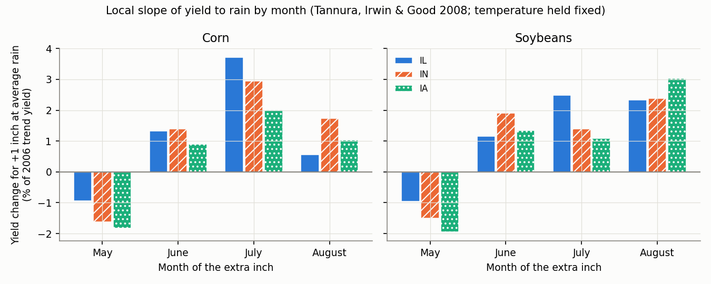
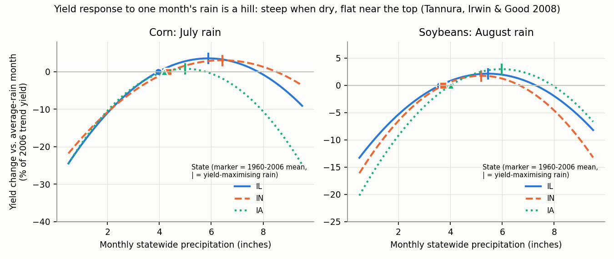
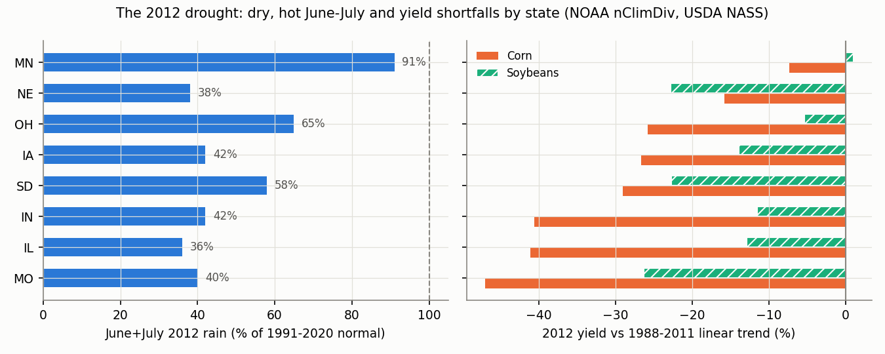

# Rain and Corn & Soybean Yields: What Is One Inch Worth?

**Proposal cell:** Milestone 1 / R1 farm exposure (row crops: corn, soybeans)  |  **Status:** VERIFIED 2026-10-29 (see Verification log)  |  **Last updated:** 2026-10-29

Companion files: `data/processed/crop_rain_sensitivity_corn_soy.csv` (125 rows, one per crop x
region x month x source), `scripts/r1_rain_yield_calcs.py` (every number we computed),
figures `docs/figures/r1_*.png`. Auxiliary tables (regression coefficients, 2012 drought,
irrigation shares, season-rain panel) are committed in `data/processed/crop_yield_aux/`; the
script regenerates them in `data/raw/r1_rain_yield/derived/`.

**Words used throughout.** A *bushel* (bu) is USDA's standard unit of grain. *Yield* is bushels
harvested per acre (bu/ac). *Trend yield* is the yield you would expect in a given year with
normal weather. It rises over time with better seed and management, by about 2 bu/ac per year
for corn. *Statewide rain* is the area average of NOAA station rain over the whole state for a
calendar month, not the rain at one gauge. A *slope* of "+5 bu/ac per inch" means that one
more inch of rain in that month, starting from a normal month, adds about 5 bu/ac.

## Key findings

- **Timing is what matters.** For corn, July rain is worth far more than rain in any other
  month. Published state models for Illinois, Indiana and Iowa (Tannura, Irwin & Good 2008,
  data for 1960-2006) put one more inch of July rain, starting from an average July, at
  **+3.2 to +5.8 bu/ac, or 2.0-3.7% of trend yield**. Our update with data through 2025 gives
  **+5.6 to +7.1 bu/ac (2.6-3.5% of the 2025 trend yield)**. If the effect grows in step with
  yields (a log model), it is **4.0-5.8% per inch**. For soybeans, the months that matter are
  August and July: **+1.1 to +1.9 bu/ac per inch (1.9-3.0%)** in August.
- **In dollars**, at the October 2026 WASDE projected 2026/27 prices ($4.70/bu corn,
  $12.00/bu soybeans): one more inch of July rain near normal on Illinois corn is worth about
  **$33/ac (range $27-54)**, Indiana about $33 ($21-56) and Iowa about $26 ($15-43). One more
  inch of August rain on soybeans is worth **$13-23/ac**. These are local rates. A move of a
  whole inch is lopsided: in Illinois, 1 inch more July rain than normal gains about $24/ac,
  while 1 inch less costs about $43/ac.
- **Losses from dry months are bigger than gains from wet ones.** In our Illinois update, July
  rain 1 inch below normal costs 9.2 bu/ac and 2 inches below costs 22.6 bu/ac (about
  **$106/ac**), while 2 inches above normal gains only 5.8 bu/ac. State models put the
  yield-maximising July rain at about 5.0-6.8 in. Beyond that, extra rain reduces yield.
- **Too much rain also hurts.** Extra May rain lowers yield in every state model: -1.4 to
  -3.3 bu/ac per inch for corn in the published and our central models (-1.1 to -4.8 across all
  our variants) and -0.3 to -1.0 for soybeans, through planting delays. In
  Illinois and Indiana the best amount of June rain is close to normal, so 2 inches of extra
  June rain cuts Indiana corn by 8.6 bu/ac. Across U.S. counties, extremely wet growing seasons cut
  maize yields by 17% on average and the most extreme ones by 34%, comparable to the 37% cut in
  the most extreme droughts (32% on average for extreme drought; Li et al. 2019). Federal crop insurance paid **$10 billion for excess rain and $18
  billion for drought** on maize over 1989-2016.
- **Total rain over the whole season is a weak index.** Schlenker & Roberts (2009) find that
  yield peaks at **25.0 in (corn) and 27.2 in (soybeans) of March-August rain**. Our state-panel
  version of that model finds only **+0.75% per inch** at average rain, and a loss of only
  about 1.8% when the season total is 4 inches away from the best amount. Ortiz-Bobea et al.
  (2019) show that a model that tracks *when* soil moisture is short improves out-of-sample
  prediction accuracy by **84-424%** over one using season-total rain. Contracts should be written for a specific month.
- **Dry Julys are also hot Julys.** Within a state, July rain and July temperature are
  negatively correlated (-0.30 to -0.37). If we drop temperature from our Illinois model, the
  July rain slope rises from 7.1 to **9.8 bu/ac per inch**, because rain then also stands in
  for the heat that comes with dry months. USDA's model splits the 2012 corn loss as about
  **69% rain and 31% heat** (28.4 of 41.4 bu/ac).
- **2012 is the standard stress test.** June+July rain was 36-42% of normal in IL, IN, IA and
  MO, and corn yields there fell 27-47% below trend. U.S. corn yielded 123.1 bu/ac against the
  166.0 USDA projected in May 2012 (-26%). Soybeans yielded 40.0 against 43.9 (-9%).
- **Irrigated acres barely respond to rain.** In 2022, 13.6% of U.S. corn acres and 10.5% of
  soybean acres were irrigated. The share is very uneven: Nebraska corn 52.7% and Arkansas
  soybeans 76.0%, versus about 1-3% in Iowa and Illinois. Nebraska corn fell only 16% below
  trend in 2012, even though its June+July rain was 38% of normal.
- **Older data understate today's sensitivity.** Lobell et al. (2014) find that the
  sensitivity of Midwest maize yields to drought stress rose over 1995-2012, linked to denser
  planting. So slopes estimated on older data are probably too low for today's crops.

## Headline table: "+1 inch in [month] in [state] ≈ X bu/ac ≈ Y% ≈ $Z/ac"

How to read the table:

- **Central** values come from our 1980-2025 re-estimate of the Tannura et al. model (yield in
  bu/ac, temperature held fixed), evaluated at the 1991-2020 normal rain.
- **Ranges** in brackets span three estimates: (a) the published Tannura et al. (2008) slope
  for 1960-2006, (b) our 1980-2025 bu/ac model, and (c) our 1980-2025 log-yield model, which
  assumes a fixed percentage effect.
- Percentages are of trend yield. Dollars use the 2026/27 projected season-average farm price
  (USDA WASDE-676, Oct 9 2026): **$4.70/bu corn, $12.00/bu soybeans**. Dollars = bu/ac × price.
- "Normal" rain is the 1991-2020 statewide monthly mean from NOAA nClimDiv.
- The **slope** columns give the local rate at normal rain: the "≈ X per inch" answer, good
  for small moves. The **exact** columns give the change for whole-inch moves (+1, +2, -1 and
  -2 inches from normal) from the same central model, in bu/ac and in $/ac. Exact changes show
  the asymmetry: the slope (7.1) lies between the gain from +1 in (5.0) and the loss from -1 in
  (9.2).
- *t* is the t-statistic of the linear rain term in our update. Below about 2 the estimate is
  statistically weak: treat it as "probably small", not as a precise number.
- Every cell is also a row in the CSV.

| Crop | Month | State | Normal rain (in) | **Slope: bu/ac per in** | **% of trend per in** | **$/ac per in** | Exact +1 / +2 / -1 / -2 in (bu/ac) | Exact +1 / +2 / -1 / -2 in ($/ac) | Notes |
|---|---|---|---|---|---|---|---|---|---|
| Corn | July | IL | 4.06 | **+7.1** [5.8-11.6] | **+3.4%** [3.4-5.3] | **$33** [27-54] | +5.0 / +5.8 / -9.2 / -22.6 | +24 / +27 / -43 / -106 | Best July rain 5.8 in; strongest month (t = 3.8) |
| Corn | July | IN | 4.29 | **+6.9** [4.4-12.0] | **+3.5%** [3.0-5.8] | **$33** [21-56] | +5.5 / +8.3 / -8.3 / -19.4 | +26 / +39 / -39 / -91 | Best July rain 6.8 in (t = 3.4) |
| Corn | July | IA | 4.17 | **+5.6** [3.2-9.1] | **+2.6%** [2.0-4.0] | **$26** [15-43] | +3.5 / +2.7 / -7.8 / -19.8 | +16 / +12 / -36 / -93 | Best July rain 5.5 in, so +2 in gains less than +1 in (t = 7.5) |
| Corn | June | IL | 4.65 | +0.9 [0.9-2.6] | +0.4% [0.4-1.3] | $4 [4-12] | -0.7 / -4.7 / -2.5 / -8.2 | -3 / -22 / -12 / -39 | Normal is near the best amount (4.9 in), so wetter and drier both lose (t = 4.4) |
| Corn | June | IN | 4.80 | +0.8 [0.8-2.9] | +0.4% [0.4-1.4] | $4 [4-14] | -1.8 / -8.6 / -3.4 / -11.9 | -8 / -41 / -16 / -56 | Best amount 5.0 in; +2 in is excess-rain damage (t = 6.8) |
| Corn | June | IA | 5.26 | -0.4 [-0.4 to +1.4] | -0.2% [-0.2 to +0.9] | -$2 [-2 to 7] | -0.8 / -2.3 / +0.1 / -0.6 | -4 / -11 / 0 / -3 | Normal June is already above the best amount (4.7 in); weak (t = 0.9) |
| Corn | May | IL | 4.77 | -2.0 [-1.5 to -2.8] | -0.9% [-0.9 to -1.3] | -$9 [-7 to -13] | -2.0 / -4.0 / +2.0 / +4.0 | -9 / -19 / +9 / +19 | Linear; wet May delays planting (t = -2.3) |
| Corn | May | IN | 4.77 | -3.3 [-2.4 to -4.8] | -1.6% [-1.6 to -2.3] | -$15 [-11 to -22] | -3.3 / -6.6 / +3.3 / +6.6 | -15 / -31 / +15 / +31 | Linear (t = -3.4) |
| Corn | May | IA | 4.84 | -1.4 [-1.4 to -2.9] | -0.6% [-0.6 to -1.8] | -$6 [-6 to -14] | -1.4 / -2.7 / +1.4 / +2.7 | -6 / -13 / +6 / +13 | Linear (t = -1.5) |
| Soybeans | August | IL | 3.56 | **+1.16** [1.07-1.81] | **+1.9%** [1.9-2.9] | **$14** [13-22] | +0.9 / +1.4 / -1.4 / -3.3 | +11 / +16 / -17 / -39 | Pod fill; weak in our update (t = 1.1) |
| Soybeans | August | IN | 3.60 | **+1.12** [1.12-1.71] | **+1.9%** [1.9-2.8] | **$13** [13-21] | +1.1 / +2.1 / -1.2 / -2.4 | +13 / +25 / -14 / -29 | Weak (t = 0.6); our curve is almost a straight line |
| Soybeans | August | IA | 4.13 | **+1.28** [1.28-1.88] | **+2.1%** [2.1-3.0] | **$15** [15-23] | +1.0 / +1.3 / -1.6 / -3.8 | +12 / +16 / -19 / -45 | Strongest soybean month in Iowa (t = 3.4) |
| Soybeans | July | IL | 4.06 | +1.36 [1.14-1.69] | +2.2% [2.2-2.7] | $16 [14-20] | +1.2 / +2.1 / -1.5 / -3.3 | +14 / +25 / -18 / -40 | Weak statistically (t = 1.0) |
| Soybeans | July | IN | 4.29 | +0.50 [0.50-0.66] | +0.8% [0.8-1.4] | $6 [6-8] | +0.2 / 0.0 / -0.8 / -2.0 | +3 / 0 / -9 / -24 | Weak (t = 1.5) |
| Soybeans | July | IA | 4.17 | +0.83 [0.52-0.91] | +1.3% [1.1-1.4] | $10 [6-11] | +0.5 / +0.4 / -1.1 / -2.9 | +6 / +5 / -14 / -35 | t = 2.8 |
| Soybeans | May | IL / IN / IA | 4.8 | -0.33 / -0.75 / -0.65 | -0.5% / -1.3% / -1.1% | -$4 / -$9 / -$8 | linear: +2 in = 2 × slope | -4 / -9 / -8 per inch | Planting delays |

**Five cautions before using any number in this table** (each is explained in the Detail
sections):

1. **Local slope.** "Per inch" is the rate at normal rain. Use the exact columns, or the
   quadratic itself, for moves of more than about ±1 inch (Section 3).
2. **Not a straight line.** Yield response is a hill: losses from a dry month are bigger than
   gains from an equally wet one, and past the best amount extra rain *lowers* yield
   (Sections 2-3).
3. **Heat travels with drought.** These slopes hold temperature fixed. Dry Julys are usually
   hot Julys, so if a contract pays on rain alone, the yield change that comes with one inch is
   larger: corn July 9.8 (IL), 8.8 (IN) and 7.3 (IA) bu/ac per inch in our rain-only model,
   26-38% above the central values (Section 5).
4. **Statewide rain, not one rain gauge.** The rain here is a whole-state average. One
   station's monthly total (what a Kalshi contract settles on) swings more and only partly
   matches the rain on a given farm, so a farm's yield change per inch of *station* rain will
   be smaller than these state slopes, and a station contract hedges less of the loss
   (Implication 4).
5. **Rain-fed acres only.** Irrigated fields barely respond to rain (Section 7).

**National models (USDA's World Agricultural Outlook Board (WAOB) crop-weather model).** These
use acre-weighted average rain over 8 states (IA, IL, NE, MN, IN, SD, OH, MO) for corn and the
same states without SD for soybeans:

- **July rain:** at the 3.87-in average, the slope is **+2.0 bu/ac per inch (1.2%, $9/ac)**.
  1 inch below average costs 3.5 bu/ac and 2 inches below costs 10.1 bu/ac, while an actual
  +1 inch gains only 0.5 bu/ac and +2 inches *loses* 2.1 bu/ac (Westcott & Jewison 2013
  coefficients; arithmetic ours). The 1988-2019 re-estimate gives a slope of **+2.7 bu/ac per
  inch (1.5%, $13/ac)** (Irwin & Hubbs 2020, (10):121).
- **June rain:** it only enters the model in severe droughts. The June term is zero unless June
  rain is at least 1.82 in below its 4.33-in average (the driest ~10% of Junes, such as 1988
  and 2012). Once it switches on, the model subtracts **9.5 bu/ac for every inch of the whole
  shortfall**: about 17 bu/ac right at the trigger (1.82 × 9.54) and 19.1 bu/ac for a 2-inch
  shortfall (Westcott & Jewison 2013, p.17). It acts like an on/off switch, not a slope.
- **Why the national July slope is smaller.** The national model puts the best July rain at
  4.5-4.8 in, close to the average, so the slope is gentle at the average and steep below it.
- **Soybeans:** the national model's July-August rain terms are not statistically
  significant. They imply only **+0.2 bu/ac per inch of July+August total**.

## Numbers table

Verification codes:

- **CONFIRMED:** we read the number in the primary source.
- **CONFIRMED + ours:** the inputs were read in the primary source, and the arithmetic is ours
  (formula in the Detail section, code in the script).
- **COMPUTED:** our own regression or arithmetic on public NOAA and NASS data, reproducible with
  `python scripts/r1_rain_yield_calcs.py`.
- **UNVERIFIED:** secondary source only.

Every cell of the headline table, and every slope, ±1 in, ±2 in and optimum value quoted
below, is a row in the CSV, with its inputs listed here.

| Quantity | Value | Units | Region / period | Source (URL + page/table) | Verification |
|---|---|---|---|---|---|
| Corn July rain coefficients b1, b2 | 17.65, -1.50 (IL); 13.62, -1.06 (IN); 19.95, -2.00 (IA) | bu/ac per in, per in² | State, 1960-2006 | Tannura et al. 2008, Table 8 p.54 | CONFIRMED |
| Corn June rain b1, b2 | 14.04, -1.50 (IL); 16.82, -1.81 (IN); 8.93, -0.82 (IA) | same | State, 1960-2006 | Tannura et al. 2008, Table 8 | CONFIRMED |
| Corn August rain b1, b2 | 2.88, -0.28 (IL, ns); 15.85, -1.78 (IN); 4.37, -0.34 (IA, ns) | same | State, 1960-2006 | Tannura et al. 2008, Table 8 | CONFIRMED |
| Corn May rain (linear) | -1.45 (IL), -2.43 (IN), -2.89 (IA) | bu/ac per in | State, 1960-2006 | Tannura et al. 2008, Table 8 | CONFIRMED |
| Corn Sep-Apr rain (linear) | 0.38 (IL, ns), 0.29 (IN, ns), 1.02 (IA) | bu/ac per in | State, 1960-2006 | Tannura et al. 2008, Table 8 | CONFIRMED |
| Corn July / August temperature | -1.65/-2.86 (IL), -1.99/-2.02 (IN), -2.23/-2.04 (IA) | bu/ac per °F | State, 1960-2006 | Tannura et al. 2008, Table 8 | CONFIRMED |
| Corn model R² | 0.95 (IL), 0.94 (IN), 0.94 (IA) | - | State, 1960-2006 | Tannura et al. 2008, Table 8 | CONFIRMED |
| Corn trend coefficient | 1.92 (IL), 1.76 (IN), 2.04 (IA) | bu/ac per year | State, 1960-2006 | Tannura et al. 2008, Table 8 | CONFIRMED |
| Soy June b1, b2 | 2.21, -0.21 (IL); 5.13, -0.52 (IN); 2.56, -0.21 (IA) | bu/ac per in, per in² | State, 1960-2006 | Tannura et al. 2008, Table 9 p.55 | CONFIRMED |
| Soy July b1, b2 | 2.57, -0.18 (IL); 3.52, -0.33 (IN); 3.45, -0.35 (IA) | same | State, 1960-2006 | Tannura et al. 2008, Table 9 | CONFIRMED |
| Soy August b1, b2 | 3.16, -0.29 (IL); 3.95, -0.38 (IN); 4.42, -0.37 (IA) | same | State, 1960-2006 | Tannura et al. 2008, Table 9 | CONFIRMED |
| Soy May rain (linear) | -0.44 (IL), -0.71 (IN), -0.93 (IA) | bu/ac per in | State, 1960-2006 | Tannura et al. 2008, Table 9 | CONFIRMED |
| Soy model R² | 0.91, 0.91, 0.89 | - | IL, IN, IA 1960-2006 | Tannura et al. 2008, Table 9 | CONFIRMED |
| Mean monthly rain May/Jun/Jul/Aug | IL 4.32/4.00/3.96/3.60; IN 4.47/4.07/4.34/3.72; IA 4.27/4.57/4.19/4.01 | in | State, 1960-2006 | Tannura et al. 2008, Table 2 p.48 | CONFIRMED |
| Mean Sep-Apr rain | IL 22.83, IN 24.57, IA 16.47 | in | State, 1960-2006 | Tannura et al. 2008, Table 2 | CONFIRMED |
| July rain range (min-max) | IL 1.75-7.27, IN 1.29-8.65, IA 0.95-10.50 | in | State, 1960-2006 | Tannura et al. 2008, Table 2 | CONFIRMED |
| Trend yield at 2006 technology (% denominator) | Corn 155.0/149.6/159.1; soy 46.0/46.9/47.8 | bu/ac | IL/IN/IA | Tannura et al. 2008, Table 6 p.52 | CONFIRMED |
| July rain-temperature correlation | -0.30 to -0.37 | correlation | IL, IN, IA, 1960-2006 | Tannura et al. 2008, p.6 | CONFIRMED |
| Cross-state July rain correlation | 0.70 (IL-IN), 0.72 (IL-IA), 0.49 (IN-IA) | correlation | 1960-2006 | Tannura et al. 2008, Table 5 p.51 | CONFIRMED |
| "2 in less July rain cuts yield 18-22 bu/ac" | 18-22 | bu/ac | IL, IN | Tannura et al. 2008, p.18 (Fig. 41, p.107) | CONFIRMED. Fig. 41 measures the loss from the yield at the *best* rain down to the yield at average rain minus the average-to-best gap (1.92 in IL, 2.08 in IN): 22.2 (IL) and 18.4 (IN). Measured from *average* rain, that same cut costs 16.6 (IL) and 13.8 (IN), and an exact 2-in cut costs 17.5 (IL) and 13.1 (IN). CONFIRMED + ours |
| Tannura slopes at mean, corn July | +5.77 (IL), +4.42 (IN), +3.19 (IA) | bu/ac per in | 1960-2006 | Computed from Tables 2, 8 | CONFIRMED + ours |
| Tannura best July rain, corn | 5.88 (IL), 6.42 (IN), 4.99 (IA) | in | 1960-2006 | -b1/(2·b2), Table 8 | CONFIRMED + ours |
| WAOB corn model: July rain b1, b2 | 13.793, -1.522 (t = 2.9, -3.2) | bu/ac per in, per in² | 8-state, 1988-2012 | Westcott & Jewison 2013, Table 6 p.11 | CONFIRMED |
| WAOB corn: July temp, mid-May planting, June shortfall, trend | -2.283 per °F; 0.289 per % planted; -9.537 per in; 1.952 per yr | bu/ac | 8-state, 1988-2012 | Westcott & Jewison 2013, Table 6 | CONFIRMED |
| WAOB corn R², standard error | 0.964; 4.2 | -; bu/ac | 1988-2012 | Westcott & Jewison 2013, Table 6 | CONFIRMED |
| 8-state mean July rain | 3.87 | in | 1988-2012 | Westcott & Jewison 2013, p.15 | CONFIRMED (we get 3.84 from NOAA nClimDiv: COMPUTED) |
| June shortfall trigger / June mean | 1.82 / 4.33 (corn); 1.91 / 4.41 (soy). Once triggered, the coefficient multiplies the whole shortfall: a 2-in shortfall costs 19.1 bu/ac (corn) and 2.56 bu/ac (soy); the 1.96-in corn shortfall of June 2012 cost 18.7 | in; bu/ac | 8-state / 7-state | Westcott & Jewison 2013, pp.17, 20, 22 | CONFIRMED |
| WAOB soy model: Jul-Aug rain b1, b2; temp; June shortfall | 5.083, -0.619 (t = 1.1, -1.2); -0.514 per °F; -1.279 per in | bu/ac | 7-state, 1988-2012 | Westcott & Jewison 2013, Table 7 p.13 | CONFIRMED |
| 7-state mean Jul-Aug average monthly rain | 3.76 | in per month | 1988-2012, soy-acre weighted | NOAA nClimDiv + NASS acres | COMPUTED |
| WAOB soybean model R² | 0.800 (0.88 with a 2003 aphid dummy) | - | 7-state, 1988-2012 | Westcott & Jewison 2013, Table 7 and pp.12-13 | CONFIRMED |
| National July slope at the mean, corn | Westcott +2.01 bu/ac per in (1.2%, $9.46/ac), exact -1 in -3.53, -2 in -10.11, best rain 4.53 in; Irwin & Hubbs +2.69 (1.5%, $12.63), -1 in -4.08, -2 in -10.96, best rain 4.82 in | bu/ac | 8-state | From the coefficient rows | CONFIRMED + ours |
| National soybean slope per inch of Jul+Aug total | +0.22 bu/ac (0.5%, $2.59/ac) | bu/ac | 7-state | From Table 7 + our 3.76-in baseline | CONFIRMED + ours |
| WAOB 2013 expected yields (% denominators) | 163.6 corn; 44.5 soy | bu/ac | U.S. | Westcott & Jewison 2013, pp.27-28 | CONFIRMED |
| Downward correction for uneven July rain | 0.65 (corn), 0.09 (soy) | bu/ac | U.S. | Westcott & Jewison 2013, pp.16, 19 | CONFIRMED |
| 2012 corn, USDA model steps | 165.1 → 146.4 (June, -18.7) → 123.7 (July heat -13, July rain -9.7) | bu/ac | U.S. 2012 | Westcott & Jewison 2013, p.22 | CONFIRMED |
| 2012 rain share of the model's corn weather loss | 68.6% (28.4 of 41.4 bu/ac); heat 31.4% | % | U.S. 2012 | From the line above | CONFIRMED + ours |
| 2012 soybeans, USDA model steps | 44.0 → 41.5 (June) → 38.4 (heat -1.4, Jul-Aug rain -1.7) | bu/ac | U.S. 2012 | Westcott & Jewison 2013, p.25 | CONFIRMED |
| 2012 July weather (8-state) | 79.6°F (+5.7°F); rain 1.84 in (-2.03 in) | °F; in | 2012 | Westcott & Jewison 2013, p.22 | CONFIRMED |
| June 2012 rain, top states | IA 2.88, IL 1.80, NE 1.62, IN 1.30 | in | June 2012 | Westcott & Jewison 2013, Table 1 p.3 | CONFIRMED |
| May 2012 projection vs Jan 2013 estimate | Corn 166.0 → 123.4; soy 43.9 → 39.6 | bu/ac | U.S. 2012 | Westcott & Jewison 2013, Tables 4-5 p.9 | CONFIRMED |
| 2012/13 farm price, May 2012 forecast vs Jan 2013 | Corn $4.60 → $7.40; soy $13.00 → $14.25 | $/bu | U.S. | Westcott & Jewison 2013, Tables 4-5 | CONFIRMED |
| WAOB model re-estimated 1988-2019: July b1, b2; mean | 13.460, -1.397 (t = 2.53, -2.47); 3.856 in | bu/ac | 8-state | Irwin & Hubbs 2020, farmdoc daily (10):121, Table 2 (coefficients) and the 2020-forecast table below it (3.856-in sample average) | CONFIRMED |
| 2020 WASDE corn yield (% denominator) | 178.5 | bu/ac | U.S. | Irwin & Hubbs 2020 | CONFIRMED |
| 2023 U.S. corn yield | 177.3 | bu/ac | U.S. | Irwin 2024, farmdoc daily (14):68 | CONFIRMED |
| Tannura IL July asymmetry | loss/gain = 1.7 for 1 in (7.27 vs 4.27); 3.2 for 2 in (17.54 vs 5.54) | ratio | IL 1960-2006 | From Tables 2, 8 | CONFIRMED + ours |
| Corn yield range over ±1 SD of July rain | 12.7 | bu/ac | 10-state, 1980-2023 | Irwin 2024, farmdoc daily (14):68 | CONFIRMED |
| Soy yield range over ±1 SD of Aug / July rain | 2.2 / 2.1 | bu/ac | 10-state, 1980-2022 | Irwin 2023, farmdoc daily (13):194 | CONFIRMED |
| Our 1980-2025 slope at normal, corn July | +7.10 (IL), +6.93 (IN), +5.62 (IA) | bu/ac per in | State | CSV | COMPUTED |
| Same, % of fitted 2025 trend (210.6, 199.9, 217.5 bu/ac) | 3.37%, 3.47%, 2.58% | % per in | State | CSV | COMPUTED |
| Our log model, corn July | 5.26%, 5.80%, 3.95% (11.6, 12.0, 9.1 bu/ac) | % per in | IL, IN, IA | CSV | COMPUTED |
| Our soybean August slopes: log model / rain-only model | 1.81 / 1.71 / 1.88 bu/ac (2.9 / 2.8 / 2.9%); 1.08 / 0.97 / 1.39 bu/ac (1.8 / 1.6 / 2.2%) | per in | IL / IN / IA 1980-2025 | CSV | COMPUTED |
| t-statistics, our 1980-2025 update (linear rain term) | Corn July 3.8 (IL), 3.4 (IN), 7.5 (IA); corn June 4.4 (IL), 6.8 (IN); soy Aug 1.1 (IL), 0.6 (IN), 3.4 (IA); soy July 1.0 (IL), 1.5 (IN), 2.8 (IA) | - | 1980-2025 | data/processed/crop_yield_aux/r1_reestimate_coefficients.csv | COMPUTED |
| Our rain-only model, corn July | +9.81 (IL), +8.76 (IN), +7.29 (IA) | bu/ac per in | State 1980-2025 | CSV | COMPUTED |
| Our corn July, IL: slope; exact +1 / -1 / +2 / -2 in | +7.1; +5.0 / -9.2 / +5.8 / -22.6 | bu/ac | IL 1980-2025 | CSV (`valid_range_note`) | COMPUTED |
| Our exact +1 in changes, other headline rows | Corn July IN +5.5, IA +3.5; corn June IL -0.7, IN -1.8, IA -0.8; soy Aug IL +0.9, IN +1.1, IA +1.0; soy July IL +1.2, IN +0.2, IA +0.5 | bu/ac | 1980-2025 | CSV | COMPUTED |
| Our best rain, corn July | 5.76 (IL), 6.78 (IN), 5.48 (IA) | in | 1980-2025 | CSV | COMPUTED |
| Our best rain, corn June | 4.93 (IL), 4.96 (IN), 4.66 (IA) | in | 1980-2025 | CSV | COMPUTED |
| 1991-2020 normals, July / August | IL 4.06/3.56; IN 4.29/3.60; IA 4.17/4.13 | in | nClimDiv statewide | NOAA NCEI Climate at a Glance | COMPUTED (from NOAA data) |
| Replication of Tannura slopes with our data (corn July) | 5.96 / 4.19 / 3.23 vs published 5.77 / 4.42 / 3.19 | bu/ac per in | 1960-2006 | Script output | COMPUTED |
| Best season (Mar-Aug) rain | 25.0 corn; 27.2 soy | in | Counties east of 100°W, 1950-2005 | Schlenker & Roberts 2009, PNAS 106:15594 (main text, Fig. 1 discussion) | CONFIRMED |
| Heat thresholds | 29°C corn, 30°C soy | °C | same | Schlenker & Roberts 2009 | CONFIRMED |
| Our panel analog: best Mar-Aug rain | 25.8 corn; 26.5 soy | in | 9 eastern states, 1960-2025 | Script | COMPUTED |
| Our panel: slope at mean; loss 2/4/6/8 in from best | +0.75%/in; -0.5/-1.8/-4.0/-7.0% (corn); soy +0.73%/in; -0.4/-1.5/-3.2/-5.7% | % | Mean 22.5 in, SD 4.5 | Script | COMPUTED |
| Extreme wet / extreme dry impact on maize | -16.6 ± 2.7% (up to -34.1%); -32.2 ± 2.0% (up to -36.6%) | % vs trend | U.S. counties 1981-2016 | Li et al. 2019, GCB 25:2325, Sec. 3.1, Fig. 1a | CONFIRMED |
| Extremes as defined by Li et al. | dry < -2σ, wet > +2.5σ of May-Aug rain; about 1% of county-years each | σ | 1981-2016 | Li et al. 2019, Sec. 2.2 | CONFIRMED |
| Drought with vs without extreme heat | -37.2% vs -25.8% | % | U.S. maize | Li et al. 2019, Sec. 3.1 | CONFIRMED |
| RMA maize indemnities, drought vs excess rain | $18B vs $10B | US$ | 1989-2016 | Li et al. 2019, Introduction (Fig. S1) | CONFIRMED |
| Loss ratio by month | Excess rain: June 1.08, July 0.95; drought: July about 1.5 | ratio | U.S. maize | Li et al. 2019, Sec. 3.1 | CONFIRMED |
| Excess-rain impact by state | IA -32.2%, MN -35.7%, MO -31.3% | % | 1981-2016 | Li et al. 2019, Sec. 3.2 | CONFIRMED |
| Extreme-drought impact by state | IL -45.7% to NE -12.2% | % | 1981-2016 | Li et al. 2019, Sec. 3.2 | CONFIRMED |
| Maize silking in July; June rain | 85% silking; June wettest month, 110 mm (4.3 in) | %; mm | U.S. | Li et al. 2019, Sec. 3.1 | CONFIRMED |
| Gain in prediction accuracy, timing-aware moisture model vs season rain | 84-424% | % | U.S. counties, 6 crops | Ortiz-Bobea et al. 2019, ERL 14:064003, Fig. 2 text | CONFIRMED |
| Critical month | July (maize), August (soybeans) | - | U.S. | Ortiz-Bobea et al. 2019, Fig. 3 caption | CONFIRMED |
| Non-irrigated counties' share of harvested area | 86% maize, 93% soybeans | % | U.S. | Ortiz-Bobea et al. 2019 | CONFIRMED |
| McLean Co., IL maize 2012 / 1985 | -41% / +29% vs average | % | County | Ortiz-Bobea et al. 2019 (text; caption says -40% / +31%) | CONFIRMED |
| Drought sensitivity of maize rising | Qualitative (field data 1995-2012) | - | Central U.S. | Lobell et al. 2014, Science 344:516 (abstract, PubMed 24786079) | CONFIRMED (abstract only) |
| Irrigated share of harvested acres, 2022 | Corn 13.6% U.S. (11.0M of 80.6M ac); soy 10.5% (8.9M of 84.6M) | % | U.S. | NASS 2022 Census of Agriculture via Quick Stats; same counts in Census Vol. 1, US State Level Data, Table 25 (pp.464, 474) | CONFIRMED (shares computed from the Census acre counts) |
| 2022 harvested acres by state | Corn: IA 12.64M, IL 10.42M, NE 8.65M, MN 7.73M, IN 5.38M, SD 4.80M, KS 4.66M, OH 3.31M, MO 3.02M. Soy: IL 10.21M, IA 9.50M, MN 7.60M, MO 5.74M, IN 5.69M, NE 5.39M, SD 4.86M, OH 4.83M, KS 4.57M, AR 3.25M, MS 2.40M | acres | 2022 | NASS 2022 Census via Quick Stats | CONFIRMED |
| Nebraska irrigated corn acres | 1,482,131 (entire crop irrigated) + 3,072,429 (irrigated part of partly irrigated farms) = 4,554,560 of 8,648,207 | acres | NE 2022 | same | CONFIRMED |
| Irrigated share by state, corn / soy | NE 52.7/43.9; KS 25.4/8.0; MO 9.4/10.4; IN 6.3/3.5; MN 3.9/1.6; IL 3.3/2.1; IA 1.2/0.9; OH 0.5/0.3; AR 74.6/76.0; MS 51.9/52.4 | % | 2022 | same | CONFIRMED |
| 2012 yields vs 1988-2011 linear trend, corn / soy | IL -41.1/-12.9; IN -40.6/-11.5; IA -26.6/-13.9; MO -47.0/-26.3; NE -15.8/-22.8; MN -7.3/+1.0; OH -25.8/-5.4; SD -29.0/-22.7; US -24.4/-9.4 | % | 2012 | NASS yields; our trend | COMPUTED |
| 2012 yields, corn / soy | IL 105/43.0; IN 99/44.0; IA 137/45.0; NE 142/41.5; US 123.1/40.0 | bu/ac | 2012 | NASS Quick Stats (current final) | CONFIRMED |
| June+July 2012 rain as % of 1991-2020 normal | IL 36, IN 42, IA 42, MO 40, NE 38, SD 58, OH 65, MN 91 | % | 2012 | NOAA nClimDiv | COMPUTED |
| July 2012 mean temperature vs normal | IL 81.8 vs 75.4; IA 79.6 vs 73.4; IN 80.2 vs 74.2 | °F | 2012 | NOAA nClimDiv | COMPUTED |
| August 2012 rain as % of 1991-2020 normal | IL 98 (3.50 vs 3.56 in), IN 113, IA 70, MO 64, NE 37 | % | 2012 | NOAA nClimDiv | COMPUTED |
| 2012/13 corn price forecast change | +61% ($4.60 → $7.40) | % | U.S. | Westcott & Jewison 2013, Table 4 | CONFIRMED + ours |
| Dollar figures at 2024/25 instead of 2026/27 prices | Corn 9.8% lower (4.24/4.70); soy 16.7% lower (10.00/12.00); e.g. IL July corn $30.1, IL Aug soy $11.6 | % ; $/ac | U.S. prices | WASDE-676 + CSV slopes | CONFIRMED + ours |
| Rain-only vs temperature-held-fixed July corn slope | +38% IL, +26% IN, +30% IA | % | 1980-2025 | CSV | COMPUTED |
| Corn season-average farm price | 2024/25 $4.24; 2025/26 est. $4.16; 2026/27 proj. $4.70 (Sept proj. $4.80) | $/bu | U.S. | USDA WASDE-676, Oct 9 2026, p.12 | CONFIRMED |
| Soybean season-average farm price | 2024/25 $10.00; 2025/26 est. $10.50; 2026/27 proj. $12.00 | $/bu | U.S. | USDA WASDE-676, p.15 | CONFIRMED |
| U.S. yields, 2024 / 2025 / 2026 proj. | Corn 179.3 / 186.5 / 181.2; soy 50.7 / 53.0 / 53.1 | bu/ac | U.S. | USDA WASDE-676, pp.12, 15 | CONFIRMED |
| 2025 state yields, corn / soy | IL 214/62.5; IN 204/59.5; IA 210/63.5; NE 194/65.5 | bu/ac | 2025 | NASS Quick Stats | CONFIRMED |
| Example: 1,000-acre IL corn farm, July 2 in below normal | about $106,000 lost revenue (22.56 bu/ac × $4.70 × 1,000) | US$ | IL | Our arithmetic | COMPUTED |
| 2012 IL corn revenue/ac at forecast prices | $820 expected (178.2 × $4.60, May 2012 forecast) vs $777 (105 × $7.40, January 2013 forecast), -5.2% | US$/ac | IL 2012 | Our arithmetic on the rows above | COMPUTED |

## Detail

### 1. Why timing matters: the crop calendar in one paragraph

Corn is planted from late April into May. Half of Iowa's corn was planted by the end of April
in 2000-2004 (Tannura et al. 2008, p.11, citing Elmore and Abendroth). Soybeans are planted
mostly in May (p.19). The yield is mostly decided during each crop's reproductive period. For
**corn, that is pollination ("silking", when the silks must catch pollen to form kernels),
which falls in July**: Li et al. (2019) note that 85% of U.S. maize is silking in July, and
that drought during this reproductive stage, especially together with heat, does the most
damage. That is why every model we read puts July rain (and July heat) at the top for corn. **Soybeans flower and
fill their pods over a longer stretch, July through August.** Westcott & Jewison (2013, p.12)
therefore use a July-August window for soybeans, and Ortiz-Bobea et al. (2019) find August is
the single most critical month for soybeans (July for maize). Rain before the season (Sep-Apr)
refills the soil. That matters a little in drier Iowa (+1.0 bu/ac per inch for corn) and
hardly at all in Illinois or Indiana (Tannura et al. 2008, p.17). A wet May hurts because it
delays planting, slows early growth and encourages shallow roots (Tannura et al. 2008, p.17).

*Figure 1. Yield change for one extra inch of statewide rain in each month, starting from an
average month, as % of trend yield (Tannura, Irwin & Good 2008, 1960-2006, temperature held
fixed). July dominates for corn; for soybeans, June through August all matter, and August
matters most in Iowa. May is negative for both crops.*

### 2. Why the effect is nonlinear (a hill, not a straight line)

The monthly models here fit yield against June, July and August rain *P* as a quadratic,
Y = b1·P + b2·P², with b2 < 0 (May and pre-season rain enter as straight lines). That shape is a hill:

- **Left side (dry):** the curve is steep. When the soil is short of water, each inch of rain
  goes straight into growth.
- **Top (optimum):** at P\* = -b1/(2·b2) one more inch does nothing. The crop already has the
  water it can use.
- **Right side (too wet):** extra rain now *reduces* yield. Li et al. (2019, Sec. 4) list the
  mechanisms: waterlogged soils starve roots of oxygen, nitrogen fertilizer is lost through
  leaching and denitrification (soil bacteria turn nitrate into gas when soils are saturated),
  toxic compounds build up in oxygen-poor soil, heavy storms bring hail, wind and direct
  damage, and fields cannot be planted on time. Tannura et al. (2008, p.11) cite the 1993 Iowa
  floods as the textbook case.

*Figure 2. Yield effect of one month's statewide rain relative to an average-rain month
(Tannura et al. 2008 coefficients; % of 2006 trend yield). Dots mark the 1960-2006 mean rain;
vertical ticks mark the yield-maximising rain. Iowa's July optimum (5.0 in) is close to its
mean, so Iowa gains little from extra July rain and loses quickly when July is very wet.*

### 3. "+1 inch" is a local slope, not a constant

Because the curve bends, "one inch is worth X" is true only near a starting point. The slope
at baseline rain P0 is **dY/dP = b1 + 2·b2·P0**. The exact change for a move of d inches is
**b1·d + b2·[(P0+d)² - P0²]**. Worked example, Illinois corn July, Tannura et al. coefficients:

- **Slope at the mean.** b1 = 17.65 and b2 = -1.50, at the mean P0 = 3.96 in, give
  17.65 - 2(1.50)(3.96) = **+5.77 bu/ac per inch**, which is 5.77/155.0 = 3.7% of the 2006
  trend yield.
- **One inch wetter:** +1 in (to 4.96 in) gives +5.77 - 1.50 = **+4.27 bu/ac**.
- **Two inches wetter:** +2 in gives **+5.54 bu/ac**. That is barely more than +1 in, because
  4.96 to 5.96 in crosses the 5.88-in optimum.
- **Drier:** -1 in gives **-7.27 bu/ac**, and -2 in gives **-17.54 bu/ac**.

So a drier July hurts more than a wetter July helps: for 1 inch the loss is 1.7 times the
gain (7.27 vs 4.27), and for 2 inches it is 3.2 times (17.54 vs 5.54). The CSV stores the local slope (`delta_yield_per_inch`)
and the exact +2-inch change (`delta_yield_plus2in`). The `valid_range_note` column holds the
exact +1, -1 and -2 inch values and the optimum. **Use the slope only within about ±1 inch of the
baseline. For bigger moves, use the quadratic itself.** The farmdoc daily summaries give a
standard-deviation view of national data: in a 10-state model for 1980-2023, the U.S. corn yield
spans a range of 12.7 bu/ac (7.2% of the 2023 yield of 177.3) between July rain 1 standard
deviation below and 1 above average (Irwin 2024). That article reports only the total span, not
how it splits between the dry side and the wet side.

### 4. The published monthly regressions

**Tannura, Irwin & Good (2008).** This study updates the "Thompson model", the classic
crop-weather regression developed by L.M. Thompson in the 1960s-80s. For each state, it
regresses NASS state yield on:

- a linear time trend;
- Sep-Apr and May rain (linear);
- June, July and August rain (linear + squared);
- May-August mean temperatures (linear).

The data are statewide records for 1960-2006 in IL, IN and IA. Nebraska is excluded because
so much of it is irrigated (p.4). The models explain 94-95% of the variation in corn yield and
89-91% in soybeans. Results by crop:

- **Corn.** July rain is the largest weather effect in every state, and June is second.
  August rain matters only in Indiana. The authors suggest Indiana's sandier soils hold less
  water (p.18). Each °F of July or August heat costs about 2 bu/ac (Table 8).
- **Soybeans.** August rain is the largest effect in IL and IA (significant only in IA), June
  is largest in IN, and May rain is harmful everywhere (pp.19-20).

Their slopes at the state mean are in the headline table ranges and the CSV. One wording
check: the report says 2 inches less July rain "would be expected to reduce yields by 18 to 22
bushels per acre" (p.18). Recomputing from Table 8 (and reading Fig. 41), that figure is measured from the yield at
the *optimum* rain (IL 22.2, IN 18.4 bu/ac). Measured from *average* rain, an exact 2-inch
shortfall costs less: 17.5 bu/ac in IL and 13.1 in IN.

**Westcott & Jewison (2013), USDA ERS.** This is the national crop-weather model of USDA's World
Agricultural Outlook Board (WAOB). Its 2013 result was USDA's pre-season corn yield projection
(p.27), and the May-July WASDE corn yield forecasts are based on WAOB crop-weather models
(Irwin & Hubbs 2020, farmdoc daily (10):131). It regresses U.S.
yield on:

- a trend;
- the share of corn planted by mid-May;
- July temperature;
- July rain (quadratic);
- a "June shortfall" term that switches on only in the driest 10% of Junes.

The weather is acre-weighted over 8 states. The soybean version uses the July-August average
and fits much less tightly: R² 0.80 vs 0.964. Its July-August rain terms are not statistically
significant (t = 1.1 and -1.2). The authors attribute this to soybeans' longer reproductive
window (p.12). Irwin & Hubbs (2020) replicated the model and re-estimated it through 2019, with
nearly identical July coefficients (13.460, -1.397).

Thompson's original papers (1986, 1988) were not accessible to us. Tannura et al. (2008,
pp.21-22) summarise Thompson (1988): the highest corn yields come with above-average July rain
and below-average July-August temperatures, and the highest soybean yields with above-average
July-August rain, "especially important in August."

### 5. Our update through 2025 (and why the bu/ac numbers grew)

We rebuilt the Tannura et al. model from public data:

- **Rain and temperature:** NOAA nClimDiv statewide monthly data from NCEI Climate at a
  Glance.
- **Yields:** NASS state yields.

The rebuilt model reproduces their published slopes closely. For 1960-2006, our corn July
slopes are 5.96, 4.19 and 3.23 bu/ac per inch against the published 5.77, 4.42 and 3.19 for
IL, IN and IA. Every month and crop is within about 0.25 bu/ac (script output). That gives us
confidence in the data pipeline.

We then re-fit three variants over 1980-2025 and evaluated them at 1991-2020 normals:

| Model (1980-2025) | Corn July IL / IN / IA (bu/ac per in) | % of 2025 trend | Soy August IL / IN / IA | % of 2025 trend |
|---|---|---|---|---|
| Tannura spec, yield in bu/ac, temperature held fixed | 7.10 / 6.93 / 5.62 | 3.4 / 3.5 / 2.6 | 1.16 / 1.12 / 1.28 | 1.9 / 1.9 / 2.1 |
| Same, log yield (fixed % effect) | 11.6 / 12.0 / 9.1 | 5.3 / 5.8 / 4.0 | 1.81 / 1.71 / 1.88 | 2.9 / 2.8 / 2.9 |
| Rain only (temperatures dropped) | 9.81 / 8.76 / 7.29 | 4.6 / 4.4 / 3.3 | 1.08 / 0.97 / 1.39 | 1.8 / 1.6 / 2.2 |

What we take from this:

- **The bu/ac slope roughly scales with yield, so the percentage is stable.** Published
  Illinois July: 5.77 bu/ac = 3.7% of 155. Ours: 7.10 bu/ac = 3.4% of 211. A model in bu/ac
  averages over decades of lower yields, so it probably understates today's bu/ac effect. A
  log model assumes the opposite extreme. The truth for a 2027 crop is probably between the
  two, which is why the headline table shows both. This also fits Lobell et al. (2014):
  drought sensitivity rose as yields rose.
- **Dropping temperature raises the corn July slope by 25-40%.** Hot and dry go together, so
  rain alone absorbs part of the heat effect. For a contract that settles only on rain,
  **the rain-only slope is the relevant one**: it is the yield change you can expect per inch
  *given what typically comes with that inch*.
- **Statistical strength varies.** Corn July is strong in all three states (t = 3.4 to 7.5).
  June corn is strong in IL and IN (t > 4). Soybean July and August terms are weaker:
  t about 1 in IL, about 3 in IA. August corn terms are not significant in our update.

The coefficients and t-statistics are in `data/processed/crop_yield_aux/r1_reestimate_coefficients.csv`
(a committed copy of `data/raw/r1_rain_yield/derived/r1_reestimate_coefficients.csv`, which the
script regenerates on every run).

### 6. Nonlinear and panel evidence

**Schlenker & Roberts (2009, PNAS).** This is a county panel for 1950-2005, counties east of
the 100th meridian, using log yields, county fixed effects and state quadratic trends. Rain
enters as a quadratic in March-August total rain. It has "a statistically significant
inverted-U shape with an estimated yield-maximizing level of **25.0 inches for corn and 27.2
inches for soybeans**". The rain coefficients themselves are in an appendix we could not
download (PMC serves it behind a script check); the NBER working-paper version (w13799, p.14)
also leaves them out. So the main text gives the optimum but not the
curvature. Their main result is about heat: yields rise with temperature up to 29°C (corn) or
30°C (soybeans) and fall steeply above. They also find the damage above the heat threshold "is
less steep for corn subsamples with greater precipitation". In other words, rain and heat
interact.

**Our state-panel version.** This uses 9 mostly rain-fed eastern states, 1960-2025, log yield,
state effects and quadratic trends, March-August rain and temperature as quadratics. It puts
the optimum at 25.8 in (corn) and 26.5 in (soybeans), close to Schlenker & Roberts, against a
sample mean of 22.5 in. The surface is **flat**:

- the slope at the mean is +0.75%/in (corn);
- 4 inches from the optimum costs only 1.8%, and 8 inches costs 7.0%.

Compare that with +2.6 to +3.5% for a single inch of *July* rain. Season-total rain hides the
timing that matters.

**Ortiz-Bobea et al. (2019, ERL).** This replaces rain with modelled soil moisture (NLDAS) and
lets its effect vary week by week through the season. On non-irrigated counties (86% of maize
and 93% of soybean area), this timing-aware moisture model improves out-of-sample prediction by
**84-424%** relative to a season-long precipitation model. Season-total rain "explain[s]
surprisingly little" of yield variation, and the critical months are July (maize) and August
(soybeans). Their McLean County, IL illustration: in 2012 soils dried fast right in the
sensitive mid-season, and yield fell 41%. Late-summer rains came too late. **Lesson for us: the
same monthly total can mean very different things depending on when in the month it falls and
what came before.** Soil moisture remembers earlier rain; a monthly rain contract does not.

**Lobell et al. (2014, Science).** Field-level data for 1995-2012 in the central U.S. show
that "the sensitivity of maize yields to drought stress associated with high vapor pressure
deficits has increased". Vapor pressure deficit is how dry the air is, which drives how fast
plants lose water. The authors link the rise to denser planting. This is from the abstract; we
did not access the full text.

**Li, Guan et al. (2019, Global Change Biology).** Using county yields for 1981-2016 and RMA
insurance cause-of-loss data, they classify growing seasons (May-August) as extreme dry
(< -2σ) or extreme wet (> +2.5σ). The two cutoffs differ so that each extreme covers about 1% of
county-years. Results:

- **Size of losses.** Extreme wet seasons cut maize yield 16.6% on average (34.1% in the most
  extreme), against 32.2% (36.6%) for extreme drought.
- **Heat makes drought worse.** Drought with extreme heat costs 37.2%; without it, 25.8%.
- **Excess rain is regional.** It is worst in cooler, poorly drained northern states: Iowa
  -32.2%, Minnesota -35.7%, Missouri -31.3%. Southern states were sometimes *helped* by very
  wet seasons.
- **Timing.** Insurance loss ratios (payouts divided by premiums) for excess rain peak in June
  (1.08) and July (0.95). For drought they peak in July (about 1.5).
- **Model gap.** Process-based crop models miss the excess-rain damage entirely.

### 7. Soils and irrigation: who is (not) rain-sensitive

**Soils change the shape of the curve.** Sandy soils hold less water, so they respond more to
rain later in the season. That is Tannura et al.'s reading of Indiana's August effect.
Poorly drained, cool soils are hurt more by excess rain, and the loss is worse when the soil
is already wet before the season (Li et al. 2019).

**Irrigation all but removes the dry side of the curve.** Irrigated acres get water when
needed, so their yields barely respond to rain shortfalls.

| State (2022 Census) | Corn grain harvested acres | Irrigated % (corn) | Soybean acres | Irrigated % (soy) |
|---|---|---|---|---|
| Iowa | 12.64 M | 1.2% | 9.50 M | 0.9% |
| Illinois | 10.42 M | 3.3% | 10.21 M | 2.1% |
| Nebraska | 8.65 M | **52.7%** | 5.39 M | **43.9%** |
| Minnesota | 7.73 M | 3.9% | 7.60 M | 1.6% |
| Indiana | 5.38 M | 6.3% | 5.69 M | 3.5% |
| South Dakota | 4.80 M | 3.5% | 4.86 M | 2.4% |
| Kansas | 4.66 M | 25.4% | 4.57 M | 8.0% |
| Ohio | 3.31 M | 0.5% | 4.83 M | 0.3% |
| Missouri | 3.02 M | 9.4% | 5.74 M | 10.4% |
| Arkansas | 0.72 M | 74.6% | 3.25 M | **76.0%** |
| Mississippi | 0.59 M | 51.9% | 2.40 M | 52.4% |
| **U.S.** | **80.60 M** | **13.6%** | **84.60 M** | **10.5%** |

Source: NASS 2022 Census of Agriculture, items "CORN, GRAIN [, IRRIGATED] - ACRES HARVESTED" and
"SOYBEANS [, IRRIGATED] - ACRES HARVESTED". The irrigated item counts the irrigated acres
only: for Nebraska, the "entire crop" acres (1,482,131) plus the irrigated part of
"part of crop" acres (3,072,429) add up exactly to the 4,554,560 irrigated acres.

Practical rule: in Nebraska, Kansas, Arkansas and Mississippi, any rain slope estimated from
state averages mixes rain-sensitive dryland fields with insensitive irrigated ones. A dryland
farm there is *more* rain-sensitive than the state slope implies; an irrigated farm needs
little rain hedge. Irrigation has costs (pumping, water rights) that we do not model.

### 8. The 2012 drought

*Figure 3. Left: June+July 2012 statewide rain as % of the 1991-2020 normal (NOAA nClimDiv).
Right: 2012 yields vs a 1988-2011 linear trend (NASS). Nebraska shows the irrigation buffer:
the second-driest state lost the least corn yield among the dry states. Minnesota was near
normal on rain and lost little.*

- **Weather.** June+July rain was 36% of normal in IL, 40% in MO, 42% in IN and IA, and 38%
  in NE. July was also 6°F above normal: IL 81.8°F vs 75.4°F, IA 79.6 vs 73.4, IN 80.2 vs 74.2.
- **Corn.** Yields fell 41% below trend in IL, 41% in IN, 47% in MO and 27% in IA. U.S. corn
  was 123.1 bu/ac, 24% below our trend and 26% below USDA's May 2012 projection of 166.0.
- **Soybeans.** They were hurt less: U.S. 40.0 vs 43.9 projected (-9%). The pattern across
  states follows August rain, as the pod-fill story predicts:
  - August rain returned in Illinois (98% of normal) and Indiana (113%), and soybeans there
    fell only 12.9% and 11.5% below trend.
  - August stayed dry in Missouri (64%) and Nebraska (37%), and soybeans fell 26.3% and 22.8%.
  - Iowa was in between: August 70% of normal, soybeans -13.9%.
- **What USDA's model attributes the corn loss to.** From an expected 165.1 bu/ac, the dry
  June removed 18.7 bu/ac, July heat 13 bu/ac and dry July a net 9.7 bu/ac, ending at 123.7.
  So **about two-thirds of the modelled weather loss is tied to rain and one-third to heat**.
- **Prices rose.** USDA's 2012/13 corn price forecast went from $4.60 (May 2012) to $7.40
  (January 2013). For an Illinois farmer, expected revenue at May prices was 178.2 × $4.60 =
  $820/ac (178.2 bu/ac is our 1988-2011 trend for Illinois). At the January 2013 price forecast,
  revenue was 105 × $7.40 = $777/ac, only 5% lower. **A national drought partly hedges
  itself through prices. A local drought does not.**

### 9. Converting to dollars

We use **price × bu/ac** with the 2026/27 projected season-average farm price, the average
price farmers receive over the marketing year (USDA WASDE-676, October 9 2026): **$4.70/bu
corn** (September projection $4.80; 2024/25 final $4.24) and **$12.00/bu soybeans** (2024/25
$10.00). At 2024/25 prices, every dollar figure would be about 10% lower for corn and 17% lower
for soybeans. For example, Illinois July corn would be $30/ac instead of $33, and Illinois
August soybeans $11.6 instead of $14. These dollars are *gross revenue* per acre. They ignore
harvest and drying costs that scale with yield, and the price response described in section 8.

## Implications for our replication design

1. **Which months to hedge.**
   - **Corn: July is the core.** A July contract captures the largest single slope, about
     $26-33/ac per inch near normal and steeper below normal.
   - **June matters in two ways.** Severe dry Junes (the WAOB "shortfall" tail, 1988 and 2012)
     hurt, and in the national model that loss is a step (about 17-19 bu/ac once June is 1.8-2
     in below average), which a single binary contract at a low June strike can mimic (added by
     the verifier). Very wet Junes also hurt in IL and IN, where normal June rain is already
     about at the optimum.
   - **May is an excess-rain month** (planting delays).
   - **Soybeans: August first, then July.** A July+August window is defensible, but its
     per-inch value is smaller: about $13-23/ac in August.
   - **Do not use season-total contracts.** Section 6 shows they are a weak index.
2. **The risk is two-sided and asymmetric.** The loss curve is convex on the dry side. In
   Illinois, -1 in costs about 9 bu/ac and -2 in about 23 bu/ac. A ladder of Kalshi binaries
   at strikes below normal (for example "July rain above 3 in / 2 in / 1 in": the hedger is
   paid when these resolve NO) can approximate that convex payout. The wet side matters in
   May and June, and in July above the state optimum (about 5.5-6.8 in statewide). It is covered by YES positions at high
   strikes. Size each rung with the CSV slopes, not one constant $/inch.
3. **Use the rain-only slopes when sizing a rain-only hedge.** Rain contracts implicitly
   hedge some of the heat that comes with dry months. The rain-only slope (Illinois corn July
   9.8 bu/ac per inch) is the right "beta" (hedge ratio) for regressing farm revenue on a
   rain index. Heat with normal rain stays unhedged; about 31% of the 2012 USDA-model loss
   was heat.
4. **Basis risk starts before the station.** These slopes are for *statewide* average rain.
   Even statewide July rain correlates only 0.49-0.72 across neighbouring states. A single
   Kalshi settlement station (for example O'Hare for our Kane County, IL contrast site) is far
   noisier. The slope of a *farm's* yield on *station* rain will be smaller than the
   state-level slope, because mismatch between station and farm rain biases the fitted slope
   toward zero. The basis-risk workstream should measure this directly.
5. **Hedge only rain-fed acres.** The irrigated share of corn acres is 0.5-6.3% in IA, IL, IN, MN
   and OH (0.3-3.5% for soybeans), but about
   half of Nebraska corn and three-quarters of Arkansas soybeans. Farm scenarios should state
   irrigated vs dryland explicitly.
6. **PRF does not cover row crops, and row crops already have insurance.** PRF insures grazing
   land and hay only, so there is no USDA rainfall-index benchmark for corn or soybeans. Federal
   crop insurance for these crops (yield- and revenue-based policies) already pays for both
   drought and excess rain, as RMA's cause-of-loss records show: maize indemnities were $18B for drought and $10B for
   excess rain in 1989-2016 (Li et al. 2019). A Kalshi rain hedge for a row-crop farm is
   therefore a *supplement* for what insurance leaves uncovered, such as the deductible and
   local losses that do not raise prices. For a benchmark we could build a "PRF-style" July
   rain index for row crops, using these slopes to set the dollar protection per inch.
7. **Prices partly offset national droughts.** In 2012 the corn price forecast rose 61%
   ($4.60 to $7.40). That softens losses for farmers whose yields fall with the national crop,
   so a hedge sized on yield × fixed price over-hedges in national droughts. Section 8 has the
   numbers.

## Unverified claims and open questions

- **Schlenker & Roberts (2009) curvature.** The main text (PMC) gives the optimum (25.0 / 27.2
  in) but not the rain coefficients. The SI appendix PDF on PMC is behind a browser check, and
  PNAS blocks scripted download. Our state-panel curvature is a stand-in, not their estimate.
- **Lobell et al. (2014):** only the abstract (PubMed) was read. Press coverage says soybeans
  showed no comparable rise in drought sensitivity, and that projected future losses were
  15-30%. Both are **UNVERIFIED**.
- **Ortiz-Bobea et al. (2019):** a Cornell press release says a 30% cut in soil moisture is
  associated with an 18% maize yield loss. We did not find that number in the paper's main text
  (it may be in the SI): **UNVERIFIED**.
- **Thompson (1986, 1988)** were not accessed. We rely on Tannura et al.'s summary of them.
- **Scripted downloads from ageconsearch.umn.edu are blocked** (an AWS bot challenge returns an
  empty page). The Tannura et al. PDF is identical at the farmdoc mirror listed in Sources; the
  two farmdoc daily PDFs are also on the farmdocdaily.illinois.edu article pages.
- **farmdoc daily soybean article (Irwin 2023):** one passage assigns the 2.2-bu/ac range to
  July and another to August. We report the summary sentence (August 2.2, July 2.1).
- **Crop-insurance details** (coverage levels, deductibles, harvest-price features) were not
  researched here. Implication 6 relies only on Li et al.'s RMA cause-of-loss totals. The
  insurance/PRF workstream should confirm the policy details before we claim which gap a rain
  hedge fills.
- **Our own regressions are not peer reviewed.**
  - They use classical OLS standard errors on 46-66 annual observations, with no correction
    for autocorrelation (correlation of errors from one year to the next).
  - Weather and yields are state averages, so county and field responses differ.
  - NOAA's nClimDiv data differ slightly from the state-climatologist data Tannura et al.
    used: our 8-state July mean is 3.84 in vs the published 3.87.
  - Some coefficients are insignificant, and some have the "wrong" curvature: corn August in
    IL and IA, and soybean August in IN (optimum 16.7 in). Treat those rows as roughly zero.
- **Proportional scaling.** Whether today's bu/ac effects follow a bu/ac model or a log model
  is unresolved. The headline ranges show both.
- **Open:** prevented planting (fields too wet to plant at all) is a separate excess-rain loss
  that yield regressions miss, because unplanted acres have no yield. Should our farm
  scenarios include it?
- **Open:** these state slopes have not yet been checked against farm or county yields near
  the Kalshi stations (for example Kane County, IL against O'Hare).

## Sources

1. Tannura, M.A., S.H. Irwin, and D.L. Good. "Weather, Technology, and Corn and Soybean Yields in
   the U.S. Corn Belt." Marketing and Outlook Research Report 2008-01, Dept. of Agricultural and
   Consumer Economics, University of Illinois, February 2008. https://ageconsearch.umn.edu/record/37501 ;
   PDF https://ageconsearch.umn.edu/record/37501/files/morr_08-01.pdf (Tables 2, 4-9; pp.4-22;
   Figs. 38-41, pp.104-107). Mirror that allows scripted download:
   https://farmdoc.illinois.edu/assets/marketing/morr/morr_08-01.pdf
2. Westcott, P.C., and M. Jewison. "Weather Effects on Expected Corn and Soybean Yields."
   USDA ERS FDS-13g-01, July 2013. https://ers.usda.gov/sites/default/files/_laserfiche/outlooks/36651/39297_fds-13g-01.pdf
   (Tables 1, 4-7; pp.3, 9-28). Publication page https://ers.usda.gov/publications/36652
3. Irwin, S., and T. Hubbs. "Understanding the WAOB Crop Weather Model for Corn." farmdoc daily
   (10):121, July 2, 2020. https://farmdocdaily.illinois.edu/2020/07/understanding-the-waob-crop-weather-model-for-corn.html
   (Tables 1-2).
4. Irwin, S., and T. Hubbs. "The Accuracy of Early Season Crop Weather Model Forecasts of the U.S.
   Average Corn Yield." farmdoc daily (10):131, July 16, 2020. https://farmdocdaily.illinois.edu/2020/07/the-accuracy-of-early-season-crop-weather-model-forecasts-of-the-us-average-corn-yield.html
   (PDF https://ageconsearch.umn.edu/record/328934/files/fdd160720.pdf). Used for the statement that
   May-July WASDE corn forecasts come from WAOB crop-weather models.
5. Irwin, S. "Should We Have Been Surprised by the U.S. Average Yield of Corn in 2023?" farmdoc
   daily (14):68, April 8, 2024. https://farmdocdaily.illinois.edu/2024/04/should-we-have-been-surprised-by-the-u-s-average-yield-of-corn-in-2023.html
   (PDF https://ageconsearch.umn.edu/record/358538/files/fdd040824.pdf).
6. Irwin, S. "The Relative Impact of Crop Weather Variables on the U.S. Average Yield of
   Soybeans." farmdoc daily (13):194, October 23, 2023. https://farmdocdaily.illinois.edu/2023/10/the-relative-impact-of-crop-weather-variables-on-the-u-s-average-yield-of-soybeans.html
7. Irwin, S. "The Relative Impact of Crop Weather Variables on the U.S. Average Yield of Corn."
   farmdoc daily (13):184, October 9, 2023. https://farmdocdaily.illinois.edu/2023/10/the-relative-impact-of-crop-weather-variables-on-the-us-average-yield-of-corn.html
   (read via a page summary; numbers cross-checked against source 5).
8. Schlenker, W., and M.J. Roberts. "Nonlinear temperature effects indicate severe damages to U.S.
   crop yields under climate change." PNAS 106(37):15594-15598, 2009. https://pmc.ncbi.nlm.nih.gov/articles/PMC2747166/
   (main text; appendix not retrieved). Also NBER WP 13799, https://www.nber.org/system/files/working_papers/w13799/w13799.pdf
   (p.14 repeats the 25.0 / 27.2-in optima and also omits the rain coefficients).
9. Lobell, D.B., M.J. Roberts, W. Schlenker, N. Braun, B.B. Little, R.M. Rejesus, and G.L. Hammer.
   "Greater sensitivity to drought accompanies maize yield increase in the U.S. Midwest." Science
   344(6183):516-519, 2014. doi:10.1126/science.1251423 ; abstract https://pubmed.ncbi.nlm.nih.gov/24786079/
10. Li, Y., K. Guan, G.D. Schnitkey, E. DeLucia, and B. Peng. "Excessive rainfall leads to maize
    yield loss of a comparable magnitude to extreme drought in the United States." Global Change
    Biology 25(7):2325-2337, 2019. https://pmc.ncbi.nlm.nih.gov/articles/PMC6850578/
11. Ortiz-Bobea, A., H. Wang, C.M. Carrillo, and T.R. Ault. "Unpacking the climatic drivers of US
    agricultural yields." Environmental Research Letters 14:064003, 2019. https://iopscience.iop.org/article/10.1088/1748-9326/ab1e75
12. USDA World Agricultural Outlook Board. World Agricultural Supply and Demand Estimates, WASDE-676,
    October 9, 2026. https://www.usda.gov/oce/commodity/wasde/wasde1026.pdf (pp.2-3, 12, 15).
13. USDA NASS Quick Stats (survey state and national yields and harvested acres, 1959-2025; 2022
    Census of Agriculture irrigated and total harvested acres). https://quickstats.nass.usda.gov ;
    2022 Census Vol. 1, US State Level Data, Table 25 "Field Crops: 2022 and 2017":
    https://www.nass.usda.gov/Publications/AgCensus/2022/Full_Report/Volume_1,_Chapter_2_US_State_Level/st99_2_025_025.pdf
14. NOAA NCEI Climate at a Glance, statewide time series (nClimDiv monthly precipitation and mean
    temperature). https://www.ncei.noaa.gov/access/monitoring/climate-at-a-glance/statewide/time-series
    (pattern: `/{state_code}/{pcp|tavg}/1/0/1895-2025/data.csv`; Illinois = 11, Indiana = 12, Iowa = 13).

## Verification log

Verified 2026-10-29 by an independent fact-checker. Primary sources were re-downloaded into
`data/raw/verify/03a/` (not the author's cache) and read directly: Tannura et al. (2008) PDF
(farmdoc mirror, 127 pp.), Westcott & Jewison (2013) ERS PDF, WASDE-676 PDF from usda.gov (file
created 2026-10-09), Li et al. (2019) and Schlenker & Roberts (2009) full text on PMC, the NBER
version of Schlenker & Roberts, Ortiz-Bobea et al. (2019) PDF from IOP, the Lobell et al. (2014)
PubMed record, the four farmdoc daily articles (including the Irwin & Hubbs Table 2 image), the
2022 Census of Agriculture Table 25 PDF, a fresh NASS Quick Stats pull of 2012 and 2025 state
and U.S. yields, and fresh NOAA Climate at a Glance files for IL, IN and IA (byte-for-byte the
same values as the author's).

**Counts.** 170 checkable items: 94 Numbers-table rows (most hold several values), 16
headline-table rows, 25 further numbers or paraphrases in the text, 14 citations, 18 URLs and 3
formulas. **158 confirmed, 8 corrected, 4 unverifiable** (the four items already listed under
"Unverified claims": Schlenker & Roberts rain curvature, Lobell et al. full text, the
Ortiz-Bobea press-release figure, Thompson's originals). The CSV was re-derived row by row:

- all 30 Tannura rows recomputed from the verifier's own reading of Tables 2, 6, 8 and 9
  (slope b1 + 2·b2·P at the mean, exact +1/+2/-1/-2 in, optimum, % and $): every value matches
  to rounding;
- the 5 national rows (Westcott & Jewison Tables 6-7; Irwin & Hubbs Table 2) recomputed:
  match;
- the 90 own-regression rows reproduced by rerunning `python scripts/r1_rain_yield_calcs.py`
  (output identical except the two notes corrected below), and the Illinois corn models
  re-fitted independently with fresh NOAA and NASS data: replication slope 5.96, update 7.10,
  rain-only 9.81 bu/ac per inch, all identical. The specification (linear trend, linear
  pre-season and May rain, quadratic June-August rain, linear May-August temperatures,
  statewide annual data, n = 46 for 1980-2025) matches Tannura et al.'s equation;
- units: all rain in inches (Li et al.'s 110 mm is now also given as 4.3 in), yields in
  bu/ac, temperatures in °F; all $/ac = bu/ac × price (largest rounding gap $0.008).

| # | Where | Old | New | Source |
|---|---|---|---|---|
| 1 | National-models bullet; Numbers table; CSV notes for the two "June (shortfall)" rows; matching strings in the script | "When June rain is at least 1.82 in below average, each further inch of shortfall costs 9.5 bu/ac" | The coefficient multiplies the **whole** shortfall once the 1.82-in trigger is reached: yield steps down about 17.4 bu/ac at the trigger, 19.1 for a 2-in shortfall, 18.7 for 2012's 1.96 in (soy: about 2.4 at the trigger, 2.56 for 2 in) | Westcott & Jewison 2013, Table 6 note, pp.17, 20, 22 |
| 2 | Numbers table ("18-22" row); Section 4 | "From average rain the loss is 16.6 (IL)" | 16.6 is the loss for a 1.92-in cut (the gap used in Fig. 41). An exact 2-in cut from average costs 17.5 (IL) and 13.1 (IN); Fig. 41's 22.2 / 18.4 are measured from the yield at the best rain | Tannura et al. 2008, Table 8, Fig. 41 (p.107) |
| 3 | Section 3 | 12.7-bu/ac range "with the drop below the mean larger than the gain above it (Irwin 2024)" | Asymmetry claim removed: the article gives only the total span over ±1 SD (10-state model, 1980-2023) | Irwin 2024, farmdoc daily (14):68 |
| 4 | Key findings (May) | "-1.4 to -3.3 bu/ac per inch for corn and -0.3 to -0.9 for soybeans" in "every state model" | -1.4 to -3.3 holds for the published and central models; across all our variants corn is -1.1 to -4.8; soybeans -0.3 to -1.0 | CSV rows (Tannura, own update, rain-only, log) |
| 5 | Key findings (excess rain) | "17% on average (up to 34%), close to the 32% (up to 37%)" | Most-extreme wet 34% is comparable to most-extreme drought 37%; averages are 17% and 32% | Li et al. 2019, abstract and Sec. 3.1 |
| 6 | Numbers table (Irwin & Hubbs row) | 3.856-in mean cited to Table 2 | Table 2 gives the coefficients; 3.856 is in the 2020-forecast table that follows it | Irwin & Hubbs 2020, farmdoc daily (10):121 |
| 7 | Section 5; Numbers table (t-statistics row) | `data/raw/r1_rain_yield/derived/...` (gitignored, invisible to teammates) | `data/processed/crop_yield_aux/r1_reestimate_coefficients.csv` (committed copy, identical) | File comparison |
| 8 | Section 8; Numbers table | 105 × $7.40 called the "actual"/"realised" revenue | $7.40 is the January 2013 *forecast* of the 2012/13 season-average price | Westcott & Jewison 2013, Table 4 |

**Added by the verifier:** exact +2-inch changes and exact $/ac columns, t-statistics and a
"five cautions" box in the headline table; exact +1 / +2-inch changes for the national July
model (+0.5 / -2.1 bu/ac); Arkansas and Mississippi corn acres (0.72 M, 0.59 M; Census Table 25);
the farmdoc mirror for the Tannura PDF and the permalink for Irwin & Hubbs (10):131 (now cited
for the WAOB-WASDE link); the Census Table 25 URL; the note that the NBER version of Schlenker &
Roberts (p.14) also omits the rain coefficients.

**Specific confirmations requested for this document.** Tannura et al. Table 8/9 coefficients,
Table 2 means and Table 6 denominators exactly as typed in the script; Westcott & Jewison July
coefficients 13.793 / -1.522 (t 2.9 / -3.2), soybean Jul-Aug 5.083 / -0.619 (t 1.1 / -1.2);
Li et al. -16.6 ± 2.7% (most extreme -34.1%), -32.2 ± 2.0% (most extreme -36.6%), $18 B drought vs
$10 B excess rain (1989-2016); Schlenker & Roberts optima 25.0 in (corn) and 27.2 in (soybeans);
WASDE-676 (Oct 9 2026) corn $4.70 (Sept $4.80; 2024/25 $4.24; 2025/26 $4.16) on p.12 and
soybeans $12.00 (2024/25 $10.00; 2025/26 $10.50) on p.15; 2022 Census irrigated shares 13.6% U.S.
corn (11,000,650 of 80,597,963 ac), 10.5% soybeans (8,910,794 of 84,599,236), 52.7% Nebraska
corn (4,554,560 of 8,648,207), 76.0% Arkansas soybeans (2,474,256 of 3,253,602).

**Remaining caveats.**

- The log-model bu/ac values (upper end of the headline ranges) are scaled by each model's own
  fitted 2025 yield (IL 220, IN 207, IA 230 bu/ac), which is above the actual 2025 yields (214,
  204, 210). That overstates the log-model bu/ac and $ values by about 1-9%.
- Figure 2 draws the Tannura curves out to 9.5 in, beyond the observed 1960-2006 range for July
  in IL (max 7.27 in) and IN (8.65 in) and for August in all three states (max 6.69-8.24 in). The
  ends of the curves are extrapolation.
- Prices are projections and change monthly (the next WASDE is due in November 2026). The
  $/ac columns scale one-for-one with price.
- None of the slopes has yet been tested against farm or county yields and single-station
  (Kalshi settlement) rain; caution 4 above is a direction, not a measured size.
- Weak rows (t below about 2: IA June corn, IL and IN August soybeans, IL and IN July soybeans)
  should not be used to size hedges on their own.
