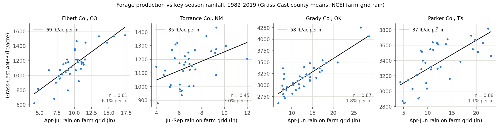
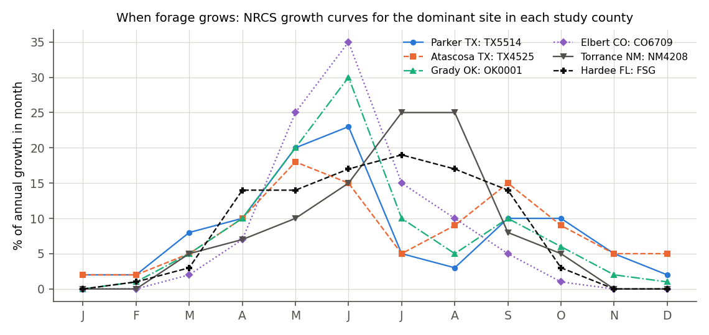
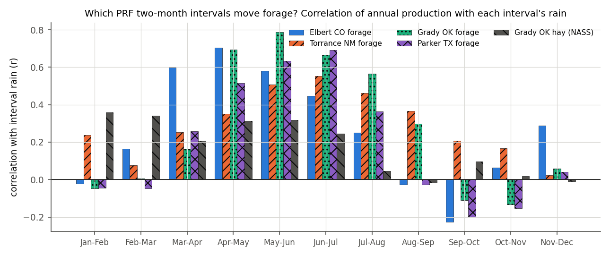
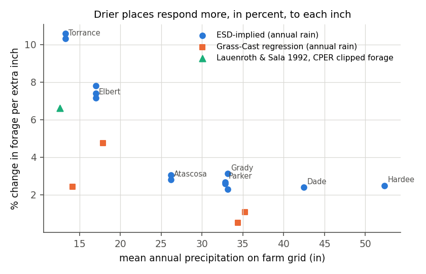

# Rain and Forage, Hay, Wheat, Sorghum, Cotton and Rice: What Is One Inch Worth?

**Proposal cell:** Extra (how rainfall moves yields, $ per inch), R2 / team  |  **Status:** DRAFT (all sources opened; per-county slopes are our computations)  |  **Last updated:** 2026-11-01 (hay prices moved to final 2025 NASS values)

Companion to [03a_rain_yield_corn_soybean.md](03a_rain_yield_corn_soybean.md) (corn and soybeans). Data: [`data/processed/crop_rain_sensitivity_other.csv`](../../data/processed/crop_rain_sensitivity_other.csv) (74 rows, keyed by `row_key`). Code: [`scripts/r2_rain_yield_calcs.py`](../../scripts/r2_rain_yield_calcs.py) (reruns offline from cached downloads in `data/raw/r2_rain_yield/`).

**Vocabulary used throughout.**
- **Forage**: grass and other plants that livestock eat.
- **ANPP (aboveground net primary production)**: the weight of new plant growth above ground in one year, in lb of dry matter per acre.
- **Air-dry**: the weight after drying in air, about 10% heavier than oven-dry.
- **Rangeland**: native, unfertilized grassland. **Pasture**: usually planted and often fertilized.
- **ESD (Ecological Site Description)**: the NRCS reference document for a soil-and-climate type of land. It lists how much the site grows in unfavorable, normal and favorable years.
- **AUM (animal unit month)**: the forage one 1,000-lb cow with a calf eats in one month. NRCS uses 26 lb/day oven-dry or 30 lb/day air-dry, so about 790 lb oven-dry or 912.5 lb air-dry per month.
- **ET (evapotranspiration)**: water that leaves the field through plants and the soil surface.
- **Water production function (WPF)**: the yield gained per inch of ET.
- **Elasticity**: % change in yield per 1% change in rain. An elasticity of 0.5 means a 20% rain shortfall costs about 10% of forage.
- **PRF index point**: PRF's rainfall index is the interval's rain as a percent of normal. One point = 1% of normal rain for that two-month interval.

## Key findings

- **"+1 inch = +2%" is about right for hay and pasture in the wetter study counties. It is too low for the dry ones and too high for Florida.** The response to an extra inch in the key spring window is:

  | County | What we measured | Gain per extra inch |
  |---|---|---|
  | Texas statewide | other-hay yields, 1975-2025 | +3.8% (+0.071 t/ac) |
  | Oklahoma statewide | other-hay yields | +2.3% |
  | Missouri statewide | other-hay yields | +2.2% |
  | Grady Co., OK | forage (Grass-Cast) | +1.8% |
  | Elbert Co., CO (shortgrass) | forage | +6% to +8% per inch |
  | Torrance Co., NM | forage (NRCS range) | about +10% per inch (upper end) |
  | Florida statewide | hay, Mar-May | only +0.5% (not statistically significant, t = 1.2) |

  (Sources: our regressions; Lauenroth & Sala 1992; NRCS ESDs.)
- **Drier places respond more in percent, mostly because an inch is a bigger share of their rain.** Measured as an elasticity (% per %), most sites fall between 0.4 and 0.9. Measured per inch, the arid counties come out 3-5 times more sensitive ([figure](../figures/r2_pct_response_vs_aridity.png)). Sala et al. (1988) map the largest year-to-year swings in grassland production (more than 80% between favorable and unfavorable years) from northern New Mexico to southwest Kansas.
- **Timing dominates.** Across the central and northern Great Plains, April-June rain (or part of it) predicts annual forage, with correlations of 0.52-0.92 (Smart et al. 2021, Table 1).
  - In our counties, Grass-Cast forage correlates most with Apr-May rain in Elbert CO (r = 0.70) and May-Jun in Grady OK (r = 0.79). Parker TX peaks at Jun-Jul (r = 0.69) and May-Jun (0.63).
  - Sep-Dec rain has almost no effect, and Sep-Oct is slightly negative in CO, OK and TX.
  - In Montana, watering at 275% of the median in July-August after a spring drought raised production by less than 2% (Heitschmidt & Vermeire 2006, cited in Smart et al. 2021). Late rain cannot undo a dry spring.
- **Losses are bigger than gains (nonlinearity).** With quadratic fits, the step from −1 to −2 inches costs more than the first inch:
  - Elbert CO forage: +1 in = +70 lb, −1 in = −73, −2 in = −150 lb/ac.
  - Missouri hay: +0.031 / −0.041 / −0.093 t/ac.
  - Texas hay: +0.067 / −0.084 / −0.185 t/ac.
  - Dryland West Texas cotton: 132 lb lint per inch at 10 in of season rain, but 57 lb at 15 in (Black et al. 2018).
- **Scenario elasticities for our 11 farms run from 0.14 to 0.89, not the 1.0 default in `run_scenarios.py`.** The rows are `scen_<farm_id>` in the CSV, column `rain_elasticity`. Recommended values:

  | Farm | Elasticity |
  |---|---|
  | DFW hay | 0.49 |
  | DFW graze | 0.57 |
  | SAT graze | 0.48 |
  | OKC hay | 0.49 |
  | OKC graze | 0.67 |
  | SGF hay | 0.40 |
  | SGF graze | 0.46 |
  | DEN graze | 0.74 |
  | ABQ graze | 0.89 |
  | TPA graze | 0.15 |
  | TPA hay | 0.14 |
- **Per acre, an inch of rain is worth little on rangeland and much more on hay and crops.** All values are for one extra inch in the key window:
  - Grazing land valued at its pasture cash rent: $0.07-$0.50 per acre.
  - Grazing land valued by the cost of hay to replace lost grazing: $0.6-$1.4.
  - Hay: $1.6 (Florida) to $9.6 (Texas).
  - Kansas dryland wheat: about $20 (3.2 bu).
  - Kansas sorghum: about $30 (6.6 bu).
  - Dryland West Texas cotton: $67-$101 (87-132 lb lint).
  - Rice: about $0, because 100% of U.S. rice acres are irrigated (2022 Census of Agriculture).
- **A water production function is "per inch of crop water use," not "per inch of rain."** About 0.7 of an extra inch of in-season rain becomes crop ET (range 0.55-0.85). Rain in the fallow or off-season is worth only 0.2-0.35 of that.
  - This factor turns the K-State slopes into per-inch-of-rain values. Winter wheat: 4.6 bu per inch of ET becomes about 3.2 bu per inch of rain. Sorghum: 9.4 becomes about 6.6.
  - Those match the measured in-season rain slopes of 3.1 and 6.6 bu.
- **Per index point, PRF pays 2-43 times our cash-rent-valued forage loss proxy.**
  - PRF pays the county base value (CBV, RMA's insured dollar value per acre) × productivity factor (PF, the 60-150% scaling the farmer picks) / 100 per acre for each point below the trigger. The proxy loss per point is value × elasticity / 100.
  - If grazing losses are valued instead at the cost of replacement hay, PRF's payment per point is close to the loss per point for the five Plains and Southwest grazing farms (ratio 0.7-1.2). It stays 2.5-5.8 times the loss for the two humid-pasture farms (Missouri and Florida).
- **Grass-Cast (USDA-ARS) is a useful county series in Colorado but too smooth farther south.** Its 2011 production in Parker TX and Grady OK was only 13% and 11% below normal. Grady County's NASS hay yield fell to 53% of trend that year. Grass-Cast correlates only 0.41 with Grady's detrended hay yields. We therefore use it as a cross-check, not as the main estimate, outside Colorado.

## Headline table: "+1 inch in [season] in [place] ≈ X ≈ Y% ≈ $Z/acre"

How to read this:
- "+1 inch" means one inch more than normal in the stated window, with everything else at normal.
- "%" is relative to normal-year production (or the 2025 trend yield for hay and crops).
- Dollars are gross value before any extra harvest cost.
- Grazing dollars are the lb change times a $/lb value, in two versions:
  - Rent: forage valued at the county pasture cash rent per pound of normal production, as in `farms.yaml`.
  - Replacement: the grazed 25% of the extra forage valued at the state's final 2025 hay price, the cost of buying hay instead.
- Ranges in brackets are other credible estimates from this doc.

| Crop, place | Window (normal rain) | **+1 in ≈ X** | **≈ Y%** | **≈ $Z/ac** | Basis and confidence |
|---|---|---|---|---|---|
| Shortgrass range, Elbert Co., CO | Apr-Jul (9.8 in) | **+69 lb forage** [48-101] | **+6.1%** [4.8-8.1] | **$0.31 rent; $1.32 replacement** | Grass-Cast 1982-2019, r = 0.81; Lauenroth-Sala clipped data at the nearby CPER: +48 lb per Apr-Sep inch (+8.1%). Medium-high |
| Arid range, Torrance Co., NM | annual (13.3 in), mostly Jun-Sep | **+60 lb** [35-93] | **+6.7%** [3.0-10.3] | **$0.09 rent; $1.39 replacement** | NRCS ESD range × 0.65 adjustment; Grass-Cast (model) gives +35 lb per Jul-Sep inch. Medium-low |
| Mixed-grass range, Grady Co., OK | Apr-Jun (13.0 in) | **+58 lb** [58-147] | **+1.8%** [1.8-3.1] | **$0.30 rent; $0.63 replacement** | Grass-Cast r = 0.87 (it understates droughts, so this is a lower end); ESD-implied 2.3-3.1% per inch of annual rain. Medium |
| Hay, Oklahoma (statewide) | Apr-Jun (12.9 in) | **+0.037 t** | **+2.3%** | **$3.30** | NASS 1975-2025, t = 5.1; Grady Co. alone: +0.032 t (+1.8%), 1960-2018. High |
| Hay (bermudagrass), Texas statewide | Apr-Jun (8.8 in) | **+0.071 t** | **+3.8%** | **$9.17** | NASS 1975-2025, t = 5.9; Parker Co. 1972-1986: +0.10 t (+5.7%). High |
| Cross Timbers range, Parker Co., TX | annual (32.8 in) | **+54 lb** [17-155] | **+1.7%** [0.5-2.7] | **$0.19 rent; $0.88 replacement** | ESD × 0.65; Grass-Cast is flatter (0.5%) but too smooth here. Medium-low |
| South Texas range, Atascosa Co., TX | annual (26.2 in) | **+65 lb** [65-107] | **+1.8%** [1.8-3.0] | **$0.30 rent; $1.05 replacement** | ESD × 0.65; no direct yield series. Low |
| Tall fescue hay, Missouri statewide | Apr-Jun (13.8 in) | **+0.042 t** | **+2.2%** | **$4.76** | NASS 1975-2025, t = 7.3, R² = 0.66. High |
| Bahiagrass hay/pasture, Florida statewide | Mar-May (10.4 in) | **+0.013 t** | **+0.5%** (not significant) | **$1.59** | NASS 1975-2025, t = 1.2. Spring drought is the only real rain risk (UF/IFAS). Low |
| Dryland winter wheat, Kansas | growing-season rain | **+3.2 bu** [2.5-3.9] | **+7.4%** | **$20.3** | K-State WPF 4.6 bu per inch of ET × 0.7. Medium-high |
| Dryland grain sorghum, Kansas | growing-season rain | **+6.6 bu** [5.2-8.0] | **+10.2%** | **$29.6** | K-State WPF 9.4 bu per inch of ET × 0.7. Medium-high |
| Dryland cotton, Texas Southern High Plains | season rain at 13 in (at 10 in) | **+87 lb lint** (+132) | **+15%** (+54%) | **$67** ($101) | Producer fields 2005-2016, quadratic, R² = 0.68, n = 11. Medium |
| Rice, U.S. | any | **≈ 0** | **≈ 0%** | **≈ $0** | 100% irrigated; 30 in of applied water per acre. High |
| *Corn (comparison), Kansas* | growing-season rain | *+9.3 bu* | *+7.2%* | *$43.8* | K-State WPF 13.3 × 0.7; see doc 03a for Corn Belt monthly slopes |

So, to the team's question "does +1 inch of rain in a month mean +2% yield?":
- In the wetter study counties (OK, north and central TX, MO), yes, roughly: +2-4% per extra inch in the key two-to-three-month window.
- In the dry ones (CO, NM), it is +6-10%.
- In Florida it is near zero.
- One inch in the wrong month (late summer or fall in the Plains) is worth about nothing.

## Numbers table

Every number used in this doc. "COMPUTED" = our regression on public data (code in `scripts/r2_rain_yield_calcs.py`). "DERIVED" = arithmetic on CONFIRMED numbers plus a stated assumption. Raw downloads are in `data/raw/r2_rain_yield/`.

### Rangeland literature

| Quantity | Value | Units | Region / period | Source (URL + page/table) | Verification |
|---|---|---|---|---|---|
| Regional (spatial) ANPP model | ANPP = −34 + 0.6 × MAP; r² = 0.90 | g/m², mm | 100 MLRAs, Central Grassland | Sala et al. 1988, Ecology 69:40, p.42 & Fig. 2 | CONFIRMED |
| Same slope in U.S. units | 136 | lb/ac per inch | spatial | 0.6 × 8.92 × 25.4 | DERIVED |
| SCS sites in Sala data | 9,498 | sites | Central Grassland | Sala et al. 1988 p.41 | CONFIRMED |
| Definition of favorable / unfavorable years | wettest 10% / driest 10% of years | - | SCS (USDA 1973, 1976) | Sala et al. 1988 p.42 | CONFIRMED |
| Mean ANPP range, average years | 150 (west) to 600 (southeast) | g/m² | Central Grassland | Sala et al. 1988 p.42 | CONFIRMED |
| Max (fav − unfav)/average variability | > 80% | % | N New Mexico to SW Kansas | Sala et al. 1988 p.42, Fig. 1D | CONFIRMED |
| Water-use efficiency; ineffective precipitation | 0.6; 56 | g/m² per mm; mm/yr | Central Grassland | Sala et al. 1988 p.42 | CONFIRMED |
| Lauenroth-Sala annual model | Forage = 13 + 0.172 × PPT; r² = 0.39 | g/m², mm | CPER, Weld Co. CO, 1939-1990 | Lauenroth & Sala 1992, Ecol. Appl. 2:397, Eq. 2 p.399 | CONFIRMED |
| Lauenroth-Sala Apr-Sep model | Forage = 17 + 0.210 × GSP; r² = 0.43 | g/m², mm | CPER | Eq. 3 p.399 | CONFIRMED |
| Lauenroth-Sala means | forage 66 (cv 44%); ANPP 97; PPT 321 mm (cv 31%) | g/m² | CPER 1939-1990 | Table 1 p.398 | CONFIRMED |
| Lauenroth-Sala long-term ANPP model | ANPP = 56 + 0.13 × PPT | g/m², mm | CPER | Fig. 2 caption p.402 | CONFIRMED |
| Regional vs temporal prediction at CPER max rain | 300 vs 130 | g/m² | CPER | p.401 | CONFIRMED |
| Event-size model | 13.4 + 0.26·PPT(15-30 mm) + 0.13·PPT(5-15) + 0.19·PPT(<5) + 0.05·PPT(>30); r² = 0.45 | g/m², mm | CPER | Eq. 4 pp.400-401 | CONFIRMED |
| Growing-season rain by event size | 17% <5 mm; 36% 5-15; 30% 15-30; 17% >30 | % | CPER, 52 yr | p.401 | CONFIRMED |
| Driest / wettest year | 104 mm (1964) / 588 mm (1967) | mm | CPER | p.401 | CONFIRMED |
| Production variability exceeds rain variability | 44% on average (77 data sets, 895 pairs) | % | global (Le Houérou et al. 1988) | cited in Lauenroth & Sala 1992 p.401 | UNVERIFIED (secondary) |
| CPER slopes in U.S. units | 39.0 (annual); 47.6 (Apr-Sep) | lb/ac per inch | CPER | from Eqs. 2-3 | DERIVED |
| CPER mean forage; % per inch | 589 lb/ac; 6.6% (annual), 8.1% (Apr-Sep) | - | CPER | from Table 1 | DERIVED |
| CPER elasticity at the means | 0.84 (annual); 0.74 (Apr-Sep; Apr-Sep mean rain of 233 mm inferred from the fit) | - | CPER | from Eqs. 2-3 | DERIVED |
| Precipitation months that predict forage (r) | AB May-Jun 0.86; KS May-Jun 0.52, May-Jul 0.68; MT Apr-May 0.92, 0.83; ND May-Jun 0.88; SD Apr-Jun 0.72; WY Apr-Jun 0.74-0.82, 0.81; WY Apr-Aug 0.89; NE Apr-mid-Aug 0.70 | r | N & C Great Plains | Smart et al. 2021, REM 78:191, Table 1 | CONFIRMED |
| Annual growth by July 1 | Nunn CO 68%; Lamar CO 65%; Hays KS 60%; Miles City MT 90% | % | ESD growth curves | Smart et al. 2021, Table 3 | CONFIRMED |
| Late-summer irrigation after spring drought | water at 275% of the median in Jul-Aug → < 2% of median production gain | % | Miles City MT | Smart et al. 2021 p.196 (citing Heitschmidt & Vermeire 2006) | UNVERIFIED (secondary) |
| Nunn CO Apr-Jun rain distribution | drought years (< 75% of mean) 29%; wet (> 125%) 20%; 1st / 4th quartile = 64% / 132% of median | % | 80 yr | Smart et al. 2021, Table 2 | CONFIRMED |
| Mixed-grass forage per inch of monthly rain | Mar 101.9; May 125.9; Jun 60.4; Jul 80.0 (ranch-level OLS) | lb/ac per inch (units read as lb/ac) | Hays KS + 2 NE ranches | Yu et al. 2019, JARE 44:179, Table 3 | CONFIRMED |
| Forage per PRF index point | May-Jun 7.35 (SE 1.95); Jun-Jul −0.12; Jul-Aug 3.06 | lb/ac per point | same | Yu et al. 2019, Table 4 | CONFIRMED |
| False-negative probability | 21% (rain model) vs 26% (PRF index model) | % | same | Yu et al. 2019, Table 5 | CONFIRMED |
| Fall/winter carryover | "very little effect" | - | same | Yu et al. 2019, footnote 12 | CONFIRMED |
| Chihuahuan Desert grass vs Dec-Sep rain | r = 0.77 (n = 34); quadratic r = 0.85; valid at 200-300 mm/yr | r | S-central NM | Khumalo & Holechek 2005, REM 58:239, abstract | CONFIRMED (abstract only; equation units not stated) |
| Grass-Cast agreement with independent data | 69% of the time, over 20 yr | % | Great Plains | Hartman et al. 2020, Ecosphere 11:e03280, abstract | CONFIRMED |
| Grass-Cast county coverage | 366 | counties | Great Plains | Hartman et al. 2020 p.5 | CONFIRMED |

### Grass-Cast historical data and our county regressions

| Quantity | Value | Units | Region / period | Source (URL + page/table) | Verification |
|---|---|---|---|---|---|
| Grass-Cast county mean ANPP (1981-2018) | Elbert 1,134; Grady 3,164; Parker 3,357 | lb/ac | county | grasscast.unl.edu/Data.aspx, ANPP_county_stats_1981-2018.csv | CONFIRMED |
| Grass-Cast min / max years | Elbert 2002 −45%, 2015 +36%; Grady 1998 −18%, 2007 +35%; Parker 2018 −15%, 2017 +14% | % of mean | county | same file | CONFIRMED |
| Torrance Grass-Cast cell means | 1,153-1,171 (e.g., cells 47167-47169) | lb/ac | Southwest grid | ANPP_stats_grid_SW_total_1982-2019.csv | CONFIRMED |
| Grass-Cast GP ANPP is an exact function of Apr-Aug simulated AET | quadratic R² = 1.00 within cells | - | Parker, Elbert cells | our test on GrassCast_1982-2019_grid_ANPP_GP.xlsx | COMPUTED |
| Grass-Cast SW spring ANPP vs Jan-May AET | R² = 1.00 | - | Torrance cells | our test | COMPUTED |
| Grass-Cast ANPP coefficient of variation | Parker 8.4%; Grady 10.5%; Elbert 19.6%; Torrance 11.5% | % | 1982-2019 | our calc | COMPUTED |
| Grass-Cast 2011 production vs mean | Parker 0.87; Grady 0.89; Elbert 0.81; Torrance 0.88 | ratio | 2011 | our calc | COMPUTED |
| Elbert 2002 / 2012 | 0.55 / 0.60 | ratio | Elbert | our calc | COMPUTED |
| Grady hay 2011 vs trend; detrended CV | 0.53; 17.5% | ratio; % | Grady Co. | NASS county yields, our trend | COMPUTED |
| Grass-Cast vs Grady hay (detrended) | r = 0.41 (n = 37) | r | 1982-2018 | our calc | COMPUTED |
| Elbert: ANPP on Apr-Jul farm-grid rain | +68.9 lb/in; 6.07%; r = 0.81; R² = 0.66; t = 8.3; rain sd 2.6 in; quadratic +1/−1/−2 in = +70/−73/−150; log-log elasticity 0.60 | lb/ac | 1982-2019 | CSV `forage_rangeland_CO_Elbert_AprJul` | COMPUTED |
| Elbert: same on Grass-Cast's own Apr-Jul rain | +83.6 lb/in; 7.37%; r = 0.91; +1/−1/−2 = +80/−87/−182 | lb/ac | 1982-2019 | CSV `..._AprJul_grasscastppt` | COMPUTED |
| Elbert: annual rain | +53.8 lb/in; 4.75%; r = 0.75; elasticity 0.85 | lb/ac | same | CSV `forage_rangeland_CO_Elbert_annual` | COMPUTED |
| Grady: Apr-Jun rain | +57.6 lb/in; 1.82%; r = 0.87; R² = 0.75; t = 10.4; +1/−1/−2 = +52/−50/−97 | lb/ac | 1982-2019 | CSV `forage_rangeland_OK_Grady_AprJun` | COMPUTED |
| Grady: annual rain | +34.4 lb/in; 1.09%; elasticity 0.38 | lb/ac | same | CSV | COMPUTED |
| Parker: Apr-Jun rain | +37.1 lb/in; 1.10%; r = 0.68; +1/−1/−2 = +46/−53/−114 | lb/ac | 1982-2019 | CSV `forage_rangeland_TX_Parker_AprJun` | COMPUTED |
| Parker: annual rain | +17.0 lb/in; 0.51%; r = 0.47 | lb/ac | same | CSV | COMPUTED |
| Torrance (model): Jul-Sep rain | +34.5 lb/in; 3.01%; r = 0.45; +1/−1/−2 = +35/−40/−84 | lb/ac | 1982-2019 | CSV `forage_rangeland_NM_Torrance_JulSep` | COMPUTED |
| Torrance (model): annual rain | +27.8 lb/in; 2.42%; r = 0.65 | lb/ac | same | CSV | COMPUTED |
| Correlation of production with each PRF interval's rain | see the [interval figure](../figures/r2_interval_correlations.png) and the table in section 5 | r | 1982-2019 (hay 1960-2018) | `data/raw/r2_rain_yield/derived/r2_interval_regressions.csv` | COMPUTED |

### NRCS Ecological Site Descriptions (reference community, total lb/ac air-dry)

| Quantity | Value (Low / RV / High) | Units | Region | Source | Verification |
|---|---|---|---|---|---|
| R084BY175TX Tight Sandy Loam 29-33" PZ, MLRA 84B | 2,090 / 3,110 / 4,240; precip 28-34 in | lb/ac | Parker Co., TX | EDIT https://edit.sc.egov.usda.gov/catalogs/esd/084B/R084BY175TX (Table 6) | CONFIRMED |
| R085AY379TX Loamy Slope 30-38, MLRA 85A | 4,000 / 6,000 / 8,000 | lb/ac | Parker Co. | EDIT 085A/R085AY379TX (Table 5) | CONFIRMED |
| R083AY024TX Tight Sandy Loam, MLRA 83A | 2,000 / 3,550 / 4,800; precip 24-37 in | lb/ac | Atascosa Co., TX | EDIT 083A/R083AY024TX (Table 5) | CONFIRMED |
| R083AY022TX Loamy Sand | 2,000 / 3,500 / 5,000 | lb/ac | Atascosa | EDIT 083A/R083AY022TX | CONFIRMED |
| R080AY056OK Loamy Upland, MLRA 80A | 2,500 / 4,700 / 6,000; precip 32-39 in | lb/ac | Grady Co., OK | EDIT 080A/R080AY056OK (JSON table) | CONFIRMED |
| R084AY075OK Sandy Loam Savannah, MLRA 84A | 3,200 / 4,400 / 5,600 (its reference sheet says 2,500-5,000) | lb/ac | Grady | EDIT 084A/R084AY075OK (Table 7) | CONFIRMED |
| R112XY103KS Loamy Upland, MLRA 112 | 3,000 / 4,750 / 6,500; precip 41-46 in | lb/ac | Dade Co., MO | EDIT 112X/R112XY103KS (Table 5) | CONFIRMED |
| R067BY024CO Sandy Plains, MLRA 67B | 800 / 1,650 / 2,200; precip 14-17 in; 0.45 AUM/ac | lb/ac | Elbert Co., CO | EDIT 067B/R067BY024CO | CONFIRMED |
| R067BY002CO Loamy Plains | 600 / 1,300 / 1,800; 0.36 AUM/ac (25% harvest efficiency, 912.5 lb/AUM) | lb/ac | Elbert | EDIT 067B/R067BY002CO (Table 5) | CONFIRMED |
| R049XB210CO Sandy Foothill, MLRA 49 | 900 / 1,600 / 2,300; 0.44 AUM/ac | lb/ac | Elbert | EDIT 049X/R049XB210CO | CONFIRMED |
| R042CY109NM Loamy, MLRA 42C | 395 / 900 / 1,400; precip 13-16 in | lb/ac | Torrance Co., NM | EDIT 042C/R042CY109NM (Table 5) | CONFIRMED |
| R042CY108NM Limy | 370 / 890 / 1,390 | lb/ac | Torrance | EDIT 042C/R042CY108NM | CONFIRMED |
| R155XY003FL South Florida Flatwoods (legacy SCS range site) | 3,000-6,000 (no RV; we use the 4,500 midpoint); 3 to 14+ acres per animal unit | lb/ac | Hardee Co., FL | SCS "26 Ecological Communities of Florida", No. 6, https://ufdc.ufl.edu/UF00000110/00001 | CONFIRMED (OCR scan) |
| FSG 155XB141FL bahiagrass | no N: 3,000-6,000 lb DM; 60 lb N: 7,000-10,000; 1.9-3.8 / 4.5-6.4 AUM/ac | lb/ac | Hardee | https://efotg.sc.egov.usda.gov/references/public/FL/FSG_MLRA_155XB141FL.pdf | CONFIRMED |
| Growth curves (Jan..Dec %) | TX5514: 2,2,8,10,20,23,5,3,10,10,5,2. TX6011: 1,2,2,18,23,17,6,4,16,6,3,2. TX4525: 2,2,5,10,18,15,5,9,15,9,5,5. OK0001: 0,1,5,10,20,30,10,5,10,6,2,1. OK0003: 0,2,6,9,21,24,14,6,11,4,2,1. CO6701: 0,0,2,8,20,28,15,12,10,5,0,0. CO6709: 0,0,2,7,25,35,15,10,5,1,0,0. NM4208: 0,0,5,7,10,15,25,25,8,5,0,0. Pensacola bahiagrass FSG: 0,1,3,14,14,17,19,17,14,3,0,0. TX5520 (coastal bermudagrass pasture, R084BY175TX state 3.1): 0,0,0,10,21,22,10,5,14,10,8,0 | % of annual | per ESD | EDIT catalog pages (above); FSG PDF | CONFIRMED |
| No growth curve in EDIT | R080AY056OK, Dade sites, R049XB210CO, R042CY109NM | - | - | EDIT | CONFIRMED |
| ESD season text | Parker 85A: "two-thirds of annual rainfall occurs during the April to September period"; Torrance: "Seventy-five percent of the precipitation falls from April to October"; Elbert 67B: two-thirds mid-April to late September; Hardee FSG: production "dips during the April/May dry period" | - | per ESD | EDIT, FSG | CONFIRMED |
| ESD-implied slope (High − Low)/(wet − dry decile rain) | Parker 83 / 155; Atascosa 99 / 107; Grady 147 / 101; Dade 114; Elbert 118 / 101 / 118; Torrance 93 / 94; Hardee 112 | lb/ac per inch of annual rain | farm grids, 1951-2025 | `derived/r2_esd_implied.csv` | DERIVED |
| Same, % of RV per inch | Parker 2.7 / 2.6; Atascosa 2.8 / 3.0; Grady 3.1 / 2.3; Dade 2.4; Elbert 7.2 / 7.8 / 7.4; Torrance 10.3 / 10.6; Hardee 2.5 | % per inch | same | same | DERIVED |
| Same, elasticity | Parker 0.88 / 0.85; Atascosa 0.73 / 0.80; Grady 1.03 / 0.76; Dade 1.02; Elbert 1.22 / 1.33 / 1.26; Torrance 1.37 / 1.40; Hardee 1.31 | - | same | same | DERIVED |
| (High − Low)/RV | Parker 69 / 67; Atascosa 79 / 86; Grady 74 / 55; Dade 74; Elbert 85 / 92 / 88; Torrance 112 / 115; Hardee 67 | % | ESDs | same | DERIVED |
| Range-to-regression adjustment | 0.65 | - | assumption: L&S r = 0.62 (annual), 0.66 (Apr-Sep); Elbert Grass-Cast/ESD elasticity ratio 0.64-0.70 | this doc | DERIVED |

### Farm-grid rainfall (NCEI nClimGrid on the PRF grid containing the farm point)

| Quantity | Parker / Atascosa / Grady / Dade / Elbert / Torrance / Hardee | Units | Period | Source | Verification |
|---|---|---|---|---|---|
| PRF grid id (farm) | 15429 / 10626 / 18129 / 20845 / 23204 / 17497 / 8893 | - | - | `data/processed/study_grids.csv` | CONFIRMED (repo) |
| Annual mean | 32.84 / 26.20 / 33.14 / 42.47 / 17.01 / 13.27 / 52.33 | in | 1951-2025 | `ncei_monthly_precip_grids.parquet`; `derived/r2_farm_grid_climatology.csv` | COMPUTED |
| Annual CV | 0.23 / 0.31 / 0.22 / 0.20 / 0.21 / 0.24 / 0.15 | - | 1951-2025 | same | COMPUTED |
| Driest-decile / wettest-decile mean annual rain | 21.1-46.9 / 13.5-41.7 / 22.3-46.2 / 27.8-58.5 / 11.4-23.2 / 8.2-19.0 / 39.3-66.1 | in | 1951-2025 | same | COMPUTED |
| Wettest months (1991-2020 normal) | May 4.32, Oct 3.74 / May 3.40, Sep 3.39 / May 5.04, Jun 4.25 / May 5.98, Jun 5.10 / Jul 2.95, May 2.61 / Jul 2.60, Aug 2.45 / Jun 8.99, Aug 8.84 | in | 1991-2020 | same | COMPUTED |
| Interval normals for farm intervals | e.g. Elbert Apr-May 4.49, Jun-Jul 4.92, Aug-Sep 3.41; Torrance Aug-Sep 4.09; Hardee Mar-Apr 5.11, May-Jun 11.93 (the rest in `derived/r2_dollars_per_inch_by_interval.csv`) | in | PRF 1951-2025 expected | `prf_official_index.csv` (expected_precip_mm) | CONFIRMED (repo) |
| Interval-rain CV, spring vs summer, Hardee | Mar-Apr 0.52, Apr-May 0.43 vs Jul-Aug 0.20 | - | 1951-2025 | climatology CSV | COMPUTED |

### Hay

| Quantity | Value | Units | Region / period | Source | Verification |
|---|---|---|---|---|---|
| State hay on Apr-Jun rain (trend held) | TX 0.071 (t = 5.9, R² = 0.46, 3.75%, elasticity 0.33); OK 0.037 (5.1, 0.35, 2.33%, 0.30); MO 0.042 (7.3, 0.66, 2.21%, 0.31); FL 0.013 (1.3, 0.18, 0.47%, 0.07) | t/ac per inch | statewide 1975-2025 | NASS Quick Stats "HAY, (EXCL ALFALFA) - YIELD"; NOAA nClimDiv; `derived/r2_hay_state_windows.csv` | COMPUTED |
| Other windows | TX Apr-Sep 0.062 (3.28%, elasticity 0.54); TX May-Aug 0.079 (4.2%); OK Apr-Sep 0.035 (2.19%, 0.48); MO Apr-Jul 0.037 (R² 0.70); FL Mar-May 0.013 (t = 1.2, 0.48%, 0.05) | t/ac per inch | 1975-2025 | same | COMPUTED |
| Quadratic +1 / −1 / −2 in, Apr-Jun | TX +0.067/−0.084/−0.185; OK +0.041/−0.043/−0.090; MO +0.031/−0.041/−0.093 | t/ac | 1975-2025 | same | COMPUTED |
| Fitted 2025 trend hay yields | TX 1.88; OK 1.61; MO 1.91; FL 2.77 | t/ac | 2025 | same | COMPUTED |
| Grady Co. hay on Apr-Jun farm-grid rain | 0.032 t/in; 1.76%; t = 3.1; R² = 0.25; n = 59; quadratic +0.047/−0.052/−0.109; 2018 trend 1.83 t/ac | t/ac | 1960-2018 | NASS county; NCEI grid | COMPUTED |
| Parker Co. hay on Apr-Jun rain | 0.102 t/in; 5.7%; t = 3.8; R² = 0.57; n = 15; +0.109/−0.126/−0.271 | t/ac | 1972-1986 | NASS county (series ends 1986) | COMPUTED |
| Grady hay interval correlations (detrended) | Jan-Feb 0.36 (t = 2.9); Feb-Mar 0.34; Apr-May 0.31; May-Jun 0.32; Jul-Aug 0.05 | r | 1960-2018 | `derived/r2_interval_regressions.csv` | COMPUTED |
| Hay yields 2025 (other hay) | TX 1.85; OK 1.95; MO 2.00; CO 1.60; NM 2.20; FL 2.30; US 2.09 | t/ac | 2025 | NASS Crop Production 2025 Summary (Jan 12 2026) p.37 | CONFIRMED |
| Hay yields 2022 drought vs 2021 (other hay) | TX 1.50 vs 1.85; OK 1.25 vs 1.60; MO 1.80 vs 2.00 | t/ac | 2021-2022 | NASS Crop Production 2024 and 2023 Summaries | CONFIRMED |
| State other-hay yields 2011 | TX 1.1; OK 0.9; Grady Co. 0.9 | t/ac | 2011 | NASS Quick Stats | CONFIRMED |
| Bermudagrass water per ton | 17.6 in/ton at low N (114 lb per inch); 3.9 in/ton with adequate N (513 lb per inch) | in water per ton | Texas A&M research via OSU | OSU Extension West District Ag Insights, Aug 2026 | CONFIRMED in newsletter; original study not seen |
| N needed per ton of bermudagrass | about 50 lb | lb N/ton | OK | same newsletter | CONFIRMED |
| Tall fescue seasonal growth | two-thirds spring, one-third fall; quality peaks in April | share | Missouri | MU Extension (E. Bailey), "MU Southwest Center studies double stocker calf operations on fescue" | CONFIRMED |
| Bahiagrass seasonality | about 85% of production April-September; low rain March-May limits production | % | Florida | UF/IFAS EDIS SS-AGR-332 (Wallau et al. 2019) p.1, p.3 | CONFIRMED |
| Bahiagrass yields | typically 3,000-10,000 lb DM/ac (up to 14,000); Ona, 50 lb N: 4,100-4,900; Ona, 100 lb N: 9,200-10,000 | lb DM/ac | Florida | EDIS SS-AGR-332 p.3, Table 1 | CONFIRMED |
| Alfalfa WPF, San Joaquin Valley | yield = 0.2 × ET − 0.6 (t/ac, in); about 5 in of ET per ton | t/ac per inch ET | CA | Sanden et al. 2011, Western Alfalfa & Forage Symposium, Fig. 2b | CONFIRMED |
| Alfalfa WPF, New Mexico | y = 0.14 + 0.12 ET (t/ha, cm), R² = 0.78 → 0.136 t/ac per inch ET | - | NM | NMSU Irrigation Management page (Sammis 1981) | CONFIRMED (page); Sammis original not opened |

### Row crops

| Quantity | Value | Units | Region / period | Source | Verification |
|---|---|---|---|---|---|
| K-State yield vs ET (good-year slope / long-term slope / threshold / max ET) | Winter wheat 6.0 / 4.6 / 10.0 / 24; sorghum 12.2 / 9.4 / 6.9 / 21; corn 16.9 / 13.3 / 10.9 / 25; soybean 4.6 / 3.8 / 7.8 / 24; sunflower 218 / 150 lb / 5.4 / 22 | bu/ac per in; in | western Kansas | Stone & Schlegel 2006, CPIA Proc. pp.173-184, Table 1 p.174, https://www.irrigationtoolbox.com/ReferenceDocuments/TechnicalPapers/CPIA/2006/Stone06.pdf ; K-State L934 Table 4 | CONFIRMED |
| Tribune KS water-supply regressions | wheat Y = −27.3 + 3.78·WS (n = 253, r² = 0.64); sorghum Y = −35.9 + 6.70·WS (n = 142, r² = 0.60) | bu/ac, in | 1974-2004 / 1973-2003 | Stone & Schlegel 2006 Figs. 2-3 | CONFIRMED |
| Tillage variants | wheat conventional −19.9 + 3.24X, no-till −56.4 + 5.20X; sorghum 5.22 vs 7.45 | bu/ac per in | Tribune | Stone & Schlegel 2006 Figs. 4-5 | CONFIRMED (via R2 sub-pull) |
| Pooled wheat WPF | Y = 10.0·ET − 1090 (kg/ha, mm) = 3.78 bu/in, threshold 4.3 in; site slopes Tribune 3.85, Colby 7.40, Bushland 1.16 bu/in | - | KS, TX 1984-2014 | Moberly et al. 2017, JCWRE 162:42, Table 6 | CONFIRMED |
| Akron CO wheat vs stored soil water | bu/a = 5.56 + 5.34 × available soil water at planting (in); r² = 0.76 | bu/ac per in | 1993-2001 | Nielsen 2006 CPIA pp.136-139, Fig. 1 | CONFIRMED |
| Sorghum WPF Akron | kg/ha = 30.2 × (mm − 259) → 12.2 bu/in, threshold 10.2 in; R² = 0.73 | - | 2006-2016 | Nielsen & Vigil 2017 ASA poster | CONFIRMED |
| Corn WPF Greeley CO | x-intercept 275 mm; 12.5 Mg/ha at 630 mm ET; our quadratic fit marginal 18.1 → 11.2 → 4.3 bu/in at 15.7 / 19.7 / 23.6 in ET | - | 2008-2011 | Trout & DeJonge 2017, Irrig. Sci. 35:251, Tables 3, 5 | CONFIRMED; fit DERIVED |
| Corn yield vs water supply | Y = 7.8 × (water supply − 4) bu/ac; boundary slope 11.2 | bu/ac per in | W Corn Belt, simulated 991 site-years | Grassini et al. 2012, UNL EC105 pp.2-4 | CONFIRMED |
| Cotton ET-lint (Bushland lysimeters) | our linear fit: 57.6 lb lint per inch ET, threshold 8.7 in; data 325-1,338 lb at 15-31 in ET | lb/ac per in | 2000-2001 | Howell et al. 2002, USCID/EWRI, Table 4 p.332 | data CONFIRMED; fit DERIVED |
| Cotton vs irrigation (Lubbock drip) | 25.8 lb lint per inch of irrigation; max yield at 29 in total water | lb/ac per in | 1988-1999 | Wanjura, Upchurch & Mahan 2000, Beltwide pp.442-448, Fig. 2 | CONFIRMED (via R2 sub-pull) |
| Dryland cotton vs season rain | Y = −1826.25 + 282.26 R − 7.5246 R² (lb/ac, in), R² = 0.68; needs at least 8 in of rain; average dryland yield 589 lb/ac; in irrigated systems rain adds 20-39 lb per inch | - | TAWC fields, Floyd & Hale Cos. TX, 2005-2016 | Black, Johnson & McCallister 2018, Beltwide Cotton Conf. pp.432-438, Table 5, https://www.cotton.org/beltwide/proceedings/2005-2022/data/conferences/2018/papers/18131.pdf | CONFIRMED |
| Dryland cotton marginal value | 132 lb/in at 10 in (yield 244 lb); 87 at 13 in (571 lb); 57 at 15 in | lb lint per inch | same | from the equation | DERIVED |
| Typical dryland lint, SHP | NASS District 12 median 2012-2016: 383 kg/ha (342 lb/ac); District 11: 438 lb; median May-Sep rain 11.5 in vs 29.1 in needed for maximum yield | - | Texas SHP | Mauget et al. 2020, Front. Sustain. Food Syst. 3:120 | CONFIRMED (via R2 sub-pull) |
| Lubbock 25-county average lint | dryland 296 lb/ac; irrigated 509 lb/ac | lb/ac | 1977-1998 | Wanjura et al. 2000 p.442 | CONFIRMED (via R2 sub-pull) |
| Oklahoma wheat weather model | standardized coefficients Oct-Nov rain +0.34, March +0.36, May −0.31, June −0.50; R² = 0.73 | standardized | OK 1941-1970 | Greene, Sutherland & Kirkham 1979, Climatic Change 2:21, Table I (as reproduced in Kirkham, OWRRI report 1980) | CONFIRMED (reproduction) |
| Kansas wheat vs monthly weather | Jul-Oct precipitation alone R² = 30.9% (Oct 19.7%); spring precipitation 8.2% | R² | KS 1941-1970 | Welker 1981, NASA TP-1724, Tables 1-2 | CONFIRMED (via R2 sub-pull) |
| W Kansas variety trials | r with monthly rain: Oct 0.36, Dec 0.29, Apr 0.22, Jun −0.16 | r | 1955-2022 | Holman et al. 2024, Crops & Soils 57(5), Table 1 | CONFIRMED (via R2 sub-pull) |
| Kansas 2021-2025 mean yields (denominators) | winter wheat 43.6; sorghum 64.8; corn 129.4; soybeans 35.4 | bu/ac | KS | NASS Quick Stats | CONFIRMED |
| Rainfall-to-ET efficiency evidence | water-supply slope ÷ long-term ET slope: wheat 3.78/4.6 = 0.82, sorghum 6.70/9.4 = 0.71; in-season rain vs stored water slopes: wheat 3.1 vs 3.7 bu/in, sorghum 6.6 vs 8.9; corn 7.8/11.2 = 0.70 | ratio | KS; W Corn Belt | Stone & Schlegel 2006; Moberly 2017 p.42 (citing Stone & Schlegel 2006 Agron. J. 98:1359); EC105 | CONFIRMED / UNVERIFIED (Moberly citation) |
| Fallow precipitation storage efficiency | conventional till 20% (8-34%); no-till 35% (20-51%) | % | Akron CO 1996-2006 | Nielsen, Vigil & Benjamin 2009 ASA poster | CONFIRMED (via R2 sub-pull) |
| Runoff fraction in the Kansas water budget model | RF = 0.106 + 0.000062·AP² (about 0.12 at 17 in) | fraction | KS | Moberly 2017 Eq. 5 | CONFIRMED |
| Small rain events, Southern High Plains | about 70% of events < 0.5 in; growing-season rain 13-14 in vs potential ET 40-45 in | - | SHP | Krieg, TAWC slides | CONFIRMED (slides) |
| Rain efficiency factor used here | 0.7 (range 0.55-0.85) in season; 0.2-0.35 off-season/fallow | - | our synthesis | this doc | DERIVED |
| Rice irrigated share | 2,279,958 of 2,279,958 harvested acres (100%); 3,824 farms | acres | U.S. 2022 | 2022 Census of Agriculture Vol.1, Table 24 p.448 | CONFIRMED |
| Irrigated share, other crops | wheat 5.7%, sorghum 7.1%, soybean 10.5%, corn 13.6%, cotton 34.6% | % | U.S. 2022 | same table | CONFIRMED |
| Water applied to rice | U.S. 2.5 acre-feet/ac (30 in); AR 2.0, CA 4.5, LA 1.9, MS 2.2, MO 1.5, TX 2.3 | acre-feet/ac | 2023 | NASS 2023 Irrigation & Water Management Survey, Table 39 p.151 | CONFIRMED |
| ERS statement | "All U.S. rice is produced in irrigated fields" | - | U.S. | ERS Rice Sector at a Glance (updated 10/9/2026) | CONFIRMED |

### Prices and values

| Quantity | Value | Units | Region / period | Source | Verification |
|---|---|---|---|---|---|
| Other hay, 2025 marketing-year average, **final** (used here) | TX 130; OK 88; MO 113; FL 120; CO 153; NM 185; US 137 | $/ton | 2025 | NASS Agricultural Prices (Aug 31 2026) p.33, "Hay Market Year Average Prices Received", https://release.nass.usda.gov/reports/agpr0826.pdf (re-checked 2026-11-01) | CONFIRMED |
| Alfalfa hay 2025, final | TX 232; OK 164; MO 170; CO 164; NM 246; US 172 | $/ton | 2025 | same table, p.33 | CONFIRMED |
| All other hay, 2025, preliminary (superseded) | TX 136; OK 90; MO 114; FL 120; CO 151; NM 184; US 138 | $/ton | 2025 | NASS Crop Values 2025 Summary (Feb 2026) p.33, https://usda.library.cornell.edu/sites/default/release-files/795791/cpvl0226.pdf; its p.45 names the August 2026 Agricultural Prices as the release of final 2025 hay prices | CONFIRMED |
| Alfalfa hay 2025, preliminary (superseded) | TX 233; OK 165; MO 169; CO 164; NM 245; US 170 | $/ton | 2025 | same, p.32 | CONFIRMED (as printed in the Feb 2026 report) |
| Other hay, August 2026 | TX 120; OK 101; MO 95; CO 180; NM 220; US 152 | $/ton | Aug 2026 | NASS Agricultural Prices (Sep 29 2026) p.18 | CONFIRMED |
| Pasture cash rent, state 2025 / 2026 | TX 7.70 / 8.60; OK 18.00 / 18.00; MO 38.50 / 39.50; CO 7.00 / 7.60; NM 4.10 / 4.20; FL 20.00 / 21.50; US 15.50 / 16.50 | $/ac | 2025-2026 | NASS Quick Stats "RENT, CASH, PASTURELAND" | CONFIRMED |
| Pasture cash rent, county 2026 (2025) | Parker 13.0 (n/a); Atascosa 12.0 (15.5); Grady 24.5 (24.5); Dade 38.0 (35.0); Elbert 9.5, CV 37% (6.1); Torrance 2.2 (1.7); Hardee 13.5 (n/a; 2024 11.0) | $/ac | county | same | CONFIRMED |
| Values used for grazing (from `farms.yaml`) | Parker 13.50; Atascosa 15.50; Grady 24.50; Dade 35.00; Elbert 6.10; Torrance 1.70; Hardee 11.00 | $/ac | 2024-2025 rents | `data/scenarios/farms.yaml` | CONFIRMED (repo) |
| Grazing fee, private non-irrigated land | CO 23.50; OK 11.00; TX (S), 2024 14.50; NM (S), 2024 17.50; 17-state 23.70 | $/AUM | 2025 | NASS Agricultural Prices (Jan 30 2026) p.36 | CONFIRMED |
| AU / AUM definition | AU = one mature cow of about 1,000 lb with a calf up to 6 months; AUM = forage one AU needs for 1 month; 26 lb oven-dry or 30 lb air-dry per day; cow with calf 790 lb/month (Table H-12) | - | NRCS | NRPH 190-645-H, §645.0804 p.645-H.33, Table H-12 | CONFIRMED |
| Other AUM conventions | 915 lb air-dry (Montana State Univ. memo 2022); 912.5 lb (Colorado ESDs); 750 lb (Univ. of Wyoming B-1320) | lb/AUM | - | MSU 2022 AUM report; ESDs; UW B-1320 | CONFIRMED; Wyoming UNVERIFIED |
| Harvest efficiency | 25% of production allotted to grazing | - | ESD stocking convention | R067BY002CO | CONFIRMED |
| WASDE season-average farm price, 2026/27 projection (Oct) | wheat 6.30; corn 4.70; sorghum 4.50; soybeans 12.00 ($/bu); all rice 15.20, long-grain 14.00 ($/cwt); upland cotton 77.0 cents/lb | - | U.S. | WASDE-676 (Oct 9 2026) pp.11-17, https://www.usda.gov/oce/commodity/wasde/wasde1026.pdf | CONFIRMED |
| WASDE 2025/26 estimates | wheat 5.06; corn 4.16; sorghum 3.67; soybeans 10.50; rice 12.40; cotton 62.2 cents | - | U.S. | same | CONFIRMED |
| Replacement value of grazed forage | normal production × 0.25 × state hay price: Parker 64.1; Atascosa 54.9; Grady 51.1; Dade 53.7; Elbert 26.1; Torrance 27.6; Hardee 81.6 | $/ac | final 2025 prices | `derived/r2_prf_vs_loss_per_point.csv` | DERIVED |
| Headline grazing $ per extra inch (rent / replacement) | Elbert 0.31 / 1.32; Torrance 0.09 / 1.39; Grady 0.30 / 0.63; Parker 0.19 / 0.88; Atascosa 0.30 / 1.05 | $/ac per inch | key window | lb change × (rent ÷ `farms.yaml` production) or × 0.25 × hay price ÷ 2,000. The CSV `scen_*` rows instead use % change × `farms.yaml` value, so they differ slightly where ESD RV ≠ `farms.yaml` production | DERIVED |
| Grazing fee converted to $/lb of production | 23.50 × 0.25 / 912.5 = 0.0064 | $/lb | Colorado 2025 | from the rows above | DERIVED |

### Scenario elasticities and PRF comparison

| Quantity | Value | Units | Region / period | Source | Verification |
|---|---|---|---|---|---|
| Recommended `rain_elasticity` | DFW_hay 0.49; DFW_graze 0.57; SAT_graze 0.48; OKC_hay 0.49; OKC_graze 0.67; SGF_hay 0.40; SGF_graze 0.46; DEN_graze 0.74; ABQ_graze 0.89; TPA_graze 0.15; TPA_hay 0.14 | - | per farm | CSV rows `scen_*` | COMPUTED / DERIVED |
| Alternative candidates | e.g. Grass-Cast vs W: DFW 0.18, OKC 0.35, DEN 0.64, ABQ 0.31; Grady county hay vs W 0.26 (SE 0.10); raw ESD 0.73-1.37 | - | per farm | `derived/r2_scenario_elasticities.csv` | COMPUTED |
| PRF payment per point of W below trigger vs proxy loss per point (cash-rent value) | DFW_hay 2.72 vs 1.21 (2.2×); DFW_graze 0.37 vs 0.08 (4.8×); SAT 0.26 vs 0.07 (3.6×); OKC_hay 2.41 vs 0.74 (3.3×); OKC_graze 0.41 vs 0.17 (2.5×); SGF_hay 2.67 vs 0.85 (3.1×); SGF_graze 0.62 vs 0.16 (3.8×); DEN 0.20 vs 0.045 (4.3×); ABQ 0.17 vs 0.015 (11.4×); TPA_graze 0.73 vs 0.017 (42.8×); TPA_hay 5.00 vs 0.47 (10.6×) | $/ac per point | 2026 terms | `derived/r2_prf_vs_loss_per_point.csv` | DERIVED |
| Same, grazing at replacement value | DFW 0.37; SAT 0.26; OKC 0.34; SGF 0.25; DEN 0.19; ABQ 0.24; TPA 0.13 $/ac per point → PRF/loss 1.01, 1.01, 1.20, 2.5, 1.02, 0.70, 5.8 (final 2025 hay prices; with the superseded preliminary prices: 0.97, 0.96, 1.17, 2.5, 1.03, 0.70, 5.8) | $/ac per point | same | same | DERIVED |

## Detail

### 1. Three ways to say "how much does rain matter", and why they differ

1. **Pounds (or tons, bushels) per inch.** This is a slope. Example: Elbert County shortgrass gains about 69 lb/ac of growth for each extra inch of April-July rain.
2. **Percent per inch.** This is the slope divided by normal production: 69 / 1,134 = 6.1% per inch. This is the number behind "+1 inch = +2%".
3. **Elasticity (% per %).** This is percent per inch times normal rain in the window: 6.1% × 9.8 in ≈ 0.60 (log-log fit 0.60). This is what an index-insurance comparison needs. PRF's index is already "rain as a percent of normal", so an elasticity tells you directly what share of forage disappears when the index falls by a given percent.

**Two places can have the same elasticity but very different % per inch.** An inch is 10% of a 10-inch season but only 2% of a 50-inch year. That is most of the reason dry places look more sensitive per inch (section 6).

**Units warning.** Forage studies report ANPP in g/m² (1 g/m² = 8.92 lb/ac). Rain is in mm (25.4 mm = 1 inch). So 1 g/m² per mm = 226.6 lb/ac per inch. Production is air-dry unless noted.

### 2. Rangeland and pasture forage: the evidence

**a) Across places versus across years (the "space-for-time" trap).** Sala et al. (1988) regressed average grassland production on average annual rain across 100 MLRAs (Major Land Resource Areas, the NRCS's regional land units).
- The result was ANPP = −34 + 0.6 × MAP (r² = 0.90). That is 136 lb/ac per inch.
- This slope says how much more grass a wetter *place* grows. It does not say how much more grass the *same place* grows in a wet year.
- At the Central Plains Experimental Range (CPER) in Weld County, CO, about 90 miles north of Elbert County, Lauenroth & Sala (1992) used 52 years of data. Their year-to-year ANPP slope is 0.13 g/m² per mm, against 0.60 for the regional model.
- Their explanation: a site's plant community (species, tiller and seed density) cannot quickly expand in a wet year. It also takes years to recover after a drought; production stayed low after the 1954 and 1964 droughts even though rain was normal.
- **For insurance, always use within-site, across-year slopes.**

**b) CPER clipped forage (best long-term direct data near our Colorado site).**
- Annual model: forage = 13 + 0.172 × annual rain (r² = 0.39). That is 39 lb/ac per inch, or 6.6% per inch of the 589 lb/ac mean. Elasticity 0.84.
- April-September model: forage = 17 + 0.210 × April-September rain (r² = 0.43). That is 48 lb/ac per inch, 8.1% per inch, elasticity about 0.74.
- Rain events of 15-30 mm (0.6-1.2 in) carry most of the signal: 0.26 g/m² per mm, against 0.05 for storms over 30 mm. Mid-size storms wet the root zone. Small ones evaporate. Big ones partly run off or exceed what the soil can hold.

**c) NRCS Ecological Site Descriptions (ESDs) for our counties.** Each ESD's reference plant community lists total annual production for unfavorable, representative (RV) and favorable years.
- Sala et al. (1988, p.42) state that SCS defined favorable and unfavorable years as the wettest 10% and driest 10% of years.
- We matched those to the mean of the wettest and driest deciles of 1951-2025 annual rain on each farm's PRF grid. The implied slope is (High − Low) / (wet-decile mean − dry-decile mean).

| County (grid) | ESD (site) | Low / RV / High lb/ac | Dry- / wet-decile rain (in) | lb/ac per in | % per in | Elasticity (raw) |
|---|---|---|---|---|---|---|
| Parker TX (15429) | R084BY175TX Tight Sandy Loam | 2,090 / 3,110 / 4,240 | 21.1 / 46.9 | 83 | 2.7 | 0.88 |
| Parker TX | R085AY379TX Loamy Slope | 4,000 / 6,000 / 8,000 | same | 155 | 2.6 | 0.85 |
| Atascosa TX (10626) | R083AY024TX Tight Sandy Loam | 2,000 / 3,550 / 4,800 | 13.5 / 41.7 | 99 | 2.8 | 0.73 |
| Atascosa TX | R083AY022TX Loamy Sand | 2,000 / 3,500 / 5,000 | same | 107 | 3.0 | 0.80 |
| Grady OK (18129) | R080AY056OK Loamy Upland | 2,500 / 4,700 / 6,000 | 22.3 / 46.2 | 147 | 3.1 | 1.03 |
| Grady OK | R084AY075OK Sandy Loam Savannah | 3,200 / 4,400 / 5,600 | same | 101 | 2.3 | 0.76 |
| Dade MO (20845) | R112XY103KS Loamy Upland (native prairie) | 3,000 / 4,750 / 6,500 | 27.8 / 58.5 | 114 | 2.4 | 1.02 |
| Elbert CO (23204) | R067BY002CO Loamy Plains | 600 / 1,300 / 1,800 | 11.4 / 23.2 | 101 | 7.8 | 1.33 |
| Elbert CO | R067BY024CO Sandy Plains | 800 / 1,650 / 2,200 | same | 118 | 7.2 | 1.22 |
| Elbert CO | R049XB210CO Sandy Foothill | 900 / 1,600 / 2,300 | same | 118 | 7.4 | 1.26 |
| Torrance NM (17497) | R042CY109NM Loamy | 395 / 900 / 1,400 | 8.2 / 19.0 | 93 | 10.3 | 1.37 |
| Torrance NM | R042CY108NM Limy | 370 / 890 / 1,390 | same | 94 | 10.6 | 1.40 |
| Hardee FL (8893) | R155XY003FL S. Florida Flatwoods (legacy) | 3,000 / (4,500) / 6,000 | 39.3 / 66.1 | 112 | 2.5 | 1.31 |

Caveats:
- **These are upper-end numbers.** They treat the whole favorable-to-unfavorable gap as rain-driven, as if rain explained 100% of the year-to-year variation. At CPER rain explains about 40% (r ≈ 0.62-0.66).
- **We therefore multiply by 0.65** to get a regression-style slope. This lands close to direct estimates. In Elbert, Grass-Cast's annual-rain elasticity (0.85) is 0.64-0.70 of the ESD values (1.22-1.33).
- Two sites are weak. The Hardee range is "variation [that] depends on plant growth conditions" on a legacy site, and the planted bahiagrass ranges reflect fertilizer, not weather. The Dade site describes native prairie, not the tall fescue that actually covers the county.
- Gaps in the ESDs: no ESD states the rain behind its favorable and unfavorable years. Several ESDs have no growth curve. R084AY075OK's own reference sheet (2,500-5,000) conflicts with its table (3,200/4,400/5,600).

**d) Grass-Cast county regressions.** USDA-ARS Grass-Cast publishes estimated ANPP per 10-km cell for 1982-2019 (Hartman et al. 2020). We averaged the cells in each county and regressed them on rain from NCEI nClimGrid (the PRF data source) on the farm's grid.

| County | Window | lb/ac per in | % per in | r | Mean ANPP lb/ac |
|---|---|---|---|---|---|
| Elbert CO | Apr-Jul (9.8 in) | 68.9 | 6.1 | 0.81 | 1,134 |
| Grady OK | Apr-Jun (13.0 in) | 57.6 | 1.8 | 0.87 | 3,173 |
| Parker TX | Apr-Jun (11.8 in) | 37.1 | 1.1 | 0.68 | 3,358 |
| Torrance NM (model) | Jul-Sep (6.9 in) | 34.5 | 3.0 | 0.45 | 1,146 |

**How Grass-Cast works, and why that matters.**
- The Great Plains hindcast ANPP is an exact function (R² = 1.00 in our test) of DayCent-simulated April-August actual ET. DayCent is a soil-plant water model.
- That function was calibrated county by county to AVHRR satellite greenness (NDVI). The Southwest product is "predicted" ANPP from simulated ET.
- So Grass-Cast is model-based evidence. It converts rain into ET with soil storage and runoff, which is exactly the rain-efficiency step crop studies also need.
- **It is too smooth in the southern Plains.**
  - Its 2011 production was 13% below normal in Parker and 11% below in Grady. In fact 2011 was the worst drought on record there: Grady's NASS hay yield was 53% of trend, and Texas hay fell to 1.1 t/ac.
  - Its year-to-year variation is 8-11% (coefficient of variation) in TX, OK and NM, against 20% in Elbert.
  - It correlates only 0.41 with Grady's detrended hay yield.
- We trust Grass-Cast most in Elbert, near CPER, one of its calibration sites. There its slope (6.1%) and Lauenroth-Sala's (6.6-8.1%) agree.

**e) Mixed-grass ranches in Kansas and Nebraska (clipped forage, Yu et al. 2019).**
- Forage per inch of monthly rain: May 125.9 lb, June 60.4, July 80.0, March 101.9.
- Measured against the PRF index itself, the May-June index gave 7.35 lb/ac per index point. The other intervals were insignificant.
- Previous fall and winter rain had "very little effect".
- Even a perfect rain model missed 21% of below-average forage years. The PRF-index model missed 26%.

### 3. Hay

We regressed NASS "other hay" yields on a linear time trend plus window rain: statewide 1975-2025, and by county where NASS has long series.

| Series | Window | t/ac per in | % per in | t | R² | $/ac per in |
|---|---|---|---|---|---|---|
| Texas | Apr-Jun | 0.071 | 3.75 | 5.9 | 0.46 | 9.17 |
| Texas | Apr-Sep | 0.062 | 3.28 | 6.0 | 0.47 | 8.00 |
| Oklahoma | Apr-Jun | 0.037 | 2.33 | 5.1 | 0.35 | 3.30 |
| Oklahoma | Apr-Sep | 0.035 | 2.19 | 6.8 | 0.50 | 3.04 |
| Missouri | Apr-Jun | 0.042 | 2.21 | 7.3 | 0.66 | 4.76 |
| Florida | Mar-May | 0.013 | 0.48 | 1.2 | 0.18 | 1.59 |
| Grady Co., OK (1960-2018) | Apr-Jun, farm grid | 0.032 | 1.76 | 3.1 | 0.25 | 2.83 |
| Parker Co., TX (1972-1986, n = 15) | Apr-Jun, farm grid | 0.102 | 5.70 | 3.8 | 0.57 | 13.26 |

Reading the table:
- **Texas bermudagrass hay** is the most rain-sensitive hay in our set: about 4% per inch of spring rain.
- **Missouri fescue hay** responds about 2% per inch, with the cleanest fit (R² = 0.66). That fits MU Extension's statement that two-thirds of tall fescue growth happens in spring.
- **Florida hay barely responds to statewide rain.** UF/IFAS says about 85% of bahiagrass growth is April-September, the rainy season, and that only low rain in March-May limits it.
- **Grady's county series is weaker than the Oklahoma statewide series.** County estimates are noisy, and one grid's rain stands in for a whole county. Its strongest correlations are with Jan-Feb and Feb-Mar rain (r = 0.36, 0.34), which suggests soil-moisture recharge before green-up matters for hay meadows.

Statewide yields average irrigated, fertilized and unfertilized fields, so a dryland hay farm is probably more sensitive than the state average. Extra tonnage also costs money to cut and bale, so net value per inch is below the gross dollars shown.

**Per inch of water, not rain, from extension sources.**
- Bermudagrass needs 17.6 in of water per ton at low nitrogen but only 3.9 in per ton with adequate nitrogen (Texas A&M work summarized by OSU Extension). That is 114 versus 513 lb of hay per inch of water used. **Fertility sets how much an inch of rain is worth.**
- Alfalfa (irrigated): about 0.2 t/ac per inch of ET, or about 5 in per ton (San Joaquin Valley). The New Mexico function gives 0.136 t/ac per inch of ET. Our study counties grow little alfalfa without irrigation, so we only use it for comparison.

### 4. Row crops: water production functions and rain

**What a water production function is.** It says yield rises linearly with seasonal crop ET once ET passes a threshold (the water needed just to grow a plant that sets no grain). K-State's Table 1 (Stone & Schlegel 2006) gives:

| Crop | Threshold ET (in) | Max ET (in) | Slope, good year (bu/in ET) | Slope, long-term (bu/in ET) | → per inch of in-season rain (× 0.7) | $/ac per in of rain | % of KS 2021-25 yield |
|---|---|---|---|---|---|---|---|
| Winter wheat | 10.0 | 24 | 6.0 | 4.6 | 3.2 | 20.3 | 7.4 |
| Grain sorghum | 6.9 | 21 | 12.2 | 9.4 | 6.6 | 29.6 | 10.2 |
| Corn | 10.9 | 25 | 16.9 | 13.3 | 9.3 | 43.8 | 7.2 |
| Soybean | 7.8 | 24 | 4.6 | 3.8 | 2.7 | 31.9 | 7.5 |

**Why "per inch of ET" is not "per inch of rain".** Part of every extra inch of rain:
- runs off (about 12% of annual rain in the Kansas water-budget model at 17 in/yr),
- evaporates from bare soil, especially from the roughly 70% of Southern High Plains storms under 0.5 in,
- drains below the roots, or
- falls when the crop is not using water.

Evidence for a 0.7 factor for in-season rain:
- At Tribune, KS, yield per inch of *water supply* (stored soil water plus in-season rain) is 3.78 bu for wheat and 6.70 for sorghum. That is 0.82 and 0.71 of the long-term ET slopes.
- In-season rain slopes are 3.1 bu (wheat) and 6.6 bu (sorghum), as cited by Moberly et al. 2017.
- For corn, the mean slope per inch of water supply is 0.70 of the boundary slope (UNL EC105).
- Rain during fallow is stored with only 20% (conventional till) to 35% (no-till) efficiency at Akron, CO.

So an extra inch of growing-season rain is worth about 0.7 × the ET slope (range 0.55-0.85), and only once the crop is past its threshold. An inch during fallow is worth roughly 0.2-0.35 × the ET slope.

**Winter wheat timing (Oklahoma and Kansas).** Fall rain (for stand establishment) and March rain (stem elongation) help. Rain in late spring and at harvest hurts:
- Oklahoma 1941-1970 standardized coefficients: Oct-Nov +0.34, March +0.36, May −0.31, June −0.50.
- In western Kansas variety trials, October rain has the highest correlation with yield (r = 0.36) and June is negative (−0.16).
- Kansas 1941-1970: July-October rain alone explains 31% of state yield variation; spring rain explains 8%.

A wheat hedge would therefore buy protection on fall and March rain, not May-June. That is close to the opposite of the forage calendar.

**Dryland cotton, West Texas.** On Texas Alliance for Water Conservation producer fields (2005-2016), lint = −1826 + 282 R − 7.52 R², with R = seasonal rain in inches:
- Below about 8.3 in of rain, there is no crop.
- At 10 in, each extra inch adds 132 lb of lint (54% of the 244 lb predicted yield), worth $101/ac at 77 cents/lb.
- At 13 in, it adds 87 lb (15%); at 15 in, 57 lb.

This is the most rain-sensitive crop in the set. It is also strongly nonlinear: the first inches above the threshold make the crop. With irrigation, rain adds only 20-39 lb per inch.

**Rice.**
- All 2,279,958 harvested U.S. rice acres were irrigated in 2022.
- Growers applied an average 30 in of water per acre in 2023 (24 in in Arkansas).
- Rain mainly saves pumping cost. Excess rain matters through planting and harvest delays, not yield per inch.

Rice yield sensitivity to an inch of rain is effectively zero. Rice is also outside PRF.

### 5. Timing: which months and which PRF intervals matter, county by county

The bar chart shows the correlation of annual production with each two-month interval's rain on the farm grid. Grass-Cast covers 1982-2019 and Grady hay 1960-2018. Each interval is tested alone, so neighboring intervals share credit.

| Interval | Elbert forage | Torrance forage (model) | Grady forage | Parker forage | Grady hay | Parker hay |
|---|---|---|---|---|---|---|
| Mar-Apr | **0.60** | 0.25 | 0.16 | 0.26 | 0.21 | 0.34 |
| Apr-May | **0.70** | 0.35 | **0.69** | 0.52 | 0.31 | **0.67** |
| May-Jun | **0.58** | **0.51** | **0.79** | **0.63** | 0.32 | **0.68** |
| Jun-Jul | 0.45 | **0.55** | **0.67** | **0.69** | 0.24 | 0.54 |
| Jul-Aug | 0.25 | 0.46 | 0.57 | 0.36 | 0.05 | 0.47 |
| Aug-Sep | −0.03 | 0.37 | 0.30 | −0.03 | −0.02 | −0.16 |
| Sep-Oct | −0.23 | 0.21 | −0.11 | −0.20 | 0.10 | −0.04 |

**Recommended forage-relevant intervals per study county.** These feed the farm scenario design. Intervals in one pair never share a month.

| Site / county | Growth calendar (source) | Rain pattern on farm grid (1991-2020) | Intervals that matter most | Notes |
|---|---|---|---|---|
| DFW / Parker TX (hay + grazing) | 53-58% of growth in Apr-Jun, second flush Sep-Oct about 20% (ESD curves TX5514, TX6011; coastal bermudagrass curve TX5520: Apr-Jun 53%, Sep-Oct 24%) | May 4.32 in, Oct 3.74 in | **Apr-May and Jun-Jul**; Sep-Oct for fall growth | Hay r = 0.67-0.68 for Apr-May / May-Jun; Grass-Cast peaks May-Jul |
| SAT / Atascosa TX (rangeland) | Apr-Jun 43%, Aug-Oct 33% (TX4525); "peak rainfall late in spring, secondary peak early in fall; July hot and dry" (ESD) | May 3.40, Sep 3.39 | **May-Jun and Sep-Oct** (plus Mar-Apr) | Bimodal; Jun-Jul and Jul-Aug rain is very variable (CV 0.73-0.74) |
| OKC / Grady OK (pasture + hay) | May-Jun 45-50% (OK0003, OK0001); "three-fourths of the season production will occur before the first of July" (R080AY050OK) | May 5.04, Jun 4.25 | **May-Jun** first, then **Mar-Apr / Jul-Aug** | Grass-Cast r = 0.79 for May-Jun; hay also tracks Jan-Mar recharge |
| SGF / Dade MO (fescue hay + pasture) | Two-thirds of tall fescue growth in spring, one-third in fall (MU Extension) | May 5.98, Jun 5.10 | **Mar-Apr and May-Jun**; **Sep-Oct** for the fall flush | Missouri hay R² = 0.66-0.70 on Apr-Jun/Apr-Jul rain |
| DEN / Elbert CO (shortgrass) | May-Jul 63-75% (CO6701, CO6709); 68% of growth by July 1 at Nunn CO (Smart et al. 2021) | Jul 2.95, May 2.61 | **Apr-May** (strongest) and **Jun-Jul**; Mar-Apr is also strong | Smart et al. name May-Jun for the shortgrass prairie; Grass-Cast r = 0.70 for Apr-May |
| ABQ / Torrance NM (arid) | Jun-Aug 65% (NM4208); about 40% of rain falls when it favors cool-season growth (ESD) | Jul 2.60, Aug 2.45 (monsoon) | **Jun-Jul and Aug-Sep** (or Jul-Aug + May-Jun) | Monsoon. Grass-Cast is model-only here; Jun-Jul r = 0.55 |
| TPA / Hardee FL (bahiagrass) | 85% of growth Apr-Sep; low rain Mar-May limits growth (EDIS); FSG curve Apr-Sep 95% | Jun 8.99 in vs May 3.54 in | **Mar-Apr and May-Jun** (the dry spring and the start of the rains) | Rainy-season intervals are reliable (CV 0.20-0.28) and rarely limit growth |

The rule across the Plains: **the spring intervals matter most, and an index point in Sep-Dec is worth almost nothing for forage.** That said, `farms.yaml` puts 10-25% of value on Sep-Oct for DFW_graze, SAT_graze and OKC_graze. That is defensible only in South Texas (bimodal rain) and possibly Parker (a fall flush).

### 6. Nonlinearity, carryover, and why dry places respond more

**Nonlinearity.** Each extra inch below normal costs more than the one before:
- Elbert forage: −73 lb for the first inch short, −150 lb for two inches.
- Texas hay: −0.084 t for one inch, −0.185 t for two.
- Missouri hay: −0.041 t and −0.093 t.
- Gains above normal are smaller than losses (Missouri +0.031 t).

So an insurance payout that is linear in the rain shortfall *underpays* deep droughts relative to mild ones. PRF's payout is linear below its trigger, and the Kalshi ladder can be shaped to be convex.

Physical limits apply too: very wet years cannot raise production much, because the plant community and nutrients cap it (Lauenroth & Sala 1992). In Florida's rainy season, extra rain does nothing.

**Carryover and lags.**
- Soil water stored before the season counts. Akron, CO wheat gains 5.3 bu per inch of available soil water at planting. Grady hay correlates with Jan-Mar rain.
- Most forage studies find previous-fall rain has little effect (Yu et al. 2019; the Sep-Dec correlations above).
- Drought damage carries over: CPER forage stayed low the year after the 1954 and 1964 droughts despite normal rain.
- A one-year, interval-by-interval index (PRF or Kalshi) cannot capture either effect. That is a source of basis risk (the gap between what the index pays and what the farm actually loses) beyond station distance.

**Why drier places respond more in percent.**
1. *Arithmetic:* an inch is a larger share of the season (10% of Torrance's 13 in versus 2% of Hardee's 52 in).
2. *Physiology:* in dry places water is the main limit, so production rises almost one-for-one with water above the "ineffective" first 56 mm (Sala et al. 1988). In humid places, light, nitrogen and temperature limit growth before water does.
3. *Variability:* dry places have more variable rain (Atascosa annual CV 0.31 versus Hardee 0.15). Sala et al. map the largest production swings in the wedge from northern New Mexico to southwest Kansas.

Our ESD-implied responses fall from 10-11% per inch in Torrance and 7-8% in Elbert to 2-3% in Parker, Grady, Atascosa, Dade and Hardee.

### 7. Turning lb and tons into dollars

**Hay:** tons × NASS final 2025 marketing-year "other hay" price for the state (TX $130, OK $88, MO $113, FL $120 per ton; Agricultural Prices, Aug 31 2026, p.33). In August 2026 prices had moved to TX $120, OK $101 and MO $95 per ton, so dollar values move ±15% with the hay market.

**Grazing land has no market price per pound**, so we give two bases:
- **Rent basis** (used in the CSV and `farms.yaml`): county pasture cash rent ÷ normal-year production. Example: Elbert $6.10/ac ÷ 1,364 lb = $0.0045 per lb of production.
- **Replacement basis** (what the rancher pays if the grass fails and the herd stays): cattle can only use about 25% of production (the ESD harvest-efficiency convention), so each lost pound of production is 0.25 lb of grazing that must be replaced with hay at the state price. In Elbert: 0.25 × $151/2,000 = $0.019/lb, about 4× the rent basis.
- **Cross-check with grazing fees:** an AUM (912.5 lb air-dry) rents for $23.50 in Colorado and $11.00 in Oklahoma (2025). At 25% harvest efficiency that is $0.0064/lb in Colorado, between the two bases.

**Crops:** WASDE-676 (October 9, 2026) 2026/27 projected prices: wheat $6.30/bu, sorghum $4.50/bu, upland cotton $0.77/lb, rice $15.20/cwt, corn $4.70/bu, soybeans $12.00/bu.

### 8. Scenario elasticities for `farms.yaml` (rows `scen_<farm_id>`)

`scripts/run_scenarios.py` computes a forage-loss proxy:

  forage loss = value × max(0, 1 − W/100) × elasticity,

where W is the farm's allocation-weighted PRF index. It reads elasticity from the first column of this CSV whose name contains "elastic". We added the column `rain_elasticity` (beyond the requested columns) for that purpose. Every `scen_*` row's elasticity is the slope of production relative to normal on W/100.

We picked the recommended value with one rule, and every alternative is listed in the row's `valid_range_note`:
1. Use direct production data first: statewide hay yield on statewide W for hay farms (and for fescue and bahiagrass pasture), and the CPER clipped-forage record for Elbert.
2. Where no such data exist, use the ESD-implied elasticity × 0.65.
3. Use Grass-Cast only as a cross-check outside Colorado.

| Farm | Recommended | Basis | Other candidates |
|---|---|---|---|
| DFW_hay | 0.49 | Texas hay vs statewide W | Grass-Cast 0.20; ESD 0.88 / 0.57 adjusted |
| DFW_graze | 0.57 | ESD R084BY175TX × 0.65 | Texas hay 0.48; Grass-Cast 0.18 |
| SAT_graze | 0.48 | ESD R083AY024TX × 0.65 | Texas hay 0.35 |
| OKC_hay | 0.49 | Oklahoma hay vs W | Grady county hay 0.26 (SE 0.10); Grass-Cast 0.32 |
| OKC_graze | 0.67 | ESD R080AY056OK × 0.65 | Oklahoma hay 0.57; Grass-Cast 0.35; Grady hay 0.35 |
| SGF_hay | 0.40 | Missouri hay vs W | ESD 1.02 / 0.66 adjusted |
| SGF_graze | 0.46 | Missouri hay vs W (fescue proxy) | ESD (native prairie) 0.66 adjusted |
| DEN_graze | 0.74 | Lauenroth & Sala CPER, Apr-Sep | Grass-Cast 0.64; ESD 0.86 adjusted |
| ABQ_graze | 0.89 | ESD R042CY109NM × 0.65 | Grass-Cast (model) 0.31 |
| TPA_graze | 0.15 | Florida hay vs W | ESD 0.85 adjusted (range not weather-driven) |
| TPA_hay | 0.14 | Florida hay vs W | same |

To use these, the lead or the B4 owner should set each farm's `rain_sensitivity_ref` in `farms.yaml` to `scen_<farm_id>`. We did not edit `farms.yaml`. The current empty refs make the runner use 1.0, which overstates forage losses by a factor of 1.1 to 7.

## Implications for our replication design

1. **Which intervals to insure (and to replicate with Kalshi monthly contracts).**
   - Spring intervals carry nearly all the forage signal in six of seven counties:
     - Elbert: Apr-May and Jun-Jul.
     - Grady: May-Jun.
     - Parker: Apr-May and Jun-Jul.
     - Dade: Mar-Apr and May-Jun.
     - Hardee: Mar-Apr and May-Jun.
     - Torrance: Jun-Jul and Aug-Sep (the monsoon).
   - Atascosa is the exception: May-Jun plus Sep-Oct.
   - Kalshi lists monthly contracts, so a two-month interval needs the sum of two monthly payouts.
   - A replica that drops Sep-Dec loses very little forage protection.
2. **Payout size that would match forage loss.**
   - Under the scenario proxy, a farm loses value × elasticity / 100 dollars per acre for each point W falls below 100, from the first point. PRF pays CBV × PF × (interval share) / 100 per acre for each point below the trigger (90 at 90% coverage), and nothing above it.
   - Per point of W, PRF pays 2.2-4.8 times the rent-valued loss on the Plains hay and grazing farms, 11 times on ABQ_graze, and 11-43 times in Florida.
   - At replacement-feed value, PRF's payout per point roughly equals the loss for the Plains and Southwest grazing farms (ratio 0.7-1.2). It stays 2.5-5.8 times for Missouri and Florida grazing.
   - So whether PRF looks like over-insurance depends mostly on how forage is valued. A Kalshi replica should be sized from an explicit loss model, not copied from PRF's dollar amounts.
3. **Converting to Kalshi's units (inches at a station).**
   - One index point equals 1% of the interval's normal rain on the grid: 0.045 in for Elbert Apr-May, 0.041 in for Torrance Aug-Sep, 0.119 in for Hardee May-Jun.
   - The forage loss per inch of shortfall is therefore value × elasticity × share ÷ normal inches. Examples:

     | Farm and interval | Rent basis ($/ac per inch short) | Replacement basis ($/ac per inch short) | PRF ($/ac per inch below trigger) |
     |---|---|---|---|
     | DEN_graze, Apr-May (45% share) | 0.45 | 1.92 | 1.96 |
     | OKC_hay, Jun-Jul | 4.27 | n/a | 14.00 |
     | ABQ_graze, Aug-Sep | 0.19 | 2.98 | 2.11 |

   - The full table is in `data/raw/r2_rain_yield/derived/r2_dollars_per_inch_by_interval.csv`. Kalshi strikes are whole or half inches, and spring normals in the dry counties are only 1.4-4.9 in per interval, so the ladder's coarseness matters most exactly where forage is most sensitive.
4. **Shape.**
   - Losses are convex (deeper droughts cost more per inch) and saturate in wet years.
   - A ladder of "below X inches" contracts can approximate this better than PRF's linear-below-trigger payout. That is one concrete advantage a Kalshi replica could offer.
5. **Florida is a special case.** Hay yields barely respond to rain (elasticity 0.14), yet haying is 79% of Hardee's PRF liability (`farms.yaml` rationale). PRF there behaves more like a rainfall-linked payment than forage-loss insurance. Our gap metrics should flag this.
6. **Use the `scen_*` elasticities** in the B4 scenarios and in the payout-gap analyses (W3). Report results at both the rent and the replacement valuation.

## Unverified claims and open questions

- **ESD favorable/unfavorable definition.** It comes from Sala et al. (1988), describing the 1970s SCS database. Current ESD authors may use a looser definition. Our ESD-implied slopes also assume a linear response between the driest- and wettest-decile years.
- **The 0.65 adjustment** is our synthesis from Lauenroth & Sala's r and the Elbert Grass-Cast/ESD ratio. It is not a published constant.
- **Yu et al. (2019) yield units** are not restated in the text we extracted; we read them as lb/acre.
- **Khumalo & Holechek (2005):** we read only the abstract; the full text was blocked. The quadratic's units are unknown, so we computed nothing from it.
- **Bermudagrass water per ton (17.6 / 3.9 in)** comes from an OSU Extension newsletter summarizing Texas A&M research. We did not find the original study.
- **Secondary citations:**
  - Heitschmidt & Vermeire (2006) via Smart et al. (2021).
  - Le Houérou et al. (1988) via Lauenroth & Sala.
  - Stone & Schlegel (2006, Agron. J.) in-season slopes via Moberly et al. (2017).
  - Sammis (1981) via the NMSU page.
  - Wyoming's 750 lb/AUM was read via a fetch tool only.
- **Statewide regressions** average many farm types. A single dryland farm is probably more sensitive. NASS stopped publishing Texas county hay yields after 1986 for Parker, and Florida county hay yields were not available.
- **Grass-Cast Southwest (Torrance)** is model-predicted. Its spring part is an exact function of simulated ET, so the Torrance Grass-Cast slopes describe the model, not observations.
- **No observed forage series for Atascosa, Dade or Hardee.** Their grazing elasticities rely on ESDs or hay proxies. Ona (Range Cattle REC, in Hardee County) clipping data relating bahiagrass yield to rain would be the best addition. We did not find a public series.
- **Hay price discrepancy, resolved 2026-11-01.** `farms.yaml` values hay at TX $130, OK $88 and MO $113 per ton; this doc first used $136, $90 and $114 from the Crop Values 2025 Summary (Feb 2026, p.33). Those Crop Values numbers are *preliminary*: the same report (p.45) says final 2025 hay prices come in the August 2026 Agricultural Prices, and that report (Aug 31 2026, p.33) gives $130, $88, $113 and FL $120, matching `farms.yaml` and Quick Stats. The CSV hay rows and every hay-price number in this doc now use the final prices (re-priced with `python scripts/r2_rain_yield_calcs.py --reprice-csv`; regressions unchanged). Dollar figures fell 1-4% (TX -4.4%, OK -2.2%, MO -0.9%); CO (+1.3%) and NM (+0.5%) replacement values rose slightly. No conclusion changes.
- **Not done (search budget):** Musick et al. (1994) and Klocke wheat WPFs; Payero corn and soybean full texts; a NASS hay-yield versus PRF-index study for the Southern Plains.

## Sources

Rangeland and pasture
- Sala, O.E., W.J. Parton, L.A. Joyce, W.K. Lauenroth (1988). Primary production of the central grassland region of the United States. Ecology 69(1):40-45. https://mountainscholar.org/bitstream/10217/81175/1/NREL_Sala_Ecol_69.pdf
- Lauenroth, W.K., O.E. Sala (1992). Long-term forage production of North American shortgrass steppe. Ecological Applications 2(4):397-403. https://mountainscholar.org/bitstream/10217/81174/1/NREL_Lauenroth_EcolApp_2.pdf
- Smart, A.J., et al. (2021). Forum: Critical decision dates for drought management in central and northern Great Plains rangelands. Rangeland Ecology & Management 78:191-200. https://doi.org/10.1016/j.rama.2019.09.005 (PDF: https://ars.usda.gov/ARSUserFiles/1354/214.%20Smart%20et%20al%202021%20REM%20critical%20decision%20dates%20for%20drought%20management%20in%20Great%20Plains.pdf)
- Hartman, M.D., et al. (2020). Seasonal grassland productivity forecast for the U.S. Great Plains using Grass-Cast. Ecosphere 11(11):e03280. https://ars.usda.gov/ARSUserFiles/52548/207.%20Hartman%20et%20al%202020%20Ecoshpere%20-%20seasonal%20grassland%20productivity%20forcast%20for%20Great%20Plains%20using%20Grass-Cast.pdf
- USDA-ARS / NDMC Grass-Cast historical productivity data (GrassCast_1982-2019_grid_ANPP_GP.xlsx, GrassCast_1982-2019_grid_ANPP_SW.xlsx, ANPP_county_stats_1981-2018.csv, ANPP_stats_grid_SW_total_1982-2019.csv). https://grasscast.unl.edu/Data.aspx (retrieved 2026-10-29)
- Khumalo, G., J. Holechek (2005). Relationships between Chihuahuan Desert perennial grass production and precipitation. Rangeland Ecology & Management 58(3):239-246. https://doi.org/10.2111/1551-5028(2005)58[239:RBCDPG]2.0.CO;2 (abstract via http://hdl.handle.net/10150/643259)
- Yu, J., M. Vandeveer, J.D. Volesky, K. Harmoney (2019). Estimating the basis risk of rainfall index insurance for pasture, rangeland, and forage. Journal of Agricultural and Resource Economics 44(1):179-193. https://doi.org/10.22004/ag.econ.281319
- USDA NRCS Ecological Site Descriptions, EDIT (retrieved 2026-10-29): R084BY175TX, R085AY379TX, R083AY024TX, R083AY022TX, R080AY056OK, R080AY050OK, R084AY075OK, R112XY103KS, R116BY021MO, R067BY024CO, R067BY002CO, R049XB210CO, R042CY109NM, R042CY108NM, F155XY120FL. https://edit.sc.egov.usda.gov/catalogs/esd/{MLRA}/{ID} and https://edit.jornada.nmsu.edu/services/
- USDA NRCS Forage Suitability Group 155XB141FL. https://efotg.sc.egov.usda.gov/references/public/FL/FSG_MLRA_155XB141FL.pdf
- USDA SCS. 26 Ecological Communities of Florida (South Florida Flatwoods, No. 6). https://ufdc.ufl.edu/UF00000110/00001
- USDA NRCS (2022). National Range and Pasture Handbook, Title 190 Part 645, Subpart H, §645.0804, p.645-H.33, Table H-12. https://directives.nrcs.usda.gov//sites/default/files2/1719488835/Subpart%20H%20%E2%80%93%20Livestock%20Nutrition%2C%20Husbandry%2C%20and%20Behavior.pdf
- Mosley, J. (2022). AUM memo, Montana State University. https://revenuefiles.mt.gov/files/Resources/Government/Agricultural-Land-Valuation-Advisory-Committee/Reports-and-Supplemental-Documents/2022-Montana-State-University-AUM-Report.pdf
- University of Wyoming Extension B-1320 (2018). https://wyoextension.org/publications/html/B1320/

Hay
- Oklahoma State University Extension, West District Ag Insights newsletter, August 2026. https://extension.okstate.edu/announcements/west-district-ag-insights-newsletter/2026/ag-insights-august-2026
- University of Missouri Extension, "MU Southwest Center studies double stocker calf operations on fescue" (E. Bailey). https://extension.missouri.edu/news/mu-southwest-center-studies-double-stocker-calf-operations-on-fescue
- Wallau, M., J. Vendramini, J. Dubeux, A. Blount (2019). Bahiagrass (Paspalum notatum Flüggé): Overview and Pasture Management. UF/IFAS EDIS SS-AGR-332. https://edis.ifas.ufl.edu/publication/AG342
- Sanden, B., K. Klonsky, D. Putnam, L. Schwankl, K. Bali (2011). Comparing costs and efficiencies of different alfalfa irrigation systems. Western Alfalfa & Forage Symposium. https://alfalfasymposium.ucdavis.edu/+symposium/2011/files/talks/11WAS-19_Sanden_CostsEfficiencies.pdf
- NMSU Irrigation Management, Alfalfa water production function (Sammis 1981, Agron. J. 73:323). https://irrigationmanagement.nmsu.edu/crop/alfalfa.html
- USDA NASS Quick Stats: HAY, (EXCL ALFALFA) - YIELD, state and county; crop yields; pasture cash rents. https://quickstats.nass.usda.gov (keyless CSV export, retrieved 2026-10-29)
- NOAA NCEI Climate at a Glance, statewide precipitation (nClimDiv). https://www.ncei.noaa.gov/access/monitoring/climate-at-a-glance/statewide/time-series

Row crops
- Stone, L.R., A.J. Schlegel (2006). Yield-water supply relationships of grain sorghum and winter wheat. Central Plains Irrigation Conference Proceedings, pp.173-184. https://www.irrigationtoolbox.com/ReferenceDocuments/TechnicalPapers/CPIA/2006/Stone06.pdf
- Rogers, D.H., et al. (2015). Agricultural Crop Water Use. K-State Research and Extension L934. https://bookstore.ksre.ksu.edu/pubs/agricultural-crop-water-use_L934.pdf
- Moberly, J.R., R.M. Aiken, et al. (2017). Journal of Contemporary Water Research & Education 162:42-60. https://opensiuc.lib.siu.edu/jcwre/vol162/iss1/6
- Nielsen, D.C. (2006). Central Plains Irrigation Conference Proceedings pp.136-139. https://www.irrigationtoolbox.com/ReferenceDocuments/TechnicalPapers/CPIA/2006/Nielsen06.pdf
- Nielsen, D.C., M.F. Vigil (2017). Sorghum production function, ASA annual meeting poster. (scisoc.confex.com, crops 2017am)
- Nielsen, D.C., M.F. Vigil, J.G. Benjamin (2009). Precipitation storage efficiency in fallow, ASA poster.
- Trout, T.J., K.C. DeJonge (2017). Water productivity of maize in the US high plains. Irrigation Science 35:251-266. https://link.springer.com/article/10.1007/s00271-017-0540-1
- Grassini, P., et al. (2012). UNL Extension EC105.
- Howell, T.A., S.R. Evett, J.A. Tolk, A.D. Schneider (2002). USCID/EWRI conference paper. https://mountainscholar.org/bitstream/10217/206909/1/121_2002-USCID_Howell.pdf
- Wanjura, D.F., D.R. Upchurch, J.R. Mahan (2000). Beltwide Cotton Conferences pp.442-448. https://www.cotton.org/beltwide/proceedings/getPDF.cfm?year=2000&paper=194.pdf
- Black, T., P. Johnson, D. McCallister (2018). An evaluation of production, costs, and sustainability on crop production in the Southern High Plains. Beltwide Cotton Conferences. https://www.cotton.org/beltwide/proceedings/2005-2022/data/conferences/2018/papers/18131.pdf
- Mauget, S., et al. (2020). Frontiers in Sustainable Food Systems 3:120.
- Greene, D.M., S.M. Sutherland, M.B. Kirkham (1979). Impact of area on winter wheat climatic models. Climatic Change 2:21-32 (read as reproduced in Kirkham, OWRRI project completion report, Oklahoma State University, 1980).
- Welker, J.E. (1981). NASA Technical Paper 1724.
- Holman, J., et al. (2024). Crops & Soils 57(5).
- USDA NASS (2024). 2022 Census of Agriculture, Vol.1, Table 24. https://www.nass.usda.gov/Publications/AgCensus/2022/
- USDA NASS (2024). 2023 Irrigation and Water Management Survey, Table 39.
- USDA ERS, Rice Sector at a Glance (updated 10/9/2026). https://www.ers.usda.gov/topics/crops/rice/rice-sector-at-a-glance

Prices
- USDA NASS, Crop Values 2025 Summary (Feb 26 2026). https://usda.library.cornell.edu/sites/default/release-files/795791/cpvl0226.pdf
- USDA NASS, Agricultural Prices (Jan 30 2026; Sep 29 2026). https://usda.library.cornell.edu/sites/default/release-files/795747/agpr0126.pdf ; https://usda.library.cornell.edu/sites/default/release-files/796084/agpr0926.pdf
- USDA NASS, Crop Production 2025 Summary (Jan 12 2026). https://usda.library.cornell.edu/sites/default/release-files/795725/cropan26.pdf
- USDA WAOB, WASDE-676 (Oct 9 2026). https://www.usda.gov/oce/commodity/wasde/wasde1026.pdf

Repo inputs (other workstreams, read only): `data/processed/ncei_monthly_precip_grids.parquet`, `data/processed/prf_official_index.csv`, `data/processed/study_grids.csv`, `data/scenarios/farms.yaml`.
