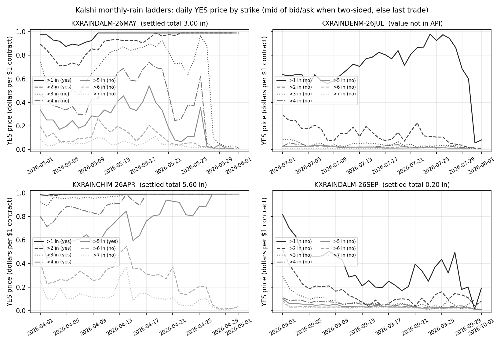
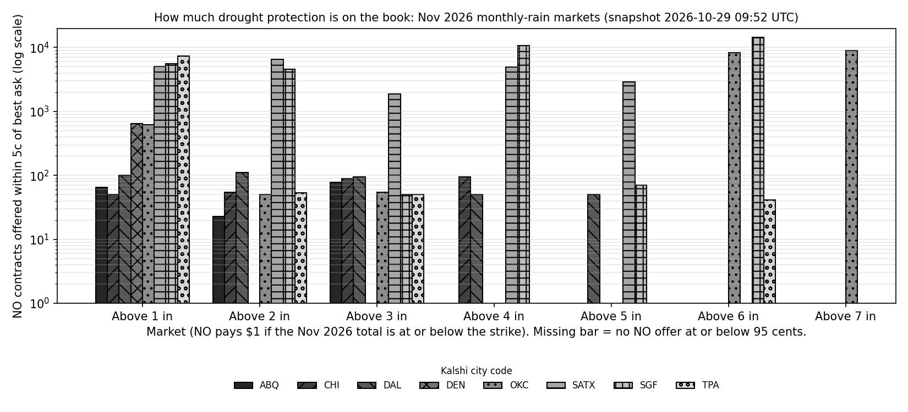

# R5: How Kalshi weather markets work, what they cost, and how people trade them

**Proposal cell:** Week 2 / Maya  |  **Status:** DRAFT  |  **Last updated:** 2026-10-29

This document covers the contract and market side of Kalshi's weather products: who regulates
them, how a monthly-rain contract is built, what trading costs, how the contracts settle (legal
side), how liquid they are, and who trades them. The meteorology of settlement (NWS vs The Weather
Company numbers, station vs grid) is in [R6](06_settlement_and_data_sources.md).

The full-history liquidity statistics are not repeated here; they come from B2's pipeline
(`scripts/pull_kalshi.py`, `data/processed/kalshi_*`) and are written up in
[05b](../analysis/05b_kalshi_liquidity_stats.md). That covers all 1,294 single-month markets:
volume, OI, daily spreads, calibration, hedge capacity and settlement regimes. This doc adds a
small, separate sample pulled by `scripts/r5_kalshi_sample.py` (raw outputs in
`data/raw/r5_kalshi/`). It contains hourly spreads, trade sizes, early closes and settlement lags
for 12 settled events, plus a second order-book snapshot. Where the two overlap, the numbers
agree; see section 5.

**Jargon used throughout.**
- **Binary (event) contract:** pays $1 if a stated event happens ("YES") and $0 otherwise. The
  "NO" side pays $1 if the event does not happen.
- **Strike:** the threshold in the question, e.g. "Above 3 inches".
- **Ladder:** the set of strikes listed for one city and month.
- **Bid / ask:** the best price someone will pay / accept right now. The **spread** is ask minus
  bid.
- **Depth:** how many contracts are offered at or near the best price.
- **Open interest (OI):** contracts currently held and not yet settled.
- **Taker:** someone who accepts a resting order. **Maker:** someone whose resting order is
  accepted.
- **DCM:** Designated Contract Market, a CFTC-licensed futures exchange.

## Key findings

- **Regulation.** Kalshi (KalshiEX LLC) has been a CFTC-designated contract market since the order
  dated 2020-11-03, announced 2020-11-04 (date corrected in the 2026-11-01 fact-check).
  - Weather contracts are self-certified to the CFTC under Regulation 40.2(a) and amended under
    40.6. No CFTC approval vote is needed.
  - The monthly-rain contract ("RAINM", 35 cities) was last re-filed on 2026-02-04. It carries a
    **position accountability level of $25,000 per strike, per member**.
  - A farm LLC can trade through an "institutional" entity account. That member then cannot also
    hold a personal account.
- **Contract shape.** Every monthly-rain market is a $1 binary "strictly greater than X inches"
  question.
  - The ladder is almost always whole inches from 1 to 7. Kalshi adds higher strikes during wet
    months (Miami Sep 2026 had 16).
  - There is **no strike below 1 inch**. At Denver and Albuquerque, 90% of the 1991-2020 normal is
    below 1 inch in 6 and 9 calendar months respectively.
  - Only the current and next month are ever tradable. Most months list 0 to 6 days before the
    month starts; the Nov 2026 ladders listed 6 to 30 days ahead.
  - Five of our seven PRF sites (OKC, SGF, ABQ, TPA, SAT) are among 20 series created on
    2026-10-25. Each has one event, Nov 2026, and no settled history.
- **Fees.**
  - All 458 Climate and Weather series report `fee_type = "quadratic"` and `fee_multiplier = 1`,
    with no scheduled fee changes. That means a taker-only fee, round up(0.07 x C x P x (1-P)),
    and no maker fee (C = contracts, P = price in dollars). The formula is the one in Kalshi's fee
    schedule as filed with the CFTC in September 2022. The current kalshi.com PDF returned HTTP
    429.
  - Buying 100 contracts at 20 cents costs $20.00 premium plus a **$1.12 fee (5.6% of
    premium)**.
  - Settling is free, and ACH, wire and withdrawals are free. Debit-card deposits may carry a 2%
    fee.
- **Settlement source.** The settlement source has changed several times (B2, 05b Table 6).
  - Nov 2025 to Feb 2026: a sum of NOAA Climate Data Online daily summaries.
  - Mar to Aug 2026: the "NWS Climatological Report (Daily)".
  - From Sep 2026: "the corresponding TWC Report (Daily)". This followed the Kalshi and The
    Weather Company (TWC) partnership of 2026-08-27 and a contract amendment effective 2026-09-04.
  - **Today two rule texts coexist.** 28 open monthly-rain events in the 14 older cities
    (including DFW, DEN and ORD) name TWC and close early once the strike is passed. 20 events in
    the 20 cities created 2026-10-25 (including OKC, SGF, ABQ, TPA and SAT) name the first
    complete NWS Daily Climate Report and do not close early.
  - Chicago also switched stations, from Midway (CLIMDW) to O'Hare (CLIORD), in Sep 2026.
- **Boundary cases.** Two of our 12 sampled events were decided by the exact strike rule.
  - Dallas May 2026 totalled 2.96 in at the station and settled at "3.0", so "Above 3" resolved
    NO.
  - Denver July 2026 totalled exactly 1.00 in. "Above 1" resolved NO after trading at about 98
    cents.
- **Liquidity in settled months.** In 12 settled events across 8 cities (Jan-Sep 2026):
  - Median volume was **110,000 contracts per event** (range 18,000-300,000). Median OI at close
    was 40,000 contracts summed over strikes.
  - The median trade was **7 contracts** (90th percentile 50).
  - Median quoted spread on contested strikes (mid price between 10 and 90 cents) was **4.5
    cents**.
  - **45%** of volume trades in the final 7 days, and **16%** at 1 or 99 cents.
  - These months overlapped Kalshi "new event" liquidity-reward programs (May to Oct 2026).
  - B2's full-history figures (05b) give the same picture on a different spread measure:
    - median 6,375 contracts per settled market;
    - mean daily-close spread 13.1 cents (9.7 at DFW), with two-sided quotes on 64% of
      market-days;
    - about 40% of volume in the final week at the study sites.
- **Current order books are thin and lopsided** (snapshot 2026-10-29 09:52 UTC, Nov 2026 ladders).
  - Dallas has a median spread of 17 cents. Quotes come in blocks of about 50 contracts per strike,
    and only **120 drought-protection contracts** are on offer on "Above 2 in" ($120 of maximum
    payout).
  - B2's snapshot finds $436 of Dallas drought payout across all seven strikes.
  - The new OKC, SGF, SAT and TPA books show thousands of contracts on some strikes. These sit
    inside a Kalshi liquidity-reward window (2026-10-26 to 11-01, target size 1,000 contracts, as
    recorded by B2's incentive-program pull). Other strikes on the same books have about 50
    contracts and spreads of 14-20 cents.
- **Who trades.** Kalshi is never the counterparty; members trade with each other.
  - Weather tickers are **not** in Kalshi's formal market-maker program (88 eligible tickers, none
    weather). Liquidity comes from reward programs and independent quoters.
  - Kalshi says its weather vertical grew 500% year over year and is "pacing toward $1.1 billion
    in annualized volume" (2026-08-27).
  - Monthly rain is a niche within weather: **0.76%** of weather contracts traded in the API's live
    window, against 52% for daily temperature.
  - Burgi, Deng & Whelan find a favorite-longshot bias on Kalshi, including in Climate & Weather.
    Contracts under 10 cents lose over 60% of their stake, and takers average -31.5% vs -9.6% for
    makers.
  - B2 finds the same in monthly rain. Seven days out, YES contracts under $0.20 averaged 4.7
    cents but resolved YES only 1.6% of the time, while favorites were roughly fair.
- **Comparison venues.**
  - Polymarket lists 5 monthly-precipitation markets: NYC, London, Seattle, Hong Kong and Seoul.
    Each traded about $47k-61k for Oct 2026, with zero fees.
  - CME listed rainfall index futures in 2010 and delisted them in 2014 with zero open interest.
    It offers no precipitation product today.

## Numbers table

Status labels:
- **CONFIRMED:** read in the primary source (API JSON, Kalshi filing or help page, paper PDF) or
  computed by us from such data.
- **UNVERIFIED:** press, snippet, or a source we could not open.

"R5 API pull" means `scripts/r5_kalshi_sample.py` on 2026-10-29 against
https://api.elections.kalshi.com/trade-api/v2. Derived outputs are in `data/raw/r5_kalshi/`.

| Quantity | Value | Units | Region / period | Source (URL + page/table) | Verification |
|---|---|---|---|---|---|
| Kalshi DCM designation date | order dated 2020-11-03 (**corrected**; 2020-11-04 is the press-release date) | date | KalshiEX LLC | CFTC press release 8302-20 (2020-11-04, "today announced that it has issued an Order of Designation"), https://www.cftc.gov/PressRoom/PressReleases/8302-20 ; order PDF https://www.cftc.gov/filings/documents/2020/orgkexkalshidesignation201103.pdf | CONFIRMED (fact-check) |
| NYC monthly-rain initial self-certification | 2024-02-07 | date | RAINNYCM | https://assets.kalshi.com/regulatory/product-certifications/RAINNYCM.pdf p.1 | CONFIRMED |
| RAINM amendment (CFTC Reg. 40.6) | 2026-02-04 | date | RAINM, 35 cities | https://assets.kalshi.com/regulatory/product-certifications/RAINM.pdf p.1 | CONFIRMED |
| Temperature contract initial listing | 2025-12-09 (filed 2025-12-08) | date | GLOBALTEMPERATURE | https://assets.kalshi.com/regulatory/product-certifications/GLOBALTEMPERATURE.pdf p.1 | CONFIRMED |
| Snow contract amendment (material-error clause) | 2026-09-02 | date | SNOWOVERTIME | https://assets.kalshi.com/regulatory/product-certifications/SNOWOVERTIME.pdf p.1 | CONFIRMED |
| Position accountability level, RAINM | 25,000 | dollars per strike per member | monthly rain | RAINM contract terms p.2, https://assets.kalshi.com/contract_terms/RAINM.pdf | CONFIRMED |
| Position limit, RAINNYCM | 25,000 | dollars per member | NYC monthly rain | https://assets.kalshi.com/contract_terms/RAINNYCM.pdf | CONFIRMED |
| Position accountability level, temperature and snow | 25,000 | dollars per strike per member | GLOBALTEMPERATURE (Dec 2025), SNOWOVERTIME (Sep 2026) | certification PDFs above, Appendix A | CONFIRMED |
| Position limit, hurricane counts | 25,000 | dollars per member | LTHUR (2021-12-01) | https://assets.kalshi.com/regulatory/product-certifications/LTHUR.pdf | CONFIRMED |
| Strike range allowed, RAINM | 0.00-100.00 in 0.01 steps | inches | RAINM | RAINM contract terms p.1 | CONFIRMED |
| Strike range allowed, RAINNYCM | 0-1,000 in 0.01 steps | inches | RAINNYCM | RAINNYCM terms | CONFIRMED |
| Minimum tick | 0.01 | dollars | all weather series sampled | RAINM terms p.2; API `price_ranges` step 0.0100 | CONFIRMED |
| Price band | 0.01-0.99 | dollars | RAINM | RAINM certification p.2 | CONFIRMED |
| Notional (payout) per contract | 1.00 | dollars | all | RAINM terms p.2; API `notional_value_dollars` | CONFIRMED |
| Minimum contract increment | 0.01 | contracts | exchange-wide since Mar-Apr 2026 | https://docs.kalshi.com/getting_started/fixed_point_migration; changelog 2026-03-03, 2026-04-17 | CONFIRMED |
| Last trading time | 11:59 PM ET, last calendar day of month | time | RAINM | RAINM terms p.2 | CONFIRMED |
| Expiration time | 10:00 AM ET | time | RAINM | RAINM terms p.2 | CONFIRMED |
| Latest expiration date | 15 | days after month end | RAINM | RAINM terms p.2; API `latest_expiration_time` e.g. 2026-12-15T15:00Z for KXRAINOKCM-26NOV | CONFIRMED |
| Settlement date | no later than 1 | day after expiration | RAINM | RAINM terms p.2 | CONFIRMED |
| Settlement timer (dispute window after determination) | 1,800 | seconds | rain markets | API `settlement_timer_seconds`; https://docs.kalshi.com/getting_started/market_lifecycle | CONFIRMED |
| Observed settlement lag after month end | median 15 (range 10-86) | hours | 12 sampled events, Jan-Sep 2026 | R5 API pull, `r5_sample_events.csv` | CONFIRMED |
| Trading hours | 24/7 except Thu 3:00-5:00 AM ET | hours | exchange | https://help.kalshi.com/en/articles/13823807-what-are-trading-hours (2026-08-23) | CONFIRMED |
| Climate and Weather series | 458 | series | all | R5 API pull `/series?category=Climate and Weather` | CONFIRMED |
| Series with an open market | 173 | series | 2026-10-29 | R5 API pull, `r5_series_catalog.csv` | CONFIRMED |
| Series with fee_type quadratic, multiplier 1 | 458 of 458 | series | 2026-10-29 | R5 API pull | CONFIRMED |
| Scheduled or historical fee changes on weather series | 0 (of 107 exchange-wide) | changes | to 2026-10-29 | R5 API pull `/series/fee_changes?show_historical=true` | CONFIRMED |
| Taker fee formula | round up(0.07 x C x P x (1-P)), "rounds to the next cent"; charged only on "orders that are immediately matched" | dollars | general fee | Kalshi Fee Schedule as filed with CFTC, Sept 2022, p.2: https://www.cftc.gov/filings/orgrules/rule091222kexdcm003.pdf ; also Burgi et al. p.6 | CONFIRMED (2022 filing); current kalshi.com PDF UNVERIFIED (HTTP 429) |
| Settlement fee (fee schedule) | "There is no settlement fee." | | | same filing p.2 | CONFIRMED |
| Bank withdrawal fee in 2022 schedule / today | 2 / 0 | dollars | | same filing p.2; Bank Withdrawals help page (2026-08-24) | CONFIRMED (fee since removed) |
| Maker fees begin (exchange, some series) | after April 2025; rollout 2026-08-20 5:00 AM ET | date | exchange | Burgi et al. p.6; https://docs.kalshi.com/changelog (entries 2026-08-20/22) | CONFIRMED |
| Fee, 100 contracts at 0.20 | 1.12 | dollars (5.6% of $20 premium) | worked example | computed with the formula above | CONFIRMED (arithmetic) |
| Fee, 1 contract at 0.20, rounded to cent | 0.02 under the 2022 "next cent" rule (10% of premium); **qualified**: under the current fee_rounding page the fee is rounded up to $0.000001 and balances settle to $0.0001 for direct members, so a direct member pays about 0.0112 (5.6%); FCM-cleared members (precision $0.01) still pay 0.02 | dollars | worked example | computed; 2022 rule in Burgi et al. p.6 and p.17; current rule https://docs.kalshi.com/getting_started/fee_rounding (read 2026-11-01) | CONFIRMED (arithmetic; rule qualified in fact-check) |
| Fee at 0.50 | 1.75 | cents per contract (3.5% of premium) | formula | computed | CONFIRMED (arithmetic) |
| Fee at 0.05 / 0.10 / 0.90 | 0.33 / 0.63 / 0.63 | cents per contract | formula | computed | CONFIRMED (arithmetic) |
| Balance precision for fee rounding | 0.0001 (direct members), 0.01 (FCM-cleared) | dollars | exchange | https://docs.kalshi.com/getting_started/fee_rounding | CONFIRMED |
| Settlement fee on yes/no outcomes | 0 | dollars | exchange | https://docs.kalshi.com/getting_started/market_settlement | CONFIRMED |
| ACH (bank) deposit fee / withdrawal fee | 0 / 0 | dollars | US users | https://help.kalshi.com/en/articles/13823798-bank-deposits ; .../13823803-bank-withdrawals (2026-08-24) | CONFIRMED |
| Debit-card deposit fee | up to 2 | % | US users | https://help.kalshi.com/en/articles/13823795-card-deposits (2026-08-13) | CONFIRMED |
| Debit-card withdrawal fee | 0 | dollars | | https://help.kalshi.com/en/articles/13823802-debit-card-withdrawals (2026-08-24) | CONFIRMED |
| Wire deposit fee / minimum | 0 / 1,000 | dollars | | https://help.kalshi.com/en/articles/13823800-how-to-deposit-funds-via-wire-transfer | CONFIRMED |
| Minimum deposit (non-wire) | 10 | dollars | | Transfers FAQ, https://help.kalshi.com/en/articles/13823791-transfers-faq | CONFIRMED |
| Interest on cash and open positions | 3.50 (variable) | % APY | US users, balance >= $250 | https://help.kalshi.com/en/articles/13823847-apy-on-kalshi | CONFIRMED |
| Minimum age | 18 | years | individuals | https://help.kalshi.com/en/articles/13823778-signing-up-as-an-individual | CONFIRMED |
| Market-maker program eligible tickers / weather tickers | 88 / 0 | tickers | 2026-04-28 page | https://help.kalshi.com/en/articles/13823819-how-to-become-a-market-maker-on-kalshi | CONFIRMED |
| TWC partnership announcement | 2026-08-27 | date | Kalshi | https://news.kalshi.com/p/kalshi-weather-company-partnership | CONFIRMED |
| RAINM amendment adding TWC as Source Agency, effective | 2026-09-04 ("September 4th") | date | KXRAINDALM and other RAINM series | API `/series/KXRAINDALM` `product_metadata.important_info` | CONFIRMED |
| Kalshi weather vertical growth | 500 | % year over year | to Aug 2026 | Kalshi release 2026-08-27 | CONFIRMED |
| Kalshi weather vertical annualized volume | "pacing toward" 1.1 | billion dollars | Aug 2026 | Kalshi release 2026-08-27 | CONFIRMED (company claim) |
| Kalshi weekly volume | > 1 | billion dollars per week | late 2025 | https://news.kalshi.com/p/kalshi-11-billion-valuation-series-e (2025-12-02) | CONFIRMED (company claim, read by helper) |
| Kalshi annualized volume | 178 | billion dollars | May 2026 | Decrypt / The Block, 2026-05-07 (company claim) | UNVERIFIED |
| Monthly-rain cities with open markets | 35 (+ Napa) | cities | 2026-10-29 | R5 API pull | CONFIRMED |
| Monthly-rain open events by rule text | 28 TWC/early-close (14 cities), 20 NWS first-complete-report (20 cities), 2 NYC | events | 2026-10-29 | R5 API pull, `open_rain_rules_20261029.json` | CONFIRMED |
| Settlement wording by contract month | NOAA CDO daily-summary sum (Nov 2025-Feb 2026), NWS CLI (Mar-Aug 2026), TWC Report (Sep 2026-), NWS first complete report (new series) | regimes | single-month rain markets | B2, [05b](../analysis/05b_kalshi_liquidity_stats.md) Table 6; R5 sample rules text | CONFIRMED |
| Chicago settlement station | CLIMDW (Midway) to Aug 2026; CLIORD (O'Hare) from Sep 2026 | station | KXRAINCHIM | 05b section 7; R5 sample `rules_primary` (26APR = CLIMDW, 26SEP = CLIORD) | CONFIRMED |
| Monthly-rain series created 2026-10-25 | 20 | series | incl. SAT, OKC, SGF, ABQ, TPA | 05b Numbers table | CONFIRMED (B2) |
| Full history: median volume per settled market / mean daily-close spread / two-sided market-days | 6,375 / 13.1 cents / 64% | | 943 settled markets, 37 series | 05b Table 1 | CONFIRMED (B2) |
| Full history, DFW: median event OI at close / mean daily-close spread | 32,984 contracts / 9.7 cents | | KXRAINDALM | 05b Table 1 | CONFIRMED (B2) |
| Monthly-rain calibration, 7 days out, YES < $0.20: mean price / YES rate | 0.047 / 0.016 | dollars / share | 139 settled events | 05b Table 5 | CONFIRMED (B2) |
| Drought payout buyable at <= $0.95, Nov 2026, all strikes: DFW / DEN / ORD / SAT / OKC / SGF / ABQ / TPA | 436 / 4,017 / 428 / 18,810 / 12,836 / 39,859 / 10,456 / 7,431 | $ payout | B2 snapshot 2026-10-29 09:30 UTC | 05b Table 4, `kalshi_rain_hedge_capacity_nov2026.csv` | CONFIRMED (B2) |
| Full history: total contracts DFW / DEN / ORD; median settled-event volume, all cities | 1,115,702 / 927,552 / 1,209,879; about 77,000 (76,952) | contracts | to 2026-10-29 | 05b Table 1 | CONFIRMED (B2) |
| Study-site trades: median size / 90th percentile | 5-7 / 60-83 | contracts | 90,269 trades, DFW, DEN, ORD | 05b Table 2 | CONFIRMED (B2) |
| Weather contracts traded in API live window | 239.8 | million contracts | markets open or settled after 2026-08-30 | R5 API pull, `r5_family_table.csv` | CONFIRMED |
| Share of those: daily US temperature / daily-weekly rain / hourly temperature / monthly rain | 52.3 / 27.0 / 16.8 / 0.76 | % | same | same | CONFIRMED |
| Settled monthly-rain events with history (DFW, DEN, ORD) | 13 / 13 / 14 | events | Jun 2025-Sep 2026 | R5 API pull, `r5_rain_city_history_summary.csv`; matches 05b Table 1 | CONFIRMED |
| Study-site series created 2026-10-25 (OKC, SGF, ABQ, TPA, SAT) | 0 | settled events | to 2026-10-29 | R5 API pull; 05b | CONFIRMED |
| Median contracts per settled event, 2026 (91 events) | 104,403 (10th-90th pct 38,412-199,854) | contracts | Jan-Sep 2026, 11 cities | R5 API pull, `r5_rain_event_history.csv` | CONFIRMED |
| Sample (12 events): median contracts per event | 110,404 (range 18,327-300,289) | contracts | Jan-Sep 2026 | `r5_sample_events.csv` | CONFIRMED |
| Sample: median OI at close, summed over strikes | 40,436 | contracts | same | same | CONFIRMED |
| Sample: median trade size / 90th percentile | 7.2 / 50 | contracts | same | same | CONFIRMED |
| Sample: median spread on contested strikes | 4.5 (range 2-10) | cents | same, hourly candles | same | CONFIRMED |
| Sample: strike-hours with a two-sided quote | 87 (median) | % | same | same | CONFIRMED |
| Sample: share of volume in last 7 days | 45 (median) | % | same | same | CONFIRMED |
| Sample: share of volume at 1c or 99c | 16 (median) | % | same | same | CONFIRMED |
| Sample: YES premium paid, all 12 events | 678,000 | dollars | same | same | CONFIRMED |
| Dallas May 2026 station total / Kalshi value | 2.96 / 3.0 | inches | DFW | `data/processed/station_daily_precip_study.parquet` (ACIS); API `expiration_value` | CONFIRMED |
| Denver July 2026 station total | 1.00 | inches | DEN | same ACIS file; API `result` = no on all strikes | CONFIRMED |
| Denver "Above 1 in" price, Jul 23-25 2026 | about 0.98 | dollars | KXRAINDENM-26JUL-1 | R5 hourly candles | CONFIRMED |
| Nov 2026 snapshot, median spread: DFW / DEN / ORD / OKC / SAT / SGF / TPA / ABQ | 17 / 9 / 17 / 14 / 12 / 9 / 14 / 1 | cents | 2026-10-29 09:52 UTC | `r5_orderbook_site_summary.csv` | CONFIRMED |
| Nov 2026 snapshot, NO contracts within 5c of best ask, all strikes: DFW / DEN / ORD / OKC / SAT / SGF / TPA / ABQ | 406 / 647 / 287 / 17,914 / 21,255 / 35,370 / 7,431 / 166 | contracts | same | same | CONFIRMED |
| DFW "Above 2 in" NO fill, all offers at or below 95c | 120 at average 0.426 | contracts, dollars | same | `r5_drought_hedge_fills.csv` | CONFIRMED |
| Liquidity-reward program, Oct 26 cohort | 170 per market, target 1,000 contracts, 2026-10-26 to 11-01 | dollars, contracts | 20 new cities | `data/processed/kalshi_rain_incentive_programs.csv` (B2, from `/incentive_programs`) | CONFIRMED (B2 pull) |
| Liquidity-reward programs, older cities | "new_event" 2026-05-01 to 10-04; "long_dated" 2026-04-29 to 07-12 | dates | DFW, DEN, ORD, etc. | same | CONFIRMED (B2 pull) |
| Mean monthly precip, 90% of normal below 1 in | DEN 6 months, ABQ 9 months, other study sites 0 | months of 12 | 1991-2020, ACIS station | `data/processed/station_monthly_precip.csv` | CONFIRMED (computed) |
| Share of months with total <= 1 in | DEN 59%, ABQ 72%, DFW 20%, OKC 21%, SAT 35%, TPA 21%, SGF 9%, ORD 9% | % of months | 1991-2020 | same | CONFIRMED (computed) |
| Listing lead time before month start | median 0 (25th-75th pct -0.5 to 4.6; max 30) | days | 173 events, 2025-2026 | `r5_rain_event_history.csv` | CONFIRMED |
| Burgi et al. sample | 313,972 contract prices; 2021 to Apr 2025 | | Kalshi | https://www.karlwhelan.com/Papers/Kalshi.pdf p.2, p.9 | CONFIRMED |
| Burgi et al.: loss on contracts < 10c | > 60 | % of money | all categories | same, p.3 | CONFIRMED |
| Burgi et al.: average return, makers / takers | -9.64 / -31.46 | % | all | same, p.27 (Fig. 6) | CONFIRMED |
| Burgi et al.: fee at 50c with 100-lot rounding | 1.77 | % of price | | same, p.17 | CONFIRMED |
| Burgi et al.: Climate & Weather regression | slope 0.031 (SE 0.005), constant -0.997 (SE 0.243), N = 29,924 | | Table 8 | same, p.24 | CONFIRMED |
| Burgi et al.: all-market regression | slope 0.034, constant -1.736, N = 156,986 | | Table 8 | same, p.24 | CONFIRMED |
| Polymarket monthly precipitation markets | 5 (NYC, London, Seattle, Hong Kong, Seoul) | markets | Oct 2026 | https://gamma-api.polymarket.com/events?tag_slug=weather&active=true&closed=false | CONFIRMED |
| Polymarket Oct 2026 precip volume NYC / London / Seattle / HK / Seoul | 46,643 / 49,684 / 49,573 / 61,460 / 58,387 | dollars | Oct 2026 | same | CONFIRMED |
| Polymarket weather taker rate (docs) / live precip markets | 0.05 / zero_fees | coefficient | 2026-10-29 | https://docs.polymarket.com/trading/fees ; gamma API `feeType` | CONFIRMED |
| Polymarket US taker coefficient | 0.06 (from 0.05), effective 2026-07-01 | coefficient | QCX (CFTC DCM) | https://www.cftc.gov/filings/orgrules/rules0707269057.pdf | CONFIRMED (read by helper) |
| Polymarket active weather events | 351, incl. daily highest temp in 51 cities | events | 2026-10-29 | gamma API, tallied by helper | CONFIRMED (helper tally) |
| CME rainfall futures launch / contract size | 2010-11-01 / $500 x index (1 point = 1 inch) | | 9 cities | https://cftc.gov/stellent/groups/public/@rulesandproducts/documents/ifdocs/rul102710cme001.pdf p.1, p.3 | CONFIRMED (read by helper) |
| CME rainfall, snowfall, frost delisting | 2014-10-20, zero open interest | | | https://cftc.gov/filings/ptc/ptc102314cmedcm007.pdf pp.2-6 | CONFIRMED (read by helper) |
| CME HDD/CDD contract size | $20 x index | | US cities | cmegroup.com spec pages (unreachable) | UNVERIFIED |
| CME weather volume growth | > 260% (2023 vs 2022) | % | | CME-sponsored Washington Post page, 2024-09-16 | UNVERIFIED (sponsored) |

## Detail

### 1. Regulatory status

**Kalshi is a CFTC-regulated futures exchange.** The CFTC issued an Order of Designation "granting
[KalshiEX LLC] status as a designated contract market (DCM)", announced 2020-11-04 (the order itself is dated 2020-11-03)
([CFTC 8302-20](https://www.cftc.gov/PressRoom/PressReleases/8302-20)).

Kalshi's help center repeats that it is "regulated as a Designated Contract Market (DCM)". It also
says contracts now clear through Kalshi Klear LLC, an affiliate ("How is Kalshi regulated?",
2026-03-19; "What is Kalshi Klear?", 2026-03-10). Before that, MIAXdx had cleared them for three
years.

Kalshi is never the counterparty: "you are always trading against another member of the
platform, not the exchange itself" ("Who are you trading with?", 2026-08-14).

**How a weather contract gets listed: self-certification.** Kalshi does not ask the CFTC for
approval. It files a certification under CEA Section 5c(c) and CFTC Regulation 40.2(a), states that
the contract complies with the Act, and can list it the next business day. Changes are filed as
amendments under Regulation 40.6. Every filing we opened follows this pattern:

| Contract (rulebook code) | Filing | Date | What it says |
|---|---|---|---|
| RAINNYCM, NYC monthly rain | 40.2(a) initial listing | 2024-02-07 | NWS Daily Climate Reports for Central Park; position limit $25,000 per member |
| LTHUR, hurricane counts | 40.2(a) | 2021-12-01 | position limit $25,000 per member |
| GLOBALTEMPERATURE, max/min/avg temperature | 40.2(a), listed after close 2025-12-09 | 2025-12-08 | accountability level $25,000 per strike per member |
| RAINM, "Will there be <above/below/between/exactly/at least> <count> inches of rain in <city> in <month>?" | 40.6 amendment | 2026-02-04 | "specify the NWS as a primary Source Agency and modify the Underlying in line with more rapid potential resolution" |
| SNOWOVERTIME, snow | 40.6 amendment | 2026-09-02 | "Added clarification in the case of inaccurate initial reading from Source Agency" |

**Where to find the rain contract terms.** Every series in the API carries two links:
- `contract_url`: the original filing.
- `contract_terms_url`: the current terms.

For all 35 monthly-rain cities except NYC these are
https://assets.kalshi.com/regulatory/product-certifications/RAINM.pdf (the 2026-02-04 filing) and
https://assets.kalshi.com/contract_terms/RAINM.pdf (the current terms). NYC uses the RAINNYCM
equivalents.

The certification's confidential appendices (B to D: further considerations, source agency, and
core-principle compliance) are not public. The filing says the public parts are "concurrently
posted" at https://kalshi.com/regulatory/filings. That page and the rulebook returned HTTP 429 to
our fetches. Rule 7.1 (Market Outcome Review) and Rule 7.2 (moving expiration earlier) are
therefore known only from how the contract terms cite them.

**Position limits and accountability levels.** The older NYC rain and hurricane contracts state a
hard "Position Limit ... $25,000 per Member". The 2025-2026 RAINM, temperature and snow contracts
instead state a "Position Accountability Level ... $25,000 per strike, per Member".

Under 17 CFR 150.1, position accountability means a member above the level must, on request,
"provide information about its position" and "halt increasing further its position or reduce its
position in an orderly manner" ([LII 17 CFR 150.1](https://www.law.cornell.edu/cfr/text/17/150.1)).
It is a soft cap that the exchange polices, not an automatic block.

The filings do not say whether $25,000 means premium paid or maximum payout. At the ceiling of $1
per contract it is at least 25,000 contracts per strike. That is far above anything the current
order books could fill (section 5), so in practice it does not bind a single farm.

**Who can trade.** Individuals must be 18 or older and pass identity verification ("Signing Up as
an Individual", 2026-03-10). Kalshi "is now accessible internationally" with restrictions listed in
the Member Agreement ("Can I trade on Kalshi from outside the United States?", 2026-03-20).

Each weather series also carries two `additional_prohibitions`:
- "Persons who are employed by any of the Source Agencies are not permitted to trade on the
  Contract."
- Persons holding "material, non-public information on the Underlying" may not trade.

**Can a farm LLC open an account? Yes.** "Businesses, funds, and other entities can trade on Kalshi
through an institutional account," with applications through institutional.kalshi.com ("Signing
Up as an Entity", 2026-06-15). Kalshi may ask for:
- formation documents (for example articles of organization);
- a recent bank statement for the entity's own account;
- ID for each authorized signer;
- proof of address and source of funds.

A member "cannot maintain both a personal account and an entity account simultaneously". The page
does not say whether non-US entities qualify.

Kalshi also lists partner FCMs (futures commission merchants): Webull, Robinhood Derivatives and
Direct Access USA ("How to Become a Market Maker", 2026-04-28). A farmer could therefore reach these
contracts through a brokerage. FCM-cleared accounts round fees to the cent (section 3).

**Funding.** These figures are from Kalshi help articles dated 2026-08-13 to 2026-08-24:

| Method | Deposit fee | Withdrawal fee | Notes |
|---|---|---|---|
| Bank (ACH) | none | none | US only; settles in about 5 business days; minimum $10 |
| Wire | none | not stated | minimum $1,000; no withdrawal hold |
| Debit card | "may incur a 2% processing fee" | none | withdrawals usually within hours |
| PayPal, Venmo, Cash App, crypto, RTP | not listed | not listed | availability varies by state and country |

Kalshi pays a variable 3.50% APY "on your cash and open positions, including the collateral behind
your positions". It requires an average balance of at least $250, US users only, and an SSN for
interest above $10 a year ("APY on Kalshi").

### 2. Contract mechanics

**Payout and prices.**
- Each contract pays $1.00 to the winning side (`notional_value_dollars` = 1.0000).
- Prices move in $0.01 ticks (`price_level_structure` = `linear_cent`, step 0.0100), within a 1 to
  99 cent band (RAINM certification p.2).
- A YES at price P and a NO at 1-P are the two sides of one contract.
- Since March-April 2026 Kalshi accepts fractional quantities down to 0.01 contracts. That is why
  the API now reports counts as strings such as `volume_fp = "1259.11"`.

**No leverage.** Positions are fully pre-funded. The buyer of YES at 20 cents deposits 20 cents and
the NO buyer deposits 80 cents, so the pair is $1 of collateral against a $1 payout.

Kalshi's "collateral return" option (off by default) returns cash when positions in a directional
ladder cannot both lose. For example, YES on "above 1,000,000" at 80c plus NO on "above
3,000,000" at 70c ties up only the $0.50 maximum loss, not $1.50 ("Collateral Return",
2026-05-17). Rain events carry `collateral_return_type = "DIRECNET"`, which is this directional
netting. A farmer buying several strikes of one ladder can therefore free some cash.

**Trading hours.** 24/7, except a weekly maintenance window from 3:00 to 5:00 AM ET on Thursdays.

**Timeline of a monthly-rain market.** Taken from the RAINM terms and API timestamps for, for
example, KXRAINOKCM-26NOV:

| Step | Rule | Example (Nov 2026) |
|---|---|---|
| Listing | Not fixed by the contract ("iterations will generally correspond to the next month") | DFW opened 2026-10-02 03:56 UTC; OKC opened 2026-10-26 03:56 UTC |
| Early close (old-cohort text only) | "This market will close and expire early if the event occurs." | DFW "Above 1/2/3 in" for Oct 2026 closed 2026-10-03 |
| Last trading time | 11:59 PM ET on the last calendar day of the month | `close_time` 2026-12-01T04:59:59Z |
| Expected expiration | API: the next day | `expected_expiration_time` 2026-12-02T04:59:59Z |
| Expiration date | Moved earlier once NWS publishes the complete month (Rule 7.2); latest is 15 days after month end, at 10:00 AM ET | `latest_expiration_time` 2026-12-15T15:00Z (OKC) |
| Determination, then 30-minute settlement timer | Result can still be disputed while the market is "determined" | `settlement_timer_seconds` = 1800 |
| Settlement | No later than the day after expiration | Sample median 15 hours after month end |

The two slow cases in our sample were LA Feb 2026 (86 h) and Seattle Jan 2026 (61 h).

**How strikes are chosen and added.** The contract lets Kalshi list any `<count>` from 0.00 to
100.00 inches in 0.01 steps, with "above, below, between, exactly, at least" variants. In practice
every monthly-rain event since November 2025 uses one design:
- "strictly greater than" (`strike_type = "greater"`) markets at whole inches 1, 2, ..., 7;
- rules text "If the total precipitation at CLIDFW in Dallas in Nov 2026 is strictly greater than 3
  inches, then the market resolves to Yes."

Kalshi adds strikes when a month runs wet:
- Miami Sep 2026 grew to 16 strikes. Strikes 8-16 were added between 2026-09-01 and 09-05; the
  month totalled 7.3 in.
- NYC Sep 2026 had 10 strikes.
- Dallas Oct 2026 lost strikes 1-3 to early closure on Oct 3 and gained 8, 9 and 10.

The legacy NYC series in 2024 used half-inch strikes (1.5, 2.5, 3.5, ...). No current ladder has a
strike below 1 inch.

**Listing horizon.** Only the current month and the next are ever open.
- Across 173 events in 2025-2026 the market opened a median 0 days before the month began
  (25th-75th percentile: 0.5 days after to 4.6 days before).
- The Nov 2026 ladders opened 6 to 30 days ahead.
- NYC's Dec 2026 ladder is scheduled to open 2026-11-27.

No series lists months further out, so a hedge for May 2027 cannot be bought today.

**Catalog of weather product families.** Families group the 458 series by contract and ticker
pattern (`classify_family()` in the script). "Live-window contracts" is the volume of markets that
are open or settled after the historical cutoff of 2026-08-30. That is about 60 days for daily
products and the Aug-Nov events for monthly ones.

| Family | Example tickers | Series (open now) | Cities / scope | Frequency | Live-window contracts | Settlement text |
|---|---|---|---|---|---|---|
| Daily high/low temperature, US | KXHIGHNY, KXHIGHTDAL, KXLOWTDEN | 70 (48) | 24 US cities, high and low | daily; 6 markets/day (two tails + four 2°F brackets) | 125.3 M | "according to The Weather Company" |
| Daily/weekly rain | KXRAIN ("Will it rain in West Palm Beach on Oct 30?"), KXRAINWKND | 16 (5) | multi-city | daily, weekly | 64.8 M | TWC; "strictly greater than 0 inches" |
| Hourly temperature direction | KXTEMPMIAH, KXTEMPNYCHS | 13 (4) | Miami, NYC, Chicago, LA | hourly | 40.2 M | Synoptic Data or Kalshi index |
| Hurricanes and tropical storms | KXHURCAT, KXFIRSTHURRICANE, KXHURPATHFLA | 68 (14) | named storms, landfall by state/city, season counts | custom, annual | 3.3 M | NOAA / NHC, TWC |
| **Monthly rain total** | **KXRAINDALM, KXRAINOKCM, KXRAINNYCM** | **38 (36)** | **35 US cities + Napa** | **monthly** | **1.8 M** | **TWC Report (Daily) or first NWS Daily Climate Report** |
| Natural disasters / geophysical | KXEARTHQUAKECALIFORNIA, KXEMERGENCYHOU | 50 (6) | | custom | 1.5 M | USGS, FEMA, etc. |
| Global climate indicators | KXGTEMP, KXHMONTH, KXRONI, KXARCTICICEMIN | 44 (10) | global | monthly, annual | 1.2 M | NOAA, NASA GISS, NSIDC |
| Weekly temperature | KXAVGTKOKC, KXWEEKHTNYC | 18 (0) | 11+ cities | weekly | 0.7 M | |
| Ski resort open/close/snowfall | KXBIGSKYOPEN, KXVAILOPEN | 43 (32) | resorts | annual | 0.5 M | resort announcements, press |
| Snowfall | KXDENSNOWM, KXCHISNOWM, KXNYCSNOWXMAS | 38 (13) | about 20 cities | monthly, holiday | 0.3 M | NWS |
| Monthly temperature thresholds / degree days | KXMSNLOWT, KXHDDCVG | 14 (4) | a few cities | monthly | 0.07 M | |
| Drought and water levels | KXMEAD, KXDROUGHTLEVEL | 5 (1) | Lake Mead, US Drought Monitor | monthly, one-off | 0.03 M | |
| Daily temperature, international | KXHIGHTLTFM (Istanbul), KXLOWTEGLL (London) | 41 (0) | 21 cities | daily | 0 | |

Source: R5 API pull, `data/raw/r5_kalshi/r5_family_table.csv` and `r5_series_catalog.csv`. City
counts are from the series titles.

**Monthly rain is a small corner of Kalshi weather:** 0.76% of weather contracts in this window,
even though the window covers four monthly events per city and only about 60 daily ones.

### 3. Fees

**Formula.** All 458 weather series report `fee_type = "quadratic"` and `fee_multiplier = 1`. The
API docs define "quadratic" as "described by the General Trading Fees Table" of the fee schedule.
"quadratic_with_maker_fees" adds the Maker Fees section.

The general table is the taker fee

    fee = round up( 0.07 x C x P x (1 - P) )

with C contracts at price P in dollars. This is the wording of Kalshi's Fee Schedule as filed with
the CFTC in September 2022
([rule091222kexdcm003.pdf](https://www.cftc.gov/filings/orgrules/rule091222kexdcm003.pdf), p.2):
"fees = round up(0.07 x C x P x (1-P)) ... round up = rounds to the next cent".

The same filing says "Trading fees are only charged for orders that are immediately matched with
orders sitting on the orderbook" (taker orders) and "There is no settlement fee". Burgi, Deng &
Whelan describe the same rule for 2021 to April 2025 (p.6). B2 implements it as
`agri_hedge.kalshi.fee()`, tested against the schedule's table.

Key properties:
- **No maker fee on weather.** Kalshi did roll out maker fees on some series from 2026-08-20 (API
  changelog). The `/series/fee_changes` history (107 changes exchange-wide) contains none for any
  weather series.
- **Settlement is free** for yes/no outcomes (2022 fee schedule; docs, "Market Settlement").
- **Rounding since the 2026 fixed-point migration.** The exchange computes the fee to $0.000001,
  then charges a "rounding fee" to bring the balance to $0.0001 for direct members or $0.01 for
  FCM-cleared members. A per-order accumulator rebates the overpayment ("Fee Rounding").
  - For a direct Kalshi account the fee is now essentially exact.
  - Through an FCM, each order still rounds up to the cent.

Caveat: the current fee schedule (https://kalshi.com/docs/kalshi-fee-schedule.pdf) returned HTTP
429 every time, so the 2022 CFTC filing is the newest version we read. The API's `quadratic` fee
type for every weather series is consistent with the 2022 general table being unchanged for
weather.

One item has changed since 2022. The 2022 schedule charged "a $2 fee for all withdrawals ... to
your linked bank account". The 2026 help center says "No fees for bank withdrawals".

**Fee by price.**

| Price P | Exact fee per contract | Fee on a 100-lot (rounded to cent) | Fee as % of premium (100-lot) | 1-contract order rounded to cent, % of premium |
|---|---|---|---|---|
| 0.05 | 0.33c | $0.34 | 6.8% | 20.0% |
| 0.10 | 0.63c | $0.63 | 6.3% | 10.0% |
| 0.20 | 1.12c | $1.12 | 5.6% | 10.0% |
| 0.30 | 1.47c | $1.47 | 4.9% | 6.7% |
| 0.50 | 1.75c | $1.75 | 3.5% | 4.0% |
| 0.80 | 1.12c | $1.12 | 1.4% | 2.5% |
| 0.90 | 0.63c | $0.63 | 0.7% | 1.1% |

In dollars the fee peaks at 50 cents. As a share of premium it is largest for cheap, longshot
contracts. Those are exactly the contracts a farmer buys for tail protection.

**Worked example: buying 100 contracts at 20 cents.**

- Premium: 100 x $0.20 = **$20.00**.
- Fee: 0.07 x 100 x 0.20 x 0.80 = **$1.12**. It is exactly a whole number of cents, so rounding
  does not change it. That is 1.12 cents per contract and 5.6% of the premium. For comparison,
  the 2022 schedule's own table gives $0.34 for 100 contracts at $0.05.
- Total outlay: **$21.12**. Maximum payout: $100.00, if YES wins. Settlement fee $0.
- Net profit if YES: $78.88. Loss if NO: $21.12.
- Break-even probability: 21.12%, versus 20% with no fee.
- If the same 100 contracts were bought as 100 separate 1-contract orders on an FCM account, each
  fee of 1.12 cents rounds up to 2 cents. That is $2.00 in total, or 10% of premium.
- Selling before expiry is another taker trade and pays the fee again, at the exit price.
- Funding by ACH or wire costs nothing. Funding by debit card can add 2%, which is $0.42 on
  $21.12.

The bigger cost is usually the spread, not the fee. Buying at the ask instead of the mid costs half
the spread. That is 2-2.5 cents per contract at the 4.5-cent sample median, but 8.5 cents at
Dallas's current 17-cent median spread, which is 42% of a 20-cent contract.

### 4. Settlement: contract and legal side

**What the binding terms say (RAINM, current version).**

The underlying is "the total monthly precipitation (in inches) recorded at the National Weather
Service (NWS) weather station specified as <city> during <month>, as reported in the first Daily
Climate Report published by the NWS Weather Forecast Office that contains precipitation data for
all calendar days of <month>."

Clarifications in the terms:
- Trace ("T") counts as 0.00.
- A day listed "Missing" in that first complete report counts as 0.00.
- The stated monthly total is used. Kalshi sums daily values only if no total is printed.
- "Only the first qualifying Daily Climate Report is determinative." Later corrections, and final
  Local Climatological Data (LCD), do not change the result unless Kalshi decides they remedy a
  material error.

The worked examples in the terms include a first report of 4.50 inches that settles YES on a
3.00-inch "at least" strike "even if a later revised report corrects this to 2.80 inches".

Source Agencies are "the National Weather Service (NWS), The Weather Company, and the National
Oceanic and Atmospheric Administration (NOAA)". The Feb 2026 filing listed only NWS and NOAA, so
TWC was added later. NYC's terms say "in hierarchical order, the National Weather Service and The
Weather Company (TWC)".

**The TWC switch.**
- **2026-08-27:** Kalshi and The Weather Company announce that Kalshi will use TWC's data feeds as
  its "trusted source for verifying weather-related market outcomes". Kalshi "resolves markets
  under its regulatory framework" (Kalshi release).
- **"September 4th":** series metadata for KXRAINDALM says "effective September 4th, an amendment
  to the contract terms will change the Source Agencies for this event to include The Weather
  Company."
- **What the market text now says:**
  - March to August 2026 markets: "the official and final value ... as reported by the
    corresponding NWS Climatological Report (Daily)".
  - Nov 2025 to Feb 2026 markets: a sum of NOAA Climate Data Online daily summaries as the primary
    link (05b Table 6). In our sample, LA Feb 2026 and Seattle Jan 2026 fall in this regime. They
    were also the two slow settlements (86 and 61 hours after month end, against about 15 hours
    later on).
  - September 2026 onward: "... as reported by the corresponding TWC Report (Daily)".
  - The open markets add: "Notice: The Contract for this market has been amended. The market rules
    have been updated to reflect the amended terms, which provide clarification in the case of
    materially erroneous data."
- R6 checks the numbers. TWC republishes the NWS daily values, and every settled strike matched the
  NWS month total (see [R6 section 4.5 and 5.1](06_settlement_and_data_sources.md)).

**Two rule texts coexist today.** This matters for our study sites. The pattern below is from all
50 open monthly-rain events on 2026-10-29 (`open_rain_rules_20261029.json`). B2's 05b Table 6 shows
the same split by contract month.

| Group | Cities | `rules_secondary` | Early close |
|---|---|---|---|
| Older cohort (created Nov 2025 - Oct 2026), 28 events (Oct + Nov) | **Dallas, Denver, Chicago (O'Hare since Sep 2026)**, Houston, Austin, Miami, LA, SF, Seattle, Columbus, Milwaukee, Providence, College Station, Lexington | "the corresponding TWC Report (Daily)" | "This market will close and expire early if the event occurs." |
| New cohort (created 2026-10-25), 20 events (Nov) | **Oklahoma City, Springfield MO, Albuquerque, Tampa, San Antonio**, Atlanta, Boston, DC, Detroit, Indianapolis, Las Vegas, Minneapolis, Newark, New Orleans, Philadelphia, Phoenix, Pittsburgh, St. Louis, Trenton, West Palm Beach | "The monthly precipitation total in the first National Weather Service Daily Climate Report containing all calendar days of the month determines this market, subject to the material-error and revised-data provisions in the contract terms." | "Expiration may move earlier when the National Weather Service releases the complete monthly precipitation total" (no close on occurrence) |
| NYC, 2 events | Central Park | (blank) | "If this event occurs, the market will close the following 10am ET." |

Early closing has also varied over time:
- Legacy NYC markets in 2024 closed early.
- No sampled markets from Feb to Sep 2026 closed early.
- In Oct 2026, 21 of 21 finalized markets closed early (`r5_rain_event_history.csv`).

For a drought hedger who holds NO on "Above X", an early close simply locks in the loss when the
month turns wet. The bigger point is that the same product family has different settlement wording
city by city, and the wording can change while a market is open.

The settlement station can change too: Chicago's ladder named Midway (CLIMDW) through Aug 2026 and
O'Hare (CLIORD) from Sep 2026. In our sample, KXRAINCHIM-26APR is a Midway month and -26SEP is an
O'Hare month.

**What happens on data errors (the "amended contract").** The current RAINM terms add this clause.
If Kalshi "determines, in its sole discretion, that the first Daily Climate Report to include the
whole month's data contains a material error", it may delay expiration until revised data appear
or the Expiration Date (15 days after month end). If no reliable data exist by then, "all markets
will resolve to the last fair price, as determined by the Exchange in its sole discretion."

The SNOWOVERTIME 40.6 filing of 2026-09-02 adds the same kind of "clarification in the case of
inaccurate initial reading". The RAINM version of this amendment is not the filing linked from the
API (that link is the Feb 2026 one). We did not find the RAINM material-error filing itself.

**Finality and disputes.** API statuses run:
- `closed` (trading stopped);
- `determined` (result known; a 1,800-second settlement timer runs and the result "can still be
  disputed");
- `disputed`, then `amended` (re-determined, timer restarts);
- `finalized` (paid out) ("Market Lifecycle" docs).

Before settlement, Kalshi "may, at its sole discretion, initiate the Market Outcome Review Process
pursuant to Rule 7.1 of the Rulebook". "Revisions to the Underlying made after Expiration will not
be accounted for." After finalization there is no contractual re-settlement. We could not open the
rulebook to quote Rule 7.1's dispute procedure (who can file, deadlines).

**Two boundary cases in our sample show that the exact rule wording matters:**
- **Dallas, May 2026.** The ACIS station record sums to 2.96 in, and Kalshi's `expiration_value`
  is "3.0". Under "strictly greater than 3 inches" the "Above 3" market resolved NO.
  - On May 25 the running total was 2.55 in and "Above 3" traded near 97 cents, presumably on a
    forecast storm. The month then fell 0.04 in short.
  - It was the busiest strike that month: 88,291 contracts.
- **Denver, July 2026.** The station total was exactly 1.00 in. On July 23 the total reached
  0.97 in and "Above 1" traded near 98 cents. Only 0.03 in more fell, so "strictly greater than 1"
  resolved NO and the price collapsed to 5 cents on the last day (Figure 1, top right).

### 5. Liquidity and pricing

**Which of our sites have history.** Only Dallas (KXRAINDALM, 13 settled events since Nov 2025),
Denver (KXRAINDENM, 13) and the Chicago contrast site (KXRAINCHIM, 14 since Jun 2025) have settled
monthly-rain markets.

**OKC, SGF, ABQ, TPA and SAT were created on 2026-10-25** and opened for trading at
2026-10-26 03:56 UTC. Nov 2026 is their first event, with 66 / 0 / 9,014 / 1,347 / 796 contracts
traded so far. So the settled sample has to borrow other cities.

Per-city history is in B2's [05b Table 1](../analysis/05b_kalshi_liquidity_stats.md) and
`data/processed/kalshi_rain_liquidity_by_series.csv`; it is not repeated here. In brief:
- DFW has traded 1,115,702 contracts over 13 events.
- DEN has traded 927,552 contracts over 13 events.
- ORD has traded 1,209,879 contracts over 14 events.
- The median settled event across all cities traded about 77,000 contracts.

Our own per-city summary (`data/raw/r5_kalshi/r5_rain_city_history_summary.csv`) gives the same
totals.

**Deep dive: 12 settled events across 8 cities.** Method notes:
- Spreads come from hourly candlestick closes. An hour counts as two-sided only if bid > 0 and
  ask < 1, because Kalshi reports an empty side as 0.00/1.00.
- "Contested" means the mid price is between 10 and 90 cents.
- OI at close is the last hourly OI before trading stopped, summed over strikes. Strikes are
  nested, so the sum counts overlapping risk.

| Event | City | Strikes (inches) | Settled total (in) | Contracts traded | YES premium paid ($) | OI at close (sum) | Trades | Median trade (contracts) | Strike-hours two-sided | Median contested spread (c) | Volume in last 7 days | Volume at 1c/99c | Settled, hours after month end |
|---|---|---|---|---|---|---|---|---|---|---|---|---|---|
| KXRAINDALM-26SEP | Dallas (DFW) | 7: 1-7 | 0.2 | 63,235 | 13,216 | 28,168 | 3,278 | 7 | 87% | 5.0 | 72% | 5% | 15 |
| KXRAINDALM-26MAY | Dallas (DFW) | 7: 1-7 | 3.0 | 228,217 | 104,450 | 108,050 | 4,763 | 7 | 93% | 4.0 | 57% | 37% | 13 |
| KXRAINDENM-26SEP | Denver (DEN) | 7: 1-7 | 2.2 | 53,780 | 25,951 | 23,469 | 2,215 | 8 | 89% | 3.5 | 57% | 17% | 15 |
| KXRAINDENM-26JUL | Denver (DEN) | 7: 1-7 | 1.00 (ACIS; API blank) | 166,400 | 49,139 | 57,713 | 9,035 | 2.5 | 80% | 2.0 | 72% | 18% | 11 |
| KXRAINCHIM-26SEP | Chicago (O'Hare, CLIORD) | 7: 1-7 | 3.7 | 108,160 | 58,695 | 35,547 | 4,839 | 7.5 | 92% | 3.0 | 24% | 7% | 15 |
| KXRAINCHIM-26APR | Chicago (Midway, CLIMDW) | 7: 1-7 | 5.6 | 235,278 | 86,978 | 117,770 | 3,732 | 13.2 | 86% | 3.0 | 47% | 27% | 10 |
| KXRAINHOUM-26SEP | Houston | 7: 1-7 | 4.0 | 45,450 | 28,481 | 15,858 | 2,114 | 6.4 | 86% | 5.0 | 20% | 22% | 15 |
| KXRAINAUSM-26SEP | Austin | 7: 1-7 | 0.1 | 18,327 | 3,710 | 9,853 | 918 | 6 | 77% | 10.0 | 42% | 5% | 15 |
| KXRAINMIAM-26SEP | Miami | 16: 1-16 (8-16 added Sep 1-5) | 7.3 | 54,806 | 27,191 | 19,425 | 3,608 | 5 | 90% | 7.0 | 33% | 16% | 15 |
| KXRAINLAXM-26FEB | Los Angeles | 7: 1-7 | 3.4 | 300,289 | 139,697 | 133,495 | 4,469 | 15 | 82% | 4.0 | 30% | 16% | 86 |
| KXRAINSEAM-26JAN | Seattle | 7: 1-7 | 4.27 | 161,857 | 74,758 | 62,270 | 2,140 | 11.5 | 74% | 6.0 | 41% | 4% | 61 |
| KXRAINNYCM-26SEP | New York (Central Park) | 10: 1-10 (5-10 added Aug 28 - Sep 1) | 5.31 | 112,648 | 65,673 | 45,326 | 5,153 | 7.5 | 93% | 5.0 | 60% | 16% | 18 |

Source: `data/raw/r5_kalshi/r5_sample_events.csv`, per-strike detail in `r5_sample_markets.csv`.

Settlement regime of each sampled event:
- NOAA CDO sum: LAX Feb, SEA Jan.
- NWS CLI: DFW May, DEN Jul, CHI Apr.
- TWC Report: all Sep 2026 events.

**How this spread figure relates to B2's.** B2 reports a *mean* spread of 13.1 cents (9.7 at DFW).
It uses *daily-close* candles of every market with volume, with two-sided quotes on 64% of
market-days. Our 4.5 cents is a *median* over *hourly* candles, restricted to contested strikes
(mid price 10-90 cents) in 12 fairly active events.

The two describe the same market from different sides:
- Quotes are a few cents wide while a strike is in play during the day.
- Quotes are often wider or one-sided at the daily close and on far strikes, which pulls the mean
  up.

For cost modelling, use our hourly figure for a patient trader working orders in active hours. Use
B2's figure for a trader who must trade at an arbitrary time.

What the table says:
- **Volume is real but small in dollars.** The busiest event (LA Feb 2026) saw 300,000 contracts
  but only $140,000 of YES premium. All 12 events together drew $678,000 of YES premium.
- **Volume concentrates on the one or two strikes near the expected total.** For DFW May 2026,
  "Above 3" (88,291 contracts) and "Above 4" (52,096) carried 61% of volume. The far strikes
  ("Above 7": 5,300) are mostly quoted at 1-2 cents.
- **Quotes exist most of the time, a few cents wide.** The median two-sided share is 87% of
  strike-hours, and the median contested spread is 4.5 cents.
  - The thinnest event (Austin Sep, 18,000 contracts) had 10-cent contested spreads.
  - Thinly traded strikes inside otherwise busy events can be 30-40 cents wide; Miami "Above 2-4"
    in Sep had 3-9 trades each.
  - The Jan-Sep 2026 months overlapped Kalshi liquidity-reward programs for these cities (below),
    so these spreads may flatter the no-subsidy state.
- **Trades are retail-sized.** The median trade is 7 contracts ($7 of maximum payout) and the 90th
  percentile is 50. B2's 90,269 study-site trades give medians of 5-7 and 90th percentiles of
  60-83 (05b Table 2).
- **Late trading and "cleanup" at extreme prices.** A median 45% of contracts trade in the final
  week, and 16% trade at 1 or 99 cents. The 1-cent trades are people buying near-certain losers as
  lottery tickets, or closing out positions.

*Figure 1. Daily YES price per strike for four ladders: the mid of bid/ask when two-sided,
otherwise the last trade. "(yes)/(no)" in the legend is the settled result. The Dallas May and
Denver July panels show the boundary cases from section 4. Source: Kalshi historical candlesticks,
`scripts/r5_kalshi_sample.py`.*

**Current order books for our study sites.** Snapshot taken 2026-10-29 09:52 UTC for the Nov 2026
ladders (`r5_orderbook_snapshot.csv`, raw books in `orderbooks_20261029T0952Z.json`). The order
book lists only bids: a YES bid at q is a NO offer at 1-q.

A farmer worried about **drought** buys **NO on "Above X in"**, which pays $1 if the month's total
is at or below X. Offers priced above 95 cents are excluded: a 99-cent "offer" is just a 1-cent
bid on the other side.

**Use B2 for the full hedge-capacity numbers.** B2's snapshot 22 minutes earlier (09:30 UTC; 05b
Table 4, `kalshi_rain_hedge_capacity_nov2026.csv`) gives drought payout buyable at <= $0.95
across all strikes:

| Site | Drought payout ($) | Note |
|---|---|---|
| DFW | 436 | at most $120 at any one strike |
| DEN | 4,017 | all at the 1-inch strike |
| ORD | 428 | |
| SAT | 18,810 | |
| OKC | 12,836 | |
| SGF | 39,859 | |
| ABQ | 10,456 | |
| TPA | 7,431 | |

Median spreads across strikes are identical in the two snapshots:

| Site | DFW | DEN | ORD | SAT | OKC | SGF | ABQ | TPA |
|---|---|---|---|---|---|---|---|---|
| Median spread (cents) | 17 | 9 | 17 | 12 | 14 | 9 | 1 | 14 |

Our per-strike version, counting only NO offers within 5 cents of the best NO ask, is in
`r5_orderbook_site_summary.csv` and Figure 2.

*Figure 2. NO contracts on offer within 5 cents of the best NO ask, per strike, Nov 2026 ladders,
log scale. A missing bar means no NO offer at or below 95 cents. Source: Kalshi order books,
2026-10-29 09:52 UTC.*

**How much could a farmer actually buy, and at what average price?** B2's table gives the
quantity. To add the price, we walked the book on the two strikes most relevant to a dry
November: NO on "Above 1 in" and on "Above 2 in". The fill takes every NO offer at or below 95
cents, cheapest first, and adds the taker fee (`r5_drought_hedge_fills.csv`):

| Market | NO contracts available (<= 95c) | Average price | Premium for all of it ($) | Taker fee ($) | Max payout ($) |
|---|---|---|---|---|---|
| DFW "Above 2 in" | 120 | 0.426 | 51 | 2.05 | 120 |
| DFW "Above 1 in" | 111 | 0.172 | 19 | 1.10 | 111 |
| ORD "Above 2 in" | 135 | 0.425 | 58 | 2.22 | 135 |
| OKC "Above 2 in" | 50 | 0.610 | 31 | 0.84 | 50 |
| OKC "Above 1 in" | 625 | 0.206 | 129 | 7.15 | 625 |
| TPA "Above 2 in" | 53 | 0.699 | 37 | 0.78 | 53 |
| SAT "Above 2 in" | 6,518 | 0.600 | 3,911 | 109.50 | 6,518 |
| SGF "Above 2 in" | 4,646 | 0.272 | 1,265 | 64.32 | 4,646 |
| DEN "Above 1 in" | 4,017 | 0.755 | 3,032 | 45.19 | 4,017 |
| ABQ "Above 1 in" | 3,844 | 0.788 | 3,028 | 44.21 | 3,844 |

Three points:
1. For the established cities (DFW, ORD) the whole book on a strike is about $100-150 of
   protection. Quotes come in 50-contract blocks on every strike, which looks like one automated
   quoter.
2. The deep books on the brand-new cities (SAT, SGF, OKC "Above 6/7") sit inside a Kalshi
   **liquidity-reward window**. B2's pull of `/incentive_programs` shows "new_event" liquidity
   programs on each of the 7 markets of every new city. Each pays $170 per market (target size
   1,000 contracts) and runs 2026-10-26 to 2026-11-01. We expect much of this depth to leave when
   the reward ends. The older cities had the same kind of program from 2026-05-01 to 2026-10-04.
3. On every site some strikes have no NO offer below 95 cents. Those are the deep strikes, where
   NO is nearly certain to pay and therefore useless as insurance.

### 6. How people trade weather markets

- **Members trade with each other; Kalshi earns fees.** Kalshi describes the other side as
  "directional traders, hedgers, and market makers" ("Who are you trading with?").
- **No formal market makers on weather.** Kalshi's market-maker program offers "reduced fees and
  certain adjusted position limits" in return for "consistent, two-sided liquidity". Its list of 88
  eligible tickers (financial indices, crypto, sports, CPI) contains no weather ticker. Susquehanna
  (SIG) describes itself as "the first institutional market maker to establish a dedicated
  prediction markets desk" ([sig.com/predictions](https://sig.com/predictions/)); we found no
  statement that it quotes weather.
- **Weather liquidity is bought with rewards.** B2's incentive-program pull shows "new_event" and
  "long_dated" liquidity rewards on monthly-rain markets since April 2026. The 50-contract blocks
  on every Dallas strike are consistent with a quoter meeting such a program's size requirement.
- **Retail-sized flow and end-of-month activity.** A median trade of 7 contracts and 45% of volume
  in the final week fit traders who watch forecasts and running totals, not hedgers buying ahead of
  time.
  - Press coverage (Bloomberg, via Claims Journal, 2026-08-31) describes "individual traders and
    meteorological experts" betting on temperatures. It also says "Farmers are using Kalshi to buy
    hedges that pay out if heat waves meet certain thresholds" (UNVERIFIED anecdote).
  - Open-source GitHub bots trade Kalshi daily-high markets from GFS ensembles (UNVERIFIED,
    self-reported).
  - An arXiv paper (Crosier, 2026, abstract only) reports that Kalshi temperature markets beat the
    National Blend of Models by about 10% RMSE in 6 of 7 cities.
- **Scale.** Kalshi says its "climate and weather vertical alone has grown 500% year over year"
  and is "pacing toward $1.1 billion in annualized volume" (2026-08-27).
  - Kalshi-reported total exchange volume was above $1 billion per week by December 2025 (company
    post). It is reported at $178 billion annualized in May 2026 (press, UNVERIFIED). On those
    figures weather is under 1% of Kalshi.
  - Within weather, our API pull puts daily temperature at 52% of contracts and monthly rain at
    0.76%.
- **Prices are biased toward longshots.** Burgi, Deng & Whelan (UCD; Jan 2026 version read; the
  UCD WP2025_19 PDF was blocked) use 313,972 contract prices from 2021 to April 2025:
  - Kalshi prices are informative but show a favorite-longshot bias: "investors who buy contracts
    costing less than 10c lose over 60 percent of their money" (p.3).
  - Contracts above 70 cents earn small positive post-fee returns (p.17).
  - Takers average -31.46% and makers -9.64% (p.27).
  - Climate & Weather is 29,924 of the 156,986 observations in their category regressions. It has
    a similar price slope (0.031 vs 0.034 for all markets) and a smaller negative constant (-0.997
    vs -1.736) (Table 8, p.24), so the bias holds in weather too.
  - **For a farmer the bias is good news on one side and bad news on the other.** Drought
    protection on a low strike is a NO bought at a high price (a favorite). Favorites on Kalshi
    have been priced slightly cheap. Buying a cheap YES on an extreme-wet strike is the expensive,
    longshot side.
  - **Monthly rain shows the same bias** (B2's calibration on 139 settled events, 05b section 6).
    Seven days before close, YES contracts under $0.20 averaged 4.7 cents but won 1.6% of the
    time, a gap of -3.1 cents (95% CI -4.2 to -1.7). Contracts above $0.80 were roughly fair.
- **Polymarket.**
  - Its monthly-precipitation markets for NYC, London, Seattle, Hong Kong and Seoul use mutually
    exclusive brackets (6-7 per city), not an "above X" ladder. They settle on NOAA, the Met
    Office, the Hong Kong Observatory and the Korea Meteorological Administration.
  - Oct 2026 volume was $47,000 to $61,000 each, all flagged `zero_fees`. Polymarket's docs list
    a 0.05 weather taker rate, and Polymarket US (the CFTC-regulated QCX) raised its exchange taker
    coefficient to 0.06 from 2026-07-01.
  - In April 2026, French police investigated suspected tampering with the Paris-CDG sensor after
    an odd Polymarket bet (NPR via WAMC). It is a reminder that a single-station underlying can be
    attacked.
- **CME.**
  - Listed rainfall index futures and options on 9 airport cities from 2010-11-01, at $500 per
    inch of index.
  - Delisted them, with snowfall and frost, on 2014-10-20 because there was "no open interest in
    these contracts" (CFTC filings, read by our helper).
  - CME still lists monthly and seasonal heating and cooling degree-day (HDD/CDD) futures. These
    are reported at $20 per index point (UNVERIFIED; cmegroup.com timed out). There is no
    precipitation product today.
  - So the last exchange attempt at rain futures failed for lack of interest. Kalshi's monthly
    rain is the only listed US precipitation derivative we found.

## Implications for our replication design

1. **The strikes exist only at whole inches from 1 inch up, which is too coarse for dry sites.**
   PRF pays when a two-month grid index falls below a chosen share of its long-run average.
   - At DEN and ABQ, 90% of the 1991-2020 monthly mean is below 1 inch in 6 and 9 months of the
     year. The lowest available drought contract, NO on "Above 1 in", pays in 59% (DEN) and 72%
     (ABQ) of all months, so it is close to prepaid money, not insurance.
   - At the wetter sites (DFW, OKC, SAT, SGF, TPA), a whole-inch grid sits within about 0.5 in of
     any trigger. That is still 10-25% of a 2-5 inch month.
   - The optimizer should treat strikes as a discrete set {1, ..., 7, plus any added} and score the
     rounding error explicitly.
2. **Monthly vs two-month intervals.** A PRF interval such as Apr-May depends on the *sum* of two
   months.
   - Positions in two separate monthly ladders can only produce payoffs of the form f(April) +
     g(May). They cannot reproduce the kink of a payout on April + May.
   - Kalshi "combos" multiply leg values (AND logic), so they do not give a sum either.
   - The second month's ladder lists only around its own start. A farmer cannot lock in the
     May leg in March.
   - Replication quality should be measured on the separable approximation, rolled month by month
     at the prices then available.
3. **Costs.**
   - **Spreads dominate fees.** Plan for a 7% x P(1-P) taker fee (no maker fee on weather, no
     settlement fee) plus half the quoted spread.
   - The spread is 2-5 cents in settled months with liquidity rewards and 9-20 cents on current
     Nov books. Use the hourly-candle spread distribution in `r5_sample_markets.csv` as the cost
     model.
   - Posting limit orders (acting as a maker) avoids both the fee and the spread but risks not
     being filled.
4. **Depth is the binding constraint.**
   - Without a liquidity-reward window, a whole strike's book in Dallas or Chicago holds about
     $100-150 of drought payout.
   - Settled events trade 50,000-300,000 contracts over a month, mostly in the final week and on
     one or two strikes.
   - A farm-sized hedge of thousands of dollars per month would be a large share of a month's
     volume. It would move prices or need patient limit orders over weeks.
   - The $25,000 per-strike accountability level is not the constraint; liquidity is.
   - For the five new study sites, volume so far is 0 to 9,000 contracts per ladder.
5. **Capital lock-up.** Contracts are fully collateralized.
   - Drought protection bought as NO at 40-75 cents ties up that cash from purchase (0-30 days
     before the month) until about 15 hours after month end.
   - Kalshi's 3.50% APY on positions and the "DIRECNET" collateral return on ladder spreads reduce,
     but do not remove, this cost.
   - It is very different from an insurance premium that buys several times its cost in coverage.
6. **Settlement-source and rule risk.**
   - The source changed mid-2026 from the NWS Climatological Report to the TWC Report, applied to
     already-open contracts.
   - Two rule texts now coexist, including different early-close behaviour. Our new sites (OKC,
     SGF, ABQ, TPA, SAT) follow "first complete NWS Daily Climate Report"; DFW and DEN follow "TWC
     Report (Daily)".
   - The exchange can delay settlement, or settle at "last fair price", at its sole discretion.
   - The strictly-greater rule and NWS rounding (2.96 in shown as 3.0) decided two of our 12
     sampled events.
   - Our backtests should settle each historical month under the rule text and station in force
     for that event (B2's `cli_code` column; Chicago is Midway before Sep 2026). They should
     record which regime applies and test strike-boundary sensitivity (see R6 and 05b section 7).
7. **Thin history.** Only DFW and DEN among our PRF sites have any settled history, and only 13
   months each. Other workstreams must estimate prices from a model (for example forecast-implied
   probabilities plus a spread) rather than from a long Kalshi price record. They should flag OKC,
   SGF, ABQ, TPA and SAT as "listed Oct 2026, no settled data".

## Unverified claims and open questions

- **Current fee schedule.** We read the September 2022 schedule filed with the CFTC. We could not
  read the current PDF (https://kalshi.com/docs/kalshi-fee-schedule.pdf returned HTTP 429). Three
  things need checking against it:
  - that the General Trading Fees coefficient is still 0.07;
  - the exact meaning of `quadratic` for weather series;
  - the current maker-fee coefficient for series that have one (0.0175 per third-party summaries,
    UNVERIFIED in 05b). That last point does not affect weather today.
- **Rulebook and filings page.** The rulebook (Rules 3.6, 5.12, 7.1, 7.2) and the filings page
  (https://kalshi.com/regulatory/filings) were not accessible. Dispute deadlines and who may
  dispute are unknown. The 40.6 filing that added TWC and the material-error clause to RAINM was
  not found; only its effect is visible in the current terms and the API notice.
- **What the $25,000 accountability level measures.** It is not stated whether it is premium or
  maximum payout.
- **Entity accounts.** Whether a non-US entity, or a farm LLC without a separate bank account, can
  open an institutional account is not stated.
- **Early-close history.** It is unclear why early closes stopped from Feb to Sep 2026 and resumed
  in Oct 2026. It is probably tied to the Feb 2026 and Sep 2026 amendments, but this is not
  confirmed.
- **Depth after the rewards end.** It is unknown whether the deep new-city books survive the end of
  the liquidity rewards on 2026-11-01. Re-run `python scripts/r5_kalshi_sample.py` after that date
  to compare.
- **Weather share of Kalshi volume.** The $1.1B weather figure is a company claim, and the $178B
  total is from press. Any weather share of Kalshi volume built from them is approximate.
- **CME.** The HDD/CDD contract size ($20 x index) and the current city list are unverified
  (cmegroup.com unreachable).
- **Our method.** The spread measure uses hourly candle closes, not tick-level quotes. Hours with
  no candle are not counted. OI at close sums nested strikes.

## Sources

**Kalshi API (unauthenticated market data, retrieved 2026-10-29)**
- Base URL: https://api.elections.kalshi.com/trade-api/v2.
- Endpoints used: `/series?category=Climate%20and%20Weather`, `/series/KXRAINDALM`,
  `/series/fee_changes?show_historical=true`, `/markets?series_ticker=...`, `/markets/{ticker}`,
  `/markets/{ticker}/orderbook`, `/series/{s}/markets/{t}/candlesticks`, `/markets/trades`,
  `/historical/cutoff`, `/historical/markets`, `/historical/markets/{t}/candlesticks`,
  `/historical/trades`.
- Pulled by `scripts/r5_kalshi_sample.py`; outputs in `data/raw/r5_kalshi/`.

**Kalshi contract filings**
- KalshiEX LLC, RAINM contract terms (current): https://assets.kalshi.com/contract_terms/RAINM.pdf
- KalshiEX LLC, CFTC Regulation 40.6 amendment of the RAINM contract, 2026-02-04:
  https://assets.kalshi.com/regulatory/product-certifications/RAINM.pdf
- KalshiEX LLC, CFTC Regulation 40.2(a) initial listing of the NYC monthly rain contract,
  2024-02-07: https://assets.kalshi.com/regulatory/product-certifications/RAINNYCM.pdf
- RAINNYCM current terms: https://assets.kalshi.com/contract_terms/RAINNYCM.pdf
- GLOBALTEMPERATURE 40.2(a) certification, 2025-12-08:
  https://assets.kalshi.com/regulatory/product-certifications/GLOBALTEMPERATURE.pdf
- SNOWOVERTIME 40.6 amendment, 2026-09-02:
  https://assets.kalshi.com/regulatory/product-certifications/SNOWOVERTIME.pdf
- LTHUR certification, 2021-12-01:
  https://assets.kalshi.com/regulatory/product-certifications/LTHUR.pdf
- Local copies of these PDFs: `data/raw/r5_kalshi/pdfs/`.

**CFTC and federal regulation**
- CFTC, "CFTC Designates KalshiEX LLC as a Contract Market", Release 8302-20, 2020-11-04:
  https://www.cftc.gov/PressRoom/PressReleases/8302-20
- 17 CFR 150.1, definition of "position accountability" (Cornell LII):
  https://www.law.cornell.edu/cfr/text/17/150.1

**Kalshi help center (dates as shown on each page)**
- How is Kalshi regulated? (2026-03-19):
  https://help.kalshi.com/en/articles/13823765-how-is-kalshi-regulated
- What is Kalshi Klear? (2026-03-10):
  https://help.kalshi.com/en/articles/13823771-what-is-kalshi-klear
- Who are you trading with? (2026-08-14):
  https://help.kalshi.com/en/articles/13823808-who-are-you-trading-with
- Signing Up as an Individual (2026-03-10):
  https://help.kalshi.com/en/articles/13823778-signing-up-as-an-individual
- Signing Up as an Entity (2026-06-15):
  https://help.kalshi.com/en/articles/13823784-signing-up-as-an-entity
- Can I trade on Kalshi from outside the United States? (2026-03-20):
  https://help.kalshi.com/en/articles/14026044-can-i-trade-on-kalshi-from-outside-the-united-states
- What are trading hours? (2026-08-23):
  https://help.kalshi.com/en/articles/13823807-what-are-trading-hours
- Transfers FAQ: https://help.kalshi.com/en/articles/13823791-transfers-faq
- Bank Deposits: https://help.kalshi.com/en/articles/13823798-bank-deposits
- Card Deposits: https://help.kalshi.com/en/articles/13823795-card-deposits
- Wire deposits:
  https://help.kalshi.com/en/articles/13823800-how-to-deposit-funds-via-wire-transfer
- Bank Withdrawals: https://help.kalshi.com/en/articles/13823803-bank-withdrawals
- Debit Card Withdrawals: https://help.kalshi.com/en/articles/13823802-debit-card-withdrawals
- APY on Kalshi: https://help.kalshi.com/en/articles/13823847-apy-on-kalshi
- Collateral Return (2026-05-17): https://help.kalshi.com/en/articles/13823816-collateral-return
- Fees (2026-04-19): https://help.kalshi.com/en/articles/13823805-fees
- How to Become a Market Maker on Kalshi (2026-04-28):
  https://help.kalshi.com/en/articles/13823819-how-to-become-a-market-maker-on-kalshi
- Market FAQs: https://help.kalshi.com/en/articles/13823821-market-faqs

**Kalshi API documentation**
- Fee Rounding: https://docs.kalshi.com/getting_started/fee_rounding
- Fixed-Point Representation (last updated 2026-08-20):
  https://docs.kalshi.com/getting_started/fixed_point_migration
- Market Lifecycle: https://docs.kalshi.com/getting_started/market_lifecycle
- Market Settlement: https://docs.kalshi.com/getting_started/market_settlement
- Get Series (FeeType enum): https://docs.kalshi.com/api-reference/market/get-series
- Get Series Fee Changes: https://docs.kalshi.com/api-reference/exchange/get-series-fee-changes
- API Changelog: https://docs.kalshi.com/changelog

**Kalshi fee schedule**
- KalshiEX LLC, Kalshi Fee Schedule, as filed with the CFTC, September 2022 (PDF created
  2022-09-09), p.2 (general formula, settlement, deposit and withdrawal fees) and the general fee
  table: https://www.cftc.gov/filings/orgrules/rule091222kexdcm003.pdf

**Not retrievable (HTTP 429)**
- Kalshi Fee Schedule, current: https://kalshi.com/docs/kalshi-fee-schedule.pdf
- Kalshi filings: https://kalshi.com/regulatory/filings

**Kalshi and The Weather Company press**
- Kalshi, "Kalshi and The Weather Company partner", 2026-08-27:
  https://news.kalshi.com/p/kalshi-weather-company-partnership
- The Weather Company release, 2026-08-27: https://weathercompany.com/news/kalshi-and-twco-partner
- Kalshi, Series E / $11B valuation post, 2025-12-02:
  https://news.kalshi.com/p/kalshi-11-billion-valuation-series-e
- Bloomberg (J. Wertz) via Claims Journal, 2026-08-31:
  https://www.claimsjournal.com/news/national/2026/08/31/339851.htm
- Gizmodo, 2026-08-27:
  https://gizmodo.com/kalshi-teams-up-with-the-weather-co-on-markets-that-are-nearly-impossible-to-insider-trade-2000803871
- TechCrunch, 2026-05-07:
  https://techcrunch.com/2026/05/07/kalshi-doubles-valuation-in-5-months-hitting-22-billion/

**Academic work**
- Burgi, C., Deng, W., & Whelan, K. "Makers and Takers: The Economics of the Kalshi Prediction
  Market." University College Dublin, January 2026 version:
  https://www.karlwhelan.com/Papers/Kalshi.pdf
  - Earlier version, UCD Centre for Economic Research WP2025_19 (not accessible, HTTP 403):
    https://www.ucd.ie/economics/t4media/WP2025_19.pdf
  - MPRA paper 126350: https://mpra.ub.uni-muenchen.de/126350/1/MPRA_paper_126350.pdf
  - VoxEU summary: https://cepr.org/voxeu/columns/economics-kalshi-prediction-market
- Crosier (2026), arXiv 2609.23969 (abstract only): https://arxiv.org/abs/2609.23969v1

**Polymarket**
- Gamma API, active weather events:
  https://gamma-api.polymarket.com/events?tag_slug=weather&active=true&closed=false (local copy
  `data/raw/r5_kalshi/polymarket_weather_events_20261029.json`).
- Polymarket fees documentation: https://docs.polymarket.com/trading/fees
- QCX (Polymarket US) CFTC rule filing, 2026-07-07:
  https://www.cftc.gov/filings/orgrules/rules0707269057.pdf
- NPR (B. Allyn) via WAMC, 2026-04-23:
  https://www.wamc.org/2026-04-23/french-police-probe-suspected-weather-device-tampering-after-odd-polymarket-bet

**CME and market makers**
- CME rainfall futures listing notice to the CFTC, 2010-10-27:
  https://cftc.gov/stellent/groups/public/@rulesandproducts/documents/ifdocs/rul102710cme001.pdf
- CME delisting of rainfall, snowfall and frost contracts, 2014-10-20:
  https://cftc.gov/filings/ptc/ptc102314cmedcm007.pdf
- CME-sponsored content, Washington Post Creative Group, 2024-09-16:
  https://www.washingtonpost.com/creativegroup/cme-group/weather-derivatives-grow-as-risks-intensify
- Susquehanna Predictions: https://sig.com/predictions/

**Project documents and data used**
- B2, [05b: Kalshi monthly-rain markets: data pipeline, liquidity, order-book depth, and calibration](../analysis/05b_kalshi_liquidity_stats.md),
  with `data/processed/kalshi_rain_liquidity_by_series.csv`,
  `kalshi_rain_hedge_capacity_nov2026.csv` and `kalshi_rain_calibration.csv`.
- `data/processed/station_daily_precip_study.parquet` and `data/processed/station_monthly_precip.csv`
  (ACIS station records, built by the station workstream).
- `data/processed/kalshi_rain_incentive_programs.csv` (B2, from Kalshi `/incentive_programs`).
- [R6: settlement and data sources](06_settlement_and_data_sources.md).

## Fact-check log

Independent fact-check run 2026-11-01 (branch `run/factcheck-2`). Summary: [11_fact_check_summary.md](../analysis/11_fact_check_summary.md). The Kalshi API reads were made on 2026-11-01, three days after this doc's pull, so counts can move.

| Claim in this doc | Source checked (2026-11-01) | Verdict |
|---|---|---|
| DCM "since the order of 2020-11-04" | CFTC release 8302-20 is dated 2020-11-04 and says the order had been issued; the order PDF is `orgkexkalshidesignation201103.pdf` (2020-11-03) | **corrected** to: order dated 2020-11-03, announced 2020-11-04 |
| RAINM terms: accountability level $25,000 per strike per member; strikes 0.00-100.00 in 0.01 steps; tick $0.01; last trading 11:59 PM ET on the month's last day; expiration 10:00 AM ET, at latest 15 days after month end; settlement no later than the day after expiration; underlying = first NWS Daily Climate Report covering the whole month | `assets.kalshi.com/contract_terms/RAINM.pdf` (PDF created 2026-10-15) | confirmed |
| All Climate and Weather series are `fee_type = quadratic`, `fee_multiplier = 1` (458 of 458 on 2026-10-29) | Kalshi API `/series?category=Climate and Weather` on 2026-11-01: 500 of 500 returned series are quadratic with multiplier 1 | confirmed (count has grown) |
| Taker fee round up(0.07 × C × P × (1 − P)); takers only before 2025; maker fees began after April 2025 | Bürgi, Deng & Whelan (Jan 2026) p.6 and p.17 | confirmed |
| 1 contract at $0.20 costs $0.02 (10%) | Correct under the 2022 "next cent" rule. Kalshi's current fee-rounding page rounds the model fee up to $0.000001 and settles balances to $0.0001 (direct members) or $0.01 (FCM-cleared) | **qualified**: about $0.0112 for a direct member and $0.02 for FCM-cleared. The 100-lot example ($1.12) is unaffected |
| Monthly-rain markets in about 35 cities (+ Napa) | API 2026-11-01: 37 `KXRAIN*M` monthly series (35 cities plus NYC and Napa) | confirmed |
| OKC, SGF, ABQ, TPA, SAT have only the Nov 2026 event; DFW and DEN have about a year of history | API events per series on 2026-11-01: 1 event each (`-26NOV`) for the five new sites; 13 each for DFW and DEN | confirmed |
| New cohort uses the "first complete NWS Daily Climate Report" text and no close-on-occurrence; older cohort names TWC and closes early when the event occurs | API `rules_secondary` and `early_close_condition` for KXRAINOKCM-26NOV and KXRAINDALM-26NOV. Both report `can_close_early = true`, but the conditions differ as the doc says | confirmed |
| TWC partnership 2026-08-27; weather volume "grown 500% year over year", "pacing toward $1.1 billion in annualized volume"; TWC added as Source Agency effective September 4 | Kalshi news post 2026-08-27; API `/series/KXRAINDALM` product_metadata | confirmed (company claims) |
| Bürgi et al.: 313,972 contract prices, 2021-April 2025; contracts under 10c lose over 60%; maker / taker returns −9.64% / −31.46%; 1.77% fee at 50c with 100-lot rounding; Climate & Weather regression slope 0.031 (0.005), constant −0.997 (0.243), N = 29,924; all markets 0.034 / −1.736 / 156,986 | paper PDF, pp.3, 6, 9-10, 17, 24, 27 | confirmed (all values). The first author's name is spelled Bürgi |
| Order-book, liquidity, calibration and settlement-lag statistics (12-event sample, Nov 2026 snapshot, 05b figures) | internal computations from API pulls; not re-run | out of scope (internal; not re-checked) |
| Polymarket markets and fees; CME rainfall launch/delisting; help-center fees (ACH, card, APY) | not re-checked in this pass | unverifiable (not re-checked) |
