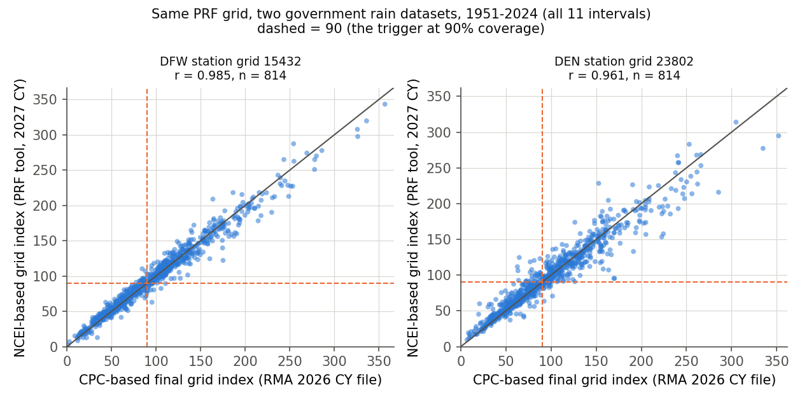
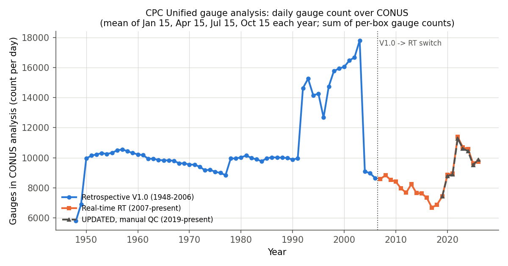

# R6: How USDA and Kalshi each decide how much it rained

**Proposal cell:** Week 2 / Evan (plus Jack's Week 2 note on the government's data-format change)  |  **Status:** DRAFT (primary sources read; spot checks run 2026-10-29)  |  **Last updated:** 2026-10-29

This note explains the "proof" each side uses to pay out. USDA's Pasture, Rangeland, Forage (PRF)
Rainfall Index pays when a government rain map, averaged over a 0.25-degree box and summed over a
two-month "index interval", comes in below normal. Kalshi's monthly rain contracts pay on the
number printed for one airport rain gauge in a National Weather Service (NWS) report. Everything
below is about how those two numbers are made, when they become final, and how far apart they can
be. Reproducible checks are in [`scripts/r6_spot_checks.py`](../../scripts/r6_spot_checks.py).

Terms used throughout:
- **Grid (PRF grid):** a 0.25 x 0.25 degree box (about 17 x 14 miles in Texas), the unit PRF insures.
- **Index interval:** one of 11 overlapping two-month windows (Jan-Feb, Feb-Mar, ..., Nov-Dec).
- **Final grid index:** interval rain in the grid divided by the grid's long-run average for that
  interval (100 = normal). A policy pays when it falls below the **trigger** = coverage level x 100.
- **Settlement / settles:** the moment a Kalshi contract's Yes/No outcome is fixed and paid.
- **CLI / CLM / CF6:** NWS text products: the Daily Climate Report, the Monthly Climate Report, and
  the Preliminary Local Climatological Data form F-6.
- **ASOS:** Automated Surface Observing System, the automated airport weather station.
- **LST:** local standard time (no daylight-saving shift).

## Key findings

- **PRF through crop year 2026 is settled on NOAA CPC's Unified Gauge-Based Analysis**, a daily
  0.25-degree map built by optimal interpolation of roughly 8,000-9,000 daily gauge reports per day
  over the lower 48 states, with each "day" running 12Z to 12Z (6 AM to 6 AM Central Standard Time)
  and stamped with its end date. RMA sums the daily values over the two months and divides by the
  grid's mean for that interval over 1948 through two years before the crop year. RMA "does not
  alter" the data and can change a published final index only if NOAA notifies it in writing of an
  error within one year (handbook FCIC-18150; Basic Provisions section 8(e)). The gauge network
  behind that normal is not constant: CPC's own per-box counts show about 9,900 gauges/day in
  1950-1991, a jump to about 14,600 in 1992, a peak near 17,800 in 2003 and a fall to about 9,100
  in 2004.
- **From crop year 2027 (contract change date 2026-08-31) PRF uses NOAA NCEI's nClimGrid-Monthly**,
  not CPC and not nClimGrid-Daily. NCEI averages its 1/24-degree (about 5 km) monthly grid into the
  same 0.25-degree PRF boxes and posts one plain CSV per month (`YYYYMM.usda.csv`: latitude,
  longitude, millimeters). The normal period becomes 1951 through crop year minus 2 (1951-2025 for
  crop year 2027). This is the "recent change in how the government formats weather maps".
- **History was recomputed.** The RMA PRF tool now serves NCEI-based index history starting in 1951
  (1948-1950 are blank). We verified that its "normal" is exactly the 1951-2025 mean of its own
  interval totals and that its totals equal sums of NCEI's monthly CSV values. CPC-based final
  values remain the official numbers for crop years 2026 and earlier.
- **CPC vs NCEI on the same box is close but not identical:** for the DFW and DEN station and
  farm grids, 1951-2024, the two index histories correlate at 0.93-0.985, differ by 6.7-14.3 index
  points on average, disagree on whether a 90%-coverage policy pays in 4.5-12.8% of interval-years,
  and the NCEI history pays 4-10% less on average. The 956-grid comparison in
  [06b](../analysis/06b_index_validation.md) agrees (CPC pays about 5% more). RMA's CPC-era index
  for 2019 onward reproduces only with CPC's manually checked `UPDATED` files (implied-normal
  variation 0.04-0.07% vs 0.4-0.5% for real-time files), consistent with 06b.
- **Kalshi's underlying is the first NWS Daily Climate Report (CLI) that covers every day of the
  month at the named ASOS station** (contract terms amended 2026-02-04). Trace counts as 0.00,
  missing days count as 0.00, and later corrections (including NCEI's final Local Climatological
  Data) are ignored unless Kalshi itself rules the first report a "material error". Since
  2026-09-04 the market text names "the corresponding TWC Report (Daily)": The Weather Company's
  Kalshi portal, which republishes the NWS CLI daily values (CF6 as backup) and says it does not
  originate or adjust them.
- **The rules text changed three times in 11 months** for the same Dallas series: November 2025 to
  February 2026 settled on a sum of NOAA Climate Data Online daily values (GHCN-Daily), March to
  August 2026 on the NWS Climatological Report (Daily), and September 2026 onward on the TWC Report.
- **Spot checks agree on the station number but not on the grid:** for DFW and DEN, June to
  September 2026, the first overnight CLI, the CLM, the CF6, ACIS, GHCN-Daily and the sum of TWC's
  daily values give identical month totals (to 0.01 in.) in all eight site-months, and every one
  of the 155 settled DFW/DEN strikes since Nov 2025 matches the CLI total (06c extends this to
  922/922 markets in 11 series). The PRF grid holding the same gauge disagrees widely: DFW June
  2026 was 8.07 in. at the airport but 4.33 in. (NCEI) and 4.41 in. (CPC) over the box.
- **The two products do not even use the same day.** Kalshi's month is midnight-to-midnight LST
  (1 AM to 1 AM CDT in summer); CPC's month is the 12Z-to-12Z days stamped 1st through last, so it
  starts and ends 18 hours earlier in Central time; nClimGrid-Monthly sums each station's own
  observing days, which end at about 7 AM for most cooperative observers. Example: the 0.16 in.
  that fell at DFW on the afternoon of 2026-09-30 is September rain for Kalshi but October rain in
  CPC's daily files.
- **One airport gauge has its own errors.** ASOS uses either a heated tipping bucket (0.01 in. per
  tip; NWS says it under-reports in extremely heavy rain and frozen precipitation) or an Ott
  weighing gauge (AWPAG) specified to within 4% or 0.02 in. of a standard 8-inch gauge. In NWS's
  2002-03 winter qualification test the tipping buckets met that standard on only 52% of events and
  under-reported by 9.5-25% on average.
- **Disputes:** Kalshi's Outcome Review Committee makes final, discretionary determinations
  (Rulebook Rule 7.1). For PRF, the final grid index is "a matter of general applicability": it
  cannot be arbitrated or appealed to USDA's National Appeals Division; the only remedy is judicial
  review after requesting a non-appealability determination within 90 days.

## Numbers table

"Computed" = derived by `scripts/r6_spot_checks.py` from the primary data named (run 2026-10-29).
Source numbers refer to the Sources list.

| Quantity | Value | Units | Region / period | Source (URL + page/table) | Verification |
|---|---|---|---|---|---|
| CPC native analysis grid | 0.125 | degrees | CONUS | [2] sec. 1 | CONFIRMED |
| CPC released / PRF grid | 0.25 x 0.25 | degrees | CONUS | [2] sec. 3; [9] para. 32A | CONFIRMED |
| CPC array | 300 x 120 boxes, centers 20.125-49.875N, 230.125-304.875E | boxes | CONUS | [4] metadata; [1] .ctl | CONFIRMED |
| PRF grid box size at 33N | about 17 (N-S) x 14 (E-W) | miles | DFW latitude | computed: 0.25 deg x 69.1 mi, x cos 33 deg | CONFIRMED (computed) |
| Daily gauge reports used, CONUS average | 8,000-9,000 | stations/day | CONUS, current | [2] sec. 1 | CONFIRMED |
| Mean gauge spacing | about 30 | km | CONUS | [2] sec. 1 | CONFIRMED |
| Stations per OI estimate | 4-10 (search radius set for 7 on average) | stations | per 0.125-deg point | [2] sec. 2 | CONFIRMED |
| Standard-deviation QC limit | 5 (10 for hurricanes) | standard deviations | daily | [2] sec. 4; [8] sec. 3.1 | CONFIRMED |
| Manual monthly QC start | January 2019 | date | CONUS | [2] sec. 4 | CONFIRMED |
| CPC day | 12Z to 12Z, stamped with end date | UTC | CONUS | [1] sec. 4; [4] | CONFIRMED |
| CPC versions | V1.0 1948-2006; RT 2007-present; UPDATED 2019-present | years | CONUS | [3] listings | CONFIRMED |
| RT availability | one day after the stamped date | days | CONUS | [2] sec. 5; [3] (2026-10-27 file posted 10-28) | CONFIRMED |
| UPDATED posting lag | July 2026 files dated 2026-09-28; Jan 2025 files dated 2025-03-22 | date | CONUS | [3] listings | CONFIRMED |
| CPC Cooperative Dataset (real time) | about 7,000 active; all but about 500 from River Forecast Centers; Feb 1992-present | gauges | U.S. | [8] sec. 5.1 | CONFIRMED |
| Real-time reports delayed more than 1 day (not used) | about 4 | % | U.S. | [8] sec. 5.1 | CONFIRMED |
| NCDC Cooperative Dataset | about 8,000 active; 1948-1998 | gauges | U.S. | [8] sec. 5.1 | CONFIRMED |
| Hourly Precipitation Dataset | about 2,500 active; lag about 1 year | sites | U.S. | [8] sec. 5.1 | CONFIRMED |
| Historical stations (RMA training) | 7,000 to 14,000 | stations | CONUS | [17] slide 13 | CONFIRMED |
| CPC gauges/day, mean | 9,885 (1950-91); 15,373 (1992-2003); 8,904 (2004-06); 7,866 (2007-18); 9,658 (2019-26) | gauges | CONUS, 4 days/yr | computed from [3] gauge-count field | CONFIRMED (computed) |
| CPC gauges/day, single years | 1991 9,962; 1992 14,639; 2003 17,814; 2004 9,094; 2006 8,644; 2007 8,578; 2017 6,677; 2022 11,386 | gauges | CONUS | same | CONFIRMED (computed) |
| Gauges in DEN station box | 0.0-1.6 (period means) | gauges/day | grid 23802, 1950-2026 | same | CONFIRMED (computed) |
| Gauges in 3 x 3 boxes around DFW | 19.9 (1950-91); 45.7-52.7 (1992-2018); 28.2 (2019-26) | gauges/day | around grid 15432 | same | CONFIRMED (computed) |
| PRF index intervals | 11 two-month intervals; at least 2 must be selected | count | PRF | [9] para. 32B-C | CONFIRMED |
| CPC-era normal | 1948 to CY-2 (CY2025: 1948-2023; CY2017: 1948-2015) | years | PRF | [9] para. 33D; [17] slide 11 | CONFIRMED |
| NCEI-era normal | 1951 to CY-2 (CY2027: 1951-2025) | years | PRF | [11] para. 33D; [13] | CONFIRMED |
| Final grid index rounding | 3 | decimals (of the ratio) | PRF | [13] | CONFIRMED |
| Coverage levels offered in PRF tool | 70, 75, 80, 85, 90 | % | PRF | [18] page | CONFIRMED |
| Indemnity deadline after final index published | 60 | days | PRF | [12] sec. 8(d) | CONFIRMED |
| Window for changing a published final index | less than 1 | year | PRF | [12] sec. 8(e) | CONFIRMED |
| Deadline to request NAD non-appealability | 90 | days after final index published | PRF | [12] sec. 15(a)(3) | CONFIRMED |
| NCEI switch dates | 2026-04-30 (Tropical Storm Option); 2026-08-31 (PRF, Apiculture, Shellfish); 2027-04-30 (Annual Forage) | dates | U.S. | [14] | CONFIRMED |
| Handbook FCIC-18150-1 issue date | 2026-08-31 | date | PRF | [11] cover | CONFIRMED |
| PM-26-053 date / FCIC Board approval | 2026-09-08 / 2026-08-20 | dates | PRF | [15] | CONFIRMED |
| 2027 Jan-Feb percent-of-value cap; grazing stocking minimum | 25; 25 | % | PRF | [15] | CONFIRMED |
| nClimGrid resolution | 1/24 (0.0417) | degrees | CONUS | [25] guide sec. 2 | CONFIRMED |
| nClimGrid points per PRF box | about 36 (6 x 6), simple average | points | CONUS | [22] Readme | CONFIRMED |
| NCEI USDA feed coverage | monthly 1895-present; daily 1950-present | years | CONUS | [22] Readme | CONFIRMED |
| NCEI USDA posting schedule | 4th business day of each month; monthly initial = last month, final = older | rule | CONUS | [22] Readme | CONFIRMED |
| Observed NCEI final postings | 202606 on 2026-08-07; 202607 on 2026-09-09; 202608 on 2026-10-12; 1,577 of 1,580 final files dated 2026-07-28 | dates | CONUS | [22] listing | CONFIRMED |
| Observed NCEI initial posting | 202609 on 2026-10-07 | date | CONUS | [22] listing | CONFIRMED |
| Grid cells in a USDA monthly CSV | 13,533 | cells | 202609 initial | computed from [22] | CONFIRMED (computed) |
| nClimGrid-Daily delay / data growth after first day | 2-3 days (3-day minimum in USDA feed) / 50-100% | days / % | CONUS | [25] guide sec. 4; [22] | CONFIRMED |
| nClimGrid-Monthly normals base; precip anomaly | 1981-2010; ratio to normal, inverse-distance weighted | method | CONUS | [23] sec. 3 | CONFIRMED |
| nClimGrid-Monthly cross-validation error | about 20 (recent summers); about half in winter | mm | CONUS area mean | [23] sec. 6a | CONFIRMED |
| nClimGrid station inclusion | at least 10 years of valid monthly data since 1950 | years | CONUS | [23] sec. 2 | CONFIRMED |
| nClimGrid-Daily observation times used | 0500-0900 LT and 2400 LT; midnight NWS sites dropped within 100 km and 100 m of a morning site | rule | CONUS | [24] sec. 2a-b | CONFIRMED |
| Share of precipitation reports taken in the morning | more than 50% throughout; over 70% by 2020 | % | NWS COOP+ASOS, 1951-2020 | [24] sec. 2b | CONFIRMED |
| PRF tool history start | 1951 (1948-1950 null) | year | grids 15429, 15432, 23204, 23802 | [18] API | CONFIRMED (computed) |
| PRF tool normal = mean of its 1951-2025 totals | 44 of 44 grid-intervals, to 4 decimals (e.g., DFW Jan-Feb 108.77 mm) | count | 4 grids | computed from [18] | CONFIRMED (computed) |
| PRF tool totals = sum of NCEI monthly finals | 12 of 12 tests, to 0.01 mm (e.g., DFW Jan-Feb 2025 137.59 mm) | count | 4 grids | computed from [18], [22] | CONFIRMED (computed) |
| PRF tool 2026 row normal | 1951-2024 mean (DFW Jan-Feb 108.3805 mm) | mm | grid 15432 | computed from [18] | CONFIRMED (computed) |
| Latest 2026 interval in PRF tool | Jun-Jul | interval | 2026-10-29 | [18] API | CONFIRMED |
| RMA bulk history files | 2026CY posted 2025-08-25 (55,577,094 bytes, CPC, 1948-2024); 2027CY posted 2026-08-31 | dates | CONUS | [19] listing | CONFIRMED |
| CPC vs NCEI index, DFW station grid 15432 | r 0.985; MAD 6.7; p90 14.4; max 53.0; trigger disagreement 4.5%; payment factor NCEI/CPC 0.96 | index points | 1951-2024, 814 values | computed from [19], [18] | CONFIRMED (computed) |
| Same, Parker Co. farm grid 15429 | r 0.979; MAD 8.0; p90 16.3; max 68.8; 5.2%; 0.95 | index points | same | same | CONFIRMED (computed) |
| Same, DEN station grid 23802 | r 0.961; MAD 9.9; p90 24.0; max 75.6; 5.7%; 0.91 | index points | same | same | CONFIRMED (computed) |
| Same, Elbert Co. farm grid 23204 | r 0.927; MAD 14.3; p90 29.3; max 96.8; 12.8%; 0.90 | index points | same | same | CONFIRMED (computed) |
| CPC vs NCEI, 956 grids near our stations | MAD 10.23; trigger disagreement 8.1%; payment factor 0.165 vs 0.157 | index points | 1951-2026 | [40] numbers table | CONFIRMED (read in 06b) |
| Implied CPC normal, grid 15432 (UPDATED, no shift) | Apr-May 216.29 (CV 0.04%); Jul-Aug 110.76 (CV 0.07%) | mm | 2019-2024 | computed from [3], [19] | CONFIRMED (computed) |
| Same with RT files | CV 0.51% (Apr-May), 0.37% (Jul-Aug) | % | 2019-2024 | same | CONFIRMED (computed) |
| NCEI normal, grid 15432 | Apr-May 213.01; Jul-Aug 108.61 | mm | 1951-2025 | [18] API | CONFIRMED |
| NWS CLI first mandatory issuance | 12:30-5:00 AM local, previous day midnight-midnight LST | time | U.S. | [26] sec. 4.1.2 | CONFIRMED |
| NWS CLI second mandatory issuance | typically 3:00-5:30 PM local | time | U.S. | [26] sec. 4.1.2 | CONFIRMED |
| CLM deadline / CF6 deadline | 5th / 3rd day of following month | day | U.S. | [26] sec. 4.2.2, 4.3.2 | CONFIRMED |
| Precipitation reporting unit | 0.01 in. or T | in. | U.S. | [26] Table 1 | CONFIRMED |
| DFW CLI times for Sep 30, 2026 | 4:39 PM and 7:31 PM CDT Sep 30; 1:48 AM CDT Oct 1; CLM 3:43 AM CDT Oct 1; CF6 0730Z Oct 1 | time | KDFW | [30] AFOS text | CONFIRMED |
| HTB funnel / tip size | 12 / 0.01 | in. | ASOS | [27] | CONFIRMED |
| AWPAG resolution / capacity | 0.01 / 40 | in. | ASOS | [28] sec. 1.1 | CONFIRMED |
| AWPAG planned sites | 313 NWS-sponsored ASOS, incl. 235 of 255 ASOS LCD sites | sites | U.S. | [28] sec. 1.3 | CONFIRMED |
| AWPAG accuracy spec | +/-4% or +/-0.02 in., whichever greater | vs 8-in. gauge | U.S. | [29] sec. 2.1 | CONFIRMED |
| 2002-03 test: AWPAG / HTB events meeting spec | 76% / 52% | % of events | Sterling VA, Johnstown PA | [29] sec. 4.1 | CONFIRMED |
| 2002-03 test: average under-report | AWPAG 3.5-4.5%; HTB 9.5-25% | % | same | [29] sec. 4.1 | CONFIRMED |
| Kalshi RAINM amendment (NWS first-CLI underlying) | 2026-02-04 | date | all RAINM series | [34] | CONFIRMED |
| TWC added as Source Agency | effective September 4 (2026) | date | KXRAINDALM | [37] `/series/KXRAINDALM` | CONFIRMED |
| Kalshi-TWC partnership announced | 2026-08-27 | date | all weather | [38] | CONFIRMED |
| Kalshi latest expiration / time | 15 days after month end / 10:00 AM ET | days / time | RAINM | [33] p. 2 | CONFIRMED |
| Kalshi last trading time | 11:59 PM ET on last day of month | time | RAINM | [33] p. 2 | CONFIRMED |
| Strike range and step | 0.00-100.00 in steps of 0.01 | in. | RAINM | [33] p. 1 | CONFIRMED |
| Outcome Review Committee | 3 members, at least 2 Public Directors; decision within 24 hours | members / hours | Kalshi | [36] Rules 2.7(e), 7.1(b) | CONFIRMED |
| TWC portal stations | 48 | stations | domestic Kalshi cities | [39] API | CONFIRMED |
| Settled DFW/DEN events / strikes / inconsistent with CLI | 22 / 155 / 0 | count | Nov 2025-Sep 2026 | computed from [37], [30] | CONFIRMED (computed) |
| Settled markets reproduced from station data, all series | 922 of 922 | markets | 133 city-months, Feb 2024-Sep 2026 | [41] | CONFIRMED (read in 06c) |
| Settlement lag after climate-month end | 6.9-13.3 (CLI/TWC rules); 57-107 (CDO rule) | hours | DFW, DEN | computed from [37] `settlement_ts` | CONFIRMED (computed) |
| Station totals, DFW Jun/Jul/Aug/Sep 2026 | 8.07 / 1.36 / T / 0.17 | in. | KDFW | [30] CLI, CLM, CF6; [31]; [32]; [39] | CONFIRMED |
| Station totals, DEN Jun/Jul/Aug/Sep 2026 | 1.42 / 1.00 / 1.59 / 2.23 (first CLI covering Sep 30: 2.22) | in. | KDEN | same | CONFIRMED |
| NCEI grid, DFW box Jun/Jul/Aug/Sep 2026 | 4.33 / 1.78 / 0.09 / 0.65 (Sep initial) | in. | grid 15432 | computed from [22] | CONFIRMED (computed) |
| CPC grid, DFW box Jun/Jul (UPDATED); Aug/Sep (RT) | 4.41 / 1.90; 0.28 / 0.28 (RT Jul 2.20) | in. | grid 15432 | computed from [3] | CONFIRMED (computed) |
| NCEI grid, DEN box Jun-Sep 2026 | 1.21 / 0.84 / 1.58 / 1.72 | in. | grid 23802 | computed from [22] | CONFIRMED (computed) |
| CPC grid, DEN box Jun/Jul (UPDATED); Aug/Sep (RT) | 1.30 / 0.98; 1.48 / 2.33 | in. | grid 23802 | computed from [3] | CONFIRMED (computed) |
| DFW rain timing around Oct 1, 2026 | 0.16 in. at 19-21Z Sep 30; 3.47 in. at 12-18Z Oct 1 | in., UTC | KDFW hourly METAR | [30] ASOS download | CONFIRMED |
| Grid IDs | DFW station 15432; Parker farm 15429; DEN station 23802; Elbert farm 23204 | ID | study sites | [20] map service for 15432, 15429, 23802; 23204 by formula (also in [40]) | CONFIRMED |

## Detail

### 1. The USDA side before 2027: CPC Unified Gauge-Based Analysis

**Who makes it.** NOAA's Climate Prediction Center (CPC, part of NCEP/NWS) produces the "CPC
Unified Gauge-Based Analysis of Daily Precipitation over CONUS" as part of its Unified
Precipitation Project, whose goal is "a suite of unified precipitation products with consistent
quantity and improved quality" built with optimal interpolation (CPC README). NOAA's Physical
Sciences Laboratory (PSL) redistributes it as netCDF and credits the original source to
"NCEP/Climate Prediction Center (Wayne Higgins, Evgeney Yarosh, Wei Shi)".

**Resolution and grid.** CPC builds each day on a 0.125-degree native grid, averages it to
0.25-degree boxes (each 0.25-degree box is the cosine-latitude-weighted mean of four 0.125-degree
boxes, "no spatial smoothing is applied"), and releases a 300 x 120 array covering 20.125N-49.875N
and 230.125E-304.875E (CPC procedure document, 2021; PSL metadata). PRF grids in the lower 48 are
exactly these boxes. We confirmed the RMA grid ID is the 1-based position in CPC's array:
`grid_id = 300*j + i + 1`, with `i = floor((lon_east - 230)/0.25)` and
`j = floor((lat - 20)/0.25)`. RMA's PRF_GRID map service returns grid 15432 for the DFW station,
15429 for the Parker County farm point, and 23802 for the DEN station, all matching the formula.

**Gauge networks and counts.** CPC's 2021 procedure note says "on average, daily precipitation
reports from 8,000-9,000 stations are available ... over the CONUS", about 30 km apart, with sparse
coverage in the western mountains. CPC's Atlas No. 7 (Higgins et al. 2000) describes the three
gauge sources of its U.S. "Unified Raingauge Dataset": (1) the near-real-time CPC Cooperative
Dataset (first-order WMO GTS sites plus SHEF-coded 24-hour reports from the River Forecast Centers;
about 7,000 active, all but about 500 from the River Forecast Centers; 1992-present; about 4% of
reports arrive more than a day late and are not used in the real-time analysis), (2) the NCDC
Cooperative Dataset (about 8,000 active daily gauges, 1948-1998, not real time), and (3) the Hourly
Precipitation Dataset (about 2,500 active hourly sites, available with a lag of about one year).
RMA's 2017 PRF training slides describe the historical record as built from "7,000 to 14,000
stations". Each daily CPC file also carries a field with the number of gauges in each box; our
script sums it to count gauges over time (section 5.7, Figure 1).

**Interpolation method.** For each 0.125-degree point, CPC (1) builds a daily climatology by
disaggregating PRISM monthly normals to 365 days, (2) interpolates each station's departure from
that climatology by optimal interpolation (OI), choosing a search radius so that on average 7
stations fall inside it and using between 4 and 10 stations, and (3) adds the interpolated
departure back to the climatology (procedure document; Xie et al. 2007 for the OI algorithm; Chen
et al. 2008 JGR for the comparison showing OI beat other techniques). OI weights decline with
distance and are reduced for stations that are close to each other. RMA's handbook paraphrases this
as "a minimum of four reporting stations closest to the center of the grid" and stresses that the
value "cannot be traced to a single point or reporting station(s)".

**Quality control.** Real-time reports pass automatic checks: a blacklist of known-bad stations,
a duplicate-station check, a "buddy check" against stations in the same 1-degree box, and a check
that the value is within 5 standard deviations (10 for hurricanes) of the daily climatology
(procedure document; Atlas 7 adds a NEXRAD radar check that removes false zero reports). Since
January 2019 CPC meteorologists also run a monthly manual QC: they inspect every day's map, compare
it to MRMS radar, trace suspicious grid values to the stations used, compare those with NCEI and
Iowa State archives, drop bad reports, and rerun the month.

**Day definition.** "Daily accumulation ends at 12Z" (README); PSL: values are "accumulated from
12z of the day before to 12z of the day". So the file stamped 2026-10-01 covers 12Z Sep 30 to 12Z
Oct 1 (6 AM to 6 AM CST). Atlas 7 notes that most input reports are on a 12Z-12Z window but "in
some cases the reporting time is ambiguous".

**Versions and known discontinuities.** Three versions sit on CPC's server
(https://ftp.cpc.ncep.noaa.gov/precip/CPC_UNI_PRCP/GAUGE_CONUS/):
- `V1.0/` retrospective analysis, 1948-2006 (gzipped daily files);
- `RT/` real-time analysis, 2007-present, built only from reports that arrived in real time and
  passed automatic QC; CPC says these "will be reprocessed later on when enhanced station data are
  available";
- `UPDATED/` 2019-present, rebuilt after the monthly manual QC.
The input network is not constant over the 1948-present record that PRF's normal is built on.
Counting the gauges CPC itself reports per box (section 5.7, Figure 1): about 9,900 per day in
1950-1991, a jump to about 14,600 in 1992 (the year Atlas 7 says CPC's real-time cooperative
collection begins), a peak near 17,800 in 2003, a fall to about 9,100 in 2004, and then a nearly
seamless hand-off from V1.0 to RT at 2007 (8,644 vs 8,578), followed by a decline to about 6,700 in
2017 and a rise to about 11,400 in 2022. So the known inhomogeneities sit at 1992 and 2004, not at
the V1.0/RT boundary. RMA's 2017 training slides point to `V1.0/` for 1948-2006 and `RT/` for
2006(7)-present; for 2019 onward RMA's CPC-era indices match `UPDATED/` (section 5.6).

**Access and latency.** CPC FTP (binary GrADS files; 0.1 mm units; -999 missing), PSL netCDF
(https://psl.noaa.gov/data/gridded/data.unified.daily.conus.html; PSL lists daily RT updates and
monthly means). CPC says RT files "are available one day after the stamped date". The directory
listing on 2026-10-29 showed the 2026-10-27 RT file posted on 10-28, and each RT file rewritten
again about a day later. The `UPDATED/` files for July 2026 were posted on 2026-09-28, about two
months after the fact.

### 2. How RMA turns daily rain maps into a PRF grid index

From the handbook (FCIC-18150, 2026 and 2027 editions), the Basic Provisions (27.1-RI), and RMA's
2026 processing note:

1. **Interval total.** Sum the precipitation over the two calendar months of the interval in the
   grid. Precipitation in earlier intervals "has no effect" on later ones.
2. **Expected grid index (the normal).** The mean of that interval's totals over the base period:
   CPC era, 1948 through two years before the crop year (crop year 2025 used 1948-2023; RMA's 2017
   slides: crop year 2017 used 1948-2015); NCEI era, 1951 through crop year minus 2 (crop year 2027
   uses 1951-2025). The two-year lag exists "because 2025 is the most recently completed full
   calendar year as of the filing date of 8/31/2026". The handbook defines it as "normalized and
   expressed as a percentage such that the mean is 100".
3. **Final grid index** = interval total / normal, "rounded to 3 decimals" (RMA processing note),
   reported as a percent (0.875 = 87.5).
4. **Trigger and payment.** Trigger grid index = expected index (100) x coverage level (70-90%).
   Payment calculation factor = (trigger - final) / trigger. The indemnity is issued no later than
   60 days after RMA publishes the final grid index; interest accrues from day 61.
5. **No smoothing or adjustment by RMA.** "RMA does not alter the NOAA CPC or HCDP data" (2026
   handbook), and the NCEI-era handbook keeps the same sentence for NCEI. The policy definition
   says the index is "based on a 24-hour period determined by the data", that is, whatever day
   definition the producer uses.
6. **Revisions.** A published final grid index "will not be changed once published unless (i) RMA
   is notified by NOAA NCEI in writing of an error in the data RMA published; (ii) the RMA
   Administrator ... determines a change is warranted; and (iii) less than 1 year has elapsed"
   (Basic Provisions 8(e)). If NOAA data become unavailable during an insured interval, no
   indemnity is due for it and its premium is refunded (section 3(j)).
7. **Preliminary vs final.** RMA's documents name only the "final grid index". The NCEI feed has
   an `initial` file for the previous month and a `final` file for older months, and RMA says "for
   the Rainfall Index, the monthly final data is used". The PRF Decision Support Tool (DST) shows
   index values for the current year as they are posted; on 2026-10-29 it showed 2026 values only
   through Jun-Jul. We did not find a published CPC-era release schedule (open question).

### 3. The 2026 switch from CPC to NOAA NCEI

**What RMA announced (2026-04-30).** The rainfall source for PRF, Apiculture and Shellfish moves
from CPC to NCEI on 2026-08-31 (Hurricane Insurance Protection's Tropical Storm Option moved
2026-04-30; Annual Forage moves 2027-04-30 and keeps CPC for the rest of crop year 2027). RMA's
reasons: NCEI data come "in formats like Microsoft Excel that anyone can open", while CPC data are
"in a technical format that requires special software"; a formal agreement with NCEI "includes
dedicated staff ..., a consistent data release schedule, and a pathway to add more weather
stations"; RMA "anticipates that final grid index values and indemnity payments will be delivered
faster"; and "historical data shows that overall loss ratios remain nearly identical under the new
data source". "The geographic grids ... will remain the same."

**Which NCEI product, exactly.** RMA's processing note ("Rainfall Index - Data, 2027 and Beyond",
posted 2026-06) names **nClimGrid** monthly precipitation (Vose et al. 2014), "at a 5 km by 5 km
grid scale", which "NOAA NCEI has re-scaled ... to 0.25 degree latitude by 0.25 degree longitude for
the Risk Management Agency", and says "the monthly final data is used". NCEI's consumer guide for
that feed (updated 2026-03-26) says each 0.25-degree value "is the simple arithmetic average of the
nClimGrid 1/24 degree grid-box values that fall within it" (about 36 points per box). The same
directory also has daily 0.25-degree grids derived from nClimGrid-Daily that are scaled so each
month sums to the monthly value; RMA does not use them for PRF. The 2027 handbook (FCIC-18150-1,
issued 2026-08-31) and the 2027 Basic Provisions replace every "NOAA CPC" with "NOAA NCEI" and
change "1948" to "1951". The handbook also dropped the CPC-specific sentence about "a minimum of
four reporting stations". The grid-index workstream reached the same identification independently
by matching DST interval totals to the 36-cell mean of nClimGrid-Monthly to within 0.05 mm
([06b](../analysis/06b_index_validation.md)); the RMA note and NCEI guide above make it an
official statement rather than an inference, and they also settle 06b's open question about the
base period: settlement from crop year 2027 uses 1951 to crop year minus 2.

**How nClimGrid-Monthly is made (Vose et al. 2014).** Input is GHCN-Daily station data from the
NWS Cooperative Observer (COOP) and ASOS networks, USDA SNOTEL, Environment Canada (south of 52N)
and Mexico's SMN (north of 24N); RAWS fire-weather gauges are excluded for precipitation because
they are unheated. Stations need at least 10 years of valid monthly data since 1950. The method is
climatologically aided interpolation: 1981-2010 station normals are mapped with thin-plate
smoothing splines, each month's station precipitation is turned into a ratio to its normal,
the ratios are interpolated by inverse-distance weighting, and the two are multiplied. Cross-
validated errors are about 20 mm in recent summers and about half that in winter. NCEI recommends
starting PRF history in 1951 "due to data quality, modelling fit, and consistency with the daily
product" (RMA note); nClimGrid-Daily (Durre et al. 2022) starts in 1951 because station density was
much lower before then. CoCoRaHS volunteer gauges are not used in nClimGrid-Daily (to avoid a
post-2000 density jump).

**Day definition under NCEI.** The monthly grid sums each station's own month of daily reports.
In GHCN-Daily a value is dated by its observation day, and most COOP gauges are read in the
morning (Durre et al. 2022: more than half of precipitation reports throughout 1951-2020 were
taken in the morning, over 70% by 2020), so for a gauge read at 7 AM, "July" runs from 7 AM on
June 30 to 7 AM on July 31. ASOS sites like DFW report midnight-to-midnight LST. For
nClimGrid-Daily, NCEI goes further: it uses only morning (0500-0900 LT) and midnight observations,
combines day D's morning reports with day D-1's midnight reports, and drops NWS midnight stations
within 100 km and 100 m elevation of a morning station, so a big airport ASOS can be left out of
the daily product entirely.

**Release timing and formats.** NCEI posts files "on the fourth business day of the month": the
`initial` file for last month and the `final` files for everything up to two months ago. On
2026-10-29 the listing showed `202607` final posted 2026-09-09, `202608` final posted 2026-10-12,
and `202609` initial posted 2026-10-07. So for an interval ending in month M, the final input is
due early in month M+2 (for Jul-Aug, early October). Format: CSV, three columns, 13,533 grid
cells.

**Were historical indices recomputed?** Yes. The PRF tool now states it "is displaying rainfall
data from the NOAA National Centers for Environmental Information (NCEI). For final index values
using rainfall data from Climate Prediction Center (CPC), please refer to the Actuarial Information
Browser for crop years 2026 and prior." Its API returns null for 1948-1950 and values from 1951. RMA
posts the bulk history file for each crop year near 8/31 (`Rainfall_Index_HistoricData2027CY.zip`
posted 2026-08-31, NCEI-based, 1951-2025; earlier files CPC-based from 1948), and warns that
"due to differing historical periods, the bulk download options cannot be used to find the final
index values that were used to issue indemnities". 06b quantifies this: on 14 PRF study grids the
DST values shown today differ from the as-settled ADM finals for 2021-2026 by 12.6 index points on
average and flip the 90%-coverage payment decision in 10.7% of cases. ProAg (an insurer) tells
agents that rates, historical illustrations and payment patterns "may differ from prior-year
results". Spreadsheet
format: the bulk file is pipe-delimited text (`grid_id|InsurancePlanCode|Commodity0088|
Commodity1191|Year|PracticeCode|ActualIndex`), where `PracticeCode` holds the interval code
(625 = Jan-Feb ... 635 = Nov-Dec in the DST API).

**Other 2027 PRF changes in the same filing (PM-26-053, 2026-09-08)** that other workstreams need:
grazing policies must show livestock equal to at least 25% of an average stocking rate, and the
percent of value placed in the Jan-Feb interval is capped at 25%.

### 4. The Kalshi side: what NWS reports and how Kalshi uses them

#### 4.1 The NWS products

| Product | What it is | When issued | Precipitation content |
|---|---|---|---|
| CLI, Daily Climate Report | Summary of one climate day at an ASOS climate site | At least twice daily: a mandatory report between 12:30 and 5:00 AM local for the previous day, and a mandatory late-afternoon report (typically 3:00-5:30 PM) for the current day so far; offices may add more | "Today/Yesterday", "Month to date", normals, departures, records; 0.01 in. or T |
| CLM, Monthly Climate Report | Month summary | At least monthly, no later than the 5th of the next month; can run once the last overnight CLI of the month is out | "TOTALS" line plus days with >= 0.01/0.10/0.50/1.00 in. and greatest 24-hour total |
| CF6 (F-6), Preliminary Local Climatological Data | One row per day plus month sums | Posted at least by the 3rd of the next month, usually daily | Column 7 "WTR" in hundredths or T; "TOTAL FOR MONTH" |

Source: NWS Instruction 10-1004 (2025-06-05). Key definitions from the same instruction:
- **Climate day:** the overnight CLI captures "the previous calendar day's (midnight-to-midnight
  Local Standard Time [LST]) data"; the CF6 says "all data are for midnight to midnight LST".
  NWS Chicago spells out the consequence: during daylight saving time the climate day runs from
  1 AM to 1 AM local daylight time.
- **Trace:** observations are reported as "Precipitation (0.01 inches or T)"; T means a trace, an
  amount below the 0.01-in. reporting resolution. NWS products keep T distinct from 0.00.
- **Missing:** one missing day makes the preliminary monthly value "MM" in the CLI and "M" in CF6.
- **Software and QC:** the CLI is produced from the ASOS Daily Summary Message, which "is not
  subject to WFO quality control"; offices "should correct erroneous data in the CLI". Backup
  sensors are noted in CF6 remarks.
- **Preliminary vs final:** "all data are preliminary until they have been subject to all levels of
  NCEI quality control." NCEI uses the CF6 to resolve discrepancies when preparing the final record
  for Local Climatological Data (LCD) sites; at Primary LCD sites (mostly major airports) NCEI does
  manual QC with the local office. Offices correct NCEI's archive through "Datzilla" tickets.

What this looked like at DFW for the last day of September 2026 (raw text from the IEM archive):
the 4:39 PM CDT CLI ("valid as of 0400 PM") already showed month-to-date 0.17 in.; a 7:31 PM CLI
showed 0.17; the overnight CLI issued 1:48 AM CDT Oct 1 (48 minutes after the climate day ended at
1 AM CDT) showed "MONTH TO DATE 0.17"; the CLM issued 3:43 AM CDT Oct 1 showed "TOTALS 0.17"; and
the CF6 issued 0730Z Oct 1 showed "TOTAL FOR MONTH: 0.17".

#### 4.2 The gauge: ASOS precipitation sensors and their biases

- **Heated tipping bucket (HTB).** The original ASOS gauge: a heated 12-inch funnel over a
  dual-chamber bucket that tips every 0.01 in.; tips are counted each minute and run through an
  algorithm for very high rain rates (NWS Chicago FAQ). NWS's AWPAG implementation plan (2003):
  the HTB "accurately measures liquid precipitation in most rain events except for excessively heavy
  rain events where the tipping bucket cannot tip fast enough", and in snow the heated funnel can
  cause evaporation losses, or snow can cap the orifice and later melt as a "false surge".
- **All-Weather Precipitation Accumulation Gauge (AWPAG).** An Ott Hydrometrie weighing gauge
  (strain gauge, 0.01 in. resolution, 40 in. capacity, antifreeze, metal wind shield, heated rim)
  with internal compensation for evaporation and wind-induced vibration. NWS planned it for 313
  NWS-sponsored ASOS sites, including 235 of the 255 ASOS LCD sites. Spec: within 4% or 0.02 in.
  (whichever is greater) of a standard NWS 8-inch gauge with an Alter shield.
- **Measured bias.** In the 2002-03 qualification test (Sterling, VA and Johnstown, PA; mostly
  frozen or mixed events) AWPAG event totals met the spec 76% of the time and the misses were
  under-reports averaging 3.5-4.5%; the collocated HTBs met it only 52% of the time and
  under-reported by 9.5-25% on average (White et al. 2004). These are winter-heavy numbers; for
  warm-season rain the main HTB risk NWS documents is undercatch in extreme rain rates. All gauges
  also undercatch in wind; we did not find a peer-reviewed undercatch number specific to our
  stations (open question). Which gauge DFW and DEN have today is not stated in anything we read.

#### 4.3 Where the station numbers live

| Archive | What it holds | Revision status |
|---|---|---|
| NWS NOWData / WFO climate pages (weather.gov/wrh/climate) | CLI, CLM, CF6 text and tables | Preliminary; Kalshi's link through Aug 2026 |
| Iowa Environmental Mesonet (IEM) AFOS archive and CLI parser (mesonet.agron.iastate.edu) | Every issued CLI/CLM/CF6 text product with issue time, including corrections | Raw as issued; best source for "first report" questions |
| ACIS (data.rcc-acis.org) | Daily/monthly station values (ThreadEx and GHCN-based) | Updated as corrections arrive |
| NCEI GHCN-Daily and Climate Data Online | Daily station values after NCEI QC | Updated; this was Kalshi's primary source Nov 2025-Feb 2026 |
| NCEI Local Climatological Data (LCD) | Final edited airport record | Final; Kalshi explicitly ignores it |
| TWC Kalshi portal (weather.com/kalshi) | Daily official values per Kalshi city since at least June 2026 | Marks rows "Revised" if later reports arrive |

#### 4.4 What Kalshi's contract actually says

Current contract terms (RAINM, fetched 2026-10-29) define the underlying as "the total monthly
precipitation (in inches) recorded at the National Weather Service (NWS) weather station specified
as <city> during <month>, as reported in the first Daily Climate Report published by the NWS
Weather Forecast Office that contains precipitation data for all calendar days of <month>". Further
clauses: trace is 0.00; a day listed as missing is 0.00; the report's stated monthly total is used
(Kalshi sums daily values only if no total is printed); "only the first qualifying Daily Climate
Report is determinative" and later corrections "including final LCD data" do not count unless the
Exchange decides the first report has a "material error", in which case expiration can be delayed
up to the Expiration Date (latest 15 days after month end, 10:00 AM ET); if no reliable data exist
by then, markets "resolve to the last fair price". Last trading is 11:59 PM ET on the month's last
day. Source Agencies: NWS, The Weather Company, NOAA. The 2026-02-04 CFTC self-certification made
NWS "a primary Source Agency" and moved the underlying to the first complete Daily Climate Report
"in line with more rapid potential resolution". The series page adds: "effective September 4th, an
amendment to the contract terms will change the Source Agencies for this event to include The
Weather Company."

The `rules_secondary` text actually attached to each Dallas market (Kalshi API):

| Events | rules_secondary (abridged) |
|---|---|
| KXRAINDALM Nov 2025 - Feb 2026 | "The primary resolution link will be a sum of NOAA's Climate Data Online Daily Summaries of precipitation at the weather station specified [GHCND:USW00003927]. If no data is available, Kalshi will invoke its rules to settle the market using the NWS' Monthly Climate Report; or if that is not available, the sum of precipitation in Daily Climate Reports." |
| Mar - Aug 2026 | "Data for CLIDFW can be found by ... https://www.weather.gov/wrh/Climate?wfo=fwd ... Daily Climate Report selected. Please use the latest version of the data ... the official and final value used to determine this market as reported by the corresponding NWS Climatological Report (Daily) ... Preliminary NWS reporting and measurement methods may be subject to underlying rounding and conversion nuances." |
| Sep 2026 onward | "Not all weather data is the same. While checking a source like AccuWeather or Google Weather may help guide your decision, the official and final value used to determine this market as reported by the corresponding TWC Report (Daily)." |

The `rules_primary` is the same in all three: "If the total precipitation at CLIDFW in Dallas in
<Mon YYYY> is strictly greater than <K> inches, then the market resolves to Yes." The older legacy
New York contract (RAINNYCM, markets back to Feb 2024) summed "the most recent daily climate
reports for any given day" and used "only initial non-preliminary reported values".

#### 4.5 "The corresponding TWC Report (Daily)" and what happens if TWC and NWS differ

Kalshi and The Weather Company (TWC, which runs weather.com and The Weather Channel app) announced
their partnership on
2026-08-27: Kalshi "will use The Weather Company's enterprise-grade weather data feeds as its
trusted source for verifying weather-related market outcomes"; TWC "provides the authoritative
observation data used to settle these markets"; "Kalshi designs the contracts, operates the
exchange, and resolves markets". TWC's portal (https://weather.com/kalshi, linked from the
Kalshi series page) lists official daily values for 48 domestic Kalshi stations. Its page text:
"Source: NWS/NOAA official Daily Climate Report (CLI), with WS Form F-6 (CF6) as backup. Values
reflect the official figures published after the daily cutoff. If a later METAR or climate report
arrives after that, the settlement rule is reapplied to the reports on file and the row reads
Revised. Values come solely from those official observations; The Weather Company does not
originate or adjust them." It also says "official climate data typically arrives between midnight
and 4 AM local time, valid for the previous day" and "A trace (T) is never measurable and adds 0 to
a period total." There is no TWC monthly total; the month is the sum of TWC's daily values.

So TWC is a re-publisher of the same NWS number, not a new measurement. They can differ only if
(a) NWS issues a corrected CLI after TWC froze a day (TWC then marks it "Revised"), (b) the CLI is
missing and TWC falls back to the CF6, or (c) TWC's sum of rounded daily values differs from the
CLI's printed month total. The contract's tie-breakers are the "first qualifying Daily Climate
Report" rule plus Kalshi's material-error discretion; if Kalshi starts a Market Outcome Review, its
three-member Outcome Review Committee (at least two Public Directors) must decide within 24 hours
and "the determinations made by the Outcome Review Committee are final" (Rulebook v1.15, Rule 7.1).
Rule 7.2 also lets Kalshi designate a new Source Agency after trading starts if the old one
becomes unreliable; the TWC addition itself was made as an amendment to the contract terms
(effective September 4, 2026, per the series page), and the February 2026 filing notes that "a new
Source Agency can be added via a Part 40 amendment".

### 5. Spot checks (run 2026-10-29)

All numbers below come from `python scripts/r6_spot_checks.py` (tables saved to
`data/raw/r6/out/`). Stations: DFW (KDFW, GHCN USW00003927) and DEN (KDEN, USW00003017), the two
study sites with Kalshi history; the other study cities' series list only November 2026 so far.

#### 5.1 Every settled Kalshi strike matches the NWS CLI month total

For all 22 settled DFW and DEN monthly events (Nov 2025 - Sep 2026; 155 settled strikes, all of
type "greater than K inches", K = 1 to 10), the Yes/No result Kalshi posted is what the CLI month
total implies. No strike was inconsistent. Kalshi's API field `expiration_value` is the CLI total rounded to 0.1 in.
for 2026 events (blank for some), so it should not be used as data:

| Event | Rules regime | Kalshi `expiration_value` | NWS CLI month total (in.) | Settled (UTC) |
|---|---|---|---|---|
| KXRAINDALM-25NOV | NOAA CDO daily sum | 5.32 | 5.32 | 2025-12-03 16:44 |
| KXRAINDALM-26FEB | NOAA CDO daily sum | 1.3 | 1.31 | 2026-03-04 19:08 |
| KXRAINDALM-26MAR | NWS CLI | 2.9 | 2.92 | 2026-04-01 15:15 |
| KXRAINDALM-26APR | NWS CLI | 5.1 | 5.06 | 2026-05-01 13:57 |
| KXRAINDALM-26MAY | NWS CLI | 3.0 | 2.96 | 2026-06-01 17:17 |
| KXRAINDALM-26JUN | NWS CLI | 8.1 | 8.07 | 2026-07-01 17:17 |
| KXRAINDALM-26JUL | NWS CLI | 1.4 | 1.36 | 2026-08-01 14:59 |
| KXRAINDALM-26AUG | NWS CLI | 0.0 | T (trace) | 2026-09-01 16:41 |
| KXRAINDALM-26SEP | TWC Report | 0.2 | 0.17 | 2026-10-01 19:17 |
| KXRAINDENM-26MAY | NWS CLI | 1.6 | 1.63 | 2026-06-01 17:17 |
| KXRAINDENM-26JUN | NWS CLI | 1.4 | 1.42 | 2026-07-01 17:17 |
| KXRAINDENM-26AUG | NWS CLI | 1.6 | 1.59 | 2026-09-01 16:41 |
| KXRAINDENM-26SEP | TWC Report | 2.2 | 2.23 | 2026-10-01 19:17 |

(The other nine events had a blank `expiration_value`; their strikes also match.) Under the
"CLI" and "TWC" regimes Kalshi settled 7 to 13 hours after the climate month ended (midnight LST),
between 13:54 and 19:17 UTC on the 1st of the next month; under the "CDO" regime it settled 57 to
107 hours (2.4 to 4.5 days) after month end, because GHCN-Daily values arrive later. The
rounding matters only if a total lands within 0.05 in. above a strike (for example 5.04 in.
against "above 5"); no 2026 event did, so we cannot tell which number Kalshi compared. DEN July
2026 landed exactly on a strike (1.00 in. vs "above 1") and settled No, confirming "strictly
greater" in practice.

This is a small, independent slice of the settlement-station workstream's full check, which
reproduces 922 of 922 settled markets (133 city-months, 11 series, Feb 2024 - Sep 2026) from ACIS
station data and documents the three value-level anomalies seen so far: a CLI "missing" day later
filled in the archive (Houston Hobby, Jan 2026), a displayed value equal to the 4 PM preliminary
CLI (New York, Jun 2024), and one unexplained value (Houston, Feb 2026); none changed an outcome.
It also found that the Chicago series settled on Midway (CLIMDW) through Aug 2026 and on O'Hare
(CLIORD) from Sep 2026, so the station must be read per market
([06c](../analysis/06c_station_vs_kalshi_settlement_check.md)).

#### 5.2 Station archives agree to the hundredth; the grid does not

| Site, month | Rules | First CLI covering last day (issued, MTD in.) | First overnight CLI | CLM | CF6 | ACIS | GHCN-D | TWC daily sum |
|---|---|---|---|---|---|---|---|---|
| DFW 2026-06 | NWS CLI | 4:30 PM CDT Jun 30, 8.07 | 1:43 AM CDT Jul 1, 8.07 | 8.07 | 8.07 | 8.07 | 8.07 | 8.07 |
| DFW 2026-07 | NWS CLI | 4:30 PM CDT Jul 31, 1.36 | 1:39 AM CDT Aug 1, 1.36 | 1.36 | 1.36 | 1.36 | 1.36 | 1.36 |
| DFW 2026-08 | NWS CLI | 4:31 PM CDT Aug 31, T | 1:39 AM CDT Sep 1, T | T | T | T | 0.00 (4 trace days) | 0.00 |
| DFW 2026-09 | TWC | 4:39 PM CDT Sep 30, 0.17 | 1:48 AM CDT Oct 1, 0.17 | 0.17 | 0.17 | 0.17 | 0.17 | 0.17 |
| DEN 2026-06 | NWS CLI | 6:30 AM MDT Jun 30, 1.42 | 1:31 AM MDT Jul 1, 1.42 | 1.42 | 1.42 | 1.42 | 1.42 | 1.42 |
| DEN 2026-07 | NWS CLI | 6:31 AM MDT Jul 31, 1.00 | 1:33 AM MDT Aug 1, 1.00 | 1.00 | 1.00 | 1.00 | 1.00 | 1.00 |
| DEN 2026-08 | NWS CLI | 6:30 AM MDT Aug 31, 1.59 | 1:31 AM MDT Sep 1, 1.59 | 1.59 | 1.59 | 1.59 | 1.59 | 1.59 |
| DEN 2026-09 | TWC | 6:29 AM MDT Sep 30, **2.22** | 1:44 AM MDT Oct 1, **2.23** | 2.23 | 2.23 | 2.23 | 2.23 | 2.23 |

All six station archives agree exactly in all eight site-months, and TWC's daily values (pulled
from TWC's own portal API, which 06c could not access) sum to the same totals with no missing
days, including both September 2026 months settled under the TWC rule. The only discrepancy is inside the NWS stream: Boulder's 6:29 AM
CLI on Sep 30 (a morning report that already lists every calendar day) said 2.22 in.; the overnight
report said 2.23. A literal reading of "the earliest-dated Daily Climate Report ... that contains
recorded precipitation values ... for every calendar day" could pick the morning report. Kalshi
settled after the overnight report, and 2.22 vs 2.23 changes no strike, but a real storm on the
last afternoon of a month could.

The same months on the PRF grid that contains each station (box 15432 around DFW, 23802 around
DEN), converted to inches:

| Site, month | Station (CLI) | NCEI grid (PRF 2027+) | CPC grid, UPDATED | CPC grid, RT | NCEI / station |
|---|---|---|---|---|---|
| DFW 2026-06 | 8.07 | 4.33 (final) | 4.41 | 4.41 | 0.54 |
| DFW 2026-07 | 1.36 | 1.78 (final) | 1.90 | 2.20 | 1.31 |
| DFW 2026-08 | T | 0.09 (final) | n/a | 0.28 | n/a |
| DFW 2026-09 | 0.17 | 0.65 (initial) | n/a | 0.28 | 3.8 |
| DEN 2026-06 | 1.42 | 1.21 (final) | 1.30 | 1.30 | 0.85 |
| DEN 2026-07 | 1.00 | 0.84 (final) | 0.98 | 1.06 | 0.84 |
| DEN 2026-08 | 1.59 | 1.58 (final) | n/a | 1.48 | 0.99 |
| DEN 2026-09 | 2.23 | 1.72 (initial) | n/a | 2.33 | 0.77 |

The airport gauge and the box average differ by a factor of two in either direction in summer
convective months (DFW June: 8.07 in. at the airport, about 4.4 in. averaged over the box). The
two government grids also differ from each other (DFW September: 0.65 vs 0.28 in.), and CPC's
real-time and updated versions differ (DFW July: 2.20 vs 1.90 in.). CPC `UPDATED/` files for
August and September 2026 were not yet posted on 2026-10-29.

#### 5.3 A day-boundary example

DFW's hourly METAR precipitation shows the 0.16 in. of Sep 30, 2026 falling between 19:00 and
21:00 UTC (2-4 PM CDT), and the 3.47 in. of Oct 1 falling between 12:00 and 18:00 UTC. The NWS
books the first amount in September (midnight-to-midnight LST). CPC's file stamped Oct 1 covers
12Z Sep 30 to 12Z Oct 1, so CPC books the Sep 30 afternoon rain in October. The Oct 1 storm
started after 12Z, so both systems book it in October. When a storm straddles the early morning of
a month boundary, CPC and the NWS put it in different months.

#### 5.4 The PRF tool now runs on NCEI data, and we can reproduce it

For four grids (DFW station 15432, Parker County farm 15429, DEN station 23802, Elbert County farm
23204) we pulled the PRF Decision Support Tool's own API
(`PrfExternalIndexes/GetIndexValues`, fields `IntervalMeasurement`, `AverageIntervalMeasurement`,
`PercentOfNormal`):
- every grid's history starts in 1951 (1948-1950 null), 75 years through 2025;
- for all 44 grid-intervals, the "average" printed for the 1951-2025 rows equals the arithmetic
  mean of the 75 printed totals for 1951-2025 to four decimals (DFW Jan-Feb: 108.77 mm), and the
  2026 row uses the 1951-2024 mean (108.3805 mm), as the "1951 to crop year minus 2" rule implies;
- 12 of 12 interval totals we tested (Jan-Feb 1951, Jan-Feb 2025, Jul-Aug 2024 for each grid)
  equal the sum of the two monthly values in NCEI's `cirs/usda/monthly/final` CSVs to 0.01 mm
  (for example DFW Jan-Feb 2025: 137.59 mm both ways);
- `PercentOfNormal` = total / average, rounded to 3 decimals.

#### 5.5 CPC-era vs NCEI-era index on the same grids

CPC-based indices come from RMA's bulk file for crop year 2026 (normal 1948-2024); NCEI-based
indices from the PRF tool (normal 1951-2025). Years 1951-2024, all 11 intervals, 814
grid-interval-years per grid:

| Grid | Correlation | Mean abs. difference (index points) | 90th pct abs. diff. | Max abs. diff. | Share where "pays at 90% coverage" disagrees | Mean payment factor at 90%, NCEI / CPC |
|---|---|---|---|---|---|---|
| 15432 DFW station | 0.985 | 6.7 | 14.4 | 53.0 | 4.5% | 0.96 |
| 15429 Parker Co. farm | 0.979 | 8.0 | 16.3 | 68.8 | 5.2% | 0.95 |
| 23802 DEN station | 0.961 | 9.9 | 24.0 | 75.6 | 5.7% | 0.91 |
| 23204 Elbert Co. farm | 0.927 | 14.3 | 29.3 | 96.8 | 12.8% | 0.90 |

"Payment factor" is (0.90 - index)/0.90 when the index is below 0.90, else 0, averaged over all
interval-years; it is a rough stand-in for expected loss cost at 90% coverage. On these four grids
the NCEI history would have paid 4-10% less on average, and in 5-13% of interval-years one dataset
triggers a payment and the other does not. The two normals differ slightly (1948 vs 1951 start,
2024 vs 2025 end), which contributes a little to the gap. See Figure 2. The grid-index workstream
ran the same comparison on 956 grids near our stations with its own CPC rebuild and got the same
picture: mean absolute difference 10.2 points, trigger disagreement 8.1%, and CPC paying about 5%
more at 90% coverage (payment factor 0.165 vs 0.157) ([06b](../analysis/06b_index_validation.md)).
RMA's "nearly identical loss ratios" may still hold nationally and premium-weighted; at the grid
level the change is not neutral.

*Figure 2. CPC-based vs NCEI-based PRF grid index for the grids containing the DFW and DEN
stations, 1951-2024, all intervals. Points off the diagonal in the upper-left and lower-right
quadrants are interval-years where one dataset pays at 90% coverage and the other does not.*

#### 5.6 Which CPC version did RMA use?

If a set of daily files is the one RMA used, then total / index (the "implied normal") must be the
same number in every year, up to the 3-decimal rounding of the index. We summed CPC daily values
for grid 15432 (HTTP range requests on each daily file) for Apr-May and Jul-Aug of 2019-2024, using
`RT/` or `UPDATED/` files, stamped either day 1 to last day ("shift 0") or day 2 to the 1st of the
next month ("shift 1"), and divided by the CPC-based index in RMA's 2026 crop-year file:

| Interval | Files | Implied normal, mean (mm) | Coefficient of variation across 6 years |
|---|---|---|---|
| Apr-May | UPDATED, shift 0 | 216.29 | **0.04%** |
| Apr-May | RT, shift 0 | 216.79 | 0.51% (2024 off by 1.3%) |
| Apr-May | UPDATED, shift 1 | 222.02 | 6.5% |
| Jul-Aug | UPDATED, shift 0 | 110.76 | **0.07%** |
| Jul-Aug | RT, shift 0 | 110.99 | 0.37% (2022 off by 1.0%) |
| Jul-Aug | UPDATED, shift 1 | 111.65 | 1.6% |

Only `UPDATED/` files stamped day 1 through the last day reproduce RMA's numbers (the residual
scatter matches index rounding; RT and UPDATED are identical in most years, so they differ only in
2022 and 2024 here). This agrees with the grid-index workstream's independent finding that a CPC
rebuild using UPDATED for 2019+ and the 1948-to-CY-minus-2 base reproduces the as-settled ADM
final indexes for 2021-2026 to 0.002 points, while RT raises the 2025 error to 0.68 points
([06b](../analysis/06b_index_validation.md)). So RMA's CPC-era history for 2019 onward uses CPC's manually quality-controlled
analysis, aligned to CPC's own 12Z-12Z day stamps with no shift. Two consequences: anyone rebuilding
CPC-era PRF indices must use `UPDATED/` for 2019+ (and `V1.0/`, `RT/` before); and because the
as-settled finals match UPDATED, a CPC-era final index could not have been computed before CPC
posted the UPDATED files for the interval's second month, which on CPC's server happened about
7-9 weeks after that month ended (January 2025 files dated 2025-03-22; July 2026 files dated
2026-09-28). That is an inference about the old timing, not an RMA statement (open question 1). The implied CPC normals
(216.29 and 110.76 mm, base 1948-2024) are 1.5-2% above the NCEI normals for the same box
(213.01 and 108.61 mm, base 1951-2025).

#### 5.7 CPC gauge counts over time

Each CPC daily file stores the number of gauges in every 0.25-degree box. We summed that field over
the whole array for four days a year (Jan 15, Apr 15, Jul 15, Oct 15), 1948-2026 (V1.0 through
2006, RT from 2007, and UPDATED from 2019 for comparison):

| Period | Gauges per day, CONUS (mean) | In the DFW box | In the 3 x 3 boxes around DFW | In the DEN box | In the 3 x 3 boxes around DEN |
|---|---|---|---|---|---|
| 1950-1991 (V1.0) | 9,885 | 2.6 | 19.9 | 0.0 | 5.4 |
| 1992-2003 (V1.0) | 15,373 | 5.4 | 46.8 | 1.6 | 11.7 |
| 2004-2006 (V1.0) | 8,904 | 2.8 | 52.7 | 1.1 | 8.3 |
| 2007-2018 (RT) | 7,866 | 3.0 | 45.7 | 1.0 | 6.6 |
| 2019-2026 (RT) | 9,658 | 4.6 | 28.2 | 0.9 | 9.6 |

Single years: 1948 5,795; 1991 9,962; 1992 14,639; 2003 17,814; 2004 9,094; 2006 8,644; 2007
8,578; 2017 6,677; 2022 11,386. UPDATED counts are within about 1.5% of RT in 2019-2026.

*Figure 1. Gauges entering the CPC Unified analysis over the lower 48 states, mean of four sample
days per year, from the per-box gauge-count field in CPC's daily files. Breaks at 1992 and
2003-2004 are network changes inside the retrospective version; the V1.0-to-RT switch in 2007 is
nearly seamless in count.*

What this means: the DEN box (the grid PRF would use for a ranch next to Denver International) has
had 0 to 2 gauges of its own for its whole history, so its value is mostly interpolated from
neighbors; the 3 x 3 neighborhood around DFW had more than twice as many gauges in 1992-2018
(about 46-53 per day) as in 1950-1991 (20), and about 60% more than since 2019 (28). PRF's normal
averages over all of these network states, so RMA's CPC-era history is not homogeneous in its
inputs. Network change is a plausible (unverified) reason why the CPC-vs-NCEI gap differs by
period (06b finds it grows after about 1990).

### 6. Side-by-side: how each side measures rain

| Feature | USDA PRF (crop years to 2026) | USDA PRF (crop year 2027+) | Kalshi monthly rain |
|---|---|---|---|
| What is measured | Area-average rain in a 0.25-degree box (about 17 x 14 mi at 33N) | Same boxes | One gauge at one airport ASOS |
| Data producer | NOAA CPC (NCEP) | NOAA NCEI | NWS Weather Forecast Office (CLI), republished by TWC |
| Inputs | About 8,000-9,000 daily gauges/day (RFC SHEF, GTS, COOP); OI with 4-10 stations per point | GHCN-Daily COOP, ASOS, SNOTEL, Canada, Mexico; thin-plate-spline normals x IDW ratio anomalies | ASOS heated tipping bucket or AWPAG weighing gauge |
| Spatial support | Box mean of 0.125-degree OI points | Arithmetic mean of about 36 nClimGrid 1/24-degree points | A gauge orifice about 1 ft across |
| Temporal window | Two calendar months (11 overlapping intervals) | Same | One calendar month |
| Day boundary | 12Z-12Z, stamped by end date (06-06 CST) | Each input station's own observing day (mostly about 7 AM local for COOP; midnight LST for ASOS) | Midnight-midnight LST (01-01 CDT in summer) |
| Normal / strike | Mean of 1948 to CY-2 | Mean of 1951 to CY-2 | Fixed inch strikes (e.g., ">4 in.") |
| Unit and rounding | mm; index to 3 decimals | Same | Inches to 0.01; T = 0; Kalshi's API shows the value rounded to 0.1 |
| First available | RT file next day | Daily initial grids after 3 days; monthly initial on 4th business day of M+1 | Overnight CLI 12:30-5 AM local next day; settled same day (spot checks) |
| Final value | RMA final grid index; publication lag not documented | Monthly final file, 4th business day of M+2 | First complete CLI; latest expiration 15 days after month end |
| Revision policy | Only if NOAA notifies RMA in writing, Administrator agrees, within 1 year | Same, with NCEI | Revisions after the first complete CLI ignored unless Kalshi finds material error |
| Main error risks | Interpolation in sparse areas (DEN box has about 1 gauge); gauge-network jumps in 1992 and 2004; real-time vs updated data | Smoothing (slight dry bias), observation-time mixing, network changes | Gauge undercatch, sensor outage (missing = 0), single-point convective luck, rule changes |
| Who decides disputes | FCIC; index not arbitrable or appealable; judicial review after NAD non-appealability request within 90 days | Same | Kalshi; Outcome Review Committee decision is final |

## Implications for our replication design

**1. Basis risk has a measurement component we can isolate.** A farmer who hedges PRF-style
risk with Kalshi faces at least four gaps: (a) *measurement mismatch*, point gauge vs 0.25-degree
box average even when the box contains the gauge; (b) *geographic distance*, the farm's box is not
the station's box; (c) *window mismatch*, two-month interval vs calendar months plus different
day boundaries; (d) *rule and source risk*, Kalshi's rules changed three times in 11 months and
PRF's source changed once. Our two-grid design isolates (a) at the station grid and adds (b) at the
farm grid. Section 5.2 shows (a) alone is large in convective months (DFW June 2026: 8.07 in. at
the gauge vs 4.33 in. on the NCEI box), so the station-grid results are a lower bound on total
basis risk, not a small correction.

**2. Station series: rebuild exactly what Kalshi settles on.** Use daily midnight-to-midnight LST
values at the ASOS station from ACIS or GHCN-Daily (they matched the CLI, CLM, CF6 and TWC to
0.01 in. in all eight spot months); set trace to 0; treat a missing day as 0 (Kalshi's rule) and
flag the month. Do not use Kalshi's `expiration_value` (rounded to 0.1 in.). For DEN and DFW use
the single-station ID for the Kalshi-era comparisons and the ACIS threaded record only for long
climatology, flagging the splice dates (DEN 1994-07, DFW 1974-01). The settlement-station
workstream's `data/processed/station_monthly_precip.csv` already implements this (filter
`n_missing == 0`, `source == "acis_station"`), and for an exact recent month the first overnight
CLI (IEM AFOS text, as in our script) is the closest thing to the contract's underlying.

**3. Grid series: use the dataset the policy actually used in each year.** For the PRF benchmark
of past payouts (crop years up to 2026), use RMA's CPC-based final indices (bulk
`Rainfall_Index_HistoricData2026CY.zip` or the Actuarial Information Browser), not the PRF tool,
which now shows NCEI history. For forward-looking pricing (crop year 2027+), use the NCEI monthly
`final` CSVs and the 1951-to-CY-minus-2 normal; the PRF tool API reproduces these exactly and is
the easiest source per grid. Report replication results against both, because the two disagree
on payment status in 5-13% of interval-years on our grids (section 5.5). The grid-index
workstream's `cpc_interval_index.parquet` (as-settled CPC rebuild) and `ncei_interval_index.parquet`
already provide both series. Any CPC rebuild must sum the files stamped day 1 through the last
day of each month and use `UPDATED/` for 2019+ (section 5.6).

**4. Align the day boundary when comparing station and grid.** Kalshi's month is
midnight-to-midnight LST. A CPC daily file stamped D covers 12Z D-1 to 12Z D, so the file stamped
D+1 overlaps the station's day D by 18 hours (Central) or 19 hours (Mountain). For
station-vs-CPC comparisons at daily or monthly scale, also compute a "station-aligned" CPC month
from files stamped 2nd of the month through 1st of the next month, and report both. NCEI monthly
values cannot be realigned (they mix each station's own observing day, mostly about 7 AM), so
treat roughly one day at each month edge as irreducible timing noise. This is a small effect on
two-month totals except when a big storm straddles a month boundary (section 5.3).

**5. Map two Kalshi months onto one PRF interval.** A PRF interval (e.g., Apr-May) is the sum of
two calendar months, but Kalshi lists one event per month with strikes on each month separately.
A replicating portfolio must be built from monthly "above K" contracts in two separate events;
there is no contract on the two-month sum. The optimizer in Milestone 2 should treat the two
months' payoffs jointly (their sum is what matters for PRF) and account for the fact that the
first month settles about a month before the interval ends.

**6. Timing mismatch is in the hedger's favor but must be modeled.** Kalshi settled 7-13 hours
after the climate month ended under the CLI/TWC rules. PRF's NCEI-era final input for an interval
ending in month M is posted around the 4th business day of M+2 (observed: up to the 12th), and
the indemnity is due within 60 days after RMA publishes the final index. So a Kalshi hedge pays
roughly 1-3 months before the PRF indemnity it is meant to mimic. Our payout-gap metrics should
record both dates.

**7. Units and IDs.** PRF data are in millimeters and the index is rounded to 3 decimals; Kalshi
strikes are inches to 0.01 (divide mm by 25.4). PRF grid ID = `300*j + i + 1` on CPC's 0.25-degree
array (verified), which lets the station-map and grid-index workstreams join stations, CPC files,
NCEI CSVs (match on box center) and RMA files without a GIS lookup.

**8. Record the rule regime with every Kalshi observation.** Tag each event as "CDO sum"
(Nov 2025-Feb 2026), "NWS CLI" (Mar-Aug 2026) or "TWC" (Sep 2026+). In our checks the regimes
gave identical outcomes, but the CDO regime settled days later, and the next amendment could
change the underlying again.

## Unverified claims and open questions

1. **CPC-era release lag of the final grid index.** We found no RMA document giving the delay
   between the end of an interval and publication of its CPC-based final index, nor whether RMA
   ever used a "preliminary" CPC index. Section 5.6 implies at least about 7-9 weeks for 2019+
   (the UPDATED posting lag); the actual publication dates could be reconstructed from archived
   PRF-tool snapshots or the Actuarial Information Browser.
2. **RMA's "nearly identical loss ratios" claim** is unpublished. Our four-grid comparison
   (section 5.5) and 06b's 956-grid comparison both show CPC paying about 5% more on average at
   90% coverage near our stations; neither is premium-weighted or national.
3. **"First Daily Climate Report that contains precipitation data for all calendar days."** Does
   the afternoon (or Boulder's 6:30 AM) CLI issued on the last day of the month count? Kalshi's
   observed settlement times (after the overnight report) say no, but the text is ambiguous.
   DEN September 2026 shows the two can differ (2.22 vs 2.23 in.), and 06c found one month
   (New York, Jun 2024) where Kalshi's displayed value equals the 4 PM preliminary report.
4. **Does Kalshi compare the rounded `expiration_value` (0.1 in.) or the CLI value (0.01 in.)?**
   No 2026 event fell close enough to a strike to tell.
5. **Which gauge DFW and DEN have now** (heated tipping bucket or AWPAG) is not in anything we
   read. NCEI's station history (HOMR) or the WFOs could answer it. It matters for undercatch.
6. **Wind undercatch magnitude** for warm-season rain at our stations: we found only the NWS
   winter qualification test (sources 28-29), not a peer-reviewed station-specific number.
7. **Stability of NCEI "final" files.** Every `monthly/final` file back to 1895 carried a
   2026-07-28 timestamp, suggesting a full regeneration. If NCEI regenerates history again, RMA's
   published finals stay fixed (Basic Provisions 8(e)) but anyone rebuilding the index from the
   NCEI files later may get slightly different numbers. Unverified whether values changed.
8. **TWC history depth.** The TWC portal API returned official values from June 2026 but nothing
   for January 2026 or June 2025. Whether TWC would ever publish a value that differs from the NWS
   CLI (other than "Revised" rows) is untested; in our eight site-months it never did.
9. **CPC README coverage dates** say "Jan. 1, 1979 - Present" while the server holds V1.0 files
   from 1948; we treat 1948 as the start (as RMA did) and note the inconsistency.
10. **Atlas 7 network description** (source 8) describes CPC's Unified Raingauge Dataset in 2000;
    we infer, but did not find stated, that the same three sources feed the V1.0 retrospective
    analysis and only the real-time source feeds RT.

## Sources

All accessed 2026-10-29. Raw copies of every page, PDF and API response are cached under
`data/raw/r6/` (web pages and PDFs in `data/raw/r6/web/`).

**NOAA CPC (PRF data source through crop year 2026)**
1. NOAA CPC. "CPC Gauge-Based Analysis of Daily Precipitation over CONUS" README.
   https://ftp.cpc.ncep.noaa.gov/precip/CPC_UNI_PRCP/GAUGE_CONUS/DOCU/PRCP_CU_GAUGE_V1.0CONUS_0.25deg.README
   (sections 3-5); GrADS control files `PRCP_CU_GAUGE_V1.0CONUS_0.25deg.lnx.ctl` and `.RT.ctl` in the same folder.
2. NOAA CPC (2021-03-16). "A Conceptual Description of the CPC Gauge Analysis Procedure."
   https://ftp.cpc.ncep.noaa.gov/precip/CPC_UNI_PRCP/GAUGE_CONUS/UPDATED/DOCU/CPC_Gauge_Ananalysis_Procedure_final_20210316.pdf (sections 1-5).
3. NOAA CPC FTP directory listings `V1.0/`, `RT/`, `UPDATED/`:
   https://ftp.cpc.ncep.noaa.gov/precip/CPC_UNI_PRCP/GAUGE_CONUS/
4. NOAA PSL. "CPC Unified Gauge-Based Analysis of Daily Precipitation over CONUS" dataset page and
   metadata record. https://psl.noaa.gov/data/gridded/data.unified.daily.conus.html ;
   https://psl.noaa.gov/cgi-bin/mddb2/mddb2.py?action=getDataset&datasetID=9
5. Xie, P., A. Yatagai, M. Chen, T. Hayasaka, Y. Fukushima, C. Liu, and S. Yang (2007). A gauge-based
   analysis of daily precipitation over East Asia. *J. Hydrometeorology* 8, 607-626. CPC copy:
   https://ftp.cpc.ncep.noaa.gov/precip/CPC_UNI_PRCP/GAUGE_CONUS/DOCU/Xie_et_al_2007_JHM_EAG.pdf
   (cited for the OI algorithm as described in source 2; no numbers taken from it).
6. Chen, M., W. Shi, P. Xie, V. B. S. Silva, V. E. Kousky, R. W. Higgins, and J. E. Janowiak (2008).
   Assessing objective techniques for gauge-based analyses of global daily precipitation.
   *J. Geophys. Res.* 113, D04110. https://doi.org/10.1029/2007JD009132
7. Chen, M., P. Xie, and CPC Precipitation Working Group (2008). "CPC Unified Gauge-based Analysis of
   Global Daily Precipitation," Western Pacific Geophysics Meeting slides.
   https://ftp.cpc.ncep.noaa.gov/precip/CPC_UNI_PRCP/GAUGE_CONUS/DOCU/Chen_et_al_2008_Daily_Gauge_Anal.pdf
8. Higgins, R. W., W. Shi, E. Yarosh, and R. Joyce (2000). *Improved United States Precipitation
   Quality Control System and Analysis.* NCEP/CPC Atlas No. 7 (sections 2, 3, 5.1).
   https://www.cpc.ncep.noaa.gov/products/outreach/research_papers/ncep_cpc_atlas/7/atlas_7.html

**USDA RMA (PRF rules, data change, tools)**
9. USDA RMA (2025-08-29). *Rainfall Index Insurance Standards Handbook*, FCIC-18150 (08-2025), 2026 and
   succeeding crop years, paragraphs 31-34 and definitions.
   https://www.rma.usda.gov/sites/default/files/2025-08/2026-18150-Rainfall-Index-Handbook.pdf
10. USDA RMA (2026-04-30). FCIC-18150 (04-2026), 2027 crop year (still CPC wording).
    https://www.rma.usda.gov/sites/default/files/2026-04/27-18150-Rainfall-Index-Handbook.pdf
11. USDA RMA (2026-08-31). FCIC-18150-1 (08-2026), 2027 crop year, summary of changes and paragraphs
    31-34. https://www.rma.usda.gov/sites/default/files/2026-08/Rainfall%20Index%20Insurance%20Standards%20Handbook%202027-18150.pdf
12. USDA RMA (2026-08). Rainfall Index Plan Common Policy, Basic Provisions (27.1-RI), sections 3(j),
    8(a)-(e), 15(a), 21(a). https://www.rma.usda.gov/sites/default/files/2026-08/Rainfall%20Index%20Plan%20Common%20Policy%2027.1-Ri.pdf
13. USDA RMA (2026-06). "Rainfall Index - Data" / "Rainfall Index - Calculations" / "Rainfall Index
    Bulk Download" (2027 and beyond processing note).
    https://www.rma.usda.gov/sites/default/files/2026-06/Rainfall%20Indexa%20Data%202027%20and%20Beyond%20Rainfall%20Index%20Processing.pdf
14. USDA RMA (2026-04-30). "USDA Risk Management Agency Upgrades Rainfall Data Source" (news release).
    https://www.rma.usda.gov/news-events/news/2026/washington-dc/usda-risk-management-agency-upgrades-rainfall-data-source
15. USDA RMA (2026-09-08). PM-26-053, "Rainfall Index Crop Insurance Policy Changes Effective for the
    2027 and Succeeding Crop Years." https://www.rma.usda.gov/policy-procedure/bulletins-memos/product-management-bulletin/pm-26-053-rainfall-index-crop
16. USDA RMA. Rainfall Index policies page (NCEI and Annual Forage notes).
    https://www.rma.usda.gov/policy-procedure/general-policies/rainfall-index
17. USDA RMA (2017-08). "Rainfall Index (RI) Pasture, Rangeland, and Forage (PRF) Technology"
    training slides 5-15. https://www.rma.usda.gov/sites/default/files/2024-05/ritechnology.pdf
18. USDA RMA. PRF Decision Support Tool page and its public API
    (`https://public-rma.fpac.usda.gov/apps/PrfWebApi/PrfExternalIndexes/GetIndexValues?intervalType=BiMonthly&sampleYearMinimum=1948&sampleYearMaximum=2026&gridId=15432`);
    "PRF Decision Support Tool Information" PDF. https://public-rma.fpac.usda.gov/apps/PRF
19. USDA RMA. Rainfall Index bulk historical index files (`Rainfall_Index_HistoricData2026CY.zip`,
    `...2027CY.zip`). https://pubfs-rma.fpac.usda.gov/pub/Miscellaneous_Files/VI_RI_Data/index.html
20. USDA RMA. PRF_GRID ArcGIS map service, queried through the PRF tool's proxy
    (`https://pdgis.rm.usda.net/arcgis/rest/services/PRF/PRF_GRID/MapServer/0/query`).
21. ProAg. "Pasture, Rangeland, Forage (PRF)" product page (NOAA NCEI note for reinsurance year 2027).
    https://www.proag.com/products/mpci/rainfall-index-policies/pasture-rangeland-forage-prf/

**NOAA NCEI (PRF data source from crop year 2027)**
22. NOAA NCEI (2026-03-26). "USDA Gridded Data - Consumer Guide" (Readme.docx) and directory listing.
    https://www.ncei.noaa.gov/pub/data/cirs/usda/
23. Vose, R. S., S. Applequist, M. Squires, I. Durre, M. J. Menne, C. N. Williams Jr., C. Fenimore,
    K. Gleason, and D. Arndt (2014). Improved historical temperature and precipitation time series
    for U.S. climate divisions. *J. Appl. Meteor. Climatol.* 53, 1232-1251.
    https://doi.org/10.1175/JAMC-D-13-0248.1 (sections 2, 3c, 6a).
24. Durre, I., A. Arguez, C. J. Schreck III, M. F. Squires, and R. S. Vose (2022). Daily high-resolution
    temperature and precipitation fields for the contiguous United States from 1951 to present.
    *J. Atmos. Oceanic Technol.* 39, 1837-1855. https://doi.org/10.1175/JTECH-D-22-0024.1 (section 2).
25. NOAA NCEI. nClimGrid-Daily product page and User Guide v1.0.0.
    https://www.ncei.noaa.gov/products/land-based-station/nclimgrid-daily ;
    https://www.ncei.noaa.gov/data/nclimgrid-daily/doc/nclimgrid-daily_v1-0-0_user-guide.pdf

**NWS station products and gauges**
26. NWS (2025-06-05). NWS Instruction 10-1004, *Climate Records*, sections 1-4.
    https://www.weather.gov/media/directives/010_pdfs/pd01010004curr.pdf
27. NWS Chicago. "Weather Observations and NWS Climate Products FAQ."
    https://www.weather.gov/lot/weather_observations_faq
28. NWS (2003-08-01). *ASOS Product Improvement Implementation Plan (Addendum IV) for All Weather
    Precipitation Accumulation Gauge*, section 1. https://www.weather.gov/media/asos/ASOS%20Implementation/awpagimplan.pdf
29. White, S. G., L. J. Winans, and J. V. Fiore (2004). Development of the all-weather precipitation
    accumulation gauge for ASOS. 84th AMS Annual Meeting, paper 7.3 (sections 2.1, 4.1).
    https://ams.confex.com/ams/pdfpapers/69273.pdf
30. Iowa Environmental Mesonet. AFOS text archive API (`/api/1/nws/afos/list.json`, `/api/1/nwstext/`),
    CLI parser (`/json/cli.py`), ASOS hourly download (`/cgi-bin/request/asos.py`).
    https://mesonet.agron.iastate.edu/
31. Applied Climate Information System (ACIS) StnData web service. https://data.rcc-acis.org/StnData
32. NOAA NCEI Access Data Service, `daily-summaries` (GHCN-Daily).
    https://www.ncei.noaa.gov/access/services/data/v1

**Kalshi and The Weather Company**
33. KalshiEX LLC. RAINM contract terms (current, with TWC as Source Agency).
    https://assets.kalshi.com/contract_terms/RAINM.pdf
34. KalshiEX LLC (2026-02-04). CFTC Regulation 40.6 notification amending the RAINM contract.
    https://assets.kalshi.com/regulatory/product-certifications/RAINM.pdf
35. KalshiEX LLC. RAINNYCM contract terms (legacy New York contract).
    https://assets.kalshi.com/contract_terms/RAINNYCM.pdf
36. KalshiEX LLC (2025-01-17). Rulebook v1.15, Rules 6.3, 7.1, 7.2 and the Outcome Review Committee.
    https://cdn.robinhood.com/assets/robinhood/legal/KalshiEX_LLC_Rulebook.pdf
37. Kalshi public API v2: `/series/KXRAINDALM`, `/events?series_ticker=...`, `/markets?event_ticker=...`,
    `/historical/markets?series_ticker=...` (fields `rules_primary`, `rules_secondary`, `result`,
    `expiration_value`, `settlement_ts`). https://api.elections.kalshi.com/trade-api/v2
38. Kalshi News (2026-08-27). "Kalshi and The Weather Company partner to bring trusted scientific
    weather data to the prediction market space." https://news.kalshi.com/p/kalshi-weather-company-partnership
39. The Weather Company. Kalshi climate data portal and its JSON endpoint
    (`/kalshi/api/climate/primary?date=YYYY-MM-DD`). https://weather.com/kalshi

**Project analyses cited (same repository)**
40. B1 grid-index workstream (2026-10-29). "PRF grids, official index values, and our rebuild of the
    PRF rainfall index." [docs/analysis/06b_index_validation.md](../analysis/06b_index_validation.md)
41. B3 settlement-station workstream (2026-10-29). "Do settlement-station records reproduce Kalshi's
    monthly-rain settlements?" [docs/analysis/06c_station_vs_kalshi_settlement_check.md](../analysis/06c_station_vs_kalshi_settlement_check.md)
